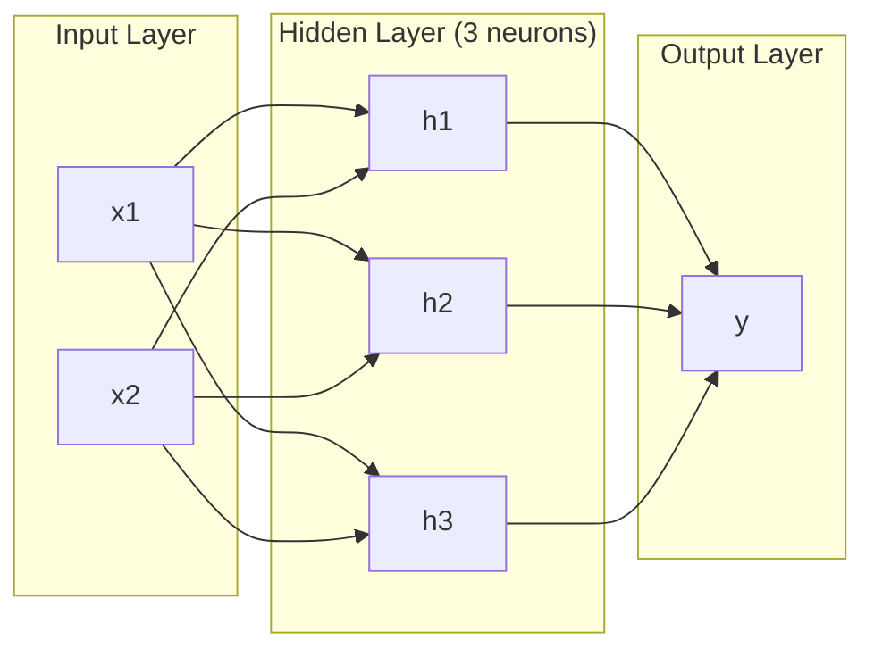
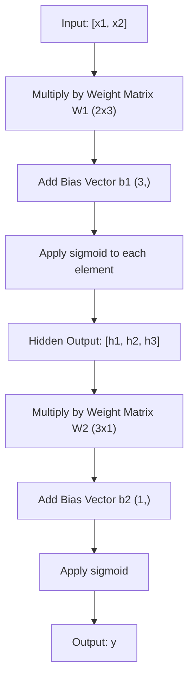
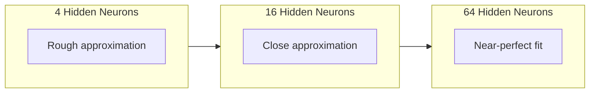

# 다층 네트워크 및 전격 패스

> 한 신경세포가 한계를 그리고, 그것들을 쌓아 놓으면 무엇이든 할 수 있습니다.

**Type:** Build
**Languages:** Python
**Prerequisites:** Phase 01 (Math Foundations), Lesson 03.01 (The Perceptron)
**Time:** ~90 minutes

## 학습 목표

- 전체 포워드 패스를 수행하는 계층 및 네트워크 클래스를 사용하여 처음부터 다층 네트워크를 구축하십시오
- 네트워크의 각 층을 통해 추적 매트릭스 크기를 추적하고 모양 불합성을 식별하십시오
- 비선형 활성화를 쌓는 것이 네트워크가 곡선 결정 경계를 배울 수 있도록 하는 방법을 설명하십시오.
- 2-2-1 구조를 사용하여 XOR 문제를 해결합니다.

## 문제

하나의 신경세포는 선의 드래제입니다. 그게 다입니다. 데이터로 한 직선입니다. 인공지능의 모든 실제 문제 -- 이미지 인식, 언어 이해, 고를 연주 -- 곡선이 필요합니다.

1969년, 민스키와 파퍼트는 이 한계가 치명적이라는 것을 증명했다: 단일 계층 네트워크는 XOR를 배울 수 없다. "학습하기 위해 투쟁"은 하지 않는다. 수학적으로 할 수 없다. XOR 진실 테이블은 한쪽에서 [0,1]와 [1,0]를 배치하고, 다른 쪽에서는 [0,0]와 [1,1]를 배치한다. 단 한 줄도 그들을 분리하지 않는다.

이것은 10년 넘게 신경망의 자금을 막었습니다. 후시로 보자면, 해결책은 명백했습니다. 한 층을 사용하지 않게 하십시오. 신경 세포를 층으로 쌓아두세요. 첫 번째 층이 입력 공간을 새로운 기능으로 조각하도록 합시다. 그리고 두 번째 층이 그 특징들을 결합하여 하나의 선이 할 수 없는 결정으로 합시다.

이 스택은 다층 네트워크입니다. 오늘날 생산되는 모든 딥러닝 모델의 기초입니다. 앞면 패스 -- 숨겨진 계층을 통해 입력에서 출력으로 흐르는 데이터 -- 다른 모든 것이 작동하기 전에 먼저 구축해야 할 것입니다.

## 개념

### 층: 입력, 숨겨진, 출력

다층 네트워크는 세 가지 유형의 층을 가지고 있습니다.

**Input layer**-- 실제로는 층이 아닙니다. 그것은 당신의 원료 데이터를 저장합니다. 두 가지 특징은 두 개의 입력 노드를 의미합니다. 여기 계산이 일어나지 않습니다.

**Hidden layers**-- 작업이 일어나는 곳. 각 신경 세포는 이전 층의 모든 출력을 가져가 무게와 편향을 적용하고, 그 결과를 활성화 기능을 통해 전달합니다. "숨겨진" 이유는 훈련 데이터에서 이러한 값을 직접 볼 수 없기 때문입니다.

**Output layer**-- 최종 답. 이진 분류에 있어서, 시그모이드와 같은 신경 세포가 하나, 다급에 있어서, 한 개의 신경 세포가 하나



이것은 2-3-1 네트워크입니다. 두 개의 입력, 3 개의 숨겨진 신경 세포, 하나의 출력. 모든 연결은 무게를 가지고 있습니다. 모든 신경 세포 (입입입을 제외하면) 는 편향을 가지고 있습니다.

각 층은 숨겨진 상태라고 불리는 숫자의 벡터를 생성합니다. 텍스트에 대해서는 숨겨진 상태가 차원을 증가시킵니다. 의미적 의미를 포착하기 위해 768 숫자로 단어를 암호화합니다. 이미지에서는 차원을 감소시킵니다. 수백만 개의 픽셀을 관리 가능한 표현으로 압축합니다. 숨겨진 상태는 학습이 사는 곳입니다.

### 신경 세포 와 활성화

각 신경세포는 세 가지 일을 합니다.

1. 각 입력값을 그에 상응하는 무게로 곱한다
2. 모든 제품을 합쳐서 편향을 추가합니다
3. 액티베이션 함수를 통해 수를 전달

현재는 시그모이드 액티베이션입니다

```math
\text{sigmoid}(z) = \frac{1}{1 + e^{-z}}
```

시그모이드는 어떤 숫자를 (0,1) 범위로 압축합니다. 큰 긍정적인 입력값은 1로 밀어붙인다. 큰 부정적인 입력값은 0으로 밀어붙인다. 0은 0.5로 나갑니다. 이 부드러운 곡선은 학습을 가능하게 합니다.

### 앞면: 데이터 흐름

앞을 통과하는 것은 입력 데이터를 네트워크로 층으로 밀어 넣고 출력을 도달할 때까지 진행합니다. 앞을 통과하는 동안 학습이 일어나지 않습니다. 그것은 순수한 계산입니다: 곱, 추가, 활성화, 반복.



각 계층에서 세 가지 작업이 순차적으로 이루어집니다.

```math
\begin{aligned}
z &= W \cdot \text{input} + b \quad \text{(linear transformation)} \\
a &= \text{sigmoid}(z) \quad \text{(activation)}
\end{aligned}
```

한 층의 출력은 다음 층의 출력이 됩니다. 즉 전면 통과입니다.

### 매트릭스 크기는

추적 차원은 딥러닝에서 가장 중요한 디버깅 기술입니다. 여기 2-3-1 네트워크가 있습니다.

| Step | Operation | Dimensions | Result Shape |
|------|-----------|------------|-------------|
| Input | $x$ | -- | (2,) |
| Hidden linear | $W_1 x + b_1$ | $W_1$: (3, 2), $b_1$: (3,) | (3,) |
| Hidden activation | $\text{sigmoid}(z_1)$ | -- | (3,) |
| Output linear | $W_2 h + b_2$ | $W_2$: (1, 3), $b_2$: (1,) | (1,) |
| Output activation | $\text{sigmoid}(z_2)$ | -- | (1,) |

규칙: 무게 매트릭스$W$층에$k$형태가 있다 (neurons_in_layer_k, neurons_in_layer_k_minus_1). 행은 현재 층과 일치한다. 기둥은 이전 층과 일치한다. 형태가 순서대로 이루어지지 않으면 오류가 발생한다.

### 보편적 근접법칙

1989년 조지 사이벤코는 놀라운 것을 증명했습니다. 하나의 숨겨진 층과 충분한 신경 세포가 가진 신경망은 원하는 정확도에 따라 어떤 연속적인 기능을 근접할 수 있습니다.

이것은 숨겨진 층이 항상 가장 좋다는 것을 의미하지는 않습니다. 그것은 건축이 이론적으로 가능하다는 것을 의미합니다. 실제로 더 깊은 네트워크 (더 많은 층, 층마다 더 적은 신경 세포) 는  넓은 네트워크보다 훨씬 적은 전체 매개 변수와 동일한 기능을 학습합니다. 그래서 딥 러닝이 작동합니다.

직관: 숨겨진 층의 모든 신경 세포는 하나의 "부러움" 또는 특징을 학습합니다. 적절한 위치에 배치된 충분한 부러움은 어떤 부드러운 곡선을 근접할 수 있습니다. 더 많은 신경 세포, 더 많은 부러움, 더 나은 근접.



### 합성성

신경망은 구성 가능하며, 이를 겹치며, 연쇄하여, 병렬로 실행할 수 있습니다. Whisper 모델은 오디오를 처리하기 위해 코더 네트워크를 사용하고, 텍스트를 생성하기 위해 별도의 디코더 네트워크를 사용합니다. 현대 LLM는 디코더만 사용된다. BERT는 코더만 사용된다. T5는 코더-디코더입니다. 아키텍처 선택은 모델이 할 수 있는 것을 정의합니다.

```figure
mlp-forward
```

## 건설 해

순수한 파이썬, 무더기 없는 매트릭스 작업은 처음부터

### 단계 1: 시그모이드 활성화

```python
import math

def sigmoid(x):
    x = max(-500.0, min(500.0, x))
    return 1.0 / (1.0 + math.exp(-x))
```

[500, 500]까지의 클램프는 지나가는 것을 막는다.`math.exp(500)`크지만 끝이 없습니다.`math.exp(1000)`무한함입니다.

### 단계 2: 계층 클래스

모든 딥 러닝에서 가장 중요한 작업은 매트릭스 곱셈입니다. 각 층, 각 관심 헤드, 모든 전진 통과는 매트뮬러입니다.$y = Wx + b$이 단 하나의 방정식은 신경망의 계산의 90%입니다.

계층은 중량 행렬과 편향 벡터를 보유하고 있습니다. 그것의 전향 방법은 입력 벡터를 가져다가 활성화 된 출력을 반환합니다.

```python
class Layer:
    def __init__(self, n_inputs, n_neurons, weights=None, biases=None):
        if weights is not None:
            self.weights = weights
        else:
            import random
            self.weights = [
                [random.uniform(-1, 1) for _ in range(n_inputs)]
                for _ in range(n_neurons)
            ]
        if biases is not None:
            self.biases = biases
        else:
            self.biases = [0.0] * n_neurons

    def forward(self, inputs):
        self.last_input = inputs
        self.last_output = []
        for neuron_idx in range(len(self.weights)):
            z = sum(
                w * x for w, x in zip(self.weights[neuron_idx], inputs)
            )
            z += self.biases[neuron_idx]
            self.last_output.append(sigmoid(z))
        return self.last_output
```

무게 매트릭스는 모양 (n_neurons, n_inputs) 을 가지고 있다. 각 줄은 모든 입력값에 걸쳐 한 신경 세포의 무게이다. 전진 방법은 신경 세포를 통해 루프를 통해 중량 수량 더 추 bias을 계산하고, sigmoid를 적용하고 결과를 수집한다.

### 단계 3: 네트워크 클래스

네트워크는 계층 목록입니다. 앞 패스는 그것들을 연쇄합니다.$k$층으로 먹여$k+1$- 그래

```python
class Network:
    def __init__(self, layers):
        self.layers = layers

    def forward(self, inputs):
        current = inputs
        for layer in self.layers:
            current = layer.forward(current)
        return current
```

4개의 논리 라인입니다. 데이터가 들어오고, 각 층을 통과하고, 다른 쪽으로 나오고,

### 단계 4: 손으로 조정된 무게와 XOR

01, 수업에서 OR, NAND, AND 인식선을 결합하여 XOR를 해결했습니다. 이제 레이어와 네트워크 클래스에서도 똑같이 해봅시다. 2-2-1 아키텍처: 두 입력, 두 숨겨진 신경 세포, 하나의 출력.

```python
hidden = Layer(
    n_inputs=2,
    n_neurons=2,
    weights=[[20.0, 20.0], [-20.0, -20.0]],
    biases=[-10.0, 30.0],
)

output = Layer(
    n_inputs=2,
    n_neurons=1,
    weights=[[20.0, 20.0]],
    biases=[-30.0],
)

xor_net = Network([hidden, output])

xor_data = [
    ([0, 0], 0),
    ([0, 1], 1),
    ([1, 0], 1),
    ([1, 1], 0),
]

for inputs, expected in xor_data:
    result = xor_net.forward(inputs)
    predicted = 1 if result[0] >= 0.5 else 0
    print(f"  {inputs} -> {result[0]:.6f} (rounded: {predicted}, expected: {expected})")
```

큰 무게 (20, -20) 은 시그모이드가 단계 함수처럼 작용하도록 한다. 첫 번째 숨겨진 신경 세포는 OR에 가깝다. 두 번째는 NAND에 가깝다. 출력 신경 세포는 그것들을 AND로 결합하여 XOR입니다.

### 단계 5: 원 분류

더 어려운 문제점은 2차원 포인트를 원자 중심의 반경 0.5의 원자 안에 또는 바깥으로 분류하는 것입니다. 이것은 곡선 결정 경계를 필요로 합니다. 단일 인식론에 불가능합니다.

```python
import random
import math

random.seed(42)

data = []
for _ in range(200):
    x = random.uniform(-1, 1)
    y = random.uniform(-1, 1)
    label = 1 if (x * x + y * y) < 0.25 else 0
    data.append(([x, y], label))

circle_net = Network([
    Layer(n_inputs=2, n_neurons=8),
    Layer(n_inputs=8, n_neurons=1),
])
```

무작위 무게를 사용하면 네트워크가 잘 분류되지 않습니다. 하지만 앞면은 여전히 실행됩니다. 이것이 핵심입니다. 앞면은 계산입니다. 올바른 무게를 배우는 것은 배후 전파입니다.

```python
correct = 0
for inputs, expected in data:
    result = circle_net.forward(inputs)
    predicted = 1 if result[0] >= 0.5 else 0
    if predicted == expected:
        correct += 1

print(f"Accuracy with random weights: {correct}/{len(data)} ({100*correct/len(data):.1f}%)")
```

무작위 무게는 정확도가 낮습니다. 보통 대다수 클래스를 추측하는 것보다 더 나쁘습니다. 훈련 후 (목록 03), 8개의 숨겨진 신경 세포를 가진 이 같은 구조는 내부와 외부를 분리하는 곡선 경계를 그리게 됩니다.

## 사용 하 고

파이토르치는 위의 모든 것을 네 줄로 합니다.

```python
import torch
import torch.nn as nn

model = nn.Sequential(
    nn.Linear(2, 8),
    nn.Sigmoid(),
    nn.Linear(8, 1),
    nn.Sigmoid(),
)

x = torch.tensor([[0.0, 0.0], [0.0, 1.0], [1.0, 0.0], [1.0, 1.0]])
output = model(x)
print(output)
```

`nn.Linear(2, 8)`레이어 클래스: 모양의 무게 매트릭스 (8, 2), 모양의 편향 벡터 (8,). `nn.Sigmoid()`이 함수는`nn.Sequential`네트워크 클래스: 체인 레이어 순서

차이점은 속도와 규모입니다. PyTorch는 GPU를 사용해서 수백만 개의 샘플을 처리하고, 자동으로 배포를 위한 기하급수들을 계산합니다. 하지만 앞을 통과하는 논리는 처음부터 만든 것과 동일합니다.

## 선박

이 수업은 네트워크 아키텍처를 설계하는 데 사용할 수 있는 반복적인 프롬프트를 생성합니다.

- `outputs/prompt-network-architect.md`

몇 개의 층, 몇 개의 신경 세포가 각 층에 있는지, 어떤 활성화 기능을 특정 문제에 사용할 것인지 결정해야 할 때 사용하십시오.

## 운동

1. 2-4-2-1 네트워크를 구축하고, 무작위 중량으로 XOR 데이터에 대한 전진 전달을 실행합니다. 중간 숨겨진 층 출력을 인쇄하여 각 층에서 표현이 어떻게 변하는지 확인하십시오.

2. 8에서 2로 변경하고 32로 변경합니다. 모든 번 무작위로 앞을 통과하십시오. 숨겨진 신경 세포의 수는 출력 범위나 분포를 변경합니까? 왜요?

3. `count_parameters`네트워크 클래스에서 훈련 가능한 무게와 편향의 총 수를 반환하는 방법. 784-256-128-10 네트워크 (고전 MNIST 아키텍처) 에서 테스트하십시오.

4. 3-4-4-2 네트워크에 대한 앞 패스를 구축하고 RGB 색상 값을 입력하고 (0-1로 정상화) 두 출력을 관찰하십시오. 이것은 두 클래스를 가진 간단한 색상 분류기의 구조입니다.

5. 시그모이드 를 "스피스 렉시" 함수 로 교체: z < 0, z 를 0.01 * z 로 반환 하면, 다시 1.0. XOR 에서 앞을 통과 하는 경우 4 단계 에서 동일한 손으로 조정 된 무게를 실행 하십시오.

## 주요 용어

| Term | What people say | What it actually means |
|------|----------------|----------------------|
| Forward pass | "Running the model" | Pushing input through every layer -- multiply by weights, add bias, activate -- to produce an output |
| Hidden layer | "The middle part" | Any layer between input and output whose values are not directly observed in the data |
| Multi-layer network | "A deep neural network" | Layers of neurons stacked sequentially, where each layer's output feeds the next layer's input |
| Activation function | "The nonlinearity" | A function applied after the linear transformation that introduces curves into the decision boundary |
| Sigmoid | "The S-curve" | $\sigma(z) = 1/(1+e^{-z})$, squashes any real number to (0,1), smooth and differentiable everywhere |
| Weight matrix | "The parameters" | A matrix $W$ of shape (current_layer_neurons, previous_layer_neurons) containing learnable connection strengths |
| Bias vector | "The offset" | A vector added after the matrix multiply that lets neurons activate even when all inputs are zero |
| Universal approximation | "Neural nets can learn anything" | A single hidden layer with enough neurons can approximate any continuous function -- but "enough" can mean billions |
| Linear transformation | "The matrix multiply step" | $z = W x + b$, the computation before activation, which maps inputs to a new space |
| Decision boundary | "Where the classifier switches" | The surface in input space where the network output crosses the classification threshold |

## 더 많은 읽기

- 마이클 닐슨, "신경 네트워크 및 딥러닝", 1-2 장 (http://neuralnetworksanddeeplearning.com/) - 인터랙티브 시각화와 함께 앞선 패스와 네트워크 구조에 대한 가장 명확한 자유로운 설명
- 사이벤코, "시그모이드 함수의 초상식으로 근접" (1989) - 원래의 보편적 근접법 이론 논문, 놀랍게도 읽을 수 있습니다
- 3Blue1Brown, "하지만 신경망은 무엇인가?"https://www.youtube.com/watch?v=aircAruvnKk) -- 20분 동안의 시각적인 걸음걸음으로 층, 무게, 그리고 앞으로의 패스를 통해 올바른 정신적 모델을 구축합니다
- 좋은 동료, 벤지오, 쿠르빌, "깊은 학습", 6장 (https://www.deeplearningbook.org/) - 다층 네트워크의 표준 참조, 온라인 무료
