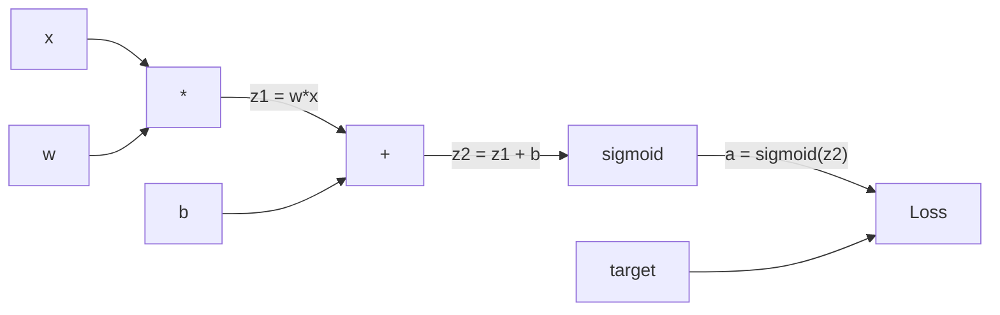
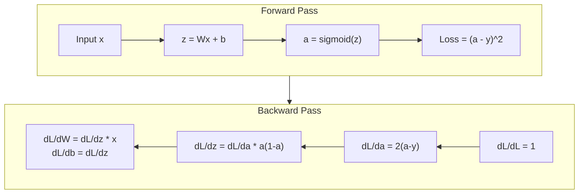
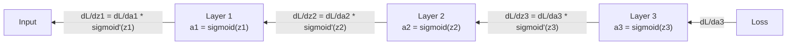

# 스크래치에서 후속으로 퍼지는

> 배포는 학습을 가능하게 하는 알고리즘입니다. 그것 없이는 신경망은 값비싼 무작위 숫자 생성기일 뿐입니다.

**Type:** Build
**Languages:** Python
**Prerequisites:** Lesson 03.02 (Multi-Layer Networks)
**Time:** ~120 minutes

## 학습 목표

- 값 기반 오토그라드 엔진을 구현하여 계산 그래프를 구축하고 토폴로지 소트를 통해 그라디언트를 계산합니다
- 연쇄 규칙을 사용하여 덧셈, 곱셈, 시그모이드의 후진 패스를 도출
- XOR 및 원 분류에 대한 다층 네트워크를 훈련시켜 처음부터 배포 엔진을 사용하여
- 심오한 시그모이드 네트워크에서 사라지는 기하급수 문제를 확인하고 기하급수적으로 왜 축소되는지 설명합니다

## 문제

네트워크는 768개의 입력과 3072개의 출력으로 한 개의 숨겨진 층을 가지고 있습니다. 이것은 2,359,296개의 무게입니다. 그것은 잘못된 예측을 했습니다. 어떤 무게가 오류를 일으켰습니까? 각각의 무게를 개별적으로 테스트하는 것은 2.3백만개의 앞으로의 패스를 의미합니다. 뒤로의 전파는 한 번의 뒤로의 패스에서 모든 2.3백만 개의 기하급수를 계산합니다. 이것은 최적화가 아닙니다. 그것은 훈련 가능한 것과 불가능한 사이의 차이입니다.

순진한 접근법: 한 무게를 가져다가 작은 양의 무게로 밀어내고 다시 앞으로의 패스를 실행하고 손실이 올라갔는지 하락했는지 측정합니다. 그 무게의 기하급수입니다. 이제 네트워크의 모든 무게에 대해 그렇게하십시오. 수천 개의 훈련 단계와 수백만 개의 데이터 포인트로 곱합니다. 유용한 무언가를 훈련하려면 지질학적 시간이 필요합니다.

배그라프가 해결합니다. 한 번 앞으로, 한 번 뒤로, 모든 기하급수 계산됩니다. 트릭은 계산에서 체인 규칙입니다. 계산 그래프에 체계적으로 적용됩니다. 이것은 딥 러닝을 실용화시킨 알고리즘입니다. 그 없이는 우리는 여전히 장난감 문제에 갇혀있을 것입니다.

## 개념

### 네트워크에 적용되는 체인 규칙

5단계 5단계에서 체인 규칙을 봤습니다.$y = f(g(x))$그럼$\frac{dy}{dx} = f'(g(x)) \cdot g'(x)$- 연쇄를 따라 파생물을 곱합니다.

신경망에서 "슬슬슬슬슬슬슬슬슬슬슬슬슬슬슬슬슬슬슬슬슬슬슬슬슬슬슬슬슬슬슬슬슬슬슬슬슬슬슬슬슬슬슬슬슬슬슬슬슬슬슬슬슬슬슬슬슬슬슬슬슬슬슬슬슬슬슬슬슬슬슬슬슬슬슬슬슬슬슬슬슬슬슬슬슬슬슬슬슬슬슬슬슬슬슬슬슬슬슬슬슬슬슬슬슬슬슬슬슬슬슬슬슬슬슬슬슬슬슬슬슬슬슬슬슬슬슬슬슬슬슬슬슬슬슬슬슬슬슬슬슬슬슬슬슬슬슬슬슬슬슬슬슬슬슬슬슬슬슬슬슬슬슬슬슬슬슬슬슬슬슬슬슬슬슬슬슬슬슬슬슬슬슬슬슬슬슬슬슬슬슬슬슬슬슬슬슬슬슬슬슬슬슬슬슬슬슬슬슬슬슬슬슬슬슬슬슬슬슬슬슬) ) 은04) 0 0 0 0 0 0 0 0 0 0 0 0 0 0 0 0 0 0 0 0 0 0 0 0 0 0 0 0 0 0 0 0 0 0 0 0 0 0 0 0 0 0 0 0 0 0 0 0 0 0 0 0 0 0 0 0 0 0 0 0 0 0 0 0 0 0 0 0 0 0 0 0 0 0 0 0 0 0 0 0 0 0 0 0 0 0 0 0 0 0 0 0 0 0 0 0 0 0 0 0 0 0 0 0 0 0 0 0 0 0 0 0 0 0 0 0 0 0 0 0 0 0 0 0 0 0 0 0 0 0 0 0 0 0 0 0 0 0 0 0 0 0 0 0 0 0 0 0 0 0 0 0 0 0 0 0 0 0 0 0 0 0 0 0 0 0 0 0 0 0 0 0 0 0 0 0 0 0 0 0 0 0 0 0 0 0 0 0 0 0 0 0 0 0 0 0 0 0 0 0 0 0 0 0 0 0 0 0 0 0 0 0 0 0 0 0 0 0 0 0 0 0 0 0 0 0 0 0 0 0 0 0 0 0 0 0 0 0 0 0 0 0 0 0 0 0 0 0 0 0 0 0 0 0 0 0 0 0 0 0 0 0 0 0 0 0 0 0 0 0 0 0 0 0 0 0 0 0

### 계산 그래프

각 앞선 패스는 그래프를 만듭니다. 각 노드는 연산 (배량, 추가, 시그모이드) 이다. 각 가장자리는 앞선 값과 뒤로 기울기를 가지고 있습니다.



앞을 통과: 값은 왼쪽에서 오른쪽으로 흐른다. $x$그리고$w$생산품$z_1 = w x$- 더해$b$$z_2$. 시그모이드가 활성화합니다$a$비교해 보세요$a$목표 $y$손실 함수를 사용하여

뒤로 지나가는: 은 오른쪽으로 왼쪽으로 흐른다.$\partial L/\partial a$(활성화와 함께 손실이 어떻게 변하는지)$\partial a/\partial z_2$(시그모이드 파생물)$\partial L/\partial z_2$- 나뉘어$\partial L/\partial b$(이름은$\partial L/\partial z_2$, 이후$z_2 = z_1 + b$) 및$\partial L/\partial z_1$- 그럼$\partial L/\partial w = \partial L/\partial z_1 \cdot x$그리고$\partial L/\partial x = \partial L/\partial z_1 \cdot w$- 그래

그래프의 각 노드는 뒤로 지나가는 동안 하나의 작업을 합니다. 위에서 오는 기하급수를 가져가서 로컬 파생수를 곱하고 내려가도록 합니다.

### 앞면과 뒤면



앞 패스는 각 계층의 입력값 z, a, 각 중간값을 저장합니다. 후 패스는 그레디언트를 계산하기 위해 이러한 저장된 값이 필요합니다. 이것은 백프로프의 중심에 있는 메모리-컴퓨팅 트레이드입니다. 당신은 메모리 (저기 활성화) 를 속도 (백만개 대신 한 패스) 로 교환합니다.

### 네트워크 를 통해 점진적 으로 흐르는

3층 네트워크에서 각 층을 통해 gradient 체인:



각 층에서, 그라디엔트는 시그모이드 파생물으로 곱됩니다.$a(1 - a)$, 최대 0.25 (때)$a = 0.5$) 3층 깊이, 그라디엔트는 최대$0.25^3 = 0.0156$10층 깊이$0.25^{10} = 0.000001$- 그래

### 사라지는 속자

이 문제는 사라지는 기하급수 문제입니다. 시그모이드 는 0 에서 1 사이의 출력을 압축합니다. 이의 파생물은 항상 0.25 미만입니다. 충분한 시그모이드 층을 쌓아두고 기하급수는 아무것도 줄어들습니다. 초기 층은 거의 학습하지 않습니다.

```
sigmoid(z):     Output range [0, 1]
sigmoid'(z):    Max value 0.25 (at z = 0)

After 5 layers:   gradient * 0.25^5 = 0.001x original
After 10 layers:  gradient * 0.25^10 = 0.000001x original
```

그래서 심도시그모이드 네트워크는 훈련이 거의 불가능합니다. ReLU와 그 변종은 레슨 04의 주제입니다.

### 2층 네트워크의 계층을 도출하는 방법

입력된 네트워크에 대한 구체적인 수학$x$, 시그모이드와 숨겨진 층, 시그모이드와 출력 층, 그리고 MSE 손실.

앞면:

```math
\begin{aligned}
z_1 &= W_1 x + b_1 \\
a_1 &= \text{sigmoid}(z_1) \\
z_2 &= W_2 a_1 + b_2 \\
a_2 &= \text{sigmoid}(z_2) \\
L &= (a_2 - y)^2
\end{aligned}
```

뒤로 통과 (열의 규칙을 단계적으로 적용):

```math
\begin{aligned}
\frac{\partial L}{\partial a_2} &= 2(a_2 - y) \\
\frac{\partial a_2}{\partial z_2} &= a_2 (1 - a_2) \\
\frac{\partial L}{\partial z_2} &= \frac{\partial L}{\partial a_2} \cdot \frac{\partial a_2}{\partial z_2} = 2(a_2 - y) \cdot a_2 (1 - a_2) \\[6pt]
\frac{\partial L}{\partial W_2} &= \frac{\partial L}{\partial z_2} \cdot a_1 \\
\frac{\partial L}{\partial b_2} &= \frac{\partial L}{\partial z_2} \\[6pt]
\frac{\partial L}{\partial a_1} &= \frac{\partial L}{\partial z_2} \cdot W_2 \\
\frac{\partial a_1}{\partial z_1} &= a_1 (1 - a_1) \\
\frac{\partial L}{\partial z_1} &= \frac{\partial L}{\partial a_1} \cdot \frac{\partial a_1}{\partial z_1} \\[6pt]
\frac{\partial L}{\partial W_1} &= \frac{\partial L}{\partial z_1} \cdot x \\
\frac{\partial L}{\partial b_1} &= \frac{\partial L}{\partial z_1}
\end{aligned}
```

모든 기하급수들은 손실에서 추적된 지역 파생물들의 산물입니다.

```figure
backprop-vanishing
```

## 건설 해

### 단계 1: 값 노드

우리의 계산의 모든 숫자는 값이 됩니다. 그것은 그 데이터와 그 기하급수와 어떻게 만들어졌는지 저장합니다.

```python
class Value:
    def __init__(self, data, children=(), op=''):
        self.data = data
        self.grad = 0.0
        self._backward = lambda: None
        self._children = set(children)
        self._op = op

    def __repr__(self):
        return f"Value(data={self.data:.4f}, grad={self.grad:.4f})"
```

아직 gradient (0.0) 가 없습니다. 아직 역진 기능이 없습니다.`_children`이 그래프를 토폴로직적으로 분류할 수 있도록

### 단계 2: 후진 기능 을 가진 작업

각 동작은 새로운 값을 생성하고 그 중 gradients가 어떻게 뒤로 흐를 지 정의합니다.

```python
def __add__(self, other):
    other = other if isinstance(other, Value) else Value(other)
    out = Value(self.data + other.data, (self, other), '+')

    def _backward():
        self.grad += out.grad
        other.grad += out.grad

    out._backward = _backward
    return out

def __mul__(self, other):
    other = other if isinstance(other, Value) else Value(other)
    out = Value(self.data * other.data, (self, other), '*')

    def _backward():
        self.grad += other.data * out.grad
        other.grad += self.data * out.grad

    out._backward = _backward
    return out
```

추가:$\partial(a+b)/\partial a = 1$$\partial(a+b)/\partial b = 1$그래서 두 입력도 직접 출력 기하급수를 얻습니다.

곱하기 위해: $\partial(ab)/\partial a = b$$\partial(ab)/\partial b = a$. 각 입력값은 다른 입력값의 값이 출력 gradient에 곱됩니다.

`+=`값은 여러 동작에서 사용될 수 있습니다. 그 기하자는 모든 경로에서 기하이의 합입니다.

### 3단계: 시그모이드 및 손실

```python
import math

def sigmoid(self):
    x = self.data
    x = max(-500, min(500, x))
    s = 1.0 / (1.0 + math.exp(-x))
    out = Value(s, (self,), 'sigmoid')

    def _backward():
        self.grad += (s * (1 - s)) * out.grad

    out._backward = _backward
    return out
```

시그모이드 파생물: $\text{sigmoid}(x) \cdot (1 - \text{sigmoid}(x))$- 계산해봤어요$\text{sigmoid}(x) = s$앞을 지나가면서 다시 사용하세요. 추가적인 작업은 없습니다.

```python
def mse_loss(predicted, target):
    diff = predicted + Value(-target)
    return diff * diff
```

단일 출력용 MSE: $(\text{predicted} - \text{target})^2$우리는 추출을 부정된 값으로 합하는 것으로 표현합니다.

### 4단계: 뒤로 가는 길

토폴로직 소orte는 노드를 올바른 순서로 처리하는 것을 보장합니다. 노드의 기하급수가 그 안에서 퍼지기 전에 완전히 축적됩니다.

```python
def backward(self):
    topo = []
    visited = set()

    def build_topo(v):
        if v not in visited:
            visited.add(v)
            for child in v._children:
                build_topo(child)
            topo.append(v)

    build_topo(self)
    self.grad = 1.0
    for v in reversed(topo):
        v._backward()
```

손실에서 시작 (그라디언트 = 1.0,  이후$dL/dL = 1$) 순차 그래프를 거쳐 뒤로 가세요. 각 노드의`_backward`그 아이들은 그 가속도를 밀어냅니다.

### 단계 5: 층 및 네트워크

```python
import random

class Neuron:
    def __init__(self, n_inputs):
        scale = (2.0 / n_inputs) ** 0.5
        self.weights = [Value(random.uniform(-scale, scale)) for _ in range(n_inputs)]
        self.bias = Value(0.0)

    def __call__(self, x):
        act = sum((wi * xi for wi, xi in zip(self.weights, x)), self.bias)
        return act.sigmoid()

    def parameters(self):
        return self.weights + [self.bias]


class Layer:
    def __init__(self, n_inputs, n_outputs):
        self.neurons = [Neuron(n_inputs) for _ in range(n_outputs)]

    def __call__(self, x):
        out = [n(x) for n in self.neurons]
        return out[0] if len(out) == 1 else out

    def parameters(self):
        params = []
        for n in self.neurons:
            params.extend(n.parameters())
        return params


class Network:
    def __init__(self, sizes):
        self.layers = []
        for i in range(len(sizes) - 1):
            self.layers.append(Layer(sizes[i], sizes[i + 1]))

    def __call__(self, x):
        for layer in self.layers:
            x = layer(x)
            if not isinstance(x, list):
                x = [x]
        return x[0] if len(x) == 1 else x

    def parameters(self):
        params = []
        for layer in self.layers:
            params.extend(layer.parameters())
        return params

    def zero_grad(self):
        for p in self.parameters():
            p.grad = 0.0
```

뉴런은 입력값을 받아 무게 수 + 편향을 계산하고 시그모이드를 적용한다.$\sqrt{2/n_{\text{inputs}}}$더 깊은 네트워크에서 시그모이드 포화 방지하기 위해. 레이어는 신경 세포의 목록입니다.`parameters()`학습 가능한 모든 값을 수집하여 업데이트할 수 있습니다.

### 단계 6: XOR에서 열차

```python
random.seed(42)
net = Network([2, 4, 1])

xor_data = [
    ([0.0, 0.0], 0.0),
    ([0.0, 1.0], 1.0),
    ([1.0, 0.0], 1.0),
    ([1.0, 1.0], 0.0),
]

learning_rate = 1.0

for epoch in range(1000):
    total_loss = Value(0.0)
    for inputs, target in xor_data:
        x = [Value(i) for i in inputs]
        pred = net(x)
        loss = mse_loss(pred, target)
        total_loss = total_loss + loss

    net.zero_grad()
    total_loss.backward()

    for p in net.parameters():
        p.data -= learning_rate * p.grad

    if epoch % 100 == 0:
        print(f"Epoch {epoch:4d} | Loss: {total_loss.data:.6f}")

print("\nXOR Results:")
for inputs, target in xor_data:
    x = [Value(i) for i in inputs]
    pred = net(x)
    print(f"  {inputs} -> {pred.data:.4f} (expected {target})")
```

손실이 감소하는 것을 관찰하십시오. 무작위 예측에서 XOR 출력을 수정하는 데까지, 완전히 배후 전파 컴퓨팅 기하급수와 올바른 방향으로 무게를 밀어주는 것입니다.

### 단계 7: 원 분류

수업 02에서는, 원분열을 위해 무게를 손으로 조정했습니다. 이제 네트워크가 그것을 배울 수 있도록 해 주세요.

```python
random.seed(7)

def generate_circle_data(n=100):
    data = []
    for _ in range(n):
        x1 = random.uniform(-1.5, 1.5)
        x2 = random.uniform(-1.5, 1.5)
        label = 1.0 if x1 * x1 + x2 * x2 < 1.0 else 0.0
        data.append(([x1, x2], label))
    return data

circle_data = generate_circle_data(80)

circle_net = Network([2, 8, 1])
learning_rate = 0.5

for epoch in range(2000):
    random.shuffle(circle_data)
    total_loss_val = 0.0
    for inputs, target in circle_data:
        x = [Value(i) for i in inputs]
        pred = circle_net(x)
        loss = mse_loss(pred, target)
        circle_net.zero_grad()
        loss.backward()
        for p in circle_net.parameters():
            p.data -= learning_rate * p.grad
        total_loss_val += loss.data

    if epoch % 200 == 0:
        correct = 0
        for inputs, target in circle_data:
            x = [Value(i) for i in inputs]
            pred = circle_net(x)
            predicted_class = 1.0 if pred.data > 0.5 else 0.0
            if predicted_class == target:
                correct += 1
        accuracy = correct / len(circle_data) * 100
        print(f"Epoch {epoch:4d} | Loss: {total_loss_val:.4f} | Accuracy: {accuracy:.1f}%")
```

우리는 온라인 SGD를 사용합니다. 모든 샘플을 축적하는 대신 각 샘플에 대한 무게를 업데이트합니다. 이것은 대칭을 더 빨리 깨고 전체 손실 풍경에 시그모이드 포화를 피합니다. 모든 시대를 통한 데이터를 섞는 것은 네트워크가 순서를 기억하는 것을 막습니다.

손 조정이 없습니다. 네트워크는 자율적으로 순환적인 의사 결정 경계를 발견합니다. 이것은 배포의 힘입니다. 당신은 건축, 손실 함수, 데이터를 정의합니다. 알고리즘은 무게를 계산합니다.

## 사용 하 고

PyTorch은 위의 모든 것을 몇 줄로 합니다. 핵심 아이디어는 동일합니다. 오토그라드는 앞으로의 통과 동안 계산 그래프를 만들고 그 추면을 뒤로 추적하여 그레디언트를 계산합니다.

```python
import torch
import torch.nn as nn

model = nn.Sequential(
    nn.Linear(2, 4),
    nn.Sigmoid(),
    nn.Linear(4, 1),
    nn.Sigmoid(),
)
optimizer = torch.optim.SGD(model.parameters(), lr=1.0)
criterion = nn.MSELoss()

X = torch.tensor([[0,0],[0,1],[1,0],[1,1]], dtype=torch.float32)
y = torch.tensor([[0],[1],[1],[0]], dtype=torch.float32)

for epoch in range(1000):
    pred = model(X)
    loss = criterion(pred, y)
    optimizer.zero_grad()
    loss.backward()
    optimizer.step()

print("PyTorch XOR Results:")
with torch.no_grad():
    for i in range(4):
        pred = model(X[i])
        print(f"  {X[i].tolist()} -> {pred.item():.4f} (expected {y[i].item()})")
```

`loss.backward()`네`total_loss.backward()`-`optimizer.step()`네 설명서가야`p.data -= lr * p.grad`-`optimizer.zero_grad()`네`net.zero_grad()`같은 알고리즘, 산업 강력 구현. PyTorch는 GPU 가속, 혼합 정확성, 추락 점검, 수백 개의 계층 유형을 처리합니다. 그러나 후진 통과는 동일한 계산 그래프에 적용되는 동일한 체인 규칙입니다.

훈련은 앞으로, 뒤로, 그리고 무게를 업데이트합니다. 인퍼런스는 앞을 지나가게 됩니다. gradients, 업데이트가 없습니다. 이 구별은 중요한 이유는 추론이 생산에서 일어나는 것이기 때문입니다. 클로드나 GPT와 같은 API를 호출하면 추론을 실행합니다. 여러분의 명령어는 네트워크를 통해 앞으로 흐르고, 무게가 바뀌지 않습니다. 배포를 이해하는 것은 그 네트워크의 모든 무게를 형성했기 때문입니다.

## 선박

이 교훈은 다음과 같은 결과를 낳습니다.
- `outputs/prompt-gradient-debugger.md`-- 어떤 신경망에서 gradient 문제를 진단하기 위해 재사용 가능한

## 운동

1. `__sub__`값 클래스 로의 방법 $(a - b = a + (-1 \cdot b))$그리고 실행`__neg__`가이드레이션이 올바른지 확인하여 수동 계산을 통해 $(a - b)^2$- 그래

2. `relu`값 (출력) 에 대한 방법$\max(0, x)$, 파생값은 1 이면$x \gt 0$, 다른 경우 0). 숨겨진 층의 sigmoid를 rel로 교체하고 다시 XOR로 훈련하십시오.

3. `__pow__`전체수능의 값에 대한 방법.`mse_loss`제대로 된 `(predicted - target) ** 2`표현. 그라디언트가 원래 구현과 일치하는지 확인합니다.

4. 훈련 루프에 gradient clipping을 추가: 호출 후 `backward()`, 모든 기하급수들을 [-1, 1]로 단축하여 더 깊은 네트워크를 훈련시켜 (sigmoid로 4+ 층) 그리고 손실 곡선을 단축과 없이 비교합니다. 이것은 폭발적인 기하급수에 대한 첫 번째 방어입니다.

5. XOR에 대한 훈련 후 네트워크의 모든 매개 변수의 기하를 인쇄하십시오. 가장 작은 기하를 가진 계층을 식별하십시오. 이것은 개념 섹션에서 읽은 사라지는 기하 문제를 보여줍니다.

## 주요 용어

| Term | What people say | What it actually means |
|------|----------------|----------------------|
| Backpropagation | "The network learns" | An algorithm that computes $\partial L/\partial w$ for every weight by applying the chain rule backward through the computational graph |
| Computational graph | "The network structure" | A directed acyclic graph where nodes are operations and edges carry values (forward) and gradients (backward) |
| Chain rule | "Multiply the derivatives" | If $y = f(g(x))$, then $\frac{dy}{dx} = f'(g(x)) \cdot g'(x)$ -- the mathematical foundation of backpropagation |
| Gradient | "The direction of steepest ascent" | The partial derivative of the loss with respect to a parameter -- tells you how to change that parameter to reduce the loss |
| Vanishing gradient | "Deep networks don't learn" | Gradients shrink exponentially as they propagate through layers with saturating activations like sigmoid |
| Forward pass | "Running the network" | Computing the output from inputs by sequentially applying each layer's operations and storing intermediate values |
| Backward pass | "Computing gradients" | Traversing the computational graph in reverse, accumulating gradients at each node using the chain rule |
| Learning rate | "How fast it learns" | A scalar that controls the step size when updating weights: $w_{\text{new}} = w_{\text{old}} - \text{lr} \cdot \text{gradient}$ |
| Topological sort | "The right order" | An ordering of graph nodes where each node appears after all nodes it depends on -- ensures gradients are fully accumulated before propagation |
| Autograd | "Automatic differentiation" | A system that builds computational graphs during forward computation and automatically computes gradients -- what PyTorch's engine does |

## 더 많은 읽기

- 루멜하트, 힌턴 & 윌리엄스, "반전 전파 오류를 통해 표현을 배우는 것" (1986) - 반전 전파를 주류로 만들고 풀린 다층 네트워크 훈련을 만든 논문
- 3Blue1Brown, "신경 네트워크" 시리즈 (https://www.youtube.com/playlist?list=PLZHQObOWTQDNU6R1_67000Dx_ZCJB-3pi) -- 네트워크로 돌아가는 배후 전파와 기하급수 흐름에 대한 최고의 시각적 설명
