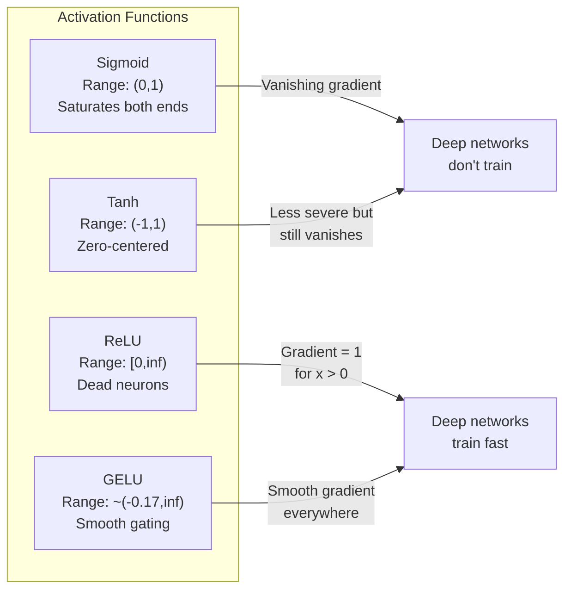
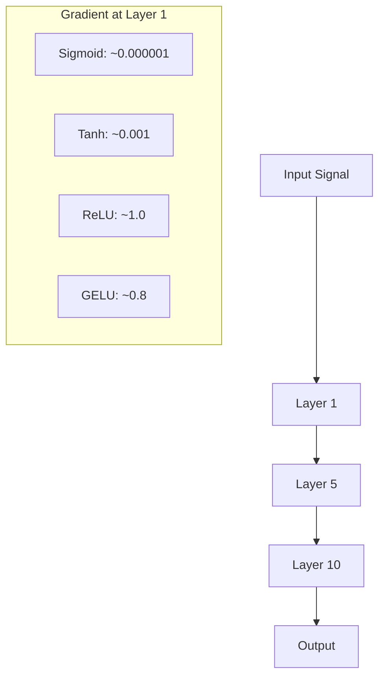
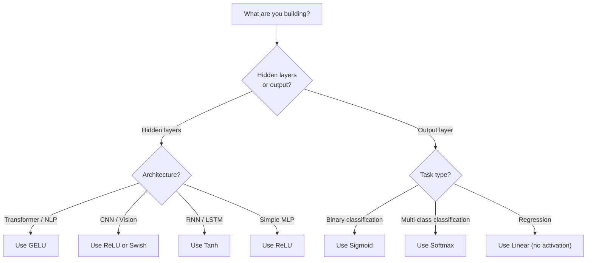

# 활성화 기능

> 비선형성 없이, 100층 네트워크는 화려한 매트릭스 곱셈입니다. 활성화는 신경 네트워크가 곡선으로 생각할 수 있는 게이트입니다.

**Type:** Build
**Languages:** Python
**Prerequisites:** Lesson 03.03 (Backpropagation)
**Time:** ~75 minutes

## 학습 목표

- 시그모이드, 탄, ReLU, 리키 ReLU, GELU, Swish, 그리고 소프트맥스를 처음부터 그 파생물들과 함께 구현한다
- 다른 활성화를 가진 10+ 층을 통해 활성화 크기를 측정함으로써 사라지는 기하급수 문제를 진단합니다.
- ReLU 네트워크에서 죽은 신경 세포를 감지하고 GELU가 왜 이 실패 모드를 피하는지 설명합니다
- 주어진 아키텍처 (변화기, CNN, RNN, 출력층) 에 대한 올바른 활성화 기능을 선택하십시오.

## 문제

2개의 선형 변환을 쌓아두세요:$y = W_2(W_1 x + b_1) + b_2$- 확장해:$y = W_2 W_1 x + W_2 b_1 + b_2$- 그냥...$y = Ax + c$-- 단일 선형 변환. 얼마나 많은 선형 계층을 쌓아 올리든, 결과는 하나의 매트릭스 곱으로 붕괴됩니다. 100층 네트워크는 단일 계층과 동일한 표현력을 가지고 있습니다.

이것은 이론적인 호기심이 아닙니다. 그것은 깊은 선형 네트워크가 문자 그대로 XOR를 배울 수 없으며, 나선 데이터 세트를 분류할 수 없으며, 얼굴을 인식할 수 없습니다. 활성 기능이 없으면 깊이는 환상입니다.

활성화 함수는 선형성을 깨고 그들은 각 계층의 출력을 비선형 함수를 통해 왜곡하여 네트워크에 의사 결정 경계를 구부릴 수 있고 임의의 함수를 대략적으로 학습할 수 있습니다. 하지만 잘못된 활성화를 선택하면 그라디언트가 0으로 사라질 수 있습니다 (깊은 네트워크에서 시그모이드), 무한으로 폭발할 수 있습니다 (심리적인 초기화 없이 무한한 활성화가) 또는 신경 세포가 영구적으로 죽습니다 (큰 부정적인 편향을 가진 ReLU). 활성화 기능의 선택은 네트워크가 학습하는지 여부를 직접 결정합니다.

## 개념

### 비선형성 이 필요 한 이유

매트릭스 곱셈은 합성된다. 매트릭스로 벡터를 곱하면$A$그 다음 매트릭스$B$이 값은$AB$10개의 선형 층을 쌓는 것은 수학적으로 하나의 큰 매트릭스와 같은 것입니다. 그 모든 매개 변수와 그 깊이 모두 낭비됩니다. 연쇄를 깨는 것이 필요합니다. 이것이 활성화 기능이 하는 것입니다.

여기 증거가 있습니다. 선형 층이 계산합니다.$f(x) = Wx + b$두 번째 덩어리

```math
\begin{aligned}
\text{Layer 1:} \quad h &= W_1 x + b_1 \\
\text{Layer 2:} \quad y &= W_2 h + b_2
\end{aligned}
```

대체:

```math
\begin{aligned}
y &= W_2 (W_1 x + b_1) + b_2 \\
y &= (W_2 W_1) x + (W_2 b_1 + b_2) \\
y &= A x + c
\end{aligned}
```

한층, 비선형 활성화를 삽입합니다$g()$층들 사이:

```math
\begin{aligned}
h &= g(W_1 x + b_1) \\
y &= W_2 h + b_2
\end{aligned}
```

이제 대체가 끊어집니다.$W_2 g(W_1 x + b_1) + b_2$네트워크는 비선형 함수를 나타낼 수 있습니다. 활성화된 각각의 추가 계층은 표현 용량을 추가합니다.

### 시그모이드

신경망의 원래 활성화 기능

```math
\text{sigmoid}(x) = \frac{1}{1 + e^{-x}}
```

출력 범위: (0, 1). 부드럽고 차별화 될 수 있는, 확률과 같은 값으로 어떤 실제 숫자를 지도합니다.

파생상품:

```math
\text{sigmoid}'(x) = \text{sigmoid}(x) \cdot (1 - \text{sigmoid}(x))
```

이 파생물의 최대 값은 0.25이며,$x = 0$. 후속 확산에서, 계층을 통해 기하급수가 증식된다. 10 층의 시그모이드의 의미는 기하급수가 최대 0.25로 10배로 증식된다:

```math
0.25^{10} = 0.000000953674
```

원래 신호의 백만분의 1도 안 되는 것입니다. 이것은 사라지는 기하급수 문제입니다. 초기 층의 기하급수가 너무 작아서 무게는 거의 업데이트되지 않습니다. 네트워크는 학습하는 것처럼 보입니다. 나중에 손실이 감소하지만 첫 번째 층은 얼어붙습니다. 깊은 시그모이드 네트워크는 단순히 훈련하지 않습니다.

추가 문제: 시그모이드 출력은 항상 긍정 (0~1) 이다. 즉 무게의 기하급수들은 항상 같은 신호이다. 이것은 기하급수 하락 중에 지크자그를 유발한다.

### 

시그모이드의 중추적인 버전입니다.

```math
\tanh(x) = \frac{e^x - e^{-x}}{e^x + e^{-x}}
```

출력 범위: (-1, 1). 0 중심, 지그자그 문제를 제거합니다.

파생상품:

```math
\tanh'(x) = 1 - \tanh(x)^2
```

최대 파생값은 1.0입니다$x = 0$시그모이드보다 4배 더 좋은데, 하지만 사라지는 기하급수 문제는 여전히 존재합니다. 큰 긍정적인 또는 부정적인 입력에 있어서, 파생물은 0에 가까워집니다. 10층은 여전히 기하급수성을 꺾고, 덜 공격적으로요.

### 종교: 돌파구

수정된 선형 단위. 2010년 네이어와 힌턴이 심오한 학습을 위해 대중화 (기능 자체가 후쿠시마의 1969년 작업으로 거슬러 올라간다)

```math
\text{relu}(x) = \max(0, x)
```

출력 범위: $[0, \infty)$. 이 파생물은 단순합니다.

```math
\text{relu}'(x) = \begin{cases} 1 & \text{if } x > 0 \\ 0 & \text{if } x \le 0 \end{cases}
```

긍정적인 입력값에 대해서는 사라지는 gradient이 없습니다. gradient은 정확히 1, 직렬로 통과합니다. 그래서 깊은 네트워크가 트레이닝이 가능해졌습니다. ReLU는 계층 간 gradient magnitude를 보존합니다.

그러나 실패 모드 (fail mode) 은 죽은 신경 세포 문제이다. 신경 세포의 중량 입력이 항상 부정적 (큰 부정적 편향 또는 불행한 체중 초기화로 인해)이라면, 그 출력은 항상 0이고 그 그라디엔트는 항상 0이고, 업데이트는 결코 없다. 영구적으로 죽은 상태이다. 실제 ReLU 네트워크의 신경 세포의 10-40%는 훈련 중에 사망할 수 있습니다.

### 유출된 ReLU

죽은 신경 세포를 치료하는 가장 간단한 방법이죠.

```math
\text{leaky\_relu}(x) = \begin{cases} x & \text{if } x > 0 \\ \alpha x & \text{if } x \le 0 \end{cases}
```

어디$\alpha$음면은 0 대신 작은 기울기를 가지고 있기 때문에 죽은 신경 세포들은 여전히 기하급수 신호를 받고 회복할 수 있습니다.

### 게루: 현대 의 기본

가우시안 오류 선형 단위. 2016년 헨드릭스와 지펠이 도입하였다. BERT, GPT 및 대부분의 현대 트랜스포머에서 기본 활성화가 이루어졌다.

```math
\text{gelu}(x) = x \cdot \Phi(x)
```

어디$\Phi(x)$표준 정상적인 분포의 누적 분포 함수입니다. 실제 사용 된 근접은:

```math
\text{gelu}(x) \approx 0.5 \cdot x \cdot \left(1 + \tanh\left(\sqrt{2/\pi} \cdot (x + 0.044715 \cdot x^3)\right)\right)
```

GELU는 모든 곳에서 부드럽고 작은 부정적인 값을 허용합니다 (Relu와 달리, 하드 클립이 0으로 떨어집니다). 확률적 해석을 가지고 있습니다. 그것은 가우스 분포 아래 긍정적 인 확률에 따라 각 입력을 중량합니다. 이 부드러운 게팅은 트랜스포머 아키텍처에서 ReLU를 우월합니다. 왜냐하면 더 나은 추락 흐름을 제공하며 죽은 신경 세포 문제를 완전히 피하기 때문입니다.

### 스위스 / 시루

자율 게이트 활성화는 2017년 Ramachandran et al.에 의해 자동 검색을 통해 발견되었습니다.

```math
\text{swish}(x) = x \cdot \text{sigmoid}(x)
```

스위쉬는 공식적으로$x \cdot \text{sigmoid}(x)$구글은 자동 검색을 통해 탐색을 발견했습니다. 활성화 기능 공간 -- 신경망의 일부를 설계하는 신경망입니다.

GELU와 마찬가지로 부드럽고 단조로운 상태이며 작은 부정적인 값을 허용합니다. 차이점은 미묘합니다. Swish는 게팅을 위해 sigmoid을 사용하지만 GELU는 가우스 CDF를 사용합니다. 실제에서 성능은 거의 동일합니다. Swish는 EfficientNet 및 일부 비전 모델에서 사용됩니다. GELU는 언어 모델에서 지배합니다.

### 소프트맥스: 출력 활성화

숨겨진 층에서 사용되지 않습니다. 소프트맥스는 원자 점수 (logits) 의 벡터를 확률 분포로 변환합니다.

```math
\text{softmax}(x_i) = \frac{e^{x_i}}{\sum_j e^{x_j}}
```

모든 출력은 0에서 1 사이의 것입니다. 모든 출력은 1으로 합당합니다. 이것은 다급 분류의 표준 최종 활성화를 만듭니다. 가장 큰 로지트는 가장 높은 확률을 얻습니다. 그러나 argmax과 달리 소프트맥스는 차별화되며 상대적인 신뢰에 대한 정보를 보존합니다.

### 형태 가 비교



### 점진적 흐름 비교



### 어떤 활성화 시



```figure
softmax-temperature
```

## 건설 해

### 단계 1: 파생 자리에서 모든 활성화 기능을 구현

각각의 함수는 하나의 부동산을 가져다가 부동산을 반환합니다. 각각의 파생 함수는 동일한 입력과 gradient를 반환합니다.

```python
import math

def sigmoid(x):
    x = max(-500, min(500, x))
    return 1.0 / (1.0 + math.exp(-x))

def sigmoid_derivative(x):
    s = sigmoid(x)
    return s * (1 - s)

def tanh_act(x):
    return math.tanh(x)

def tanh_derivative(x):
    t = math.tanh(x)
    return 1 - t * t

def relu(x):
    return max(0.0, x)

def relu_derivative(x):
    return 1.0 if x > 0 else 0.0

def leaky_relu(x, alpha=0.01):
    return x if x > 0 else alpha * x

def leaky_relu_derivative(x, alpha=0.01):
    return 1.0 if x > 0 else alpha

def gelu(x):
    return 0.5 * x * (1 + math.tanh(math.sqrt(2 / math.pi) * (x + 0.044715 * x ** 3)))

def gelu_derivative(x):
    phi = 0.5 * (1 + math.erf(x / math.sqrt(2)))
    pdf = math.exp(-0.5 * x * x) / math.sqrt(2 * math.pi)
    return phi + x * pdf

def swish(x):
    return x * sigmoid(x)

def swish_derivative(x):
    s = sigmoid(x)
    return s + x * s * (1 - s)

def softmax(xs):
    max_x = max(xs)
    exps = [math.exp(x - max_x) for x in xs]
    total = sum(exps)
    return [e / total for e in exps]
```

### 2단계: 그라디언트가 죽는 곳 을 상상 해 보십시오

-5에서 5까지 100개의 균등한 지점에서 기하급수를 계산해 보세요. 각 활성화의 기하급수가 0에 가까운 곳을 보여주는 텍스트 히스토그램을 인쇄하세요.

```python
def gradient_scan(name, derivative_fn, start=-5, end=5, n=100):
    step = (end - start) / n
    near_zero = 0
    healthy = 0
    for i in range(n):
        x = start + i * step
        g = derivative_fn(x)
        if abs(g) < 0.01:
            near_zero += 1
        else:
            healthy += 1
    pct_dead = near_zero / n * 100
    print(f"{name:15s}: {healthy:3d} healthy, {near_zero:3d} near-zero ({pct_dead:.0f}% dead zone)")

gradient_scan("Sigmoid", sigmoid_derivative)
gradient_scan("Tanh", tanh_derivative)
gradient_scan("ReLU", relu_derivative)
gradient_scan("Leaky ReLU", leaky_relu_derivative)
gradient_scan("GELU", gelu_derivative)
gradient_scan("Swish", swish_derivative)
```

### 3단계: 퇴행성 실험

시그모이드와 ReLU를 사용하여 N 층을 통해 신호를 전진합니다. 활성화 크기가 어떻게 변화하는지 측정합니다.

```python
import random

def vanishing_gradient_experiment(activation_fn, name, n_layers=10, n_inputs=5):
    random.seed(42)
    values = [random.gauss(0, 1) for _ in range(n_inputs)]

    print(f"\n{name} through {n_layers} layers:")
    for layer in range(n_layers):
        weights = [random.gauss(0, 1) for _ in range(n_inputs)]
        z = sum(w * v for w, v in zip(weights, values))
        activated = activation_fn(z)
        magnitude = abs(activated)
        bar = "#" * int(magnitude * 20)
        print(f"  Layer {layer+1:2d}: magnitude = {magnitude:.6f} {bar}")
        values = [activated] * n_inputs

vanishing_gradient_experiment(sigmoid, "Sigmoid")
vanishing_gradient_experiment(relu, "ReLU")
vanishing_gradient_experiment(gelu, "GELU")
```

### 4단계: 죽은 신경성 탐지

ReLU 네트워크를 만들고, 무작위로 입력하는 것을 통과시켜, 얼마나 많은 신경 세포가 발사하지 않는지를 계산합니다.

```python
def dead_neuron_detector(n_inputs=5, hidden_size=20, n_samples=1000):
    random.seed(0)
    weights = [[random.gauss(0, 1) for _ in range(n_inputs)] for _ in range(hidden_size)]
    biases = [random.gauss(0, 1) for _ in range(hidden_size)]

    fire_counts = [0] * hidden_size

    for _ in range(n_samples):
        inputs = [random.gauss(0, 1) for _ in range(n_inputs)]
        for neuron_idx in range(hidden_size):
            z = sum(w * x for w, x in zip(weights[neuron_idx], inputs)) + biases[neuron_idx]
            if relu(z) > 0:
                fire_counts[neuron_idx] += 1

    dead = sum(1 for c in fire_counts if c == 0)
    rarely_fire = sum(1 for c in fire_counts if 0 < c < n_samples * 0.05)
    healthy = hidden_size - dead - rarely_fire

    print(f"\nDead Neuron Report ({hidden_size} neurons, {n_samples} samples):")
    print(f"  Dead (never fired):     {dead}")
    print(f"  Barely alive (<5%):     {rarely_fire}")
    print(f"  Healthy:                {healthy}")
    print(f"  Dead neuron rate:       {dead/hidden_size*100:.1f}%")

    for i, c in enumerate(fire_counts):
        status = "DEAD" if c == 0 else "WEAK" if c < n_samples * 0.05 else "OK"
        bar = "#" * (c * 40 // n_samples)
        print(f"  Neuron {i:2d}: {c:4d}/{n_samples} fires [{status:4s}] {bar}")

dead_neuron_detector()
```

### 단계 5: 훈련 비교 - Sigmoid vs ReLU vs GELU

같은 두층 네트워크를 둘레 데이터 세트에 (순환 내부의 점 = 클래스 1, 외부 = 클래스 0) 으로 세 가지 다른 활성화를 통해 훈련하십시오.

```python
def make_circle_data(n=200, seed=42):
    random.seed(seed)
    data = []
    for _ in range(n):
        x = random.uniform(-2, 2)
        y = random.uniform(-2, 2)
        label = 1.0 if x * x + y * y < 1.5 else 0.0
        data.append(([x, y], label))
    return data


class ActivationNetwork:
    def __init__(self, activation_fn, activation_deriv, hidden_size=8, lr=0.1):
        random.seed(0)
        self.act = activation_fn
        self.act_d = activation_deriv
        self.lr = lr
        self.hidden_size = hidden_size

        self.w1 = [[random.gauss(0, 0.5) for _ in range(2)] for _ in range(hidden_size)]
        self.b1 = [0.0] * hidden_size
        self.w2 = [random.gauss(0, 0.5) for _ in range(hidden_size)]
        self.b2 = 0.0

    def forward(self, x):
        self.x = x
        self.z1 = []
        self.h = []
        for i in range(self.hidden_size):
            z = self.w1[i][0] * x[0] + self.w1[i][1] * x[1] + self.b1[i]
            self.z1.append(z)
            self.h.append(self.act(z))

        self.z2 = sum(self.w2[i] * self.h[i] for i in range(self.hidden_size)) + self.b2
        self.out = sigmoid(self.z2)
        return self.out

    def backward(self, target):
        error = self.out - target
        d_out = error * self.out * (1 - self.out)

        for i in range(self.hidden_size):
            d_h = d_out * self.w2[i] * self.act_d(self.z1[i])
            self.w2[i] -= self.lr * d_out * self.h[i]
            for j in range(2):
                self.w1[i][j] -= self.lr * d_h * self.x[j]
            self.b1[i] -= self.lr * d_h
        self.b2 -= self.lr * d_out

    def train(self, data, epochs=200):
        losses = []
        for epoch in range(epochs):
            total_loss = 0
            correct = 0
            for x, y in data:
                pred = self.forward(x)
                self.backward(y)
                total_loss += (pred - y) ** 2
                if (pred >= 0.5) == (y >= 0.5):
                    correct += 1
            avg_loss = total_loss / len(data)
            accuracy = correct / len(data) * 100
            losses.append(avg_loss)
            if epoch % 50 == 0 or epoch == epochs - 1:
                print(f"    Epoch {epoch:3d}: loss={avg_loss:.4f}, accuracy={accuracy:.1f}%")
        return losses


data = make_circle_data()

configs = [
    ("Sigmoid", sigmoid, sigmoid_derivative),
    ("ReLU", relu, relu_derivative),
    ("GELU", gelu, gelu_derivative),
]

results = {}
for name, act_fn, act_d_fn in configs:
    print(f"\n=== Training with {name} ===")
    net = ActivationNetwork(act_fn, act_d_fn, hidden_size=8, lr=0.1)
    losses = net.train(data, epochs=200)
    results[name] = losses

print("\n=== Final Loss Comparison ===")
for name, losses in results.items():
    print(f"  {name:10s}: start={losses[0]:.4f} -> end={losses[-1]:.4f} (improvement: {(1 - losses[-1]/losses[0])*100:.1f}%)")
```

## 사용 하 고

PyTorch은 기능적 및 모듈 형태로 모두 제공 합니다.

```python
import torch
import torch.nn as nn
import torch.nn.functional as F

x = torch.randn(4, 10)

relu_out = F.relu(x)
gelu_out = F.gelu(x)
sigmoid_out = torch.sigmoid(x)
swish_out = F.silu(x)

logits = torch.randn(4, 5)
probs = F.softmax(logits, dim=1)

model = nn.Sequential(
    nn.Linear(10, 64),
    nn.GELU(),
    nn.Linear(64, 32),
    nn.GELU(),
    nn.Linear(32, 5),
)
```

트랜스포머에 숨겨진 층: GELU. CNN에 숨겨진 층: ReLU. 분류에 대한 출력 층: 소프트맥스. 회귀에 대한 출력 층: 아무 것도 (선형) 확률에 대한 출력 층: sigmoid. 그게 다. 이 기본으로 시작하세요. 증거를 가지고 있을 때만 변경하세요.

RNNs와 LSTM는 숨겨진 상태를 위해 tanh와 게이트를 위해 sigmoid를 사용합니다. 하지만 오늘 처음부터 구축한다면, 당신은 아마도 RNNs를 사용하지 않을 것입니다. 만약 ReLU 네트워크에서 신경 세포가 죽어 있다면, GELU로 전환하십시오. 특별한 이유가 없으면 유출 ReLU를 찾지 마십시오. GELU는 죽은 신경 세포 문제를 해결하고 더 나은 기하류 흐름을 제공합니다.

## 선박

이 교훈은 다음과 같은 결과를 낳습니다.
- `outputs/prompt-activation-selector.md`-- 어떤 건축에 적합한 활성화 기능을 선택할 수 있도록 도와주는 재사용 가능한 프롬프트

## 운동

1. 음향 기울기를 $\alpha$이 매개 변수는 학습 가능한 매개 변수입니다.

2. 사라지는 기하급수 실험을 10개 대신 50개의 층으로 수행합니다. sigmoid, tanh, ReLU, GELU의 각 층의 크기를 그려보세요. 각 활성화의 신호가 실제로 0에 도달하는 계층은 무엇입니까?

3. ELU (전화형 선형 단위) 를 구현: $\text{elu}(x) = x$만약$x \gt 0$$\alpha (e^x - 1)$만약$x \le 0$같은 네트워크에서 ReLU와 죽은 신경 세포의 비율을 비교해 보세요.

4. 훈련 중에 실행되는 "진층 건강 모니터"을 구축하세요. 각 계층에서 평균진층 규모를 계산해 보세요. 어떤 계층의 진층이 0.001 이하 또는 100을 넘으면 경고를 인쇄하세요.

5. 훈련 비교를 수정하여 원 대신 수업 01에서 XOR 데이터 세트를 사용하십시오. 어느 활성화는 XOR에서 가장 빨리 공감합니까? 이것은 원 결과와 왜 다르습니까?

## 주요 용어

| Term | What people say | What it actually means |
|------|----------------|----------------------|
| Activation function | "The nonlinear part" | A function applied to each neuron's output that breaks linearity, enabling the network to learn nonlinear mappings |
| Vanishing gradient | "Gradients disappear in deep networks" | Gradients shrink exponentially through layers when the activation's derivative is less than 1, making early layers untrainable |
| Exploding gradient | "Gradients blow up" | Gradients grow exponentially through layers when the effective multiplier exceeds 1, causing unstable training |
| Dead neuron | "A neuron that stopped learning" | A ReLU neuron whose input is permanently negative, producing zero output and zero gradient |
| Sigmoid | "Squishes values to 0-1" | The logistic function $1/(1+e^{-x})$, historically important but causes vanishing gradients in deep networks |
| ReLU | "Clips negatives to zero" | $\max(0, x)$ -- the activation that made deep learning practical by preserving gradient magnitude |
| GELU | "The transformer activation" | Gaussian Error Linear Unit, a smooth activation that weights inputs by their probability of being positive |
| Swish/SiLU | "Self-gated ReLU" | $x \cdot \text{sigmoid}(x)$, discovered through automated search, used in EfficientNet |
| Softmax | "Turns scores into probabilities" | Normalizes a vector of logits into a probability distribution where all values are in (0,1) and sum to 1 |
| Leaky ReLU | "ReLU that doesn't die" | $\max(\alpha x, x)$ where $\alpha$ is small (0.01), preventing dead neurons by allowing small negative gradients |
| Saturation | "The flat part of sigmoid" | Regions where an activation's derivative approaches zero, blocking gradient flow |
| Logit | "The raw score before softmax" | The unnormalized output of the final layer before applying softmax or sigmoid |

## 더 많은 읽기

- 나이어 & 힌턴, "정정된 선형 단위들이 제한된 볼츠만 기계들을 개선한다" (2010) - ReLU를 도입하고 깊은 네트워크의 훈련을 가능하게 한 논문
- 헨드릭스 & 지펠, "가우스 오류 선형 단위 (GELU) " (2016) - 트랜스포머의 기본이 된 활성화 기능을 도입
- 라마창드란等人, "활성화 기능 검색" (2017) - SWISH을 발견하기 위해 자동화된 검색을 사용했으며, 활성화 설계가 자동화 될 수 있음을 보여줍니다.
- 글로트 & 벤지오, "깊은 피드퍼드 신경망 훈련의 어려움을 이해하는 것" (2010) - 사라지는/폭발하는 기하급수성을 진단하고 자비에르 초기화를 제안한 논문
- 굿펠로우, 벤지오, 쿠르빌, "딥 러닝" 6.3 (https://www.deeplearningbook.org/) -- 숨겨진 단위 및 활성화 기능의 엄격한 처리
