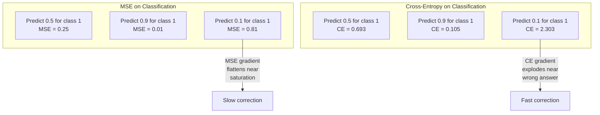
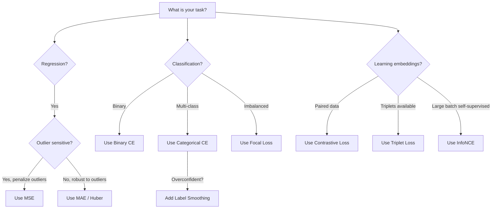
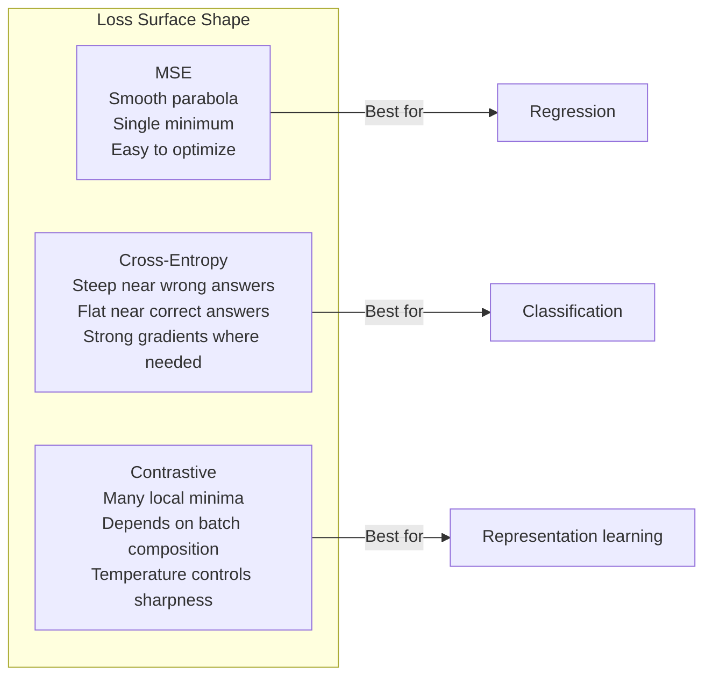

# 손실 기능

> 네트워크가 예측을 합니다. 기본 진실은 반대라고 합니다. 얼마나 잘못된가요? 그 숫자는 손실입니다. 잘못된 손실 함수를 선택하고 모델은 완전히 잘못된 것에 최적화됩니다.

**Type:** Build
**Languages:** Python
**Prerequisites:** Lesson 03.04 (Activation Functions)
**Time:** ~75 minutes

## 학습 목표

- MSE, 바이너리 크로스 엔트로피, 카테고리 크로스 엔트로피 및 콘라스티브 손실 (InfoNCE) 를 그 그레디언스와 함께 처음부터 구현
- "모든 것 에 대한 예측 0.5"의 실패 모드를 보여주면서 MSE가 분류에 실패하는 이유를 설명
- 크로스 엔트로피에 레이블 연소법을 적용하고 과잉 확신의 예측을 방지하는 방법을 설명합니다.
- 회귀, 바이너리 분류, 다중 클래스 분류 및 학습 작업을 임베디드하기 위해 올바른 손실 함수를 선택하십시오

## 문제

분류 문제에서 MSE를 최소화하는 모델은 모든 것에 대해 자신있게 0.5을 예측합니다. 손실을 최소화합니다. 또한 쓸모 없습니다.

손실 함수는 모델이 실제로 최적화하는 유일한 것입니다. 정확도도 없어요 F1 점수가 아니죠 매니저에게 보고하는 매트릭은 아니죠 최적화는 손실 함수의 기하급수와 무게를 조정하여 그 숫자를 작게합니다. 만약 손실 함수가 당신이 관심을 갖는 것을 포착하지 못한다면, 모델은 수학적으로 가장 저렴한 방법을 찾아서 만족시킬 것입니다. 그리고 그 방법은 거의 결코 당신이 원하는 것이 아닙니다.

여기 구체적인 예가 있습니다. 이진 분류 작업이 있습니다. 두 수업, 50/50 분할 당신은 MSE를 손실로 삼습니다. 모델은 각각의 입력에 대해 0.5을 예측합니다. 평균 MSE는 0.25입니다. 실제로 아무것도 배우지 않고 가능한 최소한의 수준입니다. 모델은 차별성이 없지만 기술적으로 손실 기능을 최소화했습니다. 크로스 엔트로피로 전환하고 같은 모델은 예측을 0 또는 1로 밀어붙이는 것을 강요합니다. 왜냐하면 -log(0.5) = 0.693는 끔찍한 손실이 되지만 -log(0.99) = 0.01는 정확한 예측에 대한 확신을 보상합니다. 손실 함수의 선택은 학습하는 모델과 메트릭을 사용하는 모델의 차이입니다.

더 나쁜 일이죠. 자율적인 학습에서는 별표도 없습니다. 반조적 손실은 학습 신호를 완전히 정의합니다. 무엇이 유사하고 무엇이 다른 것으로 간주되는지, 그리고 모델이 얼마나 크게 그들을 분리해야하는지. 반조적 손실을 잘못하면, 여러분의 임베디션은 하나의 점으로 붕괴됩니다. 모든 입력 지도는 동일한 벡터로 구성됩니다. 기술적으로 0 손실. 완전히 가치 없습니다.

## 개념

### 평균 제곱 오류 (MSE)

역전의 기본값. 예측과 목표 사이의 제곱 차이를 계산하고, 모든 샘플에 대한 평균을 계산합니다.

```math
\text{MSE} = \frac{1}{n} \sum (y_{\text{pred}} - y_{\text{true}})^2
```

왜 사각형이 중요할까요? 그것은 큰 오류를 사각형으로 처벌합니다. 2의 오류는 1의 오류보다 4배 더 많은 비용이 들죠. 10의 오류는 100배가 들죠. 이것은 MSE를 비정상적에 민감하게 만듭니다.

실제 숫자: 만약 당신의 모델이 주택 가격을 예측하고$10,000 on most houses but off by $한 맨션에 2만 건을 넣고 MSE는 그 맨션을 공격적으로 고쳐주고 다른 99개의 주택의 성능을 손상시킬 것입니다.

예측에 대한 MSE의 기하이는 다음과 같습니다.

```math
\frac{\partial \text{MSE}}{\partial y_{\text{pred}}} = \frac{2}{n} (y_{\text{pred}} - y_{\text{true}})
```

오류는 선형적 이다. 더 큰 오류는 더 큰 기하급수 를 얻는다. 이것은 회귀 (큰 오류는 큰 수정이 필요합니다) 및 분류에 대한 오류 (당신은 자신있게 잘못된 답변을 적자적으로 처벌하고 싶습니다, 선형적으로 아닙니다).

### 크로스 엔트로피 손실

분류에 대한 손실 함수는 정보 이론에 뿌리를 두고 예측된 확률 분포와 실제 분포 사이의 차이를 측정합니다.

**Binary Cross-Entropy (BCE):**

```math
\text{BCE} = -\left(y \log(p) + (1 - y) \log(1 - p)\right)
```

어디$y$이 표는 사실적인 표기 (0 또는 1) 이며$p$예측된 확률입니다.

왜$-\log(p)$작동: 진정한 라벨이 1이고 예측할 때$p = 0.99$, 손실은$-\log(0.99) = 0.01$- 예측할 때$p = 0.01$, 손실은$-\log(0.01) = 4.6$460x의 차이가 크로스 엔트로피가 작동하는 이유입니다. 그것은 자신감 있는 잘못된 예측을 잔인하게 처벌하고, 자신감 있는 올바른 예측을 거의 처벌하지 않습니다.

그레이디언은 같은 이야기를 합니다.

```math
\frac{\partial \text{BCE}}{\partial p} = -\frac{y}{p} + \frac{1-y}{1-p}
```

언제$y = 1$그리고$p$0에 가깝고, 그라디엔트는$-1/p$이 모델은 실수 수정하는 거대한 신호를 얻습니다.$p$1에 가깝습니다. 그라디엔트는 작습니다. 이미 정답입니다. 수정할 수 있는 것은 없습니다.

**Categorical Cross-Entropy:**

한 개의 핫 코딩된 목표가 있는 다급 분류에

```math
\text{CCE} = -\sum_i y_i \log(p_i)
```

오직 진정한 클래스가 손실에 기여합니다 (다른 모든$y_i$만약 10개의 클래스가 있고 올바른 클래스가 확률을 0.1을 얻으면, 손실은 0.1입니다.$-\log(0.1) = 2.3$만약 올바른 클래스가 0.9 확률을 얻으면 손실은$-\log(0.9) = 0.105$모델은 확률 질량을 올바른 답에 집중시키는 것을 배운다.

### 왜 MSE가 분류에 실패하는 지



MSE 기하급수가 0 또는 1에 가까운 시그모이드 포화로 인해 평평화됩니다.$-\log$시그모이드의 평면 영역을 취소하여 가장 필요한 곳에 강력한 기하급수성을 제공합니다.

### 레이블 부드러운

표준 한 가지 핫 레이블은 "이것이 100% 클래스 3이고 다른 모든 것은 0%입니다".

```math
\text{smooth\_label} = (1 - \alpha) \cdot \text{one\_hot} + \frac{\alpha}{\text{num\_classes}}
```

$\alpha = 0.1$그리고 10 클래스: [0, 0, 1, 0, ...] 대신 목표가 [0.01, 0.01, 0.91, 0.01, ...] 됩니다. 모델은 1.0 대신 0.91를 목표로 합니다.

왜 이 방법이 작동하는지: 소프트맥스 (softmax) 를 통해 정확히 1.0을 출력하려는 모델은 로그티를 무한으로 밀어 넣어야 합니다. 이것은 과도한 자신감을 유발하고 일반화를 해치고, 모델이 분포 전환에 취약하게 만듭니다. 레이블 평행은 목표 0.9 (와 ) 에 제한됩니다.$\alpha = 0.1$GPT와 대부분의 현대 모델들은 레이블 연평 또는 그 동등한 것을 사용합니다.

### 대조적 손실

라벨도 없고 클래스도 없고, 입력된 입력쌍만 있고,

**SimCLR-style contrastive loss (NT-Xent / InfoNCE):**

한 이미지를 보세요. 두 개의 증강된 시각을 만들어 보세요. (작, 회전, 색의 긴장) 이 "긍정적 쌍"입니다. 그들은 비슷한 임베디션을 가져야 합니다.

```math
L = -\log \frac{\exp(\text{sim}(z_i, z_j) / \tau)}{\sum_k \exp(\text{sim}(z_i, z_k) / \tau)}
```

어디$\text{sim}()$이모사 (Cosine) 은$z_i$그리고$z_j$양쌍이 되면 합이 모든 음수를 넘어서게 됩니다$\tau$(온) 은 분포가 얼마나 날카로운지 조절합니다. 낮은 온도는 더 단단한 음수 = 더 공격적인 분리가 됩니다.

실제 숫자: 대량 256 은 양성 쌍당 255 음수를 의미합니다. 온도 $\tau = 0.07$(SimCLR 기본) 손실은 유사점보다 부드러운 최대처럼 보입니다. 이 양쌍의 유사성은 256가지 옵션 중 가장 높을 수 있습니다.

**Triplet Loss:**

3개의 입력값을 사용합니다: 안커, 긍정적 ( 같은 클래스), 부정 ( 다른 클래스).

```math
L = \max\left(0, d(\text{anchor}, \text{positive}) - d(\text{anchor}, \text{negative}) + \text{margin}\right)
```

마진 (일반적으로 0.2-1.0) 은 긍정적 인 거리와 부정적인 거 사이의 최소 격차를 강요합니다. 음수가 이미 충분히 멀리 있다면 손실은 0 - gradient, 업데이트가 없습니다. 이것은 훈련을 효율적으로 만들지만 신중한 트리플렛 마이닝이 필요합니다.

### 집중력 손실

균형이 깨진 데이터 집합에 대해 표준 크로스 엔트로피는 올바르게 분류 된 모든 예제를 동일하게 취급합니다. 중하중 중점 손실 쉬운 예:

```math
\text{FL} = -\alpha (1 - p_t)^\gamma \log(p_t)
```

어디$p_t$실제 클래스의 예측 확률입니다$\gamma$집중력을 조절합니다.$\gamma = 0$, 이것은 표준 크로스 엔트로피입니다.$\gamma = 2$(불정확한 경우):

- 간단한 예 ($p_t = 0.9$): 무게$= (0.1)^2 = 0.01$- 사실상 무시당했어요
- 어려운 예 ($p_t = 0.1$): 무게$= (0.9)^2 = 0.81$- 전차 신호

광축 손실은 객체 탐지용으로 린 등이 도입한 것으로, 99%의 후보 영역은 배경 (단순한 부정적) 이다. 광축 손실이 없으면 모델은 쉬운 배경 예제에서 익사하고 객체를 감지하는 것을 결코 배우지 않는다. 이를 통해 모델은 중요하고 모호한 경우에 자신의 능력을 집중시킨다.

### 손실 함수 결정 나무



### 랜드 랜드 패스



```figure
cross-entropy-loss
```

## 건설 해

### 단계 1: MSE 및 그 기하급수

```python
def mse(predictions, targets):
    n = len(predictions)
    total = 0.0
    for p, t in zip(predictions, targets):
        total += (p - t) ** 2
    return total / n

def mse_gradient(predictions, targets):
    n = len(predictions)
    grads = []
    for p, t in zip(predictions, targets):
        grads.append(2.0 * (p - t) / n)
    return grads
```

### 단계 2: 바이너리 크로스 엔트로피

log ((0) 문제는 실제입니다. 모델이 긍정적 인 예제에서 정확히 0을 예측한다면,$\log(0) = -\infty$- 은 건 이런 일이 일어나지 않습니다.

```python
import math

def binary_cross_entropy(predictions, targets, eps=1e-15):
    n = len(predictions)
    total = 0.0
    for p, t in zip(predictions, targets):
        p_clipped = max(eps, min(1 - eps, p))
        total += -(t * math.log(p_clipped) + (1 - t) * math.log(1 - p_clipped))
    return total / n

def bce_gradient(predictions, targets, eps=1e-15):
    grads = []
    for p, t in zip(predictions, targets):
        p_clipped = max(eps, min(1 - eps, p))
        grads.append(-(t / p_clipped) + (1 - t) / (1 - p_clipped))
    return grads
```

### 단계 3: Softmax로 분류적 크로스 엔트로피

소프트맥스는 원소 로그티를 확률로 변환하고,

```python
def softmax(logits):
    max_val = max(logits)
    exps = [math.exp(x - max_val) for x in logits]
    total = sum(exps)
    return [e / total for e in exps]

def categorical_cross_entropy(logits, target_index, eps=1e-15):
    probs = softmax(logits)
    p = max(eps, probs[target_index])
    return -math.log(p)

def cce_gradient(logits, target_index):
    probs = softmax(logits)
    grads = list(probs)
    grads[target_index] -= 1.0
    return grads
```

소프트맥스 + 크로스 엔트로피의 기하급수는 아름답게 단순화합니다. 그것은 단지 (예측된 확률 - 1) 실제 클래스, 그리고 (예측된 확률) 다른 모든 클래스. 이 우아한 단순화는 우연이 아닙니다. 이것이 바로 소프트맥스와 크로스 엔트로피가 결합된 이유입니다.

### 4단계: 레이블 부드럽게

```python
def label_smoothed_cce(logits, target_index, num_classes, alpha=0.1, eps=1e-15):
    probs = softmax(logits)
    loss = 0.0
    for i in range(num_classes):
        if i == target_index:
            smooth_target = 1.0 - alpha + alpha / num_classes
        else:
            smooth_target = alpha / num_classes
        p = max(eps, probs[i])
        loss += -smooth_target * math.log(p)
    return loss
```

### 단계 5: 반조 손실 (프로소화된 InfoNCE)

```python
def cosine_similarity(a, b):
    dot = sum(x * y for x, y in zip(a, b))
    norm_a = math.sqrt(sum(x * x for x in a))
    norm_b = math.sqrt(sum(x * x for x in b))
    if norm_a < 1e-10 or norm_b < 1e-10:
        return 0.0
    return dot / (norm_a * norm_b)

def contrastive_loss(anchor, positive, negatives, temperature=0.07):
    sim_pos = cosine_similarity(anchor, positive) / temperature
    sim_negs = [cosine_similarity(anchor, neg) / temperature for neg in negatives]

    max_sim = max(sim_pos, max(sim_negs)) if sim_negs else sim_pos
    exp_pos = math.exp(sim_pos - max_sim)
    exp_negs = [math.exp(s - max_sim) for s in sim_negs]
    total_exp = exp_pos + sum(exp_negs)

    return -math.log(max(1e-15, exp_pos / total_exp))
```

### 단계 6: MSE와 분류에 대한 크로스 엔트로피

두 손실 함수와 같은 네트워크를 수업 04 (순환 데이터 세트) 에서 훈련하십시오.

```python
import random

def sigmoid(x):
    x = max(-500, min(500, x))
    return 1.0 / (1.0 + math.exp(-x))

def make_circle_data(n=200, seed=42):
    random.seed(seed)
    data = []
    for _ in range(n):
        x = random.uniform(-2, 2)
        y = random.uniform(-2, 2)
        label = 1.0 if x * x + y * y < 1.5 else 0.0
        data.append(([x, y], label))
    return data


class LossComparisonNetwork:
    def __init__(self, loss_type="bce", hidden_size=8, lr=0.1):
        random.seed(0)
        self.loss_type = loss_type
        self.lr = lr
        self.hidden_size = hidden_size

        self.w1 = [[random.gauss(0, 0.5) for _ in range(2)] for _ in range(hidden_size)]
        self.b1 = [0.0] * hidden_size
        self.w2 = [random.gauss(0, 0.5) for _ in range(hidden_size)]
        self.b2 = 0.0

    def forward(self, x):
        self.x = x
        self.z1 = []
        self.h = []
        for i in range(self.hidden_size):
            z = self.w1[i][0] * x[0] + self.w1[i][1] * x[1] + self.b1[i]
            self.z1.append(z)
            self.h.append(max(0.0, z))

        self.z2 = sum(self.w2[i] * self.h[i] for i in range(self.hidden_size)) + self.b2
        self.out = sigmoid(self.z2)
        return self.out

    def backward(self, target):
        if self.loss_type == "mse":
            d_loss = 2.0 * (self.out - target)
        else:
            eps = 1e-15
            p = max(eps, min(1 - eps, self.out))
            d_loss = -(target / p) + (1 - target) / (1 - p)

        d_sigmoid = self.out * (1 - self.out)
        d_out = d_loss * d_sigmoid

        for i in range(self.hidden_size):
            d_relu = 1.0 if self.z1[i] > 0 else 0.0
            d_h = d_out * self.w2[i] * d_relu
            self.w2[i] -= self.lr * d_out * self.h[i]
            for j in range(2):
                self.w1[i][j] -= self.lr * d_h * self.x[j]
            self.b1[i] -= self.lr * d_h
        self.b2 -= self.lr * d_out

    def compute_loss(self, pred, target):
        if self.loss_type == "mse":
            return (pred - target) ** 2
        else:
            eps = 1e-15
            p = max(eps, min(1 - eps, pred))
            return -(target * math.log(p) + (1 - target) * math.log(1 - p))

    def train(self, data, epochs=200):
        losses = []
        for epoch in range(epochs):
            total_loss = 0.0
            correct = 0
            for x, y in data:
                pred = self.forward(x)
                self.backward(y)
                total_loss += self.compute_loss(pred, y)
                if (pred >= 0.5) == (y >= 0.5):
                    correct += 1
            avg_loss = total_loss / len(data)
            accuracy = correct / len(data) * 100
            losses.append((avg_loss, accuracy))
            if epoch % 50 == 0 or epoch == epochs - 1:
                print(f"    Epoch {epoch:3d}: loss={avg_loss:.4f}, accuracy={accuracy:.1f}%")
        return losses
```

## 사용 하 고

PyTorch는 다음과 같은 수치 안정성을 갖춘 모든 표준 손실 함수를 제공합니다.

```python
import torch
import torch.nn as nn
import torch.nn.functional as F

predictions = torch.tensor([0.9, 0.1, 0.7], requires_grad=True)
targets = torch.tensor([1.0, 0.0, 1.0])

mse_loss = F.mse_loss(predictions, targets)
bce_loss = F.binary_cross_entropy(predictions, targets)

logits = torch.randn(4, 10)
labels = torch.tensor([3, 7, 1, 9])
ce_loss = F.cross_entropy(logits, labels)
ce_smooth = F.cross_entropy(logits, labels, label_smoothing=0.1)
```

사용`F.cross_entropy`(아니)`F.nll_loss`수학적 안정적인 작업으로 로그- 소프트맥스와 음성 로그 확률을 결합합니다.

대조적 학습을 위해 대부분의 팀은 사용자 지정 구현이나 라이브러리를 사용합니다.`lightly`또는`pytorch-metric-learning`. 핵심 루프는 항상 동일합니다. 쌍방향 유사성을 계산하고, 긍정과 부정에 대한 소프트맥스를 생성하고, 뒤로 퍼집니다.

## 선박

이 교훈은 다음과 같은 결과를 낳습니다.
- `outputs/prompt-loss-function-selector.md`-- 올바른 손실 함수를 선택하기 위해 재사용 가능한 명령어
- `outputs/prompt-loss-debugger.md`-- 손실 곡선이 잘못 보이는 경우 진단 요청

## 운동

1. 작은 오류에 대한 MSE와 큰 오류에 대한 MAE를 나타내는 Huber 손실 (스프릿 L1 손실) 을 구현하십시오. 회귀 네트워크 예측을 훈련하십시오 $y = \sin(x)$MSE와 Huber의 경우 훈련 목표의 5%가 무작위적으로 추가된 소음 (외위) 을 가지고 있습니다. 최종 테스트 오류를 비교하십시오.

2. 이진 분류 훈련 루프에 광소 손실을 추가하십시오. 불균형 데이터 세트를 생성하십시오 (90% 클래스 0, 10% 클래스 1). 표준 BCE와 광소 손실을 비교하십시오 ($\gamma = 2$200년 후 소수 계급의 회수

3. 반 단단한 음성 채굴을 통해 삼각형 손실을 구현하십시오. 5 클래스 2D 임베딩 데이터를 생성하십시오. 각 아커에 대해 긍정적 (반 단단) 보다 더 멀리 있는 가장 단단한 음수를 찾아보십시오.

4. MSE와 크로스 엔트로피 비교를 실행하지만 훈련 중에 각 층에서 기하급수 규모를 추적하십시오. 시대별 평균 기하급수 규범을 일괄적으로 그려보십시오. 모델이 가장 불확실한 초기 시대에 크로스 엔트로피가 더 큰 기하급수성을 생성하는지 확인하십시오.

5. KL의 분배 손실을 구현하고 최소화되는 것을 확인합니다$\mathrm{KL}(\text{true} \Vert \text{predicted})$그러면 부드러운 목표 (지식 정유와 같은) 를 시도해 보세요. "진짜" 분포는 교사 모델의 소프트맥스 출력에서 나온다.

## 주요 용어

| Term | What people say | What it actually means |
|------|----------------|----------------------|
| Loss function | "How wrong the model is" | A differentiable function mapping predictions and targets to a scalar that the optimizer minimizes |
| MSE | "Average squared error" | Mean of squared differences between predictions and targets; penalizes large errors quadratically |
| Cross-entropy | "The classification loss" | Measures divergence between predicted probability distribution and true distribution using $-\log(p)$ |
| Binary cross-entropy | "BCE" | Cross-entropy for two classes: $-(y \log(p) + (1-y) \log(1-p))$ |
| Label smoothing | "Softening the targets" | Replacing hard 0/1 targets with soft values (e.g., 0.1/0.9) to prevent overconfidence and improve generalization |
| Contrastive loss | "Pull together, push apart" | A loss that learns representations by making similar pairs close and dissimilar pairs far in embedding space |
| InfoNCE | "The CLIP/SimCLR loss" | Normalized temperature-scaled cross-entropy over similarity scores; treats contrastive learning as classification |
| Focal loss | "The imbalanced data fix" | Cross-entropy weighted by $(1-p_t)^\gamma$ to down-weight easy examples and focus on hard ones |
| Triplet loss | "Anchor-positive-negative" | Pushes anchor closer to positive than negative by at least a margin in embedding space |
| Temperature | "Sharpness knob" | A scalar divisor on logits/similarities that controls how peaked the resulting distribution is; lower = sharper |

## 더 많은 읽기

- 린 등, "밀체 객체 탐지에 대한 집중 손실" (2017) -- 객체 탐지에서 극단적인 클래스 불균형을 처리하기 위해 집중 손실을 도입 (RetinaNet)
- 첸等人, "비जुअल 표현의 반조적 학습을 위한 간단한 프레임워크" (SimCLR, 2020) - NT-Xent 손실로 현대적인 반조적 학습 파이프라인을 정의했습니다
- Szegedy et al., "인시프레이션 아키텍처를 다시 생각" (2016) -- 레이블 평행은 정규화 기술로 도입, 현재 대부분의 대형 모델에서 표준
- Hinton et al., "네이러널 네트워크의 지식 분비" (2015) - 소프트 타겟을 사용하여 지식 분비 및 KL 분리를 사용하여 모델 압축에 기초
