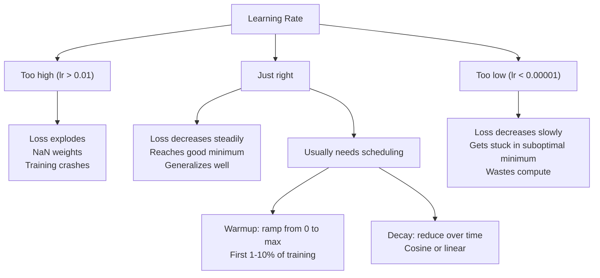
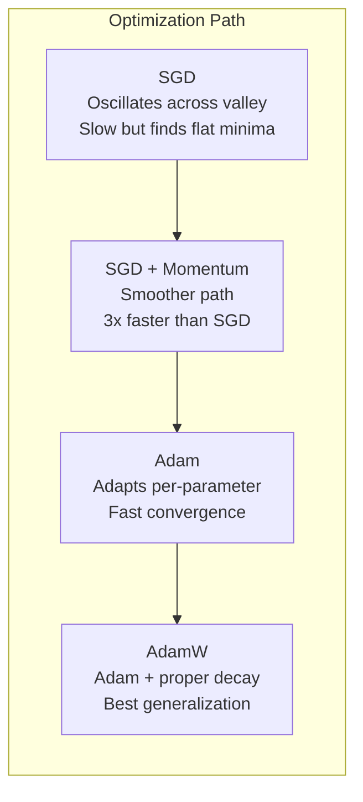
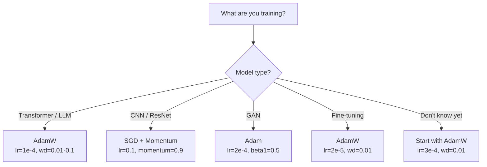

# 최적화

> 진하각은 어떤 방향으로 움직여야 하는지 알려줍니다. 얼마나 멀리인지 얼마나 빨리 움직여야 하는지 알려주지 않습니다. SGD는 компа스입니다. 아담은 교통 데이터를 가진 GPS입니다.

**Type:** Build
**Languages:** Python
**Prerequisites:** Lesson 03.05 (Loss Functions)
**Time:** ~75 minutes

## 학습 목표

- 파이썬에서 SGD, SGD와 동력을, 아담, 그리고 아담W 최적화를 처음부터 구현
- 아담의 편향 수정이 초기 훈련 단계에서 0 초기화 된 순간 추정에 대해 어떻게 보완하는지 설명하십시오.
- 왜 ADA는 같은 작업에 L2 정규화를 통해 ADA보다 더 나은 일반화를 생산하는지 증명하십시오
- 트랜스포머, CNN, GAN 및 정비에 적합한 최적화 및 기본 하이퍼파라미터를 선택하십시오

## 문제

그라디엔트를 계산했습니다. 당신은 손실을 줄이기 위해 무게 4,721을 0.003로 줄여야한다는 것을 알고 있습니다. 하지만 0.003는 어떤 단위로? 어떤 규모로? 그리고 1단계와 1,000단계와 같은 양을 움직여야합니까?

바닐라 기하급수 하락은 모든 단계의 모든 매개 변수에 동일한 학습 속도를 적용합니다: $w = w - \text{lr} \cdot \text{gradient}$이것은 실제로 신경망 훈련이 고통스러운 3가지 문제를 야기합니다.

첫째, 진동. 손실의 풍경은 평탄한 그릇처럼 거의 보이지 않습니다. 긴 좁은 계곡처럼 그라디엔트는 계곡을 가로지르는 (한 방향) 으로 지향하고, 그 길이를 가로지르는 (한 방향) 으로 지향하지 않는다. 그라디언트 하락은 좁은 차원을 거쳐 앞으로 거꾸로 뛰어넘는 동시에 유용한 차원을 따라 작은 발전을 합니다. 여러분은 이 것을 보셨을 겁니다. 손실은 고원보다 빠르게 떨어집니다. 모델이 공렴하기 때문이 아니라

둘째, 모든 매개 변수들에 대한 학습률은 잘못되었다. 일부 무게는 큰 업데이트가 필요합니다. (그들은 초기 단계, 부적절 단계에 있습니다). 다른 사람들은 작은 업데이트가 필요합니다. (그들은 최적의 값에 가깝습니다). 전용에 적합한 학습률은 후자를 파괴하고, 반대로.

세번째, 세일 포인트. 높은 차원에서, 손실 경관은 평평한 영역을 가지고 있습니다. 그 지각은 거의 0에 가깝습니다. 바닐라 SGD는 그 지각의 속도로 그 중을 니다. 사실상 0입니다. 모델은 붙어있는 것처럼 보입니다. 그것은 붙어 있지 않습니다. 그것은 다른 쪽에서 유용한 하락이 있는 평평한 영역입니다. 하지만 SGD는 통과하는 메커니즘이 없습니다.

아담은 세 가지를 모두 해결해줍니다. 매개 변수당 두 개의 실행 평균을 유지합니다. 평균 기하급수 (momentum, 핸들 오스컬레이션) 와 평균 제곱 기하급수 (adaptative rate, handle different scales). 첫 몇 단계의 편향 수정과 결합하면 기본 하이퍼파레머의 80%의 문제를 해결할 수 있는 단일 최적화가 가능합니다. 이 수업은 처음부터 다시 만들어서, 다른 20%에 대해 정확히 언제, 왜 실패하는지 알 수 있게 합니다.

## 개념

### 스토카스틱 기하급수적 하락 (SGD)

가장 간단한 최적화. 미니 배트에서 gradient를 계산하고 반대 방향으로 걸립니다.

```math
w = w - \text{lr} \cdot \text{gradient}
```

"스토카스틱"은 전체 데이터 세트를 대신 추상 gradient를 추정하기 위해 무작위 데이터 하위 집합을 사용합니다. 이 잡음은 실제로 유용합니다. 그것은 급격한 지역 최소에서 벗어날 수 있도록 도와줍니다. 하지만 잡음은 또한 진동을 유발합니다.

학습률은 유일한 단점이다. 너무 높다: 손실이 분화된다. 너무 낮다: 훈련은 영원히 걸립니다. 최적의 가치는 건축, 데이터, 배트 크기와 훈련의 현재 단계에 달려 있습니다. 현대 네트워크에서 바닐라 SGD에 대한 일반적인 값은 0.01에서 0.1까지 다양합니다. 그러나 단일 훈련 실행 내에서도 이상적인 학습률은 변합니다.

### 추진력

공을 롤링-다운힐 비유는 지나치게 사용되지만 정확합니다. 그레디엔트를 혼자 따라가는 대신 그레디엔트를 지나고 있는 속도를 유지합니다.

```math
\begin{aligned}
m_t &= \beta \, m_{t-1} + \text{gradient} \\
w &= w - \text{lr} \cdot m_t
\end{aligned}
```

베타 (일반적으로 0.9) 는 얼마나 많은 역사를 보관해야 하는지 제어합니다.$\beta = 0.9$, 동력은 대략 마지막 10개의 기하급수의 평균이다 ($1 / (1 - 0.9) = 10$)

왜 이 기동이 고쳐지는지: 같은 방향으로 지향하는 기하급수들이 축적됩니다. 반향 방향의 기하급수들은 취소됩니다. 그 좁은 계곡에서, "반향" 구성 요소는 각 단계를 표시하고 완화됩니다. "함께" 구성 요소는 일관성이 유지되고 증폭됩니다. 그 결과 유용한 방향으로 부드러운 가속입니다.

실제 수: 나쁜 조건에 있는 손실 풍경에서 SGD만만 10,000 단계가 걸릴 수 있습니다.$\beta = 0.9$) 는 같은 문제에 대해 일반적으로 3,000~5,000 단계가 소요됩니다.

### RMSProp

실제로 효과가 있었던 첫 번째 매개 변수 적응 학습률 방법. 힌턴이 코서라 강연에서 제안 (공식적으로 출판된 적이 없다).

```math
\begin{aligned}
s_t &= \beta \, s_{t-1} + (1 - \beta) \cdot \text{gradient}^2 \\
w &= w - \text{lr} \cdot \frac{\text{gradient}}{\sqrt{s_t} + \epsilon}
\end{aligned}
```

$s_t$이 자료는 평방 gradients의 실행 평균을 추적합니다. 지속적으로 큰 gradients의 매개 변수는 큰 숫자로 나뉘어집니다 (소소 효과적인 학습률). 작은 gradients의 매개 변수는 작은 숫자로 나뉘어집니다 (더 큰 효과적인 학습률).

이것은 "모든 매개 변수에 대한 하나의 학습률" 문제를 해결합니다. 이미 큰 업데이트를 받은 무게는 아마도 목표에 가깝습니다. 속도를 늦추죠. 작은 업데이트를 받은 무게는 미흡한 훈련을 받을 수도 있습니다. 속도를 높입니다.

에프실론 (일반적으로 1e-8) 은 매개 변수가 업데이트되지 않은 경우 0으로 나뉘는 것을 방지합니다.

### 애덤: 모멘텀 + RMSProp

아담은 두 가지 아이디어를 결합하여 매개 변수마다 두 개의 기하급수적인 이동 평균을 유지합니다.

```math
\begin{aligned}
m_t &= \beta_1 m_{t-1} + (1 - \beta_1) \cdot \text{gradient} && \text{(first moment: mean)} \\
v_t &= \beta_2 v_{t-1} + (1 - \beta_2) \cdot \text{gradient}^2 && \text{(second moment: variance)}
\end{aligned}
```

**Bias correction**가장 많은 설명이 놓친 핵심 세부 사항입니다.$m_1 = (1 - \beta_1) \cdot \text{gradient}$- $\beta_1 = 0.9$, 그게$0.1 \cdot \text{gradient}$-- 10배나 작고 이동 평균은 아직 뜨겁지 않은 편견 수정은

```math
\begin{aligned}
\hat{m} &= \frac{m_t}{1 - \beta_1^t} \\
\hat{v} &= \frac{v_t}{1 - \beta_2^t}
\end{aligned}
```

1단계로$\beta_1 = 0.9$이 책:$\hat{m} = m_1 / (1 - 0.9) = m_1 / 0.1 =$실제 기하급수:$(1 - 0.9^{100})$이 경우, 이변의 경우, 이변의 경우, 이변의 경우, 이변의 경우, 이변의 경우, 이변의 경우, 이변의 경우, 이변의 경우, 이변의 경우, 이변의 경우, 이변의 경우, 이변의 경우, 이변의 경우, 이변의 경우, 이변의 경우, 이변의 경우, 이변의 경우, 이변의 경우, 이변의 경우, 이변의 경우, 이변의 경우, 이변의 경우, 이변의 경우, 이변의 경우, 이변의 경우, 이변의 경우, 이변의 경우, 이변의 경우, 이변의 경우, 이변의 경우, 이변의 경우, 이변의 경우, 이변의 경우, 이변의 경우, 이변의 경우, 이변의 경우, 이변의 경우, 이변의 경우, 이변의 경우, 이변의 경우, 이변의 경우, 이변의 경우, 이변의 경우, 이변의 경우, 이변의 경우, 이변의 경우, 이변의 경우, 이변의 경우, 이변의 경우, 이변의 경우, 이변의 경우, 이변의 경우, 이변의 경우, 이변의 경우, 이변의 경우, 이변의 경우, 이변의 경우, 이변의 경우, 이변의 경우, 이변의 경우, 이변의 경우, 이변의 경우, 이변의 경우, 이변의 경우, 이변변변변변변변변변변변변변변변변변변변변변변변변변변변변변변변변변변변변변변변변변변변변변변변변변변변변변변변변변변변변변변변변변변변변변변변변변변변변변변변변변변변변변변변변변변변변변변변변변변변변변변변변변변변변변변변변변변변변변변변변변변변변변변변변변변변변변변변변변변변변변변변변변변변변변변변변변변변변변변변변변변변변변변변변변변변변변변변변변변변변변변변변변변

업데이트:

```math
w = w - \text{lr} \cdot \frac{\hat{m}}{\sqrt{\hat{v}} + \epsilon}
```

아담 기본 설정: $\text{lr} = 0.001$$\beta_1 = 0.9$$\beta_2 = 0.999$$\epsilon = 10^{-8}$이 기본 설정은 80%의 문제에서 작동합니다. 그렇지 않은 경우, 먼저 변경합니다.$\beta_2$거의 변하지 않습니다$\beta_1$또는$\epsilon$- 그래

### 체중 감소가 제대로 된 방법

L2 정규화 추가 $\lambda w^2$바닐라 SGD에서 이것은 체중 감소 (수분) 에 해당한다.$\lambda w$아담의 경우, 이 동등성은 깨집니다.

로쉬킬로프와 허터의 통찰력: 손실에 L2를 더하면 아담이 그레디언트를 처리하면 적응 학습률은 정규화 용어를 확장합니다. 큰 그레디언트 변이가 있는 매개 변수는 덜 정규화됩니다. 작은 변이가 있는 매개 변수는 더 많이 됩니다. 이것은 당신이 원하는 것이 아닙니다. 당신은 그레디언트 통계와 상관없이 균일한 정규화를 원합니다.

AdamW는 이 문제를 바로잡고, Adam 업데이트 후 무게에 직접 체중 감소를 적용합니다.

```math
w = w - \text{lr} \cdot \frac{\hat{m}}{\sqrt{\hat{v}} + \epsilon} - \text{lr} \cdot \lambda w
```

무게 감소 기간 ($\text{lr} \cdot \lambda w$(이하) 는 아담의 적응성 계수로 확장되지 않습니다. 모든 매개 변수는 같은 비율의 축소를 얻습니다.

이것은 작은 세부 사항처럼 보입니다. 그것은 아닙니다. 거의 모든 작업에 있어서 Adam + L2 정규화보다 더 나은 솔루션으로 konverges. 그것은 PyTorch에서 트랜스포머, 전파 모델 및 대부분의 현대적인 건축을 훈련하는 기본 최적화입니다. BERT, GPT, LLaMA, 안정적인 전파 - 모두 AdamW를 통해 훈련되었습니다.

### 학습 속도: 가장 중요 한 과다분야



만약 하나의 하이퍼파라미터를 조정한다면 학습률을 조정합니다. 학습률의 10배 변화가 어떤 건축적 결정보다 더 중요합니다. 일반적인 기본:

- SGD: lr = 0.01~0.1
- 아담/아담W: lr = 1e-4에서 3e-4
- 정렬 전 훈련된 모델: lr = 1e-5에서 5e-5
- 학습 속도 온화: 첫 단계의 1~10%에 걸쳐 선형 램프

### 최적화 비교



### 최적화 하는 방법 이기는 때



```figure
optimizer-trajectory
```

## 건설 해

### 단계 1: 바닐라 SGD

```python
class SGD:
    def __init__(self, lr=0.01):
        self.lr = lr

    def step(self, params, grads):
        for i in range(len(params)):
            params[i] -= self.lr * grads[i]
```

### 단계 2: 스가드와 모멘텀

```python
class SGDMomentum:
    def __init__(self, lr=0.01, beta=0.9):
        self.lr = lr
        self.beta = beta
        self.velocities = None

    def step(self, params, grads):
        if self.velocities is None:
            self.velocities = [0.0] * len(params)
        for i in range(len(params)):
            self.velocities[i] = self.beta * self.velocities[i] + grads[i]
            params[i] -= self.lr * self.velocities[i]
```

### 3단계: 아담

```python
import math

class Adam:
    def __init__(self, lr=0.001, beta1=0.9, beta2=0.999, epsilon=1e-8):
        self.lr = lr
        self.beta1 = beta1
        self.beta2 = beta2
        self.epsilon = epsilon
        self.m = None
        self.v = None
        self.t = 0

    def step(self, params, grads):
        if self.m is None:
            self.m = [0.0] * len(params)
            self.v = [0.0] * len(params)

        self.t += 1

        for i in range(len(params)):
            self.m[i] = self.beta1 * self.m[i] + (1 - self.beta1) * grads[i]
            self.v[i] = self.beta2 * self.v[i] + (1 - self.beta2) * grads[i] ** 2

            m_hat = self.m[i] / (1 - self.beta1 ** self.t)
            v_hat = self.v[i] / (1 - self.beta2 ** self.t)

            params[i] -= self.lr * m_hat / (math.sqrt(v_hat) + self.epsilon)
```

### 4단계: 아담W

```python
class AdamW:
    def __init__(self, lr=0.001, beta1=0.9, beta2=0.999, epsilon=1e-8, weight_decay=0.01):
        self.lr = lr
        self.beta1 = beta1
        self.beta2 = beta2
        self.epsilon = epsilon
        self.weight_decay = weight_decay
        self.m = None
        self.v = None
        self.t = 0

    def step(self, params, grads):
        if self.m is None:
            self.m = [0.0] * len(params)
            self.v = [0.0] * len(params)

        self.t += 1

        for i in range(len(params)):
            self.m[i] = self.beta1 * self.m[i] + (1 - self.beta1) * grads[i]
            self.v[i] = self.beta2 * self.v[i] + (1 - self.beta2) * grads[i] ** 2

            m_hat = self.m[i] / (1 - self.beta1 ** self.t)
            v_hat = self.v[i] / (1 - self.beta2 ** self.t)

            params[i] -= self.lr * m_hat / (math.sqrt(v_hat) + self.epsilon)
            params[i] -= self.lr * self.weight_decay * params[i]
```

### 5단계: 훈련 비교

수업 05에서 같은 두 층 네트워크를 네 가지 최적화 장치로 훈련시켜서

```python
import random

def sigmoid(x):
    x = max(-500, min(500, x))
    return 1.0 / (1.0 + math.exp(-x))

def make_circle_data(n=200, seed=42):
    random.seed(seed)
    data = []
    for _ in range(n):
        x = random.uniform(-2, 2)
        y = random.uniform(-2, 2)
        label = 1.0 if x * x + y * y < 1.5 else 0.0
        data.append(([x, y], label))
    return data


class OptimizerTestNetwork:
    def __init__(self, optimizer, hidden_size=8):
        random.seed(0)
        self.hidden_size = hidden_size
        self.optimizer = optimizer

        self.w1 = [[random.gauss(0, 0.5) for _ in range(2)] for _ in range(hidden_size)]
        self.b1 = [0.0] * hidden_size
        self.w2 = [random.gauss(0, 0.5) for _ in range(hidden_size)]
        self.b2 = 0.0

    def get_params(self):
        params = []
        for row in self.w1:
            params.extend(row)
        params.extend(self.b1)
        params.extend(self.w2)
        params.append(self.b2)
        return params

    def set_params(self, params):
        idx = 0
        for i in range(self.hidden_size):
            for j in range(2):
                self.w1[i][j] = params[idx]
                idx += 1
        for i in range(self.hidden_size):
            self.b1[i] = params[idx]
            idx += 1
        for i in range(self.hidden_size):
            self.w2[i] = params[idx]
            idx += 1
        self.b2 = params[idx]

    def forward(self, x):
        self.x = x
        self.z1 = []
        self.h = []
        for i in range(self.hidden_size):
            z = self.w1[i][0] * x[0] + self.w1[i][1] * x[1] + self.b1[i]
            self.z1.append(z)
            self.h.append(max(0.0, z))

        self.z2 = sum(self.w2[i] * self.h[i] for i in range(self.hidden_size)) + self.b2
        self.out = sigmoid(self.z2)
        return self.out

    def compute_grads(self, target):
        eps = 1e-15
        p = max(eps, min(1 - eps, self.out))
        d_loss = -(target / p) + (1 - target) / (1 - p)
        d_sigmoid = self.out * (1 - self.out)
        d_out = d_loss * d_sigmoid

        grads = [0.0] * (self.hidden_size * 2 + self.hidden_size + self.hidden_size + 1)
        idx = 0
        for i in range(self.hidden_size):
            d_relu = 1.0 if self.z1[i] > 0 else 0.0
            d_h = d_out * self.w2[i] * d_relu
            grads[idx] = d_h * self.x[0]
            grads[idx + 1] = d_h * self.x[1]
            idx += 2

        for i in range(self.hidden_size):
            d_relu = 1.0 if self.z1[i] > 0 else 0.0
            grads[idx] = d_out * self.w2[i] * d_relu
            idx += 1

        for i in range(self.hidden_size):
            grads[idx] = d_out * self.h[i]
            idx += 1

        grads[idx] = d_out
        return grads

    def train(self, data, epochs=300):
        losses = []
        for epoch in range(epochs):
            total_loss = 0.0
            correct = 0
            for x, y in data:
                pred = self.forward(x)
                grads = self.compute_grads(y)
                params = self.get_params()
                self.optimizer.step(params, grads)
                self.set_params(params)

                eps = 1e-15
                p = max(eps, min(1 - eps, pred))
                total_loss += -(y * math.log(p) + (1 - y) * math.log(1 - p))
                if (pred >= 0.5) == (y >= 0.5):
                    correct += 1
            avg_loss = total_loss / len(data)
            accuracy = correct / len(data) * 100
            losses.append((avg_loss, accuracy))
            if epoch % 75 == 0 or epoch == epochs - 1:
                print(f"    Epoch {epoch:3d}: loss={avg_loss:.4f}, accuracy={accuracy:.1f}%")
        return losses
```

## 사용 하 고

PyTorch 최적화는 매개 변수 그룹, 그라디언트 절단 및 학습 속도 스케줄링을 처리합니다.

```python
import torch
import torch.optim as optim

model = torch.nn.Sequential(
    torch.nn.Linear(784, 256),
    torch.nn.ReLU(),
    torch.nn.Linear(256, 10),
)

optimizer = optim.AdamW(model.parameters(), lr=3e-4, weight_decay=0.01)

scheduler = optim.lr_scheduler.CosineAnnealingLR(optimizer, T_max=100)

for epoch in range(100):
    optimizer.zero_grad()
    output = model(torch.randn(32, 784))
    loss = torch.nn.functional.cross_entropy(output, torch.randint(0, 10, (32,)))
    loss.backward()
    torch.nn.utils.clip_grad_norm_(model.parameters(), max_norm=1.0)
    optimizer.step()
    scheduler.step()
```

패턴은 항상: zero_grad, forward, loss, backward, (clip), step, (schedule) 이다. 이 순서를 기억하십시오. 이를 잘못 (예를 들어, optimizer.step() 에 앞서 스케줄러.step() 를 호출하는 것은 미묘한 버그의 일반적인 원천입니다.

CNNs에 대해서는 많은 실무자들이 여전히 단계 또는 코시노 스케줄을 가진 SGD + 운동 (lr=0.1, 운동=0.9, 무게_파괴=1e-4) 를 선호한다. SGD는 평평한 최소점을 찾는데, 이는 종종 더 잘 일반화된다. 트랜스포머와 LLM에 대해서는 온화 + 코시노 파손이 있는 AdamW는 보편적 기본이다. 측정된 이유 없이 합의에 맞서 싸우지 마십시오.

## 선박

이 교훈은 다음과 같은 결과를 낳습니다.
- `outputs/prompt-optimizer-selector.md`-- 어떤 건축물에도 적합한 최적화와 학습률을 선택하는 결정적 인

## 운동

1. 네스테로프 운동량을 구현하여 "관장" 위치에서 기하급수를 계산합니다 ($w - \text{lr} \cdot \beta v$현재 위치 대신) 은 동그라운드 데이터 세트에 있는 표준 동력으로의 공감대를 비교한다.

2. 학습 속도 온화 스케줄을 구현: 훈련 단계의 첫 10% 동안 0에서 max_lr까지 선형 램프, 그리고 코시노 붕괴로 0. 아담 + 온화와 아담 + 온화 없이 훈련.

3. 아담 훈련 기간 동안 각 매개 변수에 대한 효과적인 학습률을 추적합니다.$\text{lr} \cdot \hat{m} / (\sqrt{\hat{v}} + \epsilon)$. 10, 50 및 200 단계 후 효과적인 비율의 분포를 그려보세요. 모든 매개 변수는 같은 속도로 업데이트되고 있습니까?

4. 그라디언트 클리핑을 구현하십시오 (글로벌 표준에 따라 클리핑). 최대 그라디언트 규범을 1.0로 설정하십시오. 높은 학습률을 사용하여 클리핑과 그 없이 훈련하십시오 (아담에 대한lr=0.01). 10 개의 무작위 씨앗을 클리핑하고 그 없이 얼마나 많은 실행이 분화되는지를 계산하십시오.

5. 큰 무게를 가진 네트워크에서 아담과 아담W를 비교하십시오. 모든 무게를 무작위로 [-5, 5] (정상보다 훨씬 더 큰) 로 초기화하십시오. 200 시대 동안 weight_decay=0.1로 훈련하십시오. 두 최적화기보다 무게의 L2 규범을 훈련에 따라 그려보십시오. 아담W는 더 빠른 체중 감량을 나타낼 수 있습니다.

## 주요 용어

| Term | What people say | What it actually means |
|------|----------------|----------------------|
| Learning rate | "Step size" | The scalar multiplier on the gradient update; the single most impactful hyperparameter in training |
| SGD | "Basic gradient descent" | Stochastic gradient descent: update weights by subtracting $\text{lr} \cdot \text{gradient}$, computed on a mini-batch |
| Momentum | "Rolling ball analogy" | Exponential moving average of past gradients; dampens oscillation and accelerates consistent directions |
| RMSProp | "Adaptive learning rate" | Divides each parameter's gradient by the running RMS of its recent gradients; equalizes learning rates |
| Adam | "The default optimizer" | Combines momentum (first moment) and RMSProp (second moment) with bias correction for the initial steps |
| AdamW | "Adam done right" | Adam with decoupled weight decay; applies regularization directly to weights rather than through the gradient |
| Bias correction | "Warmup for running averages" | Dividing by $(1 - \beta^t)$ to compensate for the zero-initialization of Adam's moment estimates |
| Weight decay | "Shrink the weights" | Subtracting a fraction of the weight value at each step; a regularizer that penalizes large weights |
| Learning rate schedule | "Changing lr over time" | A function that adjusts the learning rate during training; warmup + cosine decay is the modern default |
| Gradient clipping | "Capping the gradient norm" | Scaling down the gradient vector when its norm exceeds a threshold; prevents exploding gradient updates |

## 더 많은 읽기

- 킹마 & 바, "아담: 스토카스틱 최적화 방법" (2014) - 컨버전스 분석과 편향 수정 추리와 함께 된 원래 아담 논문
- 로쉬질로프와 허터, "부동화 체중 감소 규제" (2017) -- L2 규제와 체중 감소가 아담에서 동등하지 않다는 것을 증명하고, 아담W를 제안했습니다.
- 스미스, "교육 신경망의 주기적인 학습률" (2017) - 고정된 학습률을 조정할 필요성을 제거하는 LR 범위 테스트와 주기적인 스케줄을 도입했습니다
- 루더, "그라디언트 디젤스 최적화 알고리즘의 개요" (2016) - 모든 최적화 변종 중 가장 좋은 단일 설문 조사, 명확한 비교와 직관
