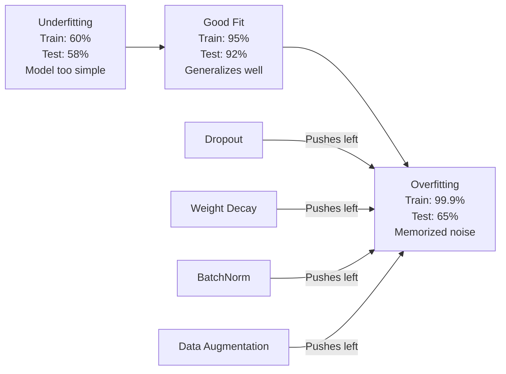
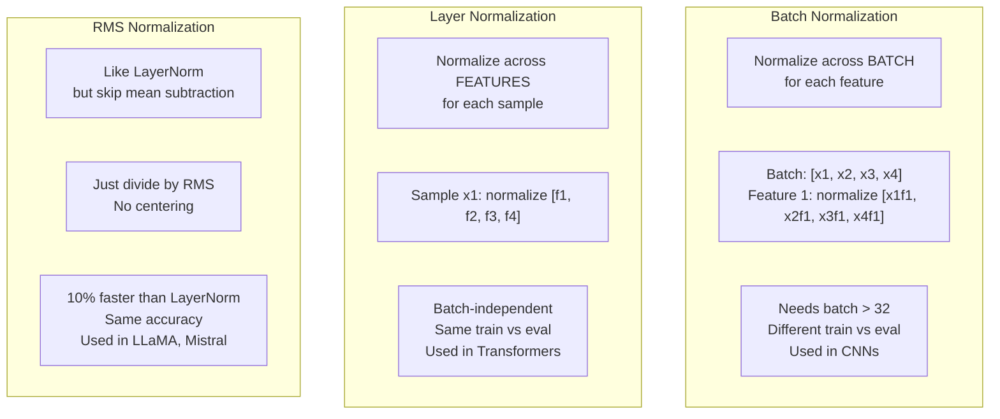
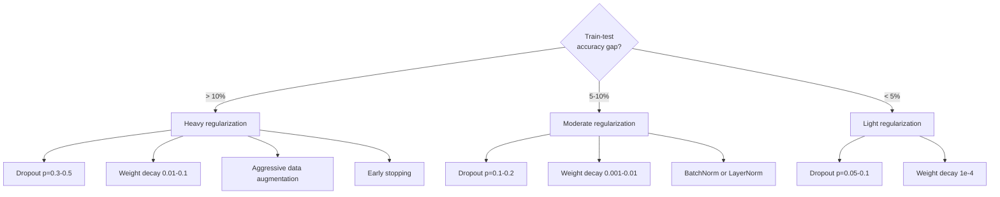

# 규제

> 당신의 모델은 99%를 훈련 데이터와 60%를 시험 데이터로 얻습니다. 학습 대신 기억합니다. 정규화는 일반화를 강요하기 위해 복잡성에 부과하는 세금입니다.

**Type:** Build
**Languages:** Python
**Prerequisites:** Lesson 03.06 (Optimizers)
**Time:** ~75 minutes

## 학습 목표

- 리버스 스케일링, L2 체중 감소, 배트 정상화, 레이어 정상화, 그리고 처음부터 RMSNorm를 구현
- 열차 시험 정확성 격차를 측정하고, 정규화 실험을 사용하여 과잉 부착을 진단
- 변환기가 BatchNorm 대신 LayerNorm을 사용하는 이유를 설명하고 현대 LLM가 RMSNorm을 선호하는 이유를 설명합니다.
- 과잉 부착의 심각성에 따라 정규화 기법의 올바른 조합을 적용한다.

## 문제

충분한 매개 변수를 가진 신경 네트워크는 어떤 데이터 세트를 기억할 수 있습니다. 이것은 가설적인 것은 아닙니다. Zhang et al. (2017) 은 임상 레이블을 사용하여 이미지네트에서 표준 네트워크를 훈련함으로써 증명했습니다. 네트워크는 완전히 임상 레이블 할당에서 거의 0의 훈련 손실을 달성했습니다. 학습할 패턴이없는 무작위 입력-출력 쌍을 백만 개씩 기억했습니다. 훈련 손실은 완벽했습니다. 테스트 정확도는 0이었습니다.

이것은 과잉 적응 문제이고 모델이 커질수록 더 악화됩니다. GPT-3는 1750억개의 매개 변수를 가지고 있습니다. 훈련 세트는 약 500억개의 토큰을 가지고 있습니다. 그 많은 매개 변수를 가지고, 모델은 훈련 데이터의 상당한 부분을 말 그대로 기억할 충분한 용량을 가지고 있습니다. 규칙화 없이는 일반화 가능한 패턴을 배우는 대신 훈련 예제를 재구성합니다.

훈련 성과와 시험 성과 사이의 격차는 과잉 적합성 격차입니다. 이 수업의 모든 기술은 다른 각도에서 그 격차를 공격합니다. 탈퇴는 네트워크가 한 개의 신경세포에 의존하지 못하게 합니다. 체중 감소는 어떤 체중이 너무 커지는 것을 막습니다. 배트 정상화는 손실 경관을 부드럽게 해줍니다. 그래서 최적화는 더 평평하고 더 일반화 가능한 최소점을 찾습니다. 레이어 정상화는 동일한 일을하지만 배트 정상화가 실패하는 곳에서 작동합니다 (작은 배트, 변수 길이 순서). RMSNorm은 평균 계산을 떨어뜨리면서 10% 더 빨리 합니다. 모든 기술은 간단합니다. 함께, 그들은 기억하는 모델과 일반화하는 모델의 차이입니다.

## 개념

### 과잉 부합 스펙트럼

모든 모델은 스펙트럼의 어딘가에 위치해 있습니다. 부적합 (패턴을 캡처하기에는 너무 간단) 에서 과적합 (음악을 캡처하기까지 복잡합니다).



### 탈퇴

가장 간단한 규칙화 기법과 가장 우아한 해석. 훈련 중에, 확률로 각각의 신경 세포의 출력을 무작위로 0으로 설정합니다.$p$- 그래

```math
\text{output} = \text{activation}(z) \cdot \text{mask} \quad \text{where }\text{mask}[i] \sim \text{Bernoulli}(1 - p)
```

$p = 0.5$뉴런의 절반은 앞으로의 모든 통과에 제로로 이동합니다. 네트워크는 과잉 표현을 배워야 합니다. 왜냐하면 어떤 뉴런이 사용할 수 있는지 예측할 수 없기 때문입니다. 이것은 적응을 방지합니다. 뉴런들은 다른 특정 뉴런에 의존하는 것을 배우는 것입니다.

집합 해석: 네트워크$N$신경 세포와 탈퇴가 생성됩니다$2^N$가능한 하위 네트워크 (신경 세포가 활성화되거나 종료되는 모든 조합)$2^N$테스트 시, 모든 신경 세포를 사용 하 고 (실종 없이)$(1 - p)$교육 기간 동안 예상되는 값과 일치하는 것입니다. 이것은 $2^N$하위 네트워크 -- 하나의 모델에서 거대한 집합입니다.

실제적으로는 테스트 대신 훈련 중에 스케일링을 적용한다 (반복된 낙하):

```math
\begin{aligned}
\text{During training:} \quad & \text{output} = \text{activation}(z) \cdot \text{mask} / (1 - p) \\
\text{During testing:} \quad & \text{output} = \text{activation}(z) \quad \text{(no change needed)}
\end{aligned}
```

이것은 더 깨끗하기 때문입니다. 왜냐하면 테스트 코드는 절대 탈퇴에 대해 알아야 할 필요가 없기 때문입니다.

기본값: 변압기 p = 0.1, MLP의 p = 0.5 및 CNN의 p = 0.2-0.3. 더 높은 중단 = 더 강한 정규화 = 더 부적합 위험.

### 체중 감소 (L2 규제)

모든 무게의 제곱 크기를 손실에 추가합니다:

```math
\text{total\_loss} = \text{task\_loss} + \frac{\lambda}{2} \sum_i w_i^2
```

정규화 용어의 기하급수는$\lambda w$이것은 모든 단계에 있어서 각 무게가 0에 대한 크기에 비례한 분수로 줄어들게 된다는 것을 의미합니다. 큰 무게는 더 많은 처벌을 받게 됩니다. 모델은 단일 무게가 지배하지 않는 솔루션으로 밀어붙인다.

왜 이것이 일반화에 도움이 되는지: 오버피트 모델은 훈련 데이터에서 잡음을 증폭시키는 큰 무게를 가지고 있습니다. 체중 붕괴는 무게를 작게 유지하므로 모델의 효과적인 용량을 제한하고 기억되는 특성에 비해 견고한 일반화 가능한 특징에 의존하도록 강요합니다.

$\lambda$하이퍼파라메터는 강도를 조절합니다.

- 변압기에 있는 AdamW에 대한 0.01
- 1e-4는 CNN의 SGD
- 0.1 중장착 모델에 대하여

수업06에서 논의했듯이, 체중 감소와 L2 정규화는 SGD에서 동등하지만 아담에서는 그렇지 않습니다. 아담과 훈련할 때 항상 AdamW (분열화 된 체중 감소) 를 사용하십시오.

### 배트 정상화

다음 층으로 전달하기 전에 미니 배치를 통해 각 층의 출력을 정상화하십시오.

어떤 층에서 활성화되는 미니 배치를 위해:

```math
\begin{aligned}
\mu &= \frac{1}{B} \sum_i x_i && \text{(batch mean)} \\
\sigma^2 &= \frac{1}{B} \sum_i (x_i - \mu)^2 && \text{(batch variance)} \\
\hat{x} &= \frac{x_i - \mu}{\sqrt{\sigma^2 + \epsilon}} && \text{(normalize)} \\
y &= \gamma \hat{x} + \beta && \text{(scale and shift)}
\end{aligned}
```

가마와 베타는 학습 가능한 매개 변수입니다. 네트워크가 최적의 경우 정상화를 해제할 수 있습니다. 그 없이는 모든 계층의 출력을 제로 평균 단위 변수로 강요할 것입니다. 네트워크가 원하는 것은 아닐 수도 있습니다.

**Training vs inference split:**훈련 중에$\mu$그리고$\sigma$현재 미니 배치를 통해 만들어집니다. 추론을 할 때, 훈련 중에 축적된 실행 평균을 사용합니다 (동력 = 0.1의 적대 이동 평균, 즉 90% 오래된 + 10% 새로운).

BatchNorm이 왜 작동하는지 아직 논의되고 있습니다. 원래 논문은 "내적 변함적 전환"을 줄이는 것이라고 주장했다 ( 이전 층의 업데이트에 따라 계층 입력의 분포가 변화합니다). 산투르카르 등 (2018) 는 이 설명이 잘못되었다는 것을 보여주었습니다. 실제 이유는 BatchNorm이 손실 상황을 더 부드럽게 만듭니다. 그라디엔트는 더 예측 가능하고 리프스키츠 상수들은 더 작고 최적화가 더 큰 단계를 안전하게 수행할 수 있습니다. 그래서 BatchNorm은 더 높은 학습률을 사용해서 더 빨리 konverge 할 수 있게 해줍니다.

배치노름은 기본적 한계를 가지고 있습니다. 그것은 대량 통계에 달려 있습니다. 대량 크기가 1인 경우 평균과 변이는 의미가 없습니다. 작은 대량 (<32), 통계들은 소음과 손상된 성능입니다. 이것은 객체 탐지 (메모리 크기가 대량 크기를 제한하는 곳) 및 언어 모델링 (열 길이가 달라지는 곳) 같은 작업에 중요합니다.

### 계층 정상화

단 하나의 샘플에서:

```math
\begin{aligned}
\mu &= \frac{1}{D} \sum_j x_j && \text{(feature mean)} \\
\sigma^2 &= \frac{1}{D} \sum_j (x_j - \mu)^2 && \text{(feature variance)} \\
\hat{x} &= \frac{x_j - \mu}{\sqrt{\sigma^2 + \epsilon}} \\
y &= \gamma \hat{x} + \beta
\end{aligned}
```

$D$각각의 샘플은 독립적으로 정상화됩니다. 대량 크기에 의존하지 않습니다. 이것이 트랜스퍼머가 BatchNorm 대신 LayerNorm을 사용하는 이유입니다. 염기들은 변수 길이가 있으며, 대량 크기는 종종 작습니다 (또는 생성 중에 1), 그리고 훈련과 추론 사이의 계산은 동일합니다.

변환기 내의 LayerNorm은 각 자기주의 블록과 각 feed-forward block (Post-LN) 에 이어 또는 그 이전에 (프레-LN, 훈련에 더 안정적인) 적용된다.

### RMSNorm

평균 추출 없이 LayerNorm. Zhang & Sennrich (2019) 에서 제안하였다.

```math
\begin{aligned}
\text{rms} &= \sqrt{\frac{1}{D} \sum_j x_j^2} \\
y &= \gamma \cdot \frac{x}{\text{rms}}
\end{aligned}
```

이게 다. 평균 계산도 없고 베타 매개 변수도 없습니다. 관찰: 레이어노름의 중심을 다시 세우는 것은 모델의 성능에 거의 기여하지 않지만 계산 비용이 많이 들지 않습니다. 제거하면 10% 정도 더 적은 오버헤드와 같은 정확도를 제공합니다.

LLaMA, LLaMA 2, LLaMA 3, Mistral, 그리고 대부분의 현대 LLM는 LayerNorm 대신 RMSNorm를 사용합니다. 수십억 개의 매개 변수와 트리లియన్ 개의 토큰의 규모에서 10%의 저축이 중요합니다.

### 정상화 비교



### 데이터 증강은 규제로

모델 수정이 아니라 데이터 수정입니다.

- 이미지: 무작위 작물, 반향, 회전, 색상 기저, 절단
- 텍스트: 동의어 교체, 다시 번역, 무작위 삭제
- 음향: 시간 연장, 음향 변경, 잡음 추가

이 효과는 규칙화와 동일합니다. 이는 훈련 세트의 실제 크기를 증가시켜 모델이 특정 예제를 기억하는 것을 어렵게 만듭니다. 원래 형태로 한 번만 이미지를 볼 수있는 모델은 그것을 기억 할 수 있습니다. 각 이미지의 50 개의 증강 버전을 볼 수있는 모델은 변함없는 구조를 배울 수밖에 없습니다.

### 일찍 멈출 것

가장 간단한 조절기: 검증 손실이 증가하기 시작하면 훈련을 중단하십시오. 모델은 그 시점에서 아직 과장되지 않았습니다. 실제로는 모든 시대를 따라 검증 손실을 추적하고, 가장 좋은 모델을 저장하고, "태용" 창 (일반적으로 5-20 시대) 를 위해 훈련을 계속합니다.

### 언제 어떤 것 을 적용 해야 합니까?



```figure
l2-regularization
```

## 건설 해

### 단계 1: 드롭 (트레인 및 에발 모드)

```python
import random
import math


class Dropout:
    def __init__(self, p=0.5):
        self.p = p
        self.training = True
        self.mask = None

    def forward(self, x):
        if not self.training:
            return list(x)
        self.mask = []
        output = []
        for val in x:
            if random.random() < self.p:
                self.mask.append(0)
                output.append(0.0)
            else:
                self.mask.append(1)
                output.append(val / (1 - self.p))
        return output

    def backward(self, grad_output):
        grads = []
        for g, m in zip(grad_output, self.mask):
            if m == 0:
                grads.append(0.0)
            else:
                grads.append(g / (1 - self.p))
        return grads
```

### 단계 2: L2 체중 감소

```python
def l2_regularization(weights, lambda_reg):
    penalty = 0.0
    for w in weights:
        penalty += w * w
    return lambda_reg * 0.5 * penalty

def l2_gradient(weights, lambda_reg):
    return [lambda_reg * w for w in weights]
```

### 단계 3: 배트 정상화

```python
class BatchNorm:
    def __init__(self, num_features, momentum=0.1, eps=1e-5):
        self.gamma = [1.0] * num_features
        self.beta = [0.0] * num_features
        self.eps = eps
        self.momentum = momentum
        self.running_mean = [0.0] * num_features
        self.running_var = [1.0] * num_features
        self.training = True
        self.num_features = num_features

    def forward(self, batch):
        batch_size = len(batch)
        if self.training:
            mean = [0.0] * self.num_features
            for sample in batch:
                for j in range(self.num_features):
                    mean[j] += sample[j]
            mean = [m / batch_size for m in mean]

            var = [0.0] * self.num_features
            for sample in batch:
                for j in range(self.num_features):
                    var[j] += (sample[j] - mean[j]) ** 2
            var = [v / batch_size for v in var]

            for j in range(self.num_features):
                self.running_mean[j] = (1 - self.momentum) * self.running_mean[j] + self.momentum * mean[j]
                self.running_var[j] = (1 - self.momentum) * self.running_var[j] + self.momentum * var[j]
        else:
            mean = list(self.running_mean)
            var = list(self.running_var)

        self.x_hat = []
        output = []
        for sample in batch:
            normalized = []
            out_sample = []
            for j in range(self.num_features):
                x_h = (sample[j] - mean[j]) / math.sqrt(var[j] + self.eps)
                normalized.append(x_h)
                out_sample.append(self.gamma[j] * x_h + self.beta[j])
            self.x_hat.append(normalized)
            output.append(out_sample)
        return output
```

### 4단계: 층 정상화

```python
class LayerNorm:
    def __init__(self, num_features, eps=1e-5):
        self.gamma = [1.0] * num_features
        self.beta = [0.0] * num_features
        self.eps = eps
        self.num_features = num_features

    def forward(self, x):
        mean = sum(x) / len(x)
        var = sum((xi - mean) ** 2 for xi in x) / len(x)

        self.x_hat = []
        output = []
        for j in range(self.num_features):
            x_h = (x[j] - mean) / math.sqrt(var + self.eps)
            self.x_hat.append(x_h)
            output.append(self.gamma[j] * x_h + self.beta[j])
        return output
```

### 단계 5: RMSNorm

```python
class RMSNorm:
    def __init__(self, num_features, eps=1e-6):
        self.gamma = [1.0] * num_features
        self.eps = eps
        self.num_features = num_features

    def forward(self, x):
        rms = math.sqrt(sum(xi * xi for xi in x) / len(x) + self.eps)
        output = []
        for j in range(self.num_features):
            output.append(self.gamma[j] * x[j] / rms)
        return output
```

### 6 단계: 규칙적 인 훈련 을 받으며 훈련 을 받지 않고

```python
def sigmoid(x):
    x = max(-500, min(500, x))
    return 1.0 / (1.0 + math.exp(-x))


def make_circle_data(n=200, seed=42):
    random.seed(seed)
    data = []
    for _ in range(n):
        x = random.uniform(-2, 2)
        y = random.uniform(-2, 2)
        label = 1.0 if x * x + y * y < 1.5 else 0.0
        data.append(([x, y], label))
    return data


class RegularizedNetwork:
    def __init__(self, hidden_size=16, lr=0.05, dropout_p=0.0, weight_decay=0.0):
        random.seed(0)
        self.hidden_size = hidden_size
        self.lr = lr
        self.dropout_p = dropout_p
        self.weight_decay = weight_decay
        self.dropout = Dropout(p=dropout_p) if dropout_p > 0 else None

        self.w1 = [[random.gauss(0, 0.5) for _ in range(2)] for _ in range(hidden_size)]
        self.b1 = [0.0] * hidden_size
        self.w2 = [random.gauss(0, 0.5) for _ in range(hidden_size)]
        self.b2 = 0.0

    def forward(self, x, training=True):
        self.x = x
        self.z1 = []
        self.h = []
        for i in range(self.hidden_size):
            z = self.w1[i][0] * x[0] + self.w1[i][1] * x[1] + self.b1[i]
            self.z1.append(z)
            self.h.append(max(0.0, z))

        if self.dropout and training:
            self.dropout.training = True
            self.h = self.dropout.forward(self.h)
        elif self.dropout:
            self.dropout.training = False
            self.h = self.dropout.forward(self.h)

        self.z2 = sum(self.w2[i] * self.h[i] for i in range(self.hidden_size)) + self.b2
        self.out = sigmoid(self.z2)
        return self.out

    def backward(self, target):
        eps = 1e-15
        p = max(eps, min(1 - eps, self.out))
        d_loss = -(target / p) + (1 - target) / (1 - p)
        d_sigmoid = self.out * (1 - self.out)
        d_out = d_loss * d_sigmoid

        for i in range(self.hidden_size):
            d_relu = 1.0 if self.z1[i] > 0 else 0.0
            d_h = d_out * self.w2[i] * d_relu
            self.w2[i] -= self.lr * (d_out * self.h[i] + self.weight_decay * self.w2[i])
            for j in range(2):
                self.w1[i][j] -= self.lr * (d_h * self.x[j] + self.weight_decay * self.w1[i][j])
            self.b1[i] -= self.lr * d_h
        self.b2 -= self.lr * d_out

    def evaluate(self, data):
        correct = 0
        total_loss = 0.0
        for x, y in data:
            pred = self.forward(x, training=False)
            eps = 1e-15
            p = max(eps, min(1 - eps, pred))
            total_loss += -(y * math.log(p) + (1 - y) * math.log(1 - p))
            if (pred >= 0.5) == (y >= 0.5):
                correct += 1
        return total_loss / len(data), correct / len(data) * 100

    def train_model(self, train_data, test_data, epochs=300):
        history = []
        for epoch in range(epochs):
            total_loss = 0.0
            correct = 0
            for x, y in train_data:
                pred = self.forward(x, training=True)
                self.backward(y)
                eps = 1e-15
                p = max(eps, min(1 - eps, pred))
                total_loss += -(y * math.log(p) + (1 - y) * math.log(1 - p))
                if (pred >= 0.5) == (y >= 0.5):
                    correct += 1
            train_loss = total_loss / len(train_data)
            train_acc = correct / len(train_data) * 100
            test_loss, test_acc = self.evaluate(test_data)
            history.append((train_loss, train_acc, test_loss, test_acc))
            if epoch % 75 == 0 or epoch == epochs - 1:
                gap = train_acc - test_acc
                print(f"    Epoch {epoch:3d}: train_acc={train_acc:.1f}%, test_acc={test_acc:.1f}%, gap={gap:.1f}%")
        return history
```

## 사용 하 고

PyTorch는 모든 정상화와 정규화를 모듈로 제공합니다.

```python
import torch
import torch.nn as nn

model = nn.Sequential(
    nn.Linear(784, 256),
    nn.BatchNorm1d(256),
    nn.ReLU(),
    nn.Dropout(0.3),
    nn.Linear(256, 128),
    nn.BatchNorm1d(128),
    nn.ReLU(),
    nn.Dropout(0.3),
    nn.Linear(128, 10),
)

model.train()
out_train = model(torch.randn(32, 784))

model.eval()
out_test = model(torch.randn(1, 784))
```

`model.train()`- `model.eval()`전환이 중요합니다. 그것은 종료/ 종료를 전환하고 배트Norm에 배트 통계와 실행 통계를 사용하도록 말합니다. 잊고 `model.eval()`배트너먼트는 미니 배트 통계를 사용하고 있기 때문에 테스트 정확도는 무작위로 변동합니다.

트랜스포머의 경우 패턴은 다릅니다.

```python
class TransformerBlock(nn.Module):
    def __init__(self, d_model=512, nhead=8, dropout=0.1):
        super().__init__()
        self.attention = nn.MultiheadAttention(d_model, nhead, dropout=dropout)
        self.norm1 = nn.LayerNorm(d_model)
        self.ff = nn.Sequential(
            nn.Linear(d_model, d_model * 4),
            nn.GELU(),
            nn.Linear(d_model * 4, d_model),
            nn.Dropout(dropout),
        )
        self.norm2 = nn.LayerNorm(d_model)
        self.dropout = nn.Dropout(dropout)

    def forward(self, x):
        attended, _ = self.attention(x, x, x)
        x = self.norm1(x + self.dropout(attended))
        x = self.norm2(x + self.ff(x))
        return x
```

LayerNorm, BatchNorm가 아니라, droput p=0.1, p=0.5이 아닙니다.

## 선박

이 교훈은 다음과 같은 결과를 낳습니다.
- `outputs/prompt-regularization-advisor.md`-- 과잉 부합을 진단하고 올바른 규칙화 전략을 추천하는

## 운동

1. 2D 데이터에 대한 공간적 낙하를 구현하십시오: 개별 신경 세포를 떨어뜨리기 대신 전체 기능 채널을 떨어 뜨립니다. 연속적인 기능 그룹을 채널로 취급하고 전체 그룹을 떨어뜨리는 방식으로 이것을 시뮬레이션하십시오. hidden_size=32와 함께 순환 데이터 세트의 표준 낙하와 기차 테스트 격차를 비교하십시오.

2. 이 수업에서 랩탑 래칭을 실행하고 이 수업에서 랩탑 래칭을 결합하여 실행하십시오. 네 가지 구성으로 훈련하세요: 둘 다, 랩탑 래칭, 라벨 래칭, 둘 다. 각 기차 테스트의 최종 정확성 격차를 측정하세요. 어느 조합으로 가장 작은 격차를 나타냅니다?

3. 숨겨진 층과 서클 데이터 세트 네트워크에서 활성화되는 사이에 BatchNorm 계층을 추가하십시오. 배치노름과 배치노름 없이 학습 속도 0.01, 0.05, 0.1에서 훈련하십시오. 배치노름은 바닐라 네트워크가 떨어져있는 경우 높은 학습 속도에서 안정적인 훈련을 허용해야합니다.

4. 초기 중지: 각 시대 테스트 손실을 추적하고, 최고의 무게를 절약하고, 테스트 손실이 20 시대 동안 개선되지 않은 경우 중지합니다. 1000 시대 동안 규칙화된 네트워크를 실행하십시오. 어떤 시대가 가장 좋은 테스트 정확성을 가지고 있는지보고하고 계산의 몇 시대를 절약했는지 보고하십시오.

5. 4층 네트워크에서 LayerNorm와 RMSNorm (단 2층) 를 비교하십시오. 두 가지 모두 같은 무게로 초기화하십시오. 200 시대 동안 훈련하고 최종 정확성, 훈련 속도 (시대당 시간) 및 첫 번째 층에서 기하급수 규모를 비교하십시오. RMSNorm이 동일한 정확성으로 더 빠르는지 확인하십시오.

## 주요 용어

| Term | What people say | What it actually means |
|------|----------------|----------------------|
| Overfitting | "Model memorized the data" | When a model's training performance significantly exceeds its test performance, indicating it learned noise rather than signal |
| Regularization | "Preventing overfitting" | Any technique that constrains model complexity to improve generalization: dropout, weight decay, normalization, augmentation |
| Dropout | "Random neuron deletion" | Zeroing random neurons during training with probability $p$, forcing redundant representations; equivalent to training an ensemble |
| Weight decay | "L2 penalty" | Shrinking all weights toward zero by subtracting $\lambda w$ at each step; penalizes complexity through weight magnitude |
| Batch normalization | "Normalize per batch" | Normalizing layer outputs across the batch dimension using batch statistics during training and running averages during inference |
| Layer normalization | "Normalize per sample" | Normalizing across features within each sample; batch-independent, used in transformers where batch size varies |
| RMSNorm | "LayerNorm without the mean" | Root mean square normalization; drops the mean subtraction from LayerNorm for 10% speedup with equal accuracy |
| Early stopping | "Stop before overfit" | Halting training when validation loss stops improving; the simplest regularizer, often used alongside others |
| Data augmentation | "More data from less" | Transforming training inputs (flip, crop, noise) to increase effective dataset size and force invariance learning |
| Generalization gap | "Train-test split" | The difference between training and test performance; regularization aims to minimize this gap |

## 더 많은 읽기

- 스리바스타바 등, "Dropout: A Simple Way to Prevent Neural Networks from Overfitting" (2014) - 합동 해석과 광범위한 실험을 가진 원래의 중퇴 논문
- 이오프와 세게디, "배치 정상화: 내부 변동 전환을 줄임으로써 심도 네트워크 훈련을 가속화" (2015) -- 배치노럼과 그 훈련 절차를 소개했습니다.
- 장 & 센리히, "뿌리 평균 광장 계층 정상화" (2019) --는 RMSNorm가 감소된 계산과 LayerNorm 정확성을 일치시키는 것을 보여주었습니다. LLaMA와 Mistral에서 채택되었습니다.
- 장 등, "딥 러닝을 이해하는 것은 재생각하는 일반화를 필요로 한다" (2017) - 신경망이 무작위 레이블을 기억할 수 있는 획기적인 논문
