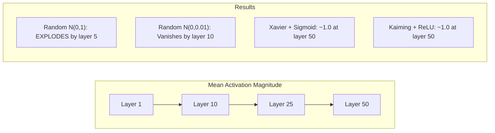
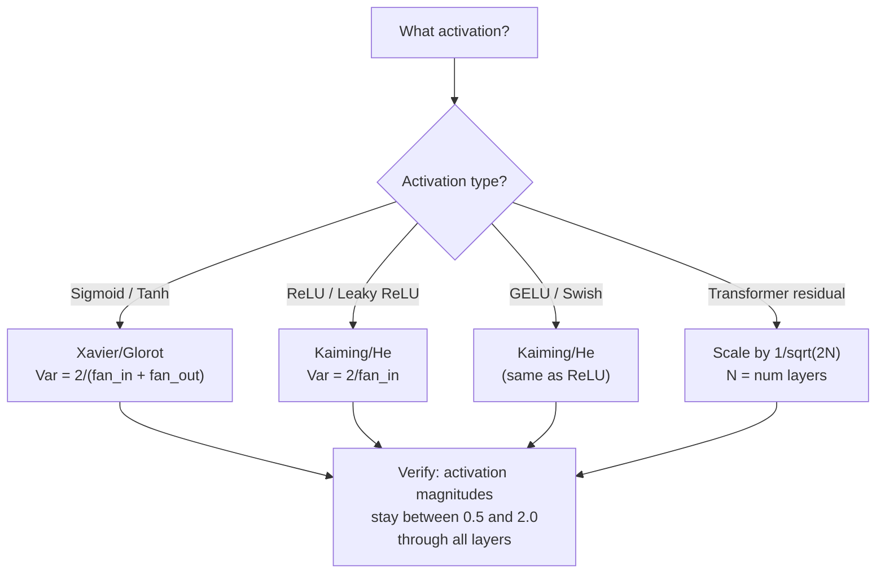

# 체중 초기화 및 훈련 안정성

> 잘못된 초기화와 훈련은 시작되지 않습니다. 올바른 초기화와 50 층의 훈련은 3만큼 원활하게됩니다.

**Type:** Build
**Languages:** Python
**Prerequisites:** Lesson 03.04 (Activation Functions), Lesson 03.07 (Regularization)
**Time:** ~90 minutes

## 학습 목표

- 0, 무작위, 자비에르/글로트, 카이밍/헤 초기화 전략을 구현하고 50 층을 통해 활성화 크기에 미치는 영향을 측정합니다
- 왜 Xavier init가 Var(w) = 2/(fan_in + fan_out) 를 사용하고 카이밍이 Var(w) = 2/fan_in을 사용하는지 알아보십시오
- 0 초기화와 함께 대칭 문제를 증명하고 무작위 규모만으로는 충분하지 않은 이유를 설명합니다.
- 올바른 초기화 전략을 활성화 함수와 일치: sigmoid/tanh에 대한 Xavier, ReLU/GELU에 대한 Kaiming

## 문제

모든 무게를 0으로 초기화하면 아무것도 배울 수 없습니다. 모든 신경 세포는 동일한 기능을 계산하고, 동일한 기하급수와 동일한 업데이트를 받습니다. 10,000 시대 후에, 512 신경 세포의 숨겨진 층은 여전히 같은 신경 세포의 512 개의 복제입니다. 당신은 512 파라미터를 지불하고 1을 얻었습니다.

너무 큰 초기화. 활성화는 네트워크를 통해 폭발합니다. 10층에 의해 값은 1e15에 도달합니다. 20층에 의해 그들은 무한으로 넘습니다. 그라디엔트는 같은 궤도를 뒤집어 따라갑니다.

표준 정상적인 분포에서 무작위로 초기화하십시오. 3 층을 위해 작동합니다. 50 층에서, 신호는 무작위 규모가 약간 작거나 약간 큰지에 따라 무궁무진으로 붕괴되거나 폭발합니다. "작업"과 "절차" 사이의 경계는 깎아도 날씬합니다.

무게 초기화는 딥러닝에서 가장 과소평가된 결정입니다. 아키텍처는 논문을 얻습니다. 최적화는 블로그 게시물을 얻습니다. 초기화는 파트노트를 얻습니다. 하지만 잘못하면 다른 것은 중요하지 않습니다. 훈련이 시작되기 전에 네트워크는 죽습니다.

## 개념

### 대칭 문제

각 신경 세포는 동일한 구조를 가지고 있습니다. 입력을 무게로 곱하고 편향을 추가하고 활성화를 적용합니다. 모든 무게가 같은 값에서 시작되면 (무는 극단적인 경우) 모든 신경 세포는 동일한 출력을 계산합니다. 후속 확산 중에, 모든 신경 세포는 동일한 기하급수를 받는다. 업데이트 단계 동안, 모든 신경 세포는 같은 양으로 변경됩니다.

여러분은 갇혀 있습니다. 네트워크는 수백개의 매개 변수를 가지고 있지만 모두 잠금 단계로 움직입니다. 이것은 대칭이라고 불립니다. 무작위 초기화는 그것을 깨는 방법입니다. 각 신경 세포는 무게 공간의 다른 지점에서 시작됩니다. 그래서 각 세포는 다른 특징을 배우습니다.

하지만 "자발"은 충분하지 않습니다. *자발성의 규모*는 네트워크가 열차하는지 여부를 결정합니다.

### 층 을 통해 변종 전파

팬_인 입력으로 한 층을 고려해보자:

```math
z = w_1 x_1 + w_2 x_2 + \cdots + w_n x_n
```

만약 각 무게가$w_i$변동된 분포에서 추출된다$\mathrm{Var}(w)$그리고 각 입력$x_i$변동이 있습니다$\mathrm{Var}(x)$, 출력 변수는:

```math
\mathrm{Var}(z) = \text{fan}_{\text{in}} \cdot \mathrm{Var}(w) \cdot \mathrm{Var}(x)
```

만약$\mathrm{Var}(w) = 1$그리고$\text{fan}_{\text{in}} = 512$, 출력 변수는 입력 변수 512x입니다. 10층 후에: $512^{10} = 1.2 \times 10^{27}$신호가 폭발했어

만약$\mathrm{Var}(w) = 0.001$, 출력 변수는 $0.001 \cdot 512 = 0.512$각 층에 10 층 후에$0.512^{10} = 0.00013$신호가 사라졌어

목표는 선택$\mathrm{Var}(w)$그래서$\mathrm{Var}(z) = \mathrm{Var}(x)$신호의 크기는 여러 층에서 일정합니다.

### 자비에르/글로트 초기화

Glorot and Bengio (2010) 은 sigmoid 및 tanh 활성화를 위한 솔루션을 도출하였다. 앞과 뒤로 합하는 양쪽에서 변수를 일정하게 유지하기 위해:

```math
\mathrm{Var}(w) = \frac{2}{\text{fan}_{\text{in}} + \text{fan}_{\text{out}}}
```

실제적으로 무게는 다음의 요소에서 따집니다.

```math
w \sim \text{Uniform}(-\text{limit}, \text{limit}) \quad \text{where } \text{limit} = \sqrt{\frac{6}{\text{fan}_{\text{in}} + \text{fan}_{\text{out}}}}
```

또는

```math
w \sim \text{Normal}\left(0, \sqrt{\frac{2}{\text{fan}_{\text{in}} + \text{fan}_{\text{out}}}}\right)
```

이것은 시그모이드와 타너가 거의 선형적이기 때문에 작동합니다.

### 카이밍/히 초기화

ReLU는 출력 절반을 죽인다 (무엇이든 부정적인 것은 0이 된다). 효과적인 fan_in는 평균적으로 출력 절반이 0이므로 절반으로 줄어들게 됩니다. Xavier init는 이것을 고려하지 않습니다.

He et al. (2015) 은 다음과 같은 공식을 조정했습니다.

```math
\mathrm{Var}(w) = \frac{2}{\text{fan}_{\text{in}}}
```

무게는 다음에서 따집니다.

```math
w \sim \text{Normal}\left(0, \sqrt{\frac{2}{\text{fan}_{\text{in}}}}\right)
```

2의 인수는 ReLU가 활성화 중 절반을 제로로 해소하는 것을 보상합니다. 그 없이는 신호는 각 층에 약 0.5x로 줄어들게 됩니다.$0.5^{50} = 8.8 \times 10^{-16}$카이밍이 이니트는 이것을 방지합니다.

### 트랜스포머 초기화

GPT-2는 다른 패턴을 도입했습니다. 잔여 연결은 각 하위 계층의 출력을 입력에 추가합니다.

```math
x = x + \text{sublayer}(x)
```

각각의 추가로 변수가 증가합니다.$N$잔류층, 변수는 $N$. GPT-2는 잔류층의 무게를 $1/\sqrt{2N}$, 어디$N$이것은 축적된 신호 크기를 안정적으로 유지합니다.

Llama 3 (405B 매개 변수, 126 층) 은 비슷한 기법을 사용한다. 이 확장 없이는 잔류 흐름은 126 층의 관심과 피드퍼드 블록을 통해 무한하게 성장할 것이다.

```mermaid
flowchart TD
    subgraph "Zero Init"
        Z1["Layer 1<br/>All weights = 0"] --> Z2["Layer 2<br/>All neurons identical"]
        Z2 --> Z3["Layer 3<br/>Still identical"]
        Z3 --> ZR["Result: 1 effective neuron<br/>regardless of width"]
    end

    subgraph "Xavier Init"
        X1["Layer 1<br/>Var = 2/(fan_in+fan_out)"] --> X2["Layer 2<br/>Signal stable"]
        X2 --> X3["Layer 50<br/>Signal stable"]
        X3 --> XR["Result: Trains with<br/>sigmoid/tanh"]
    end

    subgraph "Kaiming Init"
        K1["Layer 1<br/>Var = 2/fan_in"] --> K2["Layer 2<br/>Signal stable"]
        K2 --> K3["Layer 50<br/>Signal stable"]
        K3 --> KR["Result: Trains with<br/>ReLU/GELU"]
    end
```



### 50 층을 통해 활성화 크기는



### 올바른 마음 을 선택 하는 것



```figure
weight-init-variance
```

## 건설 해

### 단계 1: 초기화 전략

무게 매트릭스를 초기화하는 네 가지 방법. 각은 fan_in 열과 fan_out 행으로 리스트 (2D 매트릭스) 를 반환합니다.

```python
import math
import random


def zero_init(fan_in, fan_out):
    return [[0.0 for _ in range(fan_in)] for _ in range(fan_out)]


def random_init(fan_in, fan_out, scale=1.0):
    return [[random.gauss(0, scale) for _ in range(fan_in)] for _ in range(fan_out)]


def xavier_init(fan_in, fan_out):
    std = math.sqrt(2.0 / (fan_in + fan_out))
    return [[random.gauss(0, std) for _ in range(fan_in)] for _ in range(fan_out)]


def kaiming_init(fan_in, fan_out):
    std = math.sqrt(2.0 / fan_in)
    return [[random.gauss(0, std) for _ in range(fan_in)] for _ in range(fan_out)]
```

### 단계 2: 활성화 기능

우리는 각 init 전략을 의도된 활성화로 테스트하기 위해 sigmoid, tanh, ReLU를 필요로 합니다.

```python
def sigmoid(x):
    x = max(-500, min(500, x))
    return 1.0 / (1.0 + math.exp(-x))


def tanh_act(x):
    return math.tanh(x)


def relu(x):
    return max(0.0, x)
```

### 3단계: 50층을 지나 앞으로 이동

깊은 네트워크를 통해 무작위 데이터를 전달하고 각 계층에서 평균 활성화 규모를 측정합니다.

```python
def forward_deep(init_fn, activation_fn, n_layers=50, width=64, n_samples=100):
    random.seed(42)
    layer_magnitudes = []

    inputs = [[random.gauss(0, 1) for _ in range(width)] for _ in range(n_samples)]

    for layer_idx in range(n_layers):
        weights = init_fn(width, width)
        biases = [0.0] * width

        new_inputs = []
        for sample in inputs:
            output = []
            for neuron_idx in range(width):
                z = sum(weights[neuron_idx][j] * sample[j] for j in range(width)) + biases[neuron_idx]
                output.append(activation_fn(z))
            new_inputs.append(output)
        inputs = new_inputs

        magnitudes = []
        for sample in inputs:
            magnitudes.append(sum(abs(v) for v in sample) / width)
        mean_mag = sum(magnitudes) / len(magnitudes)
        layer_magnitudes.append(mean_mag)

    return layer_magnitudes
```

### 4단계: 실험

모든 조합을 실행: 0 init, 무작위 N(0,1), 무작위 N(0,0.01), 비어와 시그모이드, 비어와 타너, 카이밍과 ReLU. 키 레이어에서 크기를 인쇄하십시오.

```python
def run_experiment():
    configs = [
        ("Zero init + Sigmoid", lambda fi, fo: zero_init(fi, fo), sigmoid),
        ("Random N(0,1) + ReLU", lambda fi, fo: random_init(fi, fo, 1.0), relu),
        ("Random N(0,0.01) + ReLU", lambda fi, fo: random_init(fi, fo, 0.01), relu),
        ("Xavier + Sigmoid", xavier_init, sigmoid),
        ("Xavier + Tanh", xavier_init, tanh_act),
        ("Kaiming + ReLU", kaiming_init, relu),
    ]

    print(f"{'Strategy':<30} {'L1':>10} {'L5':>10} {'L10':>10} {'L25':>10} {'L50':>10}")
    print("-" * 80)

    for name, init_fn, act_fn in configs:
        mags = forward_deep(init_fn, act_fn)
        row = f"{name:<30}"
        for idx in [0, 4, 9, 24, 49]:
            val = mags[idx]
            if val > 1e6:
                row += f" {'EXPLODED':>10}"
            elif val < 1e-6:
                row += f" {'VANISHED':>10}"
            else:
                row += f" {val:>10.4f}"
        print(row)
```

### 단계 5: 시메트리 시연

0이 init이 동일한 신경 세포를 생성한다는 것을 보여주십시오.

```python
def symmetry_demo():
    random.seed(42)
    weights = zero_init(2, 4)
    biases = [0.0] * 4

    inputs = [0.5, -0.3]
    outputs = []
    for neuron_idx in range(4):
        z = sum(weights[neuron_idx][j] * inputs[j] for j in range(2)) + biases[neuron_idx]
        outputs.append(sigmoid(z))

    print("\nSymmetry Demo (4 neurons, zero init):")
    for i, out in enumerate(outputs):
        print(f"  Neuron {i}: output = {out:.6f}")
    all_same = all(abs(outputs[i] - outputs[0]) < 1e-10 for i in range(len(outputs)))
    print(f"  All identical: {all_same}")
    print(f"  Effective parameters: 1 (not {len(weights) * len(weights[0])})")
```

### 단계 6: 층별 대량 보고

50층을 통해 활성화 크기의 시각 바 차트를 인쇄하십시오.

```python
def magnitude_report(name, magnitudes):
    print(f"\n{name}:")
    for i, mag in enumerate(magnitudes):
        if i % 5 == 0 or i == len(magnitudes) - 1:
            if mag > 1e6:
                bar = "X" * 50 + " EXPLODED"
            elif mag < 1e-6:
                bar = "." + " VANISHED"
            else:
                bar_len = min(50, max(1, int(mag * 10)))
                bar = "#" * bar_len
            print(f"  Layer {i+1:3d}: {bar} ({mag:.6f})")
```

## 사용 하 고

PyTorch은 다음과 같은 기능들을 내장되어 제공합니다.

```python
import torch
import torch.nn as nn

layer = nn.Linear(512, 256)

nn.init.xavier_uniform_(layer.weight)
nn.init.xavier_normal_(layer.weight)

nn.init.kaiming_uniform_(layer.weight, nonlinearity='relu')
nn.init.kaiming_normal_(layer.weight, nonlinearity='relu')

nn.init.zeros_(layer.bias)
```

전화할 때`nn.Linear(512, 256)`파이토르치 (PyTorch) 는 기본적으로 카이밍 유니폼 초기화로 설정되어 있습니다. 그래서 대부분의 간단한 네트워크는 "작정 작동합니다". 파이토르치는 이미 올바른 선택을 했습니다. 하지만 사용자 지정 아키텍처를 만들거나 20층 이상의 깊이로 들어가면, 무슨 일이 일어나고 있는지 이해하고 잠재적으로 기본값을 취소해야합니다.

트랜스포머에 대해서는 HuggingFace 모델은 일반적으로 그들의 `_init_weights`GPT-2의 구현은 남은 예측을 $1/\sqrt{N}$만약 처음부터 변형을 만들려고 한다면, 이것도 직접 추가해야 합니다.

## 선박

이 교훈은 다음과 같은 결과를 낳습니다.
- `outputs/prompt-init-strategy.md`-- 체중 초기화 문제를 진단하고 올바른 전략을 추천하는

## 운동

1. LeCun 초기화 추가 ($\mathrm{Var} = 1/\text{fan}_{\text{in}}$50층 실험을 LeCun init + tanh로 실행하고 Xavier + tanh와 비교하십시오.

2. GPT-2 잔여 스케일링을 구현: 각 층의 출력을 $1/\sqrt{2N}$잔류류에 추가하기 전에 50층을 확장하고 확장하지 않고 실행하고 잔류 규모가 얼마나 빨리 성장하는지 측정합니다.

3. 네트워크의 계층 차원 및 활성화 유형을 고려한 "init 건강 검사" 기능을 생성하고, 올바른 초기화를 권장하고, 현재 init이 문제를 일으킬 경우 경고합니다.

4. 실험을 실행하세요$\text{fan} _{\text{in}} = 16$vs $\text{fan} _{\text{in}} = 1024$. Xavier와 Kaiming는 fan_in에 적응하지만, 무작위 init는 그렇지 않습니다. "운동"과 "휴가" 사이의 격차가 더 큰 층으로 어떻게 넓어지는지를 보여줍니다.

5. 정형 초기화를 구현 (자발 매트릭스를 생성하고, SVD를 계산하고, 정형 매트릭스 U를 사용)

## 주요 용어

| Term | What people say | What it actually means |
|------|----------------|----------------------|
| Weight initialization | "Set starting weights randomly" | The strategy for choosing initial weight values that determines whether a network can train at all |
| Symmetry breaking | "Make neurons different" | Using random initialization to ensure neurons learn distinct features instead of computing identical functions |
| Fan-in | "Number of inputs to a neuron" | The number of incoming connections, which determines how input variance accumulates in the weighted sum |
| Fan-out | "Number of outputs from a neuron" | The number of outgoing connections, relevant for maintaining gradient variance during backpropagation |
| Xavier/Glorot init | "The sigmoid initialization" | $\mathrm{Var}(w) = 2/(\text{fan} _{\text{in}} + \text{fan} _{\text{out}})$, designed to preserve variance through sigmoid and tanh activations |
| Kaiming/He init | "The ReLU initialization" | $\mathrm{Var}(w) = 2/\text{fan}_{\text{in}}$, accounts for ReLU zeroing half the activations |
| Variance propagation | "How signals grow or shrink through layers" | The mathematical analysis of how activation variance changes layer by layer based on weight scale |
| Residual scaling | "GPT-2's init trick" | Scaling residual connection weights by $1/\sqrt{2N}$ to prevent variance growth through $N$ transformer layers |
| Dead network | "Nothing trains" | A network where poor initialization causes all gradients to be zero or all activations to saturate |
| Exploding activations | "Values go to infinity" | When weight variance is too high, causing activation magnitudes to grow exponentially through layers |

## 더 많은 읽기

- 글로트 & 벤지오, "깊은 피드퍼드 신경망 훈련의 어려움을 이해하는 것" (2010) - 변동 분석과 함께 원래의 자비에어 초기화 논문
- 그는 "디프링 딥 풋 레티피어" (2015) - ReLU 네트워크에 대한 카이밍 초기화를 도입했습니다
- Radford et al., "언어 모델은 감독되지 않은 멀티태스 학습자" (2019) -- 잔존 스케일 초기화와 함께 GPT-2 논문
- 미쉬킨과 마타스, "All You Need is a Good Init" (2016) - 계층 순서 단위 변수 초기화, 분석 공식에 대한 경험적 대안
