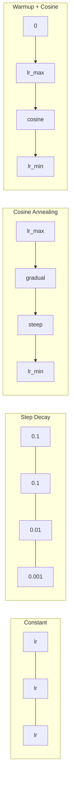
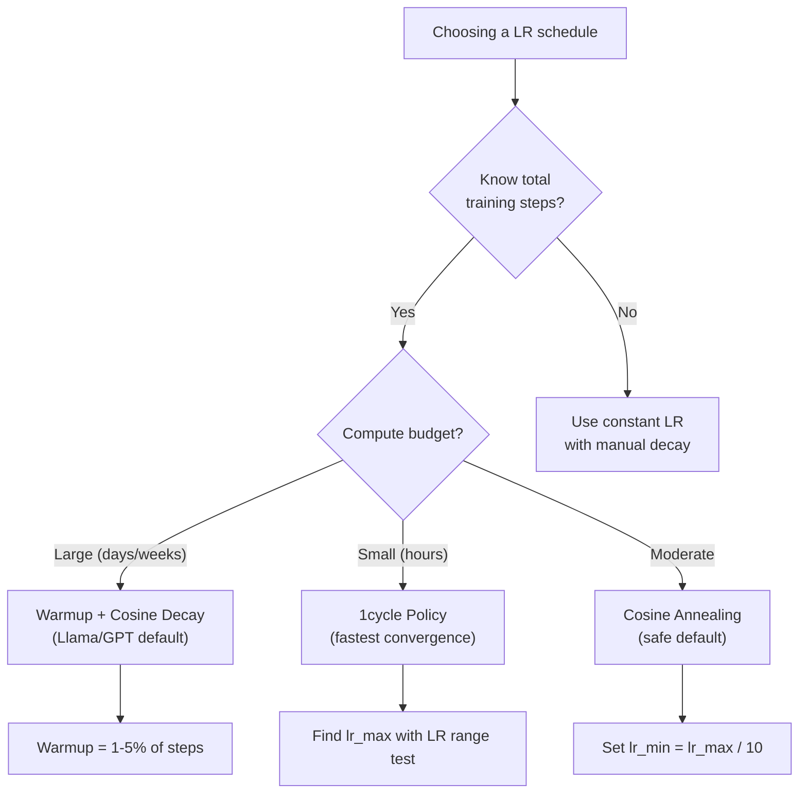
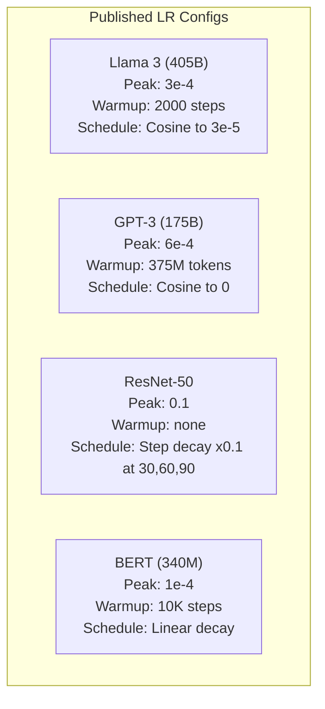

# 학습 시간표 및 온화

> 학습 속도는 가장 중요한 하이퍼파라미터입니다. 아키텍처가 아닙니다. 데이터 세트 크기가 아닙니다. 활성화 기능이 아닙니다. 학습 속도는 아닙니다. 다른 아무것도 조정하지 않으면, 이것을 조정하십시오.

**Type:** Build
**Languages:** Python
**Prerequisites:** Lesson 03.06 (Optimizers), Lesson 03.08 (Weight Initialization)
**Time:** ~90 minutes

## 학습 목표

- 일정한, 단계적 붕괴, 코시네스 화, 온화 + 코시네스 및 1주기 학습 속도 일정을 처음부터 구현
- 학습 속도 선택의 세 가지 실패 모드를 증명한다: 분화 (너무 높다), 정지 (너무 낮다) 및 오스컬레이션 (실식 없다)
- 아담 기반의 최적화 를 하는 사람 들 에게 왜 따뜻 해 주는 것 이 필요 하며, 어떻게 초기 훈련 을 안정 시키는지를 설명 하십시오
- 같은 작업에 대한 다섯 가지 일정을 모두 통한 컨버전스 속도를 비교하고 주어진 교육 예산에 적합한 일정을 선택하십시오.

## 문제

학습률을 0.1로 설정하세요. 훈련이 분화됩니다. 손실은 3단계로 무한으로 뛰어납니다. 0.0001로 설정합니다. 훈련은 탐색합니다. 100단계 후 모델은 거의 무작위로 이동하지 않습니다. 0.01로 설정합니다. 훈련은 50단계 동안 작동합니다. 그 다음 손실은 50단계로 오스틸합니다. 그 이유는 단계가 너무 큰 것이기 때문에 절대 도달할 수 없는 최소한의 수준입니다.

최적의 학습 속도는 일정하지 않습니다. 훈련 중에 변화합니다. 초기에는 큰 단계를 빠르게 덮고 싶으세요. 훈련 후에는 작은 단계를 날카로운 최소로 정착시키고 싶으세요. 90% 정확성 모델과 95% 정확성 모델 사이의 차이는 종종 일정이 됩니다.

지난 3 년 동안 발표된 모든 주요 모델은 학습 속도 스케줄을 사용합니다. Llama 3는 2000 단계의 온화 단계와 3e 5까지 코시노 붕괴로 최고 lr = 3e-4를 사용했습니다. GPT-3는 375 백만 토큰 이상의 온화 단계와 lr = 6e-4를 사용했습니다. 이것은 임의의 선택이 아닙니다. 그들은 수백만 달러의 비용을 지불하는 광범위한 하이퍼 파라미터 스래프의 결과입니다.

일정을 이해해야 합니다. 기본 설정이 문제 해결을 하지 않기 때문입니다. 미리 훈련된 모델을 정비할 때, 올바른 일정은 처음부터 훈련하는 것과 다릅니다. 배치를 늘리면 온화 기간이 바뀌어야 합니다. 훈련이 10,000 단계로 중단되면 일정이 문제인지 다른 것인지 알아야 합니다.

## 개념

### 끊임없이 배우는 비율

가장 간단한 방법은 숫자를 선택하고, 모든 단계에 사용하세요.

```math
\text{lr}(t) = \text{lr}_0
```

거의 최적의 경우도 없습니다. 훈련의 끝에는 너무 높습니다 (최저의 오스킬레이션) 또는 시작에는 너무 낮습니다 (단계 단계에 낭비된 계산). 작은 모델과 디버깅에 좋습니다. 1 시간 이상 훈련하는 모든 것에 끔찍한 선택입니다.

### 단계적 붕괴

ResNet 시대에서 온 구식 방식. 고정된 시대에서 학습 속도를 한 가지 요인으로 (일반적으로 10배) 줄입니다.

```math
\text{lr}(t) = \text{lr}_0 \cdot \gamma^{\lfloor \text{epoch} / \text{step\_size} \rfloor}
```

어디$\gamma = 0.1$그리고 step_size = 30는 lr가 30시마다 10x 감소한다는 것을 의미합니다. ResNet-50는 이것을 사용했습니다. lr=0.1, 30, 60 및 90시대에 10x 감소합니다.

문제는: 최적의 붕괴점은 데이터 세트와 아키텍처에 달려 있습니다. 다른 문제에 이동하고, 언제 떨어지는지 다시 조정해야 합니다. 전환은 급격합니다. 급격한 속도로 변화하면 손실이 급증할 수 있습니다.

### 코시네 애네일링

코시네 곡선을 따라 최대 학습 속도에서 최소로 부드러운 붕괴:

```math
\text{lr}(t) = \text{lr}_{\min} + 0.5 \cdot (\text{lr}_{\max} - \text{lr}_{\min}) \cdot \left(1 + \cos\left(\frac{\pi t}{T}\right)\right)
```

어디$t$현재 단계입니다.$T$단계의 총수입니다.

$t=0$, 코시노 용어는 1입니다$\text{lr} = \text{lr} _{\max}$- $t=T$, 코시노스 용어는 -1입니다$\text{lr} = \text{lr} _{\min}$붕괴는 처음에는 부드럽고, 중간에서 가속화되고, 끝에서 다시 부드럽습니다.

이것은 대부분의 현대 훈련 경기의 기본입니다. 더 이상 조정할 수 있는 하이퍼파레머가 없습니다.$\text{lr} _{\max}$그리고$\text{lr} _{\min}$코시네 형태는 경험적 관찰에 맞게 이루어집니다. 대부분의 학습은 훈련 중간에 이루어집니다.

### 따뜻 해 주는 것: 왜 작은 것 으로 시작 해야 합니까?

아담과 다른 적응 최적화자는 gradient 평균과 변이의 실행 추정치를 유지합니다. 단계 0에서 이러한 추정치는 0으로 초기화됩니다. 첫 몇 가지 gradient 업데이트는 쓰레기 통계에 기초합니다. 이 기간 동안 학습 속도가 높으면 모델은 거대한, 잘못된 방향을 제시하는 단계를 수행합니다.

이 문제를 해결하기 위해, 작은 학습 속도 (일반적으로 lr_max / warmup_steps 또는 심지어 0) 를 시작하여 선형적으로 을 니다.$\text{lr}_{\max}$첫 번째$N$학습률을 충분히 달성할 때, 아담의 통계는 안정화되었습니다.

```math
\text{lr}(t) = \text{lr}_{\max} \cdot \frac{t}{\text{warmup\_steps}} \quad \text{for } t < \text{warmup\_steps}
```

전형적인 온화: 전체 훈련 단계의 1-5%. Llama 3는 약 1.8조 개의 토큰을 훈련시키고 2000 단계에 온화했습니다. GPT-3는 375 백만 개의 토큰을 온화했습니다.

### 선형 온난화 + 코시네 붕괴

현대적인 기본 방식은 선형적으로 램프를 올려서 코시네로 붕괴합니다.

```
if t < warmup_steps:
    lr(t) = lr_max * (t / warmup_steps)
else:
    progress = (t - warmup_steps) / (total_steps - warmup_steps)
    lr(t) = lr_min + 0.5 * (lr_max - lr_min) * (1 + cos(pi * progress))
```

이것은 Llama, GPT, PaLM, 그리고 대부분의 현대 트랜스포머가 사용하는 것입니다. 온화화 초기 불안정을 방지합니다. 코시네스 붕괴는 모델을 좋은 최소로 설정합니다.

### 1주기 정책

레슬리 스미스의 발견 (2018): 훈련의 첫 반기에 학습률이 낮은 값에서 높은 값으로 증가하고, 후반기에 다시 감소합니다. 직관과는 달리 - 왜 학습률을 중간쯤에서 높일까요?

이론: 높은 학습률은 최적화 궤도에 소음을 추가함으로써 규칙화 역할을 한다. 모델은 램프업 단계 동안 손실 풍경을 더 많이 탐구하여 더 나은 저수지를 찾습니다. 램프다운 단계는 가장 좋은 저수지를 찾습니다.

```
Phase 1 (0 to T/2):    lr ramps from lr_max/25 to lr_max
Phase 2 (T/2 to T):    lr ramps from lr_max to lr_max/10000
```

1사이클은 일정한 계산 예산에 있어서 코시네스 링보다 더 빠른 열차를 합니다.

### 스케줄 모양



### 결정 흐름표



### 출판 된 모델 에서 실제 숫자



```figure
lr-schedule
```

## 건설 해

### 단계 1: 일정을 정하는 일

각각의 함수는 현재 단계를 거쳐 그 단계에서의 학습 속도를 반환합니다.

```python
import math


def constant_schedule(step, lr=0.01, **kwargs):
    return lr


def step_decay_schedule(step, lr=0.1, step_size=100, gamma=0.1, **kwargs):
    return lr * (gamma ** (step // step_size))


def cosine_schedule(step, lr=0.01, total_steps=1000, lr_min=1e-5, **kwargs):
    if step >= total_steps:
        return lr_min
    return lr_min + 0.5 * (lr - lr_min) * (1 + math.cos(math.pi * step / total_steps))


def warmup_cosine_schedule(step, lr=0.01, total_steps=1000, warmup_steps=100, lr_min=1e-5, **kwargs):
    if total_steps <= warmup_steps:
        return lr * (step / max(warmup_steps, 1))
    if step < warmup_steps:
        return lr * step / warmup_steps
    progress = (step - warmup_steps) / (total_steps - warmup_steps)
    return lr_min + 0.5 * (lr - lr_min) * (1 + math.cos(math.pi * progress))


def one_cycle_schedule(step, lr=0.01, total_steps=1000, **kwargs):
    mid = max(total_steps // 2, 1)
    if step < mid:
        return (lr / 25) + (lr - lr / 25) * step / mid
    else:
        progress = (step - mid) / max(total_steps - mid, 1)
        return lr * (1 - progress) + (lr / 10000) * progress
```

### 2단계: 모든 일정을 시각화 하십시오

각 교육 시간표가 훈련 기간 동안 어떻게 발전하는지 보여주는 텍스트 기반의 일면을 인쇄하십시오.

```python
def visualize_schedule(name, schedule_fn, total_steps=500, **kwargs):
    steps = list(range(0, total_steps, total_steps // 20))
    if total_steps - 1 not in steps:
        steps.append(total_steps - 1)

    lrs = [schedule_fn(s, total_steps=total_steps, **kwargs) for s in steps]
    max_lr = max(lrs) if max(lrs) > 0 else 1.0

    print(f"\n{name}:")
    for s, lr_val in zip(steps, lrs):
        bar_len = int(lr_val / max_lr * 40)
        bar = "#" * bar_len
        print(f"  Step {s:4d}: lr={lr_val:.6f} {bar}")
```

### 3단계: 훈련 네트워크

순환 데이터 세트에 간단한 2층 네트워크, 이전 수업과 같은 것, 하지만 이제 우리는 일정을 변경합니다.

```python
import random


def sigmoid(x):
    x = max(-500, min(500, x))
    return 1.0 / (1.0 + math.exp(-x))


def relu(x):
    return max(0.0, x)


def relu_deriv(x):
    return 1.0 if x > 0 else 0.0


def make_circle_data(n=200, seed=42):
    random.seed(seed)
    data = []
    for _ in range(n):
        x = random.uniform(-2, 2)
        y = random.uniform(-2, 2)
        label = 1.0 if x * x + y * y < 1.5 else 0.0
        data.append(([x, y], label))
    return data


def train_with_schedule(schedule_fn, schedule_name, data, epochs=300, base_lr=0.05, **kwargs):
    random.seed(0)
    hidden_size = 8
    total_steps = epochs * len(data)

    std = math.sqrt(2.0 / 2)
    w1 = [[random.gauss(0, std) for _ in range(2)] for _ in range(hidden_size)]
    b1 = [0.0] * hidden_size
    w2 = [random.gauss(0, std) for _ in range(hidden_size)]
    b2 = 0.0

    step = 0
    epoch_losses = []

    for epoch in range(epochs):
        total_loss = 0
        correct = 0

        for x, target in data:
            lr = schedule_fn(step, lr=base_lr, total_steps=total_steps, **kwargs)

            z1 = []
            h = []
            for i in range(hidden_size):
                z = w1[i][0] * x[0] + w1[i][1] * x[1] + b1[i]
                z1.append(z)
                h.append(relu(z))

            z2 = sum(w2[i] * h[i] for i in range(hidden_size)) + b2
            out = sigmoid(z2)

            error = out - target
            d_out = error * out * (1 - out)

            for i in range(hidden_size):
                d_h = d_out * w2[i] * relu_deriv(z1[i])
                w2[i] -= lr * d_out * h[i]
                for j in range(2):
                    w1[i][j] -= lr * d_h * x[j]
                b1[i] -= lr * d_h
            b2 -= lr * d_out

            total_loss += (out - target) ** 2
            if (out >= 0.5) == (target >= 0.5):
                correct += 1
            step += 1

        avg_loss = total_loss / len(data)
        accuracy = correct / len(data) * 100
        epoch_losses.append(avg_loss)

    return epoch_losses
```

### 4단계: 모든 일정을 비교 하십시오

각각의 스케줄과 같은 네트워크를 훈련시키고 최종 손실과 컨버전스 행동을 비교하십시오.

```python
def compare_schedules(data):
    configs = [
        ("Constant", constant_schedule, {}),
        ("Step Decay", step_decay_schedule, {"step_size": 15000, "gamma": 0.1}),
        ("Cosine", cosine_schedule, {"lr_min": 1e-5}),
        ("Warmup+Cosine", warmup_cosine_schedule, {"warmup_steps": 3000, "lr_min": 1e-5}),
        ("1cycle", one_cycle_schedule, {}),
    ]

    print(f"\n{'Schedule':<20} {'Start Loss':>12} {'Mid Loss':>12} {'End Loss':>12} {'Best Loss':>12}")
    print("-" * 70)

    for name, schedule_fn, extra_kwargs in configs:
        losses = train_with_schedule(schedule_fn, name, data, epochs=300, base_lr=0.05, **extra_kwargs)
        mid_idx = len(losses) // 2
        best = min(losses)
        print(f"{name:<20} {losses[0]:>12.6f} {losses[mid_idx]:>12.6f} {losses[-1]:>12.6f} {best:>12.6f}")
```

### 단계 5: LR 너무 높고 너무 낮

3가지 실패 모드를 보여드리겠습니다. 너무 높다 (차각), 너무 낮다 (가다) 그리고 바로 맞습니다.

```python
def lr_sensitivity(data):
    learning_rates = [1.0, 0.1, 0.01, 0.001, 0.0001]

    print("\nLR Sensitivity (constant schedule, 100 epochs):")
    print(f"  {'LR':>10} {'Start Loss':>12} {'End Loss':>12} {'Status':>15}")
    print("  " + "-" * 52)

    for lr in learning_rates:
        losses = train_with_schedule(constant_schedule, f"lr={lr}", data, epochs=100, base_lr=lr)
        start = losses[0]
        end = losses[-1]

        if end > start or math.isnan(end) or end > 1.0:
            status = "DIVERGED"
        elif end > start * 0.9:
            status = "BARELY MOVED"
        elif end < 0.15:
            status = "CONVERGED"
        else:
            status = "LEARNING"

        end_str = f"{end:.6f}" if not math.isnan(end) else "NaN"
        print(f"  {lr:>10.4f} {start:>12.6f} {end_str:>12} {status:>15}")
```

## 사용 하 고

파이토르치는 `torch.optim.lr_scheduler`이 부분의 본문은

```python
import torch
import torch.optim as optim
from torch.optim.lr_scheduler import CosineAnnealingLR, OneCycleLR, StepLR

model = nn.Sequential(nn.Linear(10, 64), nn.ReLU(), nn.Linear(64, 1))
optimizer = optim.Adam(model.parameters(), lr=3e-4)

scheduler = CosineAnnealingLR(optimizer, T_max=1000, eta_min=1e-5)

for step in range(1000):
    loss = train_step(model, optimizer)
    scheduler.step()
```

온화 + 코시네를 위해 람다 스케줄러 또는 `get_cosine_schedule_with_warmup`HuggingFace에서

```python
from transformers import get_cosine_schedule_with_warmup

scheduler = get_cosine_schedule_with_warmup(
    optimizer,
    num_warmup_steps=2000,
    num_training_steps=100000,
)
```

HuggingFace 기능은 대부분의 Llama 및 GPT 정렬 스크립트에서 사용하는 기능입니다. 의심할 때, 온화 + 온화와 함께 코시네를 사용하십시오 = 전체 단계의 3-5%. 거의 모든 데 효과가 있습니다.

## 선박

이 교훈은 다음과 같은 결과를 낳습니다.
- `outputs/prompt-lr-schedule-advisor.md`-- 교육 설정에 적합한 학습 속도 스케줄과 하이퍼파레머를 추천하는

## 운동

1. 기하급수적 붕괴를 구현: $\text{lr}(t) = \text{lr}_0 \cdot \gamma^t$어디$\gamma = 0.999$. 원형 데이터 세트에 있는 코시네스 을 비교해 보세요.

2. 학습 속도 범위 테스트 (레슬리 스미스) 를 실행하십시오. LR를 1e-7에서 1으로 기하급수적으로 증가시키는 동안 몇 백 단계에 훈련하십시오.

3. 온화 + 코시네로 훈련하지만 온화 길이를 변화시킵니다. 0%, 1%, 5%, 10%, 전체 단계의 20%

4. 따뜻한 재발전 (SGDR) 을 통해 코시네 앵글링을 구현: 학습 속도를 다시 설정하여 $\text{lr}_{\max}$모든$T$더 긴 훈련에서 표준 코시네와 비교해 보세요.

5. 훈련 손실을 모니터링하고 손실이 안정되면 자동으로 온화에서 코시네로 전환하는 "예술계획 외과의사"를 구축하고 손실이 너무 오래 지속되면 IR를 줄입니다.

## 주요 용어

| Term | What people say | What it actually means |
|------|----------------|----------------------|
| Learning rate | "How fast the model learns" | The scalar that multiplies the gradient to determine the parameter update size |
| Schedule | "Change the LR over time" | A function that maps training step to learning rate, designed to optimize convergence |
| Warmup | "Start with a small LR" | Linearly ramping the LR from near-zero to the target value over the first $N$ steps to stabilize optimizer statistics |
| Cosine annealing | "Smooth LR decay" | Decreasing the LR following a cosine curve from $\text{lr} _{\max}$ to $\text{lr} _{\min}$ over training |
| Step decay | "Drop LR at milestones" | Multiplying the LR by a factor (usually 0.1) at fixed epoch intervals |
| 1cycle policy | "Up then down" | Leslie Smith's method of ramping LR up then down in a single cycle for faster convergence |
| LR range test | "Find the best learning rate" | Training briefly while increasing LR to find the value where loss starts diverging |
| Cosine with warm restarts | "Reset and repeat" | Periodically resetting the LR to $\text{lr} _{\max}$ and decaying again (SGDR) |
| Eta min | "The floor for the LR" | The minimum learning rate that the schedule decays to |
| Peak learning rate | "The maximum LR" | The highest LR reached during training, typically after warmup |

## 더 많은 읽기

- 로시올로프 & 허터, "SGDR: Stochastic Gradient Descent with Warm Restarts" (2017) -- 코시노 반전과 따뜻한 재발전을 도입
- 스미스, "슈퍼 컨버전스: 큰 학습률을 이용한 신경망의 매우 빠른 훈련" (2018) -- 1주기 정책 논문
- 토브론等人, "Llama 2: 오픈 재단 및 피니-튜닝 채팅 모델" (2023) - 규모로 사용되는 온화 + 코시네 스케줄을 문서화
- 고얄等人, "정확하고 큰 미니배치 SGD: 1시간 동안 훈련 이미지넷" (2017) -- 선형 스케일링 규칙과 큰 배치 훈련에 대한 온화
