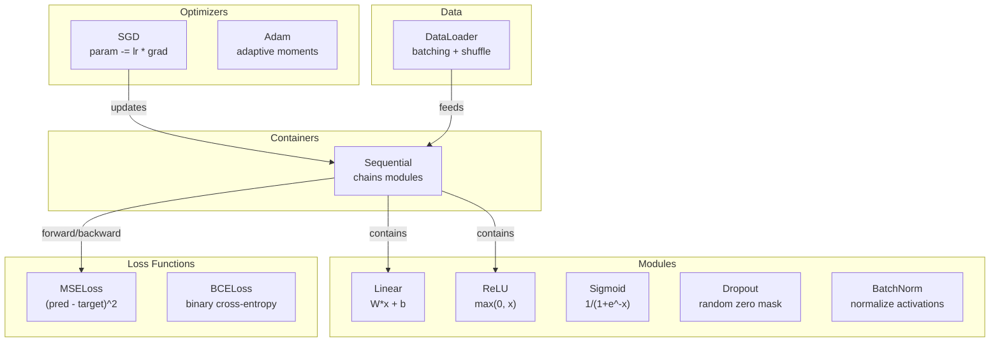
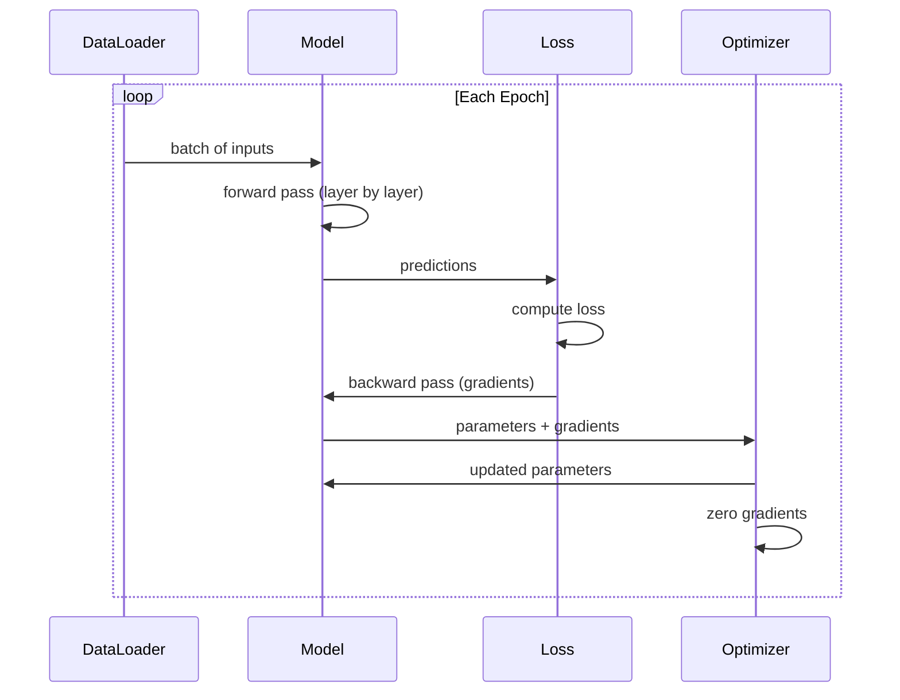
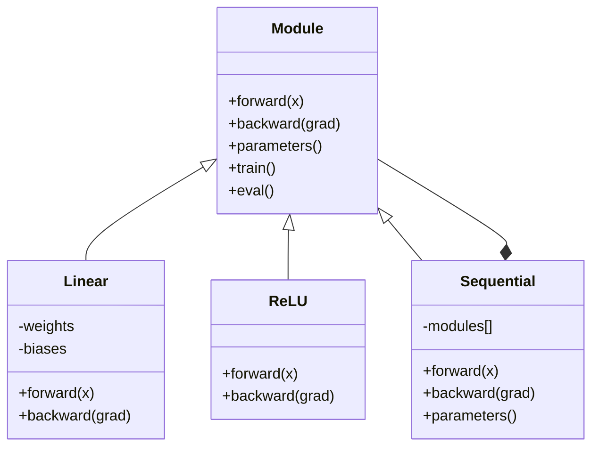

# 자신만의 미니 프레임워크를 만들어 보세요

> 신경 세포, 계층, 네트워크, 백프록, 활성화, 손실 함수, 최적화, 정규화, 초기화, LR 스케줄을 모두 분리된 조각으로 만들었습니다. 이제 그것들을 프레임워크로 연결하세요. PyTorch가 아니라 TensorFlow가 아닙니다. 여러분의 것입니다.

**Type:** Build
**Languages:** Python
**Prerequisites:** All of Phase 03 (Lessons 01-09)
**Time:** ~120 minutes

## 학습 목표

- 모듈, 라인어, ReLU, Sigmoid, Dropout, BatchNorm, Sequential, 손실 기능, 최적화 및 DataLoader로 완전한 딥러닝 프레임워크 (~500 라인) 를 구축하십시오
- 모듈 추상 (앞으로, 뒤로, 매개 변수) 을 설명하고, 기차/바퀴 모드 전환이 필요한 이유
- 모든 구성 요소를 4 층 네트워크에 서클 분류를 훈련시키는 작동 훈련 루프에 연결합니다
- 프레임워크의 각 구성 요소를 PyTorch 동등 (nn.Module, nn.Sequential, optim.Adam, DataLoader) 로 지도하십시오.

## 문제

여러분은 10개의 건축물들을 각각 다른 파일로 흩어져 있는 수업을 듣습니다.`Value`여기 수업, 여기 훈련 루프, 다른 파일에서 무게 초기화, 또 다른 파일에서 학습 속도 스케줄. 네트워크를 훈련하려면 5개의 다른 수업을 복사하고 붙여서 손으로 연결합니다.

프레임워크가 해결하는 것은 바로 그것입니다.`nn.Module``nn.Sequential``optim.Adam``DataLoader`그리고 훈련 루프 패턴으로 연결합니다.`keras.Layer``keras.Sequential``keras.optimizers.Adam`이것은 마법이 아닙니다. 그것들은 조직 패턴입니다. 이는 매번 파이프링을 재발견하지 않고도 네트워크를 정의하고 훈련하고 평가하는 것을 가능하게 합니다.

파이썬의 500 줄에 같은 것을 만들 것입니다. 이 없습니다. 외부 의존도 없습니다. 어떤 피드퍼드 네트워크를 정의할 수 있는 프레임워크, SGD 또는 아담으로 훈련, 데이터를 배치, 드롭아웃 및 배치 정상화를 적용, 어떤 활성화를 사용, 학습 속도를 일정이 가능합니다.

당신이 끝낼 때, 당신이 글을 쓸 때 무슨 일이 일어나는지 정확히 이해할 것입니다.`model = nn.Sequential(...)`피토르치에서 왜 그런지 이해하실 겁니다`model.train()`그리고`model.eval()`왜 존재하는지 이해하실 겁니다.`optimizer.zero_grad()`모든 것을 이해하실 겁니다. 왜냐하면 여러분이 모든 것을 만들어냈기 때문입니다.

## 개념

### 모듈 추상

피토르치의 모든 층은`nn.Module`모듈은 세 가지 책임을 다합니다.

1. **forward()**-- 입력된 출력을 계산
2. **parameters()**-- 모든 훈련 가능한 무게를 반환
3. **backward()**-- 계산 gradients (PyTorch에서 autograd에 의해 처리, 우리의에서 명시적으로)

선형층은 모듈이다. ReLU 활성화는 모듈이다. 방출층은 모듈이다. 대량 정상화층은 모듈이다. 모두 동일한 인터페이스를 가지고 있다.

### 순서적 컨테이너

`nn.Sequential`선 모듈. 앞으로 전달: 모듈 1을 통해 입력 데이터, 그리고 모듈 2, 그리고 모듈 3. 뒤로 전달: 체인을 역전. 컨테이너 자체는 모듈입니다. 그것은 앞으로 (), 매개 변수를 (), 그리고 뒤로 (), 그리고). 이것은 복합 패턴입니다: 모듈의 순서 자체가 모듈입니다.

### 훈련과 평가 방식

드롭트 (dropout) 는 훈련 중에 무작위로 신경 세포를 제로로 처리하지만 평가 중에 모든 것을 통과합니다.`train()`그리고`eval()`이 동작을 전환하는 방법들. 모든 모듈에는`training`깃발

### 최적화

최적화 장치 는 그 기하급수 를 사용하여 매개 변수를 업데이트 합니다.`param -= lr * grad`아담: 운동량과 변동성 추정치를 유지하고, 업데이트합니다. 최적화자는 네트워크 아키텍처를 알지 못합니다.

### 데이터 로더

배팅은 두 가지 이유로 중요합니다. 첫째, 큰 문제로 인해 전체 데이터 세트를 메모리에 넣을 수 없습니다. 둘째, 미니 배트 계층 하락은 지역 최소에서 벗어날 수 있도록 소음을 제공합니다. 데이터 로더는 데이터를 배트로 나눕니다. 선택적으로 시대 간 혼합합니다.

### 프레임워크 아키텍처



### 훈련 로프



### 모듈 계층



```figure
gradient-clipping
```

## 건설 해

### 단계 1: 모듈 기본 클래스

각 층이 구현하는 추상 인터페이스입니다.

```python
class Module:
    def __init__(self):
        self.training = True

    def forward(self, x):
        raise NotImplementedError

    def backward(self, grad):
        raise NotImplementedError

    def parameters(self):
        return []

    def train(self):
        self.training = True

    def eval(self):
        self.training = False
```

### 단계 2: 선형 층

기본 구성 블록. 무게와 편향을 저장하고, Wx + b를 앞으로 계산하고, 무게/입입입 기하급수 등을 뒤로 계산합니다.

```python
import math
import random


class Linear(Module):
    def __init__(self, fan_in, fan_out):
        super().__init__()
        std = math.sqrt(2.0 / fan_in)
        self.weights = [[random.gauss(0, std) for _ in range(fan_in)] for _ in range(fan_out)]
        self.biases = [0.0] * fan_out
        self.weight_grads = [[0.0] * fan_in for _ in range(fan_out)]
        self.bias_grads = [0.0] * fan_out
        self.fan_in = fan_in
        self.fan_out = fan_out
        self.input = None

    def forward(self, x):
        self.input = x
        output = []
        for i in range(self.fan_out):
            val = self.biases[i]
            for j in range(self.fan_in):
                val += self.weights[i][j] * x[j]
            output.append(val)
        return output

    def backward(self, grad):
        input_grad = [0.0] * self.fan_in
        for i in range(self.fan_out):
            self.bias_grads[i] += grad[i]
            for j in range(self.fan_in):
                self.weight_grads[i][j] += grad[i] * self.input[j]
                input_grad[j] += grad[i] * self.weights[i][j]
        return input_grad

    def parameters(self):
        params = []
        for i in range(self.fan_out):
            for j in range(self.fan_in):
                params.append((self.weights, i, j, self.weight_grads))
            params.append((self.biases, i, None, self.bias_grads))
        return params
```

### 단계 3: 활성화 모듈

ReLU, Sigmoid, Tanh는 모듈로 각각은 후퇴 패스에 필요한 것을 저장합니다.

```python
class ReLU(Module):
    def __init__(self):
        super().__init__()
        self.mask = None

    def forward(self, x):
        self.mask = [1.0 if v > 0 else 0.0 for v in x]
        return [max(0.0, v) for v in x]

    def backward(self, grad):
        return [g * m for g, m in zip(grad, self.mask)]


class Sigmoid(Module):
    def __init__(self):
        super().__init__()
        self.output = None

    def forward(self, x):
        self.output = []
        for v in x:
            v = max(-500, min(500, v))
            self.output.append(1.0 / (1.0 + math.exp(-v)))
        return self.output

    def backward(self, grad):
        return [g * o * (1 - o) for g, o in zip(grad, self.output)]


class Tanh(Module):
    def __init__(self):
        super().__init__()
        self.output = None

    def forward(self, x):
        self.output = [math.tanh(v) for v in x]
        return self.output

    def backward(self, grad):
        return [g * (1 - o * o) for g, o in zip(grad, self.output)]
```

### 단계 4: 기 모듈

훈련 중에 무작위로 요소를 제로로 합니다. 남은 요소를 1/(1-p) 로 스케일하여 예상 값은 동일하게 유지됩니다. eval 동안 아무것도 하지 않습니다.

```python
class Dropout(Module):
    def __init__(self, p=0.5):
        super().__init__()
        self.p = p
        self.mask = None

    def forward(self, x):
        if not self.training:
            return x
        self.mask = [0.0 if random.random() < self.p else 1.0 / (1 - self.p) for _ in x]
        return [v * m for v, m in zip(x, self.mask)]

    def backward(self, grad):
        if self.mask is None:
            return grad
        return [g * m for g, m in zip(grad, self.mask)]
```

### 단계 5: 배트 노먼 모듈

패치 전체에 있는 기능별 평균 및 단위 변수를 0으로 정상화하고, eval 모드에서 실행된 통계를 유지합니다.

```python
class BatchNorm(Module):
    def __init__(self, size, momentum=0.1, eps=1e-5):
        super().__init__()
        self.size = size
        self.gamma = [1.0] * size
        self.beta = [0.0] * size
        self.gamma_grads = [0.0] * size
        self.beta_grads = [0.0] * size
        self.running_mean = [0.0] * size
        self.running_var = [1.0] * size
        self.momentum = momentum
        self.eps = eps
        self.x_norm = None
        self.std_inv = None
        self.batch_input = None

    def forward_batch(self, batch):
        batch_size = len(batch)
        output_batch = []

        if self.training:
            mean = [0.0] * self.size
            for sample in batch:
                for j in range(self.size):
                    mean[j] += sample[j]
            mean = [m / batch_size for m in mean]

            var = [0.0] * self.size
            for sample in batch:
                for j in range(self.size):
                    var[j] += (sample[j] - mean[j]) ** 2
            var = [v / batch_size for v in var]

            self.std_inv = [1.0 / math.sqrt(v + self.eps) for v in var]

            self.x_norm = []
            self.batch_input = batch
            for sample in batch:
                normed = [(sample[j] - mean[j]) * self.std_inv[j] for j in range(self.size)]
                self.x_norm.append(normed)
                output = [self.gamma[j] * normed[j] + self.beta[j] for j in range(self.size)]
                output_batch.append(output)

            for j in range(self.size):
                self.running_mean[j] = (1 - self.momentum) * self.running_mean[j] + self.momentum * mean[j]
                self.running_var[j] = (1 - self.momentum) * self.running_var[j] + self.momentum * var[j]
        else:
            std_inv = [1.0 / math.sqrt(v + self.eps) for v in self.running_var]
            for sample in batch:
                normed = [(sample[j] - self.running_mean[j]) * std_inv[j] for j in range(self.size)]
                output = [self.gamma[j] * normed[j] + self.beta[j] for j in range(self.size)]
                output_batch.append(output)

        return output_batch

    def forward(self, x):
        result = self.forward_batch([x])
        return result[0]

    def backward(self, grad):
        if self.x_norm is None:
            return grad
        for j in range(self.size):
            self.gamma_grads[j] += self.x_norm[0][j] * grad[j]
            self.beta_grads[j] += grad[j]
        return [grad[j] * self.gamma[j] * self.std_inv[j] for j in range(self.size)]

    def parameters(self):
        params = []
        for j in range(self.size):
            params.append((self.gamma, j, None, self.gamma_grads))
            params.append((self.beta, j, None, self.beta_grads))
        return params
```

### 단계 6: 순서적 컨테이너

체인 모듈, 앞으로 왼쪽에서 오른쪽으로, 뒤로 오른쪽으로

```python
class Sequential(Module):
    def __init__(self, *modules):
        super().__init__()
        self.modules = list(modules)

    def forward(self, x):
        for module in self.modules:
            x = module.forward(x)
        return x

    def backward(self, grad):
        for module in reversed(self.modules):
            grad = module.backward(grad)
        return grad

    def parameters(self):
        params = []
        for module in self.modules:
            params.extend(module.parameters())
        return params

    def train(self):
        self.training = True
        for module in self.modules:
            module.train()

    def eval(self):
        self.training = False
        for module in self.modules:
            module.eval()
```

### 7단계: 기능 상실

MSE와 바이너리 크로스 엔트로피. 각각 손실 값을 반환하고 그 기하급수를 반환하는 후퇴를 제공합니다.

```python
class MSELoss:
    def __call__(self, predicted, target):
        self.predicted = predicted
        self.target = target
        n = len(predicted)
        self.loss = sum((p - t) ** 2 for p, t in zip(predicted, target)) / n
        return self.loss

    def backward(self):
        n = len(self.predicted)
        return [2 * (p - t) / n for p, t in zip(self.predicted, self.target)]


class BCELoss:
    def __call__(self, predicted, target):
        self.predicted = predicted
        self.target = target
        eps = 1e-7
        n = len(predicted)
        self.loss = 0
        for p, t in zip(predicted, target):
            p = max(eps, min(1 - eps, p))
            self.loss += -(t * math.log(p) + (1 - t) * math.log(1 - p))
        self.loss /= n
        return self.loss

    def backward(self):
        eps = 1e-7
        n = len(self.predicted)
        grads = []
        for p, t in zip(self.predicted, self.target):
            p = max(eps, min(1 - eps, p))
            grads.append((-t / p + (1 - t) / (1 - p)) / n)
        return grads
```

### 단계 8: SGD 및 아담 최적화

둘 다 매개 변수 목록을 가지고 gradients를 사용하여 무게를 업데이트합니다.

```python
class SGD:
    def __init__(self, parameters, lr=0.01):
        self.params = parameters
        self.lr = lr

    def step(self):
        for container, i, j, grad_container in self.params:
            if j is not None:
                container[i][j] -= self.lr * grad_container[i][j]
            else:
                container[i] -= self.lr * grad_container[i]

    def zero_grad(self):
        for container, i, j, grad_container in self.params:
            if j is not None:
                grad_container[i][j] = 0.0
            else:
                grad_container[i] = 0.0


class Adam:
    def __init__(self, parameters, lr=0.001, beta1=0.9, beta2=0.999, eps=1e-8):
        self.params = parameters
        self.lr = lr
        self.beta1 = beta1
        self.beta2 = beta2
        self.eps = eps
        self.t = 0
        self.m = [0.0] * len(parameters)
        self.v = [0.0] * len(parameters)

    def step(self):
        self.t += 1
        for idx, (container, i, j, grad_container) in enumerate(self.params):
            if j is not None:
                g = grad_container[i][j]
            else:
                g = grad_container[i]

            self.m[idx] = self.beta1 * self.m[idx] + (1 - self.beta1) * g
            self.v[idx] = self.beta2 * self.v[idx] + (1 - self.beta2) * g * g

            m_hat = self.m[idx] / (1 - self.beta1 ** self.t)
            v_hat = self.v[idx] / (1 - self.beta2 ** self.t)

            update = self.lr * m_hat / (math.sqrt(v_hat) + self.eps)

            if j is not None:
                container[i][j] -= update
            else:
                container[i] -= update

    def zero_grad(self):
        for container, i, j, grad_container in self.params:
            if j is not None:
                grad_container[i][j] = 0.0
            else:
                grad_container[i] = 0.0
```

### 9 단계: 데이터 로더

데이터를 대량으로 나눈 후 선택적으로 각 시대를 섞습니다.

```python
class DataLoader:
    def __init__(self, data, batch_size=32, shuffle=True):
        self.data = data
        self.batch_size = batch_size
        self.shuffle = shuffle

    def __iter__(self):
        indices = list(range(len(self.data)))
        if self.shuffle:
            random.shuffle(indices)
        for start in range(0, len(indices), self.batch_size):
            batch_indices = indices[start:start + self.batch_size]
            batch = [self.data[i] for i in batch_indices]
            inputs = [item[0] for item in batch]
            targets = [item[1] for item in batch]
            yield inputs, targets

    def __len__(self):
        return (len(self.data) + self.batch_size - 1) // self.batch_size
```

### 단계 10: 회로 분류에 관한 4층 네트워크 훈련

모든 것을 연결해 놓아 모델을 정의하고, 손실을 선택하고, 최적화기를 선택하고, 훈련 루프를 실행합니다.

```python
def make_circle_data(n=500, seed=42):
    random.seed(seed)
    data = []
    for _ in range(n):
        x = random.uniform(-2, 2)
        y = random.uniform(-2, 2)
        label = 1.0 if x * x + y * y < 1.5 else 0.0
        data.append(([x, y], [label]))
    return data


def train():
    random.seed(42)

    model = Sequential(
        Linear(2, 16),
        ReLU(),
        Linear(16, 16),
        ReLU(),
        Linear(16, 8),
        ReLU(),
        Linear(8, 1),
        Sigmoid(),
    )

    criterion = BCELoss()
    optimizer = Adam(model.parameters(), lr=0.01)

    data = make_circle_data(500)
    split = int(len(data) * 0.8)
    train_data = data[:split]
    test_data = data[split:]

    loader = DataLoader(train_data, batch_size=16, shuffle=True)

    model.train()

    for epoch in range(100):
        total_loss = 0
        total_correct = 0
        total_samples = 0

        for batch_inputs, batch_targets in loader:
            batch_loss = 0
            for x, t in zip(batch_inputs, batch_targets):
                pred = model.forward(x)
                loss = criterion(pred, t)
                batch_loss += loss

                optimizer.zero_grad()
                grad = criterion.backward()
                model.backward(grad)
                optimizer.step()

                predicted_class = 1.0 if pred[0] >= 0.5 else 0.0
                if predicted_class == t[0]:
                    total_correct += 1
                total_samples += 1

            total_loss += batch_loss

        avg_loss = total_loss / total_samples
        accuracy = total_correct / total_samples * 100

        if epoch % 10 == 0 or epoch == 99:
            print(f"Epoch {epoch:3d} | Loss: {avg_loss:.6f} | Train Accuracy: {accuracy:.1f}%")

    model.eval()
    correct = 0
    for x, t in test_data:
        pred = model.forward(x)
        predicted_class = 1.0 if pred[0] >= 0.5 else 0.0
        if predicted_class == t[0]:
            correct += 1
    test_accuracy = correct / len(test_data) * 100
    print(f"\nTest Accuracy: {test_accuracy:.1f}% ({correct}/{len(test_data)})")

    return model, test_accuracy
```

## 사용 하 고

여기 당신이 만든 PyTorch의 대칭이 있습니다.

```python
import torch
import torch.nn as nn
from torch.utils.data import DataLoader, TensorDataset

model = nn.Sequential(
    nn.Linear(2, 16),
    nn.ReLU(),
    nn.Linear(16, 16),
    nn.ReLU(),
    nn.Linear(16, 8),
    nn.ReLU(),
    nn.Linear(8, 1),
    nn.Sigmoid(),
)

criterion = nn.BCELoss()
optimizer = torch.optim.Adam(model.parameters(), lr=0.01)

for epoch in range(100):
    model.train()
    for inputs, targets in dataloader:
        optimizer.zero_grad()
        predictions = model(inputs)
        loss = criterion(predictions, targets)
        loss.backward()
        optimizer.step()

    model.eval()
    with torch.no_grad():
        test_predictions = model(test_inputs)
```

구조는 동일합니다.`Sequential``Linear``ReLU``Sigmoid``BCELoss``Adam``zero_grad``backward``step``train``eval`모든 콘셉트 지도는 하나씩 합니다. 차이점은 PyTorch가 자동으로 오토그라드를 처리하고 (모두 모듈에서 뒤로 구현할 필요가 없습니다) GPU를 실행하고 수년 동안 최적화되어 왔습니다. 하지만 뼈는 동일합니다.

이제 PyTorch 코드를 보면 모든 라인에 무슨 일이 일어나고 있는지 정확히 알 수 있습니다.

## 선박

이 교훈은 다음과 같은 결과를 낳습니다.
- `outputs/prompt-framework-architect.md`-- 프레임워크 추상화를 사용하여 신경 네트워크 아키텍처를 설계하는 명령어

## 운동

1. `SoftmaxCrossEntropyLoss`여러 클래스 분류를 위한 클래스. 소프트마크 예측, 크로스 엔트로피 손실을 계산하고, 복합 후진 패스를 처리. 3 클래스 스피럴 데이터 세트에 테스트.

2. 최적화 장치에서 학습 속도 스케줄링을 구현: `set_lr()`코시네 스케줄에서 방법과 와이어 9. 수업에서 9. 서클 분류자를 온화 + 코시네로 훈련하고 상수 LR에 비교하십시오.

3. `save()`그리고`load()`JSON 파일로 모든 무게를 연속화하고 다시 로드하는 시퀀셜의 방법. 로드 된 모델이 원본과 동일한 예측을 생성하는지 확인합니다.

4. 아담 최적화 장치에서 체중 감소 (L2 규칙화) 를 구현하십시오.`weight_decay`각 단계에 무게를 0으로 줄이는 매개 변수입니다.

5. 샘플별 훈련 루프를 적절한 미니 배트 기하급수 축적으로 교체하십시오. 배트 전체의 샘플에서 기하급수 축적, 그리고 배트 크기로 나눌 수 있습니다. 그리고 한 최적화 단계를 수행합니다. 이 변화가 회전 속도를 변화하는지 측정합니다.

## 주요 용어

| Term | What people say | What it actually means |
|------|----------------|----------------------|
| Module | "A layer" | The base abstraction in a framework -- anything with forward(), backward(), and parameters() |
| Sequential | "Stack layers in order" | A container that chains modules, applying them in sequence for forward and reverse for backward |
| Forward pass | "Run the network" | Computing the output by passing input through each module in order |
| Backward pass | "Compute gradients" | Propagating the loss gradient through each module in reverse to compute parameter gradients |
| Parameters | "The trainable weights" | All values in the network that the optimizer can update -- weights and biases |
| Optimizer | "The thing that updates weights" | An algorithm that uses gradients to update parameters, implementing SGD, Adam, or other rules |
| DataLoader | "The thing that feeds data" | An iterator that splits a dataset into batches, optionally shuffling between epochs |
| Training mode | "model.train()" | A flag that enables stochastic behavior like dropout and batch normalization with batch stats |
| Evaluation mode | "model.eval()" | A flag that disables dropout and uses running statistics for batch normalization |
| Zero grad | "Clear the gradients" | Resetting all parameter gradients to zero before computing the next batch's gradients |

## 더 많은 읽기

- 파즈케 등, "PyTorch: Imperative Style, High-Performance Deep Learning Library" (2019) - PyTorch의 디자인 결정을 설명하는 논문
- 렛, "Python (Python) 로 깊이 있는 학습, 2번 발행" (2021) - 3장에서는 동일한 모듈/층 추상과 함께 케라스 내부를 다루고 있습니다.
- 존슨, "Tiny-DNN" (https://github.com/tiny-dnn/tiny-dnn) -- 프레임워크 내부를 이해하는 데 필요한 헤더만 사용하는 C++ 딥러닝 프레임워크
