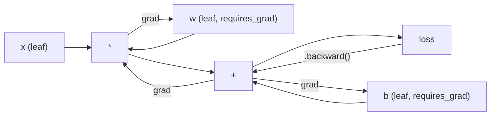
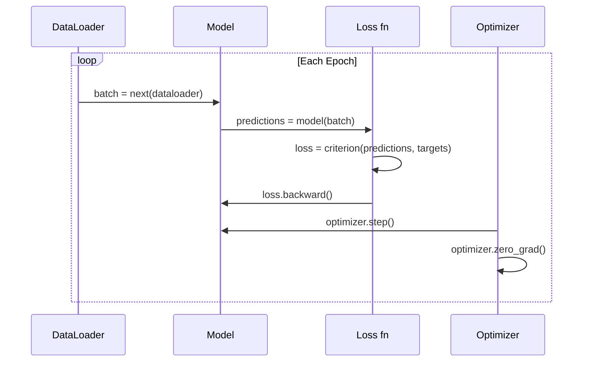

# 파이토르치 에 대한 소개

> 당신은 피스톤과 차에서 엔진을 만들었습니다. 이제 모든 사람이 실제로 운전하는 것을 배우십시오.

**Type:** Build
**Languages:** Python
**Prerequisites:** Lesson 03.10 (Build Your Own Mini Framework)
**Time:** ~75 minutes

## 학습 목표

- PyTorch의 nn.Module, nn.Sequential, 그리고 autograd을 사용하여 신경 네트워크를 구축하고 훈련
- PyTorch 텐서, GPU 가속 및 표준 훈련 루프를 사용하십시오 (zero_grad, 앞으로, 손실, 뒤로, 단계)
- 처음부터 미니 프레임워크 구성 요소를 PyTorch 부식으로 변환
- 동일한 작업에 대한 순수한 파이썬 프레임워크와 파이터치 사이의 훈련 속도를 프로필하고 비교하십시오

## 문제

작동하는 미니 프레임워크가 있습니다. 선형 레이어, ReLU, 드롭아웃, 패치 노르름, 아담, 데이터 로더, 훈련 루프. 순수한 파이썬에서 원 분류 문제에 대해 4층 네트워크를 훈련시킵니다.

또한 같은 문제에서 PyTorch보다 500배 느려집니다.

미니 프레임워크는 네이스드 파이썬 루프로 한 번에 하나의 샘플을 처리합니다. PyTorch는 GPU에서 실행되는 최적화된 C++/CUDA 커널에 동일한 작업을 전송합니다. 단일 NVIDIA A100에서 PyTorch는 약 6 시간 동안 이미지넷에서 ResNet-50 (25.6M 매개 변수) 를 훈련합니다.

속도만이 단 한 가지 차이점이 아닙니다. 프레임워크는 GPU 지원이 없습니다. 자동 차별화도 없습니다. 모든 모듈을 손으로 뒤로 써본 것입니다. 일련화도 없습니다. 분산 훈련도 없습니다. 혼합된 정확도도도 없습니다. 인쇄 문헌이 없으면 gradient flow를 디버깅할 방법이 없습니다.

PyTorch는 이러한 격차들을 모두 채우고 있습니다. 그리고 그것은 이미 구축한 것과 같은 정신적 모델을 유지하면서 그렇게합니다. 모듈, 앞으로(), 매개 변수(), 뒤로(), 최적화. 단계(). 개념은 하나-하나로 전송됩니다. 문법은 거의 동일합니다. 차이점은 PyTorch는 처음부터 설계한 동일한 인터페이스 뒤에 10 년 동안의 시스템 엔지니어링을 엮어 있다는 것입니다.

## 개념

### 왜 피토르치가 승리했는가

2015년 TensorFlow에서는 어떤 것을 실행하기 전에 정적 계산 그래프를 정의해야 했습니다. 그래프를 만들고 컴파일하고 데이터를 입력했습니다. 디버깅은 그래프 시각화를 바라보는 것을 의미했습니다. 아키텍처를 변경하면 그래프를 처음부터 다시 만드는 것을 의미했습니다.

파이토르크는 2017년에 다른 철학으로 출시되었습니다. 열정적인 실행입니다. 파이썬을 작성합니다. 그것은 즉시 실행됩니다.`y = model(x)`실제로 지금 y를 계산합니다. "그라프에 노드를 추가하여 나중에 y를 계산합니다". 이것은 표준 파이썬 디버깅 도구가 작동했습니다.

2020년까지 시장은 이야기했다. ML 연구 논문에서 PyTorch의 비중은 7% (2017) 에서 75% 이상으로 증가했다 (2022). 메타, 구글 딥마인드, 오픈AI, 앤트로픽, Hugging Face 모두 PyTorch를 주요 프레임워크로 사용합니다. TensorFlow 2.x는 응답으로 열망한 실행을 채택했습니다.

교훈은 개발자 경험의 화합물입니다. 디버깅을 할 때 10% 느리지만 50% 더 빠른 프레임워크는 매번 승리합니다.

### 텐서

텐서 (Tensor) 는 형태, dtype, 장치 등 세 가지 중요한 특성을 가진 다차원 배열이다.

```python
import torch

x = torch.zeros(3, 4)           # shape: (3, 4), dtype: float32, device: cpu
x = torch.randn(2, 3, 224, 224) # batch of 2 RGB images, 224x224
x = torch.tensor([1, 2, 3])     # from a Python list
```

**Shape**규모는 형태 (), 벡터 (n), 매트릭스 (m, n), 이미지 배트 (배트, 채널, 높, 너비) 이다.

**Dtype**정확성과 기억력을 조절합니다.

| dtype | Bits | Range | Use case |
|-------|------|-------|----------|
| float32 | 32 | ~7 decimal digits | Default training |
| float16 | 16 | ~3.3 decimal digits | Mixed precision |
| bfloat16 | 16 | Same range as float32, less precision | LLM training |
| int8 | 8 | -128 to 127 | Quantized inference |

**Device**계산이 일어나는 곳을 결정합니다.

```python
device = torch.device("cuda" if torch.cuda.is_available() else "cpu")
x = torch.randn(3, 4, device=device)
x = x.to("cuda")
x = x.cpu()
```

모든 작업에 동일한 장치에 모든 텐서가 필요합니다. 이것은 # 1 PyTorch 초보자 오류:`RuntimeError: Expected all tensors to be on the same device`계산 전에 모든 것을 같은 장치로 이동함으로써 그것을 고쳐라

**Reshaping**이 방법은 매타데이터를 바꾸고 데이터가 아닌

```python
x = torch.randn(2, 3, 4)
x.view(2, 12)      # reshape to (2, 12) -- must be contiguous
x.reshape(6, 4)    # reshape to (6, 4) -- works always
x.permute(2, 0, 1) # reorder dimensions
x.unsqueeze(0)     # add dimension: (1, 2, 3, 4)
x.squeeze()        # remove size-1 dimensions
```

### 오토그라드

미니 프레임워크는 모든 모듈에 대해 뒤로 구현해야 합니다. PyTorch는 그렇지 않습니다. 그것은 전원들에 대한 모든 작업을 지시된 아사이클 그래프 (컴퓨터 그래프) 로 기록하고 그 그래프를 뒤집어 자동으로 기하급수 계산합니다.



파이토르치의 기본 차이점은 테이프 기반의 자동 디프를 이용하는 것입니다. 모든 작업은 앞으로의 패스 중에 "테이프"에 첨부됩니다. 호출 `.backward()`테이프를 뒤집어 놓습니다.

```python
x = torch.randn(3, requires_grad=True)
y = x ** 2 + 3 * x
z = y.sum()
z.backward()
print(x.grad)  # dz/dx = 2x + 3
```

오토그라드의 세 가지 규칙:

1.  잎 텐서만`requires_grad=True`축적 gradients
2. 그라디엔트는 기본적으로 축적됩니다.`optimizer.zero_grad()`뒤로 가는 모든 걸
3. `torch.no_grad()`기하량 추적을 비활성화합니다 (평가 중에 사용)

### nn.모듈

`nn.Module`PyTorch의 버전은 자동 매개 변수 등록, 리큐티브 모듈 발견, 장치 관리, 그리고 상태 디렉트 시리에이션을 추가합니다.

```python
import torch.nn as nn

class MLP(nn.Module):
    def __init__(self, input_dim, hidden_dim, output_dim):
        super().__init__()
        self.layer1 = nn.Linear(input_dim, hidden_dim)
        self.relu = nn.ReLU()
        self.layer2 = nn.Linear(hidden_dim, output_dim)

    def forward(self, x):
        x = self.layer1(x)
        x = self.relu(x)
        x = self.layer2(x)
        return x
```

당신이 할당할 때`nn.Module`또는`nn.Parameter``__init__`PyTorch은 자동으로 등록합니다.`model.parameters()`이 때문에 미니 프레임워크에서 했던 것처럼 손으로 무게를 수집할 필요가 없습니다.

주요 건축물:

| Module | What it does | Parameters |
|--------|-------------|------------|
| nn.Linear(in, out) | $Wx + b$ | in*out + out |
| nn.Conv2d(in_ch, out_ch, k) | 2D convolution | in_ch*out_ch*k*k + out_ch |
| nn.BatchNorm1d(features) | Normalize activations | 2 * features |
| nn.Dropout(p) | Random zeroing | 0 |
| nn.ReLU() | $\max(0, x)$ | 0 |
| nn.GELU() | Gaussian error linear | 0 |
| nn.Embedding(vocab, dim) | Lookup table | vocab * dim |
| nn.LayerNorm(dim) | Per-sample normalization | 2 * dim |

### 손실 기능 및 최적화

파이토르치는 당신이 만든 모든 것을 생산할 준비가 된 버전으로 배포합니다.

**Loss functions**(~`torch.nn`):

| Loss | Task | Input |
|------|------|-------|
| nn.MSELoss() | Regression | Any shape |
| nn.CrossEntropyLoss() | Multi-class classification | Logits (not softmax) |
| nn.BCEWithLogitsLoss() | Binary classification | Logits (not sigmoid) |
| nn.L1Loss() | Regression (robust) | Any shape |
| nn.CTCLoss() | Sequence alignment | Log probabilities |

참고:`CrossEntropyLoss`결합합니다`LogSoftmax`+ `NLLLoss`내부적으로 로그이트를 통과시켜야 합니다. 소프트맥스 출력으로 하지 않습니다. 이것은 침묵으로 잘못된 gradients를 생성하는 일반적인 실수입니다.

**Optimizers**(~`torch.optim`):

| Optimizer | When to use | Typical LR |
|-----------|-------------|-----------|
| SGD(params, lr, momentum) | CNNs, well-tuned pipelines | 0.01--0.1 |
| Adam(params, lr) | Default starting point | 1e-3 |
| AdamW(params, lr, weight_decay) | Transformers, fine-tuning | 1e-4--1e-3 |
| LBFGS(params) | Small-scale, second-order | 1.0 |

### 훈련 도로는

모든 PyTorch 훈련 루프는 5단계 패턴을 따르고 있습니다.



가톨릭 패턴:

```python
for epoch in range(num_epochs):
    model.train()
    for inputs, targets in train_loader:
        inputs, targets = inputs.to(device), targets.to(device)
        optimizer.zero_grad()
        outputs = model(inputs)
        loss = criterion(outputs, targets)
        loss.backward()
        optimizer.step()
```

5개의 라인, GPT-4, 안정적인 분포, LLaMA를 훈련시킨 5개의 라인, 구조가 바뀌고, 데이터가 바뀌고, 이 5개의 라인들은 그렇지 않습니다.

### 데이터 세트 및 데이터 로더

피토르치의`Dataset`두 가지 방법을 가진 추상 클래스입니다: `__len__`그리고`__getitem__`-`DataLoader`배팅, 믹싱, 멀티 프로세스 데이터 로딩으로 포장합니다.

```python
from torch.utils.data import Dataset, DataLoader

class MNISTDataset(Dataset):
    def __init__(self, images, labels):
        self.images = images
        self.labels = labels

    def __len__(self):
        return len(self.labels)

    def __getitem__(self, idx):
        return self.images[idx], self.labels[idx]

loader = DataLoader(dataset, batch_size=64, shuffle=True, num_workers=4)
```

`num_workers=4`GPU가 현재 패치에서 작동하는 동안 데이터를 병렬로 로드하는 4 개의 프로세스를 생성합니다. 디스크에 묶인 작업 부하 (큰 이미지, 오디오) 에서, 이것은 혼자 훈련 속도를 두 배로 증가시킬 수 있습니다.

### GPU 훈련

GPU에 모델을 이동:

```python
device = torch.device("cuda" if torch.cuda.is_available() else "cpu")
model = model.to(device)
```

이것은 모든 매개 변수와 버퍼를 GPU로 반복적으로 이동합니다.

```python
inputs, targets = inputs.to(device), targets.to(device)
```

**Mixed precision**플롯16에서 앞뒤로 실행하면서 플롯32에서 마스터 웨이트를 유지함으로써 메모리 사용량을 반으로 늘리고 현대 GPU (A100, H100, RTX 4090) 의 처리량을 두 배로 늘립니다.

```python
from torch.amp import autocast, GradScaler

scaler = GradScaler()
for inputs, targets in loader:
    with autocast(device_type="cuda"):
        outputs = model(inputs)
        loss = criterion(outputs, targets)
    scaler.scale(loss).backward()
    scaler.step(optimizer)
    scaler.update()
    optimizer.zero_grad()
```

### 비교: 미니 프레임워크 vs. 파이토치 vs. 자엑스

| Feature | Mini Framework (L10) | PyTorch | JAX |
|---------|---------------------|---------|-----|
| Autodiff | Manual backward() | Tape-based autograd | Functional transforms |
| Execution | Eager (Python loops) | Eager (C++ kernels) | Traced + JIT compiled |
| GPU support | No | Yes (CUDA, ROCm, MPS) | Yes (CUDA, TPU) |
| Speed (MNIST MLP) | ~300s/epoch | ~0.5s/epoch | ~0.3s/epoch |
| Module system | Custom Module class | nn.Module | Stateless functions (Flax/Equinox) |
| Debugging | print() | print(), pdb, breakpoint() | Harder (JIT tracing breaks print) |
| Ecosystem | None | Hugging Face, Lightning, timm | Flax, Optax, Orbax |
| Learning curve | You built it | Moderate | Steep (functional paradigm) |
| Production use | Toy problems | Meta, OpenAI, Anthropic, HF | Google DeepMind, Midjourney |

```figure
dropout-mask
```

## 건설 해

3층 MLP가 MNIST에서 훈련된 PyTorch 원시물만 사용해서 고위 수준의 포장재가 없습니다`torchvision.datasets`우리는 직접 원료 데이터를 다운로드하고 분석합니다.

### 단계 1: 원료 파일에서 MNIST를 로드

MNIST는 4개의 gzip 파일로 배포됩니다. 훈련 이미지 (60,000 x 28 x 28), 훈련 레이블, 테스트 이미지 (10,000 x 28 x 28), 테스트 레이블. 우리는 그것들을 다운로드하고 바이너리 형식을 분석합니다.

```python
import torch
import torch.nn as nn
import struct
import gzip
import urllib.request
import os

def download_mnist(path="./mnist_data"):
    base_url = "https://storage.googleapis.com/cvdf-datasets/mnist/"
    files = [
        "train-images-idx3-ubyte.gz",
        "train-labels-idx1-ubyte.gz",
        "t10k-images-idx3-ubyte.gz",
        "t10k-labels-idx1-ubyte.gz",
    ]
    os.makedirs(path, exist_ok=True)
    for f in files:
        filepath = os.path.join(path, f)
        if not os.path.exists(filepath):
            urllib.request.urlretrieve(base_url + f, filepath)

def load_images(filepath):
    with gzip.open(filepath, "rb") as f:
        magic, num, rows, cols = struct.unpack(">IIII", f.read(16))
        data = f.read()
        images = torch.frombuffer(bytearray(data), dtype=torch.uint8)
        images = images.reshape(num, rows * cols).float() / 255.0
    return images

def load_labels(filepath):
    with gzip.open(filepath, "rb") as f:
        magic, num = struct.unpack(">II", f.read(8))
        data = f.read()
        labels = torch.frombuffer(bytearray(data), dtype=torch.uint8).long()
    return labels
```

### 2단계: 모형을 정의 하십시오

3층 MLP: 784 -> 256 -> 128 -> 10. ReLU 활성화. 정규화 위해 중단.

```python
class MNISTModel(nn.Module):
    def __init__(self):
        super().__init__()
        self.net = nn.Sequential(
            nn.Linear(784, 256),
            nn.ReLU(),
            nn.Dropout(0.2),
            nn.Linear(256, 128),
            nn.ReLU(),
            nn.Dropout(0.2),
            nn.Linear(128, 10),
        )

    def forward(self, x):
        return self.net(x)
```

출력층은 10개의 원소 로그이트 (자리당 1개) 를 생성합니다.`CrossEntropyLoss`내부적으로 처리합니다.

파라미터 수: $784 \cdot 256 + 256 + 256 \cdot 128 + 128 + 128 \cdot 10 + 10 = 235{,}146$현대적인 기준으로는 작지만, GPT-2는 124m에 달한다.

### 3단계: 훈련 로프

가꾸기-손실- 뒤로 하는 가꾸기 패턴

```python
def train_one_epoch(model, loader, criterion, optimizer, device):
    model.train()
    total_loss = 0
    correct = 0
    total = 0
    for images, labels in loader:
        images, labels = images.to(device), labels.to(device)
        optimizer.zero_grad()
        outputs = model(images)
        loss = criterion(outputs, labels)
        loss.backward()
        optimizer.step()
        total_loss += loss.item() * images.size(0)
        _, predicted = outputs.max(1)
        correct += predicted.eq(labels).sum().item()
        total += labels.size(0)
    return total_loss / total, correct / total


def evaluate(model, loader, criterion, device):
    model.eval()
    total_loss = 0
    correct = 0
    total = 0
    with torch.no_grad():
        for images, labels in loader:
            images, labels = images.to(device), labels.to(device)
            outputs = model(images)
            loss = criterion(outputs, labels)
            total_loss += loss.item() * images.size(0)
            _, predicted = outputs.max(1)
            correct += predicted.eq(labels).sum().item()
            total += labels.size(0)
    return total_loss / total, correct / total
```

참고`torch.no_grad()`자율성표가 비활성화되어 메모리 사용량을 줄이고 추론을 가속화합니다.

### 4단계: 모든 것 을 함께 연결 하십시오

```python
def main():
    device = torch.device("cuda" if torch.cuda.is_available() else "cpu")

    download_mnist()
    train_images = load_images("./mnist_data/train-images-idx3-ubyte.gz")
    train_labels = load_labels("./mnist_data/train-labels-idx1-ubyte.gz")
    test_images = load_images("./mnist_data/t10k-images-idx3-ubyte.gz")
    test_labels = load_labels("./mnist_data/t10k-labels-idx1-ubyte.gz")

    train_dataset = torch.utils.data.TensorDataset(train_images, train_labels)
    test_dataset = torch.utils.data.TensorDataset(test_images, test_labels)
    train_loader = torch.utils.data.DataLoader(
        train_dataset, batch_size=64, shuffle=True
    )
    test_loader = torch.utils.data.DataLoader(
        test_dataset, batch_size=256, shuffle=False
    )

    model = MNISTModel().to(device)
    criterion = nn.CrossEntropyLoss()
    optimizer = torch.optim.Adam(model.parameters(), lr=1e-3)

    num_params = sum(p.numel() for p in model.parameters())
    print(f"Device: {device}")
    print(f"Parameters: {num_params:,}")
    print(f"Train samples: {len(train_dataset):,}")
    print(f"Test samples: {len(test_dataset):,}")
    print()

    for epoch in range(10):
        train_loss, train_acc = train_one_epoch(
            model, train_loader, criterion, optimizer, device
        )
        test_loss, test_acc = evaluate(
            model, test_loader, criterion, device
        )
        print(
            f"Epoch {epoch+1:2d} | "
            f"Train Loss: {train_loss:.4f} | Train Acc: {train_acc:.4f} | "
            f"Test Loss: {test_loss:.4f} | Test Acc: {test_acc:.4f}"
        )

    torch.save(model.state_dict(), "mnist_mlp.pt")
    print(f"\nModel saved to mnist_mlp.pt")
    print(f"Final test accuracy: {test_acc:.4f}")
```

10 시대 후 예상 출력: ~97.8% 테스트 정확성. CPU에서 훈련 시간은 ~30초. GPU에서 ~5초. 같은 구조를 가진 미니 프레임워크에서 ~45분.

## 사용 하 고

### 빠른 비교: 미니 프레임워크와 파이토치

| Mini Framework (Lesson 10) | PyTorch |
|---------------------------|---------|
| `model = Sequential(Linear(784, 256), ReLU(), ...)` | `model = nn.Sequential(nn.Linear(784, 256), nn.ReLU(), ...)` |
| `pred = model.forward(x)` | `pred = model(x)` |
| `optimizer.zero_grad()` | `optimizer.zero_grad()` |
| `grad = criterion.backward()` then `model.backward(grad)` | `loss.backward()` |
| `optimizer.step()` | `optimizer.step()` |
| No GPU | `model.to("cuda")` |
| Manual backward for every module | Autograd handles everything |

인터페이스가 거의 같지만, 다른 점은 모자가 아래 모든 것이에요.

### 저장 및 로딩 모델

```python
torch.save(model.state_dict(), "model.pt")

model = MNISTModel()
model.load_state_dict(torch.load("model.pt", weights_only=True))
model.eval()
```

항상 저장해`state_dict()`(변수 사전) 모델 객체가 아니라 모델 객체를 저장하는 데는 픽셀을 사용합니다.

### 학습수준 계획

```python
scheduler = torch.optim.lr_scheduler.CosineAnnealingLR(
    optimizer, T_max=10
)
for epoch in range(10):
    train_one_epoch(model, train_loader, criterion, optimizer, device)
    scheduler.step()
```

파이토치는 15개 이상의 스케줄러를 배포한다: StepLR, ExponentialLR, CosineAnnealingLR, OneCycleLR, ReduceLROnPlateau. 모두 동일한 최적화 인터페이스에 연결된다.

## 선박

이 수업은 두 가지 유물을 만들어 냅니다.

- `outputs/prompt-pytorch-debugger.md`-- PyTorch 훈련의 일반적인 실패를 진단하는
- `outputs/skill-pytorch-patterns.md`-- PyTorch 훈련 패턴에 대한 기술 참조

## 운동

1. **Add batch normalization.**삽입 `nn.BatchNorm1d`각 선형 계층 (활성화 전) 이후 시험 정확성 및 훈련 속도와 중퇴 버전의 비교를 해 보십시오.

2. **Implement a learning rate finder.**1e-7에서 1.0) 에 대한 학습률을 기하급수적으로 증가시키는 한 시대를 훈련하십시오. 플롯 손실 vs LR. 최적의 LR는 손실이 상승하기 직전에입니다. 이를 사용하여 MNIST 모델에 대한 더 나은 LR를 선택하십시오.

3. **Port to GPU with mixed precision.**추가`torch.amp.autocast`그리고`GradScaler`A100에 대해, 2x 가속을 예상하십시오.

4. **Build a custom Dataset.**패션-MNIST (MNIST와 동일한 형식이지만 의류 아이템) 를 다운로드 합니다.`FashionMNISTDataset(Dataset)``__getitem__`그리고`__len__`. 같은 MLP를 연습하고 정확도를 비교하세요. 패션-MNIST는 더 어렵죠. 88%와 98%를 예상하세요.

5. **Replace Adam with SGD + momentum.**열차`SGD(params, lr=0.01, momentum=0.9)`. 컨버전스 곡선을 비교하고,`CosineAnnealingLR`스케줄을 세우고 SGD가 10시까지 아담을 따라잡을 수 있는지 확인해

## 주요 용어

| Term | What people say | What it actually means |
|------|----------------|----------------------|
| Tensor | "A multi-dimensional array" | A typed, device-aware array with automatic differentiation support baked into every operation |
| Autograd | "Automatic backprop" | A tape-based system that records operations during forward pass, then replays them in reverse to compute exact gradients |
| nn.Module | "A layer" | The base class for any differentiable computation block -- registers parameters, supports nesting, handles train/eval modes |
| state_dict | "The model weights" | An OrderedDict mapping parameter names to tensors -- the portable, serializable representation of a trained model |
| .backward() | "Compute gradients" | Traverse the computational graph in reverse, computing and accumulating gradients for every leaf tensor with requires_grad=True |
| .to(device) | "Move to GPU" | Recursively transfer all parameters and buffers to the specified device (CPU, CUDA, MPS) |
| DataLoader | "The data pipeline" | An iterator that batches, shuffles, and optionally parallelizes data loading from a Dataset |
| Mixed precision | "Use float16" | Train with float16 forward/backward for speed while keeping float32 master weights for numerical stability |
| Eager execution | "Run it now" | Operations execute immediately when called, not deferred to a later compilation step -- the core design choice that differentiates PyTorch from TF 1.x |
| zero_grad | "Reset gradients" | Set all parameter gradients to zero before the next backward pass, since PyTorch accumulates gradients by default |

## 더 많은 읽기

- 파즈케 등, "파이토르치: 필수적인 스타일, 고성능 깊은 학습 도서관" (2019) - 파이토르치의 디자인 트레이드오프를 설명하는 원본 논문
- 파이토르치 교과서: "사례를 통해 파이토르치를 배우는 것" (https://pytorch.org/tutorials/beginner/pytorch_with_examples.html) -- 텐서에서 nn.Module까지의 공식 경로
- PyTorch 성능 조정 가이드 (https://pytorch.org/tutorials/recipes/recipes/tuning_guide.html) -- 혼합된 정확성, 데이터 로더 작업자,  memory, 그리고 다른 생산 최적화
- 호라스 헤, "딥 러닝을 브러러로 만드는 것" (https://horace.io/brrr_intro.html) -- 왜 GPU 훈련이 빠른지 PyTorch 특수한 최적화 전략으로
