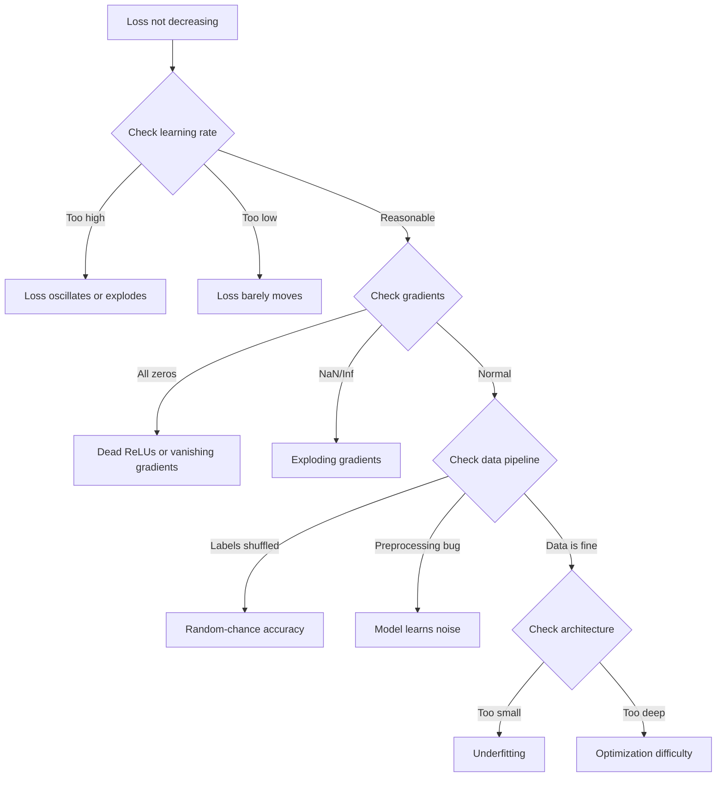
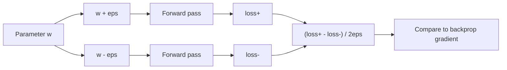
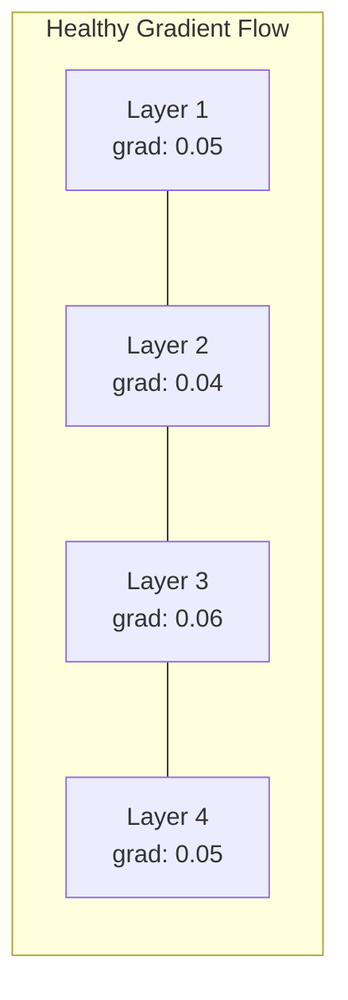
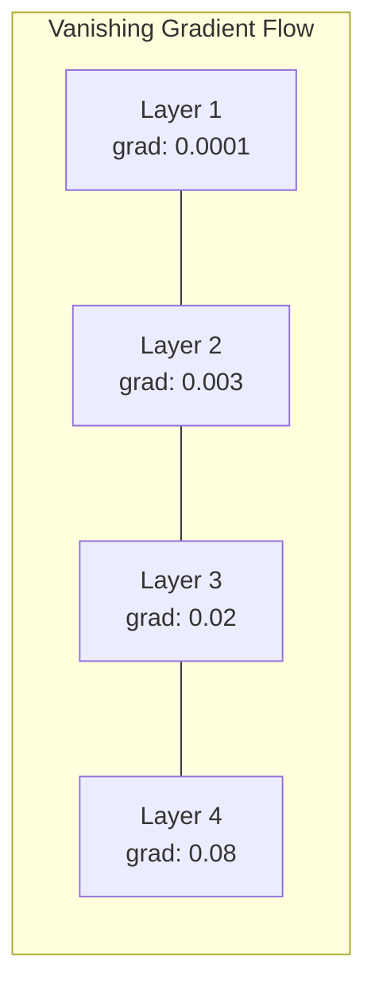
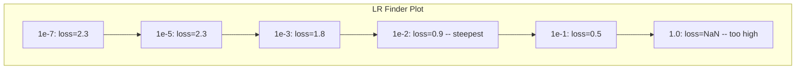

# 신경망의 디버깅

> 네트워크가 컴파일되었습니다. 실행되었습니다. 숫자를 생성했습니다. 숫자는 잘못되었습니다. 아무것도 충돌하지 않았습니다. 가장 어려운 디버깅에 오신 것을 환영합니다. 오류 메시지가 없는 종류의 것입니다.

**Type:** Build
**Languages:** Python, PyTorch
**Prerequisites:** Phase 03 Lessons 01-10 (especially backpropagation, loss functions, optimizers)
**Time:** ~90 minutes

## 학습 목표

- 체계적인 디버깅 전략을 사용하여 일반적인 신경 네트워크 오류 (NaN 손실, 평평 손실 곡선, 과잉 부착, 오스컬레이션) 를 진단합니다.
- 모델 아키텍처와 훈련 루프가 올바른지 확인하기 위해 "overfit one batch" 기술을 적용하십시오.
- 사라지고/폭발하는 추락 문제를 확인하기 위해 추락 크기와 활성화 분포 및 무게 규범을 검사한다
- 데이터 파이프라인, 모델 아키텍처, 손실 기능, 최적화 및 학습 속도 문제를 포함하는 디버깅 체크리스트를 구축하십시오

## 문제

전통적인 소프트웨어 는 깨질 때 충돌 합니다. null 포인터는 예외 를 던집니다. 타입 부합이 컴파일 시 실패 합니다. 오프-비-이-온 오류 는 명백 한 잘못된 출력을 생성 합니다.

신경망은 그런 고급스러움을 주지 않습니다.

파손된 신경망은 완성될 때까지 실행되고 손실 값을 인쇄하고 예측을 내놓습니다. 손실이 줄어들 수도 있습니다. 예측은 그럴듯한 것 같을 수도 있습니다. 하지만 모델은 침묵으로 틀렸습니다. 단축키를 배우고, 소음을 기억하거나, 쓸모없는 지역 최소로 회합하는 것입니다. 구글 연구자들은 ML 디버깅 시간의 60-70%가 오류가 발생하지 않고 모델 품질을 떨어뜨리는 "성묵" 버그에 소비된다는 것을 추정했습니다.

작동 모델과 깨진 모델의 차이점은 종종 하나의 잘못된 라인입니다.`zero_grad()`, 이식된 차원, 학습률 10x로 떨어집니다. 신전 "신경 네트워크 훈련 레시피" (2019) 는 다음과 같이 시작합니다. "신경 네트워크의 가장 일반적인 오류는 충돌하지 않는 버그입니다".

이 수업은 곤충을 찾아내는 법을 가르쳐줍니다.

## 개념

### 잘못 된 사고방식

인쇄 및 프레이 디버깅을 잊어 버립니다. 신경 네트워크 디버깅은 피드백 루프가 느리기 때문에 체계적인 접근이 필요합니다. 훈련 경주당 몇 분에서 몇 시간 동안) 그리고 증상은 모호합니다. 나쁜 손실은 20 가지 다른 것을 의미 할 수 있습니다.

황금규칙:**start simple, add complexity one piece at a time, and verify each piece independently.**



### 증상 1: 손실이 감소 하지 않는 것

이것은 가장 흔한 불평입니다. 훈련 루프는 계속되고, 시대가 지나고, 손실은 평평하게 유지되거나 야생적으로 흔들립니다.

**Wrong learning rate.**너무 높습니다. 손실이 나나로 오스틸하거나 뛰어납니다. 너무 낮습니다. 손실이 너무 느리게 감소하여 평평하게 보입니다. 아담에게, 1e-3에서 시작하십시오. SGD를 위해, 1e-1 또는 1e-2에서 시작하십시오. 다른 것이 잘못되었다고 결론 내리기 전에 항상 10x를 뻗은 3 개의 학습 속도를 시도하십시오.

**Dead ReLUs.**ReLU 신경 세포가 큰 부정적인 입력값을 받으면 0을 내보내며 그 그라디언트는 0이 됩니다. 다시 활성화되지 않습니다. 충분한 신경 세포가 죽으면 네트워크는 학습할 수 없습니다. 확인: ReLU 계층마다 정확히 0이 되는 활성화의 분수를 인쇄하십시오. 50% 이상이 죽은 경우, LeakyReLU로 전환하거나 학습 속도를 줄이십시오.

**Vanishing gradients.**시그모이드 또는 성 활성화를 가진 깊은 네트워크에서, 그라디엔트는 뒤로 퍼지면서 기하급수적으로 줄어들게 된다. 첫 번째 층에 도달할 때, 그들은 ~0. 첫 번째 층은 학습을 중단한다. 수정: ReLU/GELU를 사용하거나 잔류 연결을 추가하거나 대량 정상화를 사용한다.

**Exploding gradients.**그 반대 문제 - gradients는 기하급수적으로 증가합니다. RNNs 및 매우 깊은 네트워크에서 흔합니다. 손실은 NaN로 급격합니다.`torch.nn.utils.clip_grad_norm_`), 학습률을 낮추거나 정상화를 추가합니다.

### 증상 2: 손실이 감소하지만 모델은 나쁘다

손실이 줄어들죠. 훈련 정확도는 99%에 달합니다. 하지만 테스트 정확도는 55%에 달합니다. 아니면 모델은 실제 데이터에 무분별한 결과물을 만들어냅니다.

**Overfitting.**이 모델은 학습 패턴 대신 훈련 데이터를 기억합니다. 훈련과 검증 손실 사이의 격차는 시간이 지남에 따라 증가합니다. 수정: 더 많은 데이터, 중퇴, 체중 감소, 조기 중단, 데이터 증강.

**Data leakage.**테스트 데이터 가 훈련 에 유출 되었습니다. 정확성 은 의심스럽게도 높습니다. 일반적인 원인 은 분할 하기 전 에 믹싱, 전체 데이터 세트 에서 통계 를 통해 사전 처리, 분할 간 복제 샘플. 수정: 분할 첫째, 사전 처리 둘째, 복제 확인.

**Label errors.**대부분의 실제 데이터 세트에서 5~10%의 레이블은 잘못되어 있습니다. (Northcutt et al., 2021 -- "테스트 세트에서 퍼버시브 레이블 오류"). 모델은 소음을 학습합니다. 수정: 잘못된 레이블을 찾아서 수정하기 위해 자신감 있는 학습을 사용하거나 손실 단축을 사용하여 높은 손실 샘플을 무시합니다.

### 증상 3: 손실 중 NaN 또는 Inf

손실 값은 `nan`또는`inf`훈련은 끝났어

**Learning rate too high.**갱신도 너무 많아 질량이 폭발해버립니다

**log(0) or log(negative).**크로스 엔트로피 손실 계산기`log(p)`만약 모델의 출력값이 0 또는 음의 확률이 정확히 0이면, 로그가 폭발합니다.`[eps, 1-eps]`어디`eps=1e-7`- 그래

**Division by zero.**배트 정상화는 표준차로 나 ?? 다. 상수 값이 있는 배트에는 std=0이 있다. 수정: 나명자에 epsilon을 추가한다 (PyTorch는 기본적으로 이것을 수행하지만 사용자 지정 구현은 그렇지 않을 수 있다).

**Numerical overflow.**큰 활성화를 입력합니다`exp()`과잉수준을 계산하기 전에 최대수를 빼면 과잉수준을 계산하는 방법 (log-sum-exp 트릭)

### 기술 1: 단계적 검진

분석 기하급수 (backprop) 를 수치 기하급수 (Finite Differences) 에 비교해 보십시오.

파라미터의 수학적 기하급수 `w`이 부분의 본문은

```math
\text{grad\_numerical} = \frac{\text{loss}(w + \text{eps}) - \text{loss}(w - \text{eps})}{2 \cdot \text{eps}}
```

계약 메트릭 (상수 차이):

```math
\text{rel\_diff} = \frac{\lvert \text{grad\_analytical} - \text{grad\_numerical} \rvert}{\max(\lvert \text{grad\_analytical} \rvert, \lvert \text{grad\_numerical} \rvert, 10^{-8})}
```

만약`rel_diff < 1e-5`: 맞습니다.`rel_diff > 1e-3`거의 확실히 곤충입니다.



### 2기술: 활성화 통계는

훈련 중에 각 계층 이후의 활성화 평균 및 표준차각을 모니터링 한다. 건강한 네트워크는 0 가까이의 평균과 1 가까이의 std (정상화 후) 또는 적어도 제한된 활성화를 유지한다.

| Health indicator | Mean | Std | Diagnosis |
|-----------------|------|-----|-----------|
| Healthy | ~0 | ~1 | Network is learning normally |
| Saturated | >>0 or <<0 | ~0 | Activations stuck at extreme values |
| Dead | 0 | 0 | Neurons are dead (all zeros) |
| Exploding | >>10 | >>10 | Activations growing without bound |

### 기술 3: 계층 흐름 시각화

각 층의 평균 기하급수도를 그려보세요. 건강한 네트워크에서 기하급수 규모는 층마다 대략 비슷해야 합니다. 초기 층이 나중에 있는 층보다 1000배 작게 기하급수라면, 사라지는 기하급수가 있습니다.





### 기술 4: 과잉 적합 한 한 배트 테스트

딥러닝에서 가장 중요한 디버깅 기술입니다.

작은 배치를 (8-32 샘플) 한 번 가져가세요. 100개 이상의 반복을 연습하세요. 손실은 거의 0으로 올라와 훈련 정확도가 100%에 도달해야 합니다. 그렇지 않으면, 모델이나 훈련 루프는 근본적인 오류가 있습니다.

이 테스트는 다음과 같은 것을 발견합니다.
- 파손 손실 함수
- 은 후진 패스
- 데이터들을 표현하기에는 너무 작은 건축물
- 모델 매개 변수에 연결되지 않은 최적화
- 데이터 및 라벨의 조율이 잘못 된

이것은 실행에 30초를 걸고, 완전한 훈련 실행을 디버깅하는 시간을 절약합니다.

### 기술 5: 학습률 탐지

레슬리 스미스 (2017) 는 손실을 기록하면서 매우 작은 (1e-7) 에서 매우 큰 (10) 에 대한 학습 속도를 매는 것을 제안했다. 플롯 손실 vs 학습률. 최적의 학습률은 손실이 가장 빨리 감소하기 시작하는 비율보다 약 10배 작습니다.



이 예제에서 가장 좋은 LR: ~1e-3 (최강점 이전 한 순위 규모)

### 일반적인 피토르치 곤충

이들은 PyTorch 커뮤니티에서 가장 많은 시간을 낭비하는 버그들입니다.

| Bug | Symptom | Fix |
|-----|---------|-----|
| Forgetting `optimizer.zero_grad()` | Gradients accumulate across batches, loss oscillates | Add `optimizer.zero_grad()` before `loss.backward()` |
| Forgetting `model.eval()` at test time | Dropout and batch norm behave differently, test accuracy varies between runs | Add `model.eval()` and `torch.no_grad()` |
| Wrong tensor shapes | Silent broadcasting produces wrong results, no error | Print shapes after every operation during debugging |
| CPU/GPU mismatch | `RuntimeError: expected CUDA tensor` | Use `.to(device)` on model AND data |
| Not detaching tensors | Computation graph grows forever, OOM | Use `.detach()` or `with torch.no_grad()` |
| In-place operations breaking autograd | `RuntimeError: modified by in-place operation` | Replace `x += 1` with `x = x + 1` |
| Data not normalized | Loss stuck at random-chance level | Normalize inputs to mean=0, std=1 |
| Labels as wrong dtype | Cross-entropy expects `Long`, got `Float` | Cast labels: `labels.long()` |

### 마스터 디버깅 테이블

| Symptom | Likely cause | First thing to try |
|---------|-------------|-------------------|
| Loss stuck at -log(1/num_classes) | Model predicting uniform distribution | Check data pipeline, verify labels match inputs |
| Loss NaN after a few steps | Learning rate too high | Reduce LR by 10x |
| Loss NaN immediately | log(0) or division by zero | Add epsilon to log/division operations |
| Loss oscillating wildly | LR too high or batch size too small | Reduce LR, increase batch size |
| Loss decreasing then plateaus | LR too high for fine-tuning phase | Add LR schedule (cosine or step decay) |
| Training acc high, test acc low | Overfitting | Add dropout, weight decay, more data |
| Training acc = test acc = chance | Model not learning anything | Run overfit-one-batch test |
| Training acc = test acc but both low | Underfitting | Bigger model, more layers, more features |
| Gradients all zero | Dead ReLUs or detached computation graph | Switch to LeakyReLU, check `.requires_grad` |
| Out of memory during training | Batch too large or graph not freed | Reduce batch size, use `torch.no_grad()` for eval |

```figure
learning-curves
```

## 건설 해

활성화, 기하급수 및 손실 곡선을 모니터링하는 진단 도구 킷. 당신은 의도적으로 네트워크를 깨고 도구를 사용하여 각 문제를 진단합니다.

### 단계 1: 네트워크 디버거 클래스

각 층에 대한 활성화 및 기하급수 통계 기록을 위해 PyTorch 모델에 니다.

```python
import torch
import torch.nn as nn
import math


class NetworkDebugger:
    def __init__(self, model):
        self.model = model
        self.activation_stats = {}
        self.gradient_stats = {}
        self.loss_history = []
        self.lr_losses = []
        self.hooks = []
        self._register_hooks()

    def _register_hooks(self):
        for name, module in self.model.named_modules():
            if isinstance(module, (nn.Linear, nn.Conv2d, nn.ReLU, nn.LeakyReLU)):
                hook = module.register_forward_hook(self._make_activation_hook(name))
                self.hooks.append(hook)
                hook = module.register_full_backward_hook(self._make_gradient_hook(name))
                self.hooks.append(hook)

    def _make_activation_hook(self, name):
        def hook(module, input, output):
            with torch.no_grad():
                out = output.detach().float()
                self.activation_stats[name] = {
                    "mean": out.mean().item(),
                    "std": out.std().item(),
                    "fraction_zero": (out == 0).float().mean().item(),
                    "min": out.min().item(),
                    "max": out.max().item(),
                }
        return hook

    def _make_gradient_hook(self, name):
        def hook(module, grad_input, grad_output):
            if grad_output[0] is not None:
                with torch.no_grad():
                    grad = grad_output[0].detach().float()
                    self.gradient_stats[name] = {
                        "mean": grad.mean().item(),
                        "std": grad.std().item(),
                        "abs_mean": grad.abs().mean().item(),
                        "max": grad.abs().max().item(),
                    }
        return hook

    def record_loss(self, loss_value):
        self.loss_history.append(loss_value)

    def check_loss_health(self):
        if len(self.loss_history) < 2:
            return "NOT_ENOUGH_DATA"
        recent = self.loss_history[-10:]
        if any(math.isnan(v) or math.isinf(v) for v in recent):
            return "NAN_OR_INF"
        if len(self.loss_history) >= 20:
            first_half = sum(self.loss_history[:10]) / 10
            second_half = sum(self.loss_history[-10:]) / 10
            if second_half >= first_half * 0.99:
                return "NOT_DECREASING"
        if len(recent) >= 5:
            diffs = [recent[i+1] - recent[i] for i in range(len(recent)-1)]
            if max(diffs) - min(diffs) > 2 * abs(sum(diffs) / len(diffs)):
                return "OSCILLATING"
        return "HEALTHY"

    def check_activations(self):
        issues = []
        for name, stats in self.activation_stats.items():
            if stats["fraction_zero"] > 0.5:
                issues.append(f"DEAD_NEURONS: {name} has {stats['fraction_zero']:.0%} zero activations")
            if abs(stats["mean"]) > 10:
                issues.append(f"EXPLODING_ACTIVATIONS: {name} mean={stats['mean']:.2f}")
            if stats["std"] < 1e-6:
                issues.append(f"COLLAPSED_ACTIVATIONS: {name} std={stats['std']:.2e}")
        return issues if issues else ["HEALTHY"]

    def check_gradients(self):
        issues = []
        grad_magnitudes = []
        for name, stats in self.gradient_stats.items():
            grad_magnitudes.append((name, stats["abs_mean"]))
            if stats["abs_mean"] < 1e-7:
                issues.append(f"VANISHING_GRADIENT: {name} abs_mean={stats['abs_mean']:.2e}")
            if stats["abs_mean"] > 100:
                issues.append(f"EXPLODING_GRADIENT: {name} abs_mean={stats['abs_mean']:.2e}")
        if len(grad_magnitudes) >= 2:
            first_mag = grad_magnitudes[0][1]
            last_mag = grad_magnitudes[-1][1]
            if last_mag > 0 and first_mag / last_mag > 100:
                issues.append(f"GRADIENT_RATIO: first/last = {first_mag/last_mag:.0f}x (vanishing)")
        return issues if issues else ["HEALTHY"]

    def print_report(self):
        print("\n=== NETWORK DEBUGGER REPORT ===")
        print(f"\nLoss health: {self.check_loss_health()}")
        if self.loss_history:
            print(f"  Last 5 losses: {[f'{v:.4f}' for v in self.loss_history[-5:]]}")
        print("\nActivation diagnostics:")
        for item in self.check_activations():
            print(f"  {item}")
        print("\nGradient diagnostics:")
        for item in self.check_gradients():
            print(f"  {item}")
        print("\nPer-layer activation stats:")
        for name, stats in self.activation_stats.items():
            print(f"  {name}: mean={stats['mean']:.4f} std={stats['std']:.4f} zero={stats['fraction_zero']:.1%}")
        print("\nPer-layer gradient stats:")
        for name, stats in self.gradient_stats.items():
            print(f"  {name}: abs_mean={stats['abs_mean']:.2e} max={stats['max']:.2e}")

    def remove_hooks(self):
        for hook in self.hooks:
            hook.remove()
        self.hooks.clear()
```

### 2단계: 한 배트 이상 에 대한 시험

```python
def overfit_one_batch(model, x_batch, y_batch, criterion, lr=0.01, steps=200):
    optimizer = torch.optim.Adam(model.parameters(), lr=lr)
    model.train()
    print("\n=== OVERFIT ONE BATCH TEST ===")
    print(f"Batch size: {x_batch.shape[0]}, Steps: {steps}")

    for step in range(steps):
        optimizer.zero_grad()
        output = model(x_batch)
        loss = criterion(output, y_batch)
        loss.backward()
        optimizer.step()

        if step % 50 == 0 or step == steps - 1:
            with torch.no_grad():
                preds = (output > 0).float() if output.shape[-1] == 1 else output.argmax(dim=1)
                targets = y_batch if y_batch.dim() == 1 else y_batch.squeeze()
                acc = (preds.squeeze() == targets).float().mean().item()
            print(f"  Step {step:3d} | Loss: {loss.item():.6f} | Accuracy: {acc:.1%}")

    final_loss = loss.item()
    if final_loss > 0.1:
        print(f"\n  FAIL: Loss did not converge ({final_loss:.4f}). Model or training loop is broken.")
        return False
    print(f"\n  PASS: Loss converged to {final_loss:.6f}")
    return True
```

### 단계 3: 학습률 탐지

```python
def find_learning_rate(model, x_data, y_data, criterion, start_lr=1e-7, end_lr=10, steps=100):
    import copy
    original_state = copy.deepcopy(model.state_dict())
    optimizer = torch.optim.SGD(model.parameters(), lr=start_lr)
    lr_mult = (end_lr / start_lr) ** (1 / steps)

    model.train()
    results = []
    best_loss = float("inf")
    current_lr = start_lr

    print("\n=== LEARNING RATE FINDER ===")

    for step in range(steps):
        optimizer.zero_grad()
        output = model(x_data)
        loss = criterion(output, y_data)

        if math.isnan(loss.item()) or loss.item() > best_loss * 10:
            break

        best_loss = min(best_loss, loss.item())
        results.append((current_lr, loss.item()))

        loss.backward()
        optimizer.step()

        current_lr *= lr_mult
        for param_group in optimizer.param_groups:
            param_group["lr"] = current_lr

    model.load_state_dict(original_state)

    if len(results) < 10:
        print("  Could not complete LR sweep -- loss diverged too quickly")
        return results

    min_loss_idx = min(range(len(results)), key=lambda i: results[i][1])
    suggested_lr = results[max(0, min_loss_idx - 10)][0]

    print(f"  Swept {len(results)} steps from {start_lr:.0e} to {results[-1][0]:.0e}")
    print(f"  Minimum loss {results[min_loss_idx][1]:.4f} at lr={results[min_loss_idx][0]:.2e}")
    print(f"  Suggested learning rate: {suggested_lr:.2e}")

    return results
```

### 단계 4: 진급 검증

```python
def _flat_to_multi_index(flat_idx, shape):
    multi_idx = []
    remaining = flat_idx
    for dim in reversed(shape):
        multi_idx.insert(0, remaining % dim)
        remaining //= dim
    return tuple(multi_idx)


def gradient_check(model, x, y, criterion, eps=1e-4):
    model.train()
    x_double = x.double()
    y_double = y.double()
    model_double = model.double()

    print("\n=== GRADIENT CHECK ===")
    overall_max_diff = 0
    checked = 0

    for name, param in model_double.named_parameters():
        if not param.requires_grad:
            continue

        layer_max_diff = 0

        model_double.zero_grad()
        output = model_double(x_double)
        loss = criterion(output, y_double)
        loss.backward()
        analytical_grad = param.grad.clone()

        num_checks = min(5, param.numel())
        for i in range(num_checks):
            idx = _flat_to_multi_index(i, param.shape)
            original = param.data[idx].item()

            param.data[idx] = original + eps
            with torch.no_grad():
                loss_plus = criterion(model_double(x_double), y_double).item()

            param.data[idx] = original - eps
            with torch.no_grad():
                loss_minus = criterion(model_double(x_double), y_double).item()

            param.data[idx] = original

            numerical = (loss_plus - loss_minus) / (2 * eps)
            analytical = analytical_grad[idx].item()

            denom = max(abs(numerical), abs(analytical), 1e-8)
            rel_diff = abs(numerical - analytical) / denom

            layer_max_diff = max(layer_max_diff, rel_diff)
            checked += 1

        overall_max_diff = max(overall_max_diff, layer_max_diff)
        status = "OK" if layer_max_diff < 1e-5 else "MISMATCH"
        print(f"  {name}: max_rel_diff={layer_max_diff:.2e} [{status}]")

    model.float()

    print(f"\n  Checked {checked} parameters")
    if overall_max_diff < 1e-5:
        print("  PASS: Gradients match (rel_diff < 1e-5)")
    elif overall_max_diff < 1e-3:
        print("  WARN: Small differences (1e-5 < rel_diff < 1e-3)")
    else:
        print("  FAIL: Gradient mismatch detected (rel_diff > 1e-3)")
    return overall_max_diff
```

### 5단계: 고의로 끊어진 네트워크

이제 도구 킷을 깨진 네트워크에 적용하고 각각의 진단에 적용합니다.

```python
def demo_broken_networks():
    torch.manual_seed(42)
    x = torch.randn(64, 10)
    y = (x[:, 0] > 0).long()

    print("\n" + "=" * 60)
    print("BUG 1: Learning rate too high (lr=10)")
    print("=" * 60)
    model1 = nn.Sequential(nn.Linear(10, 32), nn.ReLU(), nn.Linear(32, 2))
    debugger1 = NetworkDebugger(model1)
    optimizer1 = torch.optim.SGD(model1.parameters(), lr=10.0)
    criterion = nn.CrossEntropyLoss()
    for step in range(20):
        optimizer1.zero_grad()
        out = model1(x)
        loss = criterion(out, y)
        debugger1.record_loss(loss.item())
        loss.backward()
        optimizer1.step()
    debugger1.print_report()
    debugger1.remove_hooks()

    print("\n" + "=" * 60)
    print("BUG 2: Dead ReLUs from bad initialization")
    print("=" * 60)
    model2 = nn.Sequential(nn.Linear(10, 32), nn.ReLU(), nn.Linear(32, 32), nn.ReLU(), nn.Linear(32, 2))
    with torch.no_grad():
        for m in model2.modules():
            if isinstance(m, nn.Linear):
                m.weight.fill_(-1.0)
                m.bias.fill_(-5.0)
    debugger2 = NetworkDebugger(model2)
    optimizer2 = torch.optim.Adam(model2.parameters(), lr=1e-3)
    for step in range(50):
        optimizer2.zero_grad()
        out = model2(x)
        loss = criterion(out, y)
        debugger2.record_loss(loss.item())
        loss.backward()
        optimizer2.step()
    debugger2.print_report()
    debugger2.remove_hooks()

    print("\n" + "=" * 60)
    print("BUG 3: Missing zero_grad (gradients accumulate)")
    print("=" * 60)
    model3 = nn.Sequential(nn.Linear(10, 32), nn.ReLU(), nn.Linear(32, 2))
    debugger3 = NetworkDebugger(model3)
    optimizer3 = torch.optim.SGD(model3.parameters(), lr=0.01)
    for step in range(50):
        out = model3(x)
        loss = criterion(out, y)
        debugger3.record_loss(loss.item())
        loss.backward()
        optimizer3.step()
    debugger3.print_report()
    debugger3.remove_hooks()

    print("\n" + "=" * 60)
    print("HEALTHY NETWORK: Correct setup for comparison")
    print("=" * 60)
    model_good = nn.Sequential(nn.Linear(10, 32), nn.ReLU(), nn.Linear(32, 2))
    debugger_good = NetworkDebugger(model_good)
    optimizer_good = torch.optim.Adam(model_good.parameters(), lr=1e-3)
    for step in range(50):
        optimizer_good.zero_grad()
        out = model_good(x)
        loss = criterion(out, y)
        debugger_good.record_loss(loss.item())
        loss.backward()
        optimizer_good.step()
    debugger_good.print_report()
    debugger_good.remove_hooks()

    print("\n" + "=" * 60)
    print("OVERFIT-ONE-BATCH TEST (healthy model)")
    print("=" * 60)
    model_test = nn.Sequential(nn.Linear(10, 32), nn.ReLU(), nn.Linear(32, 2))
    overfit_one_batch(model_test, x[:8], y[:8], criterion)

    print("\n" + "=" * 60)
    print("LEARNING RATE FINDER")
    print("=" * 60)
    model_lr = nn.Sequential(nn.Linear(10, 32), nn.ReLU(), nn.Linear(32, 2))
    find_learning_rate(model_lr, x, y, criterion)

    print("\n" + "=" * 60)
    print("GRADIENT CHECK")
    print("=" * 60)
    model_grad = nn.Sequential(nn.Linear(10, 8), nn.ReLU(), nn.Linear(8, 2))
    gradient_check(model_grad, x[:4], y[:4], criterion)
```

## 사용 하 고

### 파이토치 내장 도구

```python
import torch
import torch.nn as nn

model = nn.Sequential(
    nn.Linear(768, 256),
    nn.ReLU(),
    nn.Linear(256, 10),
)

with torch.autograd.detect_anomaly():
    output = model(input_tensor)
    loss = criterion(output, target)
    loss.backward()

for name, param in model.named_parameters():
    if param.grad is not None:
        print(f"{name}: grad_mean={param.grad.abs().mean():.2e}")
```

### 무게 및 편견 통합

```python
import wandb

wandb.init(project="debug-training")

for epoch in range(100):
    loss = train_one_epoch()
    wandb.log({
        "loss": loss,
        "lr": optimizer.param_groups[0]["lr"],
        "grad_norm": torch.nn.utils.clip_grad_norm_(model.parameters(), float("inf")),
    })

    for name, param in model.named_parameters():
        if param.grad is not None:
            wandb.log({f"grad/{name}": wandb.Histogram(param.grad.cpu().numpy())})
```

### 텐서보드

```python
from torch.utils.tensorboard import SummaryWriter

writer = SummaryWriter("runs/debug_experiment")

for epoch in range(100):
    loss = train_one_epoch()
    writer.add_scalar("Loss/train", loss, epoch)

    for name, param in model.named_parameters():
        writer.add_histogram(f"weights/{name}", param, epoch)
        if param.grad is not None:
            writer.add_histogram(f"gradients/{name}", param.grad, epoch)
```

### 디버깅 체크리스트 (완전 훈련 전)

1. 1배치 테스트를 해봐, 실패하면 그만해
2. 인쇄 모델 요약 - 파라미터 수를 확인하는 것은 합리적입니다.
3. 무작위 데이터를 통해 하나의 전진을 실행하세요. 출력 형태를 확인하세요.
4. 5시대의 열차를 통해 손실이 감소하는 것을 확인합니다.
5. 활성화 통계를 확인해 보세요. 죽은 층, 폭발은 없습니다.
6. 그라디언트 흐름을 확인해 보세요. 사라진 것도 아니고 폭발도 없습니다.
7. 데이터 파이프라인을 확인합니다. 레이블을 붙인 5개의 무작위 샘플을 인쇄합니다.

## 선박

이 교훈은 다음과 같은 결과를 낳습니다.
- `outputs/prompt-nn-debugger.md`-- 신경망 훈련 실패를 진단하는
- `outputs/skill-debug-checklist.md`-- 교육 문제 고안을 위한 결정나무 체크리스트

디버깅을 위한 주요 배포 패턴:
- 생산 훈련 스크립트에 모니터링 해킹을 추가
- 로그 활성화 및 매개 변수 통계 W&B 또는 TensorBoard에 모든 N 단계
- NaN 손실, 죽은 신경 세포 (>80% 0) 또는 gradient 폭발에 대한 자동 알림을 구현
- 아키텍처나 데이터 파이프라인을 변경할 때 항상 오버피트-온-배치 테스트를 실행하십시오.

## 운동

1. **Add an exploding gradient detector.** 변경`NetworkDebugger`그라디언트가 임계점을 초과할 때 감지하고 자동으로 그라디언트 절단 값을 제안합니다. 정상화 없이 20층 네트워크에서 테스트합니다.

2. **Build a dead neuron resurrector.**죽은 ReLU 신경 세포를 식별하는 함수를 작성하고 (항상 0을 출력) 카이밍 초기화로 들어오는 무게를 재시작하여, 이 함은 신경 세포의 70% 이상이 죽은 네트워크를 복구하는 것을 보여주십시오.

3. **Implement the learning rate finder with plotting.**확장`find_learning_rate`CSV로 결과를 저장하고 CSV를 읽고 matplotlib를 사용하여 LR vs 손실 곡선을 표시하는 별도의 스크립트를 작성하십시오. CIFAR-10에서 ResNet-18에 대한 최적의 LR를 식별하십시오.

4. **Create a data pipeline validator.**기차/테스트 분할을 통해 샘플을 복제하고, 라벨 분포 불균형 (> 10:1 비율), 입력 정상화 ( 평균 0, std, 1) 와 데이터 내 NaN/Inf 값을 확인하는 함수를 작성하십시오. 의도적으로 손상된 데이터 세트에 실행하십시오.

5. **Debug a real failure.**10강에서 나오는 미니 프레임워크를 가져가, 미묘한 버그를 도입하고 (예를 들어, 무게 매트릭스를 뒤로 옮기) 그레디언트 검사를 사용하여 정확한 매개 변수가 잘못된 그레디언트를 가지고 있는 것을 정확히 찾아내기 위해 디버깅 프로세스를 문서화하십시오.

## 주요 용어

| Term | What people say | What it actually means |
|------|----------------|----------------------|
| Silent bug | "It runs but gives bad results" | A bug that produces no error but degrades model quality -- the dominant failure mode in ML |
| Dead ReLU | "The neurons died" | A ReLU neuron whose input is always negative, so it outputs 0 and receives 0 gradient permanently |
| Vanishing gradients | "Early layers stop learning" | Gradients shrink exponentially through layers, making weights in early layers effectively frozen |
| Exploding gradients | "Loss went to NaN" | Gradients grow exponentially through layers, causing weight updates so large they overflow |
| Gradient checking | "Verify backprop is correct" | Comparing analytical gradients from backprop to numerical gradients from finite differences |
| Overfit-one-batch | "The most important debug test" | Training on a single small batch to verify the model CAN learn -- if it cannot, something is fundamentally broken |
| LR finder | "Sweep to find the right learning rate" | Exponentially increasing the learning rate over one epoch and picking the rate just before loss diverges |
| Data leakage | "Test data leaked into training" | When information from the test set contaminates training, producing artificially high accuracy |
| Activation statistics | "Monitor layer health" | Tracking mean, std, and zero-fraction of each layer's output to detect dead, saturated, or exploding neurons |
| Gradient clipping | "Cap the gradient magnitude" | Scaling gradients down when their norm exceeds a threshold, preventing exploding gradient updates |

## 더 많은 읽기

- 스미스, "교육 신경망의 주기적인 학습율" (2017) - 학습률 범위를 테스트 (LR finder) 를 소개하는 논문
- 노스컷 등, "테스트 세트에서 퍼버시브 레이블 오류가 기계 학습 벤치마크를 불안정시킵니다" (2021) -- 이미지넷, CIFAR-10 및 기타 주요 벤치마크의 3-6%의 레이블이 잘못되었다는 것을 보여줍니다
- 장 등, "딥 러닝을 이해하는 것은 재생각하는 일반화를 필요로 한다" (2017) - 신경망이 무작위 레이블을 기억할 수 있는 논문
- PyTorch 문서`torch.autograd.detect_anomaly`그리고`torch.autograd.set_detect_anomaly`내장된 NaN/Inf 검출
