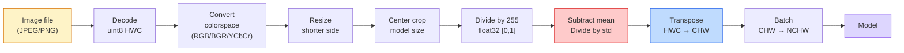
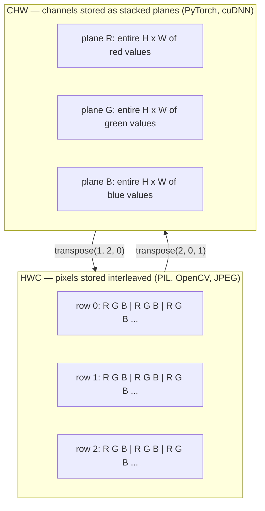

# 이미지 기본  픽셀, 채널, 색상 공간

> 이미지는 빛 샘플의 텐서입니다. 여러분이 사용할 모든 시각 모델은 이 사실에서 시작됩니다.

**Type:** Build
**Languages:** Python
**Prerequisites:** Phase 1 Lesson 12 (Tensor Operations), Phase 3 Lesson 11 (Intro to PyTorch)
**Time:** ~45 minutes

## 학습 목표

- 연속적인 장면이 어떻게 픽셀로 분해되는지 설명하고 샘플링/분량화 결정이 모든 하류 모델에 천장을 설정하는 이유를 설명합니다
- NumPy 매레이로 이미지를 읽고, 슬라이드하고 검사하고 HWC와 CHW 레이아웃 사이를 순수하게 전환하십시오
- RGB, 회색 스케일, HSV, YCbCr 사이의 변환 및 각 색상 공간의 존재 이유를 설명
- 픽셀 레벨의 사전 처리를 적용 (정상화, 표준화, 크기를 변경, 채널-첫)

## 문제

여러분이 읽을 모든 논문, 여러분이 다운로드할 모든 사전 훈련된 무게, 여러분이 호출할 모든 비전 API는 입력의 특정 코딩을 가정합니다.`uint8`모델이 원하는 이미지`float32`RGB에 훈련된 네트워크에 BGR를 공급하고 정확도는 10점으로 붕괴됩니다. 채널을 예상할 때 모델 채널-최후 입력-처음과 첫 번째 conv 레이어는 높이를 기능 채널로 취급합니다. 이 모든 것은 오류를 발생시키지 않습니다. 그것은 단지 당신의 메트릭을 망치고 파일을 로드하는 방법에 사는 버그를 사냥하는 데 일주일을 보내고 있습니다.

커블루션은 어떤 것을 슬라이드하는지를 알면 복잡하지 않습니다. 어려운 부분은 "이미지"는 카메라, JPEG 디코더, PIL, OpenCV, 타크비전, CUDA 커널과 다른 것을 의미합니다. 각 스택은 자신의 축 순서, 바이트 범위 및 채널 컨벤션을 가지고 있습니다. 이러한 직선 배들을 끊어 놓은 파이프라인을 유지할 수 없는 비전 엔지니어.

이 수업은 기초를 고정하여 나머지 단계가 그것을 기반으로 할 수 있습니다. 마지막에 여러분은 픽셀이 무엇인지, 왜 하나의 픽셀 대신 3개의 숫자가 있는지, "이미지넷 통계로 정상화"가 실제로하는 것은 무엇인지, 그리고 이 단계에서 다른 모든 수업이 가정하는 두 또는 세 가지 레이아웃 사이에서 어떻게 이동할 수 있는지 알 것입니다.

## 개념

### 전면 전산 파이프 라인 한 눈에

모든 생산 시야 시스템은 같은 순서로 되돌릴 수 있는 변환입니다. 한 걸음 잘못하면 모델은 훈련된 것과 다른 입력값을 볼 수 있습니다.



빨간색과 파란색 두 상자는 80%의 침묵 실패가 살고 있습니다. 표준화가 부족하고 잘못된 레이아웃입니다.

### 픽셀은 샘플이 아니라 사각형입니다

카메라 센서는 작은 탐지체들의 그리드에 착륙하는 광자를 산다. 각 탐지기는 초분의 일 동안 빛을 통합하고 얼마나 많은 광자에 맞게 전압을 방출한다. 센서는 그 전압을 정수로 분별한다. 하나의 탐지기는 하나의 픽셀이 된다.

```
Continuous scene                 Sensor grid                     Digital image
(infinite detail)                (H x W detectors)               (H x W integers)

    ~~~~~                        +--+--+--+--+--+                 210 198 180 155 120
   ♪ ♪ 205 195 178 152 118 ♪
  - 빛 - - -> +--+--+--+--+--+----> 200 190 175 150 115
   ~~~~~                         |  |  |  |  |  |                 195 185 170 148 112
                                 +--+--+--+--+--+                 188 180 165 145 108
```

이 단계에서는 두 가지 선택이 이루어지고 하류의 모든 것에 천장을 고정합니다.

- **Spatial sampling**이 사진의 각 장면에서 얼마나 많은 탐지기를 결정하는지를 결정합니다. 너무 적은 경우 가장자리가 어집니다. 너무 많은 경우 저장과 계산이 폭발합니다.
- **Intensity quantization**8 비트 는 256 레벨 을 주고 디스플레이 를 위한 표준 이다. 10, 12, 16 비트 는 더 부드러운 기하급수 를 주고 의료 영상 촬영, HDR, 원료 센서 파이프 라인 을 사용 한다.

픽셀은 면적이 있는 색상의 광장이 아닙니다. 그것은 하나의 측정입니다. 크기를 변경하거나 회전하면 그 측정 그리드를 다시 샘플링합니다.

### 왜 세 채널

한 탐지기는 전체 가시 스펙트럼을 가로지르는 광자를 셀 수 있습니다. 그레이 스케일입니다. 색을 얻기 위해 센서는 빨간색, 녹색, 파란색 필터 모자이크로 그릴을 덮습니다. 데모사이크한 후, 모든 공간 위치에는 빨간색 필터링 탐지기의 반응, 녹색 필터링, 파란색 필터링이 있습니다. 그 세 개의 정수는 픽셀의 RGB 트리플렛입니다.

```
One pixel in memory:

    (R, G, B) = (210, 140, 30)   <- reddish-orange

An H x W RGB image:

    shape (H, W, 3)     stored as   H rows of W pixels of 3 values
                                    each in [0, 255] for uint8
```

세 가지는 마법이 아닙니다. 깊이 카메라는 Z 채널을 추가합니다. 위성들은 적외선과 자외선 밴드를 추가합니다. 의료 스캔은 종종 한 채널 (X선, CT) 또는 여러 채널 (하이퍼 스펙트럼) 을 가지고 있습니다. 채널의 수는 마지막 축입니다. conv 층은 그것을 통해 혼합하는 것을 배우습니다.

### 두 가지 레이아웃 컨벤션: HWC 및 CHW

같은 텐서, 두 개의 순서, 모든 도서관에서 하나를 선택합니다.

```
HWC (height, width, channels)           CHW (channels, height, width)

   W ->                                    H ->
  +-----+-----+-----+                     +-----+-----+
H |R G B|R G B|R G B|                   C |R R R R R R|
| +-----+-----+-----+                   | +-----+-----+
v |R G B|R G B|R G B|                   v |G G G G G G|
  +-----+-----+-----+                     +-----+-----+
                                          |B B B B B B|
                                          +-----+-----+

   PIL, OpenCV, matplotlib,              PyTorch, most deep learning
   almost every image file on disk       frameworks, cuDNN kernels
```

CHW는 convolution 커널들이 H와 W를 가로지르는 데서 존재합니다. 채널 축을 먼저 유지하는 것은 각각의 커널이 채널당 직렬 2D 평면을 볼 수 있다는 것을 의미합니다.

한 줄의 변환은 1000번 입력합니다.

```
img_chw = img_hwc.transpose(2, 0, 1)      # NumPy
img_chw = img_hwc.permute(2, 0, 1)        # PyTorch tensor
```

메모리 레이아웃, 시각화:



### 바이트 범위 및 d 타입

세 가지 대회가 주류하고 있습니다.

| Convention | dtype | Range | Where you see it |
|------------|-------|-------|------------------|
| Raw | `uint8` | [0, 255] | Files on disk, PIL, OpenCV output |
| Normalized | `float32` | [0.0, 1.0] | After `img.astype('float32') / 255` |
| Standardized | `float32` | roughly [-2, +2] | After subtracting mean and dividing by std |

컨볼루션 네트워크는 표준화된 입력에 대한 훈련이 이루어졌습니다.`mean=[0.485, 0.456, 0.406]``std=[0.229, 0.224, 0.225]`전체 ImageNet 훈련 세트에서 세 채널의 수학적 평균과 표준 경각심을 계산하여 [0, 1] 정상화된 픽셀로 계산합니다.`uint8`표준화된 부동산을 기대하는 모델에 적용되는 것은 응용 시각에서 가장 흔한 침묵 장애입니다.

### 색상 공간 및 그 존재 이유

RGB는 캡처 형식이지만 항상 모델에 가장 유용한 표현은 아닙니다.

```
 RGB               HSV                       YCbCr / YUV

 R red             H hue (angle 0-360)       Y luminance (brightness)
 G green           S saturation (0-1)        Cb chroma blue-yellow
 B blue            V value/brightness (0-1)  Cr chroma red-green

 Linear to         Separates color from      Separates brightness from
 sensor output     brightness. Useful for    color. JPEG and most video
                   color thresholding, UI    codecs compress the chroma
                   sliders, simple filters   channels harder because the
                                             human eye is less sensitive
                                             to chroma detail than to Y.
```

대부분의 현대 CNN에 RGB를 공급하고 다른 공간에 접속하면

- **HSV** 고전적인 CV 코드, 색상 기반 세그먼트, 백색 균형
- **YCbCr** JPEG 내부, 비디오 파이프라인, Y에서만 작동하는 초상화 모델
- **Grayscale** OCR, 문서 모델, 색이 신호보다는 귀찮게 변하는 경우

RGB의 회색표는 평균이 아니라 중량수입니다. 왜냐하면 인간의 눈은 빨간색이나 파란색보다 녹색에 더 민감하기 때문입니다.

```math
Y = 0.299 R + 0.587 G + 0.114 B \qquad \text{(ITU-R BT.601, the classic weights)}
```

### 측면 비율, 크기를 변경하고, 인터폴레이션

모든 모델은 고정된 입력 크기를 가지고 있습니다. 대부분의 이미지넷 분류기에는 224x224이 있고, 현대 탐지기에는 384x384 또는 512x512이 있습니다.

- **Resize shorter side, then center crop** 표준 이미지넷 레시피. 측면 비율을 유지하며 가장자리 픽셀 스트립을 버립니다.
- **Resize and pad** 각 픽셀과 측면 비율을 보존하고, 검은 바를 추가합니다.
- **Resize directly to target** 이미지 뻗어. 저렴, 기하학을 왜곡, 많은 분류 작업에 적합합니다.

인터폴레이션 방법은 새로운 그리드가 오래된 그리드와 일치하지 않을 때 중간 픽셀의 계산 방법을 결정합니다.

```
Nearest neighbour     fastest, blocky, only choice for masks/labels
Bilinear              fast, smooth, default for most image resizing
Bicubic               slower, sharper on upscaling
Lanczos               slowest, best quality, used for final display
```

엄지손가락 규칙: 훈련에 대한 쌍선형, 당신이 볼 자산에 대한 양변 또는 양변, 정수 클래스 인증을 포함하는 모든 것에 가장 가까운.

```figure
conv-output-size
```

## 건설 해

### 단계 1: 이미지 텐서를 만들고 그 모양을 검사

결정적 합성 이미지로 시작하여 첫 번째 실험실이 NumPy만 사용해서 오프라인으로 실행됩니다. 파일 디코딩은 별도의 경계입니다. JPEG 또는 PNG 디코더가 RGB 바이트를 반환하면 아래의 모든 텐서 작업은 동일합니다.

```python
import numpy as np

def synthetic_rgb(h=128, w=192, seed=0):
    rng = np.random.default_rng(seed)
    yy, xx = np.meshgrid(np.linspace(0, 1, h), np.linspace(0, 1, w), indexing="ij")
    r = (np.sin(xx * 6) * 0.5 + 0.5) * 255
    g = yy * 255
    b = (1 - yy) * xx * 255
    rgb = np.stack([r, g, b], axis=-1) + rng.normal(0, 6, (h, w, 3))
    return np.clip(rgb, 0, 255).astype(np.uint8)

arr = synthetic_rgb()

print(f"type:   {type(arr).__name__}")
print(f"dtype:  {arr.dtype}")
print(f"shape:  {arr.shape}     # (H, W, C)")
print(f"min:    {arr.min()}")
print(f"max:    {arr.max()}")
print(f"pixel at (0, 0): {arr[0, 0]}")
```

예상 출력: `shape: (H, W, 3)``dtype: uint8`, 범위`[0, 255]`이것은 카논िकल 디코딩된 표현입니다. 이 바이트가 카메라, 이미지 디코더, 또는 이 합성 생성기에서 왔는지 여부에 관계없이요.

### 단계 2: 채널을 분할하고 재편 배치

R, G, B를 분리해서 꺼내서 PyTorch에 HWC에서 CHW로 변환합니다.

```python
R = arr[:, :, 0]
G = arr[:, :, 1]
B = arr[:, :, 2]
print(f"R shape: {R.shape}, mean: {R.mean():.1f}")
print(f"G shape: {G.shape}, mean: {G.mean():.1f}")
print(f"B shape: {B.shape}, mean: {B.mean():.1f}")

arr_chw = arr.transpose(2, 0, 1)
print(f"\nHWC shape: {arr.shape}")
print(f"CHW shape: {arr_chw.shape}")
```

회색 스케일 3개의 평면, 채널당 1개. CHW는 단순히 축을 재편합니다. 메모리 레이아웃이 허용할 때 데이터 복사본이 엄격히 필요하지 않습니다.

### 단계 3: 회색 스케일 및 HSV 변환

무게수모 회색 스케일, 그리고 수동 RGB에서 HSV로

```python
def rgb_to_grayscale(rgb):
    weights = np.array([0.299, 0.587, 0.114], dtype=np.float32)
    return (rgb.astype(np.float32) @ weights).astype(np.uint8)

def rgb_to_hsv(rgb):
    rgb_f = rgb.astype(np.float32) / 255.0
    r, g, b = rgb_f[..., 0], rgb_f[..., 1], rgb_f[..., 2]
    cmax = np.max(rgb_f, axis=-1)
    cmin = np.min(rgb_f, axis=-1)
    delta = cmax - cmin

    h = np.zeros_like(cmax)
    mask = delta > 0
    argmax = np.argmax(rgb_f, axis=-1)
    rmax = mask & (argmax == 0)
    gmax = mask & (argmax == 1)
    bmax = mask & (argmax == 2)
    h[rmax] = ((g[rmax] - b[rmax]) / delta[rmax]) % 6
    h[gmax] = ((b[gmax] - r[gmax]) / delta[gmax]) + 2
    h[bmax] = ((r[bmax] - g[bmax]) / delta[bmax]) + 4
    h = h * 60.0

    s = np.divide(delta, cmax, out=np.zeros_like(delta), where=cmax > 0)
    v = cmax
    return np.stack([h, s, v], axis=-1)

gray = rgb_to_grayscale(arr)
hsv = rgb_to_hsv(arr)
print(f"gray shape: {gray.shape}, range: [{gray.min()}, {gray.max()}]")
print(f"hsv   shape: {hsv.shape}")
print(f"hue range: [{hsv[..., 0].min():.1f}, {hsv[..., 0].max():.1f}] degrees")
print(f"sat range: [{hsv[..., 1].min():.2f}, {hsv[..., 1].max():.2f}]")
print(f"val range: [{hsv[..., 2].min():.2f}, {hsv[..., 2].max():.2f}]")
```

Hue는 [0, 1]에서 수, 포화 및 값으로 나타납니다.`hsv_full`협약

### 4단계: 표준화, 표준화, 역전

원본 바이트에서 미리 훈련된 이미지넷 모델이 기대하는 정확한 텐서로 이동하고 다시 돌아가세요.

```python
mean = np.array([0.485, 0.456, 0.406], dtype=np.float32)
std = np.array([0.229, 0.224, 0.225], dtype=np.float32)

def preprocess_imagenet(rgb_uint8):
    x = rgb_uint8.astype(np.float32) / 255.0
    x = (x - mean) / std
    x = x.transpose(2, 0, 1)
    return x

def deprocess_imagenet(chw_float32):
    x = chw_float32.transpose(1, 2, 0)
    x = x * std + mean
    x = np.clip(x * 255.0, 0, 255).astype(np.uint8)
    return x

x = preprocess_imagenet(arr)
print(f"preprocessed shape: {x.shape}     # (C, H, W)")
print(f"preprocessed dtype: {x.dtype}")
print(f"preprocessed mean per channel:  {x.mean(axis=(1, 2)).round(3)}")
print(f"preprocessed std  per channel:  {x.std(axis=(1, 2)).round(3)}")

roundtrip = deprocess_imagenet(x)
max_diff = np.abs(roundtrip.astype(int) - arr.astype(int)).max()
print(f"roundtrip max pixel diff: {max_diff}    # should be 0 or 1")
```

채널당 평균은 0에 가깝고, std는 1에 가깝다.`transforms.Normalize`전화는 뚜 아래에서 수행됩니다.

### 단계 5: 처음부터 크기를 변경

가장 가까운 이웃은 출력 좌표 각를 하나의 소스 픽셀로 회전한다. 쌍선적 인터폴레이션은 주변 4 개의 픽셀을 찾아서 거리를 따라 혼합한다. 아래의 두 구현은 엔드포인트 정렬 좌표를 사용하므로 첫 번째와 마지막 소스 픽셀은 고정되어 있습니다.

```python
def resize_coordinates(source_length, target_length):
    if target_length == 1:
        return np.zeros(1, dtype=np.float32)
    return np.linspace(0, source_length - 1, target_length, dtype=np.float32)

def nearest_resize(image, target_height, target_width):
    y = np.rint(resize_coordinates(image.shape[0], target_height)).astype(int)
    x = np.rint(resize_coordinates(image.shape[1], target_width)).astype(int)
    return image[y[:, None], x[None, :]]

def bilinear_resize(image, target_height, target_width):
    y = resize_coordinates(image.shape[0], target_height)
    x = resize_coordinates(image.shape[1], target_width)
    y0 = np.floor(y).astype(int)
    x0 = np.floor(x).astype(int)
    y1 = np.minimum(y0 + 1, image.shape[0] - 1)
    x1 = np.minimum(x0 + 1, image.shape[1] - 1)
    wy = (y - y0)[:, None, None]
    wx = (x - x0)[None, :, None]

    source = image.astype(np.float32)
    top = source[y0[:, None], x0[None, :]] * (1 - wx)
    top += source[y0[:, None], x1[None, :]] * wx
    bottom = source[y1[:, None], x0[None, :]] * (1 - wx)
    bottom += source[y1[:, None], x1[None, :]] * wx
    result = top * (1 - wy) + bottom * wy
    return np.clip(np.rint(result), 0, 255).astype(image.dtype)

target_height = arr.shape[0] * 3
target_width = arr.shape[1] * 3
nearest = nearest_resize(arr, target_height, target_width)
bilinear = bilinear_resize(arr, target_height, target_width)

def local_roughness(x):
    gy = np.diff(x.astype(float), axis=0)
    gx = np.diff(x.astype(float), axis=1)
    return float(np.abs(gy).mean() + np.abs(gx).mean())

for name, out in [("nearest", nearest), ("bilinear", bilinear)]:
    print(f"{name:>8}  shape={out.shape}  roughness={local_roughness(out):6.2f}")
```

가장 가까운 점수는 단단한 가장자리를 유지하기 때문에 가장 높습니다. 모든 새로운 픽셀이 각 축에 두 개의 위치를 혼합하기 때문에 쌍선형이 부드럽습니다. 실행 가능한 동반자는 카트뮬-롬立方핵으로 각 축에 네 개의 이웃으로 동일한 분리 가능한 아이디어를 확장하고, 이미지 라이브러리 없이 세 결과를 모두 인쇄합니다.

## 사용 하 고

파이토치는 배팅된 장치에 인식되는 텐서에서 동일한 작업을 수행합니다. 아래의 코드는 더 짧은 측면을 크기로 변경하고 중앙 작물을 취하고 각 채널을 표준화하고 미리 훈련된 모델이 기대하는 NCHW 텐서를 생성합니다.

```python
import torch
import torch.nn.functional as F

image_hwc = torch.from_numpy(synthetic_rgb(256, 320))
batch = image_hwc.permute(2, 0, 1).unsqueeze(0).float() / 255.0

height, width = batch.shape[-2:]
scale = 256 / min(height, width)
resized_height = round(height * scale)
resized_width = round(width * scale)
batch = F.interpolate(
    batch,
    size=(resized_height, resized_width),
    mode="bilinear",
    align_corners=False,
    antialias=True,
)

top = (resized_height - 224) // 2
left = (resized_width - 224) // 2
batch = batch[:, :, top:top + 224, left:left + 224]

mean = torch.tensor([0.485, 0.456, 0.406]).view(1, 3, 1, 1)
std = torch.tensor([0.229, 0.224, 0.225]).view(1, 3, 1, 1)
batch = (batch - mean) / std

print(f"tensor dtype: {batch.dtype}")
print(f"batched shape: {tuple(batch.shape)}")
print(f"per-channel mean: {batch.mean(dim=(0, 2, 3)).tolist()}")
print(f"per-channel std:  {batch.std(dim=(0, 2, 3)).tolist()}")
```

네 단계, 정확히 이 순서로: 바이트를 떠 있는 것으로 변환하고 HWC를 NCHW로 교환하고, 더 짧은 측면을 256으로 크기를 변경하고, 224x224의 중앙 작식을 취하고, 이미지넷 평균을 빼고 표준 경각심을 나누는 것입니다. 그 순서를 역전하면 모델에 도달하는 것을 조용히 변경합니다.

## 선박

이 교훈은 다음과 같은 결과를 낳습니다.

- `outputs/prompt-vision-preprocessing-audit.md` 어떤 모델 카드나 데이터 세트 카드를 팀에서 정밀한 사전 처리 변수들의 체크리스트로 변환하는 명령어.
- `outputs/skill-image-tensor-inspector.md` 어떤 이미지 모양의 텐서나 배열을 보면 d 타입, 레이아웃, 범위와 원료, 정상화 또는 표준화 된 모습을 보고하는 기술입니다.

## 운동

1. **(Easy)**2x2 RGB를 만들`uint8`HWC를 CHW로 변환하고 다시, 두 모양을 인쇄하고, 돌아가는 여행은 모든 값을 보존하는 것을 증명합니다.
2. **(Medium)**글쓰기`standardize(img, mean, std)`그리고 그 반은 합쳐서`roundtrip_max_diff <= 1`Uint8 이미지에서 테스트를 합니다. 함수는 HWC에서 하나의 이미지와 NCHW에서 동일한 호출을 가진 배트에서 작동해야 합니다.
3. **(Hard)**3채널 이미지넷 표준화된 텐서를 가지고 1x1 칸의 칸을 통해 실행하여 RGB의 중량 혼합물을 하나의 회색 채널로 학습합니다.`[0.299, 0.587, 0.114]`, 그들을 얼어, 출력과 일치 확인`rgb_to_grayscale`다른 클래식 색상 공간 변환은 1x1 회전으로 쓸 수 있습니까?

## 주요 용어

| Term | What people say | What it actually means |
|------|----------------|----------------------|
| Pixel | "A coloured square" | One sample of light intensity at one grid location — three numbers for colour, one for grayscale |
| Channel | "The colour" | One of the parallel spatial grids stacked into an image tensor; last axis in HWC, first in CHW |
| HWC / CHW | "The shape" | Axis orderings for an image tensor; disk and PIL use HWC, PyTorch and cuDNN use CHW |
| Normalize | "Scale the image" | Divide by 255 so pixels live in [0, 1] — necessary but not sufficient |
| Standardize | "Zero-center" | Subtract mean and divide by std per channel so the input distribution matches what the model was trained on |
| Grayscale conversion | "Average the channels" | A weighted sum with coefficients 0.299/0.587/0.114 that matches human luminance perception |
| Interpolation | "How resize picks pixels" | The rule that decides output values when the new grid does not align with the old one — nearest for labels, bilinear for training, bicubic for display |
| Aspect ratio | "Width over height" | The ratio that distinguishes "resize and pad" from "resize and stretch" |

## 더 많은 읽기

- [Charles Poynton — A Guided Tour of Color Space](https://web.archive.org/web/20251220000525/https://poynton.ca/PDFs/Guided_tour.pdf) 왜 이렇게 많은 색 공간이 있고, 각각의 색상이 언제 중요한지 가장 명확한 기술적인
- [PyTorch Vision Transforms Docs](https://pytorch.org/vision/stable/transforms.html) 생산에서 실제로 구성하는 변환의 전체 파이프라인을
- [How JPEG Works (Colt McAnlis)](https://www.youtube.com/watch?v=F1kYBnY6mwg) 크로마 하위 샘플링, DCT의 날카로운 시각 투어, 그리고 JPEG가 RGB보다는 YCbCr를 암호화하는 이유는
- [ImageNet Preprocessing Conventions (torchvision models)](https://pytorch.org/vision/stable/models.html) 진실의 근원`mean=[0.485, 0.456, 0.406]`그리고 동물원에서의 모든 모델들이 왜 그렇게 기대하는지
