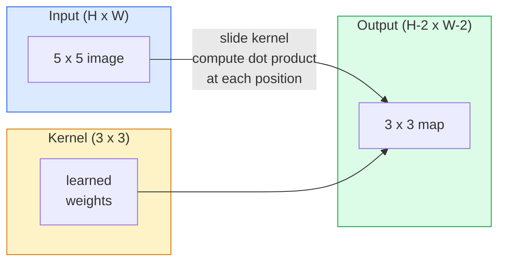
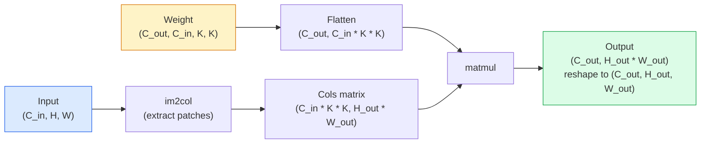

# 처음부터 전개

> 곡은 작은 밀도가 높은 층입니다. 여러분은 이미지를 가로질러 슬라이드하고, 모든 위치에 동일한 무게를 공유합니다.

**Type:** Build
**Languages:** Python
**Prerequisites:** Phase 3 (Deep Learning Core), Phase 4 Lesson 01 (Image Fundamentals)
**Time:** ~75 minutes

## 학습 목표

- 즈 루프 버전과 벡터화된 `im2col`버전
- 입력 크기와 커널 크기와  및 단계의 조합에 대한 출력 공간 크기를 계산하고, `(H - K + 2P) / S + 1`공식
- 손으로 디자인된 커널 (아웃, 블러드, 날카로운, Sobel) 그리고 각각의 활성화의 패턴을 생성하는 이유를 설명합니다
- 스택의 이 특징 추출기에 들어가 스택의 깊이를 수용장 크기와 연결한다

## 문제

224x224 RGB 이미지에 완전히 연결된 계층은 뉴런당 224 * 224 * 3 = 150,528 입력 무게가 필요합니다. 1,000개의 유닛을 가진 하나의 숨겨진 층은 유용한 것을 배우기 전에 이미 1억 5천만개의 매개 변수를  더 나쁜 것은, 그 층은 왼쪽 상단에서 있는 개와 오른쪽 아래에서 있는 개가 같은 패턴이라는 것을 전혀 알지 못합니다. 모든 픽셀 위치를 독립적으로 취급합니다. 이는 이미지에 대해 완전히 잘못된 것입니다. 고양이를 3 픽셀로 번역하면 네트워크가 개념을 다시 배울 수 없습니다.

이미지 모델이 필요로 하는 두 가지 특성은**translation equivariance**(출력 출력 출력 출력 출력 출력 출력 출력 출력 출력 출력 출력 출력 출력 출력 출력 출력 출력 출력 출력 출력 출력 출력 출력 출력 출력 출력 출력 출력 출력 출력 출력 출력 출력 출력 출력 출력 출력 출력 출력 출력 출력 출력 출력 출력 출력 출력 출력 출력 출력 출력 출력 출력 출력 출력 출력 출력 출력 출력 출력 출력 출력 출력 출력 출력 출력 출력 출력 출력 출력 출력 출력 출력 출력 출력 출력 출력 출력 출력 출력 출력 출력 출력 출력 출력 출력 출력 출력 출력 출력 출력 출력 출력 출력 출력 출력 출력 출력 출력 출력 출력 출력 출력 출력 출력 출력 출력 출력 출력 출력 출력 출력 출력 출력 출력 출력 출력 출력 출력 출력 출력 출력 출력 출력 출력 출력 출력 출력 출력 출 출 출 출 출 출 출 출 출 출 출 출 출 출 출 출 출 출 출 출 출 출 출 출 출 출 출 출 출 출 출 출 출 출 출 출 출 출 출 출 출 출 출 출 출 출 출 출 출 출 출 출 출 출 출 출 출 출 출 출 출 출 출 출 출 출 출 출 출 출 출 출 출 출 출 출 출 출 출 출 출 출 출 출 출 출 출 출 출 출 출 출 출 출 출 출 출 출 출 출 출 출 출 출 출 출 출 출 출 출 출 출 출 출 출 출 출 출 출 출 출 출 출 출 출 출 출 출 출 출 출 출 출 출 출 출 출 출 출 출 출 출 출 출 출 출 출 출 출 출 출 출 출 출 출 출 출 출 출 출 출 출 출 출 출 출 출 출 출 출 출 출 출 출 출 출 출 출 출 출 출 출 출 출 출 출 출 출 출 출 출 출 출 출 출 출 출 출 출 출 출 출 출 출 출 출 출 출 출 출 출 출 출 출 출 출 출 출 출 출 출 출 출 출 출 출 출 출 출 출 출 출 출 출 출 출 출 출 출 출 출 출 출 출 출 출 출 출 출 출 출**parameter sharing**튼튼한 층은 둘 다 무료로 제공하죠.

컨볼루션은 딥러닝을 위해 발명된 것이 아닙니다. 이것은 JPEG 압축, 포토샵에서 가우시안 블러, 산업 시각에서 가장자리 검출 및 지금까지 유통된 모든 오디오 필터에 힘을 주는 동일한 작업입니다. CNN가 2012년부터 2020년까지 이미지넷을 지배하는 이유는 컨볼루션은 가까운 값이 연관되어있는 데이터에 대한 올바른 선두이며 같은 패턴이 어디에서나 나타날 수 있습니다.

## 개념

### 1개의 커널, 슬라이딩

2D 컨볼루션은 커널 (또는 필터) 이라고 불리는 작은 무게 매트릭스를 가져가 입력값을 가로질러 슬라이드하고 각 위치에서 요소에 따라 생산되는 제품의 합을 계산합니다. 그 합은 하나의 출력 픽셀이 됩니다.



5x5 입력에 대한 구체적인 3x3 예제 (무슨 지, 단계 1):

```
Input X (5 x 5):                Kernel W (3 x 3):

  1  2  0  1  2                   1  0 -1
  0  1  3  1  0                   2  0 -2
  2  1  0  2  1                   1  0 -1
  1  0  2  1  3
  2  1  1  0  1

The kernel slides across every valid 3 x 3 window. Output Y is 3 x 3:

 Y[0,0] = sum( W * X[0:3, 0:3] )
 Y[0,1] = sum( W * X[0:3, 1:4] )
 Y[0,2] = sum( W * X[0:3, 2:5] )
 Y[1,0] = sum( W * X[1:4, 0:3] )
 ... and so on
```

그 한 가지 공식**shared weights, locality, sliding window**는 전체 아이디어입니다. 나머지는 모든 것이 회계입니다.

### 출력 크기의 공식

입력 공간 크기를 고려하면 `H`, 커널 크기가`K`, `P`, 발걸음`S`이 부분의 본문은

```math
H_{\text{out}} = \left\lfloor \frac{H - K + 2P}{S} \right\rfloor + 1
```

기억하세요. 여러분은 건축에 따라 수십 번 계산할 것입니다.

| Scenario | H | K | P | S | H_out |
|----------|---|---|---|---|-------|
| Valid conv, no padding | 32 | 3 | 0 | 1 | 30 |
| Same conv (preserves size) | 32 | 3 | 1 | 1 | 32 |
| Downsample by 2 | 32 | 3 | 1 | 2 | 16 |
| Pool 2x2 | 32 | 2 | 0 | 2 | 16 |
| Large receptive field | 32 | 7 | 3 | 2 | 16 |

" 같은 "는 ""를 뜻합니다$P$그래서$H_{\text{out}} = H$언제$S = 1$- 이상하게$K$, 즉$P = (K - 1) / 2$3x3 커널이 지배하는 이유는 이 커널은 여전히 중심이 있는 가장 작은 이 odd 커널입니다.

### 

이 없으면 각 이 특징 지도를 축소합니다. 20개씩 쌓아 224x224의 이미지가 184x184으로 됩니다. 이는 경계에서 계산을 낭비하고, 일치하는 모양을 필요로 하는 잔여 연결을 복잡하게 만듭니다.

```
Zero padding (P = 1) on a 5 x 5 input:

  0  0  0  0  0  0  0
  0  1  2  0  1  2  0
  0  0  1  3  1  0  0
  0  2  1  0  2  1  0       Now the kernel can centre on pixel
  0  1  0  2  1  3  0       (0, 0) and still have three rows and
  0  2  1  1  0  1  0       three columns of values to multiply.
  0  0  0  0  0  0  0
```

실제에서 만나게 되는 모드:`zero`(가장 흔한 것)`reflect`(변을 반사하고, 생성 모델에서 단단한 경계를 피한다)`replicate`(한쪽을 복사)`circular`(을 고, 소모형 문제에서 사용된다).

### 발걸음

단계 (step) 는 슬라이드의 단계 크기가 됩니다.`stride=1`기본값입니다.`stride=2`공간의 차원을 반으로 나누고 CNN 내부의 별도의 펀딩 레이어 없이 샘플을 하락시키는 고전적인 방법입니다. 모든 현대 건축 (ResNet, ConvNeXt, MobileNet) 은 어느 곳의 최대 펀딩 대신 단계적인 컨버를 사용합니다.

```
Stride 1 on a 5 x 5 input, 3 x 3 kernel:

  starts: (0,0) (0,1) (0,2)        -> output row 0
          (1,0) (1,1) (1,2)        -> output row 1
          (2,0) (2,1) (2,2)        -> output row 2

  Output: 3 x 3

Stride 2 on the same input:

  starts: (0,0) (0,2)              -> output row 0
          (2,0) (2,2)              -> output row 1

  Output: 2 x 2
```

### 여러 입력 채널

실제 이미지는 세 채널을 가지고 있습니다. RGB 입력의 3x3 convolution는 실제로 3x3x3 볼륨입니다. 입력 채널에 한 3x3 슬라이드입니다. 각 공간 위치에서, 당신은 세 슬라이드 모두를 곱하고 합하여 편향을 추가합니다.

```
Input:   (C_in,  H,  W)        3 x 5 x 5
Kernel:  (C_in,  K,  K)        3 x 3 x 3 (one kernel)
Output:  (1,     H', W')       2D map

For a layer that produces C_out output channels, you stack C_out kernels:

Weight:  (C_out, C_in, K, K)   e.g. 64 x 3 x 3 x 3
Output:  (C_out, H', W')       64 x 3 x 3

Parameter count: C_out * C_in * K * K + C_out   (the + C_out is biases)
```

마지막 줄은 모델을 계획할 때 계산하는 줄입니다. 64 채널 3x3 conv 3 채널 입력에는`64 * 3 * 3 * 3 + 64 = 1,792`매개 변수, 저렴해요

### 이마2콜 트릭

둥지를 둥지 둥지는 읽기 쉽지만 느립니다. GPU는 큰 매트릭스 곱셈을 원합니다. 트릭은: 입력의 모든 수용장 창을 큰 매트릭스의 한 열로 평평하게 만들고, 커널을 줄로 평평하게 만들고, 전체 convolution는 하나의 matmul로됩니다.



모든 생산 conv 구현은 이 추가 캐시-tiling 트릭의 어떤 변형입니다 (대 커널에 대한 직접 conv, Winograd, FFT conv). im2col를 이해하고 당신은 핵심을 이해합니다.

### 수용장

3x3 컨브는 9개의 입력 픽셀을 볼 수 있습니다. 2개의 3x3 컨브를 쌓아 두면, 두 번째 레이어의 뉴런은 5x5 입력 픽셀을 볼 수 있습니다. 3x3 컨브는 7x7을 제공합니다. 일반적으로:

```
RF after L stacked K x K convs (stride 1) = 1 + L * (K - 1)

With strides:   RF grows multiplicatively with stride along each layer.
```

3x3이 아래로 가는 이유는 3x3 컨브가 5x5 컨브와 같은 입구 영역을 보지만 매개 변수 수가 적고 그 사이에 비선성이 더 크다는 것입니다.

```figure
convolution-kernel
```

## 건설 해

### 단계 1: 배열을 

가장 작은 원자력으로 시작하세요: H x W 배열을 중심으로 0을 는 함수입니다.

```python
import numpy as np

def pad2d(x, p):
    if p == 0:
        return x
    h, w = x.shape[-2:]
    out = np.zeros(x.shape[:-2] + (h + 2 * p, w + 2 * p), dtype=x.dtype)
    out[..., p:p + h, p:p + w] = x
    return out

x = np.arange(9).reshape(3, 3)
print(x)
print()
print(pad2d(x, 1))
```

     `x.shape[:-2]`같은 함수가 작동하는 것을 의미합니다`(H, W)``(C, H, W)`또는`(N, C, H, W)`수정 없이

### 단계 2: 2D 이 둥근 루프로 

참고 구현은 느리지만 명확합니다.`torch.nn.functional.conv2d`원칙적으로 그렇게 합니다.

```python
def conv2d_naive(x, w, b=None, stride=1, padding=0):
    c_in, h, w_in = x.shape
    c_out, c_in_w, kh, kw = w.shape
    assert c_in == c_in_w

    x_pad = pad2d(x, padding)
    h_out = (h + 2 * padding - kh) // stride + 1
    w_out = (w_in + 2 * padding - kw) // stride + 1

    out = np.zeros((c_out, h_out, w_out), dtype=np.float32)
    for oc in range(c_out):
        for i in range(h_out):
            for j in range(w_out):
                hs = i * stride
                ws = j * stride
                patch = x_pad[:, hs:hs + kh, ws:ws + kw]
                out[oc, i, j] = np.sum(patch * w[oc])
        if b is not None:
            out[oc] += b[oc]
    return out
```

네 개의 둥지를 틀어 놓은 루프 (출력 채널, 줄, 열, C_in, kh, kw) 과의 암시 합이 더됩니다. 이것은 당신이 모든 빠른 구현을 검사하는 기본 진실입니다.

### 단계 3: 손으로 설계된 커널로 확인

수직 Sobel 커널을 만들고 합성 단계 이미지에 적용하고 수직 가장자리가 빛을 내는 것을 지켜보세요.

```python
def synthetic_step_image():
    img = np.zeros((1, 16, 16), dtype=np.float32)
    img[:, :, 8:] = 1.0
    return img

sobel_x = np.array([
    [[-1, 0, 1],
     [-2, 0, 2],
     [-1, 0, 1]]
], dtype=np.float32)[None]

x = synthetic_step_image()
y = conv2d_naive(x, sobel_x, padding=1)
print(y[0].round(1))
```

7 열 (왼쪽에서 오른쪽으로 밝기 증가) 과 다른 곳에서는 0을 큰 긍정적 값으로 예상하십시오. 그 단일 인쇄는 수학이 옳다는 것을 확인합니다.

### 단계 4: im2col

입력의 모든 커널 크기의 창을 매트릭스의 열로 변환합니다.`C_in=3, K=3`, 각 열은 27개의 숫자입니다.

```python
def im2col(x, kh, kw, stride=1, padding=0):
    c_in, h, w = x.shape
    x_pad = pad2d(x, padding)
    h_out = (h + 2 * padding - kh) // stride + 1
    w_out = (w + 2 * padding - kw) // stride + 1

    cols = np.zeros((c_in * kh * kw, h_out * w_out), dtype=x.dtype)
    col = 0
    for i in range(h_out):
        for j in range(w_out):
            hs = i * stride
            ws = j * stride
            patch = x_pad[:, hs:hs + kh, ws:ws + kw]
            cols[:, col] = patch.reshape(-1)
            col += 1
    return cols, h_out, w_out
```

여전히 파이썬 루프이지만 이제 무거운 짐을 들어 올리는 것은 단일 벡터화된 매트무일 것입니다.

### 단계 5: im2col + matmul를 통해 빠른 conv

4배 루프를 매트릭스 곱으로 교체하십시오.

```python
def conv2d_im2col(x, w, b=None, stride=1, padding=0):
    c_out, c_in, kh, kw = w.shape
    cols, h_out, w_out = im2col(x, kh, kw, stride, padding)
    w_flat = w.reshape(c_out, -1)
    out = w_flat @ cols
    if b is not None:
        out += b[:, None]
    return out.reshape(c_out, h_out, w_out)
```

정확성 검증: 두 구현을 실행하고 비교합니다.

```python
rng = np.random.default_rng(0)
x = rng.normal(0, 1, (3, 16, 16)).astype(np.float32)
w = rng.normal(0, 1, (8, 3, 3, 3)).astype(np.float32)
b = rng.normal(0, 1, (8,)).astype(np.float32)

y_naive = conv2d_naive(x, w, b, padding=1)
y_im2col = conv2d_im2col(x, w, b, padding=1)

print(f"max abs diff: {np.max(np.abs(y_naive - y_im2col)):.2e}")
```

`max abs diff`여기 있을 거야`1e-5` 차이점은 유동점 축적 순서입니다. 버그가 아닙니다.

### 단계 6: 손으로 설계된 커널의 은행

5개의 필터로 하나의 컨브 레이어가 어떤 훈련도 전에 표현할 수 있는 것을 보여줍니다.

```python
KERNELS = {
    "identity": np.array([[0, 0, 0], [0, 1, 0], [0, 0, 0]], dtype=np.float32),
    "blur_3x3": np.ones((3, 3), dtype=np.float32) / 9.0,
    "sharpen": np.array([[0, -1, 0], [-1, 5, -1], [0, -1, 0]], dtype=np.float32),
    "sobel_x": np.array([[-1, 0, 1], [-2, 0, 2], [-1, 0, 1]], dtype=np.float32),
    "sobel_y": np.array([[-1, -2, -1], [0, 0, 0], [1, 2, 1]], dtype=np.float32),
}

def apply_kernel(img2d, kernel):
    x = img2d[None].astype(np.float32)
    w = kernel[None, None]
    return conv2d_im2col(x, w, padding=1)[0]
```

회색 스케일 이미지에는 적용되며, 흐릿하게 부드럽고, 날카로운 칩스 위 가장자리를 밝게 합니다. Sobel-x는 수직 가장자리를 밝게 합니다. Sobel-y는 수평 가장자리를 밝게 합니다. 이것은 바로 AlexNet 및 VGG에서 *첫 번째* 훈련된 conv 레이어가 배운 패턴입니다. 왜냐하면 좋은 이미지 모델은 나중에 어떤 작업이 있든 가장자리와 블로브 탐지기가 필요합니다.

## 사용 하 고

피토르치의`nn.Conv2d`Autograd, CUDA 커널, cuDNN 최적화와 같은 동작을 완료합니다.

```python
import torch
import torch.nn as nn

conv = nn.Conv2d(in_channels=3, out_channels=64, kernel_size=3, stride=1, padding=1)
print(conv)
print(f"weight shape: {tuple(conv.weight.shape)}   # (C_out, C_in, K, K)")
print(f"bias shape:   {tuple(conv.bias.shape)}")
print(f"param count:  {sum(p.numel() for p in conv.parameters())}")

x = torch.randn(8, 3, 224, 224)
y = conv(x)
print(f"\ninput  shape: {tuple(x.shape)}")
print(f"output shape: {tuple(y.shape)}")
```

교환`padding=1``padding=0`그리고 출력량은 222x222로 떨어집니다.`stride=1``stride=2`그리고 112x112로 떨어집니다.

## 선박

이 교훈은 다음과 같은 결과를 낳습니다.

- `outputs/prompt-cnn-architect.md` 입력 크기와 매개 변수 예산, 그리고 대상 수용장치에 따라 의 스택을 설계하는`Conv2d`각 단계에 오른쪽 K/S/P를 가진 층
- `outputs/skill-conv-shape-calculator.md` 네트워크 스펙 레이어를 레이어별로 이동하여 각 블록의 출력 모양, 수용 필드 및 매개 변수 수를 반환하는 기술.

## 운동

1. **(Easy)**128x128 회색 스케일 입력과 `[Conv3x3(s=1,p=1), Conv3x3(s=2,p=1), Conv3x3(s=1,p=1), Conv3x3(s=2,p=1)]`, 각 층의 출력 공간 크기와 수용장치를 손으로 계산합니다. PyTorch로 확인합니다`nn.Sequential`가짜 컨버스
2. **(Medium)**확장`conv2d_naive`그리고`conv2d_im2col``groups`논쟁을 해봐`groups=C_in=C_out`깊이의 구전과 그 매개 변수 수를`C * K * K`대신`C * C * K * K`- 그래
3. **(Hard)** 의 후진 통과를 실시`conv2d_im2col`수동으로: 출력 기하급수에서 `x`그리고`w`- 확인`torch.autograd.grad`이 2kol의 기울기는`col2im`, 그리고 그것은 겹치는 창을 축적해야합니다.

## 주요 용어

| Term | What people say | What it actually means |
|------|----------------|----------------------|
| Convolution | "Sliding a filter" | A learnable dot product applied at every spatial location with shared weights; mathematically a cross-correlation, but everyone calls it convolution |
| Kernel / filter | "The feature detector" | A small weight tensor of shape (C_in, K, K) whose dot product with a window of input produces one output pixel |
| Stride | "How far you jump" | The step size between consecutive kernel placements; stride 2 halves each spatial dimension |
| Padding | "Zeros on the edges" | Extra values added around the input so the kernel can centre on border pixels; `same` padding keeps output size equal to input size |
| Receptive field | "How much the neuron sees" | The patch of original input that a given output activation depends on, growing with depth and stride |
| im2col | "The GEMM trick" | Rearranging every receptive window into columns so convolution becomes one big matrix multiply — the core of every fast conv kernel |
| Depthwise conv | "One kernel per channel" | A conv with `groups == C_in`, computing each output channel from only its matching input channel; the backbone of MobileNet and ConvNeXt |
| Translation equivariance | "Shift in, shift out" | Property that shifting the input by k pixels shifts the output by k pixels; comes for free with shared weights |

## 더 많은 읽기

- [A guide to convolution arithmetic for deep learning (Dumoulin & Visin, 2016)](https://arxiv.org/abs/1603.07285) 모든 과정이 조용히 복사하는 팅/발전/팽창의 최종 다이어그램
- [CS231n: Convolutional Neural Networks for Visual Recognition](https://cs231n.github.io/convolutional-networks/) 본래의 im2col 설명을 포함한 가톨릭 강의 노트
- [The Annotated ConvNet (fast.ai)](https://nbviewer.org/github/fastai/fastbook/blob/master/13_convolutions.ipynb) 수동 회전에서 훈련된 숫자 분류기로 이동하는 노트북
- [Receptive Field Arithmetic for CNNs (Dang Ha The Hien)](https://distill.pub/2019/computing-receptive-fields/) 수용적 필드 계산의 종이에 맞는 품질의 인터랙티브 설명자
