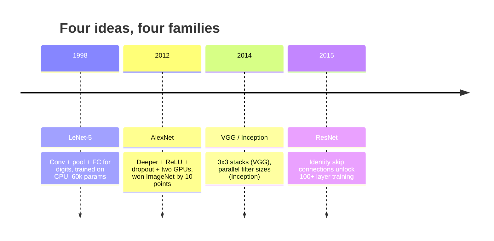
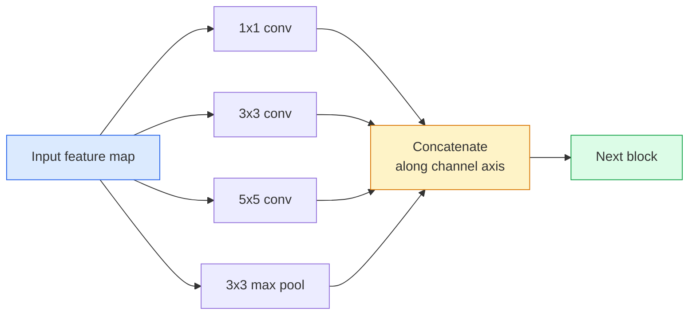
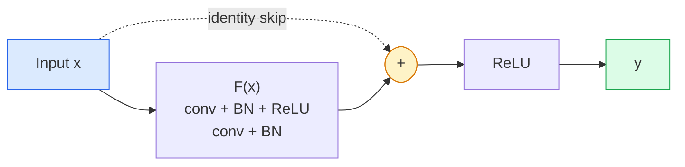

# CNNs  레넷에서 레넷

> 지난 30년 동안의 모든 주요 CNN는 하나의 새로운 아이디어가 붙어있는 동일한 비선형성 하하하하하하하하하하의 레시피입니다.

**Type:** Learn + Build
**Languages:** Python
**Prerequisites:** Phase 3 Lesson 11 (PyTorch), Phase 4 Lesson 01 (Image Fundamentals), Phase 4 Lesson 02 (Convolutions from Scratch)
**Time:** ~75 minutes

## 학습 목표

- 건축계열을 추적하세요 LeNet-5 -> AlexNet -> VGG -> 시작 -> ResNet 그리고 각 가족이 기여한 새로운 아이디어를 표시하세요
- 파이토치에서 레넷-5을 구현하고, VGG 스타일의 블록과 레스넷 베이직블록을 구현하고, 각각 40 라인 이하입니다.
- 잔여 연결이 1000층 네트워크가 훈련 불가능한 네트워크에서 최첨단 네트워크로 변하는 이유를 설명해 주십시오.
- 현대 척추 (ResNet-18, ResNet-50) 를 읽고 출력 모양, 수용장 및 매개 변수를 보고서는

## 문제

2011년, 최고의 이미지넷 분류자는 74%의 톱-5 정확도를 기록했다. 2012년 알렉스넷은 85% 점수를 얻었다. 2015년 ResNet는 96%의 점수를 기록했다. 새로운 데이터가 없습니다. 새로운 GPU 세대가 없습니다. 이득은 건축 아이디어로 인해 얻었습니다. 작업하는 비전 엔지니어들은 어떤 논문에서 어떤 아이디어가 나왔는지 알아야 합니다. 왜냐하면 2026년에 배송되는 모든 생산 척추는 같은 조각의 재조합이기 때문입니다. 그리고 아이디어가 계속 전달되기 때문입니다. 그룹화된 컨브는 CNN에서 트랜스포머로,

이러한 네트워크를 연구하는 것은 또한 일반적인 실수로부터 보호합니다. 레넷 크기의 네트워크가 문제를 해결 할 때 가장 큰 사용 가능한 모델을 찾는 것입니다. MNIST는 레스넷이 필요하지 않습니다. 각 가족의 확장 곡선을 아는 것은 어디에 앉을 수 있는지 알려줍니다.

## 개념

### 시각을 변화시킨 네 가지 아이디어



클래식 시각에서 이 4번의 도약만큼 중요한 것은 아무것도 없었습니다.

### 레넷-5 (1998)

Yann LeCun의 숫자 인식기, 60,000 매개 변수, 2개의 conv-pool 블록, 2개의 완전히 연결된 층, tanh 활성화.

```
input (1, 32, 32)
  conv 5x5 -> (6, 28, 28)
  avg pool 2x2 -> (6, 14, 14)
  conv 5x5 -> (16, 10, 10)
  avg pool 2x2 -> (16, 5, 5)
  flatten -> 400
  dense -> 120
  dense -> 84
  dense -> 10
```

현대인들은 CNN라고 부르는 모든 것은 작은 분류자 머리 을 먹이는 대변 회전과 샘플링입니다. 더 많은 층과 더 큰 채널과 더 나은 활성화를 가진 레넷입니다.

### 알렉스넷 (2012)

이미지넷을 파괴한 3가지 변경 사항:

1. **ReLU**그라디언트는 사라지지 않고 훈련은 6배 가속화됩니다.
2. **Dropout**완전히 연결된 머리에 있습니다. 정규화는 하나의 층이 되고,
3. **Depth and width**5개의 막 층, 3개의 밀도가 높은 층, 60M 매개 변수, 두 개의 GPU에 훈련되어 모델이 그 둘로 나뉘어 있습니다.

논문의 그림 2에서는 GPU가 2개의 병렬 스트림으로 나뉘어 보이지만, 이 병렬성은 하드웨어적 해결방안이였지만, 건축적 통찰이 아니었습니다.

### VGG (2014)

VGG는 물었습니다. 만약 3x3 회전만 사용해서 깊이 들어가면 어떻게 될까요?

```
stack:   conv 3x3 -> conv 3x3 -> pool 2x2
repeat:  16 or 19 conv layers
```

2개의 3x3 컨브는 5x5 컨브와 동일한 5x5 입력 영역을 보이지만 매개 변수 수가 적다 ($2 \cdot 9 \cdot C^2 = 18C^2$vs $25 \cdot C^2$VGG는 이 관찰을 전체 건축물로 바꾸었다. 단순함  한 블록 타입, 반복 은 그 후 모든 것의 참조 지점으로 만들었다.

비용: 138M 매개 변수, 훈련 속도가 느리고 추론에 비용이 많이 들어요.

### 시작 (2014, 같은 해)

구글의 "내가 어떤 커널 크기를 사용해야 하는가?"에 대한 대답은, 모두 병렬입니다.



각 분기에는 채널 혼합에 1x1 , 지역 텍스처에 3x3 , 더 큰 패턴에 5x5 , 시위 변함없는 기능에 대한  및 콤팩트가 전문화되어 있으며 다음 층이 유용한 분기 하나를 선택할 수 있습니다. 초기 v1는 매 분기 내부에서 1x1 회전을 병목으로 사용하여 매개 변수를 합성하도록했습니다.

### 퇴화 문제

2015 년까지 VGG-19 는 작동했고 VGG-32 는 작동하지 않았습니다. 깊이는 도움이 될 것으로 생각되었지만 ~ 20 층 후 훈련과 테스트 손실 모두 악화되었습니다. 이것은 과잉 적합하지 않습니다. 그것은 매 층에서 gradients가 수배적으로 줄어들기 때문에 유용한 무게를 찾지 못하는 최적화입니다.

```
Plain deep network:
  y = f_L( f_{L-1}( ... f_1(x) ... ) )

Gradient wrt early layer:
  dL/dW_1 = dL/dy * df_L/df_{L-1} * ... * df_2/df_1 * df_1/dW_1

Each multiplicative term has magnitude roughly (weight magnitude) * (activation gain).
Stack 100 of them with gains < 1 and the gradient is effectively zero.
```

VGG는 19층에서 작동했습니다. 왜냐하면 배치 규범 (동시 발행) 은 활성화를 잘 확장시켰기 때문입니다. 그러나 배치 규범조차도 30층 이상의 깊이를 구하지 못했습니다.

### ResNet (2015)

그는 장, , , 썬이 모든 것을 해결하는 변화를 제안했습니다.

```math
\begin{aligned}
\text{standard block:} \quad & y = F(x) \\
\text{residual block:} \quad & y = F(x) + x
\end{aligned}
```

`+ x`차로 운전하는 동안 항상 아무것도 하지 않을 수 있다는 것을 의미합니다`F(x)`1000층의 ResNet은 1층 네트워크만큼 나쁜 것이므로, 모든 추가 블록은 소소한 탈출구멍을 가지고 있기 때문입니다. 그 보장으로, 최적화는 모든 블록을 * 약간* 유용하게 만들려고 합니다.



이 블록의 두 가지 변종이 곳곳에 나타납니다.

- **BasicBlock**(ResNet-18, ResNet-34): 2개의 3x3 컨버, 둘 다 건너뛰어
- **Bottleneck**(ResNet-50, -101, -152): 1x1 아래, 3x3 중, 1x1 위로, 삼각을 건너뛰어. 채널 수치가 높을 때 더 저렴합니다.

스피프가 다운 샘플 (배행=2) 을 통과해야 할 때, 아이덴티티 경로는 1x1배행=2 conv로 교체되어 모양과 일치합니다.

### 왜 잔재가 눈에 보이지 않는 것 이상으로 중요할까요?

이 아이디어는 실제로 이미지 분류에 관한 것이 아니라 "손가락을 가로지르고 그라디언트가 살아남을 수 있기를 희망하는" 깊은 네트워크를 신뢰할 수 있고 확장 가능한 엔지니어링 도구로 전환하는 것에 관한 것입니다. 다음 단계에 대해 읽을 모든 트랜스포머는 모든 블록에서 정확히 같은 점프 연결을 가지고 있습니다. ResNet 없이는 GPT는 없습니다.

```figure
pooling
```

## 건설 해

### 단계 1: 레넷-5

최소한의 충실한 레넷,  액티베이션, 평균 펀딩. 현대에 대한 유일한 양식은 우리가 사용하는 것입니다.`nn.CrossEntropyLoss`원래의 가우스 연결 대신 하류로

```python
import torch
import torch.nn as nn
import torch.nn.functional as F

class LeNet5(nn.Module):
    def __init__(self, num_classes=10):
        super().__init__()
        self.conv1 = nn.Conv2d(1, 6, kernel_size=5)
        self.conv2 = nn.Conv2d(6, 16, kernel_size=5)
        self.pool = nn.AvgPool2d(2)
        self.fc1 = nn.Linear(16 * 5 * 5, 120)
        self.fc2 = nn.Linear(120, 84)
        self.fc3 = nn.Linear(84, num_classes)

    def forward(self, x):
        x = self.pool(torch.tanh(self.conv1(x)))
        x = self.pool(torch.tanh(self.conv2(x)))
        x = torch.flatten(x, 1)
        x = torch.tanh(self.fc1(x))
        x = torch.tanh(self.fc2(x))
        return self.fc3(x)

net = LeNet5()
x = torch.randn(1, 1, 32, 32)
print(f"output: {net(x).shape}")
print(f"params: {sum(p.numel() for p in net.parameters()):,}")
```

예상 출력: `output: torch.Size([1, 10])``params: 61,706`이것이 바로 현대적인 시각을 시작한 모든 숫자 분류기입니다.

### 단계 2: VGG 블록

1개의 재사용 가능한 블록: 2개의 3x3 컨버, ReLU, 배트 표준, 최대 풀

```python
class VGGBlock(nn.Module):
    def __init__(self, in_c, out_c):
        super().__init__()
        self.conv1 = nn.Conv2d(in_c, out_c, kernel_size=3, padding=1)
        self.bn1 = nn.BatchNorm2d(out_c)
        self.conv2 = nn.Conv2d(out_c, out_c, kernel_size=3, padding=1)
        self.bn2 = nn.BatchNorm2d(out_c)
        self.pool = nn.MaxPool2d(2)

    def forward(self, x):
        x = F.relu(self.bn1(self.conv1(x)))
        x = F.relu(self.bn2(self.conv2(x)))
        return self.pool(x)

class MiniVGG(nn.Module):
    def __init__(self, num_classes=10):
        super().__init__()
        self.stack = nn.Sequential(
            VGGBlock(3, 32),
            VGGBlock(32, 64),
            VGGBlock(64, 128),
        )
        self.head = nn.Sequential(
            nn.AdaptiveAvgPool2d(1),
            nn.Flatten(),
            nn.Linear(128, num_classes),
        )

    def forward(self, x):
        return self.head(self.stack(x))

net = MiniVGG()
x = torch.randn(1, 3, 32, 32)
print(f"output: {net(x).shape}")
print(f"params: {sum(p.numel() for p in net.parameters()):,}")
```

CIFAR 크기의 입력 장치에 3개의 VGG 블록, 적응형 풀, 한 개의 선형 층. ~290k 매개 변수. CIFAR-10에 충분합니다.

### 단계 3: ResNet 기본 블록

레스넷-18와 레스넷-34의 핵심 구성요소

```python
class BasicBlock(nn.Module):
    def __init__(self, in_c, out_c, stride=1):
        super().__init__()
        self.conv1 = nn.Conv2d(in_c, out_c, kernel_size=3, stride=stride, padding=1, bias=False)
        self.bn1 = nn.BatchNorm2d(out_c)
        self.conv2 = nn.Conv2d(out_c, out_c, kernel_size=3, stride=1, padding=1, bias=False)
        self.bn2 = nn.BatchNorm2d(out_c)
        if stride != 1 or in_c != out_c:
            self.shortcut = nn.Sequential(
                nn.Conv2d(in_c, out_c, kernel_size=1, stride=stride, bias=False),
                nn.BatchNorm2d(out_c),
            )
        else:
            self.shortcut = nn.Identity()

    def forward(self, x):
        out = F.relu(self.bn1(self.conv1(x)))
        out = self.bn2(self.conv2(out))
        out = out + self.shortcut(x)
        return F.relu(out)
```

`bias=False`conv 계층에 대한  BN의 베타 매개 변수는 이미 편향을 처리하고 있으므로 conv 편향을 가져가는 것도 낭비입니다.`shortcut`진단이나 채널 수치가 변경될 때만 실제 conv가 필요합니다. 그렇지 않으면 비-오프 아이덴티티입니다.

### 단계 4: 작은 ResNet

CIFAR 크기의 입력값을 위한 작동하는 ResNet을 얻기 위해 4개의 BasicBlocks 그룹을 쌓아두십시오.

```python
class TinyResNet(nn.Module):
    def __init__(self, num_classes=10):
        super().__init__()
        self.stem = nn.Sequential(
            nn.Conv2d(3, 32, kernel_size=3, stride=1, padding=1, bias=False),
            nn.BatchNorm2d(32),
            nn.ReLU(inplace=True),
        )
        self.layer1 = self._make_group(32, 32, num_blocks=2, stride=1)
        self.layer2 = self._make_group(32, 64, num_blocks=2, stride=2)
        self.layer3 = self._make_group(64, 128, num_blocks=2, stride=2)
        self.layer4 = self._make_group(128, 256, num_blocks=2, stride=2)
        self.head = nn.Sequential(
            nn.AdaptiveAvgPool2d(1),
            nn.Flatten(),
            nn.Linear(256, num_classes),
        )

    def _make_group(self, in_c, out_c, num_blocks, stride):
        blocks = [BasicBlock(in_c, out_c, stride=stride)]
        for _ in range(num_blocks - 1):
            blocks.append(BasicBlock(out_c, out_c, stride=1))
        return nn.Sequential(*blocks)

    def forward(self, x):
        x = self.stem(x)
        x = self.layer1(x)
        x = self.layer2(x)
        x = self.layer3(x)
        x = self.layer4(x)
        return self.head(x)

net = TinyResNet()
x = torch.randn(1, 3, 32, 32)
print(f"output: {net(x).shape}")
print(f"params: {sum(p.numel() for p in net.parameters()):,}")
```

2개 블록의 4개 그룹, 2개 그룹, 3개 그룹, 4개 그룹의 시작에서 2단계, 4개 그룹, 4개 그룹, 4개 그룹, 4개 그룹, 4개 그룹, 4개 그룹, 4개 그룹, 4개 그룹, 4개 그룹, 4개 그룹, 4개 그룹, 4개 그룹, 4개 그룹, 4개 그룹, 4개 그룹, 4개 그룹, 4개 그룹, 4개 그룹, 4개 그룹, 4개 그룹, 4개 그룹, 4개 그룹, 4개 그룹, 4개 그룹, 4개 그룹, 4개 그룹, 4개 그룹, 4개 그룹, 4개 그룹, 4개 그룹, 4개 그룹, 4개 그룹, 4개 그룹, 4개 그룹, 4개 그룹, 4개 그룹, 4개 그룹, 4개 그룹, 4개 그룹, 4개 그룹, 4개 그룹, 4개 그룹, 4개 그룹, 4개 그룹, 4개 그룹, 4개 그룹, 4개 그룹, 4개 그룹, 4개 그룹, 4개 그룹, 4개 그룹, 4개 그룹, 4개 그룹, 4개 그룹, 4개 그룹, 4개 그룹, 4개 그룹, 4개 그룹, 4개 그룹, 4개 그룹, 4개 그룹, 4개 그룹, 4개 그룹, 4개 그룹, 4개 그룹, 4개 그룹, 4개 그룹, 4개 그룹, 4개 그룹, 4개 그룹, 4개 그룹, 4개 그룹, 4개 그룹, 4개 그룹, 4개 그룹, 4개 그룹, 4개 그룹, 4개 그룹, 4개 그룹, 4개 그룹, 4개, 4개 그룹, 4개, 4개 그룹, 4개, 4개 그룹, 4개, 4개 그룹, 4개, 4개 그룹, 4개, 4개, 4개, 4개, 4개, 4개의 그룹, 4개의 그룹, 4개의 그룹, 4개의 그룹, 4개의 그룹, 4개의 그룹, 4개의 그룹, 4개의 그룹, 4개의 그룹, 4개의 그룹, 4개의 그룹, 4개의 그룹, 4개의 그룹, 4개의 그룹, 4개의 그룹, 4개의 그룹, 4개의 그룹, 4개의 그룹, 4개의 그룹, 4개의 그룹, 4개의 그룹, 4개의 그룹, 4개의 그룹, 4개의 그룹, 4개의 그룹, 4개의 그룹, 4개의 그룹, 4개의 그룹, 4개의

### 단계 5: 매개 변수와 기능 효율을 비교

세 네트워크 모두에서 동일한 입력을 실행하고 매개 변수를 비교하십시오.

```python
def summary(name, net, x):
    y = net(x)
    params = sum(p.numel() for p in net.parameters())
    print(f"{name:12s}  input {tuple(x.shape)} -> output {tuple(y.shape)}  params {params:>10,}")

x = torch.randn(1, 3, 32, 32)
summary("LeNet5",     LeNet5(),       torch.randn(1, 1, 32, 32))
summary("MiniVGG",    MiniVGG(),      x)
summary("TinyResNet", TinyResNet(),   x)
```

세 모델, 세 시대, 세 대의 순서, CIFAR-10 정확성, 당신은 대략적으로 필요: 레넷 60%, 미니VGG 89%, TinyResNet 93% 몇 차례 훈련 후.

## 사용 하 고

`torchvision.models`위와 같은 모든 것을 미리 훈련된 버전으로 제공합니다. 전화 서명은 가족들 간에 동일합니다.

```python
from torchvision.models import resnet18, ResNet18_Weights, vgg16, VGG16_Weights

r18 = resnet18(weights=ResNet18_Weights.IMAGENET1K_V1)
r18.eval()

print(f"ResNet-18 params: {sum(p.numel() for p in r18.parameters()):,}")
print(r18.layer1[0])
print()

v16 = vgg16(weights=VGG16_Weights.IMAGENET1K_V1)
v16.eval()
print(f"VGG-16   params: {sum(p.numel() for p in v16.parameters()):,}")
```

ResNet-18는 11.7M 매개 변수를 가지고 있다. VGG-16는 138M를 가지고 있다. 비슷한 이미지넷 1위 정확성 (69.8% vs 71.6%). 잔여 연결은 12x 매개 변수 효율성을 얻을 수 있다. 그렇기 때문에 ResNet 변종은 2016년부터 2021년 ViT에 도착할 때까지 지배했다. 그리고 여전히 계산이 제약이 되는 실제 세계 배포에 지배한다.

이적 학습에 대한 레시피는 항상 동일합니다. 미리 훈련된 로드, 척추를 얼어붙이고 분류자를 교체합니다.

```python
for p in r18.parameters():
    p.requires_grad = False
r18.fc = nn.Linear(r18.fc.in_features, 10)
```

이제 10급 CIFAR 분류기가 있습니다. 이 이미지넷이 지불한 표현을 상속합니다.

## 선박

이 교훈은 다음과 같은 결과를 낳습니다.

- `outputs/prompt-backbone-selector.md` 주어진 작업, 데이터 세트 크기와 계산 예산에 맞는 CNN 가족 (LeNet/VGG/ResNet/MobileNet/ConvNeXt) 을 선택하는 프롬프트.
- `outputs/skill-residual-block-reviewer.md` PyTorch 모듈을 읽고 점프 연결 오류를 표시하는 기술 (단계 변경에 대한 단축키가 빠진 것, 단축키 활성화 순서, 추가에 대한 BN 배치)

## 운동

1. **(Easy)** 손으로 매개 변수를 계산`TinyResNet`층으로 층으로 비교해 보세요`sum(p.numel() for p in net.parameters())`. 파라미터 예산의 대부분은  convs, BN, 또는 분류자 헤드에서 어디에 쓰인다?
2. **(Medium)** 골목 블록을 구현하여 CIFAR에 대한 ResNet-50 방식의 네트워크를 구축합니다.`TinyResNet`- 그래
3. **(Hard)**                                                                                                                                                                                                                                                                                                                                                                                                                                                                                                                             `BasicBlock`, CIFAR-10에서 34 블록의 "평평한" 네트워크와 34 블록의 ResNet을 10 개의 시대 동안 훈련합니다. 두 가지의 훈련 손실과 시대를 추적합니다.

## 주요 용어

| Term | What people say | What it actually means |
|------|----------------|----------------------|
| Backbone | "The model" | The stack of convolutional blocks that produces the feature map fed to the task head |
| Residual connection | "Skip connection" | `y = F(x) + x`; lets the optimiser learn identity by setting F to zero, which makes arbitrary depth trainable |
| BasicBlock | "Two 3x3 convs with a skip" | The ResNet-18/34 building block: conv-BN-ReLU-conv-BN-add-ReLU |
| Bottleneck | "1x1 down, 3x3, 1x1 up" | The ResNet-50/101/152 block; cheap at high channel counts because the 3x3 runs on a reduced width |
| Degradation problem | "Deeper is worse" | Past ~20 plain conv layers, both training and test error increase; solved by residual connections, not by more data |
| Stem | "The first layer" | The initial conv that converts 3-channel input into the base feature width; usually 7x7 stride 2 for ImageNet, 3x3 stride 1 for CIFAR |
| Head | "The classifier" | The layers after the final backbone block: adaptive pool, flatten, linear(s) |
| Transfer learning | "Pretrained weights" | Loading a backbone trained on ImageNet and fine-tuning only the head on your task |

## 더 많은 읽기

- [Deep Residual Learning for Image Recognition (He et al., 2015)](https://arxiv.org/abs/1512.03385)ResNet 논문; 모든 숫자는 연구 가치가 있습니다
- [Very Deep Convolutional Networks (Simonyan & Zisserman, 2014)](https://arxiv.org/abs/1409.1556) VGG 논문; 여전히 "왜 3x3"에 대한 최고의 참조
- [ImageNet Classification with Deep CNNs (Krizhevsky et al., 2012)](https://papers.nips.cc/paper_files/paper/2012/hash/c399862d3b9d6b76c8436e924a68c45b-Abstract.html) 알렉스넷; 손으로 만든 기능 시대를 끝낸 신문
- [Going Deeper with Convolutions (Szegedy et al., 2014)](https://arxiv.org/abs/1409.4842) 시초 v1; 시력 변환기에서 여전히 나타나는 평행 필터 아이디어
