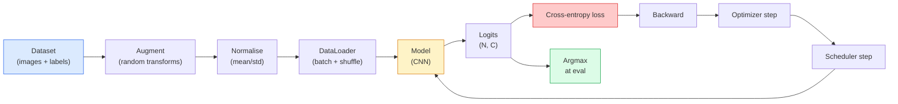

# 이미지 분류

> 분류자는 피클에서 클래스 사이의 확률 분포까지의 함수입니다. 다른 모든 것은 파이프링입니다.

**Type:** Build
**Languages:** Python
**Prerequisites:** Phase 2 Lesson 09 (Model Evaluation), Phase 3 Lesson 10 (Mini Framework), Phase 4 Lesson 03 (CNNs)
**Time:** ~75 minutes

## 학습 목표

- CIFAR-10에 대한 종결부터 종결까지의 이미지 분류 파이프라인 구축: 데이터셋, 증강, 모델, 훈련 루프, 평가
- 각 구성 요소 (데이터 로더, 손실, 최적화, 스케줄러, 증강) 의 역할을 설명하고 손실 곡선에서 그 중 어느 하나의 깨짐이 어떻게 나타날지 예측합니다.
- 믹스, 커트아웃, 레이블 연평화를 처음부터 시행하고, 각각의 추가가 가치가 있는 경우를 정당화하십시오.
- 데이터 세트 및 모델 오류를 진단하기 위해 혼동 매트릭스 및 클래스별 정확성/회복 테이블을 읽으십시오.

## 문제

배포되는 모든 비전 작업은 어느 수준에서 이미지 분류로 줄인다. 탐지는 지역을 분류합니다. 세그먼테이션은 픽셀을 분류합니다. 검색은 클래스 센토라이드와 유사성으로 순위를 매긴다. 분류를 올바르게 얻는 것은  데이터 세트 루프, 증강 정책, 손실, 평가 이 단계의 다른 모든 작업에 전송되는 기술입니다.

대부분의 분류 버그는 모델에 포함되어 있지 않습니다. 그들은 파이프라인에서 살고 있습니다. 깨진 규격, 질되지 않은 훈련 집합, 레이블을 왜곡하는 증강, 훈련 데이터로 오염된 검증 분화, 30시대 이후 침묵으로 분할되는 학습률. CNN는 CIFAR-10에서 93%를 맞을 수 있는 정렬을 하면 일반적으로 70-75%를  수 있고, 손실 곡선은 항상 그럴듯한 것처럼 보입니다.

이 수업은 모든 파이프라인을 손으로 연결해 모든 부분을 검사할 수 있도록 합니다.`torchvision.datasets`그 을 숨길 수 있을 겁니다.

## 개념

### 분류 파이프라인



이 루프의 모든 라인은 버그가 살 수 있는 곳입니다. 크로스 엔트로피는 원소 로그티를 취하고, 소프트맥스 출력도 취하지 않습니다.`model(x).softmax()`손실이 조용히 잘못된 기하급수 계산하기 전에. 증강은 입력물에만 적용되며, 라벨은 적용되지 않습니다.  혼합을 제외하고는 두 가지 모두 혼합합니다. `optimizer.zero_grad()`이 오류는 학습 곡선을 평평하게 만들면서도 오류가 발생하지 않습니다.

### 크로스 엔트로피, 로지트, 소프트맥스

분류자 는 `C`로그이트라고 불리는 이미지마다 숫자를 나타냅니다. softmax를 적용하면 확률 분포로 변환됩니다.

```math
\mathop{\mathrm{softmax}}(z)_i = \frac{\exp(z_i)}{\sum_j \exp(z_j)}
```

크로스 엔트로피는 올바른 클래스의 음력 로그 확률을 측정합니다.

```math
\begin{aligned}
\mathrm{CE}(z, y) &= -\log\left( \mathop{\mathrm{softmax}}(z)_y \right) \\
&= -z_y + \log\left( \sum_j \exp(z_j) \right)
\end{aligned}
```

오른쪽의 형태는 수치적으로 안정적인 형태 (log-sum-exp) 이다.`nn.CrossEntropyLoss`한 작업에서 softmax + NLL를 융합하고 원료 로그트를 직접 가져옵니다.$\log(\mathop{\mathrm{softmax}}(\mathop{\mathrm{softmax}}(z)))$, 의미 없는 양입니다.

### 왜 증강이 효과가 있는 걸까요?

CNN는 번역 (중도 공유) 에 대한 인덕티브 편향을 가지고 있지만, 작물, 플립, 컬러 트, 또는 암각에 대한 내장된 변동성이 없습니다. 이 변동성을 가르치는 유일한 방법은 그것을 운동하는 픽셀을 보여주기입니다. 훈련 중에 임의의 변환은 "이 두 이미지가 동일한 레이블을 가지고 있습니다. 차이를 무시하는 특징을 배우십시오".라고 말하는 방법입니다.

```
Original crop:  "dog facing left"
Flip:           "dog facing right"       <- same label, different pixels
Rotate(+15):    "dog, slight tilt"
Colour jitter:  "dog in warmer light"
RandomErasing:  "dog with patch missing"
```

규칙: 증강은 라벨을 보존해야 합니다. 숫자 위의 절단과 회전은 "6"를 "9"로 돌릴 수 있습니다. 그 데이터 세트에 대해 더 작은 회전 범위를 사용하여 숫자 특정 변수를 존중하는 증강을 선택합니다.

### 혼합 및 절제

보통 증강은 픽셀을 변환하지만, 레이블은 일색으로 유지됩니다.**Mixup**그리고**cutmix**두 가지를 모두 중계함으로써 그 부분을 깨뜨릴 수 있습니다.

```
Mixup:
  lambda ~ Beta(a, a)
  x = lambda * x_i + (1 - lambda) * x_j
  y = lambda * y_i + (1 - lambda) * y_j

Cutmix:
  paste a random rectangle of x_j into x_i
  y = area-weighted mix of y_i and y_j
```

왜 도움이 되는지: 모델은 화려한 일-핫 목표물을 기억하지 못하게 하고, 클래스 간 간 간섭을 배우게 됩니다. 훈련 손실이 증가하고, 테스트 정확도가 증가합니다.

### 라벨 연평

이랑 훈련하는 대신`[0, 0, 1, 0, 0]`, 전차를 `[eps/C, eps/C, 1-eps, eps/C, eps/C]`작은`eps`0.1과 같은 경우, 모델이 임의로 날카로운 로그트를 생산하는 것을 막고, 거의 비용 없이 캘리브레이션을 향상시킵니다.`nn.CrossEntropyLoss(label_smoothing=0.1)`PyTorch 1.10 이후

### 정확도를 넘어서는 평가

집적 정확도는 불균형을 숨깁니다. 90~10의 바이너리 분류기가 항상 대다수 클래스를 예측하는 점수를 90%로 나타냅니다. 실제로 일어나는 일을 알려주는 도구는:

- **Per-class accuracy** 한 클래스당 한 숫자; 즉시 저급급급의 범위를 나타냅니다.
- **Confusion matrix**$C \times C$행에 있는 그리드$i$  콜$j$= 정규 클래스의 수$i$클래스로 예측됩니다$j$이 모형은 정평이고, 이 모형은 정평이 아닌 모형이 있는 곳입니다.
- **Top-1 / Top-5** 올바른 클래스가 1위 또는 5위 예측에 있는지 여부; Top-5는 ImageNet에 중요하므로 "노르위치 테리어"와 "노르폴크 테리어" 같은 클래스는 진정으로 모호하다.
- **Calibration (ECE)** 0.8 신뢰성 예측은 80%의 경우 올바르게 작동합니까? 현대 네트워크는 체계적으로 과도하게 자신있게 작동합니다. 온도 확장 또는 레이블 평행으로 수정합니다.

```figure
receptive-field
```

## 건설 해

### 단계 1: 결정적 합성 데이터 세트

CIFAR-10는 디스크에 살고 있습니다. 이 수업을 재생 가능하고 빠르게 만들기 위해 우리는 모델이 배워야 할 클래스 특수한 구조를 가진 CIFAR  32x32 RGB 이미지를 닮은 합성 데이터 세트를 구축합니다. 실제 CIFAR-10에서 동일한 파이프 라인은 변경되지 않습니다.

```python
import numpy as np
import torch
from torch.utils.data import Dataset


def synthetic_cifar(num_per_class=1000, num_classes=10, seed=0):
    rng = np.random.default_rng(seed)
    X = []
    Y = []
    for c in range(num_classes):
        centre = rng.uniform(0, 1, (3,))
        freq = 2 + c
        for _ in range(num_per_class):
            yy, xx = np.meshgrid(np.linspace(0, 1, 32), np.linspace(0, 1, 32), indexing="ij")
            r = np.sin(xx * freq) * 0.5 + centre[0]
            g = np.cos(yy * freq) * 0.5 + centre[1]
            b = (xx + yy) * 0.5 * centre[2]
            img = np.stack([r, g, b], axis=-1)
            img += rng.normal(0, 0.08, img.shape)
            img = np.clip(img, 0, 1)
            X.append(img.astype(np.float32))
            Y.append(c)
    X = np.stack(X)
    Y = np.array(Y)
    idx = rng.permutation(len(X))
    return X[idx], Y[idx]


class ArrayDataset(Dataset):
    def __init__(self, X, Y, transform=None):
        self.X = X
        self.Y = Y
        self.transform = transform

    def __len__(self):
        return len(self.X)

    def __getitem__(self, i):
        img = self.X[i]
        if self.transform is not None:
            img = self.transform(img)
        img = torch.from_numpy(img).permute(2, 0, 1)
        return img, int(self.Y[i])
```

각각의 클래스는 색상 패レット와 주파수 패턴을 얻으며, 가우시안의 소음으로 모델을 픽셀을 기억하는 대신 신호를 배우도록 강요합니다.

### 단계 2: 정상화 및 증강

두 가지 변화는 모든 시각 파이프라인의 경우와 같습니다.

```python
def standardize(mean, std):
    mean = np.array(mean, dtype=np.float32)
    std = np.array(std, dtype=np.float32)
    def _fn(img):
        return (img - mean) / std
    return _fn


def random_hflip(p=0.5):
    def _fn(img):
        if np.random.random() < p:
            return img[:, ::-1, :].copy()
        return img
    return _fn


def random_crop(pad=4):
    def _fn(img):
        h, w = img.shape[:2]
        padded = np.pad(img, ((pad, pad), (pad, pad), (0, 0)), mode="reflect")
        y = np.random.randint(0, 2 * pad)
        x = np.random.randint(0, 2 * pad)
        return padded[y:y + h, x:x + w, :]
    return _fn


def compose(*fns):
    def _fn(img):
        for fn in fns:
            img = fn(img)
        return img
    return _fn
```

재배 전에 반사 패드, 제로 패드가 아니라, 왜냐하면 검은 경계선들은 모델이 쓸모없는 방법으로 무시하는 신호이기 때문입니다.

### 3단계: 혼합

훈련 단계 내부에서 두 개의 이미지와 두 개의 레이블을 혼합합니다. 대량 변환으로 구현되어 데이터 세트의 내부에 있는 것이 아니라 앞 패스에 옆에 살고 있습니다.

```python
def mixup_batch(x, y, num_classes, alpha=0.2):
    if alpha <= 0:
        return x, torch.nn.functional.one_hot(y, num_classes).float()
    lam = float(np.random.beta(alpha, alpha))
    idx = torch.randperm(x.size(0), device=x.device)
    x_mixed = lam * x + (1 - lam) * x[idx]
    y_onehot = torch.nn.functional.one_hot(y, num_classes).float()
    y_mixed = lam * y_onehot + (1 - lam) * y_onehot[idx]
    return x_mixed, y_mixed


def soft_cross_entropy(logits, soft_targets):
    log_probs = torch.log_softmax(logits, dim=-1)
    return -(soft_targets * log_probs).sum(dim=-1).mean()
```

`soft_cross_entropy`융합성 (cross-entropy) 은 부드러운 레이블 분포와 비교해서 융합성 (soft-label distribution) 이 됩니다.

### 단계 4: 훈련 루프

전체 레시피: 한 번 데이터를 넘어서, 배치마다 한 번 그레디언트, 시대로 한 번 스케줄러 단계.

```python
import torch
import torch.nn as nn
from torch.utils.data import DataLoader
from torch.optim import SGD
from torch.optim.lr_scheduler import CosineAnnealingLR

def train_one_epoch(model, loader, optimizer, device, num_classes, use_mixup=True):
    model.train()
    total, correct, loss_sum = 0, 0, 0.0
    for x, y in loader:
        x, y = x.to(device), y.to(device)
        if use_mixup:
            x_m, y_soft = mixup_batch(x, y, num_classes)
            logits = model(x_m)
            loss = soft_cross_entropy(logits, y_soft)
        else:
            logits = model(x)
            loss = nn.functional.cross_entropy(logits, y, label_smoothing=0.1)
        optimizer.zero_grad()
        loss.backward()
        optimizer.step()
        loss_sum += loss.item() * x.size(0)
        total += x.size(0)
        # Training accuracy vs the un-mixed labels `y` is only an approximation
        # when mixup is on (the model saw soft targets, not y). Treat it as a
        # rough progress signal; rely on val accuracy for real performance.
        with torch.no_grad():
            pred = logits.argmax(dim=-1)
            correct += (pred == y).sum().item()
    return loss_sum / total, correct / total


@torch.no_grad()
def evaluate(model, loader, device, num_classes):
    model.eval()
    total, correct = 0, 0
    loss_sum = 0.0
    cm = torch.zeros(num_classes, num_classes, dtype=torch.long)
    for x, y in loader:
        x, y = x.to(device), y.to(device)
        logits = model(x)
        loss = nn.functional.cross_entropy(logits, y)
        pred = logits.argmax(dim=-1)
        for t, p in zip(y.cpu(), pred.cpu()):
            cm[t, p] += 1
        loss_sum += loss.item() * x.size(0)
        total += x.size(0)
        correct += (pred == y).sum().item()
    return loss_sum / total, correct / total, cm
```

훈련 루프를 작성할 때마다 5가지 변수를 확인합니다.

1. `model.train()`훈련 전에,`model.eval()`평가 전                                                                                                                                                                                                                                                              
2. `.zero_grad()`이전`.backward()`- 그래
3. `.item()`매트릭을 축적할 때 계산 그래프를 살려주는 것은 아무것도 없습니다.
4. `@torch.no_grad()`평가 시 기억과 시간을 절약하고 미묘한 사고를 방지합니다.
5. Argmax 대 원료 로그이트, 소프트맥스  같은 결과, 1 op 더 적은

### 5단계: 함께

`TinyResNet`이전 수업에서 몇 시대를 훈련하고 평가합니다.

```python
from main import synthetic_cifar, ArrayDataset
from main import standardize, random_hflip, random_crop, compose
from main import mixup_batch, soft_cross_entropy
from main import train_one_epoch, evaluate
# TinyResNet comes from the previous lesson (03-cnns-lenet-to-resnet).
# Adjust the import path to wherever you stored the previous lesson's code.
from cnns_lenet_to_resnet import TinyResNet  # example placeholder

X, Y = synthetic_cifar(num_per_class=500)
split = int(0.9 * len(X))
X_train, Y_train = X[:split], Y[:split]
X_val, Y_val = X[split:], Y[split:]

mean = [0.5, 0.5, 0.5]
std = [0.25, 0.25, 0.25]
train_tf = compose(random_hflip(), random_crop(pad=4), standardize(mean, std))
eval_tf = standardize(mean, std)

train_ds = ArrayDataset(X_train, Y_train, transform=train_tf)
val_ds = ArrayDataset(X_val, Y_val, transform=eval_tf)

train_loader = DataLoader(train_ds, batch_size=128, shuffle=True, num_workers=0)
val_loader = DataLoader(val_ds, batch_size=256, shuffle=False, num_workers=0)

device = "cuda" if torch.cuda.is_available() else "cpu"
model = TinyResNet(num_classes=10).to(device)
optimizer = SGD(model.parameters(), lr=0.1, momentum=0.9, weight_decay=5e-4, nesterov=True)
scheduler = CosineAnnealingLR(optimizer, T_max=10)

for epoch in range(10):
    tr_loss, tr_acc = train_one_epoch(model, train_loader, optimizer, device, 10, use_mixup=True)
    va_loss, va_acc, _ = evaluate(model, val_loader, device, 10)
    scheduler.step()
    print(f"epoch {epoch:2d}  lr {scheduler.get_last_lr()[0]:.4f}  "
          f"train {tr_loss:.3f}/{tr_acc:.3f}  val {va_loss:.3f}/{va_acc:.3f}")
```

합성 데이터 세트에 대해서는 5 시대 내에 거의 완벽한 검증 정확성을 얻을 수 있습니다. 이 점은: 파이프 라인은 올바르며, 모델은 학습 가능한 것을 배울 수 있습니다. 실제 CIFAR-10로 데이터 세트를 교환하고 동일한 루프 열이 변경없이 ~ 90%로 이동합니다.

### 단계 6: 혼란 매트릭스를 읽어보십시오

정확성만으로는 모델이 실패하는 곳을 알 수 없습니다. 혼란 매트릭스는 실패합니다.

```python
def print_confusion(cm, labels=None):
    c = cm.shape[0]
    labels = labels or [str(i) for i in range(c)]
    print(f"{'':>6}" + "".join(f"{l:>5}" for l in labels))
    for i in range(c):
        row = cm[i].tolist()
        print(f"{labels[i]:>6}" + "".join(f"{v:>5}" for v in row))
    print()
    tp = cm.diag().float()
    fp = cm.sum(dim=0).float() - tp
    fn = cm.sum(dim=1).float() - tp
    prec = tp / (tp + fp).clamp_min(1)
    rec = tp / (tp + fn).clamp_min(1)
    f1 = 2 * prec * rec / (prec + rec).clamp_min(1e-9)
    for i in range(c):
        print(f"{labels[i]:>6}  prec {prec[i]:.3f}  rec {rec[i]:.3f}  f1 {f1[i]:.3f}")

_, _, cm = evaluate(model, val_loader, device, 10)
print_confusion(cm)
```

행은 실제 클래스, 열은 예측이다. 3~5 클래스 사이의 비차각적인 계산의 클러스터는 모델이 두 가지를 혼동시키고 목표 데이터 수집 또는 클래스 특수한 증강을 위한 출발점을 제공합니다.

## 사용 하 고

`torchvision`실제 CIFAR-10의 전체 파이프라인은 4줄과 훈련 루프입니다.

```python
from torchvision.datasets import CIFAR10
from torchvision.transforms import Compose, RandomCrop, RandomHorizontalFlip, ToTensor, Normalize

mean = (0.4914, 0.4822, 0.4465)
std = (0.2470, 0.2435, 0.2616)
train_tf = Compose([
    RandomCrop(32, padding=4, padding_mode="reflect"),
    RandomHorizontalFlip(),
    ToTensor(),
    Normalize(mean, std),
])
eval_tf = Compose([ToTensor(), Normalize(mean, std)])

train_ds = CIFAR10(root="./data", train=True,  download=True, transform=train_tf)
val_ds   = CIFAR10(root="./data", train=False, download=True, transform=eval_tf)
```

두 가지 점: 평균/STD는**dataset-specific**는 CIFAR-10 훈련 세트에 계산되어 있습니다. 이미지넷이 아닌 이고 반사 패드는 커뮤니티 기본 작물 정책입니다. 이 이미지넷의 통계 자료를 복사- 붙이는 것은 모델 프로파일을 프로파일하는 때까지 아무도 잡지 않는 ~1%의 정확성 누출입니다.

## 선박

이 교훈은 다음과 같은 결과를 낳습니다.

- `outputs/prompt-classifier-pipeline-auditor.md` 위의 다섯 가지 변수들을 위한 훈련 스크립트를 검사하고 첫 번째 위반을 드러내는 명령어.
- `outputs/skill-classification-diagnostics.md` 혼란 매트릭스와 클래스 이름 목록을 고려하면 클래스별 실패를 요약하고 가장 영향력 있는 단일 수정안을 제안하는 기술.

## 운동

1. **(Easy)**합성 데이터 세트에 5년 동안 같은 모델을 혼합과 혼합 없이 훈련시켜 두 가지에 대한 플롯 트레인 및 발 손실을 설명해 보십시오.
2. **(Medium)** Cutout 를 구현하여 각 훈련 이미지에서 무작위 8x8 광장을 0으로  및 압축과 증강, hflip+crop, hflip+crop+cutout, hflip+crop+mixup을 실행합니다. 각에 대한 val 정확성을 보고합니다.
3. **(Hard)**CIFAR-100 파이프라인 (100 클래스, 동일한 입력 크기로) 를 구축하고, 발표된 정확도의 1% 내로 ResNet-34 훈련 실행을 재생합니다. 추가: 세 가지 학습 속도와 두 가지 체중 감소를 스캔하고, 로그인하여 지역 CSV에 로그인하여 최종 혼란 매트릭스-상위 혼란 테이블을 생성합니다.

## 주요 용어

| Term | What people say | What it actually means |
|------|----------------|----------------------|
| Logits | "Raw outputs" | The pre-softmax vector of C numbers per image; cross-entropy expects these, not softmaxed values |
| Cross-entropy | "The loss" | Negative log-probability of the correct class; combines log-softmax and NLL in one stable op |
| DataLoader | "The batcher" | Wraps a dataset with shuffling, batching, and (optional) multi-worker loading; gets blamed for half of training bugs |
| Augmentation | "Random transforms" | Any pixel-level transform at training time that preserves the label; teaches invariances the CNN does not have natively |
| Mixup / Cutmix | "Mix two images" | Blend both inputs and labels so the classifier learns smooth interpolations instead of hard boundaries |
| Label smoothing | "Softer targets" | Replace one-hot with (1-eps, eps/(C-1), ...); improves calibration and slightly boosts accuracy |
| Top-k accuracy | "Top-5" | The correct class is in the k highest-probability predictions; used on datasets with genuinely ambiguous classes |
| Confusion matrix | "Where errors live" | C x C table where entry (i, j) counts images of true class i predicted as j; diagonal is right, off-diagonal tells you what to fix |

## 더 많은 읽기

- [CS231n: Training Neural Networks](https://cs231n.github.io/neural-networks-3/) 아직까지 한 페이지에서 훈련 파이프라인의 가장 명확한 순회
- [Bag of Tricks for Image Classification (He et al., 2019)](https://arxiv.org/abs/1812.01187) 모든 작은 트릭은 함께 3~4%를 더합니다
- [mixup: Beyond Empirical Risk Minimization (Zhang et al., 2017)](https://arxiv.org/abs/1710.09412) 원래의 믹스 팩트, 이론 3 페이지, 설득력 있는 실험
- [Why temperature scaling matters (Guo et al., 2017)](https://arxiv.org/abs/1706.04599) 현대 네트워크가 잘못 기재된 것으로 증명한 논문
