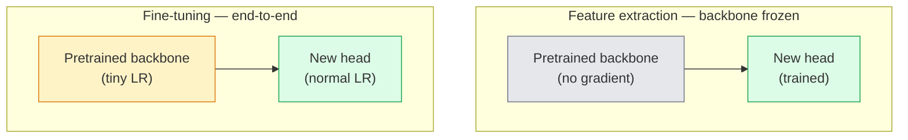

# 교류 학습 및 정렬

> 다른 사람이 백만 시간 동안 GPU를 사용해서 네트워크에 가장자리와 텍스처와 객체 부품을 가르쳤어요.

**Type:** Build
**Languages:** Python
**Prerequisites:** Phase 4 Lesson 03 (CNNs), Phase 4 Lesson 04 (Image Classification)
**Time:** ~75 minutes

## 학습 목표

- 기능 추출과 정렬을 구분하고 데이터 세트 크기와 도메인 거리와 계산 예산에 따라 올바른 것을 선택하십시오
- 미리 훈련된 척추를 로드하고, 그 분류자 머리 를 교체 하고, 20 줄 이하의 작업 기점 으로 머리 를만 훈련 시키십시오.
- 차별적인 학습률을 가진 계층을 점진적으로 해제하여 초기 일반 기능들은 늦은 작업 특정 기능보다 작은 업데이트를 받게 됩니다
- 3가지 일반적인 실패를 진단합니다. 냉동 블록에서 너무 높은 LR에서 기능 추락, 작은 데이터 세트에서 BN 통계에 붕괴, 그리고 재앙적인 잊혀짐

## 문제

ResNet-50를 이미지넷으로 훈련시키는 데는 약 2,000개의 GPU시간이 소요됩니다. 거의 모든 팀이 전송하는 모든 작업에 대한 예산이 거의 없습니다. 거의 모든 팀이 실제로 전송하는 것은 몇 백 또는 몇 천 개의 작업에 대한 특정 이미지에 훈련된 새로운 머리와 함께 미리 훈련된 척추입니다.

이건 단축선이 아닙니다. 이미지넷에서 훈련받은 CNN의 첫 번째 컨브 블록은 가장자리와 Gabor과 같은 필터를 학습합니다. 다음 몇 블록은 텍스처와 간단한 모티브를 배울 수 있습니다. 중간 블록은 물체 부분을 학습합니다. 마지막 블록은 1,000개의 이미지네트 카테고리처럼 보이는 조합을 학습합니다. 그 계층의 첫 90%는 거의 변하지 않고 의료 영상, 산업 검사, 위성 데이터, 그리고 다른 모든 시각 작업에 전달됩니다 마지막 10%는 실제로 훈련하는 것입니다.

전송을 올바르게 하는 것은 세 가지 버그를 가지고 있습니다. 너무 높은 학습률을 가진 미리 훈련된 기능을 파괴하는 것, 너무 많이 얼어붙어 정보를 모형을 굶어 버리는 것, 그리고 BatchNorm의 실행된 통계를 네트워크의 나머지 부분에서 배우지 못한 작은 데이터 세트에 몰입시키는 것. 이 교훈은 그들 각각을 의도적으로 수행합니다.

## 개념

### 특징 추출과 정렬

두 가지 정권은, 미리 훈련된 기능에 얼마나 많은 신뢰를 가지고 있는지, 그리고 얼마나 많은 데이터를 가지고 있는지에 따라 선택됩니다.



엄지 손가락 규칙:

| Dataset size | Domain distance | Recipe |
|--------------|-----------------|--------|
| < 1k images | close to ImageNet | Freeze backbone, train head only |
| 1k-10k | close | Freeze first 2-3 stages, fine-tune the rest |
| 10k-100k | any | Fine-tune end-to-end with discriminative LR |
| 100k+ | far | Fine-tune everything; consider training from scratch if domain is far enough |

"이미지네트 가까이"는 대략적으로 객체와 같은 내용의 자연 RGB 사진을 의미합니다. 의료 CT 스캔, 위성 영상 및 현미경은 멀리 떨어져 있습니다.

### 냉동이 효과가 있는 이유

이 이미지네트에서는 CNN가 1000개 범주에 특화된 것이 아니라는 것을 알게 됩니다. 그들은 자연 이미지의 통계학에 특화되어 있습니다. 특정 지향의 가장자리, 텍스처, 콘트라스트 패턴, 모양 원시. 그 통계들은 거의 모든 시각 영역에서 안정적입니다. 인간이 이름을 붙일 수 있습니다. 이 때문에 이미지네트에서 훈련된 모델이 새로운 선형 헤드 ( 척추의 정밀 조정이 없다) 를 사용하여 CIFAR-10에서 0샷을 평가한 모델은 80%+의 정확성을 달성합니다. 머리는 이미 배운 특징 중 어느 것이 이 작업에 무게를 가할 수 있는지 배우고 있습니다.

### 차별적인 학습률

얼음을 풀 때, 초기 층은 늦은 층보다 느리게 훈련해야 합니다. 초기 층은 보존하고자 하는 일반적 특징을 암호화 합니다. 늦은 층은 많은 움직임을 필요로 하는 작업에 대한 특정 구조를 암호화합니다.

```
Typical recipe:

  stage 0 (stem + first group): lr = base_lr / 100    (mostly fixed)
  stage 1:                       lr = base_lr / 10
  stage 2:                       lr = base_lr / 3
  stage 3 (last backbone group): lr = base_lr
  head:                          lr = base_lr  (or slightly higher)
```

PyTorch에서는 단지 최적화 장치에 전달된 파라미터 그룹 목록입니다. 1 모델, 5 학습 속도, 0 추가 코드.

### 배트 노르름 문제

BN 층은 `running_mean`그리고`running_var`이미지네트에서 계산된 버퍼. 작업이 다른 픽셀 분포를 가지고 있다면  다른 조명, 다른 센서, 다른 색상 공간

1. **Fine-tune with BN in train mode.**BN가 실행 통계 자료를 다른 모든 것들과 함께 업데이트하도록 한다. 작업 데이터 세트가 중형 (>= 5k 예제) 이 있을 때 기본 선택이다.
2. **Freeze BN in eval mode.**이미지네트 통계를 유지하고 무게만 훈련시켜야 합니다. 네 데이터 세트가 너무 작아서 BN의 이동 평균이 소란하게 될 때 맞습니다.
3. **Replace BN with GroupNorm.**이동 평균 문제를 완전히 제거합니다. GPU 당 배트 크기가 작을 경우 검출 및 세그먼트 척추에서 사용됩니다.

이 오류를 암시하면 정확도가 5~15%까지 증가합니다.

### 머리 디자인

분류자 머리 1~3개의 선형층과 선택적 중퇴가 있습니다. 각 타크비전 척추는 기본 머리 하나를 배포합니다.

```
backbone.fc = nn.Linear(backbone.fc.in_features, num_classes)          # ResNet
backbone.classifier[1] = nn.Linear(..., num_classes)                    # EfficientNet, MobileNet
backbone.heads.head = nn.Linear(..., num_classes)                       # torchvision ViT
```

작은 데이터 세트에서는 보통 하나의 선형 계층이 충분하다. 작업 분포가 척추 훈련 분포에서 더 멀리 있을 때 숨겨진 계층 (Linear -> ReLU -> Dropout -> Linear) 를 추가하면 도움이 된다.

### 층별 LR 붕괴

현대 미세조각 (BEiT, DINOv2, ViT-B 미세조각) 에서 사용되는 차별화된 LR의 더 부드러운 버전. 각 층을 단계로 그룹화하기 보다는, 각 층에 위층보다 약간 작은 LR를 부여하십시오.

```math
\text{lr\_layer}_k = \text{base\_lr} \cdot \text{decay}^{L - k}
```

붕괴 = 0.75 및 L = 12 개의 트랜스포머 블록과 함께, 첫 번째 블록 열차는 `0.75^11 ≈ 0.04x`이 부분은 보통 스테이지 그룹으로 구성된 LR가 충분하기 때문에, CNN보다 트랜스포머의 미세조음에 더 중요합니다.

### 어떤 점 을 평가 해야 합니까?

이식 학습 경기는 2개의 숫자를 필요로 합니다.

- **Pretrained-only accuracy** 머리 정확성, 척추가 얼어붙은 상태입니다.
- **Fine-tuned accuracy** 끝에서 끝까지 훈련된 후 같은 모델입니다.

만약 미세한 조정이 사전 훈련된 것보다 작다면 학습률이나 BN 오류가 있습니다. 항상 둘 다 인쇄하세요.

```figure
transfer-learning
```

## 건설 해

### 단계 1: 미리 훈련 된 척추를 로드 하고 검사 하십시오

```python
import torch
import torch.nn as nn
from torchvision.models import resnet18, ResNet18_Weights

backbone = resnet18(weights=ResNet18_Weights.IMAGENET1K_V1)
print(backbone)
print()
print("classifier head:", backbone.fc)
print("feature dim:", backbone.fc.in_features)
```

`ResNet18`4단계 (`layer1..layer4`) 더하여 줄기와`fc`모든 화사관리 분류 척추는 비슷한 구조를 가지고 있습니다.

### 단계 2: 기능 추출  모든 것을 얼어, 머리를 교체

```python
def make_feature_extractor(num_classes=10):
    model = resnet18(weights=ResNet18_Weights.IMAGENET1K_V1)
    for p in model.parameters():
        p.requires_grad = False
    model.fc = nn.Linear(model.fc.in_features, num_classes)
    return model

model = make_feature_extractor(num_classes=10)
trainable = sum(p.numel() for p in model.parameters() if p.requires_grad)
frozen = sum(p.numel() for p in model.parameters() if not p.requires_grad)
print(f"trainable: {trainable:>10,}")
print(f"frozen:    {frozen:>10,}")
```

오직`model.fc`척추는 얼어붙은 특징 추출기입니다.

### 3단계: 차별적 정렬

단계별 학습률을 가진 파라미터 그룹을 만드는 유틸리티

```python
def discriminative_param_groups(model, base_lr=1e-3, decay=0.3):
    stages = [
        ["conv1", "bn1"],
        ["layer1"],
        ["layer2"],
        ["layer3"],
        ["layer4"],
        ["fc"],
    ]
    groups = []
    for i, names in enumerate(stages):
        lr = base_lr * (decay ** (len(stages) - 1 - i))
        params = [p for n, p in model.named_parameters()
                  if any(n.startswith(k) for k in names)]
        if params:
            groups.append({"params": params, "lr": lr, "name": "_".join(names)})
    return groups

model = resnet18(weights=ResNet18_Weights.IMAGENET1K_V1)
model.fc = nn.Linear(model.fc.in_features, 10)
for p in model.parameters():
    p.requires_grad = True

groups = discriminative_param_groups(model)
for g in groups:
    print(f"{g['name']:>10s}  lr={g['lr']:.2e}  params={sum(p.numel() for p in g['params']):>8,}")
```

`decay=0.3`다음의 속도 30%에 달하는 각 단계 열차를 의미합니다. `fc` `base_lr``layer4` `0.3 * base_lr``conv1` `0.3^5 * base_lr ≈ 0.00243 * base_lr`극한 음향이 있고, 경험적으로 효과가 있습니다.

### 단계 4: 배트 노먼트 처리

무게를 얼어붙이지 않고 BN의 통계를 얼어붙이는 데 도움이 됩니다.

```python
def freeze_bn_stats(model):
    for m in model.modules():
        if isinstance(m, (nn.BatchNorm1d, nn.BatchNorm2d, nn.BatchNorm3d)):
            m.eval()
            for p in m.parameters():
                p.requires_grad = False
    return model
```

을 때 전화해`model.train()`모든 시대가 시작되는 순간`model.train()`모든 것을 훈련 모드로 돌려줍니다. 이것은 BN 계층에서만 되돌립니다.

### 단계 5: 최소의 끝에서 끝까지의 미세 조율 루프

```python
from torch.optim import SGD
from torch.utils.data import DataLoader
from torch.optim.lr_scheduler import CosineAnnealingLR
import torch.nn.functional as F

def fine_tune(model, train_loader, val_loader, device, epochs=5, base_lr=1e-3, freeze_bn=False):
    model = model.to(device)
    groups = discriminative_param_groups(model, base_lr=base_lr)
    optimizer = SGD(groups, momentum=0.9, weight_decay=1e-4, nesterov=True)
    scheduler = CosineAnnealingLR(optimizer, T_max=epochs)

    for epoch in range(epochs):
        model.train()
        if freeze_bn:
            freeze_bn_stats(model)
        tr_loss, tr_correct, tr_total = 0.0, 0, 0
        for x, y in train_loader:
            x, y = x.to(device), y.to(device)
            logits = model(x)
            loss = F.cross_entropy(logits, y, label_smoothing=0.1)
            optimizer.zero_grad()
            loss.backward()
            optimizer.step()
            tr_loss += loss.item() * x.size(0)
            tr_total += x.size(0)
            tr_correct += (logits.argmax(-1) == y).sum().item()
        scheduler.step()

        model.eval()
        va_total, va_correct = 0, 0
        with torch.no_grad():
            for x, y in val_loader:
                x, y = x.to(device), y.to(device)
                pred = model(x).argmax(-1)
                va_total += x.size(0)
                va_correct += (pred == y).sum().item()
        print(f"epoch {epoch}  train {tr_loss/tr_total:.3f}/{tr_correct/tr_total:.3f}  "
              f"val {va_correct/va_total:.3f}")
    return model
```

CIFAR-10에 대한 위 레시피와 함께 5 시대가 걸립니다 `ResNet18-IMAGENET1K_V1`이 이 이 이 이 이 이 이 이 이 이 이 이 이 이 이 이 이 이 이 이 이 이 이 이 이 이 이 이 이 이 이 이 이 이 이 이 이 이 이 이 이 이 이 이 이 이 이 이 이 이 이 이 이 이 이 이 이 이 이 이 이 이 이 이 이 이 이 이 이 이 이 이 이 이 이 이 이 이 이 이 이 이 이 이 이 이 이 이 이 이 이 이 이 이 이 이 이 이 이 이 이 이 이 이 이 이 이 이 이 이 이 이 이 이 이 이 이 

### 6단계: 점진적 탈빙

마지막부터 시작까지 한 시대를 한 단계로 풀 수 있는 일정은

```python
def progressive_unfreeze_schedule(model):
    stages = ["layer4", "layer3", "layer2", "layer1"]
    yielded = set()

    def start():
        for p in model.parameters():
            p.requires_grad = False
        for p in model.fc.parameters():
            p.requires_grad = True

    def unfreeze(epoch):
        if epoch < len(stages):
            name = stages[epoch]
            yielded.add(name)
            for n, p in model.named_parameters():
                if n.startswith(name):
                    p.requires_grad = True
            return name
        return None

    return start, unfreeze
```

전화`start()`첫 시대 이전에 한 번`unfreeze(epoch)`훈련 가능한 매개 변수 집합이 변경될 때마다 최적화기를 재건하세요. 그렇지 않으면 얼어붙은 매개 변수는 여전히 혼란스러운 캐시된 순간을 보유합니다.

## 사용 하 고

대부분의 실제 작업에 대해`torchvision.models`3줄이 충분합니다. 도서관 기본 설정이 해결할 수 없는 문제를 겪을 때, 위의 무거운 기계가 중요합니다.

```python
from torchvision.models import resnet50, ResNet50_Weights

model = resnet50(weights=ResNet50_Weights.IMAGENET1K_V2)
model.fc = nn.Linear(model.fc.in_features, num_classes)
optimizer = torch.optim.AdamW(model.parameters(), lr=1e-4, weight_decay=1e-4)
```

생산급의 다른 두 가지 결제:

- `timm`선박 ~ 800 개의 선습 시각 척추가`timm.create_model("resnet50", pretrained=True, num_classes=10)`치비전 동물원 이외의 모든 미세한 조율에 대해서는 표준입니다.
- 트랜스포머를 위한`transformers.AutoModelForImageClassification.from_pretrained(name, num_labels=N)`텍스트 모델과 동일한 로딩 의미와 ViT / BEiT / DeiT를 제공합니다.

## 선박

이 교훈은 다음과 같은 결과를 낳습니다.

- `outputs/prompt-fine-tune-planner.md` 데이터 세트 크기와 도메인 거리, 컴퓨팅 예산에 따라 기능 추출과 진보적, 최종 미세 조정을 선택하는 프롬프트.
- `outputs/skill-freeze-inspector.md` PyTorch 모델에서 어떤 매개 변수가 훈련 가능한지, 어떤 BatchNorm 계층이 eval 모드에서 있는지, 그리고 최적화 장치가 실제로 훈련 가능한 매개 변수를 공급하는지 보고하는 기술.

## 운동

1. **(Easy)**A를 열고`ResNet18`선형 탐사선 (백본 얼어붙은) 과 같은 합성 CIFAR 데이터 세트에 대한 완전한 미세조각으로. 두 가지 정확성을 나란히 보고하십시오. 어떤 격차가 특징을 잘 전달하고 어떤 것이 그렇지 않은지 설명하십시오.
2. **(Medium)**의도적으로 버그를 입력: set `base_lr = 1e-1`머리 대신 척추 단계에. 훈련 손실 폭발을 보여주십시오.`discriminative_param_groups`보조자. 각 단계가 경각심을 시작하는 LR를 기록하세요.
3. **(Hard)**의료 영상 데이터 세트를 (예를 들어 CheXpert-small, PatchCamelyon, 또는 HAM10000) 취해 세 가지 정법을 비교해보세요: (a) ImageNet-이 훈련된 얼린 척추 + 선형 머리; (b) ImageNet-이 훈련된 미세조직 끝에서 끝; (c) 스크래치 훈련. 각 데이터 세트의 정확성과 계산 비용을 보고하세요.

## 주요 용어

| Term | What people say | What it actually means |
|------|----------------|----------------------|
| Feature extraction | "Freeze and train head" | Backbone parameters frozen, only the new classifier head receives gradient |
| Fine-tuning | "Retrain end-to-end" | All parameters trainable, usually with much smaller LR than scratch training |
| Discriminative LR | "Smaller LR for early layers" | Optimizer parameter groups where early-stage LR is a fraction of late-stage LR |
| Layer-wise LR decay | "Smooth LR gradient" | Per-layer LR multiplied by decay^(L - k); common in transformer fine-tunes |
| Catastrophic forgetting | "The model lost ImageNet" | A too-high LR overwrites pretrained features before the new task signal is learnt |
| BN statistics drift | "Running mean is wrong" | BatchNorm running_mean/var computed on a different distribution than the current task, silently hurting accuracy |
| Linear probe | "Frozen backbone + linear head" | Evaluation of pretrained features — accuracy of the best linear classifier on top of the frozen representation |
| Catastrophic collapse | "Everything predicts one class" | Happens when fine-tuning with an LR high enough to destroy features before gradients from the head can stabilise |

## 더 많은 읽기

- [How transferable are features in deep neural networks? (Yosinski et al., 2014)](https://arxiv.org/abs/1411.1792) 계층 간 기능 전송성을 수치화한 논문
- [Universal Language Model Fine-tuning (ULMFiT, Howard & Ruder, 2018)](https://arxiv.org/abs/1801.06146) 원래의 차별적 LR / 진보적인 탈빙 요리법; 아이디어는 비전에 직접 전달됩니다
- [timm documentation](https://huggingface.co/docs/timm) 현대 시각 척추에 대한 참조 및 그들이 훈련받은 정확한 정밀한 정렬 기본
- [A Simple Framework for Linear-Probe Evaluation (Kornblith et al., 2019)](https://arxiv.org/abs/1805.08974) 왜 선형 탐사 정확도가 중요하고 어떻게 올바르게 보고해야 하는지에 대한
