# 객체 탐지  YOLO 처음부터

> 검출은 분류와 회귀입니다. 특징 지도의 모든 위치에서 실행되고, 최대치 없는 압축으로 청소됩니다.

**Type:** Build
**Languages:** Python
**Prerequisites:** Phase 4 Lesson 03 (CNNs), Phase 4 Lesson 04 (Image Classification), Phase 4 Lesson 05 (Transfer Learning)
**Time:** ~75 minutes

## 학습 목표

- 검출을 밀집한 예측 문제로 바꾸는 그리드와 앵커 디자인을 설명하고 출력 텐서의 모든 숫자가 무엇을 의미하는지 설명합니다
- 상자 사이의 통계를 계산하고 초점부터 최대치 없는 압축을 구현
- 분류, 객체성, 박스 회귀 손실을 포함하여 미리 훈련된 척추 위에 YOLO 스타일의 최소한의 머리를 구축하십시오
- 탐지 측정 행 (precision@0.5, recall, mAP@0.5, mAP@0.5:0.95) 을 읽어 다음으로 어떤 버튼을 돌리는지 선택하십시오.

## 문제

분류는 "이 그림은 개"라고 말합니다. 탐지에는 "피클셀 (112, 40, 280, 210), 프레임 (400, 180, 560, 310) 에서 고양이가 있습니다". 그 하나의 구조적 변화는  각 이미지에 한 개의 라벨 대신 표기 상자의 변수를 예측하는  모든 자율 시스템, 모든 감시 제품, 모든 문서 레이아웃 파서, 그리고 모든 공장 시각 라인 모두 의존합니다.

또한 탐지에는 모든 기술적인 비전적 트레이드오프가 동시에 나타납니다. 정확한 박스 (회복 헤드) 를 원하고, 각 박스 (분류 헤드) 에 대한 올바른 클래스를 원하고, 모델이 감지할 것이 없을 때 (물질성 점수) 를 알고 싶어하고, 실제 객체당 정확히 한 예측을 원하고 (최대 미지압) 이 중 하나를 놓치고 파이프라인은 객체를 놓치고 환각 상자를 보고하거나 약간 다른 위치에서 같은 객체를 15번 예측합니다.

YOLO (You Only Look Once, Redmon et al. 2016) 은 컨브 네트워크의 단일 전진으로 이 모든 작업을 실시간으로 수행한 디자인이며, 동일한 구조적 결정은 여전히 현대 탐지기의 척추입니다 (YOLOv8, YOLOv9, YOLO-NAS, RT-DETR).

## 개념

### 밀집 예측으로 검출

분류기는 각 이미지에 C 번호를 내보내고 YOLO 형식의 탐지기는 출력을 내보내죠`(S x S x (5 + C))`각 이미지에 있는 숫자는 S가 공간 그리드 크기가 됩니다.

```mermaid
flowchart LR
    IMG["Input 416x416 RGB"] --> BB["Backbone<br/>(ResNet, DarkNet, ...)"]
    BB --> FM["Feature map<br/>(C_feat, 13, 13)"]
    FM --> HEAD["Detection head<br/>(1x1 convs)"]
    HEAD --> OUT["Output tensor<br/>(13, 13, B * (5 + C))"]
    OUT --> DEC["Decode<br/>(grid + sigmoid + exp)"]
    DEC --> NMS["Non-max suppression"]
    NMS --> RESULT["Final boxes"]

    style IMG fill:#dbeafe,stroke:#2563eb
    style HEAD fill:#fef3c7,stroke:#d97706
    style NMS fill:#fecaca,stroke:#dc2626
    style RESULT fill:#dcfce7,stroke:#16a34a
```



각 `S * S`그리드 셀 예측`B`상자: 각 상자에 대해

- 4개의 숫자는 기하학을 설명합니다.`tx, ty, tw, th`- 그래
- 1번은 객체성 점수입니다. "이 세포에 중심을 둔 객체가 있습니까?"
- C 숫자는 클래스 확률입니다.

세포당 총: `B * (5 + C)`. VOC와`S=13, B=2, C=20`, 즉, 50개의 숫자가 한 셀에 있습니다.

### 왜 그리드와 안커가

순수적인 회귀가 예측할 수 있습니다`(x, y, w, h)`모든 객체에 대해 절대 좌표로 설명하는 것은 어렵기 때문입니다. 왜냐하면 이미지를 번역하면 모든 예측이 같은 양으로 번역되어서는 안된다는 것입니다. 각 객체가 공간적으로 고정되어 있습니다. 그릴은 그릴의 중심이 들어있는 그릴에 각 기본 진실 박스를 지정하여 이에 답합니다. 그릴은 그 객체에 대한 책임이 있습니다.

항은은 두 번째 문제를 해결합니다. 3x3 conv는 500 픽셀 너비의 박스를 16 픽셀 수용형 필드 기능 셀에서 쉽게 되돌릴 수 없습니다. 대신, 우리는 미리 정의합니다`B`각 세포에 대한 상자 모양 (안커) 을 통해 각 안커에서 작은 델타를 예측합니다. 모델은 아무것도 아닌 올바른 안커를 선택하고 밀어내는 것을 배우습니다.

```
Anchor box priors (example for 416x416 input):

  small:   (30,  60)
  medium:  (75,  170)
  large:   (200, 380)

At each grid cell, every anchor emits (tx, ty, tw, th, obj, c_1, ..., c_C).
```

현대 탐지기는 종종 해상도별로 다른 앵커 세트를 가진 FPN를 사용합니다.                                                                                                                                                                                                                                                    

### 디코딩 예측

원료`tx, ty, tw, th`상자 좌표가 아니라, 그 좌표가 그려지기 전에 변환되어야 하는 회귀 목표입니다.

```math
\begin{aligned}
\text{centre } x &= (\sigma(t_x) + \text{cell}_x) \cdot \text{stride} \\
\text{centre } y &= (\sigma(t_y) + \text{cell}_y) \cdot \text{stride} \\
\text{width} &= \text{anchor}_w \cdot \exp(t_w) \\
\text{height} &= \text{anchor}_h \cdot \exp(t_h)
\end{aligned}
```

`sigmoid`세포 내부에서 중앙 오프셋을 유지합니다. `exp`표시가 지 않고도 안크에서 너비 스케일을 자유롭게 할 수 있습니다.`stride`이 디코딩 단계는 v2 이후 모든 YOLO 버전에서 동일합니다.

### 이루

두 박스 사이의 탐지의 보편적 유사성 측정값:

```math
\mathrm{IoU}(A, B) = \frac{\mathop{\mathrm{area}}(A \cap B)}{\mathop{\mathrm{area}}(A \cup B)}
```

$\mathrm{IoU} = 1$동일한 의미입니다. $\mathrm{IoU} = 0$예측과 기본 진실 상자 사이의 IoU는 예측이 진정한 긍정적 인 것으로 간주되는지 결정하는 것입니다 (일반적으로$\mathrm{IoU} \ge 0.5$) 두 예측 사이의 IOU는 NMS가 복제하기 위해 사용하는 것입니다.

### 최대치 아닌 압축

인접한 항에 훈련된 conv 네트워크는 종종 동일한 객체에 대한 상복 상자를 예측합니다. NMS는 가장 높은 신뢰성 예측을 유지하고 임의의 다른 예측을 삭제합니다.

```
NMS(boxes, scores, iou_threshold):
    sort boxes by score descending
    keep = []
    while boxes not empty:
        pick the top-scoring box, add to keep
        remove every box with IoU > iou_threshold to the picked box
    return keep
```

전형적인 임계: 객체 탐지용 0.45입니다. 최근 탐지기는 표준 NMS를 `soft-NMS``DIoU-NMS`, 또는 직접 억제 (RT-DETR) 를 배우지만 구조적 목적은 동일합니다.

### 손실

YOLO 손실은 세 손실을 무게와 더합니다:

```math
\begin{aligned}
L = {} & \lambda_{\text{coord}} \cdot L_{\text{box}}(\text{pred}, \text{target}, \text{where obj}=1) \\
+ {} & \lambda_{\text{obj}} \cdot L_{\text{obj}}(\text{pred}, 1, \text{where obj}=1) \\
+ {} & \lambda_{\text{noobj}} \cdot L_{\text{obj}}(\text{pred}, 0, \text{where obj}=0) \\
+ {} & \lambda_{\text{cls}} \cdot L_{\text{cls}}(\text{pred}, \text{target}, \text{where obj}=1)
\end{aligned}
```

객체를 포함하는 세포들만이 상자 회귀와 분류 손실에 기여한다. 객체 없는 세포들은 객체성 손실에만 기여한다 (모델이 침묵하도록 가르친다). `lambda_noobj`일반적으로 작은 (~0.5) 이므로 세포의 대다수는 빈 상태이며 그렇지 않으면 전체 손실을 지배할 것입니다.

현대 변종은 MSE 박스 손실을 CIoU / DIoU로 교환하고 (이러시아의 광선 손실을 직접 최적화) 클래스 불균형에 대한 광선 손실을 사용하며 객체성을 품질 광선 손실과 균형을 맞추고 있습니다.

### 탐지 측정

정확도는 검출에 전달되지 않습니다. 네 개의 숫자가 그렇게합니다.

- **Precision@IoU=0.5** 예측 중 얼마나 많은 것이 실제로 정확하는지 긍정적으로 계산합니다.
- **Recall@IoU=0.5**실제 물체 중 몇 개 발견했나요?
- **AP@0.5** 정밀 회수 곡선 면적은 IoU 문턱 0.5; 한 클래스마다 한 숫자.
- **mAP@0.5:0.95** 평균 AP가 IoU의 열대 0.5, 0.55, ..., 0.95를 넘어서고, COCO 매트릭은 가장 엄격하고 가장 정보를 제공하는 것입니다.

네 가지 모두 보고. mAP@0.5에서 강하지만 mAP@0.5:0.95에서 약한 탐지기는 대략적으로 위치하지만 단단하지 않습니다. 더 나은 박스-레그리션 손실로 수정합니다. 높은 정확성과 낮은 회수력을 가진 탐지기는 너무 보수적입니다. 신뢰도 임대도를 낮추거나 객체 무게를 증가시킵니다.

```figure
object-detection-nms
```

## 건설 해

### 단계 1: 이오

수업의 일마, 두 개의 상자에 작업합니다.`(x1, y1, x2, y2)`형식

```python
import numpy as np

def box_iou(boxes_a, boxes_b):
    ax1, ay1, ax2, ay2 = boxes_a[:, 0], boxes_a[:, 1], boxes_a[:, 2], boxes_a[:, 3]
    bx1, by1, bx2, by2 = boxes_b[:, 0], boxes_b[:, 1], boxes_b[:, 2], boxes_b[:, 3]

    inter_x1 = np.maximum(ax1[:, None], bx1[None, :])
    inter_y1 = np.maximum(ay1[:, None], by1[None, :])
    inter_x2 = np.minimum(ax2[:, None], bx2[None, :])
    inter_y2 = np.minimum(ay2[:, None], by2[None, :])

    inter_w = np.clip(inter_x2 - inter_x1, 0, None)
    inter_h = np.clip(inter_y2 - inter_y1, 0, None)
    inter = inter_w * inter_h

    area_a = (ax2 - ax1) * (ay2 - ay1)
    area_b = (bx2 - bx1) * (by2 - by1)
    union = area_a[:, None] + area_b[None, :] - inter
    return inter / np.clip(union, 1e-8, None)
```

 반환`(N_a, N_b)`쌍방향 IoU의 매트릭스.`(1, 4)`- 그래

### 단계 2: 최대치 아닌 압축

```python
def nms(boxes, scores, iou_threshold=0.45):
    order = np.argsort(-scores)
    keep = []
    while len(order) > 0:
        i = order[0]
        keep.append(i)
        if len(order) == 1:
            break
        rest = order[1:]
        ious = box_iou(boxes[[i]], boxes[rest])[0]
        order = rest[ious <= iou_threshold]
    return np.array(keep, dtype=np.int64)
```

결정론자`O(N log N)`그 종류와 일치하는`torchvision.ops.nms`동일한 입력값에

### 단계 3: 상자 코딩 및 디코딩

                                                                       `(tx, ty, tw, th)`네트워크가 실제로 퇴행하는 목표가 있습니다.

```python
def encode(box_xyxy, cell_x, cell_y, stride, anchor_wh):
    x1, y1, x2, y2 = box_xyxy
    cx = 0.5 * (x1 + x2)
    cy = 0.5 * (y1 + y2)
    w = x2 - x1
    h = y2 - y1
    tx = cx / stride - cell_x
    ty = cy / stride - cell_y
    tw = np.log(w / anchor_wh[0] + 1e-8)
    th = np.log(h / anchor_wh[1] + 1e-8)
    return np.array([tx, ty, tw, th])


def decode(tx_ty_tw_th, cell_x, cell_y, stride, anchor_wh):
    tx, ty, tw, th = tx_ty_tw_th
    cx = (sigmoid(tx) + cell_x) * stride
    cy = (sigmoid(ty) + cell_y) * stride
    w = anchor_wh[0] * np.exp(tw)
    h = anchor_wh[1] * np.exp(th)
    return np.array([cx - w / 2, cy - h / 2, cx + w / 2, cy + h / 2])


def sigmoid(x):
    return 1.0 / (1.0 + np.exp(-x))
```

테스트: 상자를 암호화하고 다음 복제  당신은 원래에 매우 가까운 것을 얻을 수 있습니다 (sigmoid 역이 완벽하게 역전성이 없는까지 `tx`시그모이드 후 범위에서 제외된 상태입니다.

### 단계 4: 최소 YOLO 머리는

1x1 컨브가 특징 지도에 있습니다.`(B, S, S, num_anchors, 5 + C)`- 그래

```python
import torch
import torch.nn as nn

class YOLOHead(nn.Module):
    def __init__(self, in_c, num_anchors, num_classes):
        super().__init__()
        self.num_anchors = num_anchors
        self.num_classes = num_classes
        self.conv = nn.Conv2d(in_c, num_anchors * (5 + num_classes), kernel_size=1)

    def forward(self, x):
        n, _, h, w = x.shape
        y = self.conv(x)
        y = y.view(n, self.num_anchors, 5 + self.num_classes, h, w)
        y = y.permute(0, 3, 4, 1, 2).contiguous()
        return y
```

출력 형태: `(N, H, W, num_anchors, 5 + C)`마지막 차원은 `[tx, ty, tw, th, obj, cls_0, ..., cls_{C-1}]`- 그래

### 5단계: 기초 진리 의 임무

모든 기본 진실 상자에 대해, 어느 것을 결정하세요?`(cell, anchor)`책임자입니다.

```python
def assign_targets(boxes_xyxy, classes, anchors, stride, grid_size, num_classes):
    num_anchors = len(anchors)
    target = np.zeros((grid_size, grid_size, num_anchors, 5 + num_classes), dtype=np.float32)
    has_obj = np.zeros((grid_size, grid_size, num_anchors), dtype=bool)

    for box, cls in zip(boxes_xyxy, classes):
        x1, y1, x2, y2 = box
        cx, cy = 0.5 * (x1 + x2), 0.5 * (y1 + y2)
        gx, gy = int(cx / stride), int(cy / stride)
        bw, bh = x2 - x1, y2 - y1

        ious = np.array([
            (min(bw, aw) * min(bh, ah)) / (bw * bh + aw * ah - min(bw, aw) * min(bh, ah))
            for aw, ah in anchors
        ])
        best = int(np.argmax(ious))
        aw, ah = anchors[best]

        target[gy, gx, best, 0] = cx / stride - gx
        target[gy, gx, best, 1] = cy / stride - gy
        target[gy, gx, best, 2] = np.log(bw / aw + 1e-8)
        target[gy, gx, best, 3] = np.log(bh / ah + 1e-8)
        target[gy, gx, best, 4] = 1.0
        target[gy, gx, best, 5 + cls] = 1.0
        has_obj[gy, gx, best] = True
    return target, has_obj
```

                                                                                                                                                                                                                                                              

### 6단계: 세 가지 손실

```python
def yolo_loss(pred, target, has_obj, lambda_coord=5.0, lambda_obj=1.0, lambda_noobj=0.5, lambda_cls=1.0):
    has_obj_t = torch.from_numpy(has_obj).bool()
    target_t = torch.from_numpy(target).float()

    # box-regression loss: only on cells with objects
    box_pred = pred[..., :4][has_obj_t]
    box_true = target_t[..., :4][has_obj_t]
    loss_box = torch.nn.functional.mse_loss(box_pred, box_true, reduction="sum")

    # objectness loss
    obj_pred = pred[..., 4]
    obj_true = target_t[..., 4]
    loss_obj_pos = torch.nn.functional.binary_cross_entropy_with_logits(
        obj_pred[has_obj_t], obj_true[has_obj_t], reduction="sum")
    loss_obj_neg = torch.nn.functional.binary_cross_entropy_with_logits(
        obj_pred[~has_obj_t], obj_true[~has_obj_t], reduction="sum")

    # classification loss on cells with objects
    cls_pred = pred[..., 5:][has_obj_t]
    cls_true = target_t[..., 5:][has_obj_t]
    loss_cls = torch.nn.functional.binary_cross_entropy_with_logits(
        cls_pred, cls_true, reduction="sum")

    total = (lambda_coord * loss_box
             + lambda_obj * loss_obj_pos
             + lambda_noobj * loss_obj_neg
             + lambda_cls * loss_cls)
    return total, {"box": loss_box.item(), "obj_pos": loss_obj_pos.item(),
                   "obj_neg": loss_obj_neg.item(), "cls": loss_cls.item()}
```

YOLO 교과서마다 하드코드나 스래프하는 5개의 하이퍼 파라미터입니다.`lambda_coord=5, lambda_noobj=0.5`원래 YOLOv1 페이퍼를 반영하고 여전히 합리적인 기본으로 작동합니다.

### 7단계: 인퍼런스 파이프라인

원본 출력을 해독하고 sigmoid/exp, 객체성 임계 및 NMS를 적용한다.

```python
def postprocess(pred_tensor, anchors, stride, img_size, conf_threshold=0.25, iou_threshold=0.45):
    pred = pred_tensor.detach().cpu().numpy()
    grid_h, grid_w = pred.shape[1], pred.shape[2]
    num_anchors = len(anchors)

    boxes, scores, classes = [], [], []
    for gy in range(grid_h):
        for gx in range(grid_w):
            for a in range(num_anchors):
                tx, ty, tw, th, obj, *cls = pred[0, gy, gx, a]
                score = sigmoid(obj) * sigmoid(np.array(cls)).max()
                if score < conf_threshold:
                    continue
                cls_idx = int(np.argmax(cls))
                cx = (sigmoid(tx) + gx) * stride
                cy = (sigmoid(ty) + gy) * stride
                w = anchors[a][0] * np.exp(tw)
                h = anchors[a][1] * np.exp(th)
                boxes.append([cx - w / 2, cy - h / 2, cx + w / 2, cy + h / 2])
                scores.append(float(score))
                classes.append(cls_idx)

    if not boxes:
        return np.zeros((0, 4)), np.zeros((0,)), np.zeros((0,), dtype=int)
    boxes = np.array(boxes)
    scores = np.array(scores)
    classes = np.array(classes)
    keep = nms(boxes, scores, iou_threshold)
    return boxes[keep], scores[keep], classes[keep]
```

전체 평가 경로입니다. 헤드 -> 디코드 -> 임계 -> NMS.

## 사용 하 고

`torchvision.models.detection`동일한 개념 구조를 가진 생산 탐지기를 배웁니다. 미리 훈련된 모델을 로딩하는 것은 세 줄이 필요합니다.

```python
import torch
from torchvision.models.detection import fasterrcnn_resnet50_fpn_v2

model = fasterrcnn_resnet50_fpn_v2(weights="DEFAULT")
model.eval()
with torch.no_grad():
    predictions = model([torch.randn(3, 400, 600)])
print(predictions[0].keys())
print(f"boxes:  {predictions[0]['boxes'].shape}")
print(f"scores: {predictions[0]['scores'].shape}")
print(f"labels: {predictions[0]['labels'].shape}")
```

실시간 추론 파이프라인을 위해`ultralytics`(YOLOv8/v9) 는 표준입니다:`from ultralytics import YOLO; model = YOLO('yolov8n.pt'); model(img)`. 모델은 내부적으로 디코딩과 NMS를 처리하고 동일한 것을 반환합니다 `boxes / scores / labels`위에 세 번이나 쌓았어

## 선박

이 교훈은 다음과 같은 결과를 낳습니다.

- `outputs/prompt-detection-metric-reader.md`  `precision, recall, AP, mAP@0.5:0.95`한 줄의 진단과 다음 가장 유용한 실험을
- `outputs/skill-anchor-designer.md` 기본 진실 상자 데이터 세트를 고려하면 k-중반을 실행하는 기술`(w, h)`그리고 FPN 레벨에 따라 항구 세트를 반환하고, 적절한 항구 수를 선택하려면 필요한 커버링 통계를 제공합니다.

## 운동

1. **(Easy)**시행`box_iou`그리고 그것을 `torchvision.ops.box_iou`1000개의 무작위 상자 쌍에서 확인합니다. 최대 절대적인 차이가 아래에서`1e-6`- 그래
2. **(Medium)**항구`yolo_loss`사용 하는 버전으로`CIoU`MSE 대신 이 손실되는 상자. 100 이미지 합성 데이터 세트에 CIoU가 같은 시간대에 MSE보다 더 나은 최종 mAP@0.5:0.95로 konverges한다는 것을 보여주십시오.
3. **(Hard)**다중 계층 추론을 구현: 모델을 통해 동일한 이미지를 세 가지 해상도로 공급하고, 상자 예측을 결합하고, 끝에서 단일 NMS를 실행하십시오.

## 주요 용어

| Term | What people say | What it actually means |
|------|----------------|----------------------|
| Anchor | "Box prior" | A pre-defined box shape at each grid cell from which the network predicts deltas instead of absolute coordinates |
| IoU | "Overlap" | Intersection-over-union of two boxes; the universal similarity measure in detection |
| NMS | "Deduplicate" | Greedy algorithm that keeps highest-score predictions and removes overlapping ones above a threshold |
| Objectness | "Is there something here" | Per-anchor, per-cell scalar predicting whether an object is centred in that cell |
| Grid stride | "Downsample factor" | Pixels per grid cell; a 416-px input with a 13-grid head has stride 32 |
| mAP | "Mean average precision" | Average of the area under the precision-recall curve, averaged over classes and (for COCO) IoU thresholds |
| AP@0.5 | "PASCAL VOC AP" | Average precision with IoU threshold 0.5; the lenient version of the metric |
| mAP@0.5:0.95 | "COCO AP" | Average over IoU thresholds 0.5..0.95 step 0.05; the strict version and current community standard |

## 더 많은 읽기

- [YOLOv1: You Only Look Once (Redmon et al., 2016)](https://arxiv.org/abs/1506.02640) 창립문화; 그 이후의 모든 YOLO는 이 구조의 정제입니다
- [YOLOv3 (Redmon & Farhadi, 2018)](https://arxiv.org/abs/1804.02767) 다중 규모 FPN 스타일 헤드를 도입한 종이; 여전히 가장 명확한 다이어그램
- [Ultralytics YOLOv8 docs](https://docs.ultralytics.com) 현재 생산 기준; 데이터 세트 형식, 증강, 교육 요리법
- [The Illustrated Guide to Object Detection (Jonathan Hui)](https://jonathan-hui.medium.com/object-detection-series-24d03a12f904) 전체 탐지 동물원의 최고의 순식어 투어; DETR, RetinaNet, FCOS, YOLO가 어떻게 연관되어 있는지 이해하는 데 귀중합니다
