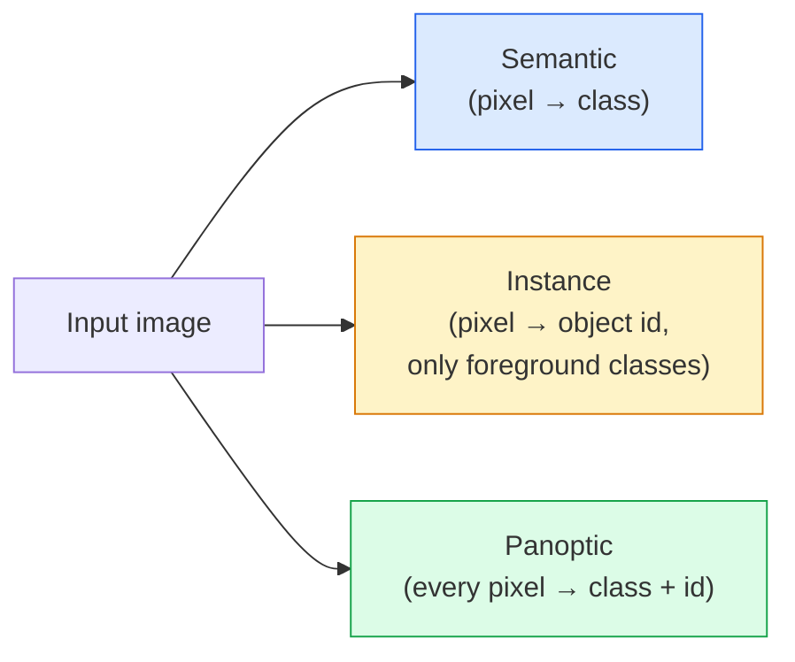
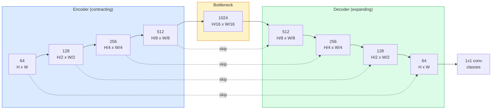

# 의미분열  U-Net

> 세그먼트는 각 픽셀에서 분류를 합니다. U-NET는 다운 샘플링 코더와 업스 샘플링 디코더를 결합하여 작동합니다.

**Type:** Build
**Languages:** Python
**Prerequisites:** Phase 4 Lesson 03 (CNNs), Phase 4 Lesson 04 (Image Classification)
**Time:** ~75 minutes

## 학습 목표

- 의미, 예제, 그리고 전관적 세그먼트를 구분하고 주어진 문제에 대한 올바른 작업을 선택
- PyTorch에서 코더 블록, 병목, 변환된 회전과 함께 디코더와 연결을 건너뛰는 U-네트를 처음부터 구축하십시오
- 픽셀별 크로스 엔트로피, 다이스 손실 및 의료 및 산업 세그먼트의 현재 기본값이 된 결합 손실을 구현
- 클래스별로 IoU 및 Dice 매트릭을 읽어보고 작은 객체 회수, 경계 정확성 또는 클래스 불균형으로 인해 나쁜 점수가 나오는지를 진단하십시오

## 문제

분류는 한 이미지에 한 개의 레이블을 내보내기. 탐지에는 한 이미지에 몇 개의 상자가 출력됩니다. 세그먼트에서는 한 픽셀에 한 개의 레이블을 내보내기. 크기의 입력 값을 위해`H x W`, 출력량은 모양의 서입니다`H x W`(말) 또는`H x W x N_instances`(사례) 이것은 한 이미지에 수백만 개의 예측이 있습니다. 한 가지도 아닙니다.

세그먼트 구조는 거의 모든 밀집 예측 시야 제품을 지원하는 이유입니다. 의료 영상 (종양 마스크), 자율주행 (도로, 경로, 장애물), 위성 (건축의 발자국, 작물 경계가), 문서 분석 (설계 구역), 로봇 (잡힐 수있는 지역) 이 있습니다. 이러한 작업 중 어느 것도 객체를 둘러싼 상자를 넣는 것으로 해결할 수 없습니다. 그들은 정확한 실루엣을 필요로합니다.

건축 문제는 간단하고 해결하기 쉽지 않습니다. 네트워크는 이미지 (이것이 어떤 장면을 뜻하는 것) 의 글로벌 맥락과 로컬 픽셀 세부사항을 동시에 볼 수 있습니다. 표준 CNN는 맥락을 얻기 위해 공간적으로 압축합니다. 이는 세부 사항을 버리는 것입니다. U-Net는 두 가지 모두 얻은 디자인입니다.

## 개념

### 의미적 vs 예제적 vs 전술적



- **Semantic**"이 픽셀은 도로이고, 그 픽셀은 자동차" 라고 쓰여 있습니다.
- **Instance**"이 픽셀은 차 3번, 그 픽셀은 차 5번"라고 합니다.
- **Panoptic**이 두 가지를 통합합니다. 각 픽셀은 클래스 레이블을 얻습니다. 모든 인스턴스는 고유의 아이디를 얻습니다.

이 수업은 의미론을 다루고 다음 수업 (마스크 R-CNN) 은 예제를 다루고 있습니다.

### U-넷 모양



코더는 공간적 해상도를 4배 반으로 나누고 채널을 두 배로 나누고 디코더는 역으로 한다. 공간적 해상도를 4배 반으로 나누고 채널을 반으로 나누고 있다. 스kip 연결은 각 해상도의 디코더 기능과 일치하는 코더 기능들을 연결한다. 최종 1x1 conv 지도`64 -> num_classes`완전한 해상도로

왜  연결이 필요한지: 값을 빼면 값을 빼면 값을 정확하게 파악할 수 없기 때문에 값을 빼면 값이 떨어질 수 없습니다. 값을 빼면 값이 떨어질 수 있습니다.

### 2차선 상위 샘플에 대한 환승

디코더는 공간적 차원을 확장해야 합니다.

- **Transposed convolution**(`nn.ConvTranspose2d`)  학습 가능한 우스 샘플. 역사적인 U-넷 기본. 단계와 커널 크기가 균등하게 나뉘지 않으면 체커보드 유물을 생성할 수 있습니다.
- **Bilinear upsample + 3x3 conv** 원활한  샘플을 따라 conv. 미미한 유물, 더 적은 매개 변수, 이제 현대 기본

두 가지 모두 자연에서 나타납니다. 첫 번째 U-넷에서는, 이리네이어는 더 안전합니다.

### 픽셀 그리드에서 크로스 엔트로피

와 함께 의미분열을 위한$C$클래스, 모델 출력 `(N, C, H, W)`- 목표가`(N, H, W)`정수 클래스 ID를 가진 크로스 엔트로피는 분류 케이스와 동일합니다. 모든 공간 위치에서 적용됩니다.

```math
\text{Loss} = \mathop{\mathrm{mean}}\limits_{(n, h, w)} \left[ -\log\left( \mathop{\mathrm{softmax}}(\text{logits}[n, :, h, w])[\text{target}[n, h, w]] \right) \right]
```

`F.cross_entropy`PyTorch에서 이 모양을 원산적으로 처리합니다.

### 다이스 손실과 왜 필요한지

크로스 엔트로피는 모든 픽셀을 동일하게 취급합니다. 한 클래스가 프레임을 지배할 때 잘못됩니다 (의료 영상: 99% 배경, 1% 종양). 네트워크는 모든 곳에서 배경 예측을 통해 99% 정확성을 얻을 수 있지만 여전히 쓸모 없습니다.

Dice 손실은 예측된 마스크와 실제 마스크의 중복을 직접 최적화함으로써 문제를 해결합니다.

```math
\begin{aligned}
\mathop{\mathrm{Dice}}(p, y) &= \frac{2 \sum (p \cdot y)}{\sum p + \sum y + \epsilon} \\
\text{Dice}_{\text{loss}} &= 1 - \text{Dice}
\end{aligned}
```

어디`p`클래스의 sigmoid/softmax 확률 지도입니다.`y`이차적 기본 진실 마스크입니다. 손실은 완전하게 겹치면만 0입니다. 비율에 기반을 둔 것이기 때문에 클래스 불균형은 중요하지 않습니다.

실제 로, **combined loss**이 부분의 본문은

```math
L = L_{\text{cross\_entropy}} + \lambda \cdot L_{\text{dice}} \qquad (\lambda \approx 1)
```

크로스 엔트로피는 훈련 초기에는 안정적인 기하급수성을 제공합니다. 다이스는 마스크 모양과 실제로 일치하는 훈련 꼬리를 집중시킵니다. 이 조합은 의료 영상 기본이며 클래스 불균형 데이터 세트에 이길 수 없습니다.

### 평가 매트릭스

- **Pixel accuracy** %의 픽셀은 정확하게 예측되었습니다. 저렴합니다. 분류의 정확성과 같은 이유로 불균형 데이터에 분해되었습니다.
- **IoU per class** 각 클래스의 마스크의 조합 상단; 클래스 간 평균 = mIoU.
- **Dice (F1 on pixels)** IoU와 비슷하다$\text{Dice} = 2 \cdot \text{IoU} / (1 + \text{IoU})$의료 영상 촬영은 다이스를 선호하고, 운전 커뮤니티는 IoU를 선호합니다.
- **Boundary F1** 예측한 경계가 지표-진짜 경계에 얼마나 가깝는지 측정하여 작은 변화에도 처벌을 합니다. 반도체 검사와 같은 고정밀 작업에 중요합니다.

평균적인 평균은 15%에 해당하는 수업을 숨기고 다른 9개는 85%에 해당한다.

### 입력 해상도 타협

U-넷의 코더는 해상도를 4배로 반으로 줄이기 때문에 입력값은 16으로 나눌 수 있습니다. 의료 이미지는 종종 512x512 또는 1024x1024입니다. 자율주행 작물은 2048x1024입니다. U-넷의 메모리 비용은`H * W * C_max`, 그리고 1024x1024에서 1024개의 병목 채널을 통해 앞면이 이미 VRAM의 기가바이트를 사용합니다.

두 가지 표준 해결 방법:
1.  입력  프로세스 256x256 타일과 접착 및 
2. 방편 구슬을 확장된 구슬로 교체하여 공간 해상도를 높게 유지하지만 수용장 (DeepLab 가족) 을 넓히게 한다.

첫 번째 모델에서는 64 채널 기반 U-Net를 가진 256x256 입력 장치가 8 GB VRAM에 편안하게 열차됩니다.

```figure
segmentation-flood
```

## 건설 해

### 단계 1: 엔코더 블록

2개의 3x3 컨브가 배치 노르드와 ReLU를 가지고 있습니다. 첫 번째 컨브는 채널 수를 변경하고, 두 번째는 그것을 유지합니다.

```python
import torch
import torch.nn as nn
import torch.nn.functional as F

class DoubleConv(nn.Module):
    def __init__(self, in_c, out_c):
        super().__init__()
        self.net = nn.Sequential(
            nn.Conv2d(in_c, out_c, kernel_size=3, padding=1, bias=False),
            nn.BatchNorm2d(out_c),
            nn.ReLU(inplace=True),
            nn.Conv2d(out_c, out_c, kernel_size=3, padding=1, bias=False),
            nn.BatchNorm2d(out_c),
            nn.ReLU(inplace=True),
        )

    def forward(self, x):
        return self.net(x)
```

이 블록은 전체적으로 재사용됩니다.`bias=False`왜냐하면 BN의 베타 버전이 편견을 처리하기 때문입니다.

### 단계 2: 아래와 위로 블록

```python
class Down(nn.Module):
    def __init__(self, in_c, out_c):
        super().__init__()
        self.net = nn.Sequential(
            nn.MaxPool2d(2),
            DoubleConv(in_c, out_c),
        )

    def forward(self, x):
        return self.net(x)


class Up(nn.Module):
    def __init__(self, in_c, out_c):
        super().__init__()
        self.up = nn.Upsample(scale_factor=2, mode="bilinear", align_corners=False)
        self.conv = DoubleConv(in_c, out_c)

    def forward(self, x, skip):
        x = self.up(x)
        if x.shape[-2:] != skip.shape[-2:]:
            x = F.interpolate(x, size=skip.shape[-2:], mode="bilinear", align_corners=False)
        x = torch.cat([skip, x], dim=1)
        return self.conv(x)
```

공간에만 적용된 형태 검증 (`shape[-2:]`) 16으로 나눌 수 없는 입력을 처리합니다.`F.interpolate`전체 모양을 비교하면 채널 수치가 차이가 발생하는데, 이는 조용한 인터폴레이션이 아닌 고음의 오류가 되어야 합니다.

### 3단계: U-넷

```python
class UNet(nn.Module):
    def __init__(self, in_channels=3, num_classes=2, base=64):
        super().__init__()
        self.inc = DoubleConv(in_channels, base)
        self.d1 = Down(base, base * 2)
        self.d2 = Down(base * 2, base * 4)
        self.d3 = Down(base * 4, base * 8)
        self.d4 = Down(base * 8, base * 16)
        self.u1 = Up(base * 16 + base * 8, base * 8)
        self.u2 = Up(base * 8 + base * 4, base * 4)
        self.u3 = Up(base * 4 + base * 2, base * 2)
        self.u4 = Up(base * 2 + base, base)
        self.outc = nn.Conv2d(base, num_classes, kernel_size=1)

    def forward(self, x):
        x1 = self.inc(x)
        x2 = self.d1(x1)
        x3 = self.d2(x2)
        x4 = self.d3(x3)
        x5 = self.d4(x4)
        x = self.u1(x5, x4)
        x = self.u2(x, x3)
        x = self.u3(x, x2)
        x = self.u4(x, x1)
        return self.outc(x)

net = UNet(in_channels=3, num_classes=2, base=32)
x = torch.randn(1, 3, 256, 256)
print(f"output: {net(x).shape}")
print(f"params: {sum(p.numel() for p in net.parameters()):,}")
```

출력 형태`(1, 2, 256, 256)` 입력값과 같은 공간 크기가, `num_classes`채널. 약 7.7M 매개 변수`base=32`- 그래

### 4단계: 손실

```python
def dice_loss(logits, targets, num_classes, eps=1e-6):
    probs = F.softmax(logits, dim=1)
    targets_one_hot = F.one_hot(targets, num_classes).permute(0, 3, 1, 2).float()
    dims = (0, 2, 3)
    intersection = (probs * targets_one_hot).sum(dim=dims)
    denom = probs.sum(dim=dims) + targets_one_hot.sum(dim=dims)
    dice = (2 * intersection + eps) / (denom + eps)
    return 1 - dice.mean()


def combined_loss(logits, targets, num_classes, lam=1.0):
    ce = F.cross_entropy(logits, targets)
    dc = dice_loss(logits, targets, num_classes)
    return ce + lam * dc, {"ce": ce.item(), "dice": dc.item()}
```

다이스는 한 클래스에 의해 계산되고 평균 (마크로 다이스) 를 합니다.`eps`배트에서 없는 클래스에 0으로 나뉘는 것을 방지합니다.

### 단계 5: IoU 메트릭

```python
@torch.no_grad()
def iou_per_class(logits, targets, num_classes):
    preds = logits.argmax(dim=1)
    ious = torch.zeros(num_classes)
    for c in range(num_classes):
        pred_c = (preds == c)
        true_c = (targets == c)
        inter = (pred_c & true_c).sum().float()
        union = (pred_c | true_c).sum().float()
        ious[c] = (inter / union) if union > 0 else torch.tensor(float("nan"))
    return ious
```

C의 길이의 벡터를 반환합니다. `nan` 배트에서 없는                                                                                                                                                                                                                                                            

### 단계 6: 종결결결결결결결결결결결결결결결결결결결결결결결결결결결결결결결결결결결결결결결결결결결결결결결결결결결결결결결결결결결결결결결결결결결결결결결결결결결결결결결결결결결결결결결결결결결결결결결결결결결결결결결결결결결결결결결결결결결결결결결결결결결결결결결결결결결결결결결결결결결결결결결결결결결결

색상의 배경에 모양을 생성하여 네트워크가 색을 배우기 위해 색을 배우지 않습니다.

```python
import numpy as np
from torch.utils.data import Dataset, DataLoader

def synthetic_segmentation(num_samples=200, size=64, seed=0):
    rng = np.random.default_rng(seed)
    images = np.zeros((num_samples, size, size, 3), dtype=np.float32)
    masks = np.zeros((num_samples, size, size), dtype=np.int64)
    for i in range(num_samples):
        bg = rng.uniform(0, 1, (3,))
        images[i] = bg
        masks[i] = 0
        num_shapes = rng.integers(1, 4)
        for _ in range(num_shapes):
            cls = int(rng.integers(1, 3))
            color = rng.uniform(0, 1, (3,))
            cx, cy = rng.integers(10, size - 10, size=2)
            r = int(rng.integers(4, 12))
            yy, xx = np.meshgrid(np.arange(size), np.arange(size), indexing="ij")
            if cls == 1:
                mask = (xx - cx) ** 2 + (yy - cy) ** 2 < r ** 2
            else:
                mask = (np.abs(xx - cx) < r) & (np.abs(yy - cy) < r)
            images[i][mask] = color
            masks[i][mask] = cls
        images[i] += rng.normal(0, 0.02, images[i].shape)
        images[i] = np.clip(images[i], 0, 1)
    return images, masks


class SegDataset(Dataset):
    def __init__(self, images, masks):
        self.images = images
        self.masks = masks

    def __len__(self):
        return len(self.images)

    def __getitem__(self, i):
        img = torch.from_numpy(self.images[i]).permute(2, 0, 1).float()
        mask = torch.from_numpy(self.masks[i]).long()
        return img, mask
```

세 가지 클래스: 배경 (0), 원 (1), 광장 (2). 네트워크는 모양을 구별하는 법을 배워야 합니다.

### 7단계: 훈련 루프

```python
def train_one_epoch(model, loader, optimizer, device, num_classes):
    model.train()
    loss_sum, total = 0.0, 0
    iou_sum = torch.zeros(num_classes)
    for x, y in loader:
        x, y = x.to(device), y.to(device)
        logits = model(x)
        loss, _ = combined_loss(logits, y, num_classes)
        optimizer.zero_grad()
        loss.backward()
        optimizer.step()
        loss_sum += loss.item() * x.size(0)
        total += x.size(0)
        iou_sum += iou_per_class(logits, y, num_classes).nan_to_num(0)
    return loss_sum / total, iou_sum / len(loader)
```

합성 데이터 세트에 10~30개의 시대를 달리고, 형태 클래스에서 mIoU가 0.9를 넘어서도록 보도록 한다.`nan_to_num(0)`배트에서 없는 클래스를 0으로 취급합니다. 클래스별 정확한 IoU를 위해 존재와 사용에 따라 마스크 `torch.nanmean`여기 평균하는 대신 평가 시점에서의 대량

## 사용 하 고

생산에 사용하도록`segmentation_models_pytorch`("smp") 는 모든 표준 세그먼트 아키텍처를 타크비전이나 타임 스카드 등으로 엮습니다. 세 줄:

```python
import segmentation_models_pytorch as smp

model = smp.Unet(
    encoder_name="resnet34",
    encoder_weights="imagenet",
    in_channels=3,
    classes=3,
)
```

진짜 일을 위해 아는 것도 가치가 있습니다.
- **DeepLabV3+**최대 풀 기반의 다운 샘플링을 확장된 컨브로 대체하여 병목이 해상도를 유지합니다. 위성 및 운전 데이터에 더 빠른 경계가 있습니다.
- **SegFormer**수직 변환기 (hierarchical transformer) 로 conv 코더를 교환합니다. 많은 벤치마크에서 현재 SOTA를 사용합니다.
- **Mask2Former**- **OneFormer**하나의 아키텍처에서 의미, 인스턴스, 그리고 범형 세그먼트를 통합합니다.

세 개 모두 대입이 되어 있습니다`smp`또는`transformers`동일한 데이터 로더를 사용한다.

## 선박

이 교훈은 다음과 같은 결과를 낳습니다.

- `outputs/prompt-segmentation-task-picker.md` 의미, 인스턴스, 그리고 범선 세그먼트를 선택하고 주어진 작업에 대한 아키텍처를 이름 붙이는 프롬프트.
- `outputs/skill-segmentation-mask-inspector.md` 클래스 분포, 예측 마스크 통계, 과부 예측 또는 경계 흐릿한 클래스를 보고하는 기술.

## 운동

1. **(Easy)**시행`bce_dice_loss`바이너리 세그먼트 작업 (전지 vs 배경) 에 대해 합성 두 클래스 데이터 세트에서 전지 5%의 픽셀이 있을 때, 결합 손실이 BCE보다 더 빨리 공감되는 것을 확인합니다.
2. **(Medium)**`nn.Upsample + conv``nn.ConvTranspose2d`합성 데이터 세트에 두 가지를 모두 훈련시키고 mIoU를 비교하십시오.
3. **(Hard)**실제 세그먼트 데이터 세트를 (오크스포드-IIIT 애완 동물, 시티스케이즈 미니 스플릿 또는 의료 하위 세트를) 가져와 U-넷을`smp.Unet`참조. 클래스별로 IoU를 보고하고 다이스를 손실에 추가하면 어떤 클래스가 가장 많은 이익을 얻는지를 확인합니다.

## 주요 용어

| Term | What people say | What it actually means |
|------|----------------|----------------------|
| Semantic segmentation | "Label every pixel" | Per-pixel classification into C classes; instances of the same class merge |
| Instance segmentation | "Label every object" | Separates distinct instances of the same class; foreground-only |
| Panoptic segmentation | "Semantic + instance" | Every pixel gets a class; every thing instance also gets a unique id |
| Skip connection | "U-Net bridge" | Concatenation of encoder features into matching-resolution decoder features; preserves high-frequency detail |
| Transposed conv | "Deconvolution" | Learnable upsampling; can produce checkerboard artifacts |
| Dice loss | "Overlap loss" | 1 - 2|A ∩ B| / (|A| + |B|); optimises mask overlap directly and is robust to class imbalance |
| mIoU | "Mean intersection over union" | Average IoU across classes; the community-standard metric for segmentation |
| Boundary F1 | "Boundary accuracy" | F1 score computed on boundary pixels only; matters for precision-critical tasks |

## 더 많은 읽기

- [U-Net: Convolutional Networks for Biomedical Image Segmentation (Ronneberger et al., 2015)](https://arxiv.org/abs/1505.04597) 본문; 모든 사람들이 복사하는 그림은 2 페이지에 있습니다
- [Fully Convolutional Networks (Long et al., 2015)](https://arxiv.org/abs/1411.4038) 세그먼트를 종말에서 종말까지의 conv 문제로 만든 논문
- [segmentation_models_pytorch](https://github.com/qubvel/segmentation_models.pytorch) 생산 세그먼트를 위한 참조; 모든 표준 아키텍처와 모든 표준 손실
- [iafoss, Unet34 submission with TTA (Kaggle notebook)](https://www.kaggle.com/code/iafoss/unet34-submission-tta-0-699-new-public-lb) 실제 세그먼트 경쟁에서 U-네트 테스트 시간 증대
