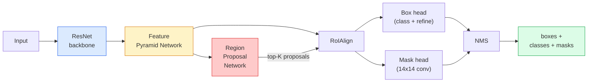

# 인스턴스 세그먼트  마스크 R-CNN

> Faster R-CNN 탐지기에 작은 마스크 분사를 추가하면 인스턴스 세그먼트가 됩니다. 어려운 부분은 RoIAlign이고, 보이는 것보다 더 어렵습니다.

**Type:** Build + Learn
**Languages:** Python
**Prerequisites:** Phase 4 Lesson 06 (YOLO), Phase 4 Lesson 07 (U-Net)
**Time:** ~75 minutes

## 학습 목표

- 마스크 R-CNN 아키텍처를 끝에서 끝으로 추적하십시오: 척추, FPN, RPN, RoIAlign, 상자 머리, 마스크 머리
- RoIAlign을 처음부터 구현하고 RoIPool가 더 이상 사용되지 않는 이유를 설명합니다
- 치 비전을 사용하세요`maskrcnn_resnet50_fpn_v2`생산 품질 인스턴스 마스크에 대한 사전 훈련된 모델 및 출력 형식을 올바르게 읽으십시오
- 작은 사용자 지정 데이터 세트에 미세 조정 마스크 R-CNN, 상자와 마스크 헤드를 교체하고 척추를 얼어붙여 보관

## 문제

의미분열은 한 클래스에 한 마스크를 제공합니다. 인스턴스 세그먼트는 두 개의 객체가 클래스를 공유할 때에도 한 개 개 마스크를 제공합니다. 개인을 셀 수, 프레임을 따라 추적하고, 물건을 측정하는 (벽에 있는 각 벽돌의 경계 상자, 미세상 이미지에서 각 세포) 는 모두 인스턴스 세그먼트를 요구합니다.

마스크 R-CNN (He et al., 2017) 은 인스턴스 세그먼트를 검출-플러스-아-마스크로 재프라메팅함으로써 이를 해결했다. 디자인은 너무 깨끗하여 다음 5 년 동안 거의 모든 인스턴스 세그먼트 페이퍼가 마스크 R-CNN 변종이었으며, 타르치비전 구현은 여전히 작고 중소 데이터 세트에서 생산 기본이다.

어려운 엔지니어링 문제는 샘플링입니다. 어떻게 픽셀 경계와 맞지 않는 각을 가진 제안 상자에서 고정 크기의 특징 영역을 절단합니까? 잘못된 것을 얻는 것은 모든 곳에서 MAP 포인트의 10분의 1을 지불합니다. RoIAlign는 답입니다.

## 개념

### 건축



이해해야 할 다섯 가지 부분:

1. **Backbone** ResNet-50 또는 ResNet-101은 ImageNet에서 훈련되어 있습니다. 단계 4, 8, 16, 32에서 기능 지도의 계층을 생성합니다.
2. **FPN (Feature Pyramid Network)** 상하 + 측면 연결은 각 레벨 C 채널에 의미 부가 있는 특징을 제공합니다. 탐지 질서는 객체 크기와 일치하는 FPN 레벨입니다.
3. **RPN (Region Proposal Network)** 각 앵커 위치에서 "이곳에 객체가 있습니까?"와 "어떻게 박스를 정비합니까?"를 예측하는 작은 칸 헤드.
4. **RoIAlign** FPN 레벨의 모든 박스에서 고정형 (예를 들어 7x7) 특징 패치를 샘플링합니다.
5. **Heads** 2층 상자 머리는 상자를 정비하고 클래스를 선택하고, 작은 conv 머리는`28x28`각 제안에 대해

### 로이알린이 아니라 로이폴이 왜 그런가?

원래의 Fast R-CNN는 제안 상자를 격자로 나눈 RoIPool를 사용했으며, 각 세포에서 최대 기능을 취하고 모든 좌표를 정수로 회전합니다. 이 회전으로 입력 픽셀 좌표에서 전체 픽셀 이 작은 224x224 이미지에 해당되는 기능 픽셀까지 기능 지도를 잘못 조정합니다. 기능 지도가 32 단계에있을 때 재앙입니다.

```
RoIPool:
  box (34.7, 51.3, 98.2, 142.9)
  round -> (34, 51, 98, 142)
  split grid -> round each cell boundary
  misalignment accumulates at every step

RoIAlign:
  box (34.7, 51.3, 98.2, 142.9)
  sample at exact float coordinates using bilinear interpolation
  no rounding anywhere
```

로아 라인 은 AP 마스크 를 COCO 에 대해 3-4 점 으로 무료로 릴트 합니다. 위치 를 중요시 하는 모든 디테커 는 현재 이 마스크 를 사용 합니다.

### 한 문항의 RPN

특징 지도의 각 위치에서 크기와 모양의 K 항구 상자를 배치하십시오. 각 항에 대한 객체성 점수를 예측하고 항을 더 잘 맞는 상자로 바꾸는 회귀 오프셋을 예측합니다. 상위 1,000개의 상자를 점수를 따라 놓고, NMS를 0.7개의 IoU에서 적용하고, 생존자들을 머리 위에 넘겨주십시오. RPN는 자신의 미니 손실을 훈련합니다  레슨 6에서 YOLO 손실과 같은 구조, 단지 두 클래스 (물질 / 객체 없습니다).

### 마스크 머리는

각 제안에 (RoIAlign 이후) 마스크 헤드 는 작은 FCN: 4 3x3 convs, 2x deconv, 최종 1x1 conv`num_classes``28x28`예측된 클래스에 해당하는 채널만 유지되고 다른 채널은 무시됩니다. 이것은 마스크 예측과 분류를 분리합니다.

최종 바이너리 마스크를 만들기 위해 28x28 마스크를 제안의 원래 픽셀 크기로 샘플링합니다.

### 손실

마스크 R-CNN는 4개의 손실을 합쳐서

```math
L = L_{\text{rpn\_cls}} + L_{\text{rpn\_box}} + L_{\text{box\_cls}} + L_{\text{box\_reg}} + L_{\text{mask}}
```

- `L_rpn_cls``L_rpn_box` RPN 제안에 대한 객관성 + 상자 회귀.
- `L_box_cls` 헤드의 분류기에 (C+1) 클래스 ( 배경 포함) 에 대한 크로스 엔트로피.
- `L_box_reg` 머리 상자 정비에 부드러운 L1
- `L_mask` 28x28 마스크 출력에서 1 피클스당 바이너리 크로스 엔트로피

각각의 손실은 자체 기본 무게를 가지고 있습니다. 타크비전 구현은 그것들을 건설자 주장으로 노출합니다.

### 출력 형식

`torchvision.models.detection.maskrcnn_resnet50_fpn_v2`각 이미지에 1개의 디킷의 목록을 반환합니다.

```
{
    "boxes":  (N, 4) in (x1, y1, x2, y2) pixel coordinates,
    "labels": (N,) class IDs, 0 = background so indices are 1-based,
    "scores": (N,) confidence scores,
    "masks":  (N, 1, H, W) float masks in [0, 1] — threshold at 0.5 for binary,
}
```

마스크는 이미 전체 화상 해상도를 가지고 있습니다. 28x28 헤드 출력 내부에서 샘플링되었습니다.

```figure
cv3-roialign-sampling
```

## 건설 해

### 단계 1: 처음부터 로이알라인을 설정

이것은 마스크 R-CNN의 한 구성 요소입니다. 시사보다는 코드를 더 쉽게 이해할 수 있습니다.

```python
import torch
import torch.nn.functional as F

def roi_align_single(feature, box, output_size=7, spatial_scale=1 / 16.0):
    """
    feature: (C, H, W) single-image feature map
    box: (x1, y1, x2, y2) in original image pixel coordinates
    output_size: side of the output grid (7 for box head, 14 for mask head)
    spatial_scale: reciprocal of the feature map stride
    """
    C, H, W = feature.shape
    x1, y1, x2, y2 = [c * spatial_scale - 0.5 for c in box]
    bin_w = (x2 - x1) / output_size
    bin_h = (y2 - y1) / output_size

    grid_y = torch.linspace(y1 + bin_h / 2, y2 - bin_h / 2, output_size)
    grid_x = torch.linspace(x1 + bin_w / 2, x2 - bin_w / 2, output_size)
    yy, xx = torch.meshgrid(grid_y, grid_x, indexing="ij")

    gx = 2 * (xx + 0.5) / W - 1
    gy = 2 * (yy + 0.5) / H - 1
    grid = torch.stack([gx, gy], dim=-1).unsqueeze(0)
    sampled = F.grid_sample(feature.unsqueeze(0), grid, mode="bilinear",
                            align_corners=False)
    return sampled.squeeze(0)
```

모든 숫자는 쌍선형 표본 위치입니다. 구둥이, 양자, 기울기가 떨어지지 않습니다.

### 단계 2: 타르치비전의 로아 라인과 비교

```python
from torchvision.ops import roi_align

feature = torch.randn(1, 16, 50, 50)
boxes = torch.tensor([[0, 10, 20, 100, 90]], dtype=torch.float32)  # (batch_idx, x1, y1, x2, y2)

ours = roi_align_single(feature[0], boxes[0, 1:].tolist(), output_size=7, spatial_scale=1/4)
theirs = roi_align(feature, boxes, output_size=(7, 7), spatial_scale=1/4, sampling_ratio=1, aligned=True)[0]

print(f"shape ours:   {tuple(ours.shape)}")
print(f"shape theirs: {tuple(theirs.shape)}")
print(f"max|diff|:    {(ours - theirs).abs().max().item():.3e}")
```

`sampling_ratio=1`그리고`aligned=True`, 두 개의 일치 내`1e-5`- 그래

### 단계 3: 미리 훈련된 마스크 R-CNN를 로드

```python
import torch
from torchvision.models.detection import maskrcnn_resnet50_fpn_v2, MaskRCNN_ResNet50_FPN_V2_Weights

model = maskrcnn_resnet50_fpn_v2(weights=MaskRCNN_ResNet50_FPN_V2_Weights.DEFAULT)
model.eval()
print(f"params: {sum(p.numel() for p in model.parameters()):,}")
print(f"classes (including background): {len(model.roi_heads.box_predictor.cls_score.out_features * [0])}")
```

46M 매개 변수, 91 클래스 (COCO). 1 클래스 (ID 0) 는 배경이며, 모델이 실제로 감지하는 모든 것은 id 1에서 시작됩니다.

### 4단계: 추론을 실행

```python
with torch.no_grad():
    x = torch.randn(3, 400, 600)
    predictions = model([x])
p = predictions[0]
print(f"boxes:  {tuple(p['boxes'].shape)}")
print(f"labels: {tuple(p['labels'].shape)}")
print(f"scores: {tuple(p['scores'].shape)}")
print(f"masks:  {tuple(p['masks'].shape)}")
```

마스크 텐서는 모양입니다`(N, 1, H, W)`. 객체당 바이너리 마스크를 얻기 위해 0.5의 임계:

```python
binary_masks = (p['masks'] > 0.5).squeeze(1)  # (N, H, W) boolean
```

### 단계 5: 사용자 지정 클래스 카운트를 위해 머리를 교환

일반적인 정렬 레시피: 척추, FPN, RPN를 재사용하고 두 분류자 헤드를 교체하십시오.

```python
from torchvision.models.detection.faster_rcnn import FastRCNNPredictor
from torchvision.models.detection.mask_rcnn import MaskRCNNPredictor

def build_custom_maskrcnn(num_classes):
    model = maskrcnn_resnet50_fpn_v2(weights=MaskRCNN_ResNet50_FPN_V2_Weights.DEFAULT)
    in_features = model.roi_heads.box_predictor.cls_score.in_features
    model.roi_heads.box_predictor = FastRCNNPredictor(in_features, num_classes)
    in_features_mask = model.roi_heads.mask_predictor.conv5_mask.in_channels
    hidden_layer = 256
    model.roi_heads.mask_predictor = MaskRCNNPredictor(in_features_mask, hidden_layer, num_classes)
    return model

custom = build_custom_maskrcnn(num_classes=5)
print(f"custom cls_score.out_features: {custom.roi_heads.box_predictor.cls_score.out_features}")
```

`num_classes`배경 클래스를 포함해야 합니다. 그래서 4개의 객체 클래스를 가진 데이터 세트가 사용 합니다.`num_classes=5`- 그래

### 6단계: 훈련 을 필요로 하지 않는 것 을 얼어붙게 하라

작은 데이터 세트에서 척추와 FPN를 얼어붙여라. RPN 객체성 + 회귀만 두 헤드가 학습한다.

```python
def freeze_backbone_and_fpn(model):
    # torchvision Mask R-CNN packs the FPN inside `model.backbone` (as
    # `model.backbone.fpn`), so iterating `model.backbone.parameters()` covers
    # both the ResNet feature layers and the FPN lateral/output convs.
    for p in model.backbone.parameters():
        p.requires_grad = False
    return model

custom = freeze_backbone_and_fpn(custom)
trainable = sum(p.numel() for p in custom.parameters() if p.requires_grad)
print(f"trainable after freeze: {trainable:,}")
```

500개의 이미지 데이터 세트에서 이것은 컨버전스와 과잉 적응 사이의 차이입니다.

## 사용 하 고

마스크 R-CNN의 전체 훈련 루프는 40 라인이며 작업  데이터 세트를 교환하고 이동하는 사이에 의미있는 변화를 일으키지 않습니다.

```python
def train_step(model, images, targets, optimizer):
    model.train()
    loss_dict = model(images, targets)
    losses = sum(loss for loss in loss_dict.values())
    optimizer.zero_grad()
    losses.backward()
    optimizer.step()
    return {k: v.item() for k, v in loss_dict.items()}
```

`targets`목록은 각 이미지 디렉트를 포함해야 합니다.`boxes``labels`그리고`masks`(이하`(num_instances, H, W)`모델은 훈련 중에 4개의 손실의 디렉트를 반환하고 eval 중에 예측 목록, 키를 `model.training`- 그래

`pycocotools`평가자 는 상자 와 마스크 에 대해 모두 mAP@IoU=0.5:0.95 를 생성 합니다. 상자 머리 또는 마스크 머리 는 병목인지 알 수 있도록 두 숫자가 필요합니다.

## 선박

이 교훈은 다음과 같은 결과를 낳습니다.

- `outputs/prompt-instance-vs-semantic-router.md` 3가지 질문을 던지고 본상과 의미적, 전체적, 그리고 정확한 모델을 선택합니다.
- `outputs/skill-mask-rcnn-head-swapper.md` 새로운                                                                                                                                                                                                                                                              `num_classes`- 그래

## 운동

1. **(Easy)**로이알라인을 확인해 보세요`torchvision.ops.roi_align`100개의 무작위 상자에 대해 보고하세요. 최대 절대적 차이를 보고하세요. 또한 RoIPool (2017년 이전 행동) 를 실행하고, 경계 근처 상자에 있는 특징 지도 픽셀에서 ~1-2개의 차이가 있음을 표시하세요.
2. **(Medium)**미세한 조율`maskrcnn_resnet50_fpn_v2`50 이미지 사용자 지정 데이터 세트에 (두 가지 클래스: 풍선, 물고기,  구멍, 로고)
3. **(Hard)**마스크 R-CNN의 마스크 헤드를 28x28 대신 56x56로 예측하는 것으로 교체하십시오. mAP@IoU=0.75를 전과 후에 측정하십시오. 이득 (또는 그 부족) 이 예상되는 경계 정확성 / 메모리 트레이드 오프와 일치하는 이유를 설명하십시오.

## 주요 용어

| Term | What people say | What it actually means |
|------|----------------|----------------------|
| Mask R-CNN | "Detection plus masks" | Faster R-CNN + a small FCN head that predicts a 28x28 mask per proposal per class |
| FPN | "Feature pyramid" | Top-down + lateral connections that give every stride level C channels of semantic-rich features |
| RPN | "Region proposer" | A small conv head that produces ~1000 object/no-object proposals per image |
| RoIAlign | "No-rounding crop" | Bilinearly samples a fixed-size feature grid from any float-coordinate box |
| RoIPool | "Pre-2017 crop" | Same purpose as RoIAlign but rounds box coordinates; obsolete |
| Mask AP | "Instance mAP" | Average precision computed with mask IoU instead of box IoU; the COCO instance segmentation metric |
| Binary mask head | "Per-class mask" | Predicts one binary mask per class for each proposal; only the predicted class's channel is kept |
| Background class | "Class 0" | The catch-all "no object" class; indices for real classes start at 1 |

## 더 많은 읽기

- [Mask R-CNN (He et al., 2017)](https://arxiv.org/abs/1703.06870) 논문; RoIAlign 3부 는 비판적 독서입니다
- [FPN: Feature Pyramid Networks (Lin et al., 2017)](https://arxiv.org/abs/1612.03144) FPN 종이; 모든 현대 탐지기가 그것을 사용합니다
- [torchvision Mask R-CNN tutorial](https://pytorch.org/tutorials/intermediate/torchvision_tutorial.html) 미세조정 루프의 참조
- [Detectron2 model zoo](https://github.com/facebookresearch/detectron2/blob/main/MODEL_ZOO.md) 거의 모든 탐지 및 세그먼트 변종에 대한 훈련된 무게를 가진 생산 구현
