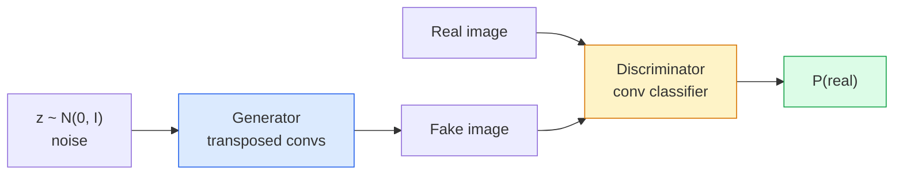
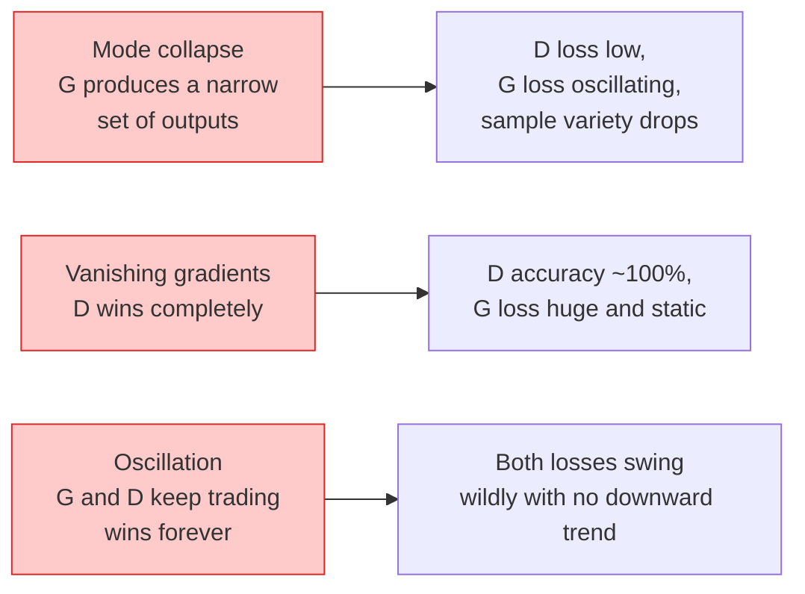

# 이미지 생성  GAN

> GAN은 고정된 게임에서 두 개의 신경망입니다. 한쪽은 드래스, 한쪽은 비평. 그 그림이 비평자를 속이는 때까지 그들은 더 잘 어울립니다.

**Type:** Build
**Languages:** Python
**Prerequisites:** Phase 4 Lesson 03 (CNNs), Phase 3 Lesson 06 (Optimizers), Phase 3 Lesson 07 (Regularization)
**Time:** ~75 minutes

## 학습 목표

- 생성자와 차별자 사이의 최소의 게임을 설명하고 왜 균형이 $p_{\text{model}} = p_{\text{data}}$
- PyTorch에서 DCGAN을 구현하고 60 줄 이하의 연동 32x32 합성 이미지를 생성하도록하십시오
- 세 가지 표준 트릭을 사용하여 GAN 훈련을 안정화하십시오: 비충분 손실, 스펙트럼 표준, TTUR (두 시간 횟수 업데이트 규칙)
- 모드 붕괴, 오스컬레이션, 그리고 차별-승부-완전히 건강한 컨버전스를 구별하는 훈련 곡선을 읽으십시오

## 문제

분류는 네트워크에 이미지를 레이블에 지도하는 방법을 가르칩니다. 생성은 문제를 뒤집어줍니다. 새로운 이미지를 샘플링하여 같은 배포에서 나온 것처럼 보입니다.

표준 손실 함수 (MSE, 크로스 엔트로피) 는 "이 샘플은 실제 분포에서 왔는가"를 측정할 수 없습니다. 픽셀 에러를 최소화하면 미미한 평균을 생성합니다. 현실적인 샘플이 아닙니다. 돌파구는 손실을 알아내는 것입니다.

GAN (Goodfellow et al., 2014) 는 그 프레임워크를 정의했다. 2018 년까지 StyleGAN은 사진에서 구별할 수 없는 1024x1024 개의 얼굴을 생산하고 있었다. 방산 모델은 품질과 제어성에 대한 왕위를 차지했지만 방산을 실용화하는 모든 트릭은 GAN에서 처음 이해되었습니다.

## 개념

### 두 네트워크



**generator**G는 소음의 벡터를 `z`그리고 이미지를 내보내죠.**discriminator**D는 이미지를 찍고 하나의 스칼라를 내놓습니다. 그 이미지 실재 가능성은

### 게임

G는 D가 틀렸으면 하고, D가 옳으면 합니다.

```math
\min_G \max_D \; \mathbb{E}_x[\log D(x)] + \mathbb{E}_z[\log(1 - D(G(z)))]
```

오른쪽에서 왼쪽으로 읽으십시오: D는 실제 (`log D(real)`(`log (1 - D(fake))`G는 D의 가짜 정확성을 최소화하고 있습니다.`D(G(z))`을 먹기 위해서

굿펠로우는 이 최소의 세계적 균형이 있다는 것을 증명했습니다`p_G = p_data`,D는 모든 곳에서 0.5을 내놓고, 생성된 분포와 실제 분포 사이의 Jensen-Shannon 분포는 0입니다.

### 포화되지 않는 손실

위의 형태는 수치적으로 불안정합니다.`D(G(z))`모든 가짜에 거의 0이니까`log(1 - D(G(z)))`G와 관련하여 사라지는 gradients가 있습니다. 고치는: G의 손실을 돌립니다.

```math
\begin{aligned}
L_D &= -\mathbb{E}_x[\log D(x)] - \mathbb{E}_z[\log(1 - D(G(z)))] \\
L_G &= -\mathbb{E}_z[\log D(G(z))] \qquad \text{(non-saturating)}
\end{aligned}
```

이제 언제`D(G(z))`G의 손실은 크며 그라디엔트는 정보적입니다.

### DCGAN 아키텍처 규칙

Radford, Metz, Chintala (2015) 는 수년 동안 실패한 실험을 5 가지 규칙으로 분리하여 GAN 훈련을 안정적으로 만들었습니다.

1. 융합을 단계적 컨브 (두 개의 네트워크) 로 대체하십시오.
2. G의 출력 및 D의 출입을 제외한 생성기와 차별기 모두에서 대량 규범을 사용한다.
3. 더 깊은 구조에서 완전히 연결된 층을 제거하십시오.
4. G는 출력 (출력 (tanh for output in [-1, 1]) 를 제외한 모든 층에서 ReLU를 사용합니다.
5. D는 모든 계층에 LeakyReLU (negative_slope=0.2) 를 사용합니다.

모든 현대 컨브 기반 GAN (StyleGAN, BigGAN, GigaGAN) 는 여전히 이러한 규칙에서 출발하고 조각을 한 번에 교체합니다.

### 실패 모드와 그 서명



- **Mode collapse**: G는 D를 속이는 한 이미지를 찾아서 그만 생성합니다. 수정: 미니배치 차별, 스펙트럼 규범 또는 레이블 컨디션을 추가합니다.
- **Discriminator wins**D가 너무 강해지거나 G의 기하급수가 사라지거나 D의 학습률이 낮거나 실제 라벨에 라벨 부드러운 것을 적용하면
- **Oscillation**TTUR (D는 G보다 2-4 배로 빨리 학습한다) 또는 Wasserstein 손실로 전환한다.

### 평가

GAN는 지형 진실이 없죠. 어떻게 그들이 작동하는지 알 수 있을까요?

- **Sample inspection** 모든 시대를 끝으로 64개의 샘플을 살펴보세요.
- **FID (Fréchet Inception Distance)** 실제 집합과 생성된 집합의 분포가 있는 Inception-v3 기능 사이의 거리.
- **Inception Score** 나이가 많고 더 부서지기 쉬운 사람, FID를 선호합니다.
- **Precision/Recall for generative models** 품질 (정확성) 과 커버리 (회복) 을 분리하여 측정합니다. FID만보다 더 많은 정보입니다.

작은 합성 데이터 실행에 있어서 샘플 검사만 충분합니다.

```figure
cv-gan-image
```

## 건설 해

### 단계 1: 생성기

64차원 소음을 소화하고 32x32 이미지를 생성하는 작은 DCGAN 생성기

```python
import torch
import torch.nn as nn

class Generator(nn.Module):
    def __init__(self, z_dim=64, img_channels=3, feat=64):
        super().__init__()
        self.net = nn.Sequential(
            nn.ConvTranspose2d(z_dim, feat * 4, kernel_size=4, stride=1, padding=0, bias=False),
            nn.BatchNorm2d(feat * 4),
            nn.ReLU(inplace=True),
            nn.ConvTranspose2d(feat * 4, feat * 2, kernel_size=4, stride=2, padding=1, bias=False),
            nn.BatchNorm2d(feat * 2),
            nn.ReLU(inplace=True),
            nn.ConvTranspose2d(feat * 2, feat, kernel_size=4, stride=2, padding=1, bias=False),
            nn.BatchNorm2d(feat),
            nn.ReLU(inplace=True),
            nn.ConvTranspose2d(feat, img_channels, kernel_size=4, stride=2, padding=1, bias=False),
            nn.Tanh(),
        )

    def forward(self, z):
        return self.net(z.view(z.size(0), -1, 1, 1))
```

4개의 컨브가 이식되어 있습니다.`kernel_size=4, stride=2, padding=1`그래서 그들은 공간 크기를 두 배로 더합니다. [-1, 1]를 통해 출력 활성화가 됩니다.

### 2단계: 차별

리레루, 리 콘버, 스칼라 로그이트로 끝납니다.

```python
class Discriminator(nn.Module):
    def __init__(self, img_channels=3, feat=64):
        super().__init__()
        self.net = nn.Sequential(
            nn.Conv2d(img_channels, feat, kernel_size=4, stride=2, padding=1),
            nn.LeakyReLU(0.2, inplace=True),
            nn.Conv2d(feat, feat * 2, kernel_size=4, stride=2, padding=1, bias=False),
            nn.BatchNorm2d(feat * 2),
            nn.LeakyReLU(0.2, inplace=True),
            nn.Conv2d(feat * 2, feat * 4, kernel_size=4, stride=2, padding=1, bias=False),
            nn.BatchNorm2d(feat * 4),
            nn.LeakyReLU(0.2, inplace=True),
            nn.Conv2d(feat * 4, 1, kernel_size=4, stride=1, padding=0),
        )

    def forward(self, x):
        return self.net(x).view(-1)
```

마지막 은 a`4x4``1x1`. 출력량은 한 이미지에 한 척의 스칼라입니다. 손실 계산 중에만 시그모이드를 적용하십시오.

### 단계 3: 훈련 단계

대안: D를 한 번 업데이트하고, G를 한 번씩 업데이트합니다.

```python
import torch.nn.functional as F

def train_step(G, D, real, z, opt_g, opt_d, device):
    real = real.to(device)
    bs = real.size(0)

    # D step
    opt_d.zero_grad()
    d_real = D(real)
    d_fake = D(G(z).detach())
    loss_d = (F.binary_cross_entropy_with_logits(d_real, torch.ones_like(d_real))
              + F.binary_cross_entropy_with_logits(d_fake, torch.zeros_like(d_fake)))
    loss_d.backward()
    opt_d.step()

    # G step
    opt_g.zero_grad()
    d_fake = D(G(z))
    loss_g = F.binary_cross_entropy_with_logits(d_fake, torch.ones_like(d_fake))
    loss_g.backward()
    opt_g.step()

    return loss_d.item(), loss_g.item()
```

`G(z).detach()`D 단계에서는 중요한 요소가 있습니다. 업데이트 중에 G에 흐르는 gradients를 원하지 않습니다.

### 단계 4: 합성 모양에 대한 완전한 훈련 루프

```python
from torch.utils.data import DataLoader, TensorDataset
import numpy as np

def synthetic_images(num=2000, size=32, seed=0):
    rng = np.random.default_rng(seed)
    imgs = np.zeros((num, 3, size, size), dtype=np.float32) - 1.0
    for i in range(num):
        r = rng.uniform(6, 12)
        cx, cy = rng.uniform(r, size - r, size=2)
        yy, xx = np.meshgrid(np.arange(size), np.arange(size), indexing="ij")
        mask = (xx - cx) ** 2 + (yy - cy) ** 2 < r ** 2
        color = rng.uniform(-0.5, 1.0, size=3)
        for c in range(3):
            imgs[i, c][mask] = color[c]
    return torch.from_numpy(imgs)

device = "cuda" if torch.cuda.is_available() else "cpu"
data = synthetic_images()
loader = DataLoader(TensorDataset(data), batch_size=64, shuffle=True)

G = Generator(z_dim=64, img_channels=3, feat=32).to(device)
D = Discriminator(img_channels=3, feat=32).to(device)
opt_g = torch.optim.Adam(G.parameters(), lr=2e-4, betas=(0.5, 0.999))
opt_d = torch.optim.Adam(D.parameters(), lr=2e-4, betas=(0.5, 0.999))

for epoch in range(10):
    for (batch,) in loader:
        z = torch.randn(batch.size(0), 64, device=device)
        ld, lg = train_step(G, D, batch, z, opt_g, opt_d, device)
    print(f"epoch {epoch}  D {ld:.3f}  G {lg:.3f}")
```

`Adam(lr=2e-4, betas=(0.5, 0.999))`DCGAN 기본  낮은 베타1는 역동적인 게임을 너무 안정시키지 못하게 합니다.

### 5단계: 샘플링

```python
@torch.no_grad()
def sample(G, n=16, z_dim=64, device="cpu"):
    G.eval()
    z = torch.randn(n, z_dim, device=device)
    imgs = G(z)
    imgs = (imgs + 1) / 2
    return imgs.clamp(0, 1)
```

샘플링 전에 항상 평가 모드로 전환하십시오. DCGAN에서 이것은 중요한 이유는 배트의 표준 실행 통계가 배트의 통계에 대신 사용됩니다.

### 단계 6: 스펙트럼 정상화

네트워크를 보장하는 차별기에는 BN를 대체하는 1Lipschitz가 있습니다. 대부분의 "D는 너무 열심히 승리한다" 실패를 수정합니다.

```python
from torch.nn.utils import spectral_norm

def build_sn_discriminator(img_channels=3, feat=64):
    return nn.Sequential(
        spectral_norm(nn.Conv2d(img_channels, feat, 4, 2, 1)),
        nn.LeakyReLU(0.2, inplace=True),
        spectral_norm(nn.Conv2d(feat, feat * 2, 4, 2, 1)),
        nn.LeakyReLU(0.2, inplace=True),
        spectral_norm(nn.Conv2d(feat * 2, feat * 4, 4, 2, 1)),
        nn.LeakyReLU(0.2, inplace=True),
        spectral_norm(nn.Conv2d(feat * 4, 1, 4, 1, 0)),
    )
```

교환`Discriminator``build_sn_discriminator()`스펙트럼 규범은 가장 쉬운 단일 강도 업그레이드입니다.

## 사용 하 고

심각한 생성에서, 미리 훈련된 무게를 사용하거나 확산으로 전환하십시오. 두 가지 표준 라이브러리:

- `torch_fidelity`사용자 지정 평가 코드를 작성하지 않고도 생성기에서 FID / IS를 계산합니다.
- `pytorch-gan-zoo`(유산) 그리고`StudioGAN`배에 시험된 DCGAN, WGAN-GP, SN-GAN, StyleGAN, 그리고 BigGAN의 구현

2026년, GAN는 여전히 실시간 이미지 생성 (연연기 <10 ms), 스타일 전송, 정밀한 제어 (Pix2Pix, CycleGAN) 을 통해 이미지-이미지 번역 (image-to-image translation) 을 위한 최고의 선택이다.

## 선박

이 교훈은 다음과 같은 결과를 낳습니다.

- `outputs/prompt-gan-training-triage.md` 훈련 곡선 설명서를 읽고 실패 모드 (모드 붕괴, D- 승률, 오스컬레이션) 과 단일 권장 수정 모드를 선택하는 명령어.
- `outputs/skill-dcgan-scaffold.md` DCGAN 스카프를 쓰는 기술`z_dim`, 목표`image_size`그리고`num_channels`, 훈련 루프와 샘플 세이버를 포함한

## 운동

1. **(Easy)**위 DCGAN를 합성 원 데이터 세트에 훈련시키고 각 시대 말 16개의 샘플의 그리드를 저장합니다. 생성된 원들은 어느 시대를 통해 명확하게 원형이 됩니다?
2. **(Medium)**분단기량 규범을 스펙트럼 규범으로 대체해 두 버전을 옆으로 훈련시켜 두 버전을 가장 빠르게 합쳐주는 것이냐?
3. **(Hard)**조건부 DCGAN을 구현: 클래스 레이블을 G와 D 모두로 입력 (G에서 소음에 대한 한 온도를 단축하고, D에서 클래스 임베디션 채널을 단축) 수업 7에서 합성 "순환과 광장" 데이터 세트를 훈련시키고 특정 레이블을 사용하여 샘플링을 통해 클래스 컨디션이 작동한다는 것을 보여주십시오.

## 주요 용어

| Term | What people say | What it actually means |
|------|----------------|----------------------|
| Generator (G) | "The draws-stuff net" | Maps noise to images; trained to fool the discriminator |
| Discriminator (D) | "The critic" | Binary classifier; trained to distinguish real from generated images |
| Minimax | "The game" | min over G, max over D of an adversarial loss; equilibrium is $p_G = p_{\text{data}}$ |
| Non-saturating loss | "The numerically sane version" | G's loss is $-\log(D(G(z)))$ instead of $\log(1 - D(G(z)))$ to avoid vanishing gradients early in training |
| Mode collapse | "Generator makes one thing" | G produces only a small subset of the data distribution; fix with SN, minibatch discrimination, or larger batch |
| TTUR | "Two learning rates" | D learns faster than G, typically by a factor of 2-4; stabilises training |
| Spectral norm | "1-Lipschitz layer" | A weight-normalisation that bounds each layer's Lipschitz constant; stops D from becoming arbitrarily steep |
| FID | "Fréchet Inception Distance" | Distance between Inception-v3 feature distributions of real and generated sets; the standard evaluation metric |

## 더 많은 읽기

- [Generative Adversarial Networks (Goodfellow et al., 2014)](https://arxiv.org/abs/1406.2661) 모든 것을 시작한 신문
- [DCGAN (Radford, Metz, Chintala, 2015)](https://arxiv.org/abs/1511.06434) GAN를 훈련시킬 수 있는 건축 규칙
- [Spectral Normalization for GANs (Miyato et al., 2018)](https://arxiv.org/abs/1802.05957) 가장 유용한 안정화 트릭
- [StyleGAN3 (Karras et al., 2021)](https://arxiv.org/abs/2106.12423) SOTA GAN; 지난 10년 동안의 모든 트릭의 최고의 히트 앨범처럼 읽습니다
