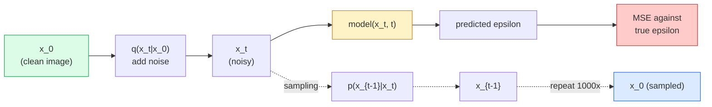

# 이미지 생성  전파 모델

> 전파 모델은 소멸을 배우며 소음한 이미지에서 소음의 일부를 제거하도록 훈련시켜 1000번 뒤로 반복하면 이미지의 생성기가 됩니다.

**Type:** Build
**Languages:** Python
**Prerequisites:** Phase 4 Lesson 07 (U-Net), Phase 1 Lesson 06 (Probability), Phase 3 Lesson 06 (Optimizers)
**Time:** ~75 minutes

## 학습 목표

- 앞으로의 소음 과정을 추출합니다 `x_0 -> x_1 -> ... -> x_T`그리고 왜 폐쇄적인 형태를 설명하는`q(x_t | x_0)`t에 해당하는
- DDPM 스타일의 훈련 목표를 구현하여 각 단계에 추가된 노이즈를 되돌려 놓으며 순수한 노이스로부터 이미지로 돌아가는 샘플링
- 시간 조건으로 U-넷을 구축 (CPU에서 훈련하기에 충분히 작습니다)
- DDPM와 DDIM 샘플링의 차이와 각이 적절할 때 설명하십시오 (학습 23는 흐름 일치와 정정된 흐름의 깊이에 관한 것입니다)

## 문제

GAN는 한 번의 샷을 생성합니다. 소음, 이미지, 한 번의 앞을 통과합니다. 그들은 빠르고 훈련하기 힘들다. 디푸전 모델은 반복적으로 생성됩니다. 순수한 소음에서 시작하여 작은 단계로 소멸하고 이미지 발생합니다. 그들은 느리고 훈련하기 쉽습니다. 지난 5년 동안 후자의 특성에서 지배를 받았는데: 모든 작은 팀은 전파 모델을 훈련시키고 합리적인 샘플을 얻을 수 있습니다. GAN 훈련은 실패한 연간에서 배우는 공예입니다.

훈련 안정성을 넘어, 디푸지언의 반복 구조는 현대 이미지 생성에서 일어나는 모든 것을 해제합니다. 텍스트 컨디션, 인 페인팅, 이미지 편집, 초상화, 제어 가능한 스타일. 샘플링 루프의 각 단계는 새로운 제한을 주입하는 장소입니다. 이 해킹은 Stable Diffusion, Imagen, DALL-E 3, Midjourney, 그리고 여러분이 사용할 모든 제어 가능한 이미지 모델이 모두 전파 기반의 이유입니다.

이 수업은 최소한의 DDPM를 구축합니다. 앞으로의 소음, 뒤로의 소음, 훈련 루프. 다음 수업 (స్థిరమైన 전파) 은 VAE, 텍스트 코더 및 분류자 없는 가이드와 함께 생산 시스템에 연결합니다.

## 개념

### 앞으로의 과정

사진을 찍어보세요`x_0`가우스 소음도 조금 더 넣으면`x_1`조금 더 더 넣으면`x_2`계속 가세요$T$`x_T`가우스파울러의 소음과 거의 구별할 수 없습니다.

```math
q(x_t \mid x_{t-1}) = \mathcal{N}\left(x_t; \sqrt{1 - \beta_t} \, x_{t-1}, \; \beta_t I\right)
```

`beta_t`작은 변동 스케줄이, 일반적으로 0.0001에서 0.02까지 선형입니다 $T=1000$각 단계는 신호를 약간 줄이고 새로운 소음을 주입합니다.

### 닫힌 형태의 점프

한 단계씩 소음을 추가하는 것은 마르코프 연쇄입니다. 하지만 수학은 접어들죠.`x_t`직결`x_0`한 발자국으로

```math
\begin{aligned}
&\text{Define } \alpha_t = 1 - \beta_t \\
&\text{Define } \bar{\alpha}_t = \prod_{s=1}^{t} \alpha_s \\[6pt]
&\text{Then: } q(x_t \mid x_0) = \mathcal{N}\left(x_t; \sqrt{\bar{\alpha}_t} \, x_0, \; (1 - \bar{\alpha}_t) I\right) \\[6pt]
&\text{Equivalently: } x_t = \sqrt{\bar{\alpha}_t} \, x_0 + \sqrt{1 - \bar{\alpha}_t} \, \epsilon \quad \text{where } \epsilon \sim \mathcal{N}(0, I)
\end{aligned}
```

이 단일 방정식은 방산이 실용적인 이유입니다. 훈련 중에 당신은 무작위로 선택합니다.`t`, 샘플`x_t`직결`x_0`, 그리고 한 단계로 열차를  마코프 연쇄의 완전한 시뮬레이션이 필요하지 않습니다.

### 역전 과정

앞으로의 과정이 고정되어 있습니다.`p(x_{t-1} | x_t)`신경망이 배운 것은 바로 이겁니다.`x_{t-1}`직접적으로, 그들은 소음을 예측합니다.`epsilon`단계로 추가$t$, 그리고 수학이 이룬`x_{t-1}`그로부터



### 훈련 손실

각 훈련 단계에 대해:

1. 실제 이미지를 샘플링하세요`x_0`- 그래
2. 시간 단계의 샘플`t`$[1, T]$- 그래
3. 샘플 잡음`epsilon ~ N(0, I)`- 그래
4. 계산`x_t = sqrt(alpha_bar_t) * x_0 + sqrt(1 - alpha_bar_t) * epsilon`- 그래
5. 예측`epsilon_theta(x_t, t)`네트워크와 함께
6. 최소화`|| epsilon - epsilon_theta(x_t, t) ||^2`- 그래

신경망은 모든 시간에 소음을 예측하는 것을 배우죠. 손실은 MSE입니다.

### 샘플링 (DDPM)

생성하기 위해: 부터 시작`x_T ~ N(0, I)`그리고 한 걸음씩 뒤로 걸어갑니다.

```
for t = T, T-1, ..., 1:
    eps = model(x_t, t)
    x_{t-1} = (1 / sqrt(alpha_t)) * (x_t - (beta_t / sqrt(1 - alpha_bar_t)) * eps) + sqrt(beta_t) * z
    where z ~ N(0, I) if t > 1, else 0
return x_0
```

핵심은 역 조건은 일반적으로 닫힌 형태로 알려져 있지 않지만, 이 특정 가우시안 전진 과정에 있어서 그렇습니다.

### 왜 1000발이?

앞으로의 잡음 스케줄은 선택되므로 각 단계에 충분한 잡음이 추가되어 반발 단계가 거의 가우스스적이 된다. 너무 적은 단계와 반발 단계가 가우스스적이어서 네트워크는 잘 모델링할 수 없다. 너무 많은 단계와 샘플링은 감소하는 이익으로 비용이 많이 들게 된다. $T=1000$선형 스케줄이 있는 경우 DDPM 기본값입니다.

### DDIM: 샘플링이 20배 더 빠르다

훈련은 동일하다. 샘플링 변경. DDIM (Song et al., 2020) 는 재교육 없이 시간 단계를 건너뛰는 결정적 역전 과정을 정의합니다. DDIM로 50 단계의 샘플링은 1000 단계 가까이의 DDPM 품질을 제공합니다. 모든 생산 시스템은 DDIM 또는 더 빠른 변형을 사용합니다 (DPM-솔버, 유러 조상).

### 시간 조절

네트워크`epsilon_theta(x_t, t)`어떤 시간 단계에 대해 말하려는지를 알아야 합니다.`t`시노수이드 시간 임베디션을 통해 (변경기에서의 위치 코딩과 같은 아이디어) 모든 U-넷 레벨의 기능 지도에 추가됩니다.

```
t_embedding = sinusoidal(t)
feature_map += MLP(t_embedding)
```

시간 조절 없이 네트워크는 이미지에서 잡음 수준을 추측해야 합니다.

```figure
cv-diffusion-image
```

## 건설 해

### 단계 1: 잡음 일정은

```python
import torch

def linear_beta_schedule(T=1000, beta_start=1e-4, beta_end=2e-2):
    return torch.linspace(beta_start, beta_end, T)


def precompute_schedule(betas):
    alphas = 1.0 - betas
    alphas_cumprod = torch.cumprod(alphas, dim=0)
    return {
        "betas": betas,
        "alphas": alphas,
        "alphas_cumprod": alphas_cumprod,
        "sqrt_alphas_cumprod": torch.sqrt(alphas_cumprod),
        "sqrt_one_minus_alphas_cumprod": torch.sqrt(1.0 - alphas_cumprod),
        "sqrt_recip_alphas": torch.sqrt(1.0 / alphas),
    }

schedule = precompute_schedule(linear_beta_schedule(T=1000))
```

한 번 미리 계산하고 훈련과 샘플링 중에 지수를 수집합니다.

### 단계 2: 앞으로 퍼지는 (q_sample)

```python
def q_sample(x0, t, noise, schedule):
    sqrt_a = schedule["sqrt_alphas_cumprod"][t].view(-1, 1, 1, 1)
    sqrt_one_minus_a = schedule["sqrt_one_minus_alphas_cumprod"][t].view(-1, 1, 1, 1)
    return sqrt_a * x0 + sqrt_one_minus_a * noise
```

한 줄로 닫힌 형태`t`시간단계 배열입니다. 배열에 있는 이미지마다 하나씩

### 단계 3: 시간 조건으로 된 U-넷

```python
import torch.nn as nn
import torch.nn.functional as F
import math

def timestep_embedding(t, dim=64):
    half = dim // 2
    freqs = torch.exp(-math.log(10000) * torch.arange(half, device=t.device) / half)
    args = t[:, None].float() * freqs[None]
    emb = torch.cat([args.sin(), args.cos()], dim=-1)
    return emb


class TinyUNet(nn.Module):
    def __init__(self, img_channels=3, base=32, t_dim=64):
        super().__init__()
        self.t_mlp = nn.Sequential(
            nn.Linear(t_dim, base * 4),
            nn.SiLU(),
            nn.Linear(base * 4, base * 4),
        )
        self.t_dim = t_dim
        self.enc1 = nn.Conv2d(img_channels, base, 3, padding=1)
        self.enc2 = nn.Conv2d(base, base * 2, 4, stride=2, padding=1)
        self.mid = nn.Conv2d(base * 2, base * 2, 3, padding=1)
        self.dec1 = nn.ConvTranspose2d(base * 2, base, 4, stride=2, padding=1)
        self.dec2 = nn.Conv2d(base * 2, img_channels, 3, padding=1)
        self.time_proj = nn.Linear(base * 4, base * 2)

    def forward(self, x, t):
        t_emb = timestep_embedding(t, self.t_dim)
        t_emb = self.t_mlp(t_emb)
        t_proj = self.time_proj(t_emb)[:, :, None, None]

        h1 = F.silu(self.enc1(x))
        h2 = F.silu(self.enc2(h1)) + t_proj
        h3 = F.silu(self.mid(h2))
        d1 = F.silu(self.dec1(h3))
        d2 = torch.cat([d1, h1], dim=1)
        return self.dec2(d2)
```

2단계 U-넷, 시간 조절이 병목에 주입되어 실제 이미지들을 위해 깊이와 너비를 확장합니다.

### 단계 4: 훈련 루프

```python
def train_step(model, x0, schedule, optimizer, device, T=1000):
    model.train()
    x0 = x0.to(device)
    bs = x0.size(0)
    t = torch.randint(0, T, (bs,), device=device)
    noise = torch.randn_like(x0)
    x_t = q_sample(x0, t, noise, schedule)
    pred = model(x_t, t)
    loss = F.mse_loss(pred, noise)
    optimizer.zero_grad()
    loss.backward()
    optimizer.step()
    return loss.item()
```

훈련 루프 전부입니다. GAN 게임도 없고, 전문적인 손실도 없고, 한 번의 MSE 호출도 없습니다.

### 단계 5: 샘플링 (DDPM)

```python
@torch.no_grad()
def sample(model, schedule, shape, T=1000, device="cpu"):
    model.eval()
    x = torch.randn(shape, device=device)
    betas = schedule["betas"].to(device)
    sqrt_one_minus_a = schedule["sqrt_one_minus_alphas_cumprod"].to(device)
    sqrt_recip_alphas = schedule["sqrt_recip_alphas"].to(device)

    for t in reversed(range(T)):
        t_batch = torch.full((shape[0],), t, dtype=torch.long, device=device)
        eps = model(x, t_batch)
        coef = betas[t] / sqrt_one_minus_a[t]
        mean = sqrt_recip_alphas[t] * (x - coef * eps)
        if t > 0:
            x = mean + torch.sqrt(betas[t]) * torch.randn_like(x)
        else:
            x = mean
    return x
```

1000개의 앞면이 샘플을 한 번 생산합니다. 실제 코드에서는 DDIM 50단계 샘플러로 교환합니다.

### 단계 6: DDIM 샘플러 (결정적, ~20배 더 빠른)

```python
@torch.no_grad()
def sample_ddim(model, schedule, shape, steps=50, T=1000, device="cpu", eta=0.0):
    model.eval()
    x = torch.randn(shape, device=device)
    alphas_cumprod = schedule["alphas_cumprod"].to(device)

    ts = torch.linspace(T - 1, 0, steps + 1).long()
    for i in range(steps):
        t = ts[i]
        t_prev = ts[i + 1]
        t_batch = torch.full((shape[0],), t, dtype=torch.long, device=device)
        eps = model(x, t_batch)
        a_t = alphas_cumprod[t]
        a_prev = alphas_cumprod[t_prev] if t_prev >= 0 else torch.tensor(1.0, device=device)
        x0_pred = (x - torch.sqrt(1 - a_t) * eps) / torch.sqrt(a_t)
        sigma = eta * torch.sqrt((1 - a_prev) / (1 - a_t) * (1 - a_t / a_prev))
        dir_xt = torch.sqrt(1 - a_prev - sigma ** 2) * eps
        noise = sigma * torch.randn_like(x) if eta > 0 else 0
        x = torch.sqrt(a_prev) * x0_pred + dir_xt + noise
    return x
```

`eta=0`완전히 결정적인 ( 같은 잡음 입력은 항상 같은 출력을 생성합니다). `eta=1`DDPM를 회복합니다.

## 사용 하 고

생산 작업에 사용 `diffusers`이 부분의 본문은

```python
from diffusers import DDPMScheduler, UNet2DModel

unet = UNet2DModel(sample_size=32, in_channels=3, out_channels=3, layers_per_block=2)
scheduler = DDPMScheduler(num_train_timesteps=1000)
```

도서관은 준비된 스케줄러 (DDPM, DDIM, DPM-Solver, Euler, Heun), 구성 가능한 U-Nets, 텍스트-상화 및 이미지-상화 파이프라인 및 LoRA 미세 조정 보조기를 배포합니다.

연구용으로`k-diffusion`(Katherine Crowson) 가장 충실한 참조 구현과 가장 좋은 샘플링 버전을 가지고 있습니다.

## 선박

이 교훈은 다음과 같은 결과를 낳습니다.

- `outputs/prompt-diffusion-sampler-picker.md` 질 목표, 지연 예산 및 컨디션 유형에 따라 DDPM / DDIM / DPM-Solver / Euler를 선택하는 프롬프트.
- `outputs/skill-noise-schedule-designer.md` T와 목표 부패 수준과 시간이 지남에 따라 신호-음악 비율의 진단 음반을 더하여 선형, 코시네스, 또는 시그모이드 베타 스케줄을 생성하는 기술.

## 운동

1. **(Easy)**앞으로의 과정을 시각화하여 한 이미지를 찍고, 그 그림을 그려보세요.`x_t``t in [0, 100, 250, 500, 750, 1000]`확인해봐`x_1000`가우스파리의 소리처럼 보입니다.
2. **(Medium)**20 시대 동안 신성순환 데이터 세트를 통해 TinyUNet를 훈련시키고 16개의 순환을 샘플링하십시오. DDPM (1000 단계) 및 DDIM (50 단계) 샘플링을 비교해보세요.
3. **(Hard)**코시네 소음 일정을 시행한다 (니콜 & 다리발, 2021):`alpha_bar_t = cos^2((t/T + s) / (1 + s) * pi / 2)`. 선형과 코시네 스케줄을 사용하여 동일한 모델을 훈련하고 코시네는 낮은 단계 계산에서 더 나은 샘플을 제공합니다.

## 주요 용어

| Term | What people say | What it actually means |
|------|----------------|----------------------|
| Forward process | "Add noise over time" | Fixed Markov chain that corrupts an image into Gaussian noise over $T$ steps |
| Reverse process | "Denoise step by step" | Learned distribution that walks back from noise to image |
| Epsilon prediction | "Predict the noise" | The training target: `epsilon_theta(x_t, t)` predicts the noise added at step $t$ |
| Beta schedule | "Noise amounts" | Sequence of $T$ small variances that define how much noise enters per step |
| $\bar{\alpha}_t$ | "Cumulative retain factor" | Product of $(1 - \beta_s)$ up to time $t$; bigger $t$ means less signal left |
| DDPM sampler | "Ancestral, stochastic" | Samples each $x_{t-1}$ from its conditional Gaussian; 1000 steps |
| DDIM sampler | "Deterministic, fast" | Rewrites sampling as a deterministic ODE; 20-100 steps with similar quality |
| Time conditioning | "Tell the model which t" | Sinusoidal embedding of $t$ injected into the U-Net so it knows the noise level |

## 더 많은 읽기

- [Denoising Diffusion Probabilistic Models (Ho et al., 2020)](https://arxiv.org/abs/2006.11239) 전파를 실용화하고 FID에 GAN를 이길 수 있는 논문
- [Improved DDPM (Nichol & Dhariwal, 2021)](https://arxiv.org/abs/2102.09672) 코시노 스케줄과 v 매개 변수를
- [DDIM (Song, Meng, Ermon, 2020)](https://arxiv.org/abs/2010.02502) 실시간 추론을 가능하게 한 결정적 샘플러
- [Elucidating the Design Space of Diffusion (Karras et al., 2022)](https://arxiv.org/abs/2206.00364) 각 전파 설계 선택의 통일적 시각; 현재 최고의 참조
