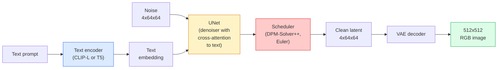

# 안정적 분포  건축 & 정교 조정

> 안정적인 디프루전 (Stable Diffusion) 은 사전 훈련된 VAE의 잠복 공간에서 실행되는 DDPM이며, 교차주의를 통해 텍스트에 조건화되며, 빠른 결정적 ODE 해제기로 샘플링되며, 분류자 없는 가이드로 조종됩니다.

**Type:** Learn + Use
**Languages:** Python
**Prerequisites:** Phase 4 Lesson 10 (Diffusion), Phase 7 Lesson 02 (Self-Attention)
**Time:** ~75 minutes

## 학습 목표

- 안정적인 방출 파이프라인의 다섯 조각을 추적하십시오: VAE, 텍스트 코더, U-넷, 스케줄러, 안전 검사  그리고 각각의 기능이 실제로 수행되는
- 잠복한 전파와 4x64x64 잠복한 공간 (3x512x512 이미지 대신) 에서 훈련하는 것이 품질 손실 없이 계산을 48x 감소시키는 이유를 설명하십시오.
- 사용`diffusers`이미지 생성, 이미지-이메이크 실행, 인 페인팅 및 ControlNet 가이드 생성
- 작은 사용자 지정 데이터 세트에 LoRA를 사용하여 정렬된 안정적인 디프러지 및 추론에 따라 LoRA 어댑터를 로드

## 문제

512x512 RGB 이미지에 직접 DDPM를 훈련시키는 것은 비용이 많이 들습니다. 모든 훈련 단계는 3x512x512 = 786,432 입력 값을 볼 U-넷을 통해 뒤로 이동하며 샘플링은 같은 U-넷을 통해 50+를 통과합니다. 안정적인 디프루전 1.5 (2022년 출시) 의 품질 수준에서, 픽셀 공간 디프루전에는 약 256 GPU-개월의 훈련과 소비자 GPU에 한 이미지에 10-30 초가 필요합니다.

공개중심 텍스트-이미지 전송이 실용화 된 트릭은**latent diffusion**(Rombach et al., CVPR 2022). 3x512x512 이미지를 4x64x64 잠수 텐서로 그리고 뒤로 지도하는 VAE를 훈련시켜, 그 잠수 공간에서 전파를 수행하십시오. 계산은 `(3*512*512)/(4*64*64) = 48x`샘플링은 10초에서 2초 이하로 떨어집니다.

거의 모든 현대 이미지 생성 모델은 자동 앵커, 디노이저 (U-Net 또는 DiT) 및 텍스트 컨디션에 대한 변동이 있는 잠복한 전파 모델입니다. 안정적인 전파를 배우면 템플릿을 배웠습니다.

## 개념

### 파이프라인



- **VAE** 냉동 자동 엽서. 엽서 (영상) 은 이미지를 잠자리 (img2img 및 훈련) 로 변환합니다. 엽서 (decoder) 는 잠자리를 다시 이미지로 변환합니다.
- **Text encoder** CLIP 텍스트 코더 (SD 1.x/2.x), CLIP-L + CLIP-G (SDXL), 또는 T5-XXL (SD3/FLUX). 토큰 임베디션의 순서를 생성합니다.
- **U-Net** 디노이저. 각 해상도 수준에서 삽입된 텍스트에 잠그기로부터 참석하는 간접 주의층을 가지고 있습니다.
- **Scheduler** 샘플링 알고리즘 (DDIM, Euler, DPM-Solver++). 시그마를 선택하고 예측 된 소음을 다시 잠그게 혼합합니다.
- **Safety checker** 출력 이미지에 선택적 NSFW / 불법 콘텐츠 필터.

### 분류자 없는 지침 (CFG)

단순 텍스트 조건화 학습 `epsilon_theta(x_t, t, c)`모든 요청에`c`CFG는 같은 네트워크를 `c`10%의 경우 (공허한 임베디션으로 대체) 를 떨어뜨려서 조건부 및 무조건적인 소음을 모두 예측하는 단일 모델을 제공합니다.

```math
\epsilon = \epsilon_{\text{uncond}} + w \cdot (\epsilon_{\text{cond}} - \epsilon_{\text{uncond}})
```

`w`이 기준은`w=0`조건 없는 것 입니다.`w=1`조건이 있는 것 같네요`w>1`SD 기본은 `w=7.5`- 그래

CFG는 텍스트에서 이미지가 생산 품질에서 작동하는 이유입니다. CFG 없이는 출력 편향을 약하게 촉구합니다.

### 잠자연 공간 기하학

VAE의 4채널 잠복은 단지 압축된 이미지가 아닙니다. 이것은 수학이 대략 의미적 편집에 해당하는 다양성 (프롬프트 엔지니어링 + 인터폴레이션이 모두 여기에 살고 있습니다) 이며, 유포 U-넷이 전체 모델링 예산을 지출하도록 훈련받은 곳입니다. 무작위 4x64x64 잠자리를 해독하면 무작위 모양의 이미지를 생성하지 않습니다. 그것은 쓰레기를 생성합니다. 왜냐하면 잠자리의 특정 하위 다수가 유효한 이미지를 해독하기 때문입니다.

두 가지 결과가 있습니다.

1. **Img2img**= 이미지를 잠그게 암호화, 부분적인 소음을 추가, 디노이저를 실행, 디코딩. 이미지의 구조는 인코딩이 거의 역전 가능하기 때문에 생존하고 있습니다.
2. **Inpainting**= img2img와 동일하지만, 기호는 마스크된 영역만을 업데이트합니다. 마스크되지 않은 영역은 암호화된 잠자리에 보관됩니다.

### U-넷 구조

SD U-Net은 3가지 추가로 Lesson 10에서 TinyUNet의 큰 버전입니다.

- **Transformer blocks**각 공간적 해상도에서 자기주의+문서 임베디션에 대한 간접주의를 포함합니다.
- **Time embedding**시노사이드 코딩을 통해 MLP를 통해
- **Skip connections**이식기능과 디코더의

SD 1.5의 전체 매개 변수는: ~860M. SDXL: ~2.6B. FLUX: ~12B. 매개 변수에서 점프는 주로 주의층입니다.

### 로라 미세 조율

안정적인 디프러시온의 완전한 정렬은 20 GB 이상의 VRAM가 필요하며 860M 매개 변수를 업데이트합니다. LoRA (Low-Rank Adaptation) 는 기본 모델을 얼어붙여서 주의층에 작은 순위 분해 매트릭스를 주입합니다. SD용 LoRA 어댑터는 일반적으로 10-50 MB이며, 단일 소비자 GPU에서 10-60 분 안에 열차하고, 추론 시점에 드롭-인 수정으로 로드합니다.

```
Original: W_q : (d_in, d_out)   frozen
LoRA:     W_q + alpha * (A @ B)   where A : (d_in, r), B : (r, d_out)

r is typically 4-32.
```

로라는 거의 모든 커뮤니티의 미세한 음반이 분포되는 방식입니다. CivitAI와 Hugging Face는 수백만 개의 음반을 주최합니다.

### 스케줄을 보게 될 것입니다

- **DDIM** 결정적, ~50단계, 간단합니다.
- **Euler ancestral** 스토카스틱, 30~50단계, 조금 더 창의적인 샘플
- **DPM-Solver++ 2M Karras** 결정적, 20-30 단계, 생산 기본
- **LCM / TCD / Turbo** 일관성 모델과 디스틸 된 변형; 1-4 단계, 어떤 품질의 비용으로.

스케줄을 교환하는 것은 일선 변경입니다`diffusers`그리고 때로는 재교육 없이 샘플 문제를 해결합니다.

```figure
cv3-latent-compression
```

## 건설 해

이 교훈은`diffusers`처음부터 안정적인 전파를 재구성하는 대신 끝에서 끝으로 재구성하는 것. 재구성해야 할 조각 (VAE, 텍스트 코더, U-Net, 스케줄러) 은 자신의 수업의 주제입니다. 여기서 목표는 생산 API에 대한 유창성입니다.

### 단계 1: 텍스트에서 이미지로

```python
import torch
from diffusers import StableDiffusionPipeline

pipe = StableDiffusionPipeline.from_pretrained(
    "runwayml/stable-diffusion-v1-5",
    torch_dtype=torch.float16,
).to("cuda")

image = pipe(
    prompt="a dog riding a skateboard in tokyo, studio ghibli style",
    guidance_scale=7.5,
    num_inference_steps=25,
    generator=torch.Generator("cuda").manual_seed(42),
).images[0]
image.save("dog.png")
```

`float16`가시적인 품질 손실 없이 VRAM를 반으로 줄입니다. `num_inference_steps=25`기본 DPM-Solver++와 일치하는`num_inference_steps=50`DDIM를 사용해서

### 2 단계: 스케줄을 변경

```python
from diffusers import DPMSolverMultistepScheduler, EulerAncestralDiscreteScheduler

pipe.scheduler = DPMSolverMultistepScheduler.from_config(pipe.scheduler.config)
pipe.scheduler = EulerAncestralDiscreteScheduler.from_config(pipe.scheduler.config)
```

스케줄러 상태는 U-넷 중량에서 분리되어 있습니다. 당신은 DDPM에 훈련하고 모든 스케줄러와 샘플을 할 수 있습니다.

### 단계 3: 이미지-이미지

```python
from diffusers import StableDiffusionImg2ImgPipeline
from PIL import Image

img2img = StableDiffusionImg2ImgPipeline.from_pretrained(
    "runwayml/stable-diffusion-v1-5",
    torch_dtype=torch.float16,
).to("cuda")

init_image = Image.open("dog.png").convert("RGB").resize((512, 512))
out = img2img(
    prompt="a dog riding a skateboard, oil painting",
    image=init_image,
    strength=0.6,
    guidance_scale=7.5,
).images[0]
```

`strength`소음 전량 (0.0 = 변하지 않고, 1.0 = 완전 재생) 은 소음 전량 (0.0 = 변하지 않고, 1.0 = 완전 재생) 이다.

### 4단계: 페인트

```python
from diffusers import StableDiffusionInpaintPipeline

inpaint = StableDiffusionInpaintPipeline.from_pretrained(
    "runwayml/stable-diffusion-inpainting",
    torch_dtype=torch.float16,
).to("cuda")

image = Image.open("dog.png").convert("RGB").resize((512, 512))
mask = Image.open("dog_mask.png").convert("L").resize((512, 512))

out = inpaint(
    prompt="a cat",
    image=image,
    mask_image=mask,
    guidance_scale=7.5,
).images[0]
```

마스크의 흰색 픽셀은 재생할 수 있는 영역입니다. 검은색 픽셀은 보존됩니다.

### 단계 5: LoRA 로딩

```python
pipe.load_lora_weights(
    "artificialguybr/studioghibli-redmond-1-5v-studio-ghibli-lora-for-liberteredmond-sd-1-5",
    weight_name="StudioGhibliRedmond-15V-LiberteRedmond-StdGBRedmAF-StudioGhibli.safetensors",
)
pipe.fuse_lora(lora_scale=0.8)

image = pipe(prompt="a village square, StdGBRedmAF, Studio Ghibli").images[0]
```

모델 카드에서 발동 문장 (`StdGBRedmAF, Studio Ghibli`) 스타일을 켜고`lora_scale`강도를 조절한다. 0.0 = 아무런 효과도 없고, 1.0 = 완전한 효과도 없다. `fuse_lora`속도와 함께 어댑터를 무게로 만들어 주지만, 교환을 방지합니다.`pipe.unfuse_lora()`다른 어댑터를 충전하기 전에

### 단계 6: LoRA 훈련 ( 스케치)

실제 로라 훈련은`peft`또는`diffusers.training`- 그 윤곽은:

```python
# Pseudocode
for step, batch in enumerate(dataloader):
    images, prompts = batch
    latents = vae.encode(images).latent_dist.sample() * 0.18215

    t = torch.randint(0, num_train_timesteps, (batch_size,))
    noise = torch.randn_like(latents)
    noisy_latents = scheduler.add_noise(latents, noise, t)

    text_emb = text_encoder(tokenizer(prompts))

    pred_noise = unet(noisy_latents, t, text_emb)  # LoRA weights injected here

    loss = F.mse_loss(pred_noise, noise)
    loss.backward()
    optimizer.step()
```

로라 매트릭스만이 그라디언트를 수신하고, 기본 U-Net, VAE, 텍스트 코더는 얼어붙는다.

## 사용 하 고

제작에서, 당신이 실제로 결정하는 것은:

- **Model family**: SD 1.5는 오픈소스 커뮤니티 피니 튜닝, SDXL는 더 높은 충실성을 위해, SD3 / FLUX는 최신 기술 및 엄격한 라이선스 요구 사항입니다.
- **Scheduler**: DPM-Solver++ 2M 카라스 20-30 단계, LCM-LoRA 1s 이하의 지연이 있을 때.
- **Precision**이 책:`float16`4080/4090에`bfloat16`A100 및 신기차에`int8`(비서`bitsandbytes`또는`compel`) VRAM가 꽉 차 있을 때
- **Conditioning**: 평정 텍스트 작업; 보다 강력한 제어를 위해 기본 파이프라인의 위쪽에 ControlNet (통치, 깊이, 자세) 를 추가하십시오.

배트 생성`AUTO1111`- `ComfyUI`지역사회 도구입니다. 생산 API를 위해,`diffusers`+ `accelerate`또는`optimum-nvidia`TensorRT 컴파일링으로

## 선박

이 교훈은 다음과 같은 결과를 낳습니다.

- `outputs/prompt-sd-pipeline-planner.md` SD 1.5 / SDXL / SD3 / FLUX를 선택하고, 시간표와 정확성을 선택합니다.
- `outputs/skill-lora-training-setup.md` 제목, 순위, 배트 크기와 학습률을 포함한 사용자 지정 데이터 세트에 대한 완전한 LoRA 훈련 구성을 작성하는 기술.

## 운동

1. **(Easy)**와 같은 명령어를 생성`guidance_scale``[1, 3, 5, 7.5, 10, 15]`그림이 어떻게 변하는지 설명해 주세요.
2. **(Medium)**진짜 사진을 찍어 보세요`StableDiffusionImg2ImgPipeline``strength``[0.2, 0.4, 0.6, 0.8, 1.0]`어떤 힘은 스타일을 변화시키면서 작성을 보존하는가? 왜 1.0은 입력 내용을 완전히 무시하는가?
3. **(Hard)**하나의 주체 (동물, 로고, 캐릭터) 의 10-20개의 이미지에 LoRA를 훈련시키고 그 주체와 함께 새로운 장면을 생성하십시오. 입력 이미지에 과도하게 적합하지 않고 최고의 정체성 보존을 생산한 LoRA 순위와 훈련 단계를 보고하십시오.

## 주요 용어

| Term | What people say | What it actually means |
|------|----------------|----------------------|
| Latent diffusion | "Diffuse in latents" | Run the entire DDPM in the VAE latent space (4x64x64) instead of pixel space (3x512x512); 48x compute saving |
| VAE scale factor | "0.18215" | Constant that rescales the VAE's raw latent to roughly unit variance; hardcoded in every SD pipeline |
| Classifier-free guidance | "CFG" | Mix conditional and unconditional noise predictions; the single most impactful inference knob |
| Scheduler | "Sampler" | The algorithm that turns noise + model predictions into a denoised latent trajectory |
| LoRA | "Low-rank adapter" | Small rank-decomposition matrices that fine-tune attention layers without touching base weights |
| Cross-attention | "Text-image attention" | Attention from latent tokens to text tokens; injects prompt information at every U-Net level |
| ControlNet | "Structure conditioning" | A separately-trained adapter that steers SD with an extra input (canny, depth, pose, segmentation) |
| DPM-Solver++ | "The default scheduler" | Second-order deterministic ODE solver; best quality at low step counts (20-30) in 2026 |

## 더 많은 읽기

- [High-Resolution Image Synthesis with Latent Diffusion (Rombach et al., 2022)](https://arxiv.org/abs/2112.10752) 안정적인 분포 종이; 설계를 정당화하는 모든 분포를 포함합니다
- [Classifier-Free Diffusion Guidance (Ho & Salimans, 2022)](https://arxiv.org/abs/2207.12598) CFG 종이
- [LoRA: Low-Rank Adaptation of Large Language Models (Hu et al., 2021)](https://arxiv.org/abs/2106.09685) 로라는 NLP 최초로 사용되었고 거의 변경되지 않은 상태에서 SD로 옮겨졌습니다.
- [diffusers documentation](https://huggingface.co/docs/diffusers) 각 SD/SDXL/SD3/FLUX 파이프라인에 대한 참조
