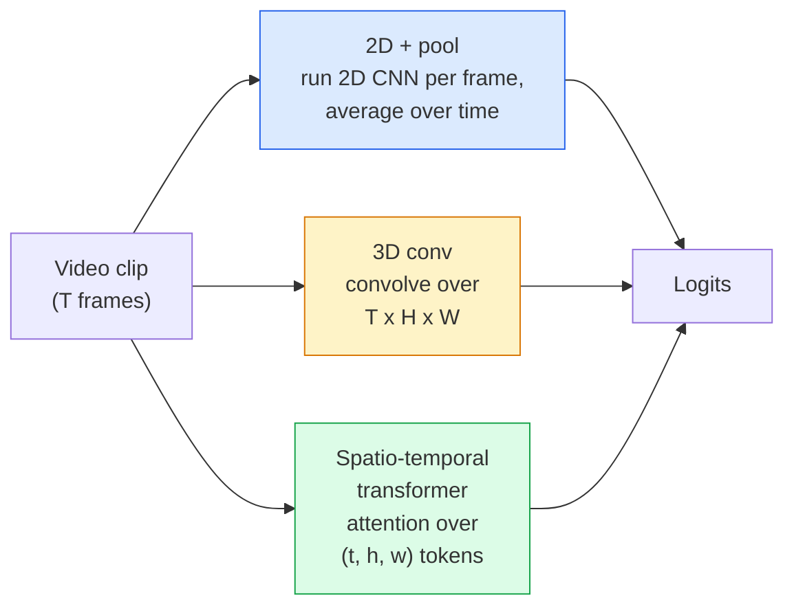

# 영상 이해  시간적 모델링

> 비디오는 이미지를 연결하는 물리학과 함께 하는 일련의 이미지입니다. 모든 비디오 모델은 시간을 추가 축 (3D conv), 대접하기 위한 일련 (변화자) 또는 한 번 추출하기 위한 기능 (2D+pool) 으로 취급합니다.

**Type:** Learn + Build
**Languages:** Python
**Prerequisites:** Phase 4 Lesson 03 (CNNs), Phase 4 Lesson 04 (Image Classification)
**Time:** ~45 minutes

## 학습 목표

- 비디오 모델링의 세 가지 주요 접근 방식을 구별하고 (D+pool, 3D conv, 공간 시간 변환기) 비용과 정확성 교류를 예측합니다.
- PyTorch에서 프레임 샘플링, 시간적 분량 및 2D+pool 기본 분류자를 구현
- 왜 I3D의 "팽창" 3D 커널이 ImageNet 무게에서 잘 전달되는지 설명하고, 어떤 요소 (2+1)D conv가 다르게하는지를 설명합니다.
- 표준 액션 인식 데이터 세트 및 매트릭을 읽어보십시오: Kinetics-400/600, UCF101, Something-Something V2; 클립 및 비디오 수준에서 최고 1 정확성

## 문제

30초의 30fps 비디오는 900개의 이미지에 해당한다. 순진적으로, 비디오 분류는 900번 실행된 이미지 분류이며, 그 다음에는 어떤 종류의 집합이 이루어진다. 이것은 거의 모든 프레임 (스포츠, 요리, 운동 비디오) 에서 액션이 눈에 띄면 작동하고, 움직임 자체가 액션을 정의할 때 나쁜 실패를 합니다. "왼쪽에서 오른쪽으로 밀어주는 것"은 각각의 프레임에 두 개의 정지된 물체처럼 보입니다.

모든 비디오 아키텍처의 핵심 질문은 언제, 어떻게 시간 구조를 모델링하는 것인가입니다? 그 대답은 다른 모든 것을 좌우합니다.

이 수업은 의도적으로 정적 이미지 수업보다 짧습니다. 이미지의 핵심 기계가 이미 자리잡고 있으며 비디오 이해는 대부분 시간적 이야기: 샘플링, 모델링 및 집합에 관한 것입니다.

## 개념

### 세 가지 건축가 가족



### 2D + 수영장

2D CNN (ResNet, EfficientNet, ViT) 를 예로 들어보세요. 샘플링된 모든 프레임에서 독립적으로 실행하세요. 프레임별 임베디션을 평균 (또는 최대 풀, 또는 주의 풀) 한 프레임에 넣습니다. pooled vector를 분류자에게 공급하세요.

장점:
- 이미지넷은 직급 전임대출을 합니다.
- 실행하기 가장 간단합니다.
- 저렴: T 프레임 * 단일 이미지 추론 비용

단점:
- 움직임을 모델링할 수 없습니다. 액션 = 외관의 집합
- 시간적 분모는 순서상 변하지 않습니다. "오픈 문"과 " 닫힌 문"은 동일합니다.

언제 사용해야 하는 것: 외모가 무거운 작업, 작은 비디오 데이터 세트에서 학습을 전송, 초기 기본 라인.

### 3D 회전

2D (H, W) 커널을 3D (T, H, W) 커널로 대체합니다. 네트워크는 공간과 시간에 걸쳐 얽혀 있습니다. 초기 가족: C3D, I3D, SlowFast.

I3D 트릭: 미리 훈련된 2D 이미지넷 모델을 가져가 새로운 시간축을 따라 복사함으로써 2D 커널을 "팽창"하십시오. 3x3 2D 컨브는 3x3x3 3D 컨브가됩니다. 이것은 처음부터 훈련하는 대신 3D 모델에 강력한 사전 훈련 된 무게를 제공합니다.

장점:
- 움직임을 직접적으로 모델링합니다.
- 3D 인플레이션은 무료 전송 학습을 제공합니다.

단점:
- T/8는 2D 대동보다 더 많은 FLOP (시간핵 3개 3배 겹치기) 이다.
- 시간적 핵은 작지만, 장거리 움직임은 피라미드 또는 이중 흐름 접근이 필요합니다.

언제 사용해야 하는지: 움직임이 신호가 되는 동작 인식 (Something-Something V2, Kinetics with motion-heavy classes)

### 공간 시간 변환기

비디오를 시간 공간 패치의 격자로 표시하고 모든 것을 보아라.

관심 패턴이 중요해요
- **Joint** 1개의 큰 주의를 기울여 (t, h, w) 에 대해`T*H*W`비싼 것 같네요
- **Divided** 블록당 두 개의 주의력: 시간, 공간에 대한 하나. 선형적인 확장.
- **Factorised** 시간 주의는 블록들 사이에 공간 주의와 교차합니다.

장점:
- 모든 주요 기준에 대한 SOTA 정확성
- 패치 인플레이션으로 이미지 트랜스포머 (ViT) 로부터 전송
- 소소한 관심으로 장 맥락 비디오를 지원합니다.

단점:
- 컴퓨터에 굶주린
- 주의를 기울여서 패턴을 선택하거나 공을 선택해야 합니다.

언제 사용해야 하는 것: 큰 데이터 세트, 고충성 비디오 이해, 다모달 비디오+ 텍스트 작업.

### 프레임 샘플링

10초속속 30fps의 클립은 300프레임이 되지만, 모든 300프레임은 어떤 모델에도 낭비된다.

- **Uniform sampling** 클립 전체에 T 프레임을 균일하게 선택하세요. 2D+pool의 기본값입니다.
- **Dense sampling** 무작위 직접 T 프레임 창. 움직임이 이웃 프레임이 필요하기 때문에 3D 컨브에서 일반적입니다.
- **Multi-clip** 동일한 비디오에서 여러 T 프레임 창을 샘플링하고, 각각을 분류하고, 테스트 시점에 평균 예측을 한다.

T는 일반적으로 8, 16, 32 또는 64입니다. 더 높은 T = 더 많은 계산에서 더 많은 시간 신호.

### 평가

두 단계:
- **Clip-level accuracy** 모델은 T 프레임 클립을 보고, top-k 보고.
- **Video-level accuracy** 비디오 당 여러 클립에서 평균 클립 레벨 예측; 더 높고 안정적입니다.

항상 둘 다 보고하십시오. 78% 클립 / 82% 비디오 점수를 얻는 모델은 테스트 시간 평균에 크게 의존하고 있습니다. 80% / 81% 점수를 얻는 모델은 클립 당 더 견고합니다.

### 데이터 세트

- **Kinetics-400 / 600 / 700** 일반적 행동 데이터 세트. 400k 클립; YouTube URL (지금 많은 사람들이 죽은)
- **Something-Something V2** 운동 정의 된 동작 ("X를 왼쪽에서 오른쪽으로 이동") 2D+pool로 해결할 수 없습니다.
- **UCF-101****HMDB-51** 나이가 많고, 작고, 여전히 보고되고 있습니다.
- **AVA** 공간과 시간에서의 *유적* 작용; 분류보다 더 어려운

```figure
v4-video-temporal
```

## 건설 해

### 단계 1: 프레임 샘플링

프레임 (또는 비디오 텐서) 목록에서 작동하는 균일하고 밀집한 샘플러

```python
import numpy as np

def sample_uniform(num_frames_total, T):
    if num_frames_total <= T:
        return list(range(num_frames_total)) + [num_frames_total - 1] * (T - num_frames_total)
    step = num_frames_total / T
    return [int(i * step) for i in range(T)]


def sample_dense(num_frames_total, T, rng=None):
    rng = rng or np.random.default_rng()
    if num_frames_total <= T:
        return list(range(num_frames_total)) + [num_frames_total - 1] * (T - num_frames_total)
    start = int(rng.integers(0, num_frames_total - T + 1))
    return list(range(start, start + T))
```

둘 다 돌아왔다`T`비디오 텐서를 잘라내는 데 사용되는 지표입니다.

### 단계 2: 2D+pool의 기본 라인

2D ResNet-18를 모든 프레임에 올려서, 평균 분자장 기능, 분류

```python
import torch
import torch.nn as nn
from torchvision.models import resnet18, ResNet18_Weights

class FramePool(nn.Module):
    def __init__(self, num_classes=400, pretrained=True):
        super().__init__()
        weights = ResNet18_Weights.IMAGENET1K_V1 if pretrained else None
        backbone = resnet18(weights=weights)
        self.features = nn.Sequential(*(list(backbone.children())[:-1]))  # global avg pool kept
        self.head = nn.Linear(512, num_classes)

    def forward(self, x):
        # x: (N, T, 3, H, W)
        N, T = x.shape[:2]
        x = x.view(N * T, *x.shape[2:])
        feats = self.features(x).view(N, T, -1)
        pooled = feats.mean(dim=1)
        return self.head(pooled)

model = FramePool(num_classes=10)
x = torch.randn(2, 8, 3, 224, 224)
print(f"output: {model(x).shape}")
print(f"params: {sum(p.numel() for p in model.parameters()):,}")
```

이 기본 라인은 종종 외관 중이긴 작업에 대한 적절한 3D 모델의 5-10 포인트 이내에 있습니다.

### 단계 3: I3D 스타일의 부풀어 3D 컨

새로운 시간축을 따라 무게를 반복함으로써 하나의 2D 컨브를 3D 컨브로 변환합니다.

```python
def inflate_2d_to_3d(conv2d, time_kernel=3):
    out_c, in_c, kh, kw = conv2d.weight.shape
    weight_3d = conv2d.weight.data.unsqueeze(2)  # (out, in, 1, kh, kw)
    weight_3d = weight_3d.repeat(1, 1, time_kernel, 1, 1) / time_kernel
    conv3d = nn.Conv3d(in_c, out_c, kernel_size=(time_kernel, kh, kw),
                        padding=(time_kernel // 2, conv2d.padding[0], conv2d.padding[1]),
                        stride=(1, conv2d.stride[0], conv2d.stride[1]),
                        bias=False)
    conv3d.weight.data = weight_3d
    return conv3d

conv2d = nn.Conv2d(3, 64, kernel_size=3, padding=1, bias=False)
conv3d = inflate_2d_to_3d(conv2d, time_kernel=3)
print(f"2D weight shape:  {tuple(conv2d.weight.shape)}")
print(f"3D weight shape:  {tuple(conv3d.weight.shape)}")
x = torch.randn(1, 3, 8, 56, 56)
print(f"3D output shape:  {tuple(conv3d(x).shape)}")
```

`time_kernel` 첫 번째 패스에서 배트 표준 통계를 깨지 않도록 중요한 활성화 크기를 대략 일정하게 유지합니다.

### 단계 4: 계수 (2+1)D 컨

3D 컨브를 2D (공간) 및 1D (시간) 컨브로 나눌 수 있습니다. 동일한 수용 필드, 더 적은 매개 변수, 일부 벤치마크에서 더 나은 정확성.

```python
class Conv2Plus1D(nn.Module):
    def __init__(self, in_c, out_c, kernel_size=3):
        super().__init__()
        mid_c = (in_c * out_c * kernel_size * kernel_size * kernel_size) \
                // (in_c * kernel_size * kernel_size + out_c * kernel_size)
        self.spatial = nn.Conv3d(in_c, mid_c, kernel_size=(1, kernel_size, kernel_size),
                                 padding=(0, kernel_size // 2, kernel_size // 2), bias=False)
        self.bn = nn.BatchNorm3d(mid_c)
        self.act = nn.ReLU(inplace=True)
        self.temporal = nn.Conv3d(mid_c, out_c, kernel_size=(kernel_size, 1, 1),
                                  padding=(kernel_size // 2, 0, 0), bias=False)

    def forward(self, x):
        return self.temporal(self.act(self.bn(self.spatial(x))))

c = Conv2Plus1D(3, 64)
x = torch.randn(1, 3, 8, 56, 56)
print(f"(2+1)D output: {tuple(c(x).shape)}")
```

전체 R  2+1)D 네트워크는 ResNet-18와 동일하며 3x3 conv마다 `Conv2Plus1D`- 그래

## 사용 하 고

두 개의 도서관에서 제작 비디오 작업이 다루어집니다.

- `torchvision.models.video` R(2+1)D, MViT, Swin3D, 선실된 운동학 무게와 같은 API 이미지 모델
- `pytorchvideo`(메타)  동물원 모델, 데이터 로더 Kinetics / SSv2 / AVA, 표준 변환.

비전 언어 비디오 모델 (비디오 캡션, 비디오 QA) 에 사용 `transformers`(`VideoMAE``VideoLLaMA``InternVideo`)

## 선박

이 교훈은 다음과 같은 결과를 낳습니다.

- `outputs/prompt-video-architecture-picker.md` 외모와 움직임, 데이터 세트 크기와 계산 예산에 따라 2D+pool / I3D / (2+1)D / 트랜스포머를 선택하는 프롬프트.
- `outputs/skill-frame-sampler-auditor.md` 비디오 파이프 라인의 샘플링을 검사하고 일반적인 버그를 표시하는 기술: 오프-비-이-온 인덱스, 일정한 샘플링`num_frames < T`, 양상을 보존하는 작물의 부족,

## 운동

1. **(Easy)**T=8의 프레임풀 (FLOP) 과 T=8의 I3D 스타일의 3D 레스넷 (ResNet) 을 계산한다. 2D+pool가 3-5배 더 저렴하게 되는 이유를 설명한다.
2. **(Medium)**합성 비디오 데이터 세트를 생성하십시오. 무작위로 움직이는 공은 무작위로 움직이고, 움직임 방향 ("왼쪽에서 오른쪽으로", "우른쪽에서 왼쪽으로", "각각 위로") 로 표시됩니다. 그 위에 프레임풀을 훈련하십시오. 거의 우연의 정확성을 달성한다는 것을 보여주십시오. 외모만으로 움직임 작업에 충분하지 않습니다.
3. **(Hard)**R  2+1D-18를 만들면 ResNet-18의 모든 Conv2d를 `Conv2Plus1D`. 이미지넷이 선보인 ResNet-18에서 첫 번째 컨브의 무게를 부풀어넣어 2. 운동에서 운동 데이터 세트를 연습하고 FramePool를 이길 수 있습니다.

## 주요 용어

| Term | What people say | What it actually means |
|------|----------------|----------------------|
| 2D + pool | "Per-frame classifier" | Run a 2D CNN on every sampled frame, average-pool features across time, classify |
| 3D convolution | "Spatio-temporal kernel" | Kernel that convolves over (T, H, W); can model motion natively |
| Inflation | "Lift 2D weights to 3D" | Initialise 3D conv weights by repeating a 2D conv's weights along the new time axis, then divide by kernel_T to preserve activation scale |
| (2+1)D | "Factorised conv" | Split 3D into 2D spatial + 1D temporal; fewer parameters, extra non-linearity between |
| Divided attention | "Time then space" | Transformer block with two attentions per layer: one over tokens at the same frame, one over tokens at the same position |
| Clip | "T-frame window" | A sampled subsequence of T frames; the unit a video model consumes |
| Clip vs video accuracy | "Two eval settings" | Clip = one sample per video, video = average across multiple sampled clips |
| Kinetics | "The ImageNet of video" | 400-700 action classes, 300k+ YouTube clips, the standard video pretraining corpus |

## 더 많은 읽기

- [I3D: Quo Vadis, Action Recognition (Carreira & Zisserman, 2017)](https://arxiv.org/abs/1705.07750) 인플레이션과 운동학 데이터 세트를 도입
- [R(2+1)D: A Closer Look at Spatiotemporal Convolutions (Tran et al., 2018)](https://arxiv.org/abs/1711.11248) 팩토리화된 컨, 여전히 강한 기본 기준
- [TimeSformer: Is Space-Time Attention All You Need? (Bertasius et al., 2021)](https://arxiv.org/abs/2102.05095) 최초의 강력한 비디오 트랜스포머
- [VideoMAE (Tong et al., 2022)](https://arxiv.org/abs/2203.12602) 마스크된 자동코더 비디오 전 훈련; 현재 지배적인 전 훈련 레시피
