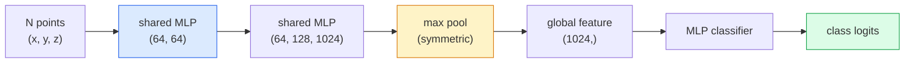

# 3D 비전  포인트 클라우드 & 네RF

> 3D 시각은 두 가지 맛으로 제공됩니다. 포인트 클라우드는 센서의 원료 출력입니다. NeRF는 학습된 부피적 분야입니다. 둘 다 "우주에서 어디에 있는지"에 대답합니다.

**Type:** Learn + Build
**Languages:** Python
**Prerequisites:** Phase 4 Lesson 03 (CNNs), Phase 1 Lesson 12 (Tensor Operations)
**Time:** ~45 minutes

## 학습 목표

- 명시적인 (점 클라우드, 매시, 보셀) 과 암시적인 (지명한 거리 필드, NeRF) 3D 표현을 구분하고 각각의 사용 시
- 포인트넷의 대칭 함수 트릭을 이해하여 신경 네트워크의 변변이 변수가 무질서한 포인트 집합에
- NeRF 앞을 통과하는 것을 추적하십시오: 방사선 투입, 볼륨 렌더링, 위치 코딩, MLP 밀도+색 머리
- 사용`nerfstudio`또는`instant-ngp`포지션된 이미지들의 작은 집합에서 미리 훈련된 3D 재조직을 위한

## 문제

카메라는 2D 이미지를 생성합니다. LIDAR는 순서가 없는 3D 포인트 집합을 생성합니다. 구조-운동 파이프라인은 3D 키포인트의 희귀한 클라우드를 생성합니다. NeRF는 몇 개의 포지션 이미지에서 전체 3D 장면을 재구성합니다. 이 모든 것은 "비전"이지만, 그 중 어느 것도 CNN가 원하는 밀집한 텐서와 같지 않습니다.

3D 시각은 거의 모든 고부가가치 로봇 작업이 3D로 실행되기 때문에 중요합니다. 포착, 장애물을 피하는, 탐색, AR 차단, 3D 콘텐츠 캡처. 2D 이미지를 이해하는 시각 엔지니어는 가장 빠르게 성장하는 현장 (AR / VR 콘텐츠, 로봇, 자율주행 스택, 부동산 또는 건설에 NeRF 기반 3D 재건) 에서 차단됩니다.

두 가지 표현은 서로 다른 이유로 지배합니다. 포인트 클라우드는 센서가 무료로 제공하는 것입니다. NeRF와 그 후속 (3D 가우시안 스플래팅, 신경 SDF) 은 신경 네트워크에서 시나를 배울 것을 요청하면 얻을 수 있습니다.

## 개념

### 점 구름

점 클라우드는 무질서한 집합입니다$N$$\mathbb{R}^3$, 선택적으로 각각의 특징 (색, 강도, 정상)

```
cloud = [
  (x1, y1, z1, r1, g1, b1),
  (x2, y2, z2, r2, g2, b2),
  ...
  (xN, yN, zN, rN, gN, bN),
]
```

네트워크가 없고 연결도 없고 두 가지 특성 때문에 신경망이 힘들어집니다.

- **Permutation invariance** 출력량은 점 순서에 따라 달라질 수 없습니다.
- **Variable N** 하나의 모델은 다양한 크기의 구름들을 처리해야 합니다.

포인트넷 (Qi et al., 2017) 은 두 가지 모두 하나의 아이디어로 해결했습니다. 공유 MLP를 모든 점에 적용하고, 대칭 함수 (최대 풀) 로 합쳐서 결과물은 순서에 의존하지 않는 고정 크기의 벡터입니다.

```math
f(P) = \max_{p \in P} \mathop{\mathrm{MLP}}(p)
```

이 부분은 포인트넷의 핵심입니다. 더 깊은 변종 (PointNet++, 포인트 트랜스포머) 은 계층 샘플링과 로컬 집합을 추가하지만 대칭 함수 트릭은 변하지 않습니다.

### 포인트넷 아키텍처



"공유 MLP"는 동일한 MLP가 모든 점에서 독립적으로 실행되는 것을 의미합니다. 효율성을 위해 포인트 차원에 1x1 conv로 구현됩니다.

### 신경 방사선 현장 (Neural Radiance Fields, NeRF)

NeRFs (Mildenhall et al., 2020) 는 "N 사진에서 3D 장면을 재구성할 수 있을까?"라는 질문을 받아서 그 장면을 나타내는 신경망으로 답했습니다.`(x, y, z, viewing_direction)` `(density, colour)`새로운 시각을 제공하는 것은 이 네트워크에 대한 광선 투명 루프입니다.

```
NeRF MLP:  (x, y, z, theta, phi) -> (sigma, r, g, b)

To render a pixel (u, v) of a new view:
  1. Cast a ray from the camera through pixel (u, v)
  2. Sample points along the ray at distances t_1, t_2, ..., t_N
  3. Query the MLP at each point
  4. Composite the colours weighted by (1 - exp(-sigma * dt))
  5. The sum is the rendered pixel colour
```

손실은 렌더링 사진에서 지형 진실 픽셀과 비교합니다. 렌더링 단계를 통해 백프롭은 MLP를 업데이트합니다. 3D 지형 진실이 없습니다. 명시적인 기하학이 없습니다.

### NeRF에서 위치 코딩

바닐라 MLP`(x, y, z)`높은 주파수 세부 사항을 나타낼 수 없습니다. MLP는 낮은 주파수에 대한 스펙트럼 편향이 있기 때문에. NeRF는 MLP 이전에 각 좌표를 푸리에 특성의 벡터로 암호화하여 이것을 수정합니다.

```math
\gamma(p) = \left(\sin(2^0 \pi p), \cos(2^0 \pi p), \sin(2^1 \pi p), \cos(2^1 \pi p), \ldots\right)
```

최대$L=10$주파수 레벨: 이것은 위치에 사용되는 트랜스포머의 트릭과 같습니다. 그리고 그것은 디푸지언 타임 컨디션에서 다시 나타납니다. (학습 10) 이 없으면 NeRF는 흐릿하게 보입니다.

### 볼륨 측정 렌더링

```math
\begin{aligned}
C(r) &= \sum_i T_i \left(1 - \exp(-\sigma_i \delta_i)\right) c_i \\[4pt]
T_i &= \exp\left(-\sum_{j<i} \sigma_j \delta_j\right) \\
\delta_i &= t_{i+1} - t_i
\end{aligned}
```

`T_i`전달력  얼마나 많은 빛이 지점을 유지하기 위해 생존하는$i$-`(1 - exp(-sigma_i * delta_i))`점의 불투명성입니다$i$-`c_i`마지막 픽셀은 지름상선에서 중량된 합입니다.

### NRF를 대체한 것

순수한 NeRF는 훈련 (시간) 과 렌더링 (진당 초) 을 느리게 한다.

- **Instant-NGP**(2022)  해시 그리드 코딩은 MLP의 위치 입력을 대체합니다.
- **Mip-NeRF 360** 무제한 장면과 반알리징을 처리합니다.
- **3D Gaussian Splatting**(2023) 는 3D 가우시안의 수백만 개의 볼륨 필드를 대체합니다.

2026년 거의 모든 실제 NeRF 제품들은 사실 3D 가우스 스플래팅입니다. 정신 모델은 여전히 NeRF입니다.

### 데이터 세트 및 벤치마크

- **ShapeNet** 3D CAD 모델의 점 클라우드 분류 및 세분화
- **ScanNet** 실제 실내 스캔으로 세그먼트를 확인할 수 있습니다.
- **KITTI** 자율주행을 위한 야외 LIDAR 포인트 클라우드
- **NeRF Synthetic**- **Blended MVS** 시각 합성용 포지션 이미지 데이터 세트
- **Mip-NeRF 360**데이터 세트  무한한 실제 장면

```figure
nerf-rays
```

## 건설 해

### 단계 1: 포인트넷 분류기

```python
import torch
import torch.nn as nn

class PointNet(nn.Module):
    def __init__(self, num_classes=10):
        super().__init__()
        self.mlp1 = nn.Sequential(
            nn.Conv1d(3, 64, 1),    nn.BatchNorm1d(64),   nn.ReLU(inplace=True),
            nn.Conv1d(64, 64, 1),   nn.BatchNorm1d(64),   nn.ReLU(inplace=True),
        )
        self.mlp2 = nn.Sequential(
            nn.Conv1d(64, 128, 1),  nn.BatchNorm1d(128),  nn.ReLU(inplace=True),
            nn.Conv1d(128, 1024, 1), nn.BatchNorm1d(1024), nn.ReLU(inplace=True),
        )
        self.head = nn.Sequential(
            nn.Linear(1024, 512),   nn.BatchNorm1d(512),  nn.ReLU(inplace=True),
            nn.Dropout(0.3),
            nn.Linear(512, 256),    nn.BatchNorm1d(256),  nn.ReLU(inplace=True),
            nn.Dropout(0.3),
            nn.Linear(256, num_classes),
        )

    def forward(self, x):
        # x: (N, 3, num_points) — transposed for Conv1d
        x = self.mlp1(x)
        x = self.mlp2(x)
        x = torch.max(x, dim=-1)[0]       # (N, 1024)
        return self.head(x)

pts = torch.randn(4, 3, 1024)
net = PointNet(num_classes=10)
print(f"output: {net(pts).shape}")
print(f"params: {sum(p.numel() for p in net.parameters()):,}")
```

약 1.6M 매개 변수, 클라우드당 1,024점으로 작동합니다.

### 단계 2: 위치 코딩

```python
def positional_encoding(x, L=10):
    """
    x: (..., D) -> (..., D * 2 * L)
    """
    freqs = 2.0 ** torch.arange(L, dtype=x.dtype, device=x.device)
    args = x.unsqueeze(-1) * freqs * 3.141592653589793
    sinc = torch.cat([args.sin(), args.cos()], dim=-1)
    return sinc.reshape(*x.shape[:-1], -1)

x = torch.randn(5, 3)
y = positional_encoding(x, L=10)
print(f"input:  {x.shape}")
print(f"encoded: {y.shape}     # (5, 60)")
```

곱하기 `2^l * pi`점점 더 높은 주파수를 제공합니다.

### 단계 3: 작은 NeRF MLP

```python
class TinyNeRF(nn.Module):
    def __init__(self, L_pos=10, L_dir=4, hidden=128):
        super().__init__()
        self.L_pos = L_pos
        self.L_dir = L_dir
        pos_dim = 3 * 2 * L_pos
        dir_dim = 3 * 2 * L_dir
        self.trunk = nn.Sequential(
            nn.Linear(pos_dim, hidden), nn.ReLU(inplace=True),
            nn.Linear(hidden, hidden),  nn.ReLU(inplace=True),
            nn.Linear(hidden, hidden),  nn.ReLU(inplace=True),
            nn.Linear(hidden, hidden),  nn.ReLU(inplace=True),
        )
        self.sigma = nn.Linear(hidden, 1)
        self.color = nn.Sequential(
            nn.Linear(hidden + dir_dim, hidden // 2), nn.ReLU(inplace=True),
            nn.Linear(hidden // 2, 3), nn.Sigmoid(),
        )

    def forward(self, x, d):
        x_enc = positional_encoding(x, self.L_pos)
        d_enc = positional_encoding(d, self.L_dir)
        h = self.trunk(x_enc)
        sigma = torch.relu(self.sigma(h)).squeeze(-1)
        rgb = self.color(torch.cat([h, d_enc], dim=-1))
        return sigma, rgb

nerf = TinyNeRF()
x = torch.randn(128, 3)
d = torch.randn(128, 3)
s, c = nerf(x, d)
print(f"sigma: {s.shape}   rgb: {c.shape}")
```

원래의 NeRF (이 2 MLP 줄기 깊이 8 개) 와 비교하면 작습니다. 건축을 보여주기에 충분합니다.

### 4단계: 광선을 따라 볼륨 측정

```python
def volumetric_render(sigma, rgb, t_vals):
    """
    sigma: (..., N_samples)
    rgb:   (..., N_samples, 3)
    t_vals: (N_samples,) distances along the ray
    """
    delta = torch.cat([t_vals[1:] - t_vals[:-1], torch.full_like(t_vals[:1], 1e10)])
    alpha = 1.0 - torch.exp(-sigma * delta)
    trans = torch.cumprod(torch.cat([torch.ones_like(alpha[..., :1]), 1.0 - alpha + 1e-10], dim=-1), dim=-1)[..., :-1]
    weights = alpha * trans
    rendered = (weights.unsqueeze(-1) * rgb).sum(dim=-2)
    depth = (weights * t_vals).sum(dim=-1)
    return rendered, depth, weights


N = 64
t_vals = torch.linspace(2.0, 6.0, N)
sigma = torch.rand(N) * 0.5
rgb = torch.rand(N, 3)
rendered, depth, weights = volumetric_render(sigma, rgb, t_vals)
print(f"rendered colour: {rendered.tolist()}")
print(f"depth:           {depth.item():.2f}")
```

1개의 광선, 64개의 샘플, 하나의 RGB 픽셀과 깊이로 복합된

## 사용 하 고

진짜 일을 위해:

- `nerfstudio`(Tancik et al.)  현재 NeRF / Instant-NGP / Gaussian Splatting의 참조 라이브러리. 명령 줄과 웹 시청자.
- `pytorch3d`(메타)  차별화 가능한 렌더링, 포인트 클라우드 유틸리티, 메시 운영
- `open3d` 포인트 클라우드 처리, 등록, 시각화

배포를 위해 3D 가우스 스플래팅은 순수한 NeRF를 대체했습니다. 그것은 100x 더 빨리 만들어지기 때문입니다. 재건 품질은 비교할 수 있습니다.

## 선박

이 교훈은 다음과 같은 결과를 낳습니다.

- `outputs/prompt-3d-task-router.md` 작업 및 입력 데이터에 기초하여 올바른 3D 표현 (점 클라우드, 매시, 보셀, 네RF, 가우스 스플랫) 로 로팅되는 프롬프트.
- `outputs/skill-point-cloud-loader.md` 파이토르치를 쓰는 능력`Dataset`.ply / .pcd / .xyz 파일의 경우 정상화, 중점화 및 포인트 샘플링이 올바르게 이루어집니다.

## 운동

1. **(Easy)**포인트넷이 변동 변동이 없다는 것을 보여주십시오. 같은 클라우드를 두 번, 한 번 엇갈린 점으로 실행하십시오. 파운드 소까지 출력이 동일하다는 것을 확인하십시오.
2. **(Medium)**카메라의 본질과 자세를 고려하여 H x W 이미지의 각 픽셀에 대해 방사선 기원 및 방향성을 생성하는 최소한의 광선 생성 기능을 구현합니다.
3. **(Hard)**티니네RF를 색상 큐브의 렌더링 뷰 (분별  rendering 또는 간단한 레이 트레이저를 통해 생성) 의 합성 데이터 세트에 훈련하십시오. 1, 10 및 100 시대에서 렌더링 손실을 보고합니다. 모델은 어떤 시대에서 인식 가능한 뷰를 생성합니까?

## 주요 용어

| Term | What people say | What it actually means |
|------|----------------|----------------------|
| Point cloud | "3D points from LIDAR" | Unordered set of (x, y, z) + optional features per point |
| PointNet | "First neural net on point clouds" | Shared MLP per point + symmetric (max) pool; permutation-invariant by construction |
| NeRF | "MLP that is the scene" | Network mapping (x, y, z, dir) to (density, colour); rendered by ray casting |
| Positional encoding | "Fourier features" | Encode each coordinate into sin/cos at multiple frequencies to overcome MLP low-frequency bias |
| Volumetric rendering | "Ray integration" | Composite samples along a ray into a single pixel using transmittance and alpha |
| Instant-NGP | "Hash-grid NeRF" | Replaces NeRF's coordinate MLP with a multi-resolution hash grid; 100-1000x faster |
| 3D Gaussian splatting | "Millions of Gaussians" | Scene = collection of 3D Gaussians; renders in real time, trains in minutes |
| SDF | "Signed distance field" | Function returning signed distance to the nearest surface; another implicit representation |

## 더 많은 읽기

- [PointNet (Qi et al., 2017)](https://arxiv.org/abs/1612.00593) 변변변변변변변변변변변변변변변변변변변변변변변변변변변변변변변변변변변변변변변변변변변변변변변변변변변변변변변변변변변변변변변변변변변변변변변변변변변변변변변변변변변변변변변변변변변변변변변변변변변변변변변변변변변변변변변변변변변변변변변변변변변변변변변변변변변변변변변변변변변변변변변변변변변변변변변변변변변변변변변변변변변변변변변변변변변변변변변변변변변변변변변변변변변변변변변변변변변변변변변변변변변변변변변변변변변변변변변변변변변변변변변변변변변변변변변변변변변변변변변변변변변변변변변변변변변변변변변변변변변변변변변변변변변변변변변변변변변변변변변변변변변변변변변변변변변변변변변변변변변변변변변변변변변변변변변변변변변변변변변변변변변변변변변변변변변변변변변변변변변변변변변변변변변변변변변변변변변변변변변변변변변변변변변변변변변변변변변변변변변변변변변변변변변변변변변변변변변변변변변변변변변변변변변변변변변변변변변변변변변변변변변변변변변변변변변변변변변변변변변변변변변변변변변변변변변변변변변변변변변변변변변변변변변변변변변변변변변변변변변변변변변변변변변변변변변변변변변변변변변변변변변변변변변변
- [NeRF (Mildenhall et al., 2020)](https://arxiv.org/abs/2003.08934) 사진에서 3D 재조사를 신경망 문제로 만든 논문
- [Instant-NGP (Müller et al., 2022)](https://arxiv.org/abs/2201.05989) 해시 그리드, 1000배 가속화
- [3D Gaussian Splatting (Kerbl et al., 2023)](https://arxiv.org/abs/2308.04079) 생산에서 NeRF를 대체한 건축
