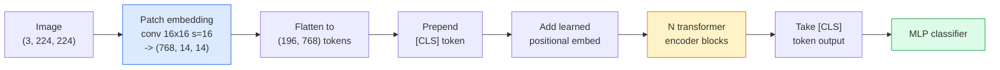

# 시력 변환기 (ViT)

> 이미지를 패치로 갈라놓고, 각각의 패치를 단어로 취급하고, 표준 트랜스포머를 실행해 보세요.

**Type:** Build
**Languages:** Python
**Prerequisites:** Phase 7 Lesson 02 (Self-Attention), Phase 4 Lesson 04 (Image Classification)
**Time:** ~45 minutes

## 학습 목표

- 최소 ViT를 만들기 위해 패치 임베딩, 학습된 위치 임베딩, 클래스 토큰 및 트랜스포머 코더 블록을 처음부터 구현
- 왜 비트 (ViT) 가 대량의 사전 훈련 데이터를 필요로 한다고 생각되었는지 설명해 주십시오.
- 건축적 전작 (아무도, 지역 창문 관심, 컨브 척추) 에 대한 ViT, Swin, 및 ConvNeXt 비교
-  `timm`그리고 표준 선형조사 / 정교조사

## 문제

10 년 동안, convolution는 컴퓨터 비전과 동의어였다. CNN는 강력한 인덕티브 편향을 가지고 있었다. 현지성, 번역 동등성, 아무도 대체할 수 없다고 생각했었습니다. 그리고 Dosovitskiy et al. (2020) 는 평평한 이미지 패치에 적용된 단순한 트랜스포머가 convolutional 기계가 전혀 없는 것으로 나타났으며, 규모에서 가장 좋은 CNN와 일치하거나 이길 수 있음을 보여주었습니다.

이미지넷 1k의 ViT는 레스넷에 패했습니다. ViT는 이미지넷-21k 또는 JFT-300M에서 미리 훈련되어 이미지넷-1k에서 정밀 조정되어 그것을 이길 수 있습니다. 결론은 트랜스포머가 유용한 전작이 부족하지만 충분한 데이터에서 배울 수 있다는 것입니다. 이후 연구 (DeiT, MAE, DINO) 는 적절한 훈련 레시피와 함께  강한 증강, 자율 감독 사전 훈련, 디스틸레이션  작은 데이터에도 훌륭한 훈련을 받는다는 것을 보여주었습니다.

2026년까지 순수한 CNN는 여전히 가장 강력한 엣지 장치 (ConvNeXt) 에 경쟁력을 갖는다. 그러나 트랜스포머는 다른 모든 것을 지배한다. 세그먼트 (Mask2Former, SegFormer), 탐지 (DETR, RT-DETR), 멀티모달 (CLIP, SigLIP), 비디오 (VideoMAE, VJEPA).

## 개념

### 파이프라인



7 단계. 패치 -> 토큰 -> 관심 -> 분류자. 각 변종 (DeiT, Swin, ConvNeXt, MAE 사전 훈련) 은 7 개 중 하나 또는 두 개를 변경하고 나머지는 혼자 남겨두고 있습니다.

### 패치 임베디션

첫 번째 conv는 비밀입니다. 커널 크기는 16, 단계 16, 그래서 224x224 이미지는 16x16 패치의 14x14 그리드입니다. 각각의 패치가 768-dim 임베디션으로 투영됩니다. 그 단일 conv는 패치와 선형적으로 프로젝트합니다.

```
Input:  (3, 224, 224)
Conv (3 -> 768, k=16, s=16, no padding):
Output: (768, 14, 14)
Flatten spatial: (196, 768)
```

196 패치 = 196 토큰. 각 토큰의 특징 차원은 768 (ViT-B), 1024 (ViT-L), 또는 1280 (ViT-H) 이다.

### 클래스 토큰

하나의 학습된 벡터가 순서에 전개되어 있습니다:

```
tokens = [CLS; patch_1; patch_2; ...; patch_196]   shape (197, 768)
```

N 트랜스포머 블록 후, `[CLS]`출력 (output) 은 전체 이미지 표현입니다. 분류 헤드에서는 이 한 벡터를만 읽습니다.

### 위치 임베디션

트랜스포머는 공간적 위치에 대한 내장된 개념이 없습니다.

```
tokens = tokens + learned_pos_embedding   (also shape (197, 768))
```

임베디션은 모델의 매개 변수이며, 그라디언트 기반 훈련은 2D 이미지 구조에 적응한다.

### 트랜스포머 코더 블록

표준, 멀티 헤드 자생, MLP, 잔존 연결, 프리 레이어노르

```
x = x + MSA(LN(x))
x = x + MLP(LN(x))

MLP is two-layer with GELU: Linear(d -> 4d) -> GELU -> Linear(4d -> d)
```

ViT-B/16는 이 블록 중 12개를 축적하고 있으며, 각각 12개의 주의 헤드로 총 86M의 매개 변수를 가지고 있습니다.

### 왜 LN 전

초기 변환기 사용은 LN 이후 (`x = LN(x + sublayer(x))`(LN) 전 (LN)`x = x + sublayer(LN(x))`) 는 더 깊은 네트워크를 안정적으로 따뜻하지 않고 훈련합니다. 모든 ViT 및 모든 현대 LLM는 LN 전기를 사용합니다.

### 패치 크기의 타인

- 16x16 패치 -> 196 토큰, 표준
- 32x32 패치 -> 49 토큰, 더 빠른 하지만 낮은 해상도
- 8x8 패치 -> 784 토큰, 더 세밀한 하지만 $O(n^2)$주의가 큰 비용이 든다.

더 큰 패치 = 더 적은 토큰 = 더 빠른 하지만 공간적 세부 사항이 적은. SwinV2는 계층 창에서 4x4 패치를 사용합니다.

### 디에이트의 레시피는 이미지네트-1k에서 ViT를 훈련시키는 데

원래의 ViT는 CNN를 이길 수 있도록 JFT-300M를 필요로 했다. DeiT (Touvron et al., 2020) 는 4가지 변경으로 ImageNet-1k에서만 ViT-B를 81.8%의 1위까지 훈련시켰다.

1. 중증: RandAugment, Mixup, CutMix, Random Erasing.
2. 스토카스틱 깊이 (훈련 중에 전체 블록을 무작위로 떨어뜨립니다).
3. 반복된 증강 (그림은 배일에 3번 샘플링)
4. CNN 교사로부터 비료 (선택, 정확성을 더 높여줍니다).

모든 현대적인 ViT 훈련 레시피는 DeiT에서 나온다.

### 스윈 vs 컨브네XT

- **Swin**(Liu et al., 2021)  창 기반의 관심. 각 블록은 로컬 창 내에서 참여합니다. 번갈아 있는 블록은 창을 이동하여 창을 통해 정보를 혼합합니다. 주의 운영자를 유지하면서 CNN와 같은 지역을 다시 가져옵니다.
- **ConvNeXt**(Liu et al., 2022)  스윈의 건축 선택과 일치하는 CNN를 재설계했습니다. (深度 convs, LayerNorm, GELU, 역동 병목).

2026년, ConvNeXt-V2와 Swin-V2은 모두 생산급입니다. 올바른 선택은 당신의 추론 스택 (ConvNeXt는 가장자리를 위해 더 잘 컴파일합니다) 및 사전 훈련 코퍼스에 달려 있습니다.

### MAE 사전 훈련

마스크된 자동코더 (He et al., 2022): 무작위로 패치의 75%를 마스크하고, 눈에 보이는 25%를 처리하도록 코더를 훈련시키고, 코더의 출력에서 마스크된 패치를 재구성하기 위해 작은 디코더를 훈련시킵니다. 사전 훈련 후 디코더를 폐기하고, 코더를 정렬하십시오.

MAE는 ViT를 이미지넷-1k에서만 훈련시킬 수 있게 하고 SOTA를 누르고 현재 기본으로 자율적으로 감독되는 레시피입니다.

```figure
batchnorm-inference
```

## 건설 해

### 단계 1: 패치 임베디션

```python
import torch
import torch.nn as nn

class PatchEmbedding(nn.Module):
    def __init__(self, in_channels=3, patch_size=16, dim=192, image_size=64):
        super().__init__()
        assert image_size % patch_size == 0
        self.proj = nn.Conv2d(in_channels, dim, kernel_size=patch_size, stride=patch_size)
        num_patches = (image_size // patch_size) ** 2
        self.num_patches = num_patches

    def forward(self, x):
        x = self.proj(x)
        return x.flatten(2).transpose(1, 2)
```

하나의 conv, 하나의 flat, 하나의 transpose. 그것은 전체 이미지-토큰 단계입니다.

### 단계 2: 트랜스포머 블록

전-LN, 다중 머리 자부심, GELU와 MLP, 잔여 연결.

```python
class Block(nn.Module):
    def __init__(self, dim, num_heads, mlp_ratio=4, dropout=0.0):
        super().__init__()
        self.ln1 = nn.LayerNorm(dim)
        self.attn = nn.MultiheadAttention(dim, num_heads, dropout=dropout, batch_first=True)
        self.ln2 = nn.LayerNorm(dim)
        self.mlp = nn.Sequential(
            nn.Linear(dim, dim * mlp_ratio),
            nn.GELU(),
            nn.Dropout(dropout),
            nn.Linear(dim * mlp_ratio, dim),
            nn.Dropout(dropout),
        )

    def forward(self, x):
        a, _ = self.attn(self.ln1(x), self.ln1(x), self.ln1(x), need_weights=False)
        x = x + a
        x = x + self.mlp(self.ln2(x))
        return x
```

`nn.MultiheadAttention`헤드, 스칼라 도트 제품, 그리고 출력 투영을 처리합니다. `batch_first=True`그래서 모양은`(N, seq, dim)`- 그래

### 3단계: 비트

```python
class ViT(nn.Module):
    def __init__(self, image_size=64, patch_size=16, in_channels=3,
                 num_classes=10, dim=192, depth=6, num_heads=3, mlp_ratio=4):
        super().__init__()
        self.patch = PatchEmbedding(in_channels, patch_size, dim, image_size)
        num_patches = self.patch.num_patches
        self.cls_token = nn.Parameter(torch.zeros(1, 1, dim))
        self.pos_embed = nn.Parameter(torch.zeros(1, num_patches + 1, dim))
        self.blocks = nn.ModuleList([
            Block(dim, num_heads, mlp_ratio) for _ in range(depth)
        ])
        self.ln = nn.LayerNorm(dim)
        self.head = nn.Linear(dim, num_classes)
        nn.init.trunc_normal_(self.pos_embed, std=0.02)
        nn.init.trunc_normal_(self.cls_token, std=0.02)

    def forward(self, x):
        x = self.patch(x)
        cls = self.cls_token.expand(x.size(0), -1, -1)
        x = torch.cat([cls, x], dim=1)
        x = x + self.pos_embed
        for blk in self.blocks:
            x = blk(x)
        x = self.ln(x[:, 0])
        return self.head(x)

vit = ViT(image_size=64, patch_size=16, num_classes=10, dim=192, depth=6, num_heads=3)
x = torch.randn(2, 3, 64, 64)
print(f"output: {vit(x).shape}")
print(f"params: {sum(p.numel() for p in vit.parameters()):,}")
```

약 2.8M 매개 변수  CPU에서 처리 가능한 작은 ViT. 실제 ViT-B는 86M; 같은 클래스 정의와 `dim=768, depth=12, num_heads=12`- 그래

### 단계 4: 정신 건강 검증  단일 이미지 추론

```python
logits = vit(torch.randn(1, 3, 64, 64))
print(f"logits: {logits}")
print(f"probs:  {logits.softmax(-1)}")
```

오류 없이 실행해야 합니다. 확률은 1입니다.

## 사용 하 고

`timm`모든 ViT 버전을 이미지넷의 사전 훈련된 무게로 배포합니다.

```python
import timm

model = timm.create_model("vit_base_patch16_224", pretrained=True, num_classes=10)
```

`timm`2026년 비전 트랜스포머의 생산 기본값은 ViT, DeiT, Swin, Swin-V2, ConvNeXt, ConvNeXt-V2, MaxViT, MViT, EfficientFormer 등 수십개의 다른 것을 같은 API에 지원합니다.

다모달 작업 (사진 + 텍스트) 에 대해`transformers`CLIP, SigLIP, BLIP-2, LLaVA의 배입니다. 이 모든 배의 이미지 코더는 ViT 변종입니다.

## 선박

이 교훈은 다음과 같은 결과를 낳습니다.

- `outputs/prompt-vit-vs-cnn-picker.md` 데이터 세트 크기와 계산, 추론 스택에 따라 ViT, ConvNeXt, 또는 Swin 사이에서 선택할 수 있는 명령어.
- `outputs/skill-vit-patch-and-pos-embed-inspector.md` ViT의 패치 임베디션 및 위치 임베디션 모양이 모델의 예상 순서 길이와 일치하는 것을 확인하는 기술, 가장 일반적인 포팅 버그를 잡습니다.

## 운동

1. **(Easy)**위의 작은 ViT를 통해 앞으로 통과하기 위해 모든 중간 텐서의 모양을 인쇄하십시오. 확인: 입력 `(N, 3, 64, 64)`-> 패치`(N, 16, 192)`-> CLS와 함께`(N, 17, 192)`-> 분류자 입력`(N, 192)`-> 출력`(N, num_classes)`- 그래
2. **(Medium)**선습된 선조`timm`4. 레슨 4 에서 합성-CIFAR 데이터 세트에 대한 ViT-S/16 을 비교하여 동일한 데이터에 대한 ResNet-18 미세 조정에 비교하십시오. 훈련 시간 및 최종 정확성을 보고하십시오.
3. **(Hard)**작은 ViT에 대한 MAE 사전 훈련을 실시: 75%의 패치를 마스크, 마스크된 패치를 재구성하기 위해 코더 + 작은 디코더를 훈련하십시오. 사전 훈련과 후에 합성 데이터에 대한 선형 탐사 정확성을 평가하십시오.

## 주요 용어

| Term | What people say | What it actually means |
|------|----------------|----------------------|
| Patch embedding | "The first conv" | A conv with kernel size = stride = patch size; turns the image into a grid of token embeddings |
| Class token | "[CLS]" | A learned vector prepended to the token sequence; its final output is the global image representation |
| Positional embedding | "Learned pos" | A learned vector added to every token so the transformer knows where each patch came from |
| Pre-LN | "LayerNorm before sublayer" | The stable transformer variant: `x + sublayer(LN(x))` instead of `LN(x + sublayer(x))` |
| Multi-head attention | "Parallel attention" | Standard transformer attention split into num_heads independent subspaces, concatenated afterwards |
| ViT-B/16 | "Base, patch 16" | The canonical size: dim=768, depth=12, heads=12, patch_size=16, image=224; ~86M params |
| DeiT | "Data-efficient ViT" | ViT trained on ImageNet-1k alone with strong augmentation; proved large pretraining datasets are not strictly required |
| MAE | "Masked autoencoder" | Self-supervised pretraining: mask 75% of patches, reconstruct; the dominant ViT pretraining recipe |

## 더 많은 읽기

- [An Image is Worth 16x16 Words (Dosovitskiy et al., 2020)](https://arxiv.org/abs/2010.11929) 비트 문서
- [DeiT: Data-efficient Image Transformers (Touvron et al., 2020)](https://arxiv.org/abs/2012.12877) 이미지넷-1k에서만 ViT를 훈련시키는 방법
- [Masked Autoencoders are Scalable Vision Learners (He et al., 2022)](https://arxiv.org/abs/2111.06377) MAE 사전 훈련
- [timm documentation](https://huggingface.co/docs/timm) 생산에서 사용 할 모든 비전 트랜스포머의 참조
