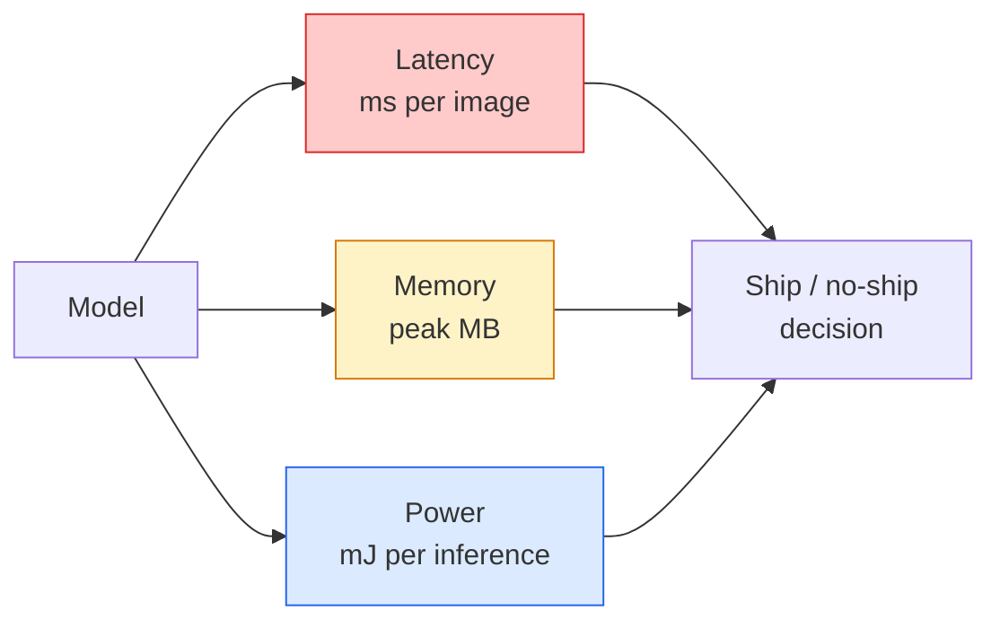

# 실시간 시야  가장자리 배치

> 가장자리 추론은 2 GB의 RAM를 가진 장치에서 90의 정확성 모델을 30fps로 실행하는 학문입니다. 정확성의 모든 점수는 밀리초의 지연으로 거래됩니다.

**Type:** Learn + Build
**Languages:** Python
**Prerequisites:** Phase 4 Lesson 04 (Image Classification), Phase 10 Lesson 11 (Quantization)
**Time:** ~75 minutes

## 학습 목표

- 어떤 PyTorch 모델에 대한 추론 지연, 최고 메모리 및 처리량을 측정하고 FLOPs / params / 지연 거래량을 읽으십시오
- PyTorch의 훈련 후량화로 비전 모델을 INT8로 양자화하고 정확성 손실 < 1%를 확인
- ONNX에 수출하고 ONNX 런타임 또는 TensorRT로 컴파일; 가장 흔한 3개의 수출 오류와 그 해결을 지정하십시오
- 가장자리 제한을 위해 MobileNetV3, EfficientNet-Lite, ConvNeXt-Tiny, 또는 MobileViT를 언제 선택할지 설명하십시오

## 문제

훈련 시간 시각 모델은 부동소수점 괴물입니다. 100M 매개 변수, 전진 패스당 10GFLOP, VRAM 2GB. 이 모든 것은 전화, 자동차의 인포테인먼트 단위, 산업 카메라 또는 드론에 적합하지 않습니다. 시각 시스템을 배포하는 것은 동일한 예측을 100배 더 작은 예산에 적용하는 것을 의미합니다.

세 개의 버튼이 대부분의 작업을 수행합니다. 모델 선택 ( 같은 레시피의 작은 아키텍처), 양분 (FP32 대신INT8) 및 추론 실행 시간 (ONNX 런타임, TensorRT, 코어 ML, TFLite). 그것들을 올바르게 만드는 것은 작업장에서 실행되는 데모와 $ 30 카메라 모듈에서 전송되는 제품 사이의 차이입니다.

이 수업은 먼저 측정 규율을 설정합니다 (당신이 측정할 수 없는 것을 최적화 할 수 없습니다), 그리고 세 개의 버튼을 걸어갑니다. 목표는 모든 가장자리 실행 시간을 배우는 것이 아니라 레버가 무엇인지 알고 각각의 생각대로 확인하는 방법입니다.

## 개념

### 3개 예산



- **Latency**p50, p95, p99: 평균적으로 p50만 있으면 실시간 시스템에서 중요한 꼬리 행동을 숨기게 됩니다.
- **Peak memory**이 기기는 고정 상태 평균이 아니라 최대치를 볼 수 있습니다.
- **Power / energy**배터리 가동 장치에 대한 추론당 1만 유일.

(모델, 지연시간, 메모리, 정확성) 의 테이블은 가장자리 결정이 이루어지는 요소입니다. 각 세포는 목표 장치에서 측정됩니다. 작업 스테이션이 아닙니다.

### 측정 징계

모든 가장자리 프로파일은 세 가지 규칙을 따르어야 합니다.

1. **Warm up**측정하기 전에 5-10 개의 도미미 앞을 통과하는 모델. 냉각 캐시와 JIT 컴파일링은 비대표적 첫 번째 숫자를 생성합니다.
2. **Synchronise**GPU 작업량 `torch.cuda.synchronize()`이 장치 없이는 커널 실행이 아니라 커널 디스패치를 측정합니다.
3. **Fix input sizes**224x224의 지연은 512x512의 지연이 아닙니다.

### 대리위원으로서의 FLOPs

FLOPs (결론에 따른 부동소수점 작업) 은 유연성을 위한 저렴하고 장치에 독립된 프록시이다. 건축 비교에 유용하며 절대적인 벽 시계처럼 오해할 수 있다. 10% 더 많은 FLOPs를 가진 모델은 하드웨어 친화적인 ops (딥 컨브를 잘 컴파일하고, 큰 7x7 컨브를 하지 않기 때문에) 를 사용하기 때문에 실제로 2배 더 빠르다.

규칙: 아키텍처 검색을 위해 FLOP를 사용, 배포 결정에 장치 내 지연을 사용.

### 한 문항에 대한 양

FP32 무게와 활성화를 INT8로 교체하십시오. 모델 크기는 4x, 메모리 대역폭은 4x, 계산은 INT8 커널을 가진 하드웨어에서 2-4x (모든 현대 모바일 SoC, 텐서 코어와 함께 모든 NVIDIA GPU) 를 떨어뜨립니다. 시각 작업에 대한 정확성 손실은 일반적으로 0.1-1 퍼센트 포인트입니다.

종류:

- **Dynamic** 양자중량으로 INT8으로, FP로 계산된 활성화.
- **Static (post-training)** 양자중량 + 기량 활성화 범위 작은 기량 세트에서. 동적보다 훨씬 더 빨리.
- **Quantisation-aware training (QAT)** 훈련 중에 양식을 시뮬레이션하여 모델이 그 주변을 배우고 있습니다. 가장 좋은 정확성, 라벨 된 데이터가 필요합니다.

시력력, 훈련 후의 정적 양분화는 5%의 노력으로 95%의 이익을 제공합니다. PTQ의 정확성 손실이 용납되지 않을 때만 QAT를 사용하십시오.

### 절단 및 비추는

- **Pruning** 비중 (대량 기반) 또는 채널 (구성) 을 제거 합니다. 과다 매개 변수를 가진 모델에서는 잘 작동하지만 이미 콤팩트된 건축물에서는 덜 유용합니다.
- **Distillation** 작은 학생을 훈련시켜 큰 교사의 로지트를 모방한다. 종종 모델을 축소함으로써 잃어버린 정확성 대부분을 회복한다. 생산 가장자리 모델의 표준.

### 추론 실행 시간

- **PyTorch eager** 느린, 배포용이 아닙니다. 개발용만 사용하세요.
- **TorchScript** 유산. `torch.compile`그리고 ONNX 수출.
- **ONNX Runtime**CPU, CUDA, CoreML, TensorRT, OpenVINO 모두 ONNX 공급자를 가지고 있습니다. 여기서 시작하세요.
- **TensorRT** NVIDIA의 컴파일러. NVIDIA GPU (워크스테이션 및 제트슨) 에서 최고의 지연성. ONNX 런타임 또는 독립적인 기능과 통합됩니다.
- **Core ML** 애플의 iOS/macOS 실행 시간. 필요성 `.mlmodel`또는`.mlpackage`- 그래
- **TFLite** 구글의 안드로이드/ARM 실행시간. 필요성 `.tflite`- 그래
- **OpenVINO** 인텔의 CPU/VPU 실행 시간. 필요성 `.xml`+ `.bin`- 그래

실제: PyTorch -> ONNX -> 수출하여 목표의 실행 시간을 선택하십시오. ONNX는 언어입니다.

### 엣지 아키텍처 선택기

| Budget | Model | Why |
|--------|-------|-----|
| < 3M params | MobileNetV3-Small | Compiles everywhere, good baseline |
| 3-10M | EfficientNet-Lite-B0 | Best accuracy per param on TFLite |
| 10-20M | ConvNeXt-Tiny | Best accuracy-per-param, CPU-friendly |
| 20-30M | MobileViT-S or EfficientViT | Transformer with ImageNet accuracy |
| 30-80M | Swin-V2-Tiny | If stack supports window attention |

이 모든 것을 INT8로 양자화하면 안되는 특별한 이유가 없다면요.

```figure
cnn-param-count
```

## 건설 해

### 단계 1: 지연 시간을 올바르게 측정하십시오

```python
import time
import torch

def measure_latency(model, input_shape, device="cpu", warmup=10, iters=50):
    model = model.to(device).eval()
    x = torch.randn(input_shape, device=device)
    with torch.no_grad():
        for _ in range(warmup):
            model(x)
        if device == "cuda":
            torch.cuda.synchronize()
        times = []
        for _ in range(iters):
            if device == "cuda":
                torch.cuda.synchronize()
            t0 = time.perf_counter()
            model(x)
            if device == "cuda":
                torch.cuda.synchronize()
            times.append((time.perf_counter() - t0) * 1000)
    times.sort()
    return {
        "p50_ms": times[len(times) // 2],
        "p95_ms": times[int(len(times) * 0.95)],
        "p99_ms": times[int(len(times) * 0.99)],
        "mean_ms": sum(times) / len(times),
    }
```

따뜻하고 동기화하고 사용하십시오`time.perf_counter()`- 실정지표가 아니라

### 단계 2: 파라미터 및 FLOP 수치가

```python
def parameter_count(model):
    return sum(p.numel() for p in model.parameters())

def flops_estimate(model, input_shape):
    """
    Rough FLOP count for a conv/linear-only model. For production use `fvcore` or `ptflops`.
    """
    total = 0
    def conv_hook(m, inp, out):
        nonlocal total
        c_out, c_in, kh, kw = m.weight.shape
        h, w = out.shape[-2:]
        total += 2 * c_in * c_out * kh * kw * h * w
    def linear_hook(m, inp, out):
        nonlocal total
        total += 2 * m.in_features * m.out_features
    hooks = []
    for m in model.modules():
        if isinstance(m, torch.nn.Conv2d):
            hooks.append(m.register_forward_hook(conv_hook))
        elif isinstance(m, torch.nn.Linear):
            hooks.append(m.register_forward_hook(linear_hook))
    model.eval()
    with torch.no_grad():
        model(torch.randn(input_shape))
    for h in hooks:
        h.remove()
    return total
```

실제 프로젝트 사용`fvcore.nn.FlopCountAnalysis`또는`ptflops`; 각 모듈 타입을 올바르게 처리합니다.

### 단계 3: 훈련 후 정적 양분

```python
def quantise_ptq(model, calibration_loader, backend="x86"):
    import torch.ao.quantization as tq
    model = model.eval().cpu()
    model.qconfig = tq.get_default_qconfig(backend)
    tq.prepare(model, inplace=True)
    with torch.no_grad():
        for x, _ in calibration_loader:
            model(x)
    tq.convert(model, inplace=True)
    return model
```

세 단계: 구성, 준비 (관측자를 삽입), 실제 데이터로 캘리버링, 변환 (융합 + 양자)`Conv -> BN -> ReLU`-> `ConvBnReLU`),`torch.ao.quantization.fuse_modules`손잡이가

### 단계 4: ONNX에 수출

```python
def export_onnx(model, sample_input, path="model.onnx"):
    model = model.eval()
    torch.onnx.export(
        model,
        sample_input,
        path,
        input_names=["input"],
        output_names=["output"],
        dynamic_axes={"input": {0: "batch"}, "output": {0: "batch"}},
        opset_version=17,
    )
    return path
```

`opset_version=17`2026년 안전 결제입니다.`dynamic_axes`임의의 대량으로 ONNX 모델을 실행할 수 있습니다.

### 5단계: 벤치마크 및 비교제도

```python
import torch.nn as nn
from torchvision.models import mobilenet_v3_small

def compare_regimes():
    model = mobilenet_v3_small(weights=None, num_classes=10)
    params = parameter_count(model)
    flops = flops_estimate(model, (1, 3, 224, 224))
    lat_fp32 = measure_latency(model, (1, 3, 224, 224), device="cpu")
    print(f"FP32 MobileNetV3-Small: {params:,} params  {flops/1e9:.2f} GFLOPs  "
          f"p50={lat_fp32['p50_ms']:.2f}ms  p95={lat_fp32['p95_ms']:.2f}ms")
```

같은 함수를 실행합니다`resnet50``efficientnet_v2_s`그리고`convnext_tiny`그리고 배포 결정에 필요한 비교 테이블이 있습니다.

## 사용 하 고

생산 스택은 세 가지 경로 중 하나에서 합쳐집니다.

- **Web / serverless**: PyTorch -> ONNX -> ONNX 런타임 (CPU 또는 CUDA 공급자). 가장 쉬운, 대부분의 사람들에게 충분합니다.
- **NVIDIA edge (Jetson, GPU server)**PyTorch -> ONNX -> TensorRT. 최고의 지연시간, 가장 큰 엔지니어링 노력.
- **Mobile**: PyTorch -> ONNX -> Core ML (iOS) 또는 TFLite (Android)

측정용으로`torch-tb-profiler``nvprof`- `nsys`, 그리고 macOS에서 도구는 층별로 분해를 제공합니다.`benchmark_app`(OpenVINO) 그리고`trtexec`(TensorRT) 독립된 CLI 번호를 입력합니다.

## 선박

이 교훈은 다음과 같은 결과를 낳습니다.

- `outputs/prompt-edge-deployment-planner.md` 척추, 양분화 전략 및 목표 장치 및 지연 SLA를 제공 한 실행 시간을 선택하는 프롬프트.
- `outputs/skill-latency-profiler.md` 온화, 동기화, 분자 및 메모리 추적으로 완전한 지연 기준 스크립트를 작성하는 기술.

## 운동

1. **(Easy)**                                  `resnet18``mobilenet_v3_small``efficientnet_v2_s`그리고`convnext_tiny`CPU에서 224x224에 위치하고 있습니다. 테이블을 보고하고 어떤 아키텍처가 가장 정확한 지수를 가지고 있는지 확인합니다.
2. **(Medium)**훈련 후 정적 양식을 적용합니다`mobilenet_v3_small`. CIFAR-10 또는 유사한 미용의 미용량 및 정확성 손실을 보고합니다.
3. **(Hard)**수출`convnext_tiny`ONNX로 보내주세요`onnxruntime``CPUExecutionProvider`, 그리고 PyTorch 열망의 기본 라인스와 지연을 비교하고, ONNX 실행시간이 더 빠른 첫 번째 층을 식별하고 그 이유를 설명합니다.

## 주요 용어

| Term | What people say | What it actually means |
|------|----------------|----------------------|
| Latency | "How fast" | Time from input to output; p50/p95/p99 percentiles, not mean |
| FLOPs | "Model size" | Floating-point ops per forward pass; rough proxy for compute cost |
| INT8 quantisation | "8-bit" | Replace FP32 weights/activations with 8-bit integers; ~4x smaller, 2-4x faster |
| PTQ | "Post-training quantisation" | Quantise a trained model without retraining; easy, usually enough |
| QAT | "Quantisation-aware training" | Simulate quantisation during training; best accuracy, requires labelled data |
| ONNX | "The neutral format" | Model exchange format supported by every mainstream inference runtime |
| TensorRT | "NVIDIA compiler" | Compiles ONNX into an optimised engine for NVIDIA GPUs |
| Distillation | "Teacher -> student" | Train a small model to mimic a big model's logits; recovers most lost accuracy |

## 더 많은 읽기

- [EfficientNet (Tan & Le, 2019)](https://arxiv.org/abs/1905.11946) 효율적인 건축을 위한 복합 확장
- [MobileNetV3 (Howard et al., 2019)](https://arxiv.org/abs/1905.02244) h-swish 및 squeeze-excite를 가진 모바일-첫 번째 건축물
- [Accelerating Inference Up to 6x Faster in PyTorch with Torch-TensorRT (NVIDIA)](https://developer.nvidia.com/blog/accelerating-inference-up-to-6x-faster-in-pytorch-with-torch-tensorrt/) 실제로 종이에서 처리량 숫자를 얻는 방법
- [ONNX Runtime docs](https://onnxruntime.ai/docs/) 양자, 그래프 최적화, 공급자 선택
