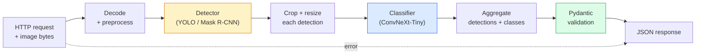

#  캡스톤

> 생산 비전 시스템은 데이터 계약으로 엮인 모델과 규칙의 연쇄입니다. 조각들은 이미 이 단계에 있습니다.

**Type:** Build
**Languages:** Python
**Prerequisites:** Phase 4 Lessons 01-15
**Time:** ~120 minutes

## 학습 목표

- 객체를 감지하고 분류하고 구조화된 JSON 을 처리하는 생산 비전 파이프라인을 설계합니다.
- 단 하나의 서비스로 탐지기를 (마스크 R-CNN 또는 YOLO), 분류기를 (ConvNeXt-Tiny) 및 데이터 계약을 (Pydantic) 연결합니다.
- 끝에서 끝까지의 파이프라인을 벤치마크하고 첫 번째 병목을 식별하십시오 (일반적으로 사전 처리, 그리고 탐지기를)
- 이미지 업로드를 받아들이고 파이프라인을 실행하고 분류로 검출을 반환하는 최소한의 FastAPI 서비스를 전송하십시오

## 문제

개별 시력 모델은 유용하다. 시력 제품은 그 체인이다. 소매 셸프 감사는 디테ክተር + 제품 분류자 + 가격 OCR 파이프라인이다. 자율주행은 2D 디테터 + 3D 디테터 + 세그먼터 + 추적기 + 계획기. 의료 사전 스크린은 세그먼터 + 지역 분류자 + 임상 UI이다.

이 연쇄를 연결하는 것은 ML 프로토타입과 제품을 분리하는 부분입니다. 모델 사이의 모든 인터페이스는 버그의 새로운 장소입니다. 모든 좌표 변환, 모든 정상화, 모든 마스크 크기는 침묵 실패 후보입니다. 파이프 라인은 가장 약한 인터페이스만큼 강합니다.

이 톱스톤은 최소 실행 가능한 파이프라인을 설정합니다. 검출 + 분류 + 구조화된 출력 + 서비스 레이어. 이 골격에 있는 4 단계 슬롯의 다른 모든 것: YOLOv8에 마스크 R-CNN를 교환하십시오. OCR 헤드를 추가하고, 세그메이션 분포를 추가하고, 추적기를 추가하십시오. 건축은 안정적입니다. 조각은 플러그 할 수 있습니다.

## 개념

### 파이프라인



7단계. 두 개의 모델단계는 비싸고 다른 5단계는 곤충들이 사는 곳입니다.

### 피단틱과 데이터 계약

모든 모델 경계선들은 타이핑된 물체로 변하고, 침묵의 실패는 큰 실수로 변합니다.

```
Detection(
    box: tuple[float, float, float, float],   # (x1, y1, x2, y2), absolute pixels
    score: float,                              # [0, 1]
    class_id: int,                             # from detector's label map
    mask: Optional[list[list[int]]],           # RLE-encoded if present
)

PipelineResult(
    image_id: str,
    detections: list[Detection],
    classifications: list[Classification],
    inference_ms: float,
)
```

감지기가 상자를 반환하면`(cx, cy, w, h)`대신`(x1, y1, x2, y2)`, 피단틱의 검증이 경계에 실패하고 당신은 즉시 알 수 있습니다 하류 작물을 디버깅 대신 침묵으로 빈 지역을 반환합니다.

### 지연이 가는 곳

거의 모든 비전 파이프라인에는 세 가지 진실이 있습니다.

1. **Preprocessing is often the biggest single block.**JPEG를 해독하고 색 공간을 변환하고 크기를 변경하는 것은 CPU에 연결되어 있고 잊기 쉽습니다.
2. **The detector dominates GPU time.**GPU의 70~90%는 탐지 전용 패스에 있습니다.
3. **Postprocessing (NMS, RLE encode/decode) is cheap on GPU, expensive on CPU.**항상 실제 목표와 함께 프로필을 작성해

분포를 아는 것이 최적화를 우선 순위 목록으로 만드는 것입니다.

### 실패 모드

- **Empty detections** 빈 목록을 반환, 충돌하지 마십시오. 로그.
- **Out-of-bounds boxes** 절단 전에 이미지 크기에 붙여서
- **Tiny crops** 분류자의 최소 입력보다 작은 상자에 대한 분류를 건너뛰어
- **Corrupt upload** 특정 오류 코드를 가진 400 응답, 500이 아닙니다.
- **Model load failure** 서비스 시작 시 실패, 첫 번째 요청 시 실패

생산 파이프라인은 일반적 인 글을 작성하지 않고 이러한 모든 것을 처리합니다 `try/except`실패를 숨기는 것입니다. 실패마다 이름 붙여진 코드와 반응이 있습니다.

### 배팅

생산 서비스는 여러 클라이언트를 서비스합니다. 요청에 대한 배팅 탐지 및 분류는 처리량을 증배합니다. 거래: 배치를 채우기 위해 기다리는 추가 지연. 전형적인 설정: 최대 20ms에 대한 요청을 수집하고, 배치를 함께 처리하고, 응답을 배포합니다. `torchserve`그리고`triton`이런 일을 원천적으로 하는 경우, 예측 가능한 부하를 가진 작은 서비스들은 자체적으로 마이크로 배치를 만들어내야 합니다.

```figure
v4-vision-pipeline
```

## 건설 해

### 단계 1: 데이터 계약

```python
from pydantic import BaseModel, Field
from typing import List, Optional, Tuple

class Detection(BaseModel):
    box: Tuple[float, float, float, float]
    score: float = Field(ge=0, le=1)
    class_id: int = Field(ge=0)
    mask_rle: Optional[str] = None


class Classification(BaseModel):
    detection_index: int
    class_id: int
    class_name: str
    score: float = Field(ge=0, le=1)


class PipelineResult(BaseModel):
    image_id: str
    detections: List[Detection]
    classifications: List[Classification]
    inference_ms: float
```

5초의 코드는 심각한 파이프라인에서 1시간의 디버깅을 절약합니다.

### 단계 2: 최소 파이프라인 클래스

```python
import time
import numpy as np
import torch
from PIL import Image

class VisionPipeline:
    def __init__(self, detector, classifier, class_names,
                 device="cpu", min_crop=32):
        self.detector = detector.to(device).eval()
        self.classifier = classifier.to(device).eval()
        self.class_names = class_names
        self.device = device
        self.min_crop = min_crop

    def preprocess(self, image):
        """
        image: PIL.Image or np.ndarray (H, W, 3) uint8
        returns: CHW float tensor on device
        """
        if isinstance(image, Image.Image):
            image = np.asarray(image.convert("RGB"))
        tensor = torch.from_numpy(image).permute(2, 0, 1).float() / 255.0
        return tensor.to(self.device)

    @torch.no_grad()
    def detect(self, image_tensor):
        return self.detector([image_tensor])[0]

    @torch.no_grad()
    def classify(self, crops):
        if len(crops) == 0:
            return []
        batch = torch.stack(crops).to(self.device)
        logits = self.classifier(batch)
        probs = logits.softmax(-1)
        scores, cls = probs.max(-1)
        return list(zip(cls.tolist(), scores.tolist()))

    def run(self, image, image_id="anonymous"):
        t0 = time.perf_counter()
        tensor = self.preprocess(image)
        det = self.detect(tensor)

        crops = []
        detections = []
        valid_indices = []
        for i, (box, score, cls) in enumerate(zip(det["boxes"], det["scores"], det["labels"])):
            x1, y1, x2, y2 = [max(0, int(b)) for b in box.tolist()]
            x2 = min(x2, tensor.shape[-1])
            y2 = min(y2, tensor.shape[-2])
            detections.append(Detection(
                box=(x1, y1, x2, y2),
                score=float(score),
                class_id=int(cls),
            ))
            if (x2 - x1) < self.min_crop or (y2 - y1) < self.min_crop:
                continue
            crop = tensor[:, y1:y2, x1:x2]
            crop = torch.nn.functional.interpolate(
                crop.unsqueeze(0),
                size=(224, 224),
                mode="bilinear",
                align_corners=False,
            )[0]
            crops.append(crop)
            valid_indices.append(i)

        class_preds = self.classify(crops)

        classifications = []
        for valid_idx, (cls_id, cls_score) in zip(valid_indices, class_preds):
            classifications.append(Classification(
                detection_index=valid_idx,
                class_id=int(cls_id),
                class_name=self.class_names[cls_id],
                score=float(cls_score),
            ))

        return PipelineResult(
            image_id=image_id,
            detections=detections,
            classifications=classifications,
            inference_ms=(time.perf_counter() - t0) * 1000,
        )
```

모든 인터페이스가 입력되어 있고, 모든 실패 경로는 특정 처리 결정이 있습니다.

### 단계 3: 탐지기와 분류기를 연결

```python
from torchvision.models.detection import maskrcnn_resnet50_fpn_v2
from torchvision.models import convnext_tiny

# Use ImageNet-pretrained weights for a realistic pipeline without training
detector = maskrcnn_resnet50_fpn_v2(weights="DEFAULT")
classifier = convnext_tiny(weights="DEFAULT")
class_names = [f"imagenet_class_{i}" for i in range(1000)]

pipe = VisionPipeline(detector, classifier, class_names)

# Smoke test with a synthetic image
test_image = (np.random.rand(400, 600, 3) * 255).astype(np.uint8)
result = pipe.run(test_image, image_id="demo")
print(result.model_dump_json(indent=2)[:500])
```

### 단계 4: 패스트API 서비스

```python
from fastapi import FastAPI, UploadFile, HTTPException
from io import BytesIO

app = FastAPI()
pipe = None  # initialised on startup

@app.on_event("startup")
def load():
    global pipe
    detector = maskrcnn_resnet50_fpn_v2(weights="DEFAULT").eval()
    classifier = convnext_tiny(weights="DEFAULT").eval()
    pipe = VisionPipeline(detector, classifier, class_names=[f"c{i}" for i in range(1000)])

@app.post("/detect")
async def detect_endpoint(file: UploadFile):
    if file.content_type not in {"image/jpeg", "image/png", "image/webp"}:
        raise HTTPException(status_code=400, detail="unsupported image type")
    data = await file.read()
    try:
        img = Image.open(BytesIO(data)).convert("RGB")
    except Exception:
        raise HTTPException(status_code=400, detail="cannot decode image")
    result = pipe.run(img, image_id=file.filename or "upload")
    return result.model_dump()
```

                `uvicorn main:app --host 0.0.0.0 --port 8000`- 테스트`curl -F 'file=@dog.jpg' http://localhost:8000/detect`- 그래

### 단계 5: 파이프 라인을 벤치마크

```python
import time

def benchmark(pipe, num_runs=20, image_size=(400, 600)):
    img = (np.random.rand(*image_size, 3) * 255).astype(np.uint8)
    pipe.run(img)  # warm up

    stages = {"preprocess": [], "detect": [], "classify": [], "total": []}
    for _ in range(num_runs):
        t0 = time.perf_counter()
        tensor = pipe.preprocess(img)
        t1 = time.perf_counter()
        det = pipe.detect(tensor)
        t2 = time.perf_counter()
        crops = []
        for box in det["boxes"]:
            x1, y1, x2, y2 = [max(0, int(b)) for b in box.tolist()]
            x2 = min(x2, tensor.shape[-1])
            y2 = min(y2, tensor.shape[-2])
            if (x2 - x1) >= pipe.min_crop and (y2 - y1) >= pipe.min_crop:
                crop = tensor[:, y1:y2, x1:x2]
                crop = torch.nn.functional.interpolate(
                    crop.unsqueeze(0), size=(224, 224), mode="bilinear", align_corners=False
                )[0]
                crops.append(crop)
        pipe.classify(crops)
        t3 = time.perf_counter()
        stages["preprocess"].append((t1 - t0) * 1000)
        stages["detect"].append((t2 - t1) * 1000)
        stages["classify"].append((t3 - t2) * 1000)
        stages["total"].append((t3 - t0) * 1000)

    for stage, times in stages.items():
        times.sort()
        print(f"{stage:12s}  p50={times[len(times)//2]:7.1f} ms  p95={times[int(len(times)*0.95)]:7.1f} ms")
```

CPU에서 일반적인 출력: 사전 처리 ~ 3 ms, 300-500 ms, 분류 20-40 ms, 총 350-550 ms. GPU에서 탐지 20-40 ms, 사전 처리 + 분류는 상대적으로 더 중요하게됩니다.

## 사용 하 고

생산 템플릿은 같은 구조로 합쳐집니다.

- **Model versioning** 응답에서 항상 모델 이름과 무게 해시를 기록하십시오.
- **Per-request trace IDs** 각 요청에 대한 각 단계의 시간을 기록하여 느린 응답과 단계들을 상관관계를 할 수 있습니다.
- **Fallback path** 분류자가 종료되면, 전체 요청을 실패하는 대신 분류 없이 검출을 반환합니다.
- **Safety filters** NSFW/PII 필터는 분류 후, 응답이 서비스를 떠나기 전에 실행됩니다.
- **Batch endpoint** a `/detect_batch`대량 처리용 이미지 URL 목록을 받아들이는 것

생산 서비스용으로`torchserve``Triton Inference Server`그리고`BentoML`배팅, 버전, 측정, 건강 검사를 처리합니다. 실행 `FastAPI`직접적으로 프로토타입과 소규모 제품에는 적합합니다.

## 선박

이 교훈은 다음과 같은 결과를 낳습니다.

- `outputs/prompt-vision-service-shape-reviewer.md` 계약/응답 형식의 위반에 대한 비전 서비스의 코드를 검토하고 첫 번째 깰 버그 이름을 지정하는 명령어.
- `outputs/skill-pipeline-budget-planner.md` 목표 지연과 처리량을 고려하여 파이프라인 각 단계에 시간 예산을 부여하고 어떤 단계가 우선 예산을 놓칠지 표시하는 기술입니다.

## 운동

1. **(Easy)**공개된 데이터 세트에서 10개의 이미지를 통해 파이프라인을 실행하고, 각 단계에 평균 시간 및 각 이미지에 대한 탐지 계산 분포를 보고하십시오.
2. **(Medium)**에 마스크 출력 필드를 추가`Detection`JSON는 10개의 객체 이미지에 대해서도 1MB 이하로 유지됩니다.
3. **(Hard)**분류기 앞에 마이크로 배치를 추가: 최대 10 ms의 작물을 수집하고, 모든 GPU 호출에 분류하고, 요청에 따라 결과를 반환합니다. 초당 5 개의 동시 요청으로 처리량 증가와 추가된 지연을 측정합니다.

## 주요 용어

| Term | What people say | What it actually means |
|------|----------------|----------------------|
| Pipeline | "The system" | An ordered chain of preprocessing, inference, and postprocessing steps with a typed interface between each pair |
| Data contract | "The schema" | Pydantic / dataclass definitions that every stage input and output conforms to; catches integration bugs at the boundary |
| Preprocessing | "Before the model" | Decoding, colour conversion, resizing, normalising; usually the biggest CPU time sink |
| Postprocessing | "After the model" | NMS, mask resize, threshold, RLE encode; cheap on GPU, expensive on CPU |
| Microbatcher | "Collect then forward" | Aggregator that waits a fixed window for multiple requests, runs a single batched forward pass |
| Trace ID | "Request id" | Per-request identifier logged at every stage so slow requests can be traced end-to-end |
| Failure code | "Named error" | Specific error code per failure class instead of generic 500; enables client retry logic |
| Health check | "Readiness probe" | Cheap endpoint that reports whether the service can answer; loadbalancers rely on this |

## 더 많은 읽기

- [Full Stack Deep Learning — Deploying Models](https://fullstackdeeplearning.com/course/2022/lecture-5-deployment/) 생산 ML 배포에 대한 가공적 개요
- [BentoML docs](https://docs.bentoml.com) 배팅, 버전 및 측정값을 가진 서비스 프레임워크
- [torchserve docs](https://pytorch.org/serve/) 파이토르치의 공식 서비스 도서관
- [NVIDIA Triton Inference Server](https://developer.nvidia.com/triton-inference-server) 배팅 및 다형 지원으로 높은 출력 서비스
