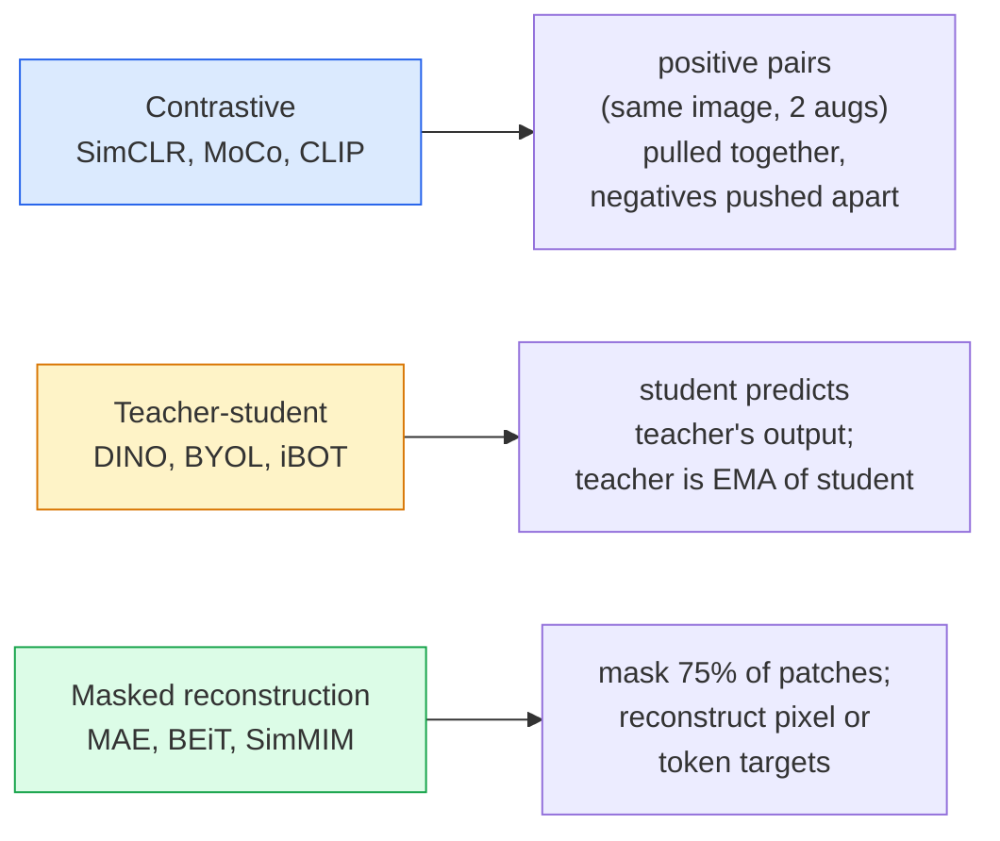

# 자기 감독 시야  SimCLR, DINO, MAE

> 레이블은 감독된 시각의 병목입니다. 자율 감독 된 사전 훈련은 그것들을 제거합니다. 100M의 레이블되지 않은 이미지에서 시각적 특징을 배우고 10k 레이블된 이미지들에 세밀한 조정을 합니다.

**Type:** Learn + Build
**Languages:** Python
**Prerequisites:** Phase 4 Lesson 04 (Image Classification), Phase 4 Lesson 14 (ViT)
**Time:** ~75 minutes

## 학습 목표

- 3개의 주요 자기 감독 가족들을 추적하고, 각각이 최적화하는 것을 설명합니다.
- InfoNCE 손실을 처음부터 실행하고 512 배트가 작동하지만 32 배트가 실패하는 이유를 설명합니다
- 왜 MAE의 75% 마스크 비율이 임의의가 아닌지 설명하고 어떻게 텍스트에 대한 BERT의 15%와 다르는지 설명합니다
- 선형 탐사 및 제로샷 검색을 위해 DINOv2 또는 MAE 이미지넷 체크포인트를 사용하십시오.

## 문제

감독된 이미지네트에는 약 1천3백만 개의 라벨된 이미지가 있으며, 이를 해설하는 데 약 1000만 달러가 소요된다. 의료 및 산업 데이터 세트는 작고 라벨링이 더 비싸다. 모든 비전 팀들은 질문합니다. 우리는 유튜브 프레임, 웹 크롤, 웹캠 영상, 위성 스래프 에 저렴한 라벨링되지 않은 데이터를 미리 훈련시킬 수 있습니까?

자율 감독 학습은 답이다. LAION 또는 JFT에 훈련된 현대 자율 감독 ViT는 정밀 조정 시 감독된 이미지넷 정확성을 달성하거나 이겨내기도 한다. 또한 감독 된 사전 훈련보다 하류 작업 (탐지, 세그먼트, 깊이) 에 더 잘 전송된다. DINOv2 (Meta, 2023) 및 MAE (Meta, 2022) 은 전송 가능한 시각 기능의 현재 생산 기본이다.

개념의 변화는 변명 과제  모델이 훈련받은 일이  하류 과제일 필요는 없다는 것입니다. 중요한 것은 모델이 유용한 특징을 배울 수 있도록 강요한다는 것입니다. 회색 화면의 색을 예측하고, 회전 이미지를 돌리고, 모델에게 회전을 분류하도록 요청하고, 패치를 마스크하고 재구성합니다. 그 규모의 세 가지 접근법은 반대의 학습, 교사-학생 증류, 그리고 마스크 재건입니다.

## 개념

### 3개의 가족



### 반조 학습 (SimCLR)

한 이미지, 두 개의 무작위 증강을 적용하고 두 개의 조회수를 얻습니다. 두 개를 동일한 코더와 프로젝션 헤드를 통해 공급합니다. "이 두 임베디션은 가까운 것"과 "이 임베디션은 패치의 다른 모든 이미지 임베디션에서 멀리 떨어져 있어야 합니다".

```
Loss for positive pair (z_i, z_j) among 2N views per batch:

   L_ij = -log( exp(sim(z_i, z_j) / tau) / sum_k in batch \ {i} exp(sim(z_i, z_k) / tau) )

sim = cosine similarity
tau = temperature (0.1 standard)
```

이것은 InfoNCE 손실입니다. 이 경우 양성당 많은 음수가 필요하므로 배트 크기가 중요합니다. SimCLR는 512-8192을 필요로합니다. MoCo는 배트 크기와 음수를 분리하기 위해 과거의 배트의 모멘텀 줄을 도입했습니다.

### 교수 학생 (DINO)

같은 구조를 가진 두 네트워크: 학생과 교사. 교사 는 학생의 무게의 기하급수 이동 평균 (EMA) 이다. 둘 다 이미지의 증강된 견해를 본다. 학생의 출력은 선생의  명시적 부정적 인 것과 일치하도록 훈련된다.

```
loss = CE( student_output(view_1),  teacher_output(view_2) )
     + CE( student_output(view_2),  teacher_output(view_1) )

teacher_weights = m * teacher_weights + (1 - m) * student_weights   (m ≈ 0.996)
```

왜 "수준을 예측하기 위해" 붕괴되지 않는지: 교사의 출력은 중심을 (차원 평균을 빼) 하고 날카롭게 (저온으로 나눌 수 있습니다). 중심을 하는 것은 한 차원의 지배를 막는 것이고, 날카롭게 하는 것은 출력 붕괴를 막는 것입니다.

DINOv2는 142M의 큐레이션된 이미지에 확장된 DINOv2입니다. 결과물은 현재 SOTA입니다.

### 마스크 된 재건 (MAE)

ViT 입력의 패치의 75%를 마스크하십시오. 보이지는 25%를만 코더로 전달하십시오. 작은 디코더는 마스크된 위치에서 코더의 출력과 마스크 토큰을 수신하고 마스크된 패치의 픽셀을 재구성하도록 훈련됩니다.

```
Encoder:  visible 25% of patches -> features
Decoder:  features + mask tokens at masked positions -> reconstructed pixels
Loss:     MSE between reconstructed and original pixels on masked patches only
```

MAE를 작동시키는 주요 디자인 선택 사항:

- **75% mask ratio** 높습니다. 코더가 의미적 특징을 배울 수 있도록 강요합니다. 25%를 재구성하는 것은 거의 비약적입니다 (네이저 픽셀은 CNN가 그것을 못잡을 수 있을 정도로 상관관계가 있습니다).
- **Asymmetric encoder/decoder** 큰 ViT 코더는 눈에 보이는 패치만 볼 수 있고 작은 디코더 (8층, 512층) 는 재구성 작업을 처리합니다. 선습 BEiT보다 3배 더 빠른 것입니다.
- **Pixel-space reconstruction target** BEiT의 표기된 목표보다 간단하고 ViT에서 더 잘 작동합니다.

사전 훈련 후 디코더를 버려요.

### 왜 75%가 아니라 15%가 되는 걸까요?

BERT는 15%의 토큰을 마스크하고 MAE는 75%를 마스크합니다.

- 자연어에는 토큰당 높은 엔트로피가 있습니다. 토큰의 15%를 예측하는 것은 여전히 어렵기 때문에 마스크 된 위치마다 많은 타당성 완성이 있습니다.
- 이미지 패치는 엔트로피가 낮다.  마스크가 벗겨진 이웃은 마스크 패치의 픽셀을 거의 정확하게 결정합니다. 예측을 하기 위해서는 의미학적 이해가 필요합니다.

75%는 단순한 공간 추출이 문제를 해결할 수 없을 만큼 높습니다. 코더는 이미지 내용을 나타낼 수 있습니다.

### 선형 탐사 평가

자율 감독 된 사전 훈련 후 표준 평가 는**linear probe**: 코더를 얼어붙이고, 이메이크넷 레이블 위에 단일 선형 분류기를 훈련시켜서,

- SimCLR ResNet-50: ~71% (2020)
- DINO ViT-S/16: ~77% (2021)
- MAE ViT-L/16: ~76% (2022)
- DINOv2 ViT-g/14: ~86% (2023)

선형 탐사는 특징 품질의 순수한 측정입니다. 미세조정은 일반적으로 2-5 점을 추가하지만 머리의 재교육 효과에도 혼합됩니다.

```figure
data-augmentation
```

## 건설 해

### 단계 1: 두 개의 시선 증강 파이프라인

```python
import torch
import torchvision.transforms as T

two_view_train = lambda: T.Compose([
    T.RandomResizedCrop(96, scale=(0.2, 1.0)),
    T.RandomHorizontalFlip(),
    T.ColorJitter(0.4, 0.4, 0.4, 0.1),
    T.RandomGrayscale(p=0.2),
    T.ToTensor(),
])


class TwoViewDataset(torch.utils.data.Dataset):
    def __init__(self, base):
        self.base = base
        self.aug = two_view_train()

    def __len__(self):
        return len(self.base)

    def __getitem__(self, i):
        img, _ = self.base[i]
        v1 = self.aug(img)
        v2 = self.aug(img)
        return v1, v2
```

각각__getitem__같은 이미지의 두 개의 증강된 조사를 반환합니다. 레이블은 필요하지 않습니다.

### 단계 2: InfoNCE 손실

```python
import torch.nn.functional as F

def info_nce(z1, z2, tau=0.1):
    """
    z1, z2: (N, D) L2-normalised embeddings of paired views
    """
    N, D = z1.shape
    z = torch.cat([z1, z2], dim=0)  # (2N, D)
    sim = z @ z.T / tau              # (2N, 2N)

    mask = torch.eye(2 * N, dtype=torch.bool, device=z.device)
    sim = sim.masked_fill(mask, float("-inf"))

    targets = torch.cat([torch.arange(N, 2 * N), torch.arange(0, N)]).to(z.device)
    return F.cross_entropy(sim, targets)
```

L2 호출 전에 임베디션을 정상화하십시오. `tau=0.1`SimCLR의 기본값이 낮아지면 손실이 더 날카로워지고 더 많은 부정적인 결과가 필요합니다.

### 단계 3: 정신 건강 검진 InfoNCE

```python
z1 = F.normalize(torch.randn(16, 32), dim=-1)
z2 = z1.clone()
loss_same = info_nce(z1, z2, tau=0.1).item()
z2_random = F.normalize(torch.randn(16, 32), dim=-1)
loss_random = info_nce(z1, z2_random, tau=0.1).item()
print(f"InfoNCE with identical pairs:  {loss_same:.3f}")
print(f"InfoNCE with random pairs:     {loss_random:.3f}")
```

동일 쌍은 낮은 손실을 줄여야 합니다 (큰 배트 및 차가운 온도에 있어서 0에 가깝습니다).$\log(2N-1) \approx \log(31) \approx 3.4$16쌍의 배치를 가지고 있습니다.

### 단계 4: MAE 스타일의 마스크

```python
def random_mask_indices(num_patches, mask_ratio=0.75, seed=0):
    g = torch.Generator().manual_seed(seed)
    n_keep = int(num_patches * (1 - mask_ratio))
    perm = torch.randperm(num_patches, generator=g)
    visible = perm[:n_keep]
    masked = perm[n_keep:]
    return visible.sort().values, masked.sort().values


num_patches = 196
visible, masked = random_mask_indices(num_patches, mask_ratio=0.75)
print(f"visible: {len(visible)} / {num_patches}")
print(f"masked:  {len(masked)} / {num_patches}")
```

간단한, 빠르고 특정 씨앗에 대한 결정적인. 실제 MAE 구현은 이것을 배팅하고 샘플별 마스크를 유지합니다.

## 사용 하 고

DINOv2는 2026년 생산 표준입니다.

```python
import torch
from transformers import AutoImageProcessor, AutoModel

processor = AutoImageProcessor.from_pretrained("facebook/dinov2-base")
model = AutoModel.from_pretrained("facebook/dinov2-base")
model.eval()

# Per-image embeddings for zero-shot retrieval
with torch.no_grad():
    inputs = processor(images=[pil_image], return_tensors="pt")
    outputs = model(**inputs)
    embedding = outputs.last_hidden_state[:, 0]  # CLS token
```

768-dim 임베디션은 현대 이미지 검색, 밀집한 대응 및 제로샷 전송 파이프라인의 척추입니다. 하류 작업에 대한 정밀한 조정에는 선형 헤드 이상의 필요가 없습니다.

이미지 텍스트 임베디션에 대해서는 SigLIP 또는 OpenCLIP가 동등하다. MAE 스타일의 미세조정을 위해서는 `timm`매 매 매 매 매 매 매 매 매 매 매 매 매 매 매 매 매 매 매 매 매 매 매 매 매 매 매 매 매 매 매 매 매 매 매 매 매 매 매 매 매 매 매 매 매 매 매 매 매 매 매 매 매 매 매 매 매 매 매 매 매 매 매 매 매 매 매 매 매 매 매 매 매 매 매 매 매 매 매 매 매 매 매 매 매 매 매 매 매 매 매 매 매 매 매 매 매 매 매 매 매 매 매 매 매 매 매 매 매 매 매 매 매 매 매 매 매 매 매 매 매 매 매 매 매 매 매 매 매 매 매 매 매 매 매 매 매 매 매 매 매 매 매 매 매 매 매 매 매 매 매 매 매 매 매 매 매 매 매 매 매 매 매 매 매 매 매 매 매 매 매 매 매 매 매 매 매 매 매 매 매 매 매 매 매 매 매 매 매 매 매 매 매 매 매 매 매 매 매 매 매 매 매 매 매 매 매 매 매 매 매 매 매 매 매 매 매 매 매 매 매 매 매 매 매 매 매 매 매 매 매 매 매 매 매 매 매 매 매 매 매 매 매 매 매 매 매 매 매 매 매 매 매 매 매 매 매 매 매 매 매 매 매 매 매 매 매 매 매 매 매 매 매 매 매 매 매 매 매 매 매 매 매 매 매 매 매 매 매 매 매 매 매 매 매 매 매 매 매 매 매 매 매 매 매 매 매 매 매 매 매 매 매 매 매 매 매 매 매 매 매 매 매 매 매 매 매 매 매 매 매 매 매 매 매 매 매 매 매 매 매 매 매 매 매 매 매 매 매 매 매 매 매 매 매 매 매 매 매 매 매 매 매 매 매 매 매 매 매 매 매 매 매 매 매 매 매 매 매 매 매 매 매 매 매 매 매 매 매 매 매 매 매 매 매 매 매 매 매 매 매 매 매 매 매 매 매 매 매 매 매 매 매 매 매 매 매 매 매 매 매 매 매 매 매 매 매 매 매 매 매 매 매 매 매 매 매 매 매 매 매 매 매 매 매 매 매 매 매 매 매 매 매 매 매 매 매 매 매 매 매 매 매 매 매 매 매 매 매 매 매 매 매 매 매 매 매 매 매 매 매 매 매 매 매 매 매 매 매 매 매 매 매 매 매 매 매 매 매 매 매 매 매 매 매 매 매 매 매 매

## 선박

이 교훈은 다음과 같은 결과를 낳습니다.

- `outputs/prompt-ssl-pretraining-picker.md` 데이터 세트 크기와 계산 및 하류 작업에 따라 SimCLR / MAE / DINOv2를 선택하는 프롬프트.
- `outputs/skill-linear-probe-runner.md` 어떤 얼어붙은 코더 + 라벨화된 데이터 세트에 대한 선형 탐사 평가서를 작성하는 기술.

## 운동

1. **(Easy)**잘 정렬된 임베디션의 온도를 낮추면 InfoNCE 손실이 감소하고 무작위 임베디션의 온도를 낮추면 상승하는지 확인합니다.`tau in [0.05, 0.1, 0.2, 0.5]`손실과 비교
2. **(Medium)**DINO형 센터 버퍼를 구현하여 센터링이 없으면 몇 시대 안에 학생이 일정 벡터로 붕괴되는 것을 보여주십시오.
3. **(Hard)**10번 강의에서 TinyUNet를 이용하여 CIFAR-100에 MAE를 훈련시켜라. 10, 50 및 200시대에서 선형 탐사 정확도를 보고하라. MAE를 훈련시켜서 선형 탐사선이 같은 1,000 이미지 하위 집합에서 처음부터 감독되는 선형 탐사선을 이길 수 있음을 보여주라.

## 주요 용어

| Term | What people say | What it actually means |
|------|----------------|----------------------|
| Self-supervised | "Label-free" | A pretext task that produces useful representations from unlabelled data |
| Pretext task | "The fake task" | The objective used during SSL (reconstruct patches, match views); discarded after pretraining |
| Linear probe | "Frozen encoder + linear head" | Standard SSL evaluation: train only a linear classifier on top of frozen features |
| InfoNCE | "Contrastive loss" | softmax over cosine similarities; positive pair is the target class, all others are negatives |
| EMA teacher | "Moving-average teacher" | Teacher whose weights are an exponential moving average of the student's; used by BYOL, MoCo, DINO |
| Mask ratio | "% of patches hidden" | Fraction of patches masked during MAE; 75% for vision, 15% for text |
| Representation collapse | "Constant output" | SSL failure where the encoder outputs a constant vector for all inputs; prevented by centring, sharpening, or negatives |
| DINOv2 | "Production SSL backbone" | Meta's 2023 self-supervised ViT; strongest general-purpose image features in 2026 |

## 더 많은 읽기

- [SimCLR (Chen et al., 2020)](https://arxiv.org/abs/2002.05709) 반대의 학습 참조
- [DINO (Caron et al., 2021)](https://arxiv.org/abs/2104.14294) 강동, 중심, 날카로운 교사와 학생
- [MAE (He et al., 2022)](https://arxiv.org/abs/2111.06377) 마스크된 자동코더 ViT를 위한 사전 훈련
- [DINOv2 (Oquab et al., 2023)](https://arxiv.org/abs/2304.07193) 자율 감독을 하는 ViT를 생산 기능으로 확장
