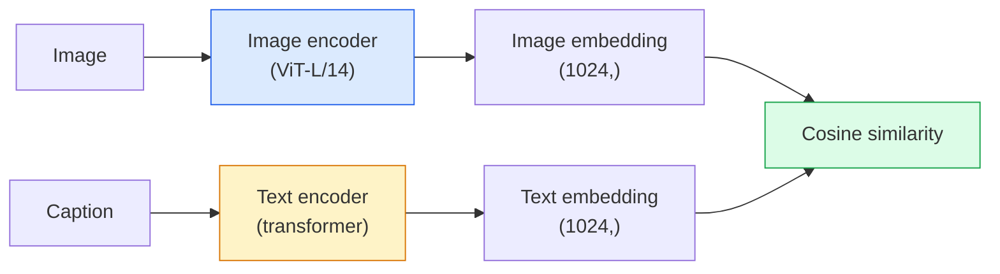

# 개방형 어휘 비전  CLIP

> 이미지 코더와 텍스트 코더를 함께 훈련시켜서, 일치하는 부쌍 (사진, 캡션) 이 공유 공간에서 같은 곳에 도착할 수 있습니다.

**Type:** Build + Use
**Languages:** Python
**Prerequisites:** Phase 4 Lesson 14 (ViT), Phase 4 Lesson 17 (Self-Supervised)
**Time:** ~45 minutes

## 학습 목표

- CLIP의 두 탑 구조와 대조적인 교육 목표를 설명해 주십시오.
- 작업에 대한 특별한 훈련 없이 0샷 분류에 미리 훈련된 CLIP (또는 SigLIP) 를 사용한다
- 0 샷 분류를 처음부터 구현: 코드 클래스 명령어, 코시노 유사성을 계산, argmax를 취
- CLIP, SigLIP, OpenCLIP, 그리고 LLaVA/LLaMA 비전 모델을 구분합니다. 2026년에 각각이 어떤 것이 될 것인가

## 문제

전통적인 분류기는 폐쇄적 어휘입니다. 1000 클래스 이미지넷 모델은 1000 개의 레이블을 예측할 수 있습니다. 모든 새로운 카테고리는 레이블 된 데이터와 재 훈련 된 머리가 필요합니다.

CLIP (Radford et al., OpenAI 2021) 는 웹에서 스크래프된 400M (사진, 캡션) 쌍에 대한 훈련이 단순히 자연어로 설명된 추론에 따라 어떤 범주에도 분류할 수 있는 모델을 생성한다는 것을 보여주었습니다. 문장을 작성함으로써 새로운 클래스를 제공합니다.

이 기능  제로 샷 전송  모든 현대 시각 시스템은 CLIP-가족 체크포인트로 시작되는 이유입니다. 탐지 (Grounding DINO, OWL-ViT), 세그먼트 (CLIPSeg, SAM), 검색, 콘텐츠 중화, VLM 및 텍스트-이미지 생성 모두 CLIP 스타일의 공동 임베디드에 기반합니다.

## 개념

### 두 개의 탑



두 코더 모두 동일한 임베디션 차원에 (512 CLIP-B/32, 1024 CLIP-L/14) 가 있는 선형 투영으로 끝난다. L2 정상화 및 코시노 유사성을 계산한다.

### 목표

많은 것을 고려하면$N$(사진, 캡션) 쌍, $N \times N$유사성 매트릭스. 두 코더를 모두 훈련시켜서 다이아곤 (동렬쌍) 은 유사성이 높고, 비 다이아곤 (동렬되지 않는) 은 유사성이 낮습니다.

```
sim_matrix = image_embeddings @ text_embeddings.T / tau

loss_i2t = cross_entropy(sim_matrix,       targets=arange(N))
loss_t2i = cross_entropy(sim_matrix.T,     targets=arange(N))
loss = (loss_i2t + loss_t2i) / 2
```

시메트릭, 왜냐하면 이미지-텍스트와 텍스트-영상 검색 모두 작동해야 하기 때문입니다. `tau`(온) 은 일반적으로 0.07로 초기화된 스칼라 매개 변수로 학습된다.

### 더 좋은 손실

SigLIP (Zhai et al., 2023) 는 소프트맥스를 쌍당 시그모이드로 대체했다.

```math
\begin{aligned}
\text{loss} &= \mathop{\mathrm{mean}}\limits_{\text{pairs}} \log\left(1 + \exp(-y_{ij} \cdot \text{sim}_{ij})\right) \\
y_{ij} &= \begin{cases} +1 & \text{if matching} \\ -1 & \text{otherwise} \end{cases}
\end{aligned}
```

쌍당 손실은 CLIP가 요구하는 조량 수준 정상화를 제거합니다. SigLIP는 작은 조량 크기에 더 잘 훈련하고 동일한 데이터에서 CLIP를 능가하거나 능가합니다.

### 0샷 분류

훈련된 CLIP를 고려하면

1. 각 클래스에 대해 " { 클래스의 사진 ") 을 작성하십시오.
2. 텍스트 코더로 모든 클래스 명령어를 암호화 -> `T`형태 (C, d).
3. 테스트 이미지를 암호화 -> `I`형태 (1, d).
4. 유사성 = `I @ T.T`형태 (1, C).
5. Argmax -> 예측 클래스

임플릿 엔지니어링 문제. 오픈AI는 이미지넷에 대한 임플릿 템플릿 (ImageNet) 80개를 발표 (" {}의 사진", " {}의 흐릿한 사진", " {}의 스케치", ...) 하였다. 클래스별로 모든 템플릿의 임플릿을 평균적으로 추가적으로 1-3%의 톱-1 정확성을 얻었다.

### 2026년 CLIP형 모델이 사용되는 곳

- **Zero-shot classification** 직접 사용
- **Image retrieval** 모든 이미지를 한 번 암호화하고, 추론에 질의를 삽입합니다.
- **Text-conditioned detection**DINO를 지탱하고 OWL-ViT는 검출기를 둘러싼 CLIP 텍스트 타워를 습니다.
- **Text-conditioned segmentation** CLIPSeg; SAM는 CLIP를 통해 텍스트 프롬프트 입력값을 사용합니다.
- **VLMs** LLaVA, Qwen-VL, InternVL는 CLIP 가족 비전 코더를 LLM로 연결합니다.
- **Text-to-image gen** CLIP 텍스트 임베디션에 있는 DALL-E 3 조건의 안정적인 디프루션

공유된 임베디션 공간을 가지고 나면, 모든 비전+언어 작업은 거리의 계산으로 변합니다.

```figure
clip-contrastive
```

## 건설 해

### 단계 1: 작은 두 개의 타워 모델

실제 CLIP는 ViT + 트랜스포머입니다. 이 수업에 탑은 미리 추출된 기능에 대한 작은 MLP입니다. 따라서 훈련 신호는 CPU에서 볼 수 있습니다.

```python
import torch
import torch.nn as nn
import torch.nn.functional as F


class TwoTower(nn.Module):
    def __init__(self, img_in=128, txt_in=64, emb=64):
        super().__init__()
        self.image_proj = nn.Sequential(nn.Linear(img_in, 128), nn.ReLU(), nn.Linear(128, emb))
        self.text_proj = nn.Sequential(nn.Linear(txt_in, 128), nn.ReLU(), nn.Linear(128, emb))
        self.logit_scale = nn.Parameter(torch.ones([]) * 2.6592)  # ln(1/0.07)

    def forward(self, img_feats, txt_feats):
        i = F.normalize(self.image_proj(img_feats), dim=-1)
        t = F.normalize(self.text_proj(txt_feats), dim=-1)
        return i, t, self.logit_scale.exp()
```

두 개의 투명, 공유 덤 출력, 학습 온도, 실제 CLIP API와 같은 모양.

### 2단계: 반조 손실

```python
def clip_loss(image_emb, text_emb, logit_scale):
    N = image_emb.size(0)
    sim = logit_scale * image_emb @ text_emb.T
    targets = torch.arange(N, device=sim.device)
    l_i = F.cross_entropy(sim, targets)
    l_t = F.cross_entropy(sim.T, targets)
    return (l_i + l_t) / 2
```

대칭성: 더 높은 로그이트_스케일 = 더 날카로운 소프트맥스 = 더 자신감 있는 하지만 불안정성의 위험

### 단계 3: 제로샷 분류자

```python
@torch.no_grad()
def zero_shot_classify(model, image_feats, class_text_feats, class_names):
    """
    image_feats:      (N, img_in)
    class_text_feats: (C, txt_in)   one averaged embedding per class
    """
    i = F.normalize(model.image_proj(image_feats), dim=-1)
    t = F.normalize(model.text_proj(class_text_feats), dim=-1)
    sim = i @ t.T
    pred = sim.argmax(dim=-1)
    return [class_names[p] for p in pred.tolist()]
```

한 단계에 한 줄이, 이것은 생산 CLIP 점검점과 같은 정확한 0샷 절차입니다.

### 4단계: 정신 건강 검진

```python
torch.manual_seed(0)
model = TwoTower()

img = torch.randn(8, 128)
txt = torch.randn(8, 64)
i, t, scale = model(img, txt)
loss = clip_loss(i, t, scale)
print(f"batch size: {i.size(0)}   loss: {loss.item():.3f}")
```

손실은 거의 `log(N) = log(8) = 2.08`무작위로 초기화된 모델에서  아직 구조가 학습되지 않은 경우 대칭적 십계 엔트로피 목표

## 사용 하 고

2026년 OpenCLIP는 커뮤니티의 기본입니다.

```python
import open_clip
import torch
from PIL import Image

model, _, preprocess = open_clip.create_model_and_transforms("ViT-B-32", pretrained="laion2b_s34b_b79k")
tokenizer = open_clip.get_tokenizer("ViT-B-32")

image = preprocess(Image.open("dog.jpg")).unsqueeze(0)
text = tokenizer(["a photo of a dog", "a photo of a cat", "a photo of a car"])

with torch.no_grad():
    image_features = model.encode_image(image)
    text_features = model.encode_text(text)
    image_features = image_features / image_features.norm(dim=-1, keepdim=True)
    text_features = text_features / text_features.norm(dim=-1, keepdim=True)
    probs = (100.0 * image_features @ text_features.T).softmax(dim=-1)

print(probs)
```

SigLIP는 더 새로운데, 작은 규모로 더 잘 훈련되고 새로운 작업에 선호된다:`google/siglip-base-patch16-224`- 두 배 모두 포옹을 하고

## 선박

이 교훈은 다음과 같은 결과를 낳습니다.

- `outputs/prompt-zero-shot-class-picker.md` 클래스와 도메인 목록을 제공하여 0 샷 CLIP에 대한 클래스 템플릿을 설계하는 프롬프트.
- `outputs/skill-image-text-retriever.md` 어떤 CLIP 체크포인트와 함께 이미지 임베디션 인덱스를 구축하고, 텍스트에 따른 질의와 이미지에 따른 질의를 지원하는 기술.

## 운동

1. **(Easy)**미리 훈련된 OpenCLIP ViT-B/32를 사용하여 80 템플릿 프롬프트 세트를 사용하여 CIFAR-10에서 제로샷 분류를 수행하십시오.
2. **(Medium)**동일한 CIFAR-10 작업에 대한 단일 템플릿 (" {}의 사진") 와 80 템플릿 평균 임베디션을 비교하십시오. 격차를 정량화하고 템플릿이 도움이 되는 이유를 설명하십시오.
3. **(Hard)**0 샷 이미지 검색 지수를 구축: CLIP로 1,000 개의 이미지를 임베드하고, FAISS 지수를 구축하고, 자연어 설명으로 쿼리를 작성합니다. 손으로 작성한 20 개의 쿼리를 위해 검색 리콜@5을 보고합니다.

## 주요 용어

| Term | What people say | What it actually means |
|------|----------------|----------------------|
| Two-tower | "Dual encoder" | Separate image and text encoders ending in a shared-dim projection head |
| Zero-shot | "No task-specific training" | Classify into classes described only by text at inference; no labels touched |
| Temperature / logit_scale | "tau" | Learned scalar that scales the similarity matrix before softmax |
| Prompt template | "A photo of a {}" | Natural-language wrapper around class names; averaging many templates boosts zero-shot accuracy |
| CLIP | "Image+text model" | The 2021 OpenAI model; vocabulary of the field in 2026 |
| SigLIP | "Sigmoid CLIP" | Swaps softmax for per-pair sigmoid; trains better at small batches |
| OpenCLIP | "Open reproduction" | Community-trained CLIP variants on LAION; production default for open-source pipelines |
| VLM | "Vision-language model" | A CLIP-family encoder plus an LLM, trained to answer questions about images |

## 더 많은 읽기

- [CLIP: Learning Transferable Visual Models from Natural Language Supervision (Radford et al., 2021)](https://arxiv.org/abs/2103.00020)
- [SigLIP: Sigmoid Loss for Language-Image Pre-Training (Zhai et al., 2023)](https://arxiv.org/abs/2303.15343)
- [OpenCLIP](https://github.com/mlfoundations/open_clip) 지역사회 코드베이스
- [Oquab et al. (2023). DINOv2: Learning Robust Visual Features without Supervision](https://arxiv.org/abs/2304.07193) CLIP형과 MAE형 모델에 대한 특징 기준을 가진 종이를
