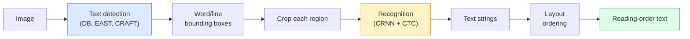

# OCR 및 문서 이해

> OCR는 세 단계의 파이프라인입니다. 텍스트 박스를 감지하고 문자를 인식하고, 그 다음 배치합니다. 모든 현대 OCR 시스템은 이러한 단계를 다시 순서로 구성하거나 통합합니다.

**Type:** Learn + Use
**Languages:** Python
**Prerequisites:** Phase 4 Lesson 06 (Detection), Phase 7 Lesson 02 (Self-Attention)
**Time:** ~45 minutes

## 학습 목표

- 고전적인 OCR 파이프라인 (탐지 -> 인식 -> 레이아웃) 과 현대적인 엔드-투-엔드 대안 (Donut, Qwen-VL-OCR) 을 추적한다
- 일련의 OCR 훈련에 대한 CTC (Connectionist Temporal Classification) 손실을 구현
- 훈련 없이 생산 문서 분석을 위해 PaddleOCR 또는 EasyOCR를 사용한다
- OCR, 레이아웃 분석, 문서 이해를 구분하고 작업에 맞는 도구를 선택하십시오

## 문제

텍스트로 가득한 이미지는 모든 곳에 있습니다. 영수증, 청구서, 주민등록증, 스캔 된 책, 양식, 화이트보드, 표지판, 스크린샷. 이들로부터 구조화된 데이터를 추출하는 것은 문자뿐만 아니라 "이것이 전체 금액입니다".

이 분야는 세 가지 기술 계층으로 나뉘어 있습니다.

1. **OCR proper**: 픽셀을 텍스트로 변환합니다.
2. **Layout parsing**: 그룹 OCR 출력 지역 ( 제목, 몸집, 테이블, 헤더)
3. **Document understanding**: 구조화된 필드를 추출 ("인조_총액 = 42.50$")

각 계층은 고전적이고 현대적인 접근 방식을 가지고 있으며 "나는 이미지에서 텍스트를 원하고"와 "이 영수증의 총 금액을 원하고" 사이의 격차는 대부분의 팀이 인식하는 것보다 더 크습니다.

## 개념

### 고전적 파이프라인



- **Text detection**선당 또는 단어당 네모를 생성합니다.
- **Recognition**각 영역을 고정된 높이에 작아서 CNN+BiLSTM+CTC를 실행하여 문자열을 생성합니다.
- **Layout**읽기 순서를 재구성합니다 (라틴어에서 왼쪽에서 오른쪽으로, 아랍어, 일본어에서 다른).

### 한 문항에 CTC

OCR 인식은 고정 길이의 기능 지도에서 변수 길이의 순서를 생성합니다. CTC (Graves et al., 2006) 는 문자 수준 조화를 하지 않고 이것을 훈련시킬 수 있습니다. 모델은 모든 시간 단계에 배포 (언어 + 빈) 를 내보내며, CTC 손실은 반복을 합쳐서 빈 부분을 제거한 후 목표 텍스트로 줄이는 모든 조화를 소외시킵니다.

```
raw output: "h h h _ _ e e l l _ l l o _ _"
after merge repeats and remove blanks: "hello"
```

CTC는 CRNN가 2015년에 작업한 이유이며 여전히 2026년에 대부분의 생산 OCR 모델을 훈련시킵니다.

### 현대적인 엔드-투-엔드 모델

- **Donut**(Kim et al., 2022)  ViT 코더 + 텍스트 디코더; 이미지를 읽고 JSON를 직접 발송합니다. 텍스트 탐지 장치, 레이아웃 모듈이 없습니다.
- **TrOCR** 라인 레벨 OCR를 위한 ViT+ 트랜스포머 디코더
- **Qwen-VL-OCR / InternVL** OCR 작업에 적합하게 정비된 전체 시각 언어 모델; 복잡한 문서에 대한 가장 높은 정확성 2026년.
- **PaddleOCR** 성숙한 생산 패키지에서 고전 DB + CRNN 파이프 라인; 여전히 오픈 소스 작업마.

엔드-투-엔드 모델은 더 많은 데이터와 계산이 필요하지만 다단계 파이프라인의 오류 축적을 생략합니다.

### 레이아웃 분석

구조화된 문서에 대해서는 각 영역을 표시하는 레이아웃 디테커 (LayoutLMv3, DocLayNet) 를 실행하십시오. 제목, 문장, 그림, 테이블, 발자국. 읽기 순서는 " 레이아웃 순서로 지역을 통해 반복, 동열"이됩니다.

양식에 대해서는 사용 **Key-Value extraction**모델 (비디오 풍부한 문서에 대한 도넛, 순수한 스캔에 대한 LayoutLMv3) 은 이미지 + 검출 된 텍스트 + 위치를 촬영하고 구조화된 키-값 쌍을 예측합니다.

### 평가 매트릭스

- **Character Error Rate (CER)** 레벤슈타인 거점/ 참조 길이가. 더 낮게는 더 좋습니다. 생산 목표: < 2% 청정 스캔.
- **Word Error Rate (WER)** 단어 수준에서 동일합니다.
- **F1 on structured fields** 핵심 가치 과제;`{invoice_total: 42.50}`맞게 보여요
- **Edit distance on JSON** 종말에서 종말까지 문서 분석을 위해; 도넛 페이퍼는 정규화된 트리 편집 거리를 도입했습니다.

```figure
cv3-ctc-collapse
```

## 건설 해

### 단계 1: CTC 손실 + 탐욕적인 디코더

```python
import torch
import torch.nn as nn
import torch.nn.functional as F


def ctc_loss(log_probs, targets, input_lengths, target_lengths, blank=0):
    """
    log_probs:      (T, N, C) log-softmax over vocab including blank at index 0
    targets:        (N, S) int targets (no blanks)
    input_lengths:  (N,) per-sample time steps used
    target_lengths: (N,) per-sample target length
    """
    return F.ctc_loss(log_probs, targets, input_lengths, target_lengths,
                      blank=blank, reduction="mean", zero_infinity=True)


def greedy_ctc_decode(log_probs, blank=0):
    """
    log_probs: (T, N, C) log-softmax
    returns: list of index sequences (blanks removed, repeats merged)
    """
    preds = log_probs.argmax(dim=-1).transpose(0, 1).cpu().tolist()
    out = []
    for seq in preds:
        decoded = []
        prev = None
        for idx in seq:
            if idx != prev and idx != blank:
                decoded.append(idx)
            prev = idx
        out.append(decoded)
    return out
```

`F.ctc_loss`사용 가능한 경우 효율적인 CuDNN 구현을 사용합니다. 탐욕적인 디코더는 빔 검색보다 간단하며 일반적으로 1%의 CER 내에 있습니다.

### 단계 2: 작은 CRNN 인식기

라인 OCR에 대한 CNN+BiLSTM 최소

```python
class TinyCRNN(nn.Module):
    def __init__(self, vocab_size=40, hidden=128, feat=32):
        super().__init__()
        self.cnn = nn.Sequential(
            nn.Conv2d(1, feat, 3, 1, 1), nn.BatchNorm2d(feat), nn.ReLU(inplace=True),
            nn.MaxPool2d(2),
            nn.Conv2d(feat, feat * 2, 3, 1, 1), nn.BatchNorm2d(feat * 2), nn.ReLU(inplace=True),
            nn.MaxPool2d(2),
            nn.Conv2d(feat * 2, feat * 4, 3, 1, 1), nn.BatchNorm2d(feat * 4), nn.ReLU(inplace=True),
            nn.MaxPool2d((2, 1)),
            nn.Conv2d(feat * 4, feat * 4, 3, 1, 1), nn.BatchNorm2d(feat * 4), nn.ReLU(inplace=True),
            nn.MaxPool2d((2, 1)),
        )
        self.rnn = nn.LSTM(feat * 4, hidden, bidirectional=True, batch_first=True)
        self.head = nn.Linear(hidden * 2, vocab_size)

    def forward(self, x):
        # x: (N, 1, H, W)
        f = self.cnn(x)                # (N, C, H', W')
        f = f.mean(dim=2).transpose(1, 2)  # (N, W', C)
        h, _ = self.rnn(f)
        return F.log_softmax(self.head(h).transpose(0, 1), dim=-1)  # (W', N, vocab)
```

고정 고도의 입력 (CNN 최대 높이를 1으로 풀) 너비는 CTC의 시간 차원입니다.

### 단계 3: 합성 OCR

끝에서 끝까지의 흡연 테스트를 위해 검은색과 흰색 수자 문자열을 생성합니다.

```python
import numpy as np

def synthetic_line(text, height=32, char_width=16):
    W = char_width * len(text)
    img = np.ones((height, W), dtype=np.float32)
    for i, c in enumerate(text):
        x = i * char_width
        shade = 0.0 if c.isalnum() else 0.5
        img[6:height - 6, x + 2:x + char_width - 2] = shade
    return img


def build_batch(strings, vocab):
    H = 32
    W = 16 * max(len(s) for s in strings)
    imgs = np.ones((len(strings), 1, H, W), dtype=np.float32)
    target_lengths = []
    targets = []
    for i, s in enumerate(strings):
        imgs[i, 0, :, :16 * len(s)] = synthetic_line(s)
        ids = [vocab.index(c) for c in s]
        targets.extend(ids)
        target_lengths.append(len(ids))
    return torch.from_numpy(imgs), torch.tensor(targets), torch.tensor(target_lengths)


vocab = ["_"] + list("0123456789abcdefghijklmnopqrstuvwxyz")
imgs, targets, lengths = build_batch(["hello", "world"], vocab)
print(f"images: {imgs.shape}   targets: {targets.shape}   lengths: {lengths.tolist()}")
```

실제 OCR 데이터 세트는 글꼴, 잡음, 회전, 흐릿함, 색을 추가합니다. 위의 파이프라인은 동일합니다.

### 단계 4: 훈련 스케치

```python
model = TinyCRNN(vocab_size=len(vocab))
opt = torch.optim.Adam(model.parameters(), lr=1e-3)

for step in range(200):
    strings = ["abc" + str(step % 10)] * 4 + ["xyz" + str((step + 1) % 10)] * 4
    imgs, targets, target_lens = build_batch(strings, vocab)
    log_probs = model(imgs)  # (W', 8, vocab)
    input_lens = torch.full((8,), log_probs.size(0), dtype=torch.long)
    loss = ctc_loss(log_probs, targets, input_lens, target_lens, blank=0)
    opt.zero_grad(); loss.backward(); opt.step()
```

이 비약적인 합성 데이터에 따라 200단계 이상에서의 손실은 ~3에서 ~0.2로 떨어질 것입니다.

## 사용 하 고

생산 경로는 세 가지입니다.

- **PaddleOCR** 성숙하고 빠른, 다국어.`paddleocr.PaddleOCR(lang="en").ocr(image_path)`- 그래
- **EasyOCR** 파이썬 네이티브, 다국어, 파이토치 척추
- **Tesseract** 고전적; 모델이 어려움을 겪을 때 여전히 오래된 스캔 문서에 유용합니다.

종말에서 종말까지 문서 분석을 위해 Donut 또는 VLM를 사용하십시오.

```python
from transformers import DonutProcessor, VisionEncoderDecoderModel

processor = DonutProcessor.from_pretrained("naver-clova-ix/donut-base-finetuned-cord-v2")
model = VisionEncoderDecoderModel.from_pretrained("naver-clova-ix/donut-base-finetuned-cord-v2")
```

리시브, 청구서 및 반복 구조를 가진 양식에 대해서는 Donut을 정렬하십시오. 임의 문서 또는 추론을 가진 OCR에 대해서는 Qwen-VL-OCR와 같은 VLM가 현재 기본입니다.

## 선박

이 교훈은 다음과 같은 결과를 낳습니다.

- `outputs/prompt-ocr-stack-picker.md` Tesseract / PaddleOCR / Donut / VLM-OCR를 선택하는 명령어
- `outputs/skill-ctc-decoder.md` 길이를 정상화 하는 등 탐욕적이고 반지 탐색 CTC 디코더를 처음부터 작성하는 기술

## 운동

1. **(Easy)**5자리 무작위 숫자 문자열에 500단계 동안 TinyCRNN를 훈련시켜서
2. **(Medium)**탐욕적인 디코딩을 빔 검색 (beam_width=5) 로 대체하십시오. CER 델타 보고. 빔 검색이 승리하는 입력값은 무엇입니까?
3. **(Hard)**20개의 영수증, 추출 라인 항목의 집합에 PaddleOCR를 사용하여 {item_name, price} 쌍을 위해 손으로 표시된 지형 진실에 대해 F1를 계산합니다.

## 주요 용어

| Term | What people say | What it actually means |
|------|----------------|----------------------|
| OCR | "Text from pixels" | Turning image regions into character sequences |
| CTC | "Alignment-free loss" | Loss that trains a sequence model without per-timestep labels; marginalises over alignments |
| CRNN | "Classic OCR model" | Conv feature extractor + BiLSTM + CTC; the 2015 baseline still used in production |
| Donut | "End-to-end OCR" | ViT encoder + text decoder; emits JSON directly from image |
| Layout parsing | "Find regions" | Detect and label Title/Table/Figure/Paragraph regions in a document |
| Reading order | "Text sequence" | Ordering of recognised regions into a sentence; trivial for Latin, non-trivial for mixed layouts |
| CER / WER | "Error rates" | Levenshtein distance / reference length at character or word granularity |
| VLM-OCR | "LLM that reads" | A vision-language model trained or prompted for OCR tasks; current SOTA on complex documents |

## 더 많은 읽기

- [CRNN (Shi et al., 2015)](https://arxiv.org/abs/1507.05717) 원래 CNN+RNN+CTC 아키텍처
- [CTC (Graves et al., 2006)](https://www.cs.toronto.edu/~graves/icml_2006.pdf) 원래의 CTC 종이; 알고리즘 아이디어로 밀집되어 있습니다
- [Donut (Kim et al., 2022)](https://arxiv.org/abs/2111.15664) OCR 없는 문서 이해 변환기
- [PaddleOCR](https://github.com/PaddlePaddle/PaddleOCR) 오픈소스 생산 OCR 스택
