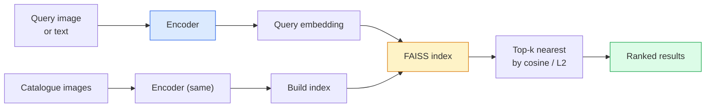

# 이미지 검색 및 측정 학습

> 검색 시스템은 공간을 내장하는 데 있어서 거리에 따라 후보자를 순위화합니다. 메트릭 학습은 그 공간을 형성하는 학문입니다. 그래서 거리는 당신이 원하는 것을 의미합니다.

**Type:** Build
**Languages:** Python
**Prerequisites:** Phase 4 Lesson 14 (ViT), Phase 4 Lesson 18 (CLIP)
**Time:** ~45 minutes

## 학습 목표

- 삼단, 대조적, 대리 기반의 미터 학습 손실을 설명하고 주어진 데이터 세트에 적합한 것을 선택하십시오
- L2 정상화와 코시노 유사성을 올바르게 구현하고 " 같은 항목"과 " 같은 클래스"의 차이점을 감사
- FAISS 인덱스를 생성하고 텍스트와 이미지로 쿼리를 작성하고, 유지된 쿼리 세트에 대한 recall@K 보고
- DINOv2, CLIP, SigLIP를 사용할 수 있는 등뼈로 사용해서 각각이 승리할 때 알아보세요.

## 문제

검색은 생산 비전에서 모든 곳에 있습니다. 복제 탐지, 역 이미지 검색, 시각 검색 (" 유사한 제품을 찾아"), 얼굴 재확인, 감시용 인격 재확인, 전자 상거래에 대한 인스턴스 수준의 일치. 제품 질문은 항상 동일합니다. "이 쿼리 이미지를 고려하면 내 카탈로그를 순위화하십시오".

두 가지 설계 결정은 전체 시스템을 형성합니다. 임베디션  어떤 모델이 벡터를 생성하는지. 인덱스  어떻게 규모에서 가장 가까운 이웃을 찾을 수 있는지. 둘 다 2026 년 상품입니다 (인베디션에 대한 DINOv2, 인덱스에 대한 FAISS), 이는 바를 높여줍니다. 어려운 부분은 응용 프로그램에 대한 * 유사한 것으로 간주되는 *를 정의하고, 다음 임베디션 공간을 형성하여 거리가 일치합니다.

그 형성은 측정 학습입니다. 그것은 작은 하지만 높은 레버리지의 학문입니다.

## 개념

### 한 눈에 발견



### 4개의 가족들이

| Loss | Requires | Pros | Cons |
|------|----------|------|------|
| **Contrastive** | (anchor, positive) + negatives | Simple, works with any pair label | Slow to converge without many negatives |
| **Triplet** | (anchor, positive, negative) | Intuitive; direct margin control | Hard-triplet mining is expensive |
| **NT-Xent / InfoNCE** | Pairs + batch-mined negatives | Scales to large batches | Needs big batch or momentum queue |
| **Proxy-based (ProxyNCA)** | Class labels only | Fast, stable, no mining | Can overfit to proxies on small datasets |

대부분의 생산 사용 사례에서, 미리 훈련된 척추로 시작하고 테스트 세트에서 비-제품 임베디션이 저조한 성능을 보인 경우에만 측정 학습 미세조를 추가하십시오.

### 공식적으로 삼각 손실

```math
L = \max\left(0, \lVert f(a) - f(p) \rVert^2 - \lVert f(a) - f(n) \rVert^2 + \text{margin}\right)
```

항로를 끌어당겨라`a`긍정적인 것 가까이`p`, 음의에서 멀리 밀어`n`,`margin`이 세 개의 이미지 구조는 모든 유사성 순서에 일반화됩니다.

광산: 쉬운 삼중 (`n`이미 멀리 떨어져 있습니다`a`) 는 0 손실을 기여하고, 하드 트리플트만이 네트워크를 가르칩니다.`n`보다 더`p`하지만 마진 내에서) 는 2016년 페이스넷 레시피이며 여전히 지배적이다.

### 코시네 유사성 vs L2

두 가지 기준, 두 가지 컨벤션

- **Cosine**L2 표준화된 임베디션을 필요로 합니다.
- **L2**: 유클리드 거리. 원료 또는 정상화된 임베디션에서 작동하지만 일반적으로 L2 - 정상화 + 2 L2와 결합됩니다.

대부분의 현대 네트워크에 있어서 두 가지 네트워크는 동등합니다.`||a - b||^2 = 2 - 2 cos(a, b)`언제`||a|| = ||b|| = 1`- 당신의 임베디션 훈련에 맞는 컨벤션을 선택하세요. 침묵으로 섞는 것은 "최근"의 의미를 변화시킵니다.

### 스

표준 검색 메트릭:

```
recall@K = fraction of queries where at least one correct match is in the top K results
```

리콜@1, @5, @10 사이즈에 보고합니다. 0.95 이상의 리콜@10와 0.5 이하의 리콜@1은 임베디션 공간이 올바른 구조를 가지고 있지만 순위가   더 긴 미세조음이나 재 순위 단계를 시도합니다.

복제 검출을 위해서는 정확성@K가 더 중요하기 때문에 모든 거짓 양성은 사용자가 볼 수 있는 오류입니다. 시각 검색에서는 recall@K가 제품 신호입니다.

### FAISS 한 문항

페이스북 인공지능 유사성 검색. 가장 가까운 이웃 검색을 위한 실제 라이브러리. 세 개의 인덱스 선택:

- `IndexFlatIP`- `IndexFlatL2` 무력, 정확성, 훈련이 없습니다. ~ 1M 벡터를 사용하십시오.
- `IndexIVFFlat`K 세포로 분할하여 가장 가까운 몇 개의 세포를 검색합니다. 대략적이고 빠른 것은 훈련 데이터가 필요합니다.
- `IndexHNSW` 그래프 기반, 많은 질의에 가장 빠른, 큰 지수 크기가.

100k 벡터로`IndexFlatIP`코시노 유사성에서 10M를 원하죠`IndexIVFFlat`. 100M+에 대한 제품 양량화 (`IndexIVFPQ`)

### 인스턴스 레벨과 카테고리 레벨 검색

두 개의 서로 다른 문제와 같은 이름입니다.

- **Category-level** "내 카탈로그에서 고양이를 찾아라". 클래스 조건적 유사성; 내장된 CLIP/DINOv2 임베디션은 잘 작동합니다.
- **Instance-level** "내 카탈로그에서 이 정확한 제품을 찾아보세요". 같은 클래스의 시각적으로 유사한 객체들 사이의 세밀한 차별화, 롤프라인 임베디션의 성능이 낮아, 미트릭 학습 문제들에 대한 세밀한 조정이 필요합니다.

모델 선택 전에 항상 어떤 모델을 해결하고 있는지 물어보십시오.

```figure
metric-embedding
```

## 건설 해

### 단계 1: 트립렛 손실

```python
import torch
import torch.nn.functional as F

def triplet_loss(anchor, positive, negative, margin=0.2):
    d_ap = F.pairwise_distance(anchor, positive, p=2)
    d_an = F.pairwise_distance(anchor, negative, p=2)
    return F.relu(d_ap - d_an + margin).mean()
```

L2 표준화 또는 원료 임베디션에서 작동합니다.

### 단계 2: 반 하드 광산

배틀 및 라벨의 배치를 고려하면 각 항에 가장 어려운 반 단단한 음수를 찾아보십시오.

```python
def semi_hard_negatives(emb, labels, margin=0.2):
    dist = torch.cdist(emb, emb)
    same_class = labels[:, None] == labels[None, :]
    diff_class = ~same_class
    N = emb.size(0)

    positives = dist.clone()
    positives[~same_class] = float("-inf")
    positives.fill_diagonal_(float("-inf"))
    pos_idx = positives.argmax(dim=1)

    semi_hard = dist.clone()
    semi_hard[same_class] = float("inf")
    d_ap = dist[torch.arange(N), pos_idx].unsqueeze(1)
    semi_hard[dist <= d_ap] = float("inf")
    neg_idx = semi_hard.argmin(dim=1)

    fallback_mask = semi_hard[torch.arange(N), neg_idx] == float("inf")
    if fallback_mask.any():
        hardest = dist.clone()
        hardest[same_class] = float("inf")
        neg_idx = torch.where(fallback_mask, hardest.argmin(dim=1), neg_idx)
    return pos_idx, neg_idx
```

각 항은 가장 단단한 긍정적 인 클래스를 얻으며 긍정적 인 것보다 더 멀리 있지만 지점 내에 있는 반 단단한 부정적 인 값을 얻습니다.

### 단계 3: 상기함@K

```python
def recall_at_k(query_emb, gallery_emb, query_labels, gallery_labels, k=1):
    sim = query_emb @ gallery_emb.T
    _, top_k = sim.topk(k, dim=-1)
    matches = (gallery_labels[top_k] == query_labels[:, None]).any(dim=-1)
    return matches.float().mean().item()
```

L2 표준화된 임베디션에서 내부 제품으로 상위 k는 코시네스로 상위 k에 해당한다.

### 4단계: 함께 정리

```python
import torch
import torch.nn as nn
from torch.optim import Adam

class Encoder(nn.Module):
    def __init__(self, in_dim=128, emb_dim=64):
        super().__init__()
        self.net = nn.Sequential(
            nn.Linear(in_dim, 128), nn.ReLU(),
            nn.Linear(128, emb_dim),
        )

    def forward(self, x):
        return F.normalize(self.net(x), dim=-1)

torch.manual_seed(0)
num_classes = 6
protos = F.normalize(torch.randn(num_classes, 128), dim=-1)

def sample_batch(bs=32):
    labels = torch.randint(0, num_classes, (bs,))
    x = protos[labels] + 0.15 * torch.randn(bs, 128)
    return x, labels

enc = Encoder()
opt = Adam(enc.parameters(), lr=3e-3)

for step in range(200):
    x, y = sample_batch(32)
    emb = enc(x)
    pos_idx, neg_idx = semi_hard_negatives(emb, y)
    loss = triplet_loss(emb, emb[pos_idx], emb[neg_idx])
    opt.zero_grad(); loss.backward(); opt.step()
```

몇 백 단계 후에 임베디션 클러스터는 한 클래스에 한 클러스터를 형성합니다.

## 사용 하 고

2026년 생산 스테이크:

- **DINOv2 + FAISS**일반용 시각 검색. 롤프에서 작동합니다.
- **CLIP + FAISS** 질문들이 문자
- **Fine-tuned DINOv2 + FAISS** 인스턴스 레벨 검색, 얼굴 재인식, 패션, 전자상거래
- **Milvus / Weaviate / Qdrant** FAISS 또는 HNSW 주변에서 관리되는 벡터 DB 팩러

SOTA 인스턴스 검색을 위한 레시피는: DINOv2 척추, 임베디션 헤드, 트리플렛 또는 인포NCE 손실을 통해 인스턴스 레이블된 쌍에 추가, FAISS에서 인덱스.

## 선박

이 교훈은 다음과 같은 결과를 낳습니다.

- `outputs/prompt-retrieval-loss-picker.md` 주어진 검색 문제에서 triplet / InfoNCE / ProxyNCA를 선택하는 명령어.
- `outputs/skill-recall-at-k-runner.md` 열차/발/갤러리 분할과 적절한 데이터 계약으로 recall@K에 대한 깨끗한 평가 띠를 작성하는 기술.

## 운동

1. **(Easy)**위의 장난감 예시를 실행하여, 훈련 전에 그리고 훈련 후 PCA로 임베디션을 그려서 6개의 클러스터를 볼 수 있습니다.
2. **(Medium)**프로시NCA 손실 구현을 추가하십시오: 클래스당 한 가지 학습된 "프로시", 코시노 유사성에 대한 표준 크로스 엔트로피. 장난감 데이터에서 회전 속도와 삼중 손실을 비교하십시오.
3. **(Hard)**1,000개의 ImageNet 검증 이미지를 HuggingFace를 통해 DINOv2에 삽입하고 FAISS 평평 인덱스를 구축하고, 검색과 같은 이미지 (1.0) 와 기본 진실으로 ImageNet 라벨을 가지고 있는 지연 분할에 대해 recall@{1, 5, 10}를 보고합니다.

## 주요 용어

| Term | What people say | What it actually means |
|------|----------------|----------------------|
| Metric learning | "Shape the space" | Training an encoder so distances in its output space reflect a target similarity |
| Triplet loss | "Pull and push" | $L = \max(0, d(a, p) - d(a, n) + \text{margin})$; the canonical metric-learning loss |
| Semi-hard mining | "Useful negatives" | Negatives further from the anchor than the positive but within margin; empirically the most informative |
| Proxy-based loss | "Class prototypes" | One learned proxy per class; cross-entropy over similarity-to-proxies; no pair mining |
| Recall@K | "Top-K hit rate" | Fraction of queries with at least one correct result in the top K |
| Instance retrieval | "Find this exact thing" | Fine-grained matching; off-the-shelf features usually underperform |
| FAISS | "The NN library" | Facebook's nearest-neighbour library; supports exact and approximate indexes |
| HNSW | "Graph index" | Hierarchical navigable small world; fast approximate NN with small memory overhead |

## 더 많은 읽기

- [FaceNet: A Unified Embedding for Face Recognition (Schroff et al., 2015)](https://arxiv.org/abs/1503.03832) 삼판 손실 / 반 단단한 채굴 종이
- [In Defense of the Triplet Loss for Person Re-Identification (Hermans et al., 2017)](https://arxiv.org/abs/1703.07737) 삼각형의 정렬에 대한 실용적인 지침서
- [FAISS documentation](https://github.com/facebookresearch/faiss/wiki) 모든 지표, 모든 거래
- [SMoT: Metric Learning Taxonomy (Kim et al., 2021)](https://arxiv.org/abs/2010.06927) 현대 손실과 그 연관성 조사
