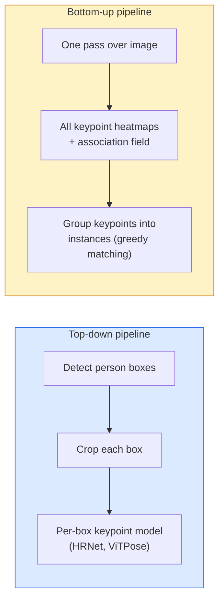

# 키포인트 탐지 및 포즈 추정

> 포즈란 순서대로 된 키포인트들의 집합입니다. 키포인트 탐지기는 히트맵 회전기입니다. 나머지는 회계입니다.

**Type:** Build
**Languages:** Python
**Prerequisites:** Phase 4 Lesson 06 (Detection), Phase 4 Lesson 07 (U-Net)
**Time:** ~45 minutes

## 학습 목표

- 위 아래와 아래 아래의 자세 추정을 구분하고 각이 사용되는 시점을 명시합니다.
- 가우스스 키 포인트 목표와 K 키 포인트의 회귀 열지도와 추론에서 키 포인트 좌표를 추출
- 부분 연계 필드 (PAF) 과 아래로 올라가는 파이프라인이 키포인트들을 인스턴스로 연결하는 방법을 설명한다
- 생산 키 포인트 추정에 MediaPipe Pose 또는 MMPose를 사용하고 출력 형식을 이해하십시오

## 문제

키포인트 작업은 여러 이름으로 숨어 있습니다. 인간 포지 (17개 몸 관절), 얼굴 지표 (68개 또는 478개 포인트), 손 (21개), 동물 포지, 로봇 객체 포지, 의학 해부학적 지표. 이들 각각은 동일한 구조를 공유합니다. 객체에서 K 분별 지점을 감지하고 (x, y) 좌표를 출력합니다.

포즈 추정은 운동 캡처, 피트니스 앱, 스포츠 분석, 동작 제어, 애니메이션, AR 테스트, 로봇 포착의 기초입니다. 2D 케이스는 성숙하고, 3D 포즈 ( 단일 카메라에서 세계 좌표에서 공동 위치를 추정) 는 현재 연구의 한계입니다.

엔지니어링 문제는 규모입니다. 단일 이미지, 단일 인격 포지션은 20ms의 문제입니다. 30fps의 군중에서 다중 인격 포지션은 다른 구조와 다른 문제입니다.

## 개념

### 아래쪽과 아래쪽



- **Top-down** 먼저 사람을 감지하고, 다음 각 작물에 개인별 키포인트 모델을 실행합니다. 가장 높은 정확성; 사람들이 있는 숫자에 따라 선형적으로 측정합니다.
- **Bottom-up** 한 번 앞을 통과하면 모든 키포인트를 더하여 연관분야를 예측하고 그룹화합니다.

위 아래 (HRNet, ViTPose) 는 정확성 선두주자; 아래 아래 (OpenPose, HigherHRNet) 는 혼잡한 장면의 처리량 선두주자입니다.

### 열지도 회귀

퇴행하기 보다는`(x, y)`직접적으로 예측해 보세요`H x W`가우스 반지와 같은 키포인트에 대한 열 지도가 실제 위치로 중심을 둔다.

```math
\text{target}[k, y, x] = \exp\left(-\frac{(x - \mathit{cx}_k)^2 + (y - \mathit{cy}_k)^2}{2 \sigma^2}\right)
```

추론에서, 각 열지도의 argmax는 예측된 키포인트 위치입니다.

왜 온도 지도가 직접적인 회귀보다 더 잘 작동하는지: 네트워크의 공간 구조 (conv 기능 지도) 는 공간 출력과 자연스럽게 일치합니다. 가우스 목표 또한 정규화합니다.

### 서브픽셀 로컬레이션

Argmax는 정수 좌표를 제공합니다. sub-피클스 정확성을 위해, argmax 및 그 이웃에 파라볼라를 부착하여 정교합니다. 또는 잘 알려진 오프셋을 사용하십시오.`(dx, dy) = 0.25 * (heatmap[y, x+1] - heatmap[y, x-1], ...)`방향이

### 부분 친화적 필드 (PAF)

아래쪽 위로 연결하기 위한 OpenPose의 트릭. 연결된 키포인트의 각 쌍 (예를 들어 왼쪽 어깨에서 왼쪽 팔꿈치) 에 대해, 한쪽에서 다른 쪽으로 가리키는 단위 벡터를 암호화하는 2 채널 필드를 예측하십시오. 어깨와 팔꿈치를 연결하기 위해, 후보 쌍을 연결하는 선에 따라 PAF를 통합하십시오. 가장 높은 통합이있는 쌍이 일치합니다.

```
For each connection (limb):
  PAF channels: 2 (unit vector x, y)
  Line integral: sum over sample points of (PAF . line_direction)
  Higher integral = stronger match
```

예쁘고, 개인 개개인의 작물을 내지 않고 임의의 인적 크기로 확장됩니다.

### COCO 키포인트

표준 체포지 데이터 세트: 개인당 17 개의 키포인트, PCK (정확한 키포인트 비율) 및 OKS (물질 키포인트 유사성) 은 매트릭으로. OKS는 IoU의 키포인트 아날로그이며 COCO mAP@OKS에 의해 보고됩니다.

### 2D와 3D

- **2D pose** 이미지 좌표; 생산 품질에 의해 해결됩니다 (MediaPipe, HRNet, ViTPose).
- **3D pose** 세계 / 카메라 좌표; 여전히 활발한 연구. 일반적인 접근법:
  - 작은 MLP (VideoPose3D) 를 사용하여 2D 예측을 3D로 옮기십시오.
  - 이미지에서 직접 3D 회귀 (PyMAF, MHFormer).
  - 지상 진실을 위한 멀티뷰 설정 (CMU Panoptic)

```figure
cv3-pose-heatmap
```

## 건설 해

### 단계 1: 가우스 열지도 목표

```python
import numpy as np
import torch

def gaussian_heatmap(size, cx, cy, sigma=2.0):
    yy, xx = np.meshgrid(np.arange(size), np.arange(size), indexing="ij")
    return np.exp(-((xx - cx) ** 2 + (yy - cy) ** 2) / (2 * sigma ** 2)).astype(np.float32)

hm = gaussian_heatmap(64, 32, 32, sigma=2.0)
print(f"peak: {hm.max():.3f} at ({hm.argmax() % 64}, {hm.argmax() // 64})")
```

채널 축을 따라 쌓인 키 포인트 열 지도는 전체 목표 텐서를 제공합니다.

### 단계 2: 작은 키포인트 헤드

U-Net 스타일의 모델로 K 온도 지도 채널을 내보내죠.

```python
import torch.nn as nn
import torch.nn.functional as F

class TinyKeypointNet(nn.Module):
    def __init__(self, num_keypoints=4, base=16):
        super().__init__()
        self.down1 = nn.Sequential(nn.Conv2d(3, base, 3, 2, 1), nn.ReLU(inplace=True))
        self.down2 = nn.Sequential(nn.Conv2d(base, base * 2, 3, 2, 1), nn.ReLU(inplace=True))
        self.mid = nn.Sequential(nn.Conv2d(base * 2, base * 2, 3, 1, 1), nn.ReLU(inplace=True))
        self.up1 = nn.ConvTranspose2d(base * 2, base, 2, 2)
        self.up2 = nn.ConvTranspose2d(base, num_keypoints, 2, 2)

    def forward(self, x):
        h1 = self.down1(x)
        h2 = self.down2(h1)
        h3 = self.mid(h2)
        u1 = self.up1(h3)
        return self.up2(u1)
```

입력 `(N, 3, H, W)`, 출력`(N, K, H, W)`- 손실은 가우스 목표에 대한 1피클 MSE입니다.

### 단계 3: 추론  키포인트 좌표를 추출

```python
def heatmap_to_coords(heatmaps):
    """
    heatmaps: (N, K, H, W)
    returns:  (N, K, 2) float coordinates in image pixels
    """
    N, K, H, W = heatmaps.shape
    hm = heatmaps.reshape(N, K, -1)
    idx = hm.argmax(dim=-1)
    ys = (idx // W).float()
    xs = (idx % W).float()
    return torch.stack([xs, ys], dim=-1)

coords = heatmap_to_coords(torch.randn(2, 4, 32, 32))
print(f"coords: {coords.shape}")  # (2, 4, 2)
```

1 줄을 추론하면, sub-pixel 정밀화를 위해 argmax를 중계시켜

### 단계 4: 합성 키포인트 데이터 세트

간단한 방법: 흰색 캔버스에 네 점을 그려서 예측하는 법을 배우십시오.

```python
def make_synthetic_sample(size=64):
    img = np.ones((3, size, size), dtype=np.float32)
    rng = np.random.default_rng()
    kps = rng.integers(8, size - 8, size=(4, 2))
    for cx, cy in kps:
        img[:, cy - 2:cy + 2, cx - 2:cx + 2] = 0.0
    hms = np.stack([gaussian_heatmap(size, cx, cy) for cx, cy in kps])
    return img, hms, kps
```

작은 모델이 한 분 안에 배울 수 있을 만큼 쉬운 것 같아요

### 5단계: 훈련

```python
model = TinyKeypointNet(num_keypoints=4)
opt = torch.optim.Adam(model.parameters(), lr=3e-3)

for step in range(200):
    batch = [make_synthetic_sample() for _ in range(16)]
    imgs = torch.from_numpy(np.stack([b[0] for b in batch]))
    hms = torch.from_numpy(np.stack([b[1] for b in batch]))
    pred = model(imgs)
    # Upsample pred to full resolution
    pred = F.interpolate(pred, size=hms.shape[-2:], mode="bilinear", align_corners=False)
    loss = F.mse_loss(pred, hms)
    opt.zero_grad(); loss.backward(); opt.step()
```

## 사용 하 고

- **MediaPipe Pose** 구글의 생산 포즈 추정기; WebGL + 모바일 실행 시간을 10ms 미만의 지연으로 전송합니다.
- **MMPose**(OpenMMLab)  종합적인 연구 코드베이스; 사전 훈련된 무게를 가진 모든 SOTA 아키텍처.
- **YOLOv8-pose** 단일 포드 패스로 실시간으로 가장 빠른 멀티인 포즈
- **transformers HumanDPT / PoseAnything** 개방형 어휘 포즈를 위한 새로운 시각 언어 접근법 (어떤 객체, 어떤 키포인트 집합)

## 선박

이 교훈은 다음과 같은 결과를 낳습니다.

- `outputs/prompt-pose-stack-picker.md` MediaPipe / YOLOv8-pose / HRNet / ViTPose를 선택하는 프롬프트, 대기시간, 크기와 2D vs 3D 필요를 고려하면
- `outputs/skill-heatmap-to-coords.md` 모든 생산 포즈 모델에서 사용되는 서브픽셀 열지도-조ordinate 루틴을 작성하는 기술.

## 운동

1. **(Easy)**인공 4 점 데이터 세트에 작은 키포인트 모델을 훈련하십시오. 예측된 키포인트와 실제 키포인트 사이의 L2 오류 평균을 보고합니다.
2. **(Medium)**미작수 미련을 추가: argmax 위치를 고려하면, 이웃 피클스 (x) 와 y (y) 를 따라 1D 파라볼을 부착한다. 정확성 증가와 정수 argmax을 보고한다.
3. **(Hard)**각 이미지는 4 키 포인트 패턴의 두 가지 인스턴스를 보여주는 2인 합성 데이터 세트를 구축하고, 어떤 키 포인트가 어느 인스턴스에 속하는지 예측하는 PAF를 사용하여 아래로 위로 파이프라인을 훈련하고 OKS를 평가합니다.

## 주요 용어

| Term | What people say | What it actually means |
|------|----------------|----------------------|
| Keypoint | "A landmark" | A specific ordered point on an object (joint, corner, feature) |
| Pose | "The skeleton" | An ordered set of keypoints belonging to one instance |
| Top-down | "Detect then pose" | Two-stage pipeline: person detector + per-crop keypoint model; highest accuracy |
| Bottom-up | "Pose first, group later" | Single-pass all-keypoint prediction + grouping; constant time in crowd size |
| Heatmap | "Gaussian target" | H x W tensor per keypoint with peak at the true location; the preferred regression target |
| PAF | "Part Affinity Field" | 2-channel unit vector field encoding limb directions; used to group keypoints into instances |
| OKS | "Keypoint IoU" | Object Keypoint Similarity; the COCO metric for pose |
| HRNet | "High-Resolution Net" | The dominant top-down keypoint architecture; preserves high-res features throughout |

## 더 많은 읽기

- [OpenPose (Cao et al., 2017)](https://arxiv.org/abs/1812.08008) PAF와 함께 아래에서 위로; 여전히 접근 방식의 가장 좋은 기록
- [HRNet (Sun et al., 2019)](https://arxiv.org/abs/1902.09212) 상하급 참조 구조
- [ViTPose (Xu et al., 2022)](https://arxiv.org/abs/2204.12484) 포즈 척추로서의 평정 ViT; 많은 벤치마크에서 현재 SOTA
- [MediaPipe Pose](https://developers.google.com/mediapipe/solutions/vision/pose_landmarker) 생산 실시간 포지; 2026년 가장 빠른 배포
