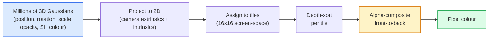

# 3D 가우시안 스플래팅

> 장면은 수백만 개의 3차원 가우시안의 구름입니다. 각각의 위치, 방향, 규모, 불투명성, 그리고 보는 방향에 따라 달라지는 색상이 있습니다.

**Type:** Build
**Languages:** Python
**Prerequisites:** Phase 4 Lesson 13 (3D Vision & NeRF), Phase 1 Lesson 12 (Tensor Operations), Phase 4 Lesson 10 (Diffusion basics optional)
**Time:** ~90 minutes

## 학습 목표

- 왜 3D 가우시안 스플래팅이 2026년 광현실적인 3D 재건의 생산 기본으로 NeRF를 대체했는지 설명합니다
- 6개의 가우스 매개 변수 (위치는, 회전 사각형, 규모, 불투명성, 구형 조화 색상, 선택적 특징) 그리고 각각의 수개의 부동의 함수가 얼마나 많은지를 설명합니다.
- 2D 가우스 스플래팅 라스터라이저를 처음부터 구현하여 `alpha`작곡을 하고, 3D 케이스를 같은 루프로 어떻게 프로젝트하는지 보여주십시오
- 사용`nerfstudio``gsplat`또는`SuperSplat`20~50개의 사진으로 한 장면을 재조성하고`KHR_gaussian_splatting`glTF 확장 또는 OpenUSD 26.03 `UsdVolParticleField3DGaussianSplat`스케마

## 문제

NeRF는 MLP의 무게로 장면을 저장합니다. 렌더링된 모든 픽셀은 광선을 따라 수백 개의 MLP 쿼리입니다. 훈련은 몇 시간, 렌더링은 몇 초, 그리고 무게는 편집할 수 없습니다.

3D 가우스 스플래팅 (Kerbl, Kopanas, Leimkühler, Drettakis, SIGGRAPH 2023) 은 그 모든 것을 대체했습니다. 장면은 3차원 가우시안의 정면적인 집합입니다. 렌더링은 GPU 라스터라이징이 100+fps로 이루어집니다. 훈련은 몇 분 걸립니다. 편집은 직렬합니다. 가우시안의 하위 집합을 번역하면 의자를 움직입니다. 2026년까지 크로노스 그룹은 가우스 스플랫에 대한 glTF 확장 프로그램을 승인했으며, OpenUSD 26.03은 가우스 스플랫 스키마를 배포하고, Zillow 및 Apartments.com은 부동산을 그들과 함께 렌더링하고, 3D 재건에 대한 대부분의 새로운 연구 논문은 3DGS 핵심 아이디어의 변형입니다.

정신 모델은 간단합니다. 수학은 움직이는 부분들이 충분하기 때문에 대부분의 소개는 라스터라이징에서 시작하여 투명과 구형적 조화계를 넘어서게 됩니다. 이 수업은 전체 것을 만듭니다.

## 개념

### 가우스족이 가지고 있는

3D 가우시안은 우주에서 다음과 같은 특성을 가진 매개 변수입니다.

```
position         mu         (3,)    centre in world coordinates
rotation         q          (4,)    unit quaternion encoding orientation
scale            s          (3,)    log-scales per axis (exponentiated at render time)
opacity          alpha      (1,)    post-sigmoid opacity [0, 1]
SH coefficients  c_lm       (3 * (L+1)^2,)   view-dependent colour
```

회전 + 규모는 3x3의 코버리언스를 만듭니다: `Sigma = R S S^T R^T`3D에서 가우스주의 형태입니다. 구형 하모닉은 색이 보는 방향과 함께 변화합니다.  스펙룰러 하이라이트, 미묘한 반짝이는 빛, 시각에 의존하는 빛  각 시각 텍스처를 저장하지 않고. SH 3 차원에서는 색채 채널당 16 개의 계수를 얻습니다. 색채에만 48 개의 가우스주의 파도가 있습니다.

각 장면은 일반적으로 1-5 백만 가우스스니아를 가지고 있습니다. 각 장면은 대략 60 개의 부동 (3 + 4 + 3 + 1 + 48 + 미스) 를 저장합니다. 이는 5 백만 가우스스니아 장면에 240 MB입니다.  각 포인트 텍스처와 동등한 포인트 클라우드보다 훨씬 작으며, 높은 해상도로 재전제된 NeRF의 MLP 무게보다 규모의 순위가 작습니다.

### 라스터링, 레이 행진이 아닌



5단계, 모두 GPU 친화적, 픽셀당 MLP 질의가 없습니다. 하나의 RTX 3080 Ti는 147fps에서 6백만 스플래트를 제공합니다.

### 투영 단계

3D 가우시안은 세계 위치에서`mu`3D 코버라이언스`Sigma`스크린 위치에서 2D 가우스 시의 프로젝트를 `mu'`2D 코버라이언스`Sigma'`이 부분의 본문은

```math
\begin{aligned}
\mu' &= \mathop{\mathrm{project}}(\mu) \\
\Sigma' &= J W \Sigma W^T J^T \qquad (2 \times 2) \\[6pt]
W &= \text{viewing transform (rotation + translation of camera)} \\
J &= \text{Jacobian of the perspective projection at } \mu'
\end{aligned}
```

2D 가우시안의 발자국은 의 원형의 자동체인`Sigma'`그 elip스 내부의 모든 픽셀은 Gaussian의 기여를 받습니다`exp(-0.5 * (p - mu')^T Sigma'^-1 (p - mu'))`- 그래

### 알파 작곡 규칙

한 픽셀에 대해, 그것을 덮는 가우시안은 앞뒤로 분류됩니다 (또는 역변 공식으로 전뒤로 동등합니다). 1980년대 이후 모든 반 투명 라스터라이저와 같은 방정식으로 구성되어 있습니다:

```math
\begin{aligned}
C_{\text{pixel}} &= \sum_i \alpha_i T_i c_i \\[6pt]
T_i &= \prod_{j < i} (1 - \alpha_j) && \text{transmittance up to } i \\
\alpha_i &= \text{opacity}_i \cdot \exp\left(-0.5 \, d^T \Sigma'^{-1} d\right) && \text{local contribution} \\
c_i &= \mathop{\mathrm{eval\_SH}}(\text{SH}_i, \text{view\_direction}) && \text{view-dependent colour}
\end{aligned}
```

이쪽은**the same equation as NeRF's volumetric render**이 정체성은 왜 렌더링 품질이 일치 NeRF  둘 다 같은 광경분야 방정식을 통합 하는 이유입니다.

### 왜 이 차이가 있을 수 있는 걸까요?

각 단계  투영, 타일 할당, 알파 컴포시팅, SH 평가 은 가우시안 매개 변수에 비해 차별화 될 수 있습니다. 기본 진실 이미지를 고려하면, 계산 렌더링 픽셀 손실, 라스터라이저를 통해 백프록, 모든 업데이트 `(mu, q, s, alpha, c_lm)`가우시안족은 약 30,000번의 반복을 통해 올바른 위치와 스케일과 색을 찾습니다.

### 밀집 및 절단

고스란스적 인 무늬가 복잡한 무기를 다루지 않습니다. 훈련은 두 가지 적응 메커니즘을 포함합니다.

- **Clone**가우스산이 현재 위치에서 그 gradient magnitude가 높지만 그 규모는 작다
- **Split**큰 규모의 가우시안은 그 gradient가 높을 때 두 개의 작은 것으로  큰 가우시안은 지역에 적합하기에는 너무 부드럽습니다.
- **Prune**가우시안들은 그 비명도가 열계층 아래로 떨어지는 것을

밀도가 늘어나고 있습니다$N$반복. 장면은 일반적으로 훈련 끝에서 ~ 100k 초기 가우시안 (SfM 포인트에서 씨앗) 에서 1-5M까지 성장합니다.

### 한 문항에 있는 구형 조화

시각에 의존하는 색은 함수입니다 `c(direction)`분자구름에 대한 분자구름의 분자구름은 분자구름의 분자구름입니다`L`그리고 당신은`(L+1)^2`새로운 조회에 대한 색을 평가하는 것은 학습된 SH 계수와 조회 방향에서 평가되는 기초 사이의 점수 산물이다. 0 정도 = 한 계수 = 일정 색상. 3 정도 = 16 계수 = 램베르트색의 그림자, 거울 및 가벼운 반사력을 캡처하기에 충분하다. SD 가우스 스플래팅 논문은 기본으로 3 정도를 사용합니다.

### 2026년 생산 스택

```
1. Capture         smartphone / DJI drone / handheld scanner
2. SfM / MVS       COLMAP or GLOMAP derives camera poses + sparse points
3. Train 3DGS      nerfstudio / gsplat / inria official / PostShot (~10-30 min on RTX 4090)
4. Edit            SuperSplat / SplatForge (clean floaters, segment)
5. Export          .ply -> glTF KHR_gaussian_splatting or .usd (OpenUSD 26.03)
6. View            Cesium / Unreal / Babylon.js / Three.js / Vision Pro
```

### 4D 및 생성형

- **4D Gaussian Splatting** 가우시안은 시간의 함수이며, 볼륨 비디오 (슈퍼맨 2026년, A$AP 로키의 "헬리콥터") 에 사용됩니다.
- **Generative splats** 텍스트에서 플래트 (World Labs의 마블) 모델, 전체 장면을 환각시키는
- **3D Gaussian Unscented Transform** NVIDIA NuRec의 자율주행 시뮬레이션 버전을

```figure
cv3-gaussian-splat
```

## 건설 해

### 1단계: 2차원 가우시안

먼저 2D 라스터라이저를 만들죠. 3D 케이스는 투영 후 그 정도로 줄어들죠.

```python
import torch
import torch.nn as nn
import torch.nn.functional as F


def eval_2d_gaussian(means, covs, points):
    """
    means:  (G, 2)      centres
    covs:   (G, 2, 2)   covariance matrices
    points: (H, W, 2)   pixel coordinates
    returns: (G, H, W)  density at every pixel for every Gaussian
    """
    G = means.size(0)
    H, W, _ = points.shape
    flat = points.view(-1, 2)
    inv = torch.linalg.inv(covs)
    diff = flat[None, :, :] - means[:, None, :]
    d = torch.einsum("gpi,gij,gpj->gp", diff, inv, diff)
    density = torch.exp(-0.5 * d)
    return density.view(G, H, W)
```

`einsum`이 수분형이 `diff^T Sigma^-1 diff`각 쌍 (가우스, 픽셀) 에 대해

### 단계 2: 2D 스플래팅 라스터라이저

2차원 깊이는 의미가 없어서, 우리는 질서를 위해 학습된 가우시안 스칼라를 사용합니다.

```python
def rasterise_2d(means, covs, colours, opacities, depths, image_size):
    """
    means:     (G, 2)
    covs:      (G, 2, 2)
    colours:   (G, 3)
    opacities: (G,)     in [0, 1]
    depths:    (G,)     per-Gaussian scalar used for ordering
    image_size: (H, W)
    returns:   (H, W, 3) rendered image
    """
    H, W = image_size
    yy, xx = torch.meshgrid(
        torch.arange(H, dtype=torch.float32, device=means.device),
        torch.arange(W, dtype=torch.float32, device=means.device),
        indexing="ij",
    )
    points = torch.stack([xx, yy], dim=-1)

    densities = eval_2d_gaussian(means, covs, points)
    alphas = opacities[:, None, None] * densities
    alphas = alphas.clamp(0.0, 0.99)

    order = torch.argsort(depths)
    alphas = alphas[order]
    colours_sorted = colours[order]

    T = torch.ones(H, W, device=means.device)
    out = torch.zeros(H, W, 3, device=means.device)
    for i in range(means.size(0)):
        a = alphas[i]
        out += (T * a)[..., None] * colours_sorted[i][None, None, :]
        T = T * (1.0 - a)
    return out
```

빠른 것은 아닙니다. 실제 구현은 타일 기반 CUDA 커널을 사용합니다. 하지만 정확한 수학과 완전히 차별화 될 수 있습니다.

### 단계 3: 훈련 가능한 2D 스플래트 장면

```python
class Splats2D(nn.Module):
    def __init__(self, num_splats=128, image_size=64, seed=0):
        super().__init__()
        g = torch.Generator().manual_seed(seed)
        H, W = image_size, image_size
        self.means = nn.Parameter(torch.rand(num_splats, 2, generator=g) * torch.tensor([W, H]))
        self.log_scale = nn.Parameter(torch.ones(num_splats, 2) * math.log(2.0))
        self.rot = nn.Parameter(torch.zeros(num_splats))  # single angle in 2D
        self.colour_logits = nn.Parameter(torch.randn(num_splats, 3, generator=g) * 0.5)
        self.opacity_logit = nn.Parameter(torch.zeros(num_splats))
        self.depth = nn.Parameter(torch.rand(num_splats, generator=g))

    def covs(self):
        s = torch.exp(self.log_scale)
        c, si = torch.cos(self.rot), torch.sin(self.rot)
        R = torch.stack([
            torch.stack([c, -si], dim=-1),
            torch.stack([si, c], dim=-1),
        ], dim=-2)
        S = torch.diag_embed(s ** 2)
        return R @ S @ R.transpose(-1, -2)

    def forward(self, image_size):
        covs = self.covs()
        colours = torch.sigmoid(self.colour_logits)
        opacities = torch.sigmoid(self.opacity_logit)
        return rasterise_2d(self.means, covs, colours, opacities, self.depth, image_size)
```

`log_scale``opacity_logit`그리고`colour_logits`모든 제한 없는 매개 변수는 렌더링 시간에 올바른 활성화를 통해 매핑됩니다. 이것은 모든 3DGS 구현의 표준 패턴입니다.

### 단계 4: 2D 가우시안을 목표 이미지로 조정

```python
import math
import numpy as np

def make_target(size=64):
    yy, xx = np.meshgrid(np.arange(size), np.arange(size), indexing="ij")
    img = np.zeros((size, size, 3), dtype=np.float32)
    # Red circle
    mask = (xx - 20) ** 2 + (yy - 20) ** 2 < 10 ** 2
    img[mask] = [1.0, 0.2, 0.2]
    # Blue square
    mask = (np.abs(xx - 45) < 8) & (np.abs(yy - 40) < 8)
    img[mask] = [0.2, 0.3, 1.0]
    return torch.from_numpy(img)


target = make_target(64)
model = Splats2D(num_splats=64, image_size=64)
opt = torch.optim.Adam(model.parameters(), lr=0.05)

for step in range(200):
    pred = model((64, 64))
    loss = F.mse_loss(pred, target)
    opt.zero_grad(); loss.backward(); opt.step()
    if step % 40 == 0:
        print(f"step {step:3d}  mse {loss.item():.4f}")
```

200단계 이상으로 64개의 가우시안들은 두 가지 모양으로 자리잡고 있습니다.

### 5단계: 2D에서 3D로

3D 확장자는 동일한 루프를 유지합니다.

1. 가우스 반전 은 단각 대신 사각형이다.
2. 협동성`R S S^T R^T``R`이 쿼터니온에서 만들어졌습니다`S = diag(exp(log_scale))`- 그래
3. 투영`(mu, Sigma) -> (mu', Sigma')`                                 `mu`- 그래
4. 색상은 구형적-합성적인 확장으로 변하고, 보는 방향에서 평가한다.
5. 깊이 분류는 학습된 스칼라 대신 실제 카메라 공간 z에서 나옵니다.

모든 생산 실행 (`gsplat``inria/gaussian-splatting``nerfstudio`) 은 바로 이 방식의 GPU를 타일 기반 CUDA 커널로 사용합니다.

### 단계 6: 구형 조화학 평가

3급까지의 SH 기준은 채널당 16개의 용어를 가지고 있습니다.

```python
def eval_sh_degree_3(sh_coeffs, dirs):
    """
    sh_coeffs: (..., 16, 3)   last dim is RGB channels
    dirs:      (..., 3)       unit vectors
    returns:   (..., 3)
    """
    C0 = 0.282094791773878
    C1 = 0.488602511902920
    C2 = [1.092548430592079, 1.092548430592079,
          0.315391565252520, 1.092548430592079,
          0.546274215296039]
    x, y, z = dirs[..., 0], dirs[..., 1], dirs[..., 2]
    x2, y2, z2 = x * x, y * y, z * z
    xy, yz, xz = x * y, y * z, x * z

    result = C0 * sh_coeffs[..., 0, :]
    result = result - C1 * y[..., None] * sh_coeffs[..., 1, :]
    result = result + C1 * z[..., None] * sh_coeffs[..., 2, :]
    result = result - C1 * x[..., None] * sh_coeffs[..., 3, :]

    result = result + C2[0] * xy[..., None] * sh_coeffs[..., 4, :]
    result = result + C2[1] * yz[..., None] * sh_coeffs[..., 5, :]
    result = result + C2[2] * (2.0 * z2 - x2 - y2)[..., None] * sh_coeffs[..., 6, :]
    result = result + C2[3] * xz[..., None] * sh_coeffs[..., 7, :]
    result = result + C2[4] * (x2 - y2)[..., None] * sh_coeffs[..., 8, :]

    # degree 3 terms omitted here for brevity; full 16-coefficient version in the code file
    return result
```

배워온 것`sh_coeffs`이 경우, 가우시안의 모든 방향의 색을 저장합니다. 렌더링 시 현재 시각 방향에 따라 평가하고 3 벡터 RGB를 얻습니다.

## 사용 하 고

실제 3DGS 작업에 사용하세요 `gsplat`(메타) 또는`nerfstudio`이 부분의 본문은

```bash
pip install nerfstudio gsplat
ns-download-data example
ns-train splatfacto --data path/to/data
```

`splatfacto`네어스트 스튜디오의 3DGS 트레이너입니다. 일반적인 장면에서는 RTX 4090에서 10~30분 정도 걸립니다.

2026년에 중요한 수출 옵션:

- `.ply` 원시 가우스 클라우드 (편집형, 최대 파일)
- `.splat` 플레이캐너스/슈퍼플래트 양자형
- glTF `KHR_gaussian_splatting` 크로노스 표준, 시청자 간 휴대용 (Feb 2026 RC).
- 오픈USD `UsdVolParticleField3DGaussianSplat` NVIDIA Omniverse 및 Vision Pro 파이프라인에 대한 USD-이족

4D / 역동적인 장면에`4DGS`그리고`Deformable-3DGS`같은 기계의 시간적 변동과 불투명성을 가진 확장

## 선박

이 교훈은 다음과 같은 결과를 낳습니다.

- `outputs/prompt-3dgs-capture-planner.md` 특정 장면을 촬영하는 세션 (사진의 수, 카메라 경로, 조명) 을 계획하는 명령어.
- `outputs/skill-3dgs-export-router.md` 올바른 수출 형식을 선택하는 기술 (`.ply`- `.splat`/ glTF / USD) 를 하류 시청자 또는 엔진에 제공 합니다.

## 운동

1. **(Easy)**2D 스플래트 트레이너를 다른 합성 이미지에 실행하세요`num_splats``[16, 64, 256]`그리고 각 단계에 대한 MSE vs 단계의 표면을 그려서 수익률이 감소하는 지점을 확인한다.
2. **(Medium)**2D 라스터라이저를 확장하여 2D 하모닉을 통해 스칼라어 "관각"에 의존하는 가우시안별 RGB 색상을 지원합니다. 목표 이미지 쌍을 훈련하고 모델이 양쪽을 재구성하는 것을 확인합니다.
3. **(Hard)**복제`nerfstudio`그리고 기차`splatfacto`당신이 가진 모든 장면 (도시, 식물, 얼굴, 방) 의 20 사진 촬영에. glTF에 수출 `KHR_gaussian_splatting`그리고 그것을 시청자 (Three.js) 에서 열`GaussianSplats3D`, 슈퍼플래트, 바빌론.js V9). 훈련 시간, 가우시안의 수, 그리고 렌더링 FPS를 보고하십시오.

## 주요 용어

| Term | What people say | What it actually means |
|------|----------------|----------------------|
| 3DGS | "Gaussian splats" | Explicit scene representation as millions of 3D Gaussians with per-Gaussian position, rotation, scale, opacity, SH colour |
| Covariance | "Shape of the Gaussian" | `Sigma = R S S^T R^T`; orientation and anisotropic scale of one Gaussian |
| Alpha compositing | "Back-to-front blend" | Same equation as NeRF's volumetric render, now over an explicit sparse set |
| Densification | "Clone and split" | Adaptive addition of new Gaussians where reconstruction is under-fit |
| Pruning | "Delete low-opacity" | Remove Gaussians that have collapsed to near-zero opacity during training |
| Spherical harmonics | "View-dependent colour" | Fourier basis on the sphere; stores colour as a function of viewing direction |
| Splatfacto | "nerfstudio's 3DGS" | The easiest path to training 3DGS in 2026 |
| `KHR_gaussian_splatting` | "glTF standard" | Khronos 2026 extension that makes 3DGS portable across viewers and engines |

## 더 많은 읽기

- [3D Gaussian Splatting for Real-Time Radiance Field Rendering (Kerbl et al., SIGGRAPH 2023)](https://repo-sam.inria.fr/fungraph/3d-gaussian-splatting/) 원본 종이를
- [gsplat (Meta/nerfstudio)](https://github.com/nerfstudio-project/gsplat) 생산 품질 CUDA 라스터라이저
- [nerfstudio Splatfacto](https://docs.nerf.studio/nerfology/methods/splat.html) 교육 레시피
- [Khronos KHR_gaussian_splatting extension](https://github.com/KhronosGroup/glTF/blob/main/extensions/2.0/Khronos/KHR_gaussian_splatting/README.md) 2026년 휴대용 형식
- [OpenUSD 26.03 release notes](https://openusd.org/release/)`UsdVolParticleField3DGaussianSplat`스케마
- [THE FUTURE 3D State of Gaussian Splatting 2026](https://www.thefuture3d.com/blog-0/2026/4/4/state-of-gaussian-splatting-2026) 산업 전반
