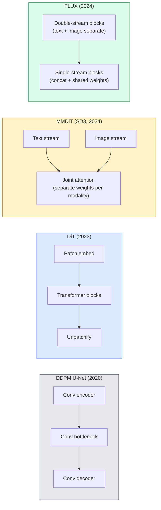

# 디프루전 트랜스포머 및 수정된 흐름

> U-Net은 전파의 비밀이 아닙니다. 트랜스포머로 교체하고, 잡음 스케줄을 직선으로 바꾸고, 갑자기 SD3, FLUX, 그리고 2026년마다 텍스트에서 이미지로 연결되는 모델이 있습니다.

**Type:** Learn + Build
**Languages:** Python
**Prerequisites:** Phase 4 Lesson 10 (Diffusion DDPM), Phase 4 Lesson 14 (ViT), Phase 7 Lesson 02 (Self-Attention)
**Time:** ~75 minutes

## 학습 목표

- U-Net DDPM (강좌 10) 에서 디푸지언 트랜스포머 (DiT), MMDiT (SD3) 및 싱글+다중 흐름 디T (FLUX) 까지의 진화 과정을 추적한다.
- 수정된 흐름에 대해 설명: 왜 노리와 데이터 사이의 직선 궤도가 모델들이 1000 단계 대신 20 단계의 샘플을 가져갈 수 있는지
- 작은 DiT 블록과 정정 흐름 훈련 루프를 구현하고, 둘 다 100 라인 이하입니다.
- 모델 변종 (SD3, FLUX.1-dev, FLUX.1-schnell, Z-Image, Qwen-Image) 을 건축, 매개 변수 수 및 라이선스별로 구분한다

## 문제

10강은 U-Net 디노이저와 함께 DDPM를 만들었습니다. 그 레시피는 2020-2023년에 지배적이었다: U-Net + 베타 스케줄 + 노이즈 예측 손실.

2026년 최신 텍스트-진상 모델들은 모두 이 시스템을 넘어섰습니다. 안정적인 디프루전 3, FLUX, SD4, Z- 이미지, Qwen- 이미지, Hunyuan- 이미지 은 U- 네트워크를 사용하지 않습니다. 그들은 디프루전 변환기를 (DiT) 사용합니다. SD3와 FLUX는 또한 DDPM 노스 스케줄을 수정된 흐름으로 교환합니다. 이는 노스에서 데이터로의 경로를 곧게 만들고 일관성 또는 디스틸 된 변형을 통해 1-4 단계 추론을 가능하게합니다.

이 변화는 중요한 이유는 디푸전 기반 이미지 생성이 제어 가능하고, 신속한 정확성 (SD3/SD4 해결 텍스트 렌더링) 과 생산 속도가 높아졌기 때문입니다. DiT + 수정된 흐름을 이해하는 것은 2026년 생성 이미지 스택을 이해하는 것입니다.

## 개념

### U-넷에서 트랜스포머로



- **DiT**(Peebles & Xie, 2023)  잠복 패치에 U-넷을 ViT와 같은 트랜스포머로 대체합니다. 적응 레이어 표준 (AdaLN) 을 통해 컨디션합니다.
- **MMDiT**(SD3, Esser et al., 2024)  공동의 관심을 공유하는 텍스트 및 이미지 토큰의 별도의 무게를 가진 두 스트림.
- **FLUX**(블랙포스트랩, 2024)  초기 N 블록은 SD3와 같은 두 개의 스트림으로 이루어집니다. 나중에 블록은 더 높은 깊이에서 효율성을 위해 중계를 공유하고 ( 단일 스트림)
- **Z-Image**(2025)  효율적인 단일 스트림 DiT 6B 매개 변수에서 "모든 비용으로 확장"을 도전합니다.

### 한 문항에서 수정된 흐름

DDPM는 앞으로의 과정을 음한 SDE로 정의합니다.`x_t`점점 더 부패하고 있습니다. 배운 역은 1000 개의 작은 단계로 해결되는 두 번째 SDE입니다.

수정된 흐름은**straight-line**깨끗한 데이터와 순수한 잡음 사이의 인터폴레이션:

```math
x_t = (1 - t) \, x_0 + t \, \epsilon, \qquad t \in [0, 1]
```

네트워크를 훈련시켜 속도 예측을 할 수 있습니다`v_theta(x_t, t) = epsilon - x_0` 깨끗한 데이터에서 소음까지 직선 경로를 따라 앞으로의 방향 (`dx_t/dt`) 샘플링 중에, 당신은 이러한 속도를 뒤로 통합하여 소음으로부터 데이터로 나아갑니다. 결과 ODE는 직선에 훨씬 더 가깝기 때문에 샘플링에 대한 통합 단계가 훨씬 적은 것입니다.

SD3이 이렇게 부르죠**Rectified Flow Matching**FLUX, Z-Image, 그리고 대부분의 2026 모델들은 동일한 목표를 사용한다. 전형적인 추론: 20-30 Euler 단계 (분명론적) vs 50+ DDIM 단계 구 DDPM 정권에서. 디스틸 / 터보 / 스프랭크 / LCM 변종은 1-4 단계로 줄입니다.

### AdaLN 컨디셔닝

시간 단계 및 클래스/ 텍스트에 대한 DTs 조건**adaptive layer norm**: 예측`scale`그리고`shift`U-Nets에서 FiLM 방식의 모듈링보다 훨씬 더 깨끗하고 모든 현대 DiT에서 기본으로 적용됩니다.

```
cond -> MLP -> (scale, shift, gate)
norm(x) * (1 + scale) + shift, then residual add * gate
```

### SD3 및 FLUX의 텍스트 코더

- **SD3**세 개의 텍스트 코더를 사용한다: 두 개의 CLIP 모델 + T5-XXL. 임베디션은 연결되어 텍스트 컨디션으로 이미지 스트림에 공급됩니다.
- **FLUX**한 개의 CLIP-L + T5-XXL를 사용한다.
- **Qwen-Image / Z-Image**변종들은 기본 LLM에 맞춰 자체적인 텍스트 코더를 사용합니다.

텍스트 코더는 SD3/FLUX의 명령어에 대한 이유를 SD1.5보다 훨씬 더 잘 설명하는 큰 부분입니다. T5-XXL만으로는 4.7B 파라미가 있습니다.

### 분류자 없는 지침은 여전히 유효하다

수정된 흐름은 샘플링을 변화시키는 것이 아니라 조건화하는 것을 변화시킵니다. 분류자 없는 지침 (훈련 중에 10%의 확률이 있는 글씨를 떨어뜨리고, 추론 시 조건부와 무조건적인 예측을 혼합) 은 수정된 흐름과 동일하게 작동합니다. 대부분의 2026 모델은 SD1.5의 7.5보다 3.5-5  낮은 지침 스케일을 사용합니다. 왜냐하면 수정된 흐름 모델은 기본으로 명령에 더 밀접하게 따라하기 때문입니다.

### 일관성, 터보, 슈넬, LCM

같은 아이디어에 대한 네 가지 이름: 느린 여러 단계 모델을 몇 단계 모델로 단속하게 유출합니다.

- **LCM (Latent Consistency Model)** 최종예선을 예측하는 학생을 훈련시켜`x_0`어떤 중간중간에서든`x_t`한 발자국으로
- **SDXL Turbo / FLUX schnell** 1~4 단계 모델은 적대적 디푸전 증류로 훈련되어 있습니다.
- **SD Turbo** 잠잠한 전파에 적응된 OpenAI 스타일의 일관성 모델

새로운 모델 선박의 생산 서비스는 "완전 품질" 체크포인트와 "터보 / 스프랭크" 변종을 모두 제공합니다. 슈넬 ("자동" 독일어, 블랙포스트 랩의 컨벤션) 는 1-4 단계로 실행되며 실시간 파이프라인을 부합합니다.

### 2026년 모델 풍경

| Model | Size | Architecture | License |
|-------|------|--------------|---------|
| Stable Diffusion 3 Medium | 2B | MMDiT | SAI Community |
| Stable Diffusion 3.5 Large | 8B | MMDiT | SAI Community |
| FLUX.1-dev | 12B | Double + Single Stream DiT | non-commercial |
| FLUX.1-schnell | 12B | same, distilled | Apache 2.0 |
| FLUX.2 | — | iterated FLUX.1 | mixed |
| Z-Image | 6B | S3-DiT (Scalable Single-Stream) | permissive |
| Qwen-Image | ~20B | DiT + Qwen text tower | Apache 2.0 |
| Hunyuan-Image-3.0 | ~80B | DiT | research |
| SD4 Turbo | 3B | DiT + distillation | SAI Commercial |

FLUX.1-schnell은 2026년 오픈소스 기본 버전입니다. Z- 이미지 는 효율성 리더입니다. FLUX.2 및 SD4는 현재 품질 팁입니다.

### 이 단계 전환이 중요한 이유

DDPM+U-Net가 작동했습니다.**better, faster, and scales more cleanly**. 이 전환은 RNN에서 NLP의 트랜스포머에 이르는 것과 유사합니다. 두 건축물 모두 동일한 문제를 해결했지만 트랜스포머가 확장되어 현재 지배하고 있습니다. 2026 년 이미지, 비디오 또는 3D 생성에 대한 모든 논문은 DiT 모양의 디노이저와 일반적으로 수정된 흐름 목표를 사용합니다. U-Net DDPM는 현재 주로 교육 (강좌 10) 이다.

```figure
cv3-rectified-flow
```

## 건설 해

### 단계 1: AdaLN로 DiT 블록

```python
import torch
import torch.nn as nn


class AdaLNZero(nn.Module):
    """
    Adaptive LayerNorm with a gate. Predicts (scale, shift, gate) from the conditioning.
    Init such that the whole block starts as identity ("zero init").
    """

    def __init__(self, dim, cond_dim):
        super().__init__()
        self.norm = nn.LayerNorm(dim, elementwise_affine=False)
        self.mlp = nn.Linear(cond_dim, dim * 3)
        nn.init.zeros_(self.mlp.weight)
        nn.init.zeros_(self.mlp.bias)

    def forward(self, x, cond):
        scale, shift, gate = self.mlp(cond).chunk(3, dim=-1)
        h = self.norm(x) * (1 + scale.unsqueeze(1)) + shift.unsqueeze(1)
        return h, gate.unsqueeze(1)


class DiTBlock(nn.Module):
    def __init__(self, dim=192, heads=3, mlp_ratio=4, cond_dim=192):
        super().__init__()
        self.adaln1 = AdaLNZero(dim, cond_dim)
        self.attn = nn.MultiheadAttention(dim, heads, batch_first=True)
        self.adaln2 = AdaLNZero(dim, cond_dim)
        self.mlp = nn.Sequential(
            nn.Linear(dim, dim * mlp_ratio),
            nn.GELU(),
            nn.Linear(dim * mlp_ratio, dim),
        )

    def forward(self, x, cond):
        h, gate1 = self.adaln1(x, cond)
        a, _ = self.attn(h, h, h, need_weights=False)
        x = x + gate1 * a
        h, gate2 = self.adaln2(x, cond)
        x = x + gate2 * self.mlp(h)
        return x
```

`AdaLNZero`본격적인 인격 지도가 시작되는 이유는 MLP 무게가 0으로 초기화되기 때문입니다. 훈련은 정체성으로부터 블록을 밀어냅니다. 이것은 깊은 트랜스포머 전파 모델을 극적으로 안정시킵니다.

### 2단계: 작은 다이트

```python
def timestep_embedding(t, dim):
    import math
    half = dim // 2
    freqs = torch.exp(-math.log(10000) * torch.arange(half, device=t.device) / half)
    args = t[:, None].float() * freqs[None]
    return torch.cat([args.sin(), args.cos()], dim=-1)


class TinyDiT(nn.Module):
    def __init__(self, image_size=16, patch_size=2, in_channels=3, dim=96, depth=4, heads=3):
        super().__init__()
        self.patch_size = patch_size
        self.num_patches = (image_size // patch_size) ** 2
        self.patch = nn.Conv2d(in_channels, dim, kernel_size=patch_size, stride=patch_size)
        self.pos = nn.Parameter(torch.zeros(1, self.num_patches, dim))
        self.time_mlp = nn.Sequential(
            nn.Linear(dim, dim * 2),
            nn.SiLU(),
            nn.Linear(dim * 2, dim),
        )
        self.blocks = nn.ModuleList([DiTBlock(dim, heads, cond_dim=dim) for _ in range(depth)])
        self.norm_out = nn.LayerNorm(dim, elementwise_affine=False)
        self.head = nn.Linear(dim, patch_size * patch_size * in_channels)

    def forward(self, x, t):
        n = x.size(0)
        x = self.patch(x)
        x = x.flatten(2).transpose(1, 2) + self.pos
        t_emb = self.time_mlp(timestep_embedding(t, self.pos.size(-1)))
        for blk in self.blocks:
            x = blk(x, t_emb)
        x = self.norm_out(x)
        x = self.head(x)
        return self._unpatchify(x, n)

    def _unpatchify(self, x, n):
        p = self.patch_size
        h = w = int(self.num_patches ** 0.5)
        x = x.view(n, h, w, p, p, -1).permute(0, 5, 1, 3, 2, 4).reshape(n, -1, h * p, w * p)
        return x
```

### 단계 3: 수정된 흐름 훈련

```python
import torch.nn.functional as F

def rectified_flow_train_step(model, x0, optimizer, device):
    model.train()
    x0 = x0.to(device)
    n = x0.size(0)
    t = torch.rand(n, device=device)
    epsilon = torch.randn_like(x0)
    x_t = (1 - t[:, None, None, None]) * x0 + t[:, None, None, None] * epsilon

    target_velocity = epsilon - x0
    pred_velocity = model(x_t, t)

    loss = F.mse_loss(pred_velocity, target_velocity)
    optimizer.zero_grad()
    loss.backward()
    optimizer.step()
    return loss.item()
```

DDPM의 잡음 예측 손실과 비교해 보세요 (강좌 10): 같은 구조, 다른 목표.`epsilon`, 우리는 예측 **velocity** `epsilon - x_0`, 즉 직선 중계로 데이터를 소음으로 가리키는

### 단계 4: 에우러 샘플러

수정된 흐름은 ODE이다. 유일러의 방법은 가장 간단하고, 잘 훈련된 수정된 흐름 모델에서는 20+ 단계에 높은 순위 해제자와 거의 같은 정확성이다.

```python
@torch.no_grad()
def rectified_flow_sample(model, shape, steps=20, device="cpu"):
    model.eval()
    x = torch.randn(shape, device=device)
    dt = 1.0 / steps
    t = torch.ones(shape[0], device=device)
    for _ in range(steps):
        v = model(x, t)
        x = x - dt * v
        t = t - dt
    return x
```

20 단계: 훈련된 모델에서는 1000 단계 DDPM와 비교할 수 있는 샘플을 생산합니다.

### 단계 5: 끝에서 끝까지의 흡연 테스트

```python
import numpy as np

def synthetic_blobs(num=200, size=16, seed=0):
    rng = np.random.default_rng(seed)
    out = np.zeros((num, 3, size, size), dtype=np.float32)
    yy, xx = np.meshgrid(np.arange(size), np.arange(size), indexing="ij")
    for i in range(num):
        cx, cy = rng.uniform(4, size - 4, size=2)
        r = rng.uniform(2, 4)
        mask = (xx - cx) ** 2 + (yy - cy) ** 2 < r ** 2
        colour = rng.uniform(-1, 1, size=3)
        for c in range(3):
            out[i, c][mask] = colour[c]
    return torch.from_numpy(out)
```

A를 열고`TinyDiT`500 단계 후 샘플 출력량은 희미한 색의 반점처럼 보일 수 있습니다.

## 사용 하 고

FLUX / SD3 / Z-Image를 사용하여 실제 이미지 생성`diffusers`모든 배들은 통일된 API를 가지고 있습니다.

```python
from diffusers import FluxPipeline, StableDiffusion3Pipeline
import torch

pipe = FluxPipeline.from_pretrained(
    "black-forest-labs/FLUX.1-schnell",
    torch_dtype=torch.bfloat16,
).to("cuda")

out = pipe(
    prompt="a golden retriever surfing a tsunami, hyperrealistic, studio lighting",
    guidance_scale=0.0,           # schnell was trained without CFG
    num_inference_steps=4,
    max_sequence_length=256,
).images[0]
out.save("surf.png")
```

세 줄이`FLUX.1-schnell`4단계로 모델 아이디를 `black-forest-labs/FLUX.1-dev`CFG로 20-30단계로 더 높은 품질을 위해

SD3용:

```python
pipe = StableDiffusion3Pipeline.from_pretrained(
    "stabilityai/stable-diffusion-3.5-large",
    torch_dtype=torch.bfloat16,
).to("cuda")
out = pipe(prompt, guidance_scale=3.5, num_inference_steps=28).images[0]
```

## 선박

이 교훈은 다음과 같은 결과를 낳습니다.

- `outputs/prompt-dit-model-picker.md` 품질, 지연 및 라이선스 제한을 감안하면 SD3, FLUX.1-dev, FLUX.1-schnell, Z-Image, SD4 Turbo 사이에서 선택합니다.
- `outputs/skill-rectified-flow-trainer.md`AdaLN DiT 및 Euler 샘플링으로 정정된 흐름에 대한 완전한 훈련 루프를 작성합니다.

## 운동

1. **(Easy)**위의 TinyDiT를 합성 블로브 데이터 세트에 500 단계 동안 훈련하십시오. 10, 20 및 50 Euler 단계로 생성된 샘플을 비교하십시오.
2. **(Medium)**학습된 클래스 임베디션을 임베디션 시간으로 연결하여 텍스트 컨디션을 추가합니다. 색상별로 10개의 " 클래스 " 덩어리).
3. **(Hard)**같은 데이터에 훈련된 같은 크기의 네트워크의 수정된 흐름에서 생성된 샘플과 DDPM 버전 사이의 프레체 거리 (FID 프록시) 를 같은 수의 단계에 계산한다.

## 주요 용어

| Term | What people say | What it actually means |
|------|----------------|----------------------|
| DiT | "Diffusion transformer" | Transformer that replaces the U-Net as the diffusion denoiser; operates on patchified latents |
| AdaLN | "Adaptive layer norm" | Timestep/text conditioning via learned scale, shift, gate applied after LayerNorm; standard in every modern DiT |
| MMDiT | "Multi-modal DiT (SD3)" | Separate weight streams for text and image tokens that share a joint self-attention |
| Single-stream / double-stream | "FLUX trick" | First $N$ blocks double-stream (separate weights per modality), later blocks single-stream (concat + shared weights) for efficiency |
| Rectified flow | "Straight-line noise-to-data" | Linear interpolation between data and noise; network predicts velocity; fewer ODE steps needed at inference |
| Velocity target | "epsilon - x_0" | The regression target in rectified flow; points from clean data to noise |
| CFG guidance | "classifier-free guidance" | Mix conditional and unconditional predictions; still used in rectified-flow models |
| Schnell / turbo / LCM | "1-4 step distillation" | Small-step variants distilled from full-quality models; production real-time |

## 더 많은 읽기

- [Scalable Diffusion Models with Transformers (Peebles & Xie, 2023)](https://arxiv.org/abs/2212.09748) DIT 종이
- [Scaling Rectified Flow Transformers (Esser et al., SD3 paper)](https://arxiv.org/abs/2403.03206) MMDiT 및 규모로 정정된 흐름
- [FLUX.1 model card and technical report (Black Forest Labs)](https://huggingface.co/black-forest-labs/FLUX.1-dev) 이중+ 단일 흐름 세부 사항
- [Z-Image: Efficient Image Generation Foundation Model (2025)](https://arxiv.org/html/2511.22699v1) 6B에서 단일 흐름 DiT
- [Elucidating the Design Space of Diffusion (Karras et al., 2022)](https://arxiv.org/abs/2206.00364) 각 방산 설계 거래소 참조
- [Latent Consistency Models (Luo et al., 2023)](https://arxiv.org/abs/2310.04378) LCM- LoRA가 어떻게 4단계 추론을 줄 수 있는지
