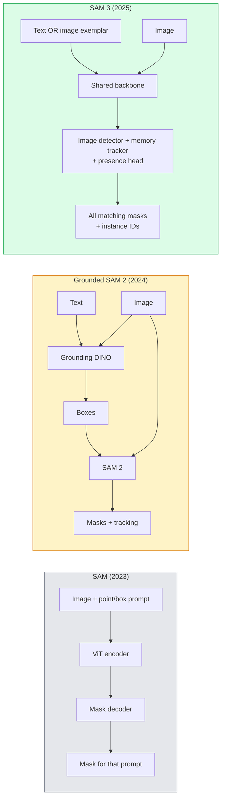

# SAM 3 및 오픈 워커벌리 세그먼팅

> 모델에 텍스트 명령어와 이미지를 주고 매칭된 개체마다 마스크를 가져오세요. SAM 3는 한 번 앞을 돌립니다.

**Type:** Use + Build
**Languages:** Python
**Prerequisites:** Phase 4 Lesson 07 (U-Net), Phase 4 Lesson 08 (Mask R-CNN), Phase 4 Lesson 18 (CLIP)
**Time:** ~60 minutes

## 학습 목표

- SAM (비जु얼 명령어만), 토지 SAM / SAM 2 (탐지 + SAM) 및 SAM 3 (이용식 개념 세그먼트를 통해 네이티브 텍스트 명령어) 를 구분한다
- SAM 3 아키텍처를 설명하십시오: 공유 척추 + 이미지 탐지 + 메모리 기반 비디오 추적기 + 존재 헤드 + 분리된 탐지-트래커 설계
- 포옹하는 얼굴을 사용 하십시오`transformers`텍스트를 통해 탐지, 세그먼트 및 비디오 추적을 위한 SAM 3 통합
- 잠정성, 개념 복잡성, 배포 목표에 따라 SAM 3, 지형 SAM 2, YOLO-World, SAM-MI 사이에서 선택

## 문제

2023 SAM는 시각적 인상급 모델이었습니다. 포인트를 클릭하거나 상자를 그리면 마스크를 반환합니다. "이 사진의 모든 오렌지를 나에게 줘"는 데는 상자를 생성하기 위해 탐지기가 필요했습니다.

SAM 3 (Meta, Nov 2025, ICLR 2026) 은 캐스케드를 붕괴시켰다. 그것은 짧은 명목 문장을 또는 이미지 모범을 즉시 받아서 모든 일치하는 마스크와 인스턴스 ID를 단일 전진 패스로 반환합니다. 즉**Promptable Concept Segmentation (PCS)**. 2026년 3월 오브젝트 멀티플렉스 업데이트 (SAM 3.1) 와 결합하여, 동일한 개념의 여러 사례를 비디오로 효율적으로 추적합니다.

이 수업은 이 모델이 나타내는 구조적 변화에 관한 것입니다. 2D Seg, 탐지, 텍스트 이미지 지형이 하나의 모델로 통합되었습니다. 생산 문제는 더 이상 "어떤 파이프라인을 함께 체인하는 것"이 아니라 "어떤 프롬팩블 모델이 내 사용 사례를 끝에서 끝으로 처리합니다".

## 개념

### 세 세대가



### 즉각적인 개념 세그먼트

"콘셉트 프롬프트"는 짧은 명목 문장 (`"yellow school bus"``"striped red umbrella"``"hand holding a mug"`) 또는 이미지 모범. 모델은 개념에 해당하는 이미지 각 인스턴스별로 세그먼트 마스크를 반환하고, 매치마다 고유 인스턴스 ID를 제공합니다.

이것은 세 가지 방법으로 전통적인 시각적 인상시 SAM에서 다릅니다.

1. 단 한 번의 요청이 필요하지 않습니다.
2. 개방형 어휘는 자연어로 설명할 수 있는 모든 것을 의미할 수 있습니다.
3. 한 번에 한 마스크가 아닌 여러 인스턴스를 동시에 반환합니다.

### 주요 건축물

- **Shared backbone** 하나의 ViT가 이미지를 처리합니다. 탐지기 머리와 메모리 기반 추적기는 모두 그로부터 읽습니다.
- **Presence head**는 개념이 이미지에 존재하는지 여부를 예측합니다. "이것이 여기 있습니까?"와 "어디 있습니까?"를 분리합니다.
- **Decoupled detector-tracker** 이미지 레벨 탐지 및 비디오 레벨 추적은 별도의 헤드를 가지고 있어 방해가 되지 않습니다.
- **Memory bank** 비디오 추적을 위해 프레임에 걸쳐 인스턴스 기능들을 저장합니다 ( SAM 2 같은 메커니즘을 사용했습니다).

### 규모의 교육

SAM 3는 훈련되었습니다**4 million unique concepts**인공지능+인간의 검토를 사용하여 반복적으로 해설하고 수정하는 데이터 엔진에 의해 생성됩니다.**SA-CO benchmark**이전 기준보다 50배 더 큰 270K의 고유한 개념을 포함하고 있습니다. SAM 3는 SA-CO에서 인간 성능의 75-80%를 달성하고 이미지 + 비디오 PCS에서 기존 시스템을 두 배로 증가시킵니다.

### SAM 3.1 객체 다중

2026년 3월 업데이트: **Object Multiplex**같은 개념의 여러 인스턴스를 동시에 공동 추적하는 공유 메모리 메커니즘을 도입합니다. 이전에는 N 인스턴스를 추적하는 것은 N 분리된 메모리 은행을 의미했습니다. 멀티플렉스는 인스턴스 쿼리로 공유된 메모리로 붕괴합니다. 결과는 정확성을 희생하지 않고 실질적으로 더 빠른 멀티 객체 추적입니다.

### 2026년에도 지형 SAM가 중요해

- 특정 개방형 어휘 탐지기를 교체할 때 (DINO-X, Florence-2).
- SAM 3 라이선스가 차단제인 경우
- 탐지선수 임대보다 SAM3가 노출되는 것을 더 제어해야 할 때
- 탐지기 구성 요소에 대한 연구/배추 작업에 대한 용도로

모듈 파이프 라인은 여전히 존재합니다. 대부분의 생산 작업에 SAM 3는 더 간단한 답입니다.

### YOLO-월드 VS SAM 3

- **YOLO-World** 오픈 워커블리 디테커만 (마스크가 없습니다). 실시간. 높은 fps에서 상자가 필요할 때 가장 좋습니다.
- **SAM 3** 전체 세그먼트 + 추적. 느린 하지만 더 풍부한 출력.

생산 분할: YOLO-World는 빠른 탐지 전용 파이프라인 (로봇 탐색, 빠른 대시보드), 마스크 또는 추적이 필요한 모든 것 සඳහා SAM 3입니다.

### SAM-MI 효율성

SAM-MI (2025~2026) 는 SAM의 디코더 병목을 해결합니다. 주요 아이디어:

- **Sparse point prompting** 밀집한 명령어 대신 몇 가지 잘 선택된 포인트를 사용합니다. 디코더 호출을 96% 감소시킵니다.
- **Shallow mask aggregation**                                                                                                                                                                                                                                                              
- **Decoupled mask injection** 디코더는 재 실행 대신 미리 계산된 마스크 기능을 수신합니다.

결과: ~ 1.6x 가량 가속화 가 오픈 어휘 기준에 대한 근거-SAM보다

### 세 모델의 출력 형식

모두 동일한 일반적인 구조를 반환합니다 (박스 + 레이블 + 점수 + 마스크 + ID), 이는 도움이 됩니다  하류 파이프 라인은 어떤 모델에 달려있는지 갈라지지 않아도됩니다.

```figure
cv3-open-vocab
```

## 건설 해

### 1단계: 신속한 건설

사용자 문장을 SAM 3 개념 요청 목록으로 변환하는 보조기를 구축하십시오. 이것은 "이용자가 입력한 것"이 "모델이 소비하는 것"과 만나는 경계입니다.

```python
def split_concepts(sentence):
    """
    Heuristic splitter for multi-concept prompts.
    Returns list of short noun phrases.
    """
    for sep in [",", ";", "and", "or", "&"]:
        if sep in sentence:
            parts = [p.strip() for p in sentence.replace("and ", ",").split(",")]
            return [p for p in parts if p]
    return [sentence.strip()]

print(split_concepts("cats, dogs and balloons"))
```

SAM 3는 앞으로의 패스마다 하나의 컨셉을 수용합니다. 다 컨셉 쿼리에서는 루프 또는 배치를 사용합니다.

### 단계 2: 후처리 보조

SAM3의 원산물들을 네 번째 단계 16강 파이프라인 계약에 맞춘 검출 목록으로 바꾸어 놓으세요.

```python
from dataclasses import dataclass
from typing import List

@dataclass
class ConceptDetection:
    concept: str
    instance_id: int
    box: tuple          # (x1, y1, x2, y2)
    score: float
    mask_rle: str       # run-length encoded


def rle_encode(binary_mask):
    flat = binary_mask.flatten().astype("uint8")
    runs = []
    prev, count = flat[0], 0
    for v in flat:
        if v == prev:
            count += 1
        else:
            runs.append((int(prev), count))
            prev, count = v, 1
    runs.append((int(prev), count))
    return ";".join(f"{v}x{c}" for v, c in runs)
```

RLE는 많은 고해상도 마스크에도 반응용 부하를 작게 유지합니다. SAM 2, SAM 3, 지상 SAM 2에도 동일한 형식이 작동합니다.

### 단계 3: 통일된 개방형 음성 세그먼트 인터페이스

어떤 백엔드 (SAM 3, Grounded SAM 2, YOLO-World + SAM 2) 를 하나인 방법 뒤에 꽂아주세요. 백엔드가 변경될 때 다운스트림 코드는 변경되지 않습니다.

```python
from abc import ABC, abstractmethod
import numpy as np

class OpenVocabSeg(ABC):
    @abstractmethod
    def detect(self, image: np.ndarray, concept: str) -> List[ConceptDetection]:
        ...


class StubOpenVocabSeg(OpenVocabSeg):
    """
    Deterministic stub used for pipeline testing when real models are not loaded.
    """
    def detect(self, image, concept):
        h, w = image.shape[:2]
        return [
            ConceptDetection(
                concept=concept,
                instance_id=0,
                box=(w * 0.2, h * 0.3, w * 0.5, h * 0.8),
                score=0.89,
                mask_rle="0x100;1x50;0x200",
            ),
            ConceptDetection(
                concept=concept,
                instance_id=1,
                box=(w * 0.55, h * 0.25, w * 0.85, h * 0.75),
                score=0.74,
                mask_rle="0x80;1x40;0x220",
            ),
        ]
```

진짜`SAM3OpenVocabSeg`하위급은 `transformers.Sam3Model`그리고`Sam3Processor`- 그래

### 단계 4: 안목 안목 SAM 3 사용 ( 참조)

실제 모델에 대해서는`transformers`통합:

```python
from transformers import Sam3Processor, Sam3Model
import torch

processor = Sam3Processor.from_pretrained("facebook/sam3")
model = Sam3Model.from_pretrained("facebook/sam3").eval()

inputs = processor(images=pil_image, return_tensors="pt")
inputs = processor.set_text_prompt(inputs, "yellow school bus")

with torch.no_grad():
    outputs = model(**inputs)

masks = processor.post_process_masks(
    outputs.masks, inputs.original_sizes, inputs.reshaped_input_sizes
)
boxes = outputs.boxes
scores = outputs.scores
```

한 번만 하면 모든 경기들이 한 번의 통화로 돌아옵니다.

### 단계 5: 지상 SAM 2에서 무료로 제공한 것을 측정하십시오

정직한 기준: 실제 파이프라인에서 지상 SAM2를 SAM3로 대체하면 어떻게 될까요?

- 지연성: SAM 3는 한 번 앞을 통과 ( 별도의 탐지기가 없으나) 모델 자체는 더 무거운데, 보통은 순위 중립 또는 가벼운 가속화이다.
- 정확성: SAM 3는 희귀 또는 구성 개념 ("줄로 된 빨간 낙하산") 에서 상당히 낫다. 일반적인 단일 단어 개념에 유사하다.
- 유연성: 지형 SAM 2는 검출기를 교환할 수 있습니다 (DINO-X, Florence-2, 지형 DINO 1.5); SAM 3는 모놀리틱입니다.

결론: SAM 3는 2026 오픈-포컬 세그의 기본입니다. 지형 SAM 2는 여전히 탐지기 유연성 또는 다른 라이선스 조건이 필요할 때 올바른 답입니다.

## 사용 하 고

생산 배포 패턴:

- **Real-time annotation** SAM 3 + CVAT의 레이블-예- 텍스트- 프롬프트 기능. 해독자는 레이블 이름을 선택하고 SAM 3는 각각의 일치하는 인스턴스를 미리 레이블합니다. 검토하고 수정합니다.
- **Video analytics** SAM 3.1 멀티 객체 추적을 위한 객체 멀티플렉스; 메모리 기반 추적기까지 공급 프레임.
- **Robotics** 공개 음성 조작을 위한 SAM 3 ("붉은 잔을 들어라"); 계획 원시로 실행된다.
- **Medical imaging** SAM 3는 의료 개념에 정교하게 조정되어 있습니다. HF에 대한 접근 요청이 필요합니다.

울트라리틱스는 파이썬 패키지 SAM 3를 엮어 넣습니다.

```python
from ultralytics import SAM

model = SAM("sam3.pt")
results = model(image_path, prompts="yellow school bus")
```

YOLO와 SAM2와 같은 인터페이스

## 선박

이 교훈은 다음과 같은 결과를 낳습니다.

- `outputs/prompt-open-vocab-stack-picker.md`                                                                                                                                                                                                                                                              
- `outputs/skill-concept-prompt-designer.md` 사용자 발언을 잘 형성된 SAM 3 개념 명령으로 바꾸는 기술 (분할, 불분명, 역전).

## 운동

1. **(Easy)**SAM 3 를 10 개의 이미지에 선택된 컨셉 프롬프트와 실행하세요. SAM 2 + 지형 DINO 1.5 를 동일한 이미지에 비교해 보세요. 각각의 모델이 놓친 컨셉을 보고하세요.
2. **(Medium)**SAM 3 위에 "클릭-투-안/클릭-투-엑스클루드" UI를 구축하십시오. 텍스트 프롬프트는 후보 인스턴스를 반환합니다. 사용자 클릭은 어떤 것이 긍정적 인 것으로 간주되는지 유지합니다. 최종 개념 세트를 JSON로 출력합니다.
3. **(Hard)**사용자 지정 컨셉 세트 (예를 들어 5 종류의 전자 부품) 에 20 개의 라벨된 이미지로 미세 조율 SAM 3

## 주요 용어

| Term | What people say | What it actually means |
|------|----------------|----------------------|
| Open-vocabulary segmentation | "Segment by text" | Produce masks for objects described in natural language, not a fixed label set |
| PCS | "Promptable Concept Segmentation" | SAM 3's core task — given a noun-phrase or image exemplar, segment all matching instances |
| Concept prompt | "The text input" | Short noun phrase or image exemplar; not a full sentence |
| Presence head | "Is it here?" | SAM 3 module that decides whether the concept exists in the image before localisation |
| SA-CO | "SAM 3 benchmark" | 270K-concept open-vocabulary segmentation benchmark; 50x larger than prior open-vocab benchmarks |
| Object Multiplex | "SAM 3.1 update" | Shared-memory multi-object tracking; fast joint tracking of many instances |
| Grounded SAM 2 | "Modular pipeline" | Detector + SAM 2 cascade; still relevant when detector swap matters |
| SAM-MI | "Efficient SAM variant" | Mask Injection for 1.6x speedup over Grounded-SAM |

## 더 많은 읽기

- [SAM 3: Segment Anything with Concepts (arXiv 2511.16719)](https://arxiv.org/abs/2511.16719)
- [SAM 3.1 Object Multiplex (Meta AI, March 2026)](https://ai.meta.com/blog/segment-anything-model-3/)
- [SAM 3 model page on Hugging Face](https://huggingface.co/facebook/sam3)
- [Grounded SAM 2 tutorial (PyImageSearch)](https://pyimagesearch.com/2026/01/19/grounded-sam-2-from-open-set-detection-to-segmentation-and-tracking/)
- [Ultralytics SAM 3 docs](https://docs.ultralytics.com/models/sam-3/)
- [SAM3-I: Instruction-aware SAM (arXiv 2512.04585)](https://arxiv.org/abs/2512.04585)
