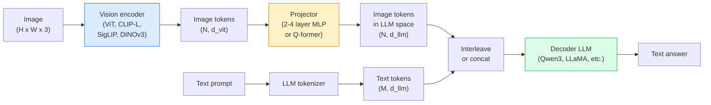

# 시각 언어 모델  ViT-MLP-LLM 패턴

> 비전 코더는 이미지를 토큰으로 변환합니다. MLP 프로젝터는 LLM의 임베디션 공간에 해당 토큰을 지도합니다. 언어 모델은 나머지는합니다. 그 패턴은 2026 년 모든 생산 VLM입니다.

**Type:** Learn + Use
**Languages:** Python
**Prerequisites:** Phase 4 Lesson 14 (ViT), Phase 4 Lesson 18 (CLIP), Phase 7 Lesson 02 (Self-Attention)
**Time:** ~75 minutes

## 학습 목표

- ViT-MLP-LLM 구조를 설명하고 세 가지 구성 요소 중 각각의 기여를 설명
- Qwen3-VL, InternVL3.5, LLaVA-Next, GLM-4.6V를 파라미터 수, 컨텍스트 길이가, 벤치마크 성능에 비교한다
- 딥스택: 여러 레벨의 ViT 기능이 단일 마지막 레이어 기능보다 시각 언어 조화를 더 잘 강화하는 이유를 설명하십시오
- 생산에서 VLM 환각을 크로스 모달 오류율 (CMER) 으로 측정하고 신호에 따라 행동하십시오.

## 문제

CLIP (단계 4 수업 18) 은 이미지와 텍스트를 공유하는 임베디드 공간을 제공합니다. 이는 제로 샷 분류 및 검색에 충분합니다. CLIP는 텍스트를 생성하지 않기 때문에 "이 이미지에 빨간색 자동차가 몇 개 있습니까?"에 대답할 수 없습니다.

비전 언어 모델 (VLM)  Qwen3-VL, InternVL3.5, LLaVA-Next, GLM-4.6V  클립 가족 이미지 코더를 전체 언어 모델로 니다. 모델은 이미지와 질문을 보고 답을 생성합니다. 2026년 오픈 소스 VLM는 멀티모달 벤치마크 (MMMU, MMBench, DocVQA, ChartQA, MathVista, OSWorld) 에서 GPT-5와 Gemini-2.5-Pro를 견디거나 이길 수 있습니다.

세 개의 조각 (ViT, 프로젝터, LLM) 은 표준입니다. 모델들 사이의 차이점은 ViT, 어떤 프로젝터, 어떤 LLM, 훈련 데이터 및 조화 요리법입니다. 패턴을 이해하면 어떤 구성 요소를 교환하는 것이 기계적입니다.

## 개념

### ViT-MLP-LLM 아키텍처



1. **Vision encoder** 미리 훈련된 ViT (CLIP-L/14, SigLIP, DINOv3 또는 정교한 변종) 로 패치 토큰을 생성한다.
2. **Projector** LLM의 임베디션 차원에 비전 토큰을 매핑하는 작은 모듈 (2-4 레이어 MLP, 또는 Q-former) 이 있습니다. 이 곳에서 대부분의 미세 조정이 이루어집니다.
3. **LLM** 디코더만 사용하는 언어 모델 (Qwen3, Llama, Mistral, GLM, InternLM). 시야 + 텍스트 토큰을 순서대로 읽고 텍스트를 생성합니다.

세 개의 조각 모두 원칙적으로 훈련 가능합니다. 실제에서 비전 코더와 LLM는 대부분 얼어붙어있는 반면 프로젝터는 몇 억 개의 신호 매개 변수를 저렴하게 훈련합니다.

### 딥 스택

바닐라 투사에는 마지막 ViT 계층만 사용된다. 딥 스택 (Qwen3-VL) 샘플은 여러 ViT 깊이에서 특징을 가지고 있으며, 그것들을 쌓아간다. 더 깊은 계층은 높은 수준의 의미론을 가지고 있으며, 더 은 계층은 미세한 초자료 공간적 및 텍스처 정보를 가지고 있다. LLM에 두 가지 모두 공급하면 "이상이 무엇을 포함하고 있다" (역사론) 와 "정확하게" (공간 지형) 사이의 격차를 닫는다.

### 세 단계의 훈련

현대 VLM는 단계별로 훈련합니다.

1. **Alignment** ViT 및 LLM를 얼어붙이십시오. 이미지 캡션 쌍에 프로젝터를만 훈련하십시오. 시각 공간을 언어 공간으로 지도하는 것을 프로젝터에게 가르칩니다.
2. **Pre-training** 모든 것을 해제합니다. 대규모의 간접화된 이미지- 텍스트 데이터 (500M+ 쌍) 를 훈련합니다. 모델의 시각적 지식을 구축합니다.
3. **Instruction tuning** 큐레이션 (사진, 질문, 답변) 트리플에 미세조정을 합니다. 대화 행동과 작업 형식을 가르칩니다. 이것이 "비전 의식 LM"를 사용할 수 있는 보조로 만듭니다.

대부분의 LoRA 미세조각은 소규모 표기된 데이터 세트를 가진 3단계 목표입니다.

### 모델 가족 비교 (2026년 초)

| Model | Params | Vision encoder | LLM | Context | Strengths |
|-------|--------|----------------|-----|---------|-----------|
| Qwen3-VL-235B-A22B (MoE) | 235B (22B active) | custom ViT + DeepStack | Qwen3 | 256K | General SOTA, GUI agent |
| Qwen3-VL-30B-A3B (MoE) | 30B (3B active) | custom ViT + DeepStack | Qwen3 | 256K | Smaller MoE alternative |
| Qwen3-VL-8B (dense) | 8B | custom ViT | Qwen3 | 128K | Production dense default |
| InternVL3.5-38B | 38B | InternViT-6B | Qwen3 + GPT-OSS | 128K | Strong MMBench / MMVet |
| InternVL3.5-241B-A28B | 241B (28B active) | InternViT-6B | Qwen3 | 128K | Competitive with GPT-4o |
| LLaVA-Next 72B | 72B | SigLIP | Llama-3 | 32K | Open, easy to fine-tune |
| GLM-4.6V | ~70B | custom | GLM | 64K | Open-source, strong OCR |
| MiniCPM-V-2.6 | 8B | SigLIP | MiniCPM | 32K | Edge-friendly |

### 시각적 요인

Qwen3-VL-235B는 OSWorld에서 세계 최고 성과를 달성했습니다**visual agents**이 모델은 스크린샷을 보고 UI를 이해하고 동작을 (클릭, 타입, 스크롤) 를 발행한다. 도구와 결합하여 일반적인 데스크톱 작업에 루프를 닫는다. 이것은 2026 "AI PC" 데모가 가장 뚜 아래 실행되는 것입니다.

### 에이전틱 기능 + 로페 변종

VLM가 알아야 합니다**when**Qwen3-VL는 T-RoPE (시간 회전 위치 임베디션) 에서 **text-based time alignment** 비디오 프레임과 얽힌 명시적인 시간표 텍스트 토큰. 모델은 "`<timestamp 00:32>`프레임, 프롬프트"와 시간적 관계를 논할 수 있습니다.

### 조율 문제

크래블 데이터 세트의 이미지- 텍스트 쌍의 12%는 이미지에 완전히 기반을 둔 설명이 포함되어 있습니다. 이 방법을 익힌 VLM는 침묵으로 오브젝트를 환각시키는 것을 배우며, 숫자를 잘못 읽으며, 관계를 발명합니다. 생산에서 이것은 지배적인 실패 모드입니다.

Skywork.ai는 **Cross-Modal Error Rate (CMER)**추적하기 위해서:

```
CMER = fraction of outputs where the text confidence is high but the image-text similarity (via a CLIP-family checker) is low
```

높은 CMER는 모델이 이미지에 기반하지 않은 것을 자신있게 말하는 것을 의미합니다. CMER를 모니터링하고 생산 KPI로 취급하는 것은 그들의 배포에서 환각률을 ~ 35%로 줄입니다. 트릭은 "모델을 수정하는 것이 아니라" 인간 검토에 높은 CMER 출력을 노선합니다.

### LoRA/ QLoRA로 정렬

70B VLM의 완전한 정렬은 대부분의 팀의 손이 닿지 않습니다. A100 / H100에 적합한 A4비트 기본 중량으로의 관심 + 프로젝터 레이어 (LoRA) 에 대한 LoRA (랭크 16-64) 은 5,000-50,000 개의 예제입니다.$100-$계산에 5000명, 2~10시간 훈련

### 공간적 추론은 여전히 약하다

현재 VLM는 공간적 추론 기준 (윗-하, 왼쪽-오른, 계산, 거리에) 에서 50-60% 점수를 얻습니다. 만약 귀하의 사용 사례가 "어떤 객체가 어느 위에 있는지"에 달려 있다면, "보통적으로 검증합니다.

```figure
v4-vlm-projector
```

## 건설 해

### 단계 1: 프로젝터

가장 자주 훈련하는 부분은 2~4층 MLP입니다.

```python
import torch
import torch.nn as nn


class Projector(nn.Module):
    def __init__(self, vit_dim=768, llm_dim=4096, hidden=4096):
        super().__init__()
        self.net = nn.Sequential(
            nn.Linear(vit_dim, hidden),
            nn.GELU(),
            nn.Linear(hidden, llm_dim),
        )

    def forward(self, x):
        return self.net(x)
```

입력은 `(N_patches, d_vit)`표기적 텐서. 출력`(N_patches, d_llm)`LLM는 모든 출력 줄을 하나의 표본으로 취급합니다.

### 단계 2: ViT-MLP-LLM를 끝에서 끝으로 집착

VLM의 최소 크기의 앞 패스의 골격.`transformers`; 이것은 개념적인 레이아웃입니다.

```python
class MinimalVLM(nn.Module):
    def __init__(self, vit, projector, llm, image_token_id):
        super().__init__()
        self.vit = vit
        self.projector = projector
        self.llm = llm
        self.image_token_id = image_token_id  # placeholder token in text prompt

    def forward(self, image, input_ids, attention_mask):
        # 1. vision features
        vision_tokens = self.vit(image)                     # (B, N_patches, d_vit)
        vision_embeds = self.projector(vision_tokens)       # (B, N_patches, d_llm)

        # 2. text embeddings
        text_embeds = self.llm.get_input_embeddings()(input_ids)  # (B, M, d_llm)

        # 3. replace image placeholder tokens with vision embeds
        merged = self._merge(text_embeds, vision_embeds, input_ids)

        # 4. run LLM
        return self.llm(inputs_embeds=merged, attention_mask=attention_mask)

    def _merge(self, text_embeds, vision_embeds, input_ids):
        out = text_embeds.clone()
        expected = vision_embeds.size(1)
        for b in range(input_ids.size(0)):
            positions = (input_ids[b] == self.image_token_id).nonzero(as_tuple=True)[0]
            if len(positions) != expected:
                raise ValueError(
                    f"batch item {b} has {len(positions)} image tokens but vision_embeds has {expected} patches."
                    " Every sample in the batch must be pre-padded to the same number of image placeholder tokens.")
            out[b, positions] = vision_embeds[b]
        return out
```

`<image>`텍스트의 위치 지표는 실제 이미지 임베디션으로 대체됩니다.

### 단계 3: CMER 계산

가벼운 실행 시점 확인

```python
import torch.nn.functional as F


def cross_modal_error_rate(image_emb, text_emb, text_confidence, sim_threshold=0.25, conf_threshold=0.8):
    """
    image_emb, text_emb: embeddings of image and generated text (normalised internally)
    text_confidence:     mean per-token probability in [0, 1]
    Returns:             fraction of high-confidence outputs with low image-text alignment
    """
    image_emb = F.normalize(image_emb, dim=-1)
    text_emb = F.normalize(text_emb, dim=-1)
    sim = (image_emb * text_emb).sum(dim=-1)        # cosine similarity
    high_conf_low_sim = (text_confidence > conf_threshold) & (sim < sim_threshold)
    return high_conf_low_sim.float().mean().item()
```

CMER를 생산 KPI로 간주하십시오. 엔드포인트, 프롬프트 타입, 고객별로 모니터링하십시오. 증가하는 CMER는 모델이 일부 입력 분포에 환각하기 시작하는 것을 나타냅니다.

### 단계 4: 장난감 VLM 분류기 ( 실행 가능한)

프로젝터 트레인들을 보여줘 가짜 "ViT 기능"이 들어오고 있습니다. LLM 스타일의 작은 토큰은 수업을 예측합니다.

```python
class ToyVLM(nn.Module):
    def __init__(self, vit_dim=32, llm_dim=64, num_classes=5):
        super().__init__()
        self.projector = Projector(vit_dim, llm_dim, hidden=64)
        self.head = nn.Linear(llm_dim, num_classes)

    def forward(self, vision_tokens):
        projected = self.projector(vision_tokens)
        pooled = projected.mean(dim=1)
        return self.head(pooled)
```

이것은 합성 (특성, 클래스) 쌍에 200 단계 이하의 로  프로젝터 패턴이 작동하는 것을 보여주기에 충분합니다.

## 사용 하 고

2026년 생산팀이 VLM를 사용하는 세 가지 방법:

- **Hosted API** 오픈AI 비전, 앤트로피 클로드 비전, 구글 트윈리 비전.
- **Open-source self-host** Qwen3-VL 또는 InternVL3.5`transformers`그리고`vllm`전면 통제, 더 높은 전면 노력.
- **Fine-tune on domain** 부하 Qwen2.5-VL-7B 또는 LLaVA-1.6-7B, LoRA 5k-50k 사용자 정의 예제, 서비스 `vllm`또는`TGI`- 그래

```python
from transformers import AutoProcessor, AutoModelForVision2Seq
import torch
from PIL import Image

model_id = "Qwen/Qwen3-VL-8B-Instruct"
processor = AutoProcessor.from_pretrained(model_id)
model = AutoModelForVision2Seq.from_pretrained(model_id, torch_dtype=torch.bfloat16, device_map="auto")

messages = [{
    "role": "user",
    "content": [
        {"type": "image", "image": Image.open("plot.png")},
        {"type": "text", "text": "What does this chart show?"},
    ],
}]
inputs = processor.apply_chat_template(messages, add_generation_prompt=True, tokenize=True, return_dict=True, return_tensors="pt").to("cuda")
generated = model.generate(**inputs, max_new_tokens=256)
answer = processor.decode(generated[0][inputs["input_ids"].shape[1]:], skip_special_tokens=True)
```

`apply_chat_template``<image>`위치지식 토큰화; 모델은 내부적으로 융합을 처리합니다.

## 선박

이 교훈은 다음과 같은 결과를 낳습니다.

- `outputs/prompt-vlm-selector.md` 정확성, 지연시간, 컨텍스트 길이가, 예산이 주어지는 Qwen3-VL / InternVL3.5 / LLaVA-Next / API를 선택합니다.
- `outputs/skill-cmer-monitor.md` 크로스 모달 오류율, 엔드포인트 단위표 및 알림 문턱을 가진 생산 VLM 최종 지점을 기기하는 코드를 발급합니다.

## 운동

1. **(Easy)**다섯 개의 이미지에 있는 모든 열린 VLM를 통해 세 개의 명령어를 실행하십시오 ("이것이 무엇입니까?", "물들을 셀 수", "경상을 설명하십시오"). 각 답변을 올바르게 / 부분적으로 올바르게 / 환각적으로 손으로 점수하십시오. 첫 번째 통과 CMER와 비슷한 비율을 계산하십시오.
2. **(Medium)**표적 도메인의 500개의 이미지에 표적 도메인의 표적 도메인 (랭크 16) 로 로라와 함께 Qwen2.5-VL-3B 또는 LLaVA-1.6-7B를 정렬합니다. 0샷과 정렬된 MMBench 스타일의 정확성을 비교하십시오.
3. **(Hard)**VLM의 이미지 코더를 기본 SigLIP/CLIP 대신 DINOv3로 교체하십시오. 프로젝터를만 재교육하십시오 (은 LLM + 얼린 DINOv3). 밀집 예측 작업 (수정, 공간적 추론) 이 개선되는지를 측정하십시오.

## 주요 용어

| Term | What people say | What it actually means |
|------|----------------|----------------------|
| ViT-MLP-LLM | "The VLM pattern" | Vision encoder + projector + language model; every 2026 VLM |
| Projector | "The bridge" | 2-4 layer MLP (or Q-former) that maps vision tokens into LLM embedding space |
| DeepStack | "Qwen3-VL feature trick" | Multi-level ViT features stacked rather than last-layer only |
| Image token | "<image> placeholder" | Special token in the text stream replaced by projected vision embeddings |
| CMER | "Hallucination KPI" | Cross-Modal Error Rate; high when text confidence is high but image-text similarity is low |
| Visual agent | "VLM that clicks" | VLM operating GUIs (OSWorld, mobile, web) with tool calls |
| Q-former | "Fixed-count token bridge" | BLIP-2 style projector producing a fixed number of visual query tokens |
| Alignment / pre-training / instruction tuning | "Three stages" | Standard VLM training pipeline |

## 더 많은 읽기

- [Qwen3-VL Technical Report (arXiv 2511.21631)](https://arxiv.org/abs/2511.21631)
- [InternVL3.5 Advancing Open-Source Multimodal Models (arXiv 2508.18265)](https://arxiv.org/html/2508.18265v1)
- [LLaVA-Next series](https://llava-vl.github.io/blog/2024-05-10-llava-next-stronger-llms/)
- [BentoML: Best Open-Source VLMs 2026](https://www.bentoml.com/blog/multimodal-ai-a-guide-to-open-source-vision-language-models)
- [MMMU: Multi-discipline Multimodal Understanding benchmark](https://mmmu-benchmark.github.io/)
- [VLMs in manufacturing (Robotics Tomorrow, March 2026)](https://www.roboticstomorrow.com/story/2026/03/when-machines-learn-to-see-like-experts-the-rise-of-vision-language-models-in-manufacturing/26335/)
