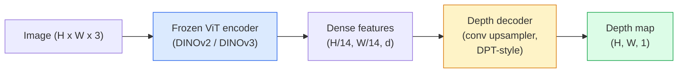

# 단일형 깊이 & 기하학 추정

> 깊이 지도는 각 픽셀이 카메라로부터의 거리를 나타내는 단일 채널 이미지입니다. 이전에는 스테레오나 리다르 없이 하나의 RGB 프레임에서 예측하는 것은 불가능했습니다. 2026년, 얼어붙은 ViT 코더와 가벼운 헤드 (lightweight head) 는 지상의 진실의 몇 퍼센트 내에 있습니다.

**Type:** Build + Use
**Languages:** Python
**Prerequisites:** Phase 4 Lesson 14 (ViT), Phase 4 Lesson 17 (Self-Supervised Vision), Phase 4 Lesson 07 (U-Net)
**Time:** ~60 minutes

## 학습 목표

- 상대적 및 측정 깊이를 구분하고 각 생산 모델 (MiDaS, Marigold, Depth Anything V3, ZoeDepth) 에서 해결하는 상태를 구분합니다.
- 고의적인 단일 이미지의 깊이 예측을 위해 Depth Anything V3 (DINOv2 척추) 를 사용하십시오
- 단일 이미지에서 (관측 신호, 질감 기하급수, 학습된 전조) 왜 일체 깊이가 작동하는지 설명하고, 어떤 것을 복구할 수 없는지를 설명합니다 (완벽한 규모, 폐쇄된 기하학)
- 깊이 지도와 피인홀 카메라 내재를 사용하여 2D 탐지 3D 포인트로 들어갑니다

## 문제

깊이는 2D 컴퓨터 비전에서 부족한 축입니다. RGB를 감안하면 이미지의 평면에서 어떤 것들이 나타나는지 알 수 있지만 얼마나 멀리 있는지 알 수 없습니다. 깊이 센서 (스테리오 기장, LiDAR, 비행 시간) 는 이것을 직접 해결하지만 비용이 많이 들고, 취약하고 범위가 제한되어 있습니다.

단일형 깊이 추정  단일 RGB 프레임에서 깊이 예측  흐릿하고 신뢰할 수 없는 출력을 생산하는 데 사용됩니다. 2026년까지, 대형 사전 훈련된 코더들은 이렇게 변경했습니다. Depth Anything V3는 얼어붙은 DINOv2 척추를 사용하여 실내, 야외, 의료 및 위성 영역에서 일반화되는 깊이 지도를 생산합니다. 마리골드는 조건부 전파 문제로 깊이의 틀을 재구성합니다. ZoeDepth은 실제 메트릭 거리를 뒤로 합니다.

깊이 또한 2D 감지와 3D 이해 사이의 다리입니다. 탐지된 상자의 픽셀을 깊이로 곱하면 2D 객체를 3D 포인트 클라우드로 끌어올립니다. 이것은 모든 AR 폐쇄 시스템의 핵심입니다. 모든 장애물 피하는 파이프라인, 그리고 모든 "컵을 " 로봇.

## 개념

### 상대적 대 측정 깊이는

- **Relative depth** 주문`z`실제 세계 단위 없이도 값이 됩니다. "Pixel A는 B보다 더 가깝지만, 거리 비율은 미터에 고정되어 있지 않습니다".
- **Metric depth** 카메라로부터의 절대 거리 (m) 는 모델이 이미지 신호와 실제 거리 사이의 통계적 관계를 학습해야 합니다.

미다스, 딥 앤더슨 V3는 상대적인 깊이를 생성한다. 마리골드는 상대적인 깊이를 생성한다. 조디프스, 유니디프스, 메트릭3D는 측정 깊이를 생성한다. 측정 모델은 카메라 내재에 민감하다. 상대 모델은 그렇지 않다.

### 코더-독호기 패턴



깊이 모든 V3는 코더를 얼어붙이고 DPT 스타일의 디코더만을 훈련시킵니다. 코더는 풍부한 기능을 제공합니다. 디코더는 이미지를 해상도로 다시 인터폴링하고 깊이로 회전합니다.

### 왜 하나의 이미지가 깊이 있게 만들어 주는가

2D 이미지는 깊이와 상관관계를 맺는 많은 단면적 신호를 포함합니다.

- **Perspective**3D의 평행선은 2D로 합쳐진다.
- **Texture gradient** 먼 곳의 표면은 작고 밀도가 더 높은 성질을 가지고 있습니다.
- **Occlusion order** 가까운 물체는 더 먼 물체를 차단합니다.
- **Size constancy** 알려진 물체 (차, 인간) 은 대략적인 규모를 제공합니다.
- **Atmospheric perspective** 먼 물체는 야외 장면에서 더 흐릿하고 파란색으로 보입니다.

수십억 개의 이미지에 훈련된 ViT는 이러한 신호를 내재합니다. 충분한 데이터와 강력한 척추로, 일각각 깊이는 3D 감독 없이도 합리적인 정확성을 달성합니다.

### 모노클러 깊이가 할 수 없는 일이

- **Absolute metric scale**그 네트워크는 "잔이 스푼보다 두 배 더 멀리 떨어져 있다"고 예측할 수 있습니다.
- **Occluded geometry** 의 의 뒷부분은 보이지 않아서 믿을 수 없는 결론을 내릴 수 있습니다.
- **Truly untextured / reflective surfaces**거울, 유리, 유니폼 벽. 네트워크는 믿을 수 있지만 잘못된 깊이를 보고합니다.

### 2026년 깊이 V3

- 바닐라 DINOv2 ViT-L/14 인코더 (냉장고)
- DPT 디코더
- 다양한 출처에서 출력된 이미지 쌍에 훈련 (광미학적 일관성을 넘어 명시적인 깊이 감독이 필요하지 않습니다).
- 공간적으로 일관된 기하학을 예측합니다**an arbitrary number of visual inputs, with or without known camera poses**- 그래
- 모노컬러 깊이, 모든 시각 기하학, 시각 렌더링, 카메라 포즈 추정

이 모델은 2026년에 깊이가 필요할 때 호출할 수 있는 드롭인 모델입니다.

### 마리골드  깊이에 대한 전파

마리골드 (Ke et al., CVPR 2024) 은 깊이 추정을 조건적 이미지-이미즈 전파로 재구성한다. 조건화: RGB. 목표: 깊이 지도. 선습된 안정적 전파 2 U-네트를 척추로 사용합니다. 출력 깊이 지도는 객체 경계에서 예외적으로 날카로운 것입니다. 트레이드 오프: 푸드-프로ವರ್드 모델보다 느린 추론 (10-50 단계에 대해 말함)

### 내재 및 핀홀 카메라

픽셀을 들어올리는 데`(u, v)`깊이 있게`d`3D 포인트로`(X, Y, Z)`카메라 좌표:

```math
\begin{aligned}
f_x, f_y, c_x, c_y &= \text{camera intrinsics} \\
X &= (u - c_x) \cdot d / f_x \\
Y &= (v - c_y) \cdot d / f_y \\
Z &= d
\end{aligned}
```

내재는 EXIF 메타데이터, 캘리브레이션 패턴 또는 단일형 내재 추정기 (Perspective Fields, UniDepth) 에서 나온다. 내재가 없으면, 여전히 시각화, 측정에 사용할 수 있는 60-70° FOV 및 중소 해상도의 원리를 가정하여 포인트 클라우드를 렌더링 할 수 있습니다.

### 평가

두 가지 표준 측정값:

- **AbsRel**(완전히 상대적인 오류): `mean(|d_pred - d_gt| / d_gt)`. 낮은 것이 더 낫습니다. 생산 모델에 0.05-0.1
- **delta < 1.25**(목적 정확성): 픽셀의 분자`max(d_pred/d_gt, d_gt/d_pred) < 1.25`더 높으면 더 좋죠.

상대적 깊이 (Deepth Anything V3, MiDaS) 에 대해서는 평가에서 양 매트릭의 규모와 전환 변함없는 버전을 사용합니다.

```figure
depth-sweep
```

## 건설 해

### 단계 1: 깊이 측정

```python
import torch

def abs_rel_error(pred, target, mask=None):
    if mask is not None:
        pred = pred[mask]
        target = target[mask]
    return (torch.abs(pred - target) / target.clamp(min=1e-6)).mean().item()


def delta_accuracy(pred, target, threshold=1.25, mask=None):
    if mask is not None:
        pred = pred[mask]
        target = target[mask]
    ratio = torch.maximum(pred / target.clamp(min=1e-6), target / pred.clamp(min=1e-6))
    return (ratio < threshold).float().mean().item()
```

평가를 하기 전에 항상 유효하지 않은 깊이 픽셀 (허, NaN, 포화) 을 마스크하십시오.

### 단계 2: 스케일 및 시프트 조율

상대적 깊이 모델에서, 계산 메트릭을 하기 전에 예측을 기본 진실에 맞추십시오.`a * pred + b = target`이 부분의 본문은

```python
def align_scale_shift(pred, target, mask=None):
    if mask is not None:
        p = pred[mask]
        t = target[mask]
    else:
        p = pred.flatten()
        t = target.flatten()
    A = torch.stack([p, torch.ones_like(p)], dim=1)
    coeffs, *_ = torch.linalg.lstsq(A, t.unsqueeze(-1))
    a, b = coeffs[:2, 0]
    return a * pred + b
```

달아`align_scale_shift`이전`abs_rel_error`MiDaS/ Depth Anything를 평가할 때

### 단계 3: 지점 구름으로 깊이를 끌어올라

```python
import numpy as np

def depth_to_point_cloud(depth, intrinsics):
    H, W = depth.shape
    fx, fy, cx, cy = intrinsics
    v, u = np.meshgrid(np.arange(H), np.arange(W), indexing="ij")
    z = depth
    x = (u - cx) * z / fx
    y = (v - cy) * z / fy
    return np.stack([x, y, z], axis=-1)


depth = np.random.uniform(0.5, 4.0, (240, 320))
intr = (320.0, 320.0, 160.0, 120.0)
pc = depth_to_point_cloud(depth, intr)
print(f"point cloud shape: {pc.shape}  (H, W, 3)")
```

3D 리프트 애플리케이션마다 하나의 기능이 있습니다.`.ply`메쉬랩 또는 클라우드 컴파어에서 열 수 있습니다.

### 단계 4: 합성 깊이 장면으로 흡연 테스트

```python
def synthetic_depth(size=96):
    yy, xx = np.meshgrid(np.arange(size), np.arange(size), indexing="ij")
    # Floor: linear gradient from near (top) to far (bottom)
    depth = 1.0 + (yy / size) * 4.0
    # Box in the middle: closer
    mask = (np.abs(xx - size / 2) < size / 6) & (np.abs(yy - size * 0.6) < size / 6)
    depth[mask] = 2.0
    return depth.astype(np.float32)


gt = torch.from_numpy(synthetic_depth(96))
pred = gt + 0.3 * torch.randn_like(gt)  # simulated prediction
aligned = align_scale_shift(pred, gt)
print(f"before align  absRel = {abs_rel_error(pred, gt):.3f}")
print(f"after align   absRel = {abs_rel_error(aligned, gt):.3f}")
```

### 단계 5: 깊이 모든 V2 사용 ( 참조)

```python
import numpy as np
from transformers import pipeline
from PIL import Image

pipe = pipeline(task="depth-estimation", model="depth-anything/Depth-Anything-V2-Large-hf")

image = Image.open("street.jpg").convert("RGB")
out = pipe(image)
depth_np = np.array(out["depth"])
```

세 줄이`out["depth"]`PIL 회색 스케일입니다. 수학에 대한 numpy로 변환됩니다. 깊이 모든 3 (노벨 2025) 이 파이프라인을 통해 로드하지 않습니다.`depth_anything_3`패키지: `DepthAnything3.from_pretrained("depth-anything/DA3MONO-LARGE")`상대적인 단일형 모델을 로드하고,`model.inference(images).depth``[N, H, W]`깊이 배열

## 사용 하 고

- **Depth Anything V3**(Meta AI / ByteDance, 2024-2026)  상대 깊은 데 기본. 생산 중 가장 빠른 ViT 큰 척추 모델.
- **Marigold**(ETH, 2024)  최고 시각 품질, 느린 추론
- **UniDepth**(ETH, 2024)  카메라 내재 추정과 함께 측정 깊이가
- **ZoeDepth**(인텔, 2023)  메트릭 깊이; 나이가 많고 여전히 신뢰할 수 있습니다.
- **MiDaS v3.1** 유서 깊은 하지만 안정적인; 비교하기 좋은 기준

전형적인 통합 패턴:

1. RGB 프레임이 도착합니다.
2. 깊이 모델은 깊이 지도를 생성합니다.
3. 탐지기는 상자를 생산합니다.
4. 3D로 깊이로 리프트 박스 센토라이드를 올려 놓아, 사용할 수 있는 경우 포인트 클라우드와 결합한다.
5. 하류: AR 차단, 경로 계획, 객체 크기의 추정, 스테레오 교체

실시간 사용에 있어서, Depth Anything V2 Small (INT8 양자화) 는 소비자 GPU에서 518x518에서 ~30fps를 누릅니다.

## 선박

이 교훈은 다음과 같은 결과를 낳습니다.

- `outputs/prompt-depth-model-picker.md` Depth Anything V3, Marigold, UniDepth, MiDaS 사이의 선택은 지연, 측정 대 상대적 필요, 그리고 장면 유형을 고려합니다.
- `outputs/skill-depth-to-pointcloud.md` 깊이 지도에서 포인트 클라우드를 구축하는 기술`.ply`- 그래

## 운동

1. **(Easy)**책상 10개의 이미지에 깊이 V2를 실행하세요. 그레이 스케일 PNG로 깊이를 저장하고 검사하세요. 예측된 깊이가 잘못 보이는 한 개체를 식별하고 단면 신호가 왜 실패했는지 설명하세요.
2. **(Medium)**RGB + 깊이에서 깊이 V2를 고려하면, 점 클라우드로 올려`open3d`두 장면을 비교해 보세요. (내외/내외) 그리고 어느 장면을 더 믿을 수 있는 것으로 보는지 보세요.
3. **(Hard)**알려진 물체의 위치만 따라 차이가 있는 5쌍의 이미지를 촬영하십시오. (예를 들어, 병이 30cm 가까이 이동했습니다). 두 개에서 미τρ적 깊이를 예측하기 위해 UniDepth을 사용하십시오. 예측된 거리 델타와 실제 30cm의 차이를 보고하십시오.

## 주요 용어

| Term | What people say | What it actually means |
|------|----------------|----------------------|
| Monocular depth | "Single-image depth" | Depth estimation from one RGB frame, no stereo or LiDAR |
| Relative depth | "Ordered depth" | Ordered z-values without real-world units |
| Metric depth | "Absolute distance" | Depth in metres; requires calibration or a model trained with metric supervision |
| AbsRel | "Absolute relative error" | Mean of $\lvert d_{\text{pred}} - d_{\text{gt}} \rvert / d_{\text{gt}}$; standard depth metric |
| Delta accuracy | "delta < 1.25" | Fraction of pixels with prediction within 25% of ground truth |
| Pinhole camera | "fx, fy, cx, cy" | The camera model used to lift (u, v, d) to (X, Y, Z) |
| DPT | "Dense Prediction Transformer" | The conv-based decoder used on top of frozen ViT encoders for depth |
| DINOv2 backbone | "The reason it works" | Self-supervised features that generalise across domains without depth labels |

## 더 많은 읽기

- [Depth Anything V3 paper page](https://depth-anything.github.io/) DINOv2 코더로 SOTA 모노컬러 깊이
- [Marigold (Ke et al., CVPR 2024)](https://marigoldmonodepth.github.io/) 전파 기반 깊이 추정
- [UniDepth (Piccinelli et al., 2024)](https://arxiv.org/abs/2403.18913) 내재적인 미τρ적 깊이
- [MiDaS v3.1 (Intel ISL)](https://github.com/isl-org/MiDaS) 가톨릭 비교 깊이의 기본 기준
- [DINOv3 blog post (Meta)](https://ai.meta.com/blog/dinov3-self-supervised-vision-model/) 깊이 정확도를 높이는 코더 가족
