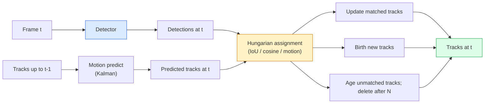

# 멀티 객체 추적 및 비디오 메모리

> 추적은 탐지+연결입니다. 모든 프레임을 감지합니다. 이 프레임의 탐지와 마지막 프레임의 흔적을 ID로 일치합니다.

**Type:** Build
**Languages:** Python
**Prerequisites:** Phase 4 Lesson 06 (YOLO Detection), Phase 4 Lesson 08 (Mask R-CNN), Phase 4 Lesson 24 (SAM 3)
**Time:** ~60 minutes

## 학습 목표

- 추적을 탐지하여 추적하는 것을 질의 기반 추적과 구별하고 알고리즘 가족 (SORT, DeepSORT, ByteTrack, BoT-SORT, SAM 2 메모리 추적기, SAM 3.1 객체 복합) 의 이름을 지정합니다.
- 클래식 추적-발견을 위해 IoU + 헝가리 임무를 처음부터 구현
- SAM 2의 메모리 뱅크와 왜 IoU 기반의 연관보다 더 잘 수식물 처리하는지 설명해 주십시오.
- 세 가지 추적 측정값 (MOTA, IDF1, HOTA) 을 읽어보고 특정 사용 사례에 있어서 어느 하나에 대해 중요하다고 선택하십시오.

## 문제

탐지기는 하나의 프레임에서 물체가 어디에 있는지 알려줍니다. 추적기는 프레임에서 어떤 탐지인지 알려줍니다.`t`프레임에서 감지되는 것과 동일한 객체입니다`t-1`그 없이, 여러분은 선을 넘는 물체를 셀 수 없고, 구구를 막는 과정에서 따라갈 수 없고, "차 4번은 8초 동안 라인에서 있었다"는 것을 알 수 없습니다.

추적은 모든 비디오 제품에서 필수적입니다. 스포츠 분석, 감시, 자율주행, 의료 비디오 분석, 야생 동물 모니터링, 워드마크 카운팅. 핵심 구성 요소는 공유됩니다: 프레임 단속기, 운동 모델 (칼만 필터 또는 더 풍부한 것), 연관 단계 (IoU / cosine / 학습된 기능에 대한 헝가리 알고리즘) 및 트랙 라이프 사이클 (생, 업데이트, 죽음).

2026년에는 두 가지 새로운 패턴이 등장했습니다.**SAM 2 memory-based tracking**(운동 모델 연관 대신 특징 기억)**SAM 3.1 Object Multiplex**(함께 같은 개념의 많은 사례를 공유하는 메모리) 이 수업은 클래식 스택을 먼저, 그리고 기억 기반 접근 방식을 진행합니다.

## 개념

### 추적-탐지



2026년에 발견되는 모든 추적기는 이 루프의 변형입니다.

- **SORT**(2016): 칼만 필터 + IoU 헝가리어. 단순하고 빠르고 외모 모델이 없습니다.
- **DeepSORT**(2017): SORT + CNN 기반의 외모 기능 (ReID 임베디드) 로 트랙당.
- **ByteTrack**(2021): 낮은 신뢰성 검출을 두 번째 단계로 연관시킵니다. MOT17에서 최고 성능을 발휘하는 외모 기능이 필요하지 않습니다.
- **BoT-SORT**(2022): 바이트 + 카메라 운동 보상 + ReID.
- **StrongSORT / OC-SORT** 더 나은 움직임과 외모를 가진 바이트트랙 후손.

### 한 문장에서 칼먼 필터

칼먼 필터는 트랙별 상태를 유지합니다`(x, y, w, h, dx, dy, dw, dh)`각 프레임에서**predict**그리고, 이 상태는 일정 속도의 모델을 이용해서**update**업데이트는 예측 불확실성이 높을 때 탐지에 더 신뢰합니다. 이것은 부드러운 궤도를 제공하고 짧은 잠복을 통해 트랙을 계속 할 수있는 능력을 제공합니다 (1-5 프레임).

모든 클래식 추적기는 운동 예측 단계에 칼만 필터를 사용합니다.

### 헝가리 알고리즘

`M x N`비용 매트릭스 (tracks x detections) 에서 전체 비용을 최소화하는 1대 1 할당을 찾아보세요. 비용은 보통 `1 - IoU(track_bbox, detection_bbox)`또는 외관 특징의 음수 코시네스 유사성.$O((M+N)^3)$$M, N$1000까지 Python에서 충분히 빠르게 `scipy.optimize.linear_sum_assignment`- 그래

### 바이트트랙의 핵심 아이디어

표준 추적기는 낮은 신뢰성 검출을 떨어뜨립니다 (< 0. 5).**second-stage candidates**: 높은 신뢰성 검출과 트랙을 일치시킨 후, 비교할 수 없는 트랙은 약간 느슨한 IoU 문턱과 낮은 신뢰성 검출을 일치시키려고 합니다. 짧은 점막을 회복하고, 군중 근처에서 ID를 전환합니다.

### SAM 2 메모리 기반 추적

SAM 2는 비디오를 처리하여 **memory bank**한 프레임에 있는 프롬프트 (클릭, 박스, 텍스트) 를 사용하면, 인스턴스를 메모리로 암호화합니다. 이후의 프레임에서는 메모리는 새로운 프레임의 기능에 대한 교차적 관람을 수행하며 디코더는 새로운 프레임에서 동일한 인스턴스를 위한 마스크를 생성합니다.

칼만 필터도 없고 헝가리어도 없고,

장점:
- 큰 점포에 강하다 (기억은 많은 프레임에서 인스턴스 아이덴티티를 가지고 있다).
- SAM 3의 문자 명령어와 결합된 경우 공개된 어휘자료.
- 별도의 모형이 없는 상태에서 작동합니다.

단점:
- 다중 객체 추적에 있어서 바이트트랙보다 느려
- 메모리 뱅크가 커지고, 컨텍스트 창을 제한합니다.

### SAM 3.1 객체 다중

이전 SAM 2 / SAM 3 추적은 각각의 인스턴스에 별도의 메모리 뱅크를 유지합니다. 50 개체에 대해 50 개의 메모리 뱅크를 유지합니다. Object Multiplex (2026년 3월) 는 그것들을 공유된 메모리로 붕괴합니다.**per-instance query tokens**. 비용 규모는 수차례에 걸쳐 줄기적인 방식으로 증가합니다.

2026년, 다중중은 대중 추적의 새로운 기본입니다. 콘서트 군중, 창고 노동자, 교통 교차.

### 알아야 할 세 가지 기준

- **MOTA (Multi-Object Tracking Accuracy)** 1 - (FN + FP + ID 스위치) / GT. 오류 유형에 의해 중화; 탐지 및 연관 오류를 혼합하는 단일 매트릭.
- **IDF1 (ID F1)** ID 정확성과 회수의 조화적 평균. 각 지형 진실 트랙이 시간이 지남에 따라 ID를 얼마나 잘 유지하는지 구체적으로 초점을 맞추고 있습니다. ID 스위치 민감한 작업에 MOTA보다 좋습니다.
- **HOTA (Higher Order Tracking Accuracy)** 탐지 정확성 (DetA) 과 연관 정확성 (AssA) 로 분해된다. 2020 년 이후 커뮤니티 표준; 가장 포괄적 인.

감시 (누가 누구인가): IDF1는 보고하는 것입니다. 스포츠 분석 (수수권) 에 대해: HOTA. 일반 학술 비교에 대해: HOTA.

```figure
cv3-track-assoc
```

## 건설 해

### 단계 1: IoU 기반 비용 매트릭스

```python
import numpy as np


def bbox_iou(a, b):
    """
    a, b: (N, 4) arrays of [x1, y1, x2, y2].
    Returns (N_a, N_b) IoU matrix.
    """
    ax1, ay1, ax2, ay2 = a[:, 0], a[:, 1], a[:, 2], a[:, 3]
    bx1, by1, bx2, by2 = b[:, 0], b[:, 1], b[:, 2], b[:, 3]
    inter_x1 = np.maximum(ax1[:, None], bx1[None, :])
    inter_y1 = np.maximum(ay1[:, None], by1[None, :])
    inter_x2 = np.minimum(ax2[:, None], bx2[None, :])
    inter_y2 = np.minimum(ay2[:, None], by2[None, :])
    inter = np.clip(inter_x2 - inter_x1, 0, None) * np.clip(inter_y2 - inter_y1, 0, None)
    area_a = (ax2 - ax1) * (ay2 - ay1)
    area_b = (bx2 - bx1) * (by2 - by1)
    union = area_a[:, None] + area_b[None, :] - inter
    return inter / np.clip(union, 1e-8, None)
```

### 단계 2: 최소 SORT 스타일 추적기

고정된 일정 속도의 칼먼은 간략하게 생략합니다. 우리는 간단한 IoU 연관성을 사용합니다. 생산에서 칼먼의 예측은 필수적입니다.`sort`파이썬 패키지는 전체 버전을 제공합니다.

```python
from scipy.optimize import linear_sum_assignment


class Track:
    def __init__(self, tid, bbox, frame):
        self.id = tid
        self.bbox = bbox
        self.last_frame = frame
        self.hits = 1

    def update(self, bbox, frame):
        self.bbox = bbox
        self.last_frame = frame
        self.hits += 1


class SimpleTracker:
    def __init__(self, iou_threshold=0.3, max_age=5):
        self.tracks = []
        self.next_id = 1
        self.iou_threshold = iou_threshold
        self.max_age = max_age

    def step(self, detections, frame):
        if not self.tracks:
            for d in detections:
                self.tracks.append(Track(self.next_id, d, frame))
                self.next_id += 1
            return [(t.id, t.bbox) for t in self.tracks]

        track_boxes = np.array([t.bbox for t in self.tracks])
        det_boxes = np.array(detections) if len(detections) else np.empty((0, 4))

        iou = bbox_iou(track_boxes, det_boxes) if len(det_boxes) else np.zeros((len(track_boxes), 0))
        cost = 1 - iou
        cost[iou < self.iou_threshold] = 1e6

        matched_track = set()
        matched_det = set()
        if cost.size > 0:
            row, col = linear_sum_assignment(cost)
            for r, c in zip(row, col):
                if cost[r, c] < 1.0:
                    self.tracks[r].update(det_boxes[c], frame)
                    matched_track.add(r); matched_det.add(c)

        for i, d in enumerate(det_boxes):
            if i not in matched_det:
                self.tracks.append(Track(self.next_id, d, frame))
                self.next_id += 1

        self.tracks = [t for t in self.tracks if frame - t.last_frame <= self.max_age]
        return [(t.id, t.bbox) for t in self.tracks]
```

60 라인, 프레임별 탐지, 프레임별 트랙 ID를 반환합니다. 실제 시스템은 칼만 예측, 바이트트랙의 2단계 재 일치 및 외모 기능을 추가합니다.

### 단계 3: 합성 궤도 시험

```python
def synthetic_frames(num_frames=20, num_objects=3, H=240, W=320, seed=0):
    rng = np.random.default_rng(seed)
    starts = rng.uniform(20, 200, size=(num_objects, 2))
    velocities = rng.uniform(-5, 5, size=(num_objects, 2))
    frames = []
    for f in range(num_frames):
        dets = []
        for i in range(num_objects):
            cx, cy = starts[i] + f * velocities[i]
            dets.append([cx - 10, cy - 10, cx + 10, cy + 10])
        frames.append(dets)
    return frames


tracker = SimpleTracker()
for f, dets in enumerate(synthetic_frames()):
    tracks = tracker.step(dets, f)
```

직선으로 움직이는 세 개체들은 20개의 프레임에 걸쳐서 자신의 신원을 보관해야 합니다.

### 단계 4: ID 스위치 매트릭

```python
def count_id_switches(tracks_per_frame, gt_per_frame):
    """
    tracks_per_frame:  list of list of (track_id, bbox)
    gt_per_frame:      list of list of (gt_id, bbox)
    Returns number of ID switches.
    """
    prev_assignment = {}
    switches = 0
    for tracks, gts in zip(tracks_per_frame, gt_per_frame):
        if not tracks or not gts:
            continue
        t_boxes = np.array([b for _, b in tracks])
        g_boxes = np.array([b for _, b in gts])
        iou = bbox_iou(g_boxes, t_boxes)
        for g_idx, (gt_id, _) in enumerate(gts):
            j = iou[g_idx].argmax()
            if iou[g_idx, j] > 0.5:
                t_id = tracks[j][0]
                if gt_id in prev_assignment and prev_assignment[gt_id] != t_id:
                    switches += 1
                prev_assignment[gt_id] = t_id
    return switches
```

이것은 단순화된 IDF1 인접 메트릭입니다. 지형 진실 물체가 주어진 예측 트랙 ID를 얼마나 자주 변경하는지 계산합니다. 실제 MOTA / IDF1 / HOTA 도구는`py-motmetrics`그리고`TrackEval`- 그래

## 사용 하 고

2026년 생산 추적기:

- `ultralytics` YOLOv8 + 바이트트랙 / 보트-소르트 내장`results = model.track(source, tracker="bytetrack.yaml")`- 기본값
- `supervision`(로보플로)  바이트트랙 랩더와 해설 공사
- SAM 2 / SAM 3.1  메모리 기반 추적 `processor.track()`- 그래
- 사용자 지정 스택: 탐지기 (YOLOv8 / RT-DETR) + `sort-tracker`- `OC-SORT`- `StrongSORT`- 그래

선택:

- 보행자 / 자동차 / 상자 30+fps: **ByteTrack with ultralytics**- 그래
- 한 수업을 한 군중에서 한 수업을 한 번 더 하는 경우**SAM 3.1 Object Multiplex**- 그래
- 식별 가능한 외모를 가진 무거운 점프: **DeepSORT / StrongSORT**(ReID 기능)
- 스포츠 / 복잡한 상호작용: **BoT-SORT**또는 학습된 추적기 (MOTRv3).

## 선박

이 교훈은 다음과 같은 결과를 낳습니다.

- `outputs/prompt-tracker-picker.md`는 SORT / ByteTrack / BoT-SORT / SAM 2 / SAM 3.1를 선택합니다.
- `outputs/skill-mot-evaluator.md` 지형 진실 경로를 대비하여 MOTA/IDF1/HOTA에 대한 완전한 평가 배너스를 작성합니다.

## 운동

1. **(Easy)**위 위의 합성 추적기를 3, 10 및 30 개로 실행하세요. 각 경우 ID 스위치 수를 보고하세요. 간단한 IoU 단 하나의 연관성이 실패하기 시작하는 곳을 확인하세요.
2. **(Medium)**연결하기 전에 일정한 속도의 칼만 예측 단계를 추가하십시오. 짧은 (2-3 프레임) 은 더 이상 ID 스위치를 유발하지 않는다는 것을 보여주십시오.
3. **(Hard)**SAM 2의 메모리 기반 추적기를 통합 (via `transformers`30초 동안의 클립에서 SimpleTracker와 SAM 2을 모두 실행하고, 5명의 주목받는 사람들을 위한 실체 식별자를 수동으로 표시하여 ID 스위치 수를 비교합니다.

## 주요 용어

| Term | What people say | What it actually means |
|------|----------------|----------------------|
| Tracking-by-detection | "Detect then associate" | Per-frame detector + Hungarian assignment on IoU / appearance |
| Kalman filter | "Motion predict" | Linear dynamics + covariance for smooth track predictions and occlusion handling |
| Hungarian algorithm | "Optimal assignment" | Solves the minimum-cost bipartite matching problem; `scipy.optimize.linear_sum_assignment` |
| ByteTrack | "Low-confidence second pass" | Re-match unmatched tracks to low-confidence detections to recover short occlusions |
| DeepSORT | "SORT + appearance" | Adds a ReID feature for cross-frame matching; better for ID preservation |
| Memory bank | "SAM 2 trick" | Per-instance spatio-temporal features stored across frames; cross-attention replaces explicit association |
| Object Multiplex | "SAM 3.1 shared memory" | Single shared memory with per-instance queries for fast many-object tracking |
| HOTA | "Modern tracking metric" | Decomposes into detection and association accuracy; community standard |

## 더 많은 읽기

- [SORT (Bewley et al., 2016)](https://arxiv.org/abs/1602.00763) 최소 추적-탐지용 종이
- [DeepSORT (Wojke et al., 2017)](https://arxiv.org/abs/1703.07402) 외관 기능을 추가합니다
- [ByteTrack (Zhang et al., 2022)](https://arxiv.org/abs/2110.06864) 신뢰도가 낮은 2번 통과
- [BoT-SORT (Aharon et al., 2022)](https://arxiv.org/abs/2206.14651) 카메라 운동 보상
- [HOTA (Luiten et al., 2020)](https://arxiv.org/abs/2009.07736) 분해된 추적 메트릭
- [SAM 2 video segmentation (Meta, 2024)](https://ai.meta.com/sam2/) 메모리 기반 추적기
- [SAM 3.1 Object Multiplex (Meta, March 2026)](https://ai.meta.com/blog/segment-anything-model-3/)
