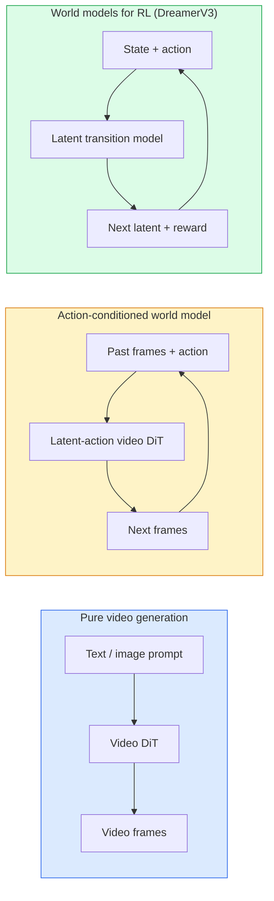

# 세계 모델 및 비디오 전파

> 장면의 다음 초를 예측하는 비디오 모델은 세계 시뮬레이터입니다. 행동의 예측을 조건화하고 학습된 게임 엔진을 가지고 있습니다.

**Type:** Learn + Build
**Languages:** Python
**Prerequisites:** Phase 4 Lesson 10 (Diffusion), Phase 4 Lesson 12 (Video Understanding), Phase 4 Lesson 23 (DiT + Rectified Flow)
**Time:** ~75 minutes

## 학습 목표

- 순수한 비디오 생성 모델 (Sora 2) 과 액션 컨디션 세계 모델 (Genie 3, DreamerV3) 사이의 차이를 설명하십시오.
- 비디오 디티를 설명하십시오: 공간 시간 패치, 3D 위치 코딩, T, H, W 토큰을 통한 공동의 관심
- 세계 모델이 로봇에 어떻게 연결되는지를 추적합니다: VLM 계획은 → 비디오 모델이 시뮬레이션합니다 → 역 역 역동성은 행동을 방출합니다
- 주어진 사용 사례 (창작 비디오, 인터랙티브 시밍, 자율주행 합성) 를 위해 Sora 2, Genie 3, Runway GWM-1 월드, Wan-Video, HunyuanVideo 사이에서 선택하십시오.

## 문제

비디오 생성과 세계 모델링은 2026년에 합쳐졌습니다. 비디오의 일관된 분기를 생성할 수 있는 모델은 어떤 의미에서 세상이 어떻게 움직이는지 배웠죠. 물체 영구성, 중력, 인과관계, 스타일. 만약 당신이 행동에 대한 예측을 조건으로 한다면 (왼쪽으로 걸어, 문을 열어) 비디오 모델은 게임 엔진, 운전 시뮬레이터 또는 로봇 환경을 대체할 수 있는 학습 가능한 시뮬레이터로 변합니다.

- 이 모든 것이 콘크리트입니다. 제니 3는 하나의 이미지에서 재생 가능한 환경을 생성합니다. 활주로 GWM-1 월드스는 무한한 탐험 가능한 장면을 합성합니다. 소라 2는 동기화된 오디오와 모델링 물리학으로 1분짜리 영상을 제작합니다. NVIDIA 코스모스 드라이브, 웨이브 게이아-2 및 테슬라 드라이빙월드는 자율주행 차량 훈련 데이터에 대한 현실적인 운전 영상을 생성합니다. 세계 모델 패러다임은 로봇의 시미-트리얼을 조용히 점령하고 있습니다.

이 수업은 4단계 "대면적인 그림" 수업입니다. 이 수업은 이미지 생성, 비디오 이해, 그리고 요원적 추론을 건축 패턴으로 연결합니다.

## 개념

### 세계 모델링의 세 가족



- **Sora 2**순수한 비디오 생성, 명령에 의해 구성됩니다. 액션 인터페이스 없습니다. 당신은 그것을 중부 배포 "추도" 할 수 없습니다.
- **Genie 3****GWM-1 Worlds****Mirage / Magica**액션 컨디션 세계 모델입니다. 관찰된 비디오에서 잠그린 동작을 입력하고, 다음으로 액션에 대한 미래의 프레임 예측을 조정합니다. 인터랙티브  당신은 키를 누르거나 카메라를 움직이면 장면이 반응합니다.
- **DreamerV3**그리고 클래식 RL 세계 모델 가족들은 명백한 행동 조건으로 잠그어진 공간에서 예측하고 보상 신호에 훈련합니다. 시각적 수준이 낮아 샘플 효율적인 RL에 더 유용합니다.

### 비디오 DT 아키텍처

```
Video latent:          (C, T, H, W)
Patchify (spatial):    grid of P_h x P_w patches per frame
Patchify (temporal):   group P_t frames into a temporal patch
Resulting tokens:      (T / P_t) * (H / P_h) * (W / P_w) tokens
```

위치 코딩은 3D: 각 (t, h, w) 좌표에 대한 회전 또는 학습된 임베디션이다. 주의는 다음과 같다:

- **Full joint** 모든 토큰이 모든 토큰에 참석합니다. $O(N^2)$$N$장편 동영상에는 금지되어 있습니다.
- **Divided** 시간적 관심의 대변 (시간 간 동일한 공간적 위치:`(H*W) * T^2`) 및 공간적 관심 (시간 단계, 공간 전체: `T * (H*W)^2` 타임스포머와 대부분의 비디오 디트에서 사용된다.
- **Window** (t, h, w) 의 로컬 윈도우.

2026년 비디오 전파 모델마다 이러한 세 가지 패턴 중 하나를 사용하며 AdaLN 컨디션 (강좌 23) 및 정정된 흐름을 사용합니다.

### 행동의 조건: 잠복한 행동 모델

천재는 배우게 됩니다**latent action**프레임마다 연속 프레임의 쌍 사이의 행동을 차별적으로 예측함으로써. 모델의 디코더는 추론된 잠잠한 동작에 조건이 있습니다.  명시적인 키보드 키에 아닙니다. 추론에서 사용자는 잠잠한 동작을 지정할 수 있습니다.

소라는 액션 인터페이스를 완전히 건너뛰고, 디코더는 과거의 공간 시간 토큰에서 다음 공간 시간 토큰을 예측합니다.

### 물리적 유력성

소라 2의 2026 출시가 명시적으로 발표되었습니다**physical plausibility**: 무게, 균형, 객체 영구성, 원인과 결과. 연구팀이 수동으로 평가한 유의성 점수를 통해 측정합니다. 모델은 떨어지는 객체, 캐릭터 충돌, 목적에 대한 실패 (실점 점프) 와 Sora 1에 비해 눈에 띄게 향상됩니다.

유연성은 여전히 지배적인 실패 모드입니다. 2024-2025년 동안 스파게티를 먹는 사람들이거나 유리를 마시는 비디오는 모델의 지속적인 객체 표현의 부족을 밝혀냈다. 2026년 모델 (소라 2, 런웨이 Gen-5, 유안비디오) 은 이러한 것을 줄이지만 제거하지는 않습니다.

### 자율주행 세계 모델

운전 세계 모델은 궤도, 경계 상자 또는 내비게이션 지도에 따라 조건화된 현실적인 도로 장면을 생성합니다. 사용:

- **Cosmos-Drive-Dreams**(NVIDIA) 는 RL 훈련에 필요한 몇 분간의 운전 영상을 생성합니다.
- **Gaia-2**(Wayve)  정책 평가에 대한 궤도 조건화된 장면 합성
- **DrivingWorld**(테슬라)  다양한 날씨, 시간, 교통 조건을 시뮬레이션합니다.
- **Vista**(ByteDance)  반응형 운전 장면 합성

그들은 코너 케이스에 대한 값비싼 실제 데이터 수집을 대체합니다. 밤에는 보행자 통행, 얼음 교차, 비정상적인 차량 유형, 그렇지 않으면 수백만 마일 운전이 필요할 것입니다.

### 로봇 스택: VLM + 비디오 모델 + 역 역 역동성

새로운 세 가지 구성 요소로 이루어진 로봇 루프:

1. **VLM**목표를 분석 ("붉은 잔을 뽑아") 하고, 높은 수준의 액션 시퀀스를 계획한다.
2. **Video generation model**각 동작을 실행하는 것이 어떻게 보일지 시뮬레이션합니다
3. **Inverse dynamics model**이러한 관찰을 일으키는 구체적인 모터 명령어를 추출합니다.

이것은 보너스 형식과 샘플 중이있는 RL를 대체합니다. 세계 모델은 상상력을 수행합니다. 역 역 역동성은 작동에 대한 루프를 닫습니다. 천재 상상자는 하나의 인스턴시이션입니다. 많은 연구 그룹이 이 구조에 공감하고 있습니다.

### 평가

- **Visual quality** FVD (Fréchet Video Distance), 사용자 연구
- **Prompt alignment** 프레임당 CLIPS 점수, VQA 스타일 평가.
- **Physical plausibility** 벤치마킹 스위트 (Sora 2의 내부 벤치마킹, VBench) 에 의해 평가된다.
- **Controllability**(인터랙티브 세계 모델)  행동 → 관찰 일관성; 이전 상태로 돌아갈 수 있습니까?

### 2026년 모델 풍경

| Model | Use | Parameters | Output | License |
|-------|-----|------------|--------|---------|
| Sora 2 | text-to-video, audio | — | 1-min 1080p + audio | API only |
| Runway Gen-5 | text/image-to-video | — | 10s clips | API |
| Runway GWM-1 Worlds | interactive world | — | infinite 3D rollout | API |
| Genie 3 | interactive world from image | 11B+ | playable frames | research preview |
| Wan-Video 2.1 | open text-to-video | 14B | high-quality clips | non-commercial |
| HunyuanVideo | open text-to-video | 13B | 10s clips | permissive |
| Cosmos / Cosmos-Drive | autonomous driving sim | 7-14B | driving scenes | NVIDIA open |
| Magica / Mirage 2 | AI-native game engine | — | modifiable worlds | product |

```figure
v4-world-rollout
```

## 건설 해

### 단계 1: 비디오에 3D 패치

```python
import torch
import torch.nn as nn


class VideoPatch3D(nn.Module):
    def __init__(self, in_channels=4, dim=64, patch_t=2, patch_h=2, patch_w=2):
        super().__init__()
        self.proj = nn.Conv3d(
            in_channels, dim,
            kernel_size=(patch_t, patch_h, patch_w),
            stride=(patch_t, patch_h, patch_w),
        )
        self.patch_t = patch_t
        self.patch_h = patch_h
        self.patch_w = patch_w

    def forward(self, x):
        # x: (N, C, T, H, W)
        x = self.proj(x)
        n, c, t, h, w = x.shape
        tokens = x.reshape(n, c, t * h * w).transpose(1, 2)
        return tokens, (t, h, w)
```

3D 컨브는 커널과 같은 단계가 공간-시간 패치피터 역할을 합니다.`(T, H, W) -> (T/2, H/2, W/2)`토큰의 그리드

### 단계 2: 3D 회전 위치 코딩

로터리 포지션 임베디션 (RoPE) 은`t``h``w`축:

```python
def rope_3d(tokens, t_dim, h_dim, w_dim, grid):
    """
    tokens: (N, T*H*W, D)
    grid: (T, H, W) sizes
    t_dim + h_dim + w_dim == D
    """
    T, H, W = grid
    n, seq, d = tokens.shape
    if t_dim + h_dim + w_dim != d:
        raise ValueError(f"t_dim+h_dim+w_dim ({t_dim}+{h_dim}+{w_dim}) must equal D={d}")
    assert seq == T * H * W
    t_idx = torch.arange(T, device=tokens.device).repeat_interleave(H * W)
    h_idx = torch.arange(H, device=tokens.device).repeat_interleave(W).repeat(T)
    w_idx = torch.arange(W, device=tokens.device).repeat(T * H)
    # Simplified: just scale channels by frequencies. Real RoPE rotates pairs.
    freqs_t = torch.exp(-torch.log(torch.tensor(10000.0)) * torch.arange(t_dim // 2, device=tokens.device) / (t_dim // 2))
    freqs_h = torch.exp(-torch.log(torch.tensor(10000.0)) * torch.arange(h_dim // 2, device=tokens.device) / (h_dim // 2))
    freqs_w = torch.exp(-torch.log(torch.tensor(10000.0)) * torch.arange(w_dim // 2, device=tokens.device) / (w_dim // 2))
    emb_t = torch.cat([torch.sin(t_idx[:, None] * freqs_t), torch.cos(t_idx[:, None] * freqs_t)], dim=-1)
    emb_h = torch.cat([torch.sin(h_idx[:, None] * freqs_h), torch.cos(h_idx[:, None] * freqs_h)], dim=-1)
    emb_w = torch.cat([torch.sin(w_idx[:, None] * freqs_w), torch.cos(w_idx[:, None] * freqs_w)], dim=-1)
    return tokens + torch.cat([emb_t, emb_h, emb_w], dim=-1)
```

단순화된 첨가 형태. 실제 로페는 주파수에서 쌍용 채널을 회전합니다. 위치 정보는 동일합니다.

### 3단계: 집중 차단

```python
class DividedAttentionBlock(nn.Module):
    def __init__(self, dim=64, heads=2):
        super().__init__()
        self.time_attn = nn.MultiheadAttention(dim, heads, batch_first=True)
        self.space_attn = nn.MultiheadAttention(dim, heads, batch_first=True)
        self.ln1 = nn.LayerNorm(dim)
        self.ln2 = nn.LayerNorm(dim)
        self.ln3 = nn.LayerNorm(dim)
        self.mlp = nn.Sequential(nn.Linear(dim, 4 * dim), nn.GELU(), nn.Linear(4 * dim, dim))

    def forward(self, x, grid):
        T, H, W = grid
        n, seq, d = x.shape
        # time attention: same (h, w), across t
        xt = x.view(n, T, H * W, d).permute(0, 2, 1, 3).reshape(n * H * W, T, d)
        a, _ = self.time_attn(self.ln1(xt), self.ln1(xt), self.ln1(xt), need_weights=False)
        xt = (xt + a).reshape(n, H * W, T, d).permute(0, 2, 1, 3).reshape(n, seq, d)
        # space attention: same t, across (h, w)
        xs = xt.view(n, T, H * W, d).reshape(n * T, H * W, d)
        a, _ = self.space_attn(self.ln2(xs), self.ln2(xs), self.ln2(xs), need_weights=False)
        xs = (xs + a).reshape(n, T, H * W, d).reshape(n, seq, d)
        xs = xs + self.mlp(self.ln3(xs))
        return xs
```

시간 주의는 시간 간 각 공간적 위치에서, 공간 주의는 각 프레임 내에서 위치 간 각 위치에서, 시간 간 각 공간적 위치에서, 시간 간 각 위치에서, 시간 간 각 위치에서, 공간의 관심은 위치 간 각 프레임 내에서, 공간의 관심은 위치 간 각 위치에서, 공간의 관심은 시간 간 각 위치에서, 공간의 관심은 위치 간 각 프레임 내에서, 공간의 관심은 위치 간 각 위치 간 각 위치에서, 공간의 관심은 시간 간 각 위치에서, 공간의 관심은 시간 간 각 위치에서, 공간의 관심은 시간 간 각 위치에서, 공간의 위치 간 각 위치에서, 공간의 위치 간 각 위치에서, 공간의 관심은 시간 간 각 프레임에서, 공간의 관심은 시간 간 각 위치에서, 공간의 위치 간 각 위치에서, 공간의 위치 간 두 가지에서, 공간의 위치 간 두 가지에서, 공간의 관심은 시간, 공간의 위치에서, 공간의 위치, 공간의 위치, 공간의 위치, 공간의 위치, 공간의 위치, 공간, 공간의 위치, 공간, 공간의 위치, 공간, 공간의 위치, 공간, 공간의 위치, 공간, 공간의 위치, 공간, 공간, 공간, 공간, 공간의 위치, 공간, 공간, 공간, 공간, 공간, 공간, 공간, 공간, 공간, 공간, 공간, 공간, 공간, 공간, 공간, 공간, 공간, 공간, 공간, 공간, 공간, 공간, 공간, 공간, 공간, 공간, 공간, 공간, 공간, 공간, 공간, 공간, 공간, 공간, 공간, 공간, 공간, 공간, 공간, 공간, 공간, 공간, 공간, 공간, 공간, 공간, 공간, 공간, 공간, 공간, 공간, 공간, 공간, 공간, 공간, 공간, 공간, 공간, 공간, 공간, 공간, 공간, 공간, 공간, 공간, 공간, 공간, 공간, 공간, 공간, 공간, 공간, 공간, 공간, 공간, 공간, 공간, 공간, 공간, 공간, 공간, 공간, 공간, 공간, 공간, 공간, 공간, 공간, 공간, 공간, 공간, 공간, 공간, 공간, 공간, 공간, 공간, 공간, 공간, 공간, 공간, 공간, 공간, 공간, 공간, 공간, 공간, 공간, 공간, 공간,$O(T^2 + (HW)^2)$1개 대신 1개의$O((THW)^2)$이것은 타임스포머의 핵심이고 모든 현대 비디오 디트입니다.

### 4단계: 작은 비디오 DiT를 작성

```python
class TinyVideoDiT(nn.Module):
    def __init__(self, in_channels=4, dim=64, depth=2, heads=2):
        super().__init__()
        self.patch = VideoPatch3D(in_channels=in_channels, dim=dim, patch_t=2, patch_h=2, patch_w=2)
        self.blocks = nn.ModuleList([DividedAttentionBlock(dim, heads) for _ in range(depth)])
        self.out = nn.Linear(dim, in_channels * 2 * 2 * 2)

    def forward(self, x):
        tokens, grid = self.patch(x)
        for blk in self.blocks:
            tokens = blk(tokens, grid)
        return self.out(tokens), grid
```

작동하는 비디오 생성기가 아니라 모든 조각이 올바르게 형성되는 구조적인 데모입니다.

### 단계 5: 모양을 확인

```python
vid = torch.randn(1, 4, 8, 16, 16)  # (N, C, T, H, W)
model = TinyVideoDiT()
out, grid = model(vid)
print(f"input  {tuple(vid.shape)}")
print(f"tokens grid {grid}")
print(f"output {tuple(out.shape)}")
```

기대`grid = (4, 8, 8)`그리고`out = (1, 256, 32)`패치링 후, 머리는 다음으로 토큰별 공간-시간 패치로 프로젝션, 비디오로 다시 패치링이 되지 않도록 준비합니다.

## 사용 하 고

2026년 생산 접근 패턴:

- **Sora 2 API**(OpenAI)  텍스트에서 비디오, 동기화된 오디오. 프리미엄 가격.
- **Runway Gen-5 / GWM-1**(런웨이)  이미지에서 비디오로, 상호작용적인 세계
- **Wan-Video 2.1 / HunyuanVideo** 오픈소스 자스 호스트
- **Cosmos / Cosmos-Drive**(NVIDIA)  운전 시뮬레이션 오픈 웨이트
- **Genie 3** 연구 미리보기, 접근 요청

인터랙티브 세계 모델 데모를 구축하기 위해: 품질을 위해 Wan-Video를 시작하여 상호 작용을 위해 잠잠한 액션 어댑터에 레이어. 자율주행 시뮬레이션: 코스모스-드라이브는 2026 오픈 참조입니다.

로봇에 대해서는 야생의 무리가 있습니다.

1. 언어 목표 -> VLM (Qwen3-VL) -> 고급 계획.
2. 플랜 -> 잠잠한 액션 비디오 모델 -> 상상적인 배포
3. 롤러 -> 역 역동학 모델 -> 낮은 수준의 동작
4. 실행된 동작 -> 관찰 단계 1에 다시 입력

## 선박

이 교훈은 다음과 같은 결과를 낳습니다.

- `outputs/prompt-video-model-picker.md` Sora 2 / 런웨이 / Wan / HunyuanVideo / Cosmos 사이에서 선택합니다
- `outputs/skill-physical-plausibility-checks.md` 자동화 검사를 정의하는 기술 (물질 영구성, 중력, 연속성) 배송 전에 생성된 비디오에서 실행하기 위해.

## 운동

1. **(Easy)**5초의 360p 비디오의 토큰 수를 패치 t=2, 패치 h=8, 패치 w=8로 계산한다. 이 크기의 관심에 대한 메모리 이유.
2. **(Medium)**위의 분산 주의 블록을 전체 공동 주의 블록으로 바꾸고 모양과 매개 변수 수를 측정하십시오. 실제 비디오 모델에서 분산 주의가 필요한 이유를 설명하십시오.
3. **(Hard)**최소의 잠잠한 액션 비디오 모델을 구축하십시오: (frame_t, action_t, frame_{t+1}) 트리플의 데이터 세트를 가져 (어떤 간단한 2D 게임), 액션 임베디드에 조건화된 작은 비디오 DiT를 훈련시키고, 다른 액션이 다른 다음 프레임을 생성한다는 것을 보여주십시오.

## 주요 용어

| Term | What people say | What it actually means |
|------|----------------|----------------------|
| World model | "Learned simulator" | A model that predicts future observations given state and action |
| Video DiT | "Spacetime transformer" | Diffusion transformer with 3D patchification and divided attention |
| Latent action | "Inferred control" | Discrete or continuous action latent inferred from frame pairs; used to condition next-frame generation |
| Divided attention | "Time then space" | Two attention operations per block — across time then across space — to keep $O(N^2)$ manageable |
| Object permanence | "Things stay real" | Scene property that video models must learn; classic failure mode on food, glassware |
| FVD | "Fréchet Video Distance" | Video equivalent of FID; primary visual quality metric |
| Inverse dynamics model | "Observations to actions" | Given (state, next state), output the action that connects them; closes robotics loop |
| Cosmos-Drive | "NVIDIA driving sim" | Open-weights autonomous-driving world model for RL and evaluation |

## 더 많은 읽기

- [Sora technical report (OpenAI)](https://openai.com/index/video-generation-models-as-world-simulators/)
- [Genie: Generative Interactive Environments (Bruce et al., 2024)](https://arxiv.org/abs/2402.15391) 잠잠한 행동 세계 모델
- [TimeSformer (Bertasius et al., 2021)](https://arxiv.org/abs/2102.05095) 비디오 트랜스포머에 대한 관심은 분산
- [DreamerV3 (Hafner et al., 2023)](https://arxiv.org/abs/2301.04104) RL의 세계 모델
- [Cosmos-Drive-Dreams (NVIDIA, 2025)](https://research.nvidia.com/labs/toronto-ai/cosmos-drive-dreams/) 세계 운전 모델
- [Top 10 Video Generation Models 2026 (DataCamp)](https://www.datacamp.com/blog/top-video-generation-models)
- [From Video Generation to World Model — survey repo](https://github.com/ziqihuangg/Awesome-From-Video-Generation-to-World-Model/)
