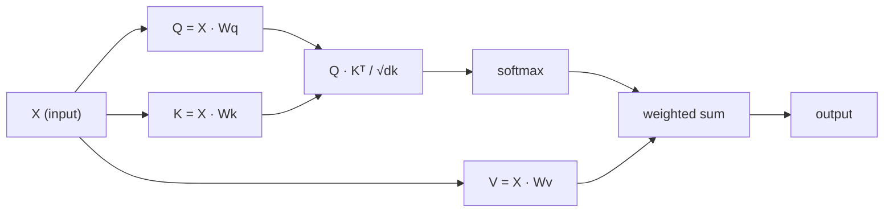

# 처음부터 자기 관심

> 주의는 검색 테이블입니다. 그 단어마다 "누가 나에게 중요합니까?"라는 질문을 하고 그 답을 배우게 됩니다.

**Type:** Build
**Languages:** Python
**Prerequisites:** Phase 3 (Deep Learning Core), Phase 5 Lesson 10 (Sequence-to-Sequence)
**Time:** ~90 minutes

## 학습 목표

- 질의/키/값 예측과 소프트맥스 중량 수치를 포함하여 NumPy만을 사용하여 점 점 제품 자체 주의를 처음부터 구현
- 여러 헤드 주의층을 만들어 헤드를 나눈, 평행주의를 계산하고 결과를 연결하는
- 주의 매트릭스가 표본 관계를 어떻게 캡처하는지 추적하고 왜 확장되는지 설명합니다$\sqrt{d_k}$부드러운 최대 포화 방지
- 이방향주의를 자율적 (독립형) 관심으로 변환하기 위해 인과적 마스크를 적용한다

## 문제

RNNs는 한 번에 하나의 토큰을 순차적으로 처리합니다. 토큰 50을 달성할 때, 토큰 1에서 얻은 정보는 50 개의 압축 단계를 통해 압축되었습니다. 장거리 의존성은 고정 크기의 숨겨진 상태로 압축됩니다. LSTM 게팅의 양이 완전히 해결되지 않는 병목.

2014 Bahdanau 주의 논문에서는 해결방안을 제시했습니다. 디코더가 각 코더 위치를 되돌아보고 현재 단계에 어떤 것이 중요하는지 결정하도록 허용했습니다. 그러나 여전히 RNN에 연결되었습니다. 2017 "주의는 당신이 필요로하는 모든 것" 논문에서는 더 날카로운 질문을 던졌습니다. 주의가 * 유일한 * 메커니즘이라면 어떻게 될까요? 반복이 없습니다. 회전도 없습니다. 단지 주의가 있습니다.

자기 주의 는 순서 로 있는 모든 위치 를 하나의 병렬 단계 로 다른 위치 를 돌볼 수 있게 해 줍니다. 이것이 트랜스포머 를 빠르고 확장 가능 하고 지배적 으로 만드는 것 입니다.

## 개념

### 데이터베이스 검색 유사성

관심은 부드러운 데이터베이스 검색으로 생각하세요.

```
Traditional database:
  Query: "capital of France"  -->  exact match  -->  "Paris"

Attention:
  Query: "capital of France"  -->  similarity to ALL keys  -->  weighted blend of ALL values
```

모든 토큰은 세 개의 벡터를 생성합니다.
- **Query (Q)**"내가 뭘 찾고 있어?"
- **Key (K)**"내가 무엇을 포함하고 있는가?"
- **Value (V)**: "선택되면 어떤 정보를 제공해야 할까요?"

질의와 모든 키 사이의 점 곱은 주의 점수를 생성합니다. 높은 점수는 "이 키는 내 질의와 일치합니다".

### Q, K, V 계산

각각의 토큰 임베디션은 학습된 세 개의 무게 매트릭스를 통해 투영됩니다.

```
Input embeddings (sequence of n tokens, each d-dimensional):

  X = [x1, x2, x3, ..., xn]       shape: (n, d)

Three weight matrices:

  Wq  shape: (d, dk)
  Wk  shape: (d, dk)
  Wv  shape: (d, dv)

Projections:

  Q = X @ Wq    shape: (n, dk)      each token's query
  K = X @ Wk    shape: (n, dk)      each token's key
  V = X @ Wv    shape: (n, dv)      each token's value
```

시각적으로, 하나의 표기:

```
             Wq
  x_i ------[*]------> q_i    "What am I looking for?"
       |
       |     Wk
       +----[*]------> k_i    "What do I contain?"
       |
       |     Wv
       +----[*]------> v_i    "What do I offer?"
```

### 주의 행렬

모든 토큰에 대해 Q, K, V를 가지고 나면, 주의 점수는 매트릭스를 형성합니다.

```
Scores = Q @ K^T    shape: (n, n)

              k1    k2    k3    k4    k5
        +-----+-----+-----+-----+-----+
   q1   | 2.1 | 0.3 | 0.1 | 0.8 | 0.2 |   <- how much q1 attends to each key
        +-----+-----+-----+-----+-----+
   q2   | 0.4 | 1.9 | 0.7 | 0.1 | 0.3 |
        +-----+-----+-----+-----+-----+
   q3   | 0.2 | 0.6 | 2.3 | 0.5 | 0.1 |
        +-----+-----+-----+-----+-----+
   q4   | 0.9 | 0.1 | 0.4 | 1.7 | 0.6 |
        +-----+-----+-----+-----+-----+
   q5   | 0.1 | 0.3 | 0.2 | 0.5 | 2.0 |
        +-----+-----+-----+-----+-----+

Each row: one token's attention over the entire sequence
```

하나의 질의를 한번에 살펴보면 키를 스캔합니다. 각 줄은 모든 토큰을 점수합니다. softmax는 점수를 무게로 변환합니다. 컨텍스트 벡터는 무게가 있는 값의 혼합입니다.

```figure
attention-matrix
```

### 왜 규모가?

점 제품들은 차원과 함께 성장합니다$d_k$- 만약$d_k = 64$, 점 제품 10 범위에서 될 수 있습니다. 부드러운max를 그라디언트가 사라지는 지역으로 밀어.$\sqrt{d_k}$- 그래

```math
\text{Scaled scores} = \frac{Q K^T}{\sqrt{d_k}}
```

이것은 소프트맥스가 유용한 기하급수성을 생성하는 범위에서 값을 유지합니다.

### 소프트맥스는 점수를 무게로 바꾸어 놓습니다

소프트맥스는 원자 점수를 각 줄에 걸쳐 확률 분포로 변환합니다.

```
Raw scores for q1:   [2.1, 0.3, 0.1, 0.8, 0.2]
                            |
                         softmax
                            |
Attention weights:   [0.52, 0.09, 0.07, 0.14, 0.08]   (sums to ~1.0)
```

이제 각각의 토큰은 다른 토큰에 얼마나 많은 것을 지불해야 하는지 나타내는 무게를 가지고 있습니다.

### 가치 의 중량 합

각 토큰의 최종 출력은 모든 값 벡터의 중량 합입니다.

```
output_i = sum( attention_weight[i][j] * v_j  for all j )

For token 1:
  output_1 = 0.52 * v1 + 0.09 * v2 + 0.07 * v3 + 0.14 * v4 + 0.08 * v5
```

### 전체 파이프라인



한 줄의 공식:

```math
\text{Attention}(Q, K, V) = \mathop{\mathrm{softmax}}\left( \frac{Q K^T}{\sqrt{d_k}} \right) V
```

```figure
softmax-attention-scaling
```

## 건설 해

### 단계 1: 처음부터 소프트맥스

소프트맥스는 원자 로그트를 확률로 변환합니다. 숫자 안정성을 위해 최대값을 빼면 됩니다.

```python
import numpy as np

def softmax(x):
    shifted = x - np.max(x, axis=-1, keepdims=True)
    exp_x = np.exp(shifted)
    return exp_x / np.sum(exp_x, axis=-1, keepdims=True)

logits = np.array([2.0, 1.0, 0.1])
print(f"logits:  {logits}")
print(f"softmax: {softmax(logits)}")
print(f"sum:     {softmax(logits).sum():.4f}")
```

### 단계 2: 점 점 제품 관심

핵심 함수는 Q, K, V 매트릭스를 가져다가 주의 출력을 더한 무게 매트릭스를 반환합니다.

```python
def scaled_dot_product_attention(Q, K, V):
    dk = Q.shape[-1]
    scores = Q @ K.T / np.sqrt(dk)
    weights = softmax(scores)
    output = weights @ V
    return output, weights
```

### 단계 3: 학습된 예측을 통해 자기주의 수업

Wq, Wk, Wv 중량 매트릭스를 가진 완전한 자기주의 모듈

```python
class SelfAttention:
    def __init__(self, d_model, dk, dv, seed=42):
        rng = np.random.default_rng(seed)
        scale = np.sqrt(2.0 / (d_model + dk))
        self.Wq = rng.normal(0, scale, (d_model, dk))
        self.Wk = rng.normal(0, scale, (d_model, dk))
        scale_v = np.sqrt(2.0 / (d_model + dv))
        self.Wv = rng.normal(0, scale_v, (d_model, dv))
        self.dk = dk

    def forward(self, X):
        Q = X @ self.Wq
        K = X @ self.Wk
        V = X @ self.Wv
        output, weights = scaled_dot_product_attention(Q, K, V)
        return output, weights
```

### 4단계: 문장을 써라

문장을 위해 가짜 임베디션을 만들어서 주의가 무게를 습니다.

```python
sentence = ["The", "cat", "sat", "on", "the", "mat"]
n_tokens = len(sentence)
d_model = 8
dk = 4
dv = 4

rng = np.random.default_rng(42)
X = rng.normal(0, 1, (n_tokens, d_model))

attn = SelfAttention(d_model, dk, dv, seed=42)
output, weights = attn.forward(X)

print("Attention weights (each row: where that token looks):\n")
print(f"{'':>6}", end="")
for token in sentence:
    print(f"{token:>6}", end="")
print()

for i, token in enumerate(sentence):
    print(f"{token:>6}", end="")
    for j in range(n_tokens):
        w = weights[i][j]
        print(f"{w:6.3f}", end="")
    print()
```

### 단계 5: ASCII 온도 지도로 주의를 시각화하십시오

빠른 시각을 위해 캐릭터에 주의 무게를 지도하십시오.

```python
def ascii_heatmap(weights, tokens, chars=" ░▒▓█"):
    n = len(tokens)
    print(f"\n{'':>6}", end="")
    for t in tokens:
        print(f"{t:>6}", end="")
    print()

    for i in range(n):
        print(f"{tokens[i]:>6}", end="")
        for j in range(n):
            level = int(weights[i][j] * (len(chars) - 1) / weights.max())
            level = min(level, len(chars) - 1)
            print(f"{'  ' + chars[level] + '   '}", end="")
        print()

ascii_heatmap(weights, sentence)
```

## 사용 하 고

피토르치의`nn.MultiheadAttention`우리가 만든 것과 정확히 같고, 더하면 멀티 헤드 분화와 출력 투영

```python
import torch
import torch.nn as nn

d_model = 8
n_heads = 2
seq_len = 6

mha = nn.MultiheadAttention(embed_dim=d_model, num_heads=n_heads, batch_first=True)

X_torch = torch.randn(1, seq_len, d_model)

output, attn_weights = mha(X_torch, X_torch, X_torch)

print(f"Input shape:            {X_torch.shape}")
print(f"Output shape:           {output.shape}")
print(f"Attention weight shape: {attn_weights.shape}")
print(f"\nAttn weights (averaged over heads):")
print(attn_weights[0].detach().numpy().round(3))
```

주요 차이점은: 다중 머리 관심은 여러 개의 관심 기능을 병렬로 실행하고 있으며 각자는 Q, K, V의 크기의 각종 투표를 가지고 있습니다 $d_k = d_{\text{model}} / n_{\text{heads}}$이 모델은 서로 다른 관계 유형에 동시에 관심을 가질 수 있게 합니다.

## 선박

이 교훈은 다음과 같은 결과를 낳습니다.
- `outputs/prompt-attention-explainer.md`- 데이터베이스 검색 유사성으로 주의를 설명하는 명령어

## 운동

1. 수정`scaled_dot_product_attention`Softmax 이전에 특정 위치를 음수 무한로 설정하는 선택적 마스크 매트릭스를 받아들이기 (이러한 방법으로 인과/독호기 마스크가 작동합니다)
2. 처음부터 다중머리 주의를 구현: Q, K, V를 나눌 수 있습니다 `n_heads`조각, 각에 대한 주의를 실행, 동맥, 그리고 최종 무게 매트릭스 Wo
3. 같은 길이의 두 개의 문장을 가지고, 같은 자기주의 사례를 통해 먹여, 그들의 주의 패턴을 비교해보세요. 무엇이 변할까요? 무엇이 그대로 유지될까요?

## 주요 용어

| Term | What people say | What it actually means |
|------|----------------|----------------------|
| Query (Q) | "The question vector" | A learned projection of the input that represents what information this token is looking for |
| Key (K) | "The label vector" | A learned projection that represents what information this token contains, matched against queries |
| Value (V) | "The content vector" | A learned projection carrying the actual information that gets aggregated based on attention scores |
| Scaled dot-product attention | "The attention formula" | $\mathop{\mathrm{softmax}}(QK^T / \sqrt{d_k}) V$ - scaling prevents softmax saturation in high dimensions |
| Self-attention | "The token looks at itself and others" | Attention where Q, K, V all come from the same sequence, letting every position attend to every other position |
| Attention weights | "How much focus" | A probability distribution over positions, produced by softmax over scaled dot products |
| Multi-head attention | "Parallel attention" | Running multiple attention functions with different projections, then concatenating results for richer representations |

## 더 많은 읽기

- [Attention Is All You Need (Vaswani et al., 2017)](https://arxiv.org/abs/1706.03762)- 원래의 변압기 종이
- [The Illustrated Transformer (Jay Alammar)](https://jalammar.github.io/illustrated-transformer/)- 전체 건축물의 가장 좋은 시각적 보행
- [The Annotated Transformer (Harvard NLP)](https://nlp.seas.harvard.edu/annotated-transformer/)- 설명과 함께 라인별 PyTorch 구현
