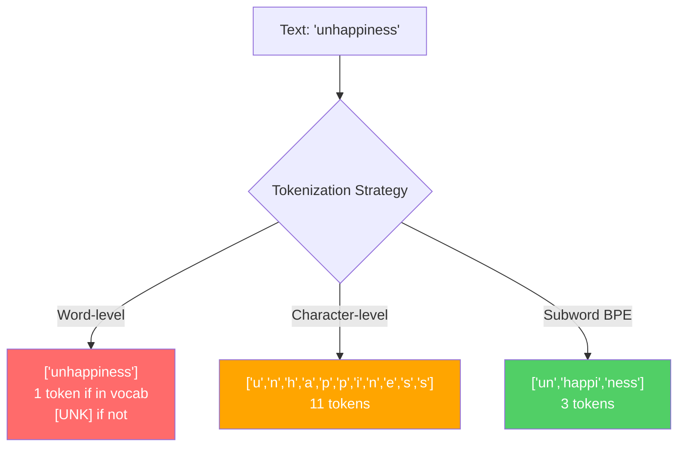
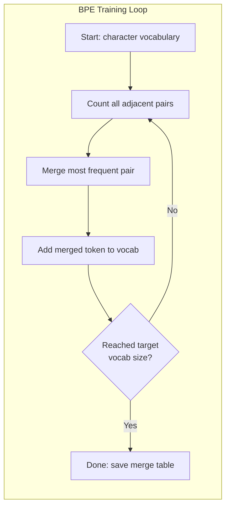
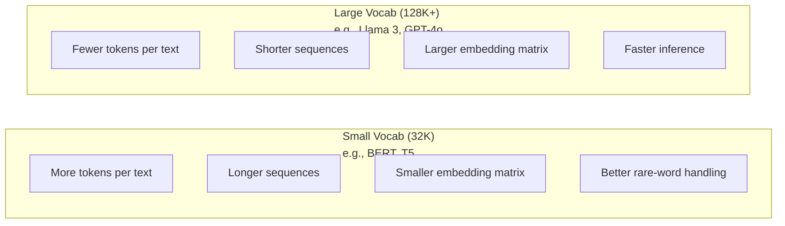

# 토큰: BPE, 워드피스, 세인트피스

> LLM는 영어로 읽지 않습니다. 정수들을 읽습니다. 토케니저는 그 정수들이 의미를 가지고 있는지 아니면 낭비하는지 결정합니다.

**Type:** Build
**Languages:** Python
**Prerequisites:** Phase 05 (NLP Foundations)
**Time:** ~90 minutes

## 학습 목표

- BPE, WordPiece, 그리고 Unigram 토큰화 알고리즘을 처음부터 구현하고 그들의 융합 전략을 비교
- 어휘의 크기가 모델 효율성에 어떻게 영향을 미치는지 설명하십시오. 너무 작아서 긴 염기서열을 생성하고 너무 큰 폐기물이 매개 변수를 함축합니다.
- 언어와 코드 간 토큰화 유물을 분석하여 특정 토큰화 유물이 분해되는 곳을 식별합니다.
- 틱토큰 및 문장자 라이브러리를 사용하여 텍스트를 토큰화하고 결과 토큰 ID를 검사합니다

## 문제

LLM는 영어도 읽지 않고, 어떤 언어를 읽지 않고, 숫자를 읽습니다.

"안녕하세요, 세계!"와 [15496, 11, 995, 0] 사이의 격차는 표기기입니다. 모델이 처리하기 전에 모든 단어, 모든 공간, 모든 점수표가 정수로 변환되어야 합니다. 이 변환은 중립적이지 않습니다. 나중에 취소할 수 없는 가정들을 모델에 넣습니다.

잘못하면 모델은 여러 토큰으로 일반적인 단어를 암호화하는 용량을 낭비합니다. "불안"은 1개 대신 4개의 토큰이 됩니다. 128K 컨텍스트 윈도우는 75% 줄어들었습니다. 올바른 방법으로 해봅시다. 같은 맥락 창은 두 배 더 많은 의미를 가지고 있습니다. "이 모델은 코드를 잘 처리한다"와 "이 모델은 파이썬에 익혀있다"의 차이점은 종종 토큰이 훈련된 방식에 달려 있습니다.

GPT-4 또는 클로드에 대한 모든 API 호출은 토큰 당 가격입니다. 모델이 생성하는 모든 토큰은 계산 비용입니다. 출력을 나타내는 데 필요한 토큰이 적은수록 엔드-투-엔드 추론이 빠르다. 토큰화는 사전 처리가 아닙니다. 그것은 건축입니다.

## 개념

### 실패 한 3 가지 방법 (그리고 승리 한 방법)

텍스트를 숫자로 변환하는 세 가지 확실한 방법이 있습니다. 그 중 두 가지는 규모로 작동하지 않습니다.

**Word-level tokenization**"Cat sat"는 ["The", "cat", "sat"]"가 됩니다. 간단합니다. 하지만 "tokenization"는 어떨까요? 또는 "GPT-4o"는 어떨까요? 또는 "Geschwindigkeitsbegrenzung"와 같은 독일어 합성 단어입니다. 단어 수준은 모든 언어의 모든 단어를 다루는 거대한 어휘가 필요합니다. 한 단어를 놓치고 당신은 두려워됩니다.`[UNK]`토큰은 모델의 "이것이 무엇인지 모르겠어요".라고 말하는 방법입니다. 영어만으로는 백만 개 이상의 단어 형태가 있습니다. 코드, URL, 과학적 표기, 그리고 100개의 다른 언어를 추가하면 무한한 어휘가 필요합니다.

**Character-level tokenization**다른 방향으로 가죠. "안녕하세요"는 ["h", "e", "l", "l", "o""가 됩니다. 어휘는 작습니다. 몇 백 개의 문자입니다. 알려지지 않은 표본은 없습니다. 하지만 순서는 매우 길게됩니다. 10 단어 수준의 표본이 되는 문장은 50 문자 수준의 표본이 됩니다. 모델은 "t", "h", "e"가 함께 "the"라는 것을 배워야 합니다.

**Subword tokenization**단어가 단위로 남아 있다. "the"는 하나의 표본이다. 희귀한 단어들은 의미 있는 조각으로 분해된다. "불행복"은 ["un", "happy", "ness"]이 된다. 어휘는 관리할 수 있게 남아 있다. (30K에서 128K 표본) 은 짧은 순서로 남아 있다. 알려지지 않은 표본은 본질적으로 사라진다. 왜냐하면 모든 단어들은 하위 단어 조각에서 만들어질 수 있기 때문입니다.

모든 현대 LLM는 하위 단어 토큰화를 사용합니다. GPT-2, GPT-4, BERT, Llama 3, Claude - 모두. 문제는 어떤 알고리즘이냐는 것입니다.



### BPE: 바이트 페어 코딩

BPE는 토큰화로 재기용된 탐욕적인 압축 알고리즘입니다. 이 아이디어는 인덱스 카드에 들어갈 정도로 간단합니다.

개별 문자로 시작해 훈련 코퍼스에서 인접한 모든 쌍을 셀 수 있습니다. 가장 빈번한 쌍을 새로운 토큰으로 통합합니다. 목표 어휘 크기를 달성하기까지 반복합니다.

```figure
tokenizer-bpe
```

여기 BPE가 작은 코퍼스에서 실행되고 있습니다. "저기", "저기" 그리고 "최신"이라는 단어들이 있습니다.

```
Corpus (with word frequencies):
  "lower"  x5
  "lowest" x2
  "newest" x6

Step 0 -- Start with characters:
  l o w e r       (x5)
  l o w e s t     (x2)
  n e w e s t     (x6)

Step 1 -- Count adjacent pairs:
  (e,s): 8    (s,t): 8    (l,o): 7    (o,w): 7
  (w,e): 13   (e,r): 5    (n,e): 6    ...

Step 2 -- Merge most frequent pair (w,e) -> "we":
  l o we r        (x5)
  l o we s t      (x2)
  n e we s t      (x6)

Step 3 -- Recount and merge (e,s) -> "es":
  l o we r        (x5)
  l o we s t      (x2)    <- 'es' only forms from 'e'+'s', not 'we'+'s'
  n e we s t      (x6)    <- wait, the 'e' before 'we' and 's' after 'we'

Actually tracking this precisely:
  After "we" merge, remaining pairs:
  (l,o): 7   (o,we): 7   (we,r): 5   (we,s): 8
  (s,t): 8   (n,e): 6    (e,we): 6

Step 3 -- Merge (we,s) -> "wes" or (s,t) -> "st" (tied at 8, pick first):
  Merge (we,s) -> "wes":
  l o we r        (x5)
  l o wes t       (x2)
  n e wes t       (x6)

Step 4 -- Merge (wes,t) -> "west":
  l o we r        (x5)
  l o west        (x2)
  n e west        (x6)

...continue until target vocab size reached.
```

융합 테이블은 토케니저입니다. 새로운 텍스트를 암호화하려면, 학습된 순서대로 융합을 적용하십시오. 훈련 코퍼스는 어떤 융합이 있는지 결정하고, 그 선택은 모델이 보는 것을 영구적으로 형성합니다.



### 바이트 레벨 BPE (GPT-2, GPT-3, GPT-4)

표준 BPE는 유니코드 문자에서 작동합니다. 바이트 레벨 BPE는 원자 바이트 (0-255) 에서 작동합니다. 이것은 정확히 256 개의 기본 어휘를 제공합니다. 모든 언어 또는 코딩을 처리하며, 결코 알려지지 않은 토큰을 생성하지 않습니다.

GPT-2는 이러한 접근 방식을 도입했습니다. 기본 어휘는 가능한 모든 바이트를 포함합니다. BPE는 그 위에 구축됩니다. OpenAI의 틱톡 라이브러리는 다음과 같은 어휘 크기로 바이트 수준의 BPE를 구현합니다.

- GPT-2: 50,257개의 토큰
- GPT-3.5/GPT-4: ~100,256 토큰 (cl100k_base 코딩)
- GPT-4o: 200,019 토큰 (o200k_base 코딩)

### 워드피스 (BERT)

워드피스는 BPE와 비슷하지만 픽스 합치는 방식이 다르다. 원시 주파수 대신 훈련 데이터의 가능성을 극대화합니다.

```
BPE merge criterion:      count(A, B)
WordPiece merge criterion: count(AB) / (count(A) * count(B))
```

BPE 는 "어떤 쌍이 가장 자주 나타난다?"라고 묻습니다. 워드피스는 "어떤 쌍이 우연히 예상보다 더 자주 함께 나타난다?"라고 묻습니다. 이 미묘한 차이점은 다른 어휘를 만들어 냅니다. 워드피스는 공동 발생이 놀라울 정도로 자주 일어나는 곳보다는 합병을 선호합니다.

워드피스는 또한 연속 하위 단어에 "##" 사전을 사용합니다.

```
"unhappiness" -> ["un", "##happi", "##ness"]
"embedding"   -> ["em", "##bed", "##ding"]
```

"##"의 앞음식은 이 조각이 이전 토큰을 계속한다는 것을 알려줍니다. BERT는 30,522개의 토큰의 어휘를 가진 WordPiece를 사용합니다. 모든 BERT 변종 - DistilBERT, RoBERTa의 토큰화는 실제로 BPE이지만 BERT 자체는 WordPiece입니다.

### 문장 (Llama, T5)

SentencePiece는 유니코드 문자, 백공간을 포함한 원시 스트림으로 입력된 것을 처리합니다. 사전 토큰화 단계가 없습니다. 단어 경계에 대한 언어 특수한 규칙이 없습니다. 이것은 중국어, 일본어, 태국어 및 다른 언어로 작동합니다. 공간에서 단어를 분리하지 않는 경우

SentencePiece는 두 개의 알고리즘을 지원합니다.
- **BPE mode**: 표준 BPE와 동일한 융합 논리, 원자 문자열에 적용
- **Unigram mode**BPE의 역은 합병 대신 정렬합니다. BPE의 역은 합병 대신 정렬합니다.

Llama 2는 32,000개의 토큰의 어휘를 가진 SentencePiece BPE를 사용한다. T5는 32,000개의 토큰의 SentencePiece Unigram을 사용한다. 참고: Llama 3는 128,256개의 토큰을 가진 티켓콘 기반의 바이이트 레벨 BPE 토큰화로 전환되었다.

### 단어자량 거래

이것은 측정 가능한 결과를 가진 진정한 엔지니어링 결정입니다.



구체적인 숫자. 4,096 차원 임베디션이 있는 128K 어휘에 대해서는 임베디션 매트릭스만으로는 128,000 x 4,096 = 52400만 파라미터이다. 32K 어휘에 대해서는 13100만 파라미터이다. 이는 토케니저 선택만으로는 400M 파라미터 차이가 있다.

하지만 더 큰 어휘는 텍스트를 더 공격적으로 압축합니다. 32K 어휘의 토큰 100개를 사용하는 영어 문장은 128K 어휘의 토큰 70개를 사용할 수 있습니다. 즉 생성 중에 30% 더 적은 앞을 통과합니다. 수백만 개의 요청을 처리하는 모델에서는 계산 비용의 직접적인 감소입니다.

트렌드는 분명하다: 어휘의 크기는 증가하고 있다. GPT-2는 50,257을 사용했다. GPT-4는 ~100K를 사용했다. Llama 3는 128K를 사용했다. GPT-4o는 200K를 사용했다.

| Model | Vocab Size | Tokenizer Type | Avg Tokens per English Word |
|-------|-----------|----------------|---------------------------|
| BERT | 30,522 | WordPiece | ~1.4 |
| GPT-2 | 50,257 | Byte-level BPE | ~1.3 |
| Llama 2 | 32,000 | SentencePiece BPE | ~1.4 |
| GPT-4 | ~100,256 | Byte-level BPE | ~1.2 |
| Llama 3 | 128,256 | Byte-level BPE (tiktoken) | ~1.1 |
| GPT-4o | 200,019 | Byte-level BPE | ~1.0 |

### 다국어 세금

주로 영어로 훈련된 토큰 제작자는 다른 언어에 잔인합니다. GPT-2의 토큰 제작자에서 한국어 텍스트는 평균적으로 단어가 2~3개의 토큰을 가지고 있습니다. 중국어는 더 나쁘게 될 수 있습니다. 이것은 한국인 사용자가 실제로 영어 사용자의 절반 정도의 컨텍스트 창을 가지고 있다는 것을 의미합니다. 정보 밀도가 적은 것에 대해 동일한 가격을 지불합니다.

이 때문에 Llama 3는 32K에서 128K로 4배로 가량한 어휘를 늘렸다. 영어 이외의 스크립트에 더 많은 토큰을 사용하게 되면 언어 간 압축이 더 공정하게 이루어질 수 있습니다.

```figure
tokenizer-tradeoff
```

## 건설 해

### 단계 1: 캐릭터 레벨 토케니저

기틀에서 시작하세요. 문자 레벨 토큰이 각 문자를 유니코드 코드 포인트로 지도합니다. 훈련이 필요하지 않습니다. 알려지지 않은 토큰이 없습니다. 직접 지도만 합니다.

```python
class CharTokenizer:
    def encode(self, text):
        return [ord(c) for c in text]

    def decode(self, tokens):
        return "".join(chr(t) for t in tokens)
```

"안녕하세요"는 [104, 101, 108, 108, 111]이 됩니다. 각 캐릭터는 고유의 표기입니다. 이것이 우리가 개선하는 기본 라인입니다.

### 단계 2: 처음부터 BPE 토큰화

실제 구현. 우리는 원본 바이트 (GPT-2와 같은) 를 훈련, 부쌍을 셀, 가장 빈번한 합병, 그리고 순서대로 모든 합병을 기록. 합병 테이블은 토큰화입니다.

```python
from collections import Counter

class BPETokenizer:
    def __init__(self):
        self.merges = {}
        self.vocab = {}

    def _get_pairs(self, tokens):
        pairs = Counter()
        for i in range(len(tokens) - 1):
            pairs[(tokens[i], tokens[i + 1])] += 1
        return pairs

    def _merge_pair(self, tokens, pair, new_token):
        merged = []
        i = 0
        while i < len(tokens):
            if i < len(tokens) - 1 and tokens[i] == pair[0] and tokens[i + 1] == pair[1]:
                merged.append(new_token)
                i += 2
            else:
                merged.append(tokens[i])
                i += 1
        return merged

    def train(self, text, num_merges):
        tokens = list(text.encode("utf-8"))
        self.vocab = {i: bytes([i]) for i in range(256)}

        for i in range(num_merges):
            pairs = self._get_pairs(tokens)
            if not pairs:
                break
            best_pair = max(pairs, key=pairs.get)
            new_token = 256 + i
            tokens = self._merge_pair(tokens, best_pair, new_token)
            self.merges[best_pair] = new_token
            self.vocab[new_token] = self.vocab[best_pair[0]] + self.vocab[best_pair[1]]

        return self

    def encode(self, text):
        tokens = list(text.encode("utf-8"))
        for pair, new_token in self.merges.items():
            tokens = self._merge_pair(tokens, pair, new_token)
        return tokens

    def decode(self, tokens):
        byte_sequence = b"".join(self.vocab[t] for t in tokens)
        return byte_sequence.decode("utf-8", errors="replace")
```

훈련 루프는 BPE의 핵심입니다. 쌍을 셀, 승자를 합쳐, 반복합니다. 각각의 합치는 토큰의 전체 수를 줄입니다.`num_merges`라운드, 어휘는 256 (기본 바이트) 에서 256+ num_merges로 증가합니다.

코딩은 학습된 정확한 순서대로 합병을 적용한다. 이것은 중요합니다. 1을 합병하면 "th"를 생성하고 5을 합병하면, 코딩은 먼저 merge 1을 적용해야 함으로써 "the"는 merge 5에서 "th" + "e"에서 형성 될 수 있습니다.

디코딩은 반대로요. 단어자리에서 모든 토큰 ID를 찾아, 바이트를 연결하고 UTF-8로 디코딩하세요.

### 단계 3: 롤트리프 에코딩 및 디코딩

```python
corpus = (
    "The cat sat on the mat. The cat ate the rat. "
    "The dog sat on the log. The dog ate the frog. "
    "Natural language processing is the study of how computers "
    "understand and generate human language. "
    "Tokenization is the first step in any NLP pipeline."
)

tokenizer = BPETokenizer()
tokenizer.train(corpus, num_merges=40)

test_sentences = [
    "The cat sat on the mat.",
    "Natural language processing",
    "tokenization pipeline",
    "unhappiness",
]

for sentence in test_sentences:
    encoded = tokenizer.encode(sentence)
    decoded = tokenizer.decode(encoded)
    raw_bytes = len(sentence.encode("utf-8"))
    ratio = len(encoded) / raw_bytes
    print(f"'{sentence}'")
    print(f"  Tokens: {len(encoded)} (from {raw_bytes} bytes) -- ratio: {ratio:.2f}")
    print(f"  Roundtrip: {'PASS' if decoded == sentence else 'FAIL'}")
```

압축 비율은 토케니저의 효과에 대해 알려줍니다. 0.50의 비율은 토큰이 텍스트를 원본 바이트의 절반만큼의 토큰으로 압축한다는 것을 의미합니다. 더 낮게는 더 낫다. 훈련 과정에서는 비율이 좋겠습니다. 배포되지 않은 텍스트에 "불행복" (부체에 표시되지 않는) 와 같은 비율은 더 나쁘게 될 것입니다.

### 단계 4: 틱톡과 비교

```python
import tiktoken

enc = tiktoken.get_encoding("cl100k_base")

texts = [
    "The cat sat on the mat.",
    "unhappiness",
    "Hello, world!",
    "def fibonacci(n): return n if n < 2 else fibonacci(n-1) + fibonacci(n-2)",
    "Geschwindigkeitsbegrenzung",
]

for text in texts:
    our_tokens = tokenizer.encode(text)
    tiktoken_tokens = enc.encode(text)
    tiktoken_pieces = [enc.decode([t]) for t in tiktoken_tokens]
    print(f"'{text}'")
    print(f"  Our BPE:   {len(our_tokens)} tokens")
    print(f"  tiktoken:  {len(tiktoken_tokens)} tokens -> {tiktoken_pieces}")
```

tiktoken은 정확히 같은 알고리즘을 사용하지만, 100,000개의 융합을 통해 수백 가가바이트의 텍스트를 훈련합니다. 알고리즘은 동일합니다. 차이점은 훈련 데이터와 융합 수입니다. 40개의 융합을 가진 문장으로 훈련된 토큰이 tiktoken의 100K 융합과 경쟁할 수 없습니다. 하지만 메커니즘은 동일합니다.

### 5단계: 어휘 분석

```python
def analyze_vocabulary(tokenizer, test_texts):
    total_tokens = 0
    total_chars = 0
    token_usage = Counter()

    for text in test_texts:
        encoded = tokenizer.encode(text)
        total_tokens += len(encoded)
        total_chars += len(text)
        for t in encoded:
            token_usage[t] += 1

    print(f"Vocabulary size: {len(tokenizer.vocab)}")
    print(f"Total tokens across all texts: {total_tokens}")
    print(f"Total characters: {total_chars}")
    print(f"Avg tokens per character: {total_tokens / total_chars:.2f}")

    print(f"\nMost used tokens:")
    for token_id, count in token_usage.most_common(10):
        token_bytes = tokenizer.vocab[token_id]
        display = token_bytes.decode("utf-8", errors="replace")
        print(f"  Token {token_id:4d}: '{display}' (used {count} times)")

    unused = [t for t in tokenizer.vocab if t not in token_usage]
    print(f"\nUnused tokens: {len(unused)} out of {len(tokenizer.vocab)}")
```

이것은 여러분의 어휘의 Zipf 분포를 보여줍니다. 몇 개의 토큰이 지배합니다. (공간, "the", "e"). 대부분의 토큰은 거의 사용되지 않습니다. 생산 토큰화는 이러한 분포를 최적화합니다. 일반적인 패턴은 짧은 토큰 ID를 얻습니다. 희귀 패턴은 더 긴 표현을 얻습니다.

## 사용 하 고

네 스크래치 BPE가 작동해 이제 제작 도구가 어떻게 생겼는지 보세요

### 틱톡 (OpenAI)

```python
import tiktoken

enc = tiktoken.get_encoding("cl100k_base")

text = "Tokenizers convert text to integers"
tokens = enc.encode(text)
print(f"Tokens: {tokens}")
print(f"Pieces: {[enc.decode([t]) for t in tokens]}")
print(f"Roundtrip: {enc.decode(tokens)}")
```

tiktoken는 Python 결합으로 Rust로 작성되어 있습니다. 그것은 초에 수백만 개의 토큰을 암호화합니다. 동일한 BPE 알고리즘, 산업-강력 구현.

### 포옹하는 얼굴 표지표

```python
from tokenizers import Tokenizer
from tokenizers.models import BPE
from tokenizers.trainers import BpeTrainer
from tokenizers.pre_tokenizers import ByteLevel

tokenizer = Tokenizer(BPE())
tokenizer.pre_tokenizer = ByteLevel()

trainer = BpeTrainer(vocab_size=1000, special_tokens=["<pad>", "<eos>", "<unk>"])
tokenizer.train(["corpus.txt"], trainer)

output = tokenizer.encode("The cat sat on the mat.")
print(f"Tokens: {output.tokens}")
print(f"IDs: {output.ids}")
```

Hugging Face Tokenizers 라이브러리는 또한 Rust Under the Hood입니다. 그것은 Gigabyte 규모의 corpora에 BPE를 초 안에 훈련시킵니다. 이것은 당신이 당신의 모델을 훈련할 때 사용하는 것입니다.

### 라마의 토케니저를 로딩

```python
from transformers import AutoTokenizer

tokenizer = AutoTokenizer.from_pretrained("meta-llama/Llama-3.1-8B")

text = "Tokenizers are the unsung heroes of LLMs"
tokens = tokenizer.encode(text)
print(f"Token IDs: {tokens}")
print(f"Tokens: {tokenizer.convert_ids_to_tokens(tokens)}")
print(f"Vocab size: {tokenizer.vocab_size}")

multilingual = ["Hello world", "Hola mundo", "Bonjour le monde"]
for text in multilingual:
    ids = tokenizer.encode(text)
    print(f"'{text}' -> {len(ids)} tokens")
```

Llama 3의 128K 어휘는 GPT-2의 50K 어휘보다 훨씬 더 나은 비영리 텍스트를 압축합니다. 이것을 직접 확인할 수 있습니다. 같은 문장을 여러 언어로 코딩하고 토큰을 셀 수 있습니다.

## 선박

이 교훈은`outputs/prompt-tokenizer-analyzer.md`-- 텍스트와 모델 조합의 토큰화 효율성을 분석하는 재사용 가능한 프롬프트. 텍스트 샘플을 입력하여 어떤 모델의 토큰화가 가장 잘 처리하는지 알려줍니다.

## 운동

1. BPE 토케니저는 각 융합 단계에 어휘를 인쇄하도록 수정합니다. "t" + "h"가 "th"가 되는지, "th" + "e"가 "the"가 되는지 관찰합니다. 일반적인 영어 단어들이 조각으로 어떻게 집합되는지 추적합니다.

2. 특별 토큰을 추가 (`<pad>``<eos>``<unk>`) 를 BPE 토큰화로 지정하여, 그들에게 ID 0, 1, 2를 부여하고, 다른 모든 토큰을 그에 따라 이동시켜, BPE를 실행하기 전에 백공간에서 분할되는 사전 토큰화 단계를 실행합니다.

3. WordPiece 융합 기준 (주파수 대신 확률 비율) 을 구현하십시오. BPE와 WordPiece 둘 다 같은 융합 수와 같은 코퍼스에서 훈련하십시오. 결과 된 어휘를 비교하십시오. 어느 하나는 언어적으로 더 의미있는 하위 단어를 생성합니까?

4. 다국어 토큰 제작 효율 기준을 작성하십시오. 영어, 스페인어, 중국어, 한국어, 아랍어 10 문장을 작성하여, 각각을 틱토큰 (cl100k_base) 로 토큰으로 표시하고, 문자당 평균 토큰을 측정합니다. 각 언어에 대한 "다국어 세금"을 정량화하십시오.

5. BPE 토큰을 더 큰 코퍼스에서 훈련하십시오 (위키백과 기사를 다운로드하십시오). 같은 텍스트에서 10% 내의 틱토큰 압축 비율을 달성하기 위해 융합 수를 조정하십시오. 이것은 코퍼스 크기와 융합 수와 압축 품질 사이의 관계를 이해하도록 강요합니다.

## 주요 용어

| Term | What people say | What it actually means |
|------|----------------|----------------------|
| Token | "A word" | A unit in the model's vocabulary -- could be a character, subword, word, or multi-word chunk |
| BPE | "Some compression thing" | Byte Pair Encoding -- iteratively merge the most frequent adjacent pair of tokens until the target vocabulary size is reached |
| WordPiece | "BERT's tokenizer" | Like BPE but merges maximize the likelihood ratio count(AB)/(count(A)*count(B)) instead of raw frequency |
| SentencePiece | "A tokenizer library" | A language-agnostic tokenizer that operates on raw Unicode without pre-tokenization, supporting BPE and Unigram algorithms |
| Vocabulary size | "How many words it knows" | The total number of unique tokens: GPT-2 has 50,257, BERT has 30,522, Llama 3 has 128,256 |
| Fertility | "Not a tokenizer term" | Average number of tokens per word -- measures tokenizer efficiency across languages (1.0 is perfect, 3.0 means the model works three times harder) |
| Byte-level BPE | "GPT's tokenizer" | BPE operating on raw bytes (0-255) instead of Unicode characters, guaranteeing no unknown tokens for any input |
| Merge table | "The tokenizer file" | Ordered list of pair merges learned during training -- this IS the tokenizer, and order matters |
| Pre-tokenization | "Splitting on spaces" | Rules applied before subword tokenization: whitespace splitting, digit separation, punctuation handling |
| Compression ratio | "How efficient the tokenizer is" | Tokens produced divided by input bytes -- lower means better compression and faster inference |

## 더 많은 읽기

- [Sennrich et al., 2016 -- "Neural Machine Translation of Rare Words with Subword Units"](https://arxiv.org/abs/1508.07909)--NLP에 BPE를 도입한 논문으로 1994년 압축 알고리즘을 현대적인 토큰화의 기초로 만들었습니다.
- [Kudo & Richardson, 2018 -- "SentencePiece: A simple and language independent subword tokenizer"](https://arxiv.org/abs/1808.06226)-- 다국어 모델을 실용화한 언어-지식주의적 표본화
- [OpenAI tiktoken repository](https://github.com/openai/tiktoken)-- 생산 BPE 구현 Rust with Python bindings, GPT-3.5/4/4o에서 사용
- [Hugging Face Tokenizers documentation](https://huggingface.co/docs/tokenizers)-- 스 성능으로 생산급 토케니저 훈련
