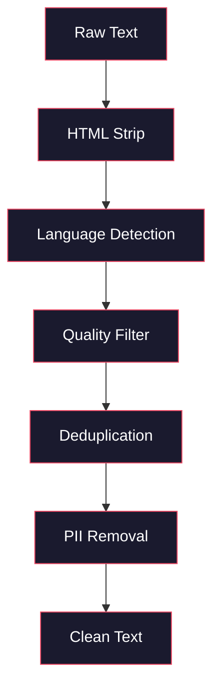
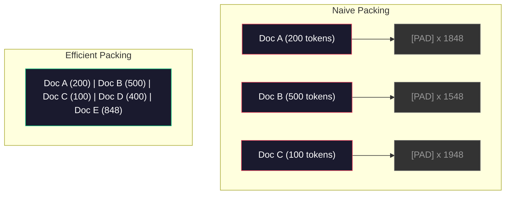

# 사전 훈련에 필요한 데이터 파이프라인

> 모델은 거울입니다. 여러분이 그것을 먹여 주는 데이터를 반영합니다. 쓰레기를 먹여서, 쓰레기를 완벽하게 유동하게 반영합니다.

**Type:** Build
**Languages:** Python
**Prerequisites:** Phase 10, Lessons 01-02 (Tokenizers, Building a Tokenizer)
**Time:** ~90 minutes

## 학습 목표

- 메모리에 로드하지 않고 텍스트의 테라바이트를 토큰화하고, 덩어리, 믹스하고, 배치를 만드는 스트리밍 데이터 파이프라인을 구축하십시오
- 실제 사전 훈련 파이프라인에서 사용되는 데이터 품질 필터를 구현 (분배제, 언어 검출, 콘텐츠 필터링)
- 적절한 주의 마스크와 문서 경계 관리를 통해 고정된 길이의 훈련 순서를 만들
- 프로파일 파이프라인 처리량은 데이터 로더가 GPU 훈련 속도를 따라잡을 수 있도록

## 문제

토큰이 있고, 이제 데이터가 필요해요.

데이터 세트도 아니고 CSV 파일도 아닙니다. 텍스트의 테라바이트는 깨끗하고, 배제되고, 품질을 위해 필터링되고, 고정된 길이의 순서로 토큰화되고, 8GPU 클러스터가 다음 배치를 기다릴 수 없을 정도로 빠르게 무작위로 제공됩니다.

대부분의 사람들은 LLM를 훈련시키는 것이 모델 아키텍처에 관한 것이라고 생각합니다. 그렇지 않습니다. Llama 3는 15.6조 토큰을 사용했습니다. GPT-3는 300억 토큰을 사용했습니다. DeepSeek-V2는 8.1조를 사용했습니다. 세 가지의 아키텍처는 대략 동일합니다. 주의와 피드퍼드 레이어와 함께 쌓인 트랜스포머 블록. 출력 품질의 차이점은 데이터에서 압도적으로 발생합니다.

치야의 DeepMind의 논문은 이런 사실을 정확하게 밝혀냈습니다. 주어진 컴퓨팅 예산에 있어서 모델 매개 변수와 훈련 토큰의 최적의 비율이 있습니다. 칠라는 2022년 대부분의 모델들이 상당히 훈련이 부족하다는 것을 보여주었습니다. 그들은 볼 수 있는 데이터의 양에 너무 많은 매개 변수를 가지고 있었습니다. 1.4조 토큰 (Chinchilla-optimal) 에 훈련된 70B 매개 변수 모델은 300억 토큰 (Gopher) 에 훈련된 280B 모델을 능가했다.

데이터 파이프라인은 모델이 언어를 배우는지 혹은 소음을 배우는지 결정합니다.

## 개념

### 자료가 어디서 왔는가

모든 큰 언어 모델은 다양한 자료에 의해 훈련받습니다. 정확한 구성은 대부분의 연구소에서 철저히 지켜진 비밀이지만, 우리는 그 범주를 이해하기 위해 충분히 알고 있습니다.

| Source | Size | Quality | Used By |
|--------|------|---------|---------|
| Common Crawl | ~250 TB raw | Low (needs heavy filtering) | GPT-3, Llama, most open models |
| Wikipedia | ~20 GB | High | Every major LLM |
| GitHub code | ~1 TB+ | Medium (lots of duplicates, dead code) | StarCoder, CodeLlama, DeepSeek-Coder |
| Books (BookCorpus, Pile) | ~100 GB | High | GPT-2, GPT-3, early models |
| Academic papers (arXiv, S2ORC) | ~100 GB | High for STEM | Llama, Galactica |
| StackOverflow, Reddit | ~100 GB | Medium | Llama, Falcon |
| Curated web (C4, RefinedWeb) | ~5 TB | Medium-High (pre-filtered) | T5, Falcon |

라마 3는 데이터 믹스를 공개했다: 대략 50% 웹 데이터, 25% 코드, 13% 책 및 학술 논문, 8% 수학 데이터, 4% 다국어 웹 데이터. 전체는 5 TB 이상의 원본에서 15.6조 토큰이었다.

이 비율은 전체 크기와 마찬가지로 중요합니다. 너무 많은 웹 데이터가 모델이 Reddit의 개구리로 변합니다. 너무 적은 코드가 프로그래밍이 불가능합니다. 너무 적은 수학은 논리에는 실패합니다. 이 혼합을 올바르게 만드는 것은 LLM를 훈련시키는 가장 어려운 부분 중 하나입니다. 그리고 공식이 없습니다. 그것은 실험과 평가가 필요합니다.

### 데이터 청소

웹 데이터 원료는 더러운 것입니다. 일반적인 크래블 덤프는 다음과 같은 것을 포함합니다.

- HTML 태그와 자바스크립트
- 보일러 플레이트 헤더, 발자국, 내비게이션 메뉴
- 복제 페이지 (정확하고 거의 복제된 페이지)
- 기계 생성 스팸
- 개인 식별 가능한 정보 (PII)
- 품질이 낮은 텍스트 (키워드 목록, SEO 스팸)
- 텍스트로 코딩된 비 텍스트 콘텐츠

이를 청소하는 것은 선택적이지 않습니다. 이것은 일관된 문장을 생성하는 모델과 제품 목록과 혼합된 HTML 태그를 출력하는 모델 사이의 차이입니다.



각 단계로 소음의 한 종류가 제거됩니다.

**HTML stripping:**모든 마크를 제거하고, 보이는 텍스트 콘텐츠만 보관합니다. 라이브러리들은`trafilatura`또는`readability`탐색, 광고, 보일러 플레이트를 폐기하면서 기사 내용을 추출합니다.

**Language detection:**각 문서를 분류하기 위해 fastText의 언어 식별 모델을 (lid.176.bin) 사용하십시오. 대상 언어로 필터링하십시오. 0.8보다 낮은 신뢰성을 가진 영어로 분류 된 문서는 아마도 깨끗한 영어가 아닙니다.

**Quality filtering:**여기서 흥미가 생기게 됩니다. RefinedWeb (Falcon의 데이터 세트) 는 복잡성 기반 필터를 사용합니다. 위키백과에서 작은 언어 모델을 훈련시키고, 다음 각 문서를 점수를 제공합니다. 높은 복잡성은 문서는 위키백과와 다르다는 것을 의미합니다. 아마도 스팸, 키워드 목록 또는 기계 생성 된 콘텐츠. 문서는 문턱을 초과하는 복잡성이 제거됩니다.

**Deduplication:**가장 큰 영향력을 미치는 순환 단계입니다. 일반 크롤은 수많은 복제 페이지들을 포함합니다. 법적 면책, 쿠키 통지, 서비스 조건. 복제 내용의 훈련은 계산 낭비이며 모델이 특정 구절을 문자 그대로 기억하고 재구성하도록 만들 수 있습니다.

**PII removal:**이름, 이메일 주소, 전화번호, 사회보장번호, 구조화된 PII를 위한 Regex 기반 탐지, 맥락에서 이름들을 위한 NER 모델

### MinHash과 분배 해제

정확한 분배는 간단합니다. 각 문서를 해시하고 복제물을 제거합니다. 하지만 거의 복제물은 진짜 문제입니다. 약간 다른 광고를 주위에서 같은 뉴스 기사 두 복사본은 거의 복제입니다. 내용은 95% 동일하지만 바이트 대 바이트는 다릅니다.

미인하시 + 로컬리티 감수적인 해시 (LSH) 는 이를 효율적으로 해결합니다.


이 아이디어는

1. **Shingling:**각 문서를 n-그램의 집합으로 변환 (예를 들어, 단어 또는 문자 5그램) 합니다. 3 단어 을 가진 "빠른 갈색 여우"는 {"빠른 갈색 여우">가 됩니다.

2. **MinHash:**각 문서의 돌 집합에 대해 k 해시 값을 계산하십시오. 각 해시 값은 다른 해시 함수 아래 모든 돌의 최소 해시입니다. 이것은 어떤 두 문서 사이의 Jaccard 유사성을 근접하는 고정 크기의 "서명"을 만듭니다.

3. **LSH:**문서를 분기하여 마인하시 서명 밴드에 따라 버킷으로 묶어 두십시오. 같은 버킷의 문서는 후보가 거의 복제됩니다. 이것은 모든 쌍을 비교하는 것을 피합니다. 당신은 후보를 비교합니다.

4. **Verify:**각 후보쌍에 대해 정확한 자커드 유사성을 계산합니다. 유사성이 임계점을 초과하면 한 복사본을 제거하십시오 (일반적으로 0.8).

라마 연구팀은 웹 데이터의 약 38%를 분배를 통해 제거했다고 보고했습니다. 이것은 작은 숫자 아닙니다. 일반적인 크롤의 3분의 1 이상이 복제 또는 거의 복제 된 콘텐츠입니다.

### 순서 포장

모델은 고정된 길이의 입력 순서를 예상합니다. 문서의 길이는 변수입니다. 일부는 50 토큰입니다. 일부는 50,000 토큰입니다.

순진한 접근법: 모든 문서를 최대 순서 길이로 습니다. 이것은 학습에 아무런 기여도 하지 않는 기 토큰에 엄청난 계산을 낭비합니다.

더 나은 접근법: 여러 문서를 하나의 순서로 묶어, 순서 끝 토큰으로 분리한다. 2048 토큰의 순서에는 [EOS] 토큰과 연결된 세 개의 짧은 문자가 포함될 수 있다.



주의 마스크는 올바르게 설정되어야 합니다. 문서 A의 토큰은 동일한 포장된 순서 내에서 문서 B의 토큰에 응하지 않아야 합니다. 이것은 블록 지각주의 주의 마스크가 필요합니다.

긴 문서들은 순서 경계에서 줄여서 조각으로 나뉘어집니다. 분단점은 중요합니다. 문장의 중간에서 분할하면 모델이 불완전한 생각을 볼 수 있습니다. 일부 파이프라인은 가능한 경우 분할을 문장 또는 문장의 경계로 정렬합니다.

### 칠라 스케일 법칙

고정된 계산 예산에$C$(FLOP로 측정) 최적의 모델 크기가$N$데이터 세트의 크기와$D$다음으로:

```math
\begin{aligned}
N_{\text{opt}} &\sim C^{0.5} \\
D_{\text{opt}} &\sim C^{0.5}
\end{aligned}
```

실제적으로는 모델 크기와 데이터 세트의 크기를 대략 똑같이 확장해야 한다는 의미입니다. 10배 더 많은 매개 변수를 가진 모델은 같은 손실을 달성하기 위해 약 10배 더 많은 훈련 토큰이 필요합니다.

| Model | Parameters | Training Tokens | Chinchilla-Optimal? |
|-------|-----------|----------------|-------------------|
| GPT-3 | 175B | 300B | No (undertrained 3-4x) |
| Chinchilla | 70B | 1.4T | Yes (by design) |
| Llama 2 | 70B | 2T | Overtrained (intentionally) |
| Llama 3 | 70B | 15T | Heavily overtrained |

Llama 3는 의도적으로 칠라 법칙을 위반합니다. 메타는 더 많은 데이터에 대한 과잉 훈련이 컴퓨팅-오프тималдык 비율을 훨씬 뛰어넘어 추론을 위한 더 나은 모델을 생산한다는 것을 발견했습니다. 추가적인 훈련 비용은 한 번 지불되지만 작은 모델은 영원히 더 저렴합니다. 이것은 때때로 "분석-오프тималдык" 확장 접근법이라고 불립니다. 그리고 2024년부터 산업 표준이되었습니다.

```figure
l5-data-pipeline
```

## 건설 해

### 단계 1: 텍스트 를 깨끗 하게 한다

HTML를 줄여서 백색 공간을 정상화하고 텍스트가 아닌 내용을 제거합니다. 우리는 공공 영역 텍스트 (구텐베르크 프로젝트) 를 작은 코퍼스로 사용할 것입니다.

```python
import re

def clean_text(text):
    text = re.sub(r"<[^>]+>", "", text)
    text = re.sub(r"http\S+", "", text)
    text = re.sub(r"[^\x20-\x7E\n]", "", text)
    text = re.sub(r"\n{3,}", "\n\n", text)
    text = re.sub(r" {2,}", " ", text)
    return text.strip()

def quality_filter(text, min_words=50, max_ratio_caps=0.3, max_ratio_special=0.1):
    words = text.split()
    if len(words) < min_words:
        return False
    caps_ratio = sum(1 for w in words if w.isupper()) / len(words)
    if caps_ratio > max_ratio_caps:
        return False
    special_chars = sum(1 for c in text if not c.isalnum() and not c.isspace())
    if special_chars / max(len(text), 1) > max_ratio_special:
        return False
    return True
```

품질 필터는 SEO 스팸 (ALL CAPS), 기계 생성 노이즈 (고위 특수 문자 비율) 및 스텀 페이지 (너무 짧은) 를 포착합니다. 이 세 가지 검사만으로 웹 탐색에서 놀라운 양의 쓰레기를 제거합니다.

### 단계 2: 미인하쉬 분배

미인하시를 처음부터 구현하세요. 외부 라이브러리가 필요하지 않습니다.`hashlib`- 그래

```python
import hashlib
from collections import defaultdict

def get_shingles(text, k=5):
    words = text.lower().split()
    if len(words) < k:
        return set()
    return {" ".join(words[i:i+k]) for i in range(len(words) - k + 1)}

def minhash_signature(shingles, num_hashes=128):
    signature = []
    for i in range(num_hashes):
        min_hash = float("inf")
        for shingle in shingles:
            h = int(hashlib.sha256(f"{i}:{shingle}".encode()).hexdigest(), 16)
            min_hash = min(min_hash, h)
        signature.append(min_hash)
    return signature

def lsh_buckets(signature, bands=16):
    rows_per_band = len(signature) // bands
    buckets = []
    for b in range(bands):
        start = b * rows_per_band
        band_data = tuple(signature[start:start + rows_per_band])
        bucket_hash = hashlib.md5(str(band_data).encode()).hexdigest()
        buckets.append((b, bucket_hash))
    return buckets

def deduplicate(documents, threshold=0.8, num_hashes=128, bands=16):
    signatures = []
    shingle_sets = []
    for doc in documents:
        shingles = get_shingles(doc)
        shingle_sets.append(shingles)
        signatures.append(minhash_signature(shingles, num_hashes))

    bucket_map = defaultdict(list)
    for doc_idx, sig in enumerate(signatures):
        for band_id, bucket_hash in lsh_buckets(sig, bands):
            bucket_map[(band_id, bucket_hash)].append(doc_idx)

    duplicate_pairs = set()
    for bucket_docs in bucket_map.values():
        if len(bucket_docs) < 2:
            continue
        for i in range(len(bucket_docs)):
            for j in range(i + 1, len(bucket_docs)):
                duplicate_pairs.add((bucket_docs[i], bucket_docs[j]))

    removed = set()
    for i, j in duplicate_pairs:
        if i in removed or j in removed:
            continue
        s1, s2 = shingle_sets[i], shingle_sets[j]
        if not s1 or not s2:
            continue
        jaccard = len(s1 & s2) / len(s1 | s2)
        if jaccard >= threshold:
            removed.add(j)

    return [doc for idx, doc in enumerate(documents) if idx not in removed], len(removed)
```

`num_hashes=128`그리고`bands=16`매개 변수는 정확성 회수 트레이드 오프스를 제어합니다. 더 많은 해시들은 더 정확한 유사성 추정치를 제공합니다. 더 많은 밴드는 더 많은 거짓 긍정의 비용으로 회수 (다중 복제) 를 증가시킵니다. 이러한 값은 전형적인 웹 텍스트에 잘 작동합니다.

### 단계 3: 토큰화 및 팩 시퀀스

깨끗하고 복제된 텍스트를 가져다가 토큰화하고 고정된 길이의 순서로 훈련하도록 포장하십시오.

```python
def tokenize_corpus(documents, tokenizer):
    all_tokens = []
    for doc in documents:
        tokens = tokenizer.encode(doc)
        all_tokens.extend(tokens)
        all_tokens.append(tokenizer.eos_id)
    return all_tokens

def pack_sequences(token_ids, seq_length, pad_id=0):
    sequences = []
    attention_masks = []
    for i in range(0, len(token_ids), seq_length):
        seq = token_ids[i:i + seq_length]
        mask = [1] * len(seq)
        if len(seq) < seq_length:
            pad_count = seq_length - len(seq)
            seq = seq + [pad_id] * pad_count
            mask = mask + [0] * pad_count
        sequences.append(seq)
        attention_masks.append(mask)
    return sequences, attention_masks
```

### 단계 4: 훈련용 데이터 로더

무작위로 배열된 일련의 배치를 생산합니다. 훈련 루프는 이것을 소비합니다.

```python
import random

class PreTrainingDataLoader:
    def __init__(self, sequences, attention_masks, batch_size, shuffle=True):
        self.sequences = sequences
        self.attention_masks = attention_masks
        self.batch_size = batch_size
        self.shuffle = shuffle

    def __len__(self):
        return (len(self.sequences) + self.batch_size - 1) // self.batch_size

    def __iter__(self):
        indices = list(range(len(self.sequences)))
        if self.shuffle:
            random.shuffle(indices)
        for start in range(0, len(indices), self.batch_size):
            batch_idx = indices[start:start + self.batch_size]
            batch_seqs = [self.sequences[i] for i in batch_idx]
            batch_masks = [self.attention_masks[i] for i in batch_idx]
            yield batch_seqs, batch_masks
```

### 단계 5: 데이터 세트 통계

중요한 숫자를 계산하세요: 전체 토큰, 고유 토큰, 압축 비율, 문서 길이의 분포.

```python
from collections import Counter

def compute_statistics(documents, token_ids, sequences, tokenizer_vocab_size):
    total_chars = sum(len(d) for d in documents)
    total_tokens = len(token_ids)
    unique_tokens = len(set(token_ids))
    compression_ratio = total_chars / total_tokens

    doc_lengths = [len(d.split()) for d in documents]
    avg_doc_length = sum(doc_lengths) / max(len(doc_lengths), 1)
    max_doc_length = max(doc_lengths) if doc_lengths else 0
    min_doc_length = min(doc_lengths) if doc_lengths else 0

    token_counts = Counter(token_ids)
    top_tokens = token_counts.most_common(10)

    non_pad_tokens = sum(sum(1 for t in seq if t != 0) for seq in sequences)
    total_positions = sum(len(seq) for seq in sequences)
    utilization = non_pad_tokens / max(total_positions, 1)

    stats = {
        "total_documents": len(documents),
        "total_characters": total_chars,
        "total_tokens": total_tokens,
        "unique_tokens": unique_tokens,
        "vocab_utilization": unique_tokens / tokenizer_vocab_size,
        "compression_ratio": compression_ratio,
        "avg_doc_length_words": avg_doc_length,
        "max_doc_length_words": max_doc_length,
        "min_doc_length_words": min_doc_length,
        "num_sequences": len(sequences),
        "sequence_utilization": utilization,
        "top_10_tokens": top_tokens,
    }
    return stats
```

압축 비율은 이 코퍼스에서 토큰이 얼마나 효율적인지 알려줍니다. 영어 텍스트는 일반적으로 토큰당 약 3-4 문자로 압축됩니다. 토큰당 1.5 문자를 볼 경우, 토큰이 너무 공격적으로 분할됩니다. 8+를 볼 경우, 그것은 매우 도메인 특정 합성을 배웠습니다.

순서 활용은 얼마나 많은 순서들이 실제 데이터와 셈을 하는지 알려줍니다. 90% 이하는 셈이 비효율적이라는 것을 의미합니다.

## 사용 하 고

### HuggingFace 데이터 세트와 비교

HuggingFace의 데이터 세트 라이브러리를 통해 동일한 코퍼스를 로드하고 파이프라인 속도를 비교하십시오.

```python
from datasets import load_dataset
from transformers import AutoTokenizer

ds = load_dataset("wikitext", "wikitext-2-raw-v1", split="train")
tokenizer = AutoTokenizer.from_pretrained("meta-llama/Meta-Llama-3-8B")

import time

start = time.time()
tokenized = ds.map(
    lambda x: tokenizer(x["text"], truncation=True, max_length=2048),
    batched=True,
    num_proc=4,
)
hf_time = time.time() - start
total_tokens = sum(len(t) for t in tokenized["input_ids"])
print(f"HuggingFace: {total_tokens:,} tokens in {hf_time:.2f}s ({total_tokens/hf_time:,.0f} tokens/sec)")
```

HuggingFace 파이프라인에는 뚜 아래의 Rust 토큰이 사용되고 4 코어에서 병렬 처리됩니다. 순수한 파이썬 파이프라인에는 10-50배 느려집니다. 그 격차는 제작 팀이 컴파일된 토큰을 사용하는 이유입니다. 알고리즘은 동일합니다. 구현 언어는 차이입니다.

## 선박

이 수업은 LLM 교육 파이프라인에서 데이터 품질을 검증하고 디버깅하는 데 필요한 시사기를 제공합니다.`outputs/prompt-data-quality-checker.md`- 그래

## 운동

1. **Easy:**간단한 유리스틱 (자료 집합 분석) 을 사용하여 청소 파이프라인에 언어 검출을 추가하십시오. 영어 문서만 필터링하고 얼마나 많은 문서가 제거되는지를 측정하십시오.
2. **Medium:**미인하쉬 근접한 데두플릭션과 함께 SHA-256 해시를 사용하여 정확한 복제 작업을 수행합니다. 웹 스크래핑 코퍼스에서 각 방법으로 잡힌 복제 수를 비교하십시오.
3. **Hard:**복잡성 기반의 품질 필터를 구축하십시오. 위키백과 텍스트에 작은 빅램 언어 모델을 훈련하고, 복잡성으로 각 문서를 점수를 부여하고, 아래 20%를 제거하십시오. 필터링 된 데이터와 필터링되지 않은 데이터에 대한 훈련을 할 때 모델 출력 품질을 비교하십시오.

## 주요 용어

| Term | What people say | What it actually means |
|------|----------------|----------------------|
| Common Crawl | "The internet" | A non-profit that crawls the web monthly -- ~250TB raw, the starting point for most LLM training data |
| MinHash | "Some hashing trick" | A technique to estimate Jaccard similarity between sets using fixed-size signatures -- enables near-duplicate detection at scale |
| LSH | "Locality-Sensitive Hashing" | A method to group similar items into the same bucket -- reduces pairwise comparisons from $O(n^2)$ to near-linear |
| Sequence packing | "Concatenating documents" | Fitting multiple documents into fixed-length sequences with proper attention masks -- eliminates padding waste |
| Chinchilla scaling | "Train on more data" | For a fixed compute budget, optimal performance requires scaling model size and training tokens roughly equally |
| Fertility | "Tokens per word" | Average number of tokens per word -- 1.3 for English in GPT-4, higher for non-Latin scripts |
| Data mixing | "Choosing training data" | The ratio of code vs text vs math vs multilingual data -- no formula, requires experimentation |
| Perplexity filter | "Quality scoring" | Use a small language model to score documents -- high perplexity means the text is unlike clean reference data |
| Deduplication | "Removing copies" | Eliminating exact and near-duplicate documents -- typically removes 30-40% of raw web data |
| Attention mask | "Which tokens to look at" | A binary mask that prevents attention across document boundaries in packed sequences |

## 더 많은 읽기

- [Hoffmann et al., 2022 -- Training Compute-Optimal Large Language Models (Chinchilla)](https://arxiv.org/abs/2203.15556)-- 데이터 스케일에 대한 우리의 생각을 바꾸었던 논문
- [Penedo et al., 2023 -- The RefinedWeb Dataset for Falcon LLM](https://arxiv.org/abs/2306.01116)-- 일반적인 크롤을 고품질으로 필터링하는 방법
- [Touvron et al., 2023 -- Llama 2: Open Foundation and Fine-Tuned Chat Models](https://arxiv.org/abs/2307.09288)-- Llama 2의 데이터 파이프라인 세부사항
- [Lee et al., 2022 -- Deduplicating Training Data Makes Language Models Better](https://arxiv.org/abs/2107.06499)왜 분배가 생각보다 중요할까요?
- [Broder, 1997 -- On the Resemblance and Containment of Documents](https://ieeexplore.ieee.org/document/666900)-- 원래의 미인하시 종이
- [Meta, 2024 -- Llama 3 Technical Report](https://arxiv.org/abs/2407.21783)-- 15.6T 토큰, 데이터 혼합 비율, 필터링 파이프라인
