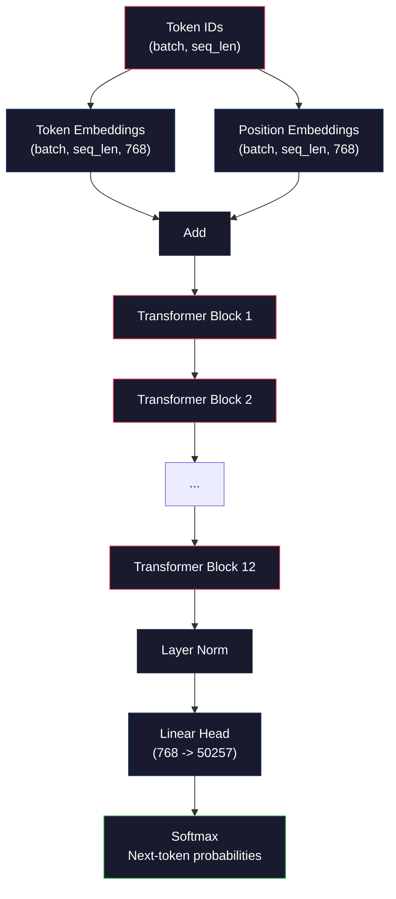
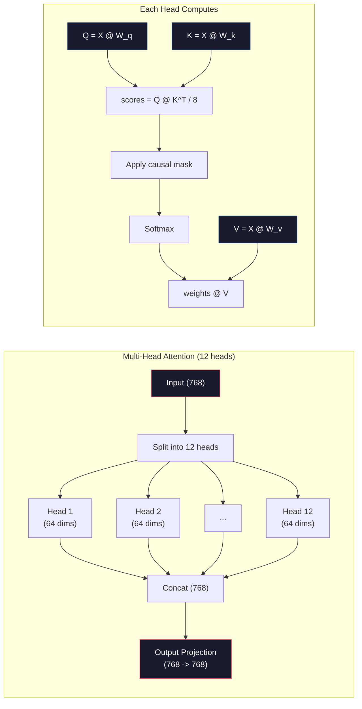
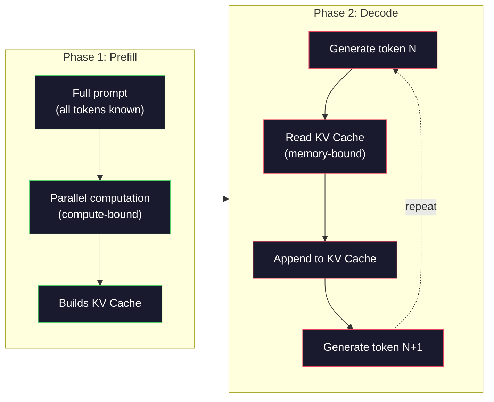

# 미니 GPT (124M 파라미터) 의 사전 훈련

> GPT-2 소형은 12억개의 매개 변수를 가지고 있습니다. 즉 12개의 트랜스포머 층, 12개의 주의력 헤드, 768차원 임베디드입니다. 여러분은 몇 시간 안에 하나의 GPU에서 처음부터 훈련시킬 수 있습니다. 대부분의 사람들은 이것을 결코 하지 않습니다. 그들은 미리 훈련된 체크포인트를 사용합니다. 하지만 여러분이 직접 훈련하지 않는다면, 여러분은 제품을 구축하는 모델 안에서 실제로 무슨 일이 일어나고 있는지 이해하지 못합니다.

**Type:** Build
**Languages:** Python (with numpy)
**Prerequisites:** Phase 10, Lessons 01-03 (Tokenizers, Building a Tokenizer, Data Pipelines)
**Time:** ~120 minutes

## 학습 목표

- 전체 GPT-2 아키텍처 (124M 매개 변수) 를 처음부터 구현: 토큰 임베디션, 위치 임베디션, 트랜스포머 블록 및 언어 모델 헤드
- 다음 토큰 예측을 사용하여 교차 엔트로피 손실을 가진 텍스트 코퍼스에서 GPT 모델을 훈련하십시오
- 온도 샘플링과 상위 k/top-p 필터링으로 자동 퇴행성 텍스트 생성
- 훈련 손실 곡선을 모니터링하고 모델이 일관된 언어 패턴을 학습하는지 확인합니다

## 문제

트랜스포머는 무엇인지 아시겠죠. 여러분은 다이어그램을 읽었습니다. "만일 주의가 필요하다"라고 말할 수 있고, 화이트보드 위에 "다 머리 주의"라는 표기된 상자를 그려볼 수 있습니다.

그 말은, 모델이 텍스트를 생성할 때 일어나는 일을 이해한다는 것을 의미하지는 않습니다.

GPT-2 소형 (중량 결합) 에서 124,438,272개의 매개 변수가 있습니다. 각각의 훈련 루프를 실행하여 설정되었습니다. 앞으로 통과, 계산 손실, 뒤로 통과, 업데이트 무게. 12개의 트랜스포머 블록 블록당 12개의 주의력 단위가 있습니다. 768차원 임베디션 공간 50257개의 토큰의 어휘. 모델이 토큰을 생성할 때마다, 모든 124 백만 매개 변수는 하나의 매트릭스 곱셈 체인에 참여하여 토큰 ID의 순서를 취하고 다음 토큰에 대한 확률 분포를 생성합니다.

만약 여러분이 이것을 직접 만들지 않았다면, 여러분은 블랙박스에서 작업하고 있습니다. API를 사용할 수 있습니다. 정렬을 할 수 있습니다. 하지만 어떤 일이 잘못되면, 모델이 환각을 일으키고, 반복하거나, 지시사항을 따르지 않을 때, 여러분은 왜 그런지 하는 정신적 모델을 가지고 있지 않습니다.

이 수업은 GPT-2를 처음부터 작게 만듭니다. PyTorch에서 아닙니다. Numpy에서요. 매트릭스 곱셈은 모두 가시적입니다. 매트릭스 곱셈은 모든 gradient을 코드에서 계산합니다. 다음 단어를 예측하기 위해 12400만 개의 숫자가 어떻게 음모하는지 정확히 볼 것입니다.

## 개념

### GPT 건축물

GPT는 자율적 인 언어 모델입니다. "자율적"은 전작 모든 토큰에 조건화된 하나의 토큰을 동시에 생성한다는 것을 의미합니다. 아키텍처는 트랜스포머 디코더 블록의 스택입니다.

다음은 토큰 ID에서 다음 토큰 확률까지의 전체 계산 그래프입니다.

1. 토큰 ID가 들어옵니다. 모양: (batch_size, seq_len)
2. 토큰 임베디션 검색. 각 ID는 768 차원 벡터로 지도를 합니다. 모양: (batch_size, seq_len, 768).
3. 위치 임베디션 검색. 각 위치 (0, 1, 2, ...) 는 768 차원 벡터로 지도를 만듭니다. 같은 모양.
4. 토큰 임베디션을 추가하고 위치 임베디션을 추가합니다.
5. 12개의 트랜스포머 블록을 통과시켜
6. 마지막 층 정상화
7. 선형 투영과 어휘의 크기가. 모양: (batch_size, seq_len, vocab_size).
8. 확률을 얻기 위해 소프트맥스

전체 모델입니다. 변곡이 없습니다. 반복도 없습니다. 단지 임베디션, 관심, 피드퍼드 네트워크, 그리고 레이어 규범이 12번 쌓여 있습니다.



### 트랜스포머 블록

12개 블록의 각각은 동일한 패턴을 따르고 있습니다. 사전 표준 구조 (GPT-2는 원래 트랜스포머와 같이 사전 표준, 이후 규범을 사용합니다):

1. 레이어Norm
2. 여러 머리 의 자기 관심
3. 잔여 연결 (인트업이 추가된 후)
4. 레이어Norm
5. 피드 포드 네트워크 (MLP)
6. 잔여 연결 (인트업이 추가된 후)

잔류 연결은 매우 중요합니다. 그 없이는, 그레디언트는 반전 과정에서 블록 1에 도달할 때 사라집니다. 그레디언트는 손실에서 "skip" 경로를 통해 어떤 층으로도 직접 흐르게 됩니다. 이 때문에 12, 32, 또는 96 블록을 쌓을 수 있습니다.

### 주의: 핵심 메커니즘

자기주의는 모든 토큰이 이전 토큰을 보고 각각의 토큰에 얼마나 많은 관심을 기울여야 하는지 결정하도록 합니다. 여기 수학이 있습니다.

각각의 토큰 위치에 대해 입력에서 세 개의 벡터를 계산하십시오.
- **Query (Q)**"내가 뭘 찾고 있어?"
- **Key (K)**"내가 무엇을 포함하고 있는가?"
- **Value (V)**"내가 가지고 있는 정보는 무엇인가?"

```
Q = input @ W_q    (768 -> 768)
K = input @ W_k    (768 -> 768)
V = input @ W_v    (768 -> 768)

attention_scores = Q @ K^T / sqrt(d_k)
attention_scores = mask(attention_scores)   # causal mask: -inf for future positions
attention_weights = softmax(attention_scores)
output = attention_weights @ V
```

인과적 마스크는 GPT를 자동 퇴행성으로 만드는 것입니다. 위치 5는 0-5 지위에 관해서는 6, 7, 8 지위에 관해서는 안됩니다. 이것은 훈련 중에 미래의 토큰을 보면서 모델이 "사기를" 방지합니다.

**Multi-head attention**768 차원 공간은 64 차원의 12개의 헤드를 나눈다. 각 헤드는 다른 주의 패턴을 학습한다. 한 헤드는 문법적 관계를 추적할 수 있다. 다른 헤드는 의미적 유사성을 추적할 수 있다. 다른 하나는 위치적 근접을 추적할 수 있다.



$\sqrt{d_k}$-$\sqrt{64} = 8$이 자료가 없으면 점들이 큰 수치를 거쳐 높은 차원의 벡터들을 위해 덩어리를 넓혀서 덩어리를 덩어리로 어집니다. 그레이디언트가 거의 0이 되는 지역으로 밀려나죠. 이것은 원래의 "주의는 필요한 모든 것"이라는 논문에서 핵심적인 통찰력 중 하나였습니다.

### KV 캐시: 왜 추론이 빠르는가

훈련 중에, 당신은 전체 순서들을 한 번에 처리합니다. 추론 중에, 당신은 한 번에 하나의 토큰을 생성합니다. 최적화 없이, 토큰을 생성합니다.$N$모든 사람들의 관심을 재계산해야 합니다$N-1$이전 토큰입니다$O(N^2)$생성된 토큰당 또는$O(N^3)$길이의 연속에 대한 총 $N$- 그래

KV 캐시로 풀 수 있습니다. 각 토큰에 대한 K와 V를 계산한 후 저장합니다. 토큰을 생성할 때$N+1$새로운 토큰을 위해 Q를 계산하고 이전 토큰에서 캐시된 K와 V를 검색하면$O(N)$ $O(1)$K와 V 계산에 대한 주의점 계산은 여전히$O(N)$왜냐하면 전직 위치들을 모두 관리가 되지만 입력에 대한 과잉 매트릭스 곱셈을 피하기 때문입니다.

12 층과 12 개의 헤드 (GPT-2) 를 위해 KV 캐시에는 2 (K + V) x 12 층 x 12 개의 헤드 x 64 개의 림스 = 1 토큰당 18,432 값이 저장됩니다. 1024 토큰 순서에서는 FP32에서 약 75MB입니다. 128 층의 Llama 3 405B에서는 단일 순서의 KV 캐시가 10GB를 초과할 수 있습니다. 이것이 긴 맥락 추론이 메모리 구속 된 이유입니다.

### 사전 작성과 디코딩: 두 단계의 인퍼런스

LLM에 초청을 보내면 두 가지 단계로 결론을 내립니다.

**Prefill**모든 토큰이 알려져 있기 때문에 모델은 모든 위치에 대한 관심을 동시에 계산할 수 있습니다. 이 단계는 계산에 묶여 있습니다. GPU는 전체 처리량에서 매트릭스 곱셈을 수행합니다. A100에서 1000 토큰의 토큰에 대해, 사전 채워는 시간은 대략 20-50ms입니다.

**Decode**토큰을 하나씩 생성합니다. 새로운 토큰은 이전 토큰에 달려 있습니다. 이 단계는 메모리로 연결됩니다. 모형 무게와 GPU 메모리에서 KV 캐시를 읽는 것이 모터릭스 수학이 아닙니다. GPU의 컴퓨터 코어는 대부분 메모리의 읽기만을 기다리고 있습니다. GPT-2에서, 매트뮬들이 필요로 하는 FLOP의 수와 상관없이 각 디코딩 단계는 거의 같은 시간이 걸립니다. 메모리 대역폭이 제약이기 때문입니다.

이 차이점은 생산 시스템에서 중요합니다. GPU 계산으로 처리량을 미리 채워주십시오 (더 많은 FLOPS = 더 빠른 사전 채워). 메모리 대역폭 (더 빠른 메모리 = 더 빠른 디코딩) 으로 처리량을 디코드하십시오. 그래서 NVIDIA H100는 A100보다 메모리 대역폭 개선에 초점을 맞추었습니다. 그것은 직접 토큰 생성 속도를 높입니다.



### 훈련 도로는

LLM를 훈련시키는 것은 다음 토큰 예측입니다. 토큰 [0, 1, 2, ..., N-1]을 주어지면, 예측 토큰 [1, 2, 3, ..., N]을 예측합니다. 손실 함수는 모델의 예측 확률 분포와 실제 다음 토큰 사이의 크로스 엔트로피입니다.

한 단계 훈련:

1. **Forward pass**: 모든 12 블록을 통해 패치를 실행하고 각 위치에 대한 로그티 (softmax 전 점수) 를 얻으십시오.
2. **Compute loss**: 로그이트와 타겟 토큰 사이의 크로스 엔트로피 (인पुट은 한 위치로 이동한다).
3. **Backward pass**: 배후 확산을 사용하여 모든 124M 매개 변수를 계산한다.
4. **Optimizer step**GPT-2는 아담을 학습 속도 온화와 코시노 해체로 사용합니다.

학습률 스케줄은 예상보다 더 중요합니다. GPT-2는 첫 2,000 단계 동안 0에서 최고 학습률까지 따뜻해지며, 코시노 곡선을 따라 붕괴됩니다. 높은 학습률을 시작하면 모델이 분화됩니다. 상정한 높은 속도를 유지하는 것은 나중에 훈련에서 진동을 유발합니다. 온화-이후 붕괴 패턴은 모든 주요 LLM에서 사용됩니다.

### GPT-2 작은 것: 숫자

| Component | Shape | Parameters |
|-----------|-------|------------|
| Token embeddings | (50257, 768) | 38,597,376 |
| Position embeddings | (1024, 768) | 786,432 |
| Per-block attention ($W_q, W_k, W_v, W_{\text{out}}$) | 4 x (768, 768) | 2,359,296 |
| Per-block FFN (up + down) | (768, 3072) + (3072, 768) | 4,718,592 |
| Per-block LayerNorms (2x) | 2 x 768 x 2 | 3,072 |
| Final LayerNorm | 768 x 2 | 1,536 |
| **Total per block** | | **7,080,960** |
| **Total (12 blocks)** | | **85,054,464 + 39,383,808 = 124,438,272** |

출력 투사 (logits head) 는 토큰 임베디션 매트릭스와 무게를 공유합니다. 이것을 웨이트 잇이라고 합니다. 이는 매개 변수 수를 38M로 줄이고 성능을 향상시킵니다. 왜냐하면 모델이 입력과 출력에서 동일한 표현 공간을 사용하도록 강요하기 때문입니다.

## 건설 해

### 단계 1: 층을 삽입

토큰 임베디션은 50,257개의 가능한 토큰 중 각각을 768차원 벡터로 지도합니다. 위치 임베디션은 각각의 토큰이 순서 내에 위치하는 위치에 대한 정보를 추가합니다. 두 가지는 합됩니다.

```python
import numpy as np

class Embedding:
    def __init__(self, vocab_size, embed_dim, max_seq_len):
        self.token_embed = np.random.randn(vocab_size, embed_dim) * 0.02
        self.pos_embed = np.random.randn(max_seq_len, embed_dim) * 0.02

    def forward(self, token_ids):
        seq_len = token_ids.shape[-1]
        tok_emb = self.token_embed[token_ids]
        pos_emb = self.pos_embed[:seq_len]
        return tok_emb + pos_emb
```

초기화 위한 0.02 표준차각은 GPT-2 논문에서 나온다. 너무 큰 초기 앞면이 훈련에 불안감을 야기하는 극단적인 값을 생성한다. 너무 작고 초기 출력들은 모든 입력에 거의 동일하며, 초기 경각 신호가 쓸모없게 한다.

### 단계 2: 원시 마스크로 자기 주의

우선 단두대 주의. 원시 마스크는 소프트맥스보다 앞면의 미래 위치를 음적 무한으로 설정하여 각 위치가 자신과 이전 위치만 관람할 수 있도록 합니다.

```python
def attention(Q, K, V, mask=None):
    d_k = Q.shape[-1]
    scores = Q @ K.transpose(0, -1, -2 if Q.ndim == 4 else 1) / np.sqrt(d_k)
    if mask is not None:
        scores = scores + mask
    weights = np.exp(scores - scores.max(axis=-1, keepdims=True))
    weights = weights / weights.sum(axis=-1, keepdims=True)
    return weights @ V
```

소프트맥스 구현은 기하급수화 전에 최대수를 빼고 있습니다. 이 없이는 exp(large_number) 는 무한으로 넘습니다. 이것은 출력을 변경하지 않는 수치 안정 트릭입니다.$\mathop{\mathrm{softmax}}(x - c) = \mathop{\mathrm{softmax}}(x)$어떤 일정수$c$- 그래

### 3단계: 여러 머리 를 집중 시키십시오

768 차원의 입력값을 64 차원의 12개의 헤드로 나눌 수 있습니다. 각 헤드는 독립적으로 주의를 계산합니다. 결과를 합쳐 768 차원으로 다시 프로젝합니다.

```python
class MultiHeadAttention:
    def __init__(self, embed_dim, num_heads):
        self.num_heads = num_heads
        self.head_dim = embed_dim // num_heads
        self.W_q = np.random.randn(embed_dim, embed_dim) * 0.02
        self.W_k = np.random.randn(embed_dim, embed_dim) * 0.02
        self.W_v = np.random.randn(embed_dim, embed_dim) * 0.02
        self.W_out = np.random.randn(embed_dim, embed_dim) * 0.02

    def forward(self, x, mask=None):
        batch, seq_len, d = x.shape
        Q = (x @ self.W_q).reshape(batch, seq_len, self.num_heads, self.head_dim).transpose(0, 2, 1, 3)
        K = (x @ self.W_k).reshape(batch, seq_len, self.num_heads, self.head_dim).transpose(0, 2, 1, 3)
        V = (x @ self.W_v).reshape(batch, seq_len, self.num_heads, self.head_dim).transpose(0, 2, 1, 3)

        scores = Q @ K.transpose(0, 1, 3, 2) / np.sqrt(self.head_dim)
        if mask is not None:
            scores = scores + mask
        weights = np.exp(scores - scores.max(axis=-1, keepdims=True))
        weights = weights / weights.sum(axis=-1, keepdims=True)
        attn_out = weights @ V

        attn_out = attn_out.transpose(0, 2, 1, 3).reshape(batch, seq_len, d)
        return attn_out @ self.W_out
```

재형-반복-재형 춤은 다중머리주의에서 가장 혼란스러운 부분입니다. 다음은 어떻게 되는지입니다: (batch, seq_len, 768) 텐서가 (batch, seq_len, 12, 64), 그리고 (batch, 12, seq_len, 64) 가 됩니다. 이제 12개의 머리는 각각 자신의 (seq_len, 64) 매트릭스를 가지고 있습니다. 주의를 받은 후, 우리는 과정을 뒤집어 놓습니다: (batch, 12, seq_len, 64) 가 (batch, seq_len, 12, 64) 가 (batch, seq_len, 768) 가 됩니다.

### 단계 4: 트랜스포머 블록

하나의 완전한 트랜스포머 블록: 레이어노름, 머릿수 주의가 잔존하고, 레이어노름, 리세트와 함께 feedforward.

```python
class LayerNorm:
    def __init__(self, dim, eps=1e-5):
        self.gamma = np.ones(dim)
        self.beta = np.zeros(dim)
        self.eps = eps

    def forward(self, x):
        mean = x.mean(axis=-1, keepdims=True)
        var = x.var(axis=-1, keepdims=True)
        return self.gamma * (x - mean) / np.sqrt(var + self.eps) + self.beta


class FeedForward:
    def __init__(self, embed_dim, ff_dim):
        self.W1 = np.random.randn(embed_dim, ff_dim) * 0.02
        self.b1 = np.zeros(ff_dim)
        self.W2 = np.random.randn(ff_dim, embed_dim) * 0.02
        self.b2 = np.zeros(embed_dim)

    def forward(self, x):
        h = x @ self.W1 + self.b1
        h = np.maximum(0, h)  # GELU approximation: ReLU for simplicity
        return h @ self.W2 + self.b2


class TransformerBlock:
    def __init__(self, embed_dim, num_heads, ff_dim):
        self.ln1 = LayerNorm(embed_dim)
        self.attn = MultiHeadAttention(embed_dim, num_heads)
        self.ln2 = LayerNorm(embed_dim)
        self.ffn = FeedForward(embed_dim, ff_dim)

    def forward(self, x, mask=None):
        x = x + self.attn.forward(self.ln1.forward(x), mask)
        x = x + self.ffn.forward(self.ln2.forward(x))
        return x
```

피드퍼드 네트워크는 768 차원 입력값을 3,072 차원 (4x) 으로 확장하고 비선형성을 적용하고 768으로 다시 프로젝합니다. 이 확장-감축 패턴은 모델에 각 위치에서 작동할 수 있는 "더 넓은" 내부 표현을 제공합니다. GPT-2는 GELU 활성화를 사용합니다. 그러나 우리는 단순성을 위해 ReLU를 사용합니다.

### 단계 5: 전체 GPT 모델

12개의 트랜스포머 블록을 쌓아두세요. 앞쪽에 임베디션 레이어와 뒷쪽에 출력 프로젝션을 추가하세요.

```python
class MiniGPT:
    def __init__(self, vocab_size=50257, embed_dim=768, num_heads=12,
                 num_layers=12, max_seq_len=1024, ff_dim=3072):
        self.embedding = Embedding(vocab_size, embed_dim, max_seq_len)
        self.blocks = [
            TransformerBlock(embed_dim, num_heads, ff_dim)
            for _ in range(num_layers)
        ]
        self.ln_f = LayerNorm(embed_dim)
        self.vocab_size = vocab_size
        self.embed_dim = embed_dim

    def forward(self, token_ids):
        seq_len = token_ids.shape[-1]
        mask = np.triu(np.full((seq_len, seq_len), -1e9), k=1)

        x = self.embedding.forward(token_ids)
        for block in self.blocks:
            x = block.forward(x, mask)
        x = self.ln_f.forward(x)

        logits = x @ self.embedding.token_embed.T
        return logits

    def count_parameters(self):
        total = 0
        total += self.embedding.token_embed.size
        total += self.embedding.pos_embed.size
        for block in self.blocks:
            total += block.attn.W_q.size + block.attn.W_k.size
            total += block.attn.W_v.size + block.attn.W_out.size
            total += block.ffn.W1.size + block.ffn.b1.size
            total += block.ffn.W2.size + block.ffn.b2.size
            total += block.ln1.gamma.size + block.ln1.beta.size
            total += block.ln2.gamma.size + block.ln2.beta.size
        total += self.ln_f.gamma.size + self.ln_f.beta.size
        return total
```

무게의 결합을 알아보십시오: `logits = x @ self.embedding.token_embed.T`. 출력 투사에서 토큰 임베디션 매트릭스를 재사용 (transposed). 이것은 단순히 매개 변수를 저장하는 트릭이 아닙니다. 즉 모델은 토큰 (인베디션) 을 이해하고 예측하기 위해 동일한 벡터 공간을 사용합니다.

### 6단계: 훈련 로프

124M 매개 변수에서 실제 훈련 실행을 위해서는 GPU와 PyTorch가 필요합니다. 이 훈련 루프는 순수한 이 작동하는 작은 모델의 메커니즘을 보여줍니다. 우리는 작은 모델을 사용합니다 (4 층, 4 헤드, 128 )

```python
def cross_entropy_loss(logits, targets):
    batch, seq_len, vocab_size = logits.shape
    logits_flat = logits.reshape(-1, vocab_size)
    targets_flat = targets.reshape(-1)

    max_logits = logits_flat.max(axis=-1, keepdims=True)
    log_softmax = logits_flat - max_logits - np.log(
        np.exp(logits_flat - max_logits).sum(axis=-1, keepdims=True)
    )

    loss = -log_softmax[np.arange(len(targets_flat)), targets_flat].mean()
    return loss


def train_mini_gpt(text, vocab_size=256, embed_dim=128, num_heads=4,
                   num_layers=4, seq_len=64, num_steps=200, lr=3e-4):
    tokens = np.array(list(text.encode("utf-8")[:2048]))
    model = MiniGPT(
        vocab_size=vocab_size, embed_dim=embed_dim, num_heads=num_heads,
        num_layers=num_layers, max_seq_len=seq_len, ff_dim=embed_dim * 4
    )

    print(f"Model parameters: {model.count_parameters():,}")
    print(f"Training tokens: {len(tokens):,}")
    print(f"Config: {num_layers} layers, {num_heads} heads, {embed_dim} dims")
    print()

    for step in range(num_steps):
        start_idx = np.random.randint(0, max(1, len(tokens) - seq_len - 1))
        batch_tokens = tokens[start_idx:start_idx + seq_len + 1]

        input_ids = batch_tokens[:-1].reshape(1, -1)
        target_ids = batch_tokens[1:].reshape(1, -1)

        logits = model.forward(input_ids)
        loss = cross_entropy_loss(logits, target_ids)

        if step % 20 == 0:
            print(f"Step {step:4d} | Loss: {loss:.4f}")

    return model
```

손실은 ln(vocab_size) 근처에서 시작됩니다. 256-토큰 바이트 레벨의 어휘에 있어서 ln(256) = 5.55. 무작위 모델은 모든 토큰에 동등한 확률을 부여합니다. 훈련이 진행됨에 따라 손실은 감소합니다. 모델은 일반적인 패턴을 예측하는 것을 배우기 때문에: "th" t, 기간 후 공간 등.

생산에서, 당신은 gradient 축적, 학습 속도 온화, gradient 절단과 함께 Adam 최적화기를 사용 할 것입니다. 앞으로 통과-손실- 뒤로 업데이트 루프는 동일합니다. 최적화가 더 정교합니다.

### 7단계: 텍스트 생성

생성은 훈련된 모델을 사용하여 한 번에 하나의 토큰을 예측합니다. 각 예측은 출력 분포에서 샘플을 얻습니다 (또는 argmax로 탐욕적으로 받아들여집니다).

```python
def generate(model, prompt_tokens, max_new_tokens=100, temperature=0.8):
    tokens = list(prompt_tokens)
    seq_len = model.embedding.pos_embed.shape[0]

    for _ in range(max_new_tokens):
        context = np.array(tokens[-seq_len:]).reshape(1, -1)
        logits = model.forward(context)
        next_logits = logits[0, -1, :]

        next_logits = next_logits / temperature
        probs = np.exp(next_logits - next_logits.max())
        probs = probs / probs.sum()

        next_token = np.random.choice(len(probs), p=probs)
        tokens.append(next_token)

    return tokens
```

온도는 무작위성을 조절합니다. 온도는 1.0을 원유 분포를 사용합니다. 온도는 0.5을 날카롭게합니다 (더 결정적인 - 모델은 가장 높은 선택을 더 자주 선택합니다). 온도는 1.5를 평평하게합니다 (더 무작위 - 낮은 확률 토큰이 더 큰 기회를 얻습니다). 온도는 0.0는 탐욕적인 디코딩입니다 (အမြဲ 가장 높은 확률 토큰을 선택하십시오).

`tokens[-seq_len:]`윈도우는 모델의 최대 컨텍스트 길이가 (1024 GPT-2) 있기 때문에 필요합니다. 당신이 그것을 초과하면, 당신은 가장 오래된 토큰을 떨어뜨려야 합니다. 이것은 모든 사람들이 말하는 "콘텍스트 윈도우"입니다.

```figure
sampling-decoder
```

## 사용 하 고

### 완전한 훈련 및 세대 시범

```python
corpus = """The transformer architecture has revolutionized natural language processing.
Attention mechanisms allow the model to focus on relevant parts of the input.
Self-attention computes relationships between all pairs of positions in a sequence.
Multi-head attention splits the representation into multiple subspaces.
Each attention head can learn different types of relationships.
The feedforward network provides nonlinear transformations at each position.
Residual connections enable gradient flow through deep networks.
Layer normalization stabilizes training by normalizing activations.
Position embeddings give the model information about token ordering.
The causal mask ensures autoregressive generation during training.
Pre-training on large text corpora teaches the model general language understanding.
Fine-tuning adapts the pre-trained model to specific downstream tasks."""

model = train_mini_gpt(corpus, num_steps=200)

prompt = list("The transformer".encode("utf-8"))
output_tokens = generate(model, prompt, max_new_tokens=100, temperature=0.8)
generated_text = bytes(output_tokens).decode("utf-8", errors="replace")
print(f"\nGenerated: {generated_text}")
```

작은 모델과 작은 코퍼스에서 생성된 텍스트는 가장 좋은 경우 반 일관성이 있을 것입니다. 훈련 텍스트에서 일부 바이트 레벨 패턴을 배울 수 있지만 GPT-2가 40GB의 훈련 데이터와 전체 124M 파라미터 아키텍처와 같은 방식을 일반화 할 수 없습니다. 문제는 출력 품질이 아닙니다. 핵심은 모든 단계를 추적할 수 있다는 것입니다. 임베디션 검색, 주의 계산, 피드퍼드 변환, 로지트 투영, 소프트맥스, 샘플링 모든 작전이 눈에 띄는 것 같습니다.

## 선박

이 교훈은`outputs/prompt-gpt-architecture-analyzer.md`-- GPT형 모델의 건축 선택들을 분석하는 프롬프트. 모델 카드나 기술 보고서를 입력하여 매개 변수 배정, 주의 설계, 확장 결정들을 분해합니다.

## 운동

1. 12/12 대신 24층과 16개의 헤드를 사용하도록 모델을 수정하십시오. 매개 변수를 계산하세요. 깊이 두 배로 늘리는 것은 너비 두 배로 늘리는 것과 비교되는 방법 (부착 차원) 은 무엇입니까?

2. GELU 활성화 기능을 구현합니다 $(\mathop{\mathrm{GELU}}(x) = x \cdot 0.5 \cdot (1 + \mathop{\mathrm{erf}}(x / \sqrt{2})))$그리고 리루를 리드퍼드 네트워크에서 교체하고, 각 활성화에 500단계 훈련을 실행하고 최종 손실을 비교합니다.

3. 생성 기능에 KV 캐시를 추가하십시오. 첫 번째 전진 후 각 계층에 대한 K 및 V 텐서를 저장하고 다음 토큰에 재사용하십시오. 속도를 측정하십시오. 캐시와 그없이 200 토큰을 생성하고 벽 시계 시간을 비교하십시오.

4. 톱-k 샘플링 (최고 확률 토큰 k만 고려) 과 톱-p 샘플링 (핵 샘플링: 누적 확률이 p를 초월한 토큰의 가장 작은 집합을 고려) 을 구현하십시오. 온도 0.8에서 출력 품질을 톱-k=50와 대 대 대 최고-p=0.95에 비교하십시오.

5. 훈련 손실 곡선 플래터 구축. 1000 단계로 모델을 훈련하고, 플래트 손실 vs 단계. 빠른 초기 하락 (공동 바이트 학습), 느린 중간 단계 (학습 바이트 패턴) 및 평판 (작은 코퍼스에 오버피팅) 을 식별하십시오. 이 곡선의 모양은 128-차원 모델 또는 GPT-4을 훈련하고 있는지 여부와 동일합니다.

## 주요 용어

| Term | What people say | What it actually means |
|------|----------------|----------------------|
| Autoregressive | "It generates one word at a time" | Each output token is conditioned on all previous tokens -- the model predicts P(token_n \| token_0, ..., token_{n-1}) |
| Causal mask | "It can't see the future" | An upper-triangular matrix of -infinity values that prevents attention to future positions during training |
| Multi-head attention | "Multiple attention patterns" | Splitting Q, K, V into parallel heads (e.g., 12 heads of 64 dims each for GPT-2) so each head can learn different relationship types |
| KV Cache | "Caching for speed" | Storing computed Key and Value tensors from previous tokens to avoid redundant computation during autoregressive generation |
| Prefill | "Processing the prompt" | The first inference phase where all prompt tokens are processed in parallel -- compute-bound on GPU FLOPS |
| Decode | "Generating tokens" | The second inference phase where tokens are generated one at a time -- memory-bound on GPU bandwidth |
| Weight tying | "Sharing embeddings" | Using the same matrix for input token embeddings and the output projection head -- saves 38M params in GPT-2 |
| Residual connection | "Skip connection" | Adding the input directly to the output of a sublayer (x + sublayer(x)) -- enables gradient flow in deep networks |
| Layer normalization | "Normalizing activations" | Normalizing across the feature dimension to mean 0 and variance 1, with learnable scale and bias parameters |
| Cross-entropy loss | "How wrong the predictions are" | $-\log(\text{probability assigned to the correct next token})$, averaged over all positions -- the standard LLM training objective |

## 더 많은 읽기

- [Radford et al., 2019 -- "Language Models are Unsupervised Multitask Learners" (GPT-2)](https://cdn.openai.com/better-language-models/language_models_are_unsupervised_multitask_learners.pdf)-- 124M에서 1.5B의 파라미터 가정을 도입한 GPT-2 논문
- [Vaswani et al., 2017 -- "Attention Is All You Need"](https://arxiv.org/abs/1706.03762)-- 초창기 트랜스포머 종이
- [Llama 3 Technical Report](https://arxiv.org/abs/2407.21783)-- 메타가 16K GPU를 통해 405B 매개 변수에 GPT 아키텍처를 확장한 방법
- [Pope et al., 2022 -- "Efficiently Scaling Transformer Inference"](https://arxiv.org/abs/2211.05102)-- 사전 채용과 디코딩을 공식화한 논문과 KV 캐시 분석
