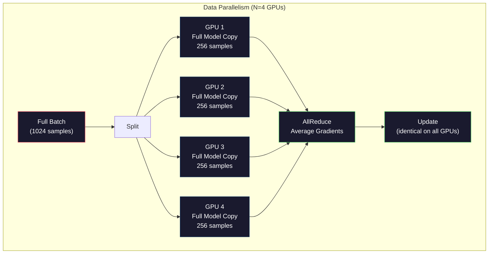
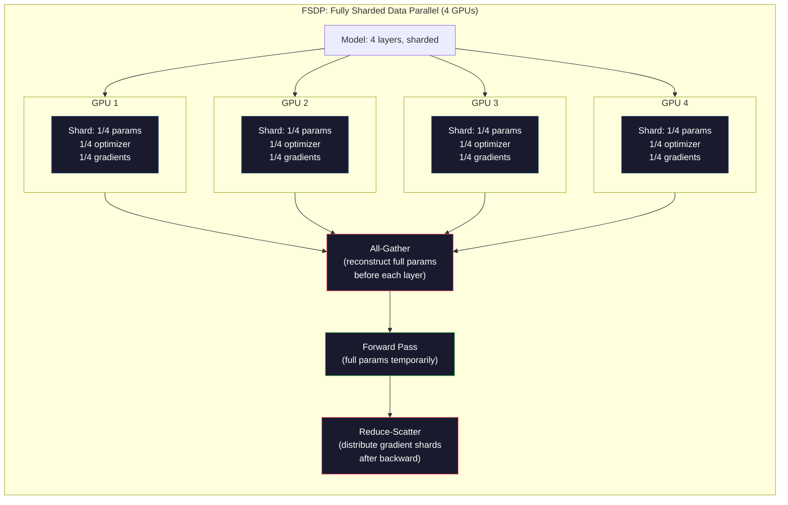
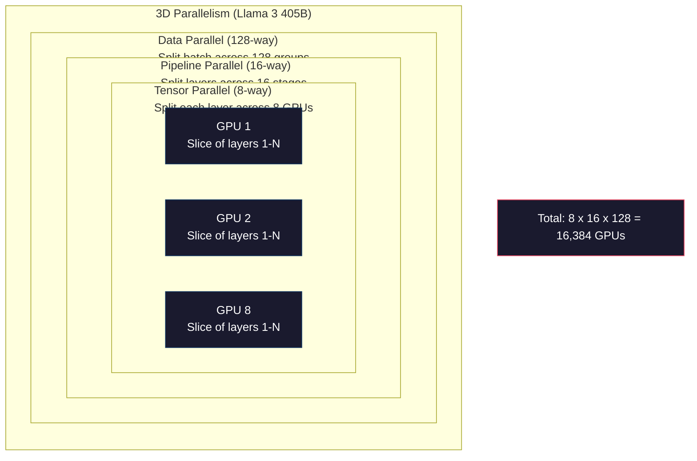

# 확장: 분산 훈련, FSDP, 딥스피드

> 124M 모델은 GPU에 훈련됐습니다. 이제 7억개의 매개 변수를 시도해 보세요. 모델은 메모리에 맞지 않습니다. 데이터들은 한 기계에서 몇 주 걸립니다. 분산 훈련은 규모로 선택적이지 않습니다. 그것은 앞으로의 유일한 길입니다.

**Type:** Build
**Languages:** Python
**Prerequisites:** Phase 10, Lesson 04 (Pre-Training a Mini GPT)
**Time:** ~120 minutes

## 학습 목표

- 3가지 종류의 병렬성을 설명 (데이터, 텐서, 파이프라인) 그리고 모델과 클러스터 크기에 따라 각이 필요할 때
- 여러 GPU에서 gradient 동기화와 PyTorch DDP를 사용하여 데이터 병렬 훈련을 구현
- 주어진 모델 크기의 메모리 예산을 계산 (중중량 + 최적화 상태 + 기하급수 + 활성화) 로 최소 하드웨어를 결정합니다.
- FSDP 또는 DeepSpeed ZeRO 단계를 구성하여 GPU 및 단일 GPU 메모리를 초과하는 융합 모델의 모델 상태를 쪼개십시오.

## 문제

FP16의 7B 파라미터 모델은 무게에 대해서만 14GB가 필요합니다. 아담 최적화기는 각 파라미터의 추가 복사본을 두 번 저장합니다. 즉, 다른 28GB입니다. 배트프로패지션 중에 그라디엔트는 14GB 더 추가합니다. 단일 활성화가 저장되기 전에 당신은 56GB에 있습니다.

NVIDIA A100는 80GB의 메모리를 가지고 있습니다.

80GB의 56GB가 소비됩니다. 즉, 활성화에 24GB가 남아 있습니다. 앞으로 전달하는 동안 계산되는 중간 값은 후속 확산을 위해 생생하게 유지되어야합니다. 4096 차원 모델의 2048 토큰 순서에서는 단일 레이어의 활성화에 약 64MB가 사용됩니다. 32 레이어와 함께, 샘플당 2GB가 필요합니다. 8개의 배트 크기는 16GB가 필요합니다. 24GB가 있습니다. 12개의 배트 크기는 폭발합니다.

이제 70B 매개 변수를 시도해보세요. 무게는 FP16에서 140GB입니다. 하나의 GPU에 맞지 않습니다. 무게를 유지하기 위해 적어도 2A100 (2 x 80GB = 160GB) 이 필요합니다. 최적화 상태와 gradients를 추가하고 훨씬 더 많은 것을 필요로합니다. 최소 3+ GPU, 그리고 사실적으로 8-16는 쪼개기 전략에 따라 다릅니다.

Llama 3 405B는 16,384개의 NVIDIA H100 GPU에 의해 훈련되었습니다.$100 million in compute. DeepSeek V3 trained a comparable model for roughly $5.6 백만 달러는 건축에 대해 똑똑한 것으로 (전문자 혼합은 단 하나의 기호의 일부만 활성화되는 것을 의미합니다)

이 수업은 대규모 훈련이 가능한 네 가지 전략을 다루고 있습니다. 데이터 병렬성, 텐서 병렬성, 파이프라인 병렬성, 완전히 분해된 데이터 병렬성. 분산 훈련 프레임워크에 닿기 전에 매커니즘을 이해하기 위해 순수한 파이썬에서 각각을 시뮬레이션합니다.

## 개념

### 왜 배포 해야 합니까?

여기 실제 모델의 메모리 수학이 있습니다. 모든 숫자는 계산된 것이 아니라 추정된 것입니다.

| Model | Params | Weights (FP16) | Adam States | Gradients (FP16) | Total (no activations) |
|-------|--------|----------------|-------------|------------------|----------------------|
| GPT-2 Small | 124M | 248 MB | 992 MB | 248 MB | 1.5 GB |
| Llama 3 8B | 8B | 16 GB | 64 GB | 16 GB | 96 GB |
| Llama 3 70B | 70B | 140 GB | 560 GB | 140 GB | 840 GB |
| Llama 3 405B | 405B | 810 GB | 3,240 GB | 810 GB | 4,860 GB |

"아담 상태" 열은 킬러입니다. 아담은 FP32에서 모두 각 매개 변수 (m) 와 실행 변수 (v) 를 저장합니다. 70B 모델에서는 70B x 4 바이트 x 2 = 560GB입니다. 최적화 장치만으로 7 A100가 필요합니다.

하나의 H100는 80GB를 가지고 있습니다. Llama 3 405B는 무게, 최적화, 그리고 기하급수들을 유지하기 위해 적어도 61개의 H100가 필요합니다. 활성화들을 추가하면 숫자가 더 커집니다. 메타는 16,384개의 GPU를 사용했습니다. 그들이 원하는 것이 아니라, 왜냐하면 그들은 해야했기 때문입니다.

### 데이터 병렬성

가장 간단한 분산 전략. 전체 모델을 N GPU로 복사합니다. 각 훈련 패치를 N 동등한 부분으로 나눕니다. 각 GPU는 데이터 조각에 앞뒤로 통과합니다. 뒤로 통과한 후 모든 GPU에서 gradients를 평균합니다. 각 GPU는 무게의 복사본을 동일한 평균 gradients로 업데이트합니다. 모든 복사본을 동기화합니다.

**The good:**선형 처리량 확장. N GPU는 단계마다 N 배 더 많은 데이터를 처리합니다. 통신은 계산과 겹치는 gradient 평균에 제한됩니다.

**The bad:**모든 GPU는 모델의 완전한 복사본, 최적화 상태 및 기하급수들을 보유하고 있습니다. 70B 모델에 대해, 각 GPU는 840GB가 필요합니다. 데이터 병렬성은 GPU 메모리를 줄이는 데 아무런 영향을 미치지 않습니다. 그것은 훈련 시간을 줄여줍니다.

**The math:**유효 패치 크기는 = per_gpu_batch_size x N. 1 GPU 패치 16개 GPU에 있는 N=64개의 GPU에 대해서는 유효 패치는 1,024. Llama 3는 1단계당 16백만 개의 토큰의 효과적인 패치 크기를 사용하였다.



### 텐서 평행성

GPU에 개별 계층을 나눌 수 있습니다. 단일 매트릭스 곱셈은 GPU에 나뉘어, 각각의 계산 결과의 일부입니다.

피드프로더 레이어에서 모양 (8192, 8192) 의 무게 매트릭스를 고려하십시오. 4방향 텐서 평행성으로, 각 GPU는 (8192, 2048) 셔드를 보유하고 있습니다. 각 GPU는 입력을 셔드로 곱하여 부분 결과를 생성합니다. 부분 결과는 결합됩니다. 전체 출력을 생성하기 위해 모든 줄여서 또는 모든 수집을 통해.

**The good:**모델 무게에 대한 GPU 메모리 1GPU를 줄입니다. 80B 모델은 8개의 GPU로 나뉘어 각각의 GPU가 ~8.75B 매개 변수를 가진 무게를 가지고 있습니다.

**The bad:**각 계층 후에 빠른 GPU 간 통신이 필요합니다. 각 매트무일 후에 모든 줄이는 지연을 추가합니다. 이것은 NVLink (900 GB/s 같은 노드의 GPU 간) 과 잘 작동하지만 InfiniBand (400 Gb/s, 약 50 GB/s) 로 연결된 노드 간 나쁘게 작동합니다.

**Real usage:**메가트론-LM는 텐서 병렬화를 개척했다. Llama 3 405B는 각 노드 내에서 8방향 텐서 병렬화를 사용합니다.

### 파이프라인 평행성

GPU 1은 1층에서 1층을 실행한다. GPU 2는 9층에서 16층을 실행한다. GPU 3는 17층에서 24층을 실행한다. GPU 4는 25층에서 32층을 실행한다. 데이터 유도로는 흐른다. GPU 1은 그 층을 계산하고 GPU 2에 활성화를 전송한다. GPU 2는 그 층을 계산하고 GPU 3에 전송한다.

**The good:**GPU 간 최소한의 통신은 계층 경계에서 작동하는 것입니다. 그레디엔트나 무게에 비해 작습니다.

**The bad:**파이프라인 거품. GPU 4가 마이크로 패치 1에서 앞을 통과하는 것을 계산할 때, GPU 1, 2, 3는 비동기 (그들은 이미 그들의 부분을 전송했다). 후를 통과하는 동안 패턴이 뒤집어집니다. 순진한 파이프라인을 사용하면 GPU 활용량은 N 파이프라인 단계에 대해 1/N에 불과합니다.

**GPipe and PipeDream**분포를 마이크로 패시로 나눌 수 있는 거품 문제를 해결합니다. GPU 1은 마이크로 패시 2를 마이크로 패시 2를 전송을 완료하자마자 시작됩니다.

### FSDP: 완전하게 분해된 데이터

FSDP는 데이터 병렬성의 확장성을 셔딩의 메모리 효율성과 결합합니다. 각각의 GPU가 모델의 완전한 복제를 보유하는 대신, 각 GPU는 매개 변수, 기하 및 최적화 상태의 1/N만을 보유합니다.

층의 앞으로 통과하기 전에 FSDP는 **all-gather**모든 GPU의 전체 매개 변수를 각 GPU의 메모리에 수집합니다. 앞으로 통과한 후, 각 GPU는 비동적 매개 변수를 폐기합니다. 뒤로 이동하는 동안, 모든 매개 변수는 다시 회전하여 gradient 계산을 위해 매개 변수를 재구성합니다. 뒤로 통과한 후,**reduce-scatter**gradient shards를 분포하여 각 GPU는 gradients의 1/N만을 저장합니다.

**The math for a 70B model on 8 GPUs:**

| Component | Without FSDP | With FSDP |
|-----------|-------------|-----------|
| Weights (FP16) | 140 GB per GPU | 17.5 GB per GPU |
| Adam States (FP32) | 560 GB per GPU | 70 GB per GPU |
| Gradients (FP16) | 140 GB per GPU | 17.5 GB per GPU |
| **Total** | **840 GB per GPU** | **105 GB per GPU** |

FSDP 없이는 70B 모델을 하나의 80GB GPU에 장착할 수 없습니다. 8GB GPU에 FSDP를 사용하면 각 GPU는 105GB를 사용합니다. 대기하세요, 여전히 적합하지 않습니다. GPU당 80GB 이하로 가기 위해 적어도 16GB GPU가 필요합니다. 또는 FSDP를 활성화 체크포인팅과 결합합니다.

통신 비용은 각 층 전에 모든 것을 수집하기 때문에 바닐라 데이터 병렬화보다 높습니다. 하지만 메모리 절약은 이전에 불가능한 훈련 실행을 가능하게합니다.



### 딥스피드 ZeRO

딥스피드의 ZeRO (제로 리던시 최적화) 는 개념적으로 FSDP와 동일하지만 마이크로소프트에서 독립적으로 개발되었습니다.

| Stage | Shards | Memory Savings | Communication |
|-------|--------|---------------|---------------|
| ZeRO-1 | Optimizer states only | ~4x reduction | Same as data parallel |
| ZeRO-2 | + Gradients | ~8x reduction | Slightly more |
| ZeRO-3 | + Parameters | ~Nx reduction (N GPUs) | All-gather per layer |

ZeRO-3는 FSDP와 동등하다. 이름도 다르며 메커니즘도 동일하다. 파이토치는 DeepSpeed이 개념을 증명한 후 FSDP를 네이티브 구현으로 추가했다.

또한 딥스피드는 ZeRO-Offload (CPU RAM에 오프로드 최적화 상태가 저렴하고 더 큰) 와 ZeRO-Infinity (NVMe SSD에 오프로드) 를 도입했습니다. 이러한 메모리 용량에 대한 계산 속도를 거래합니다.

### 혼합 된 정확성 훈련

현대 교육은 여러 부동의 포인트 형식을 동시에 사용합니다.

- **Forward pass**FP16 또는 BF16 (16-비트) FP32의 절반의 메모리를 가지고 있습니다.
- **Master weights**: FP32 (32 비트). 무게 업데이트 중 수치 정확성을 위해 최적화 장치에서 유지됩니다.
- **Loss scaling**: FP16 기하급수의 0으로 하락을 방지하기 위해 뒤로 이동하기 전에 큰 일정으로 손실을 곱합니다. 최적화 단계 전에 동일한 일정으로 나눕니다.

BF16 (Brain Float 16) 는 FP32와 동일한 기하급수 범위를 가지고 있지만 정확도가 감소 (7 mantissa bits vs FP32s 23) 는 거의 손실 확장이 필요하지 않습니다. 이는 동일한 값 범위를 나타낼 수 있기 때문입니다. FP16는 5 기하급수 비트와 10 mantissa bits - 그것은 미세한 곡물 값을 나타낼 수 있지만 극심한 규모에서 오프로프 / 하프로프로프로프가 될 수 있습니다.

구글의 TPU는 BF16를 원산적으로 사용한다. NVIDIA의 A100와 H100는 FP16와 BF16을 모두 지원한다. 산업은 크게 BF16로 이동해 왔는데 이는 손실 확장 두통을 제거하기 때문이다.

**Memory comparison for a 7B model:**

| Precision | Weights | Optimizer | Gradients | Total |
|-----------|---------|-----------|-----------|-------|
| FP32 everywhere | 28 GB | 56 GB | 28 GB | 112 GB |
| Mixed (BF16 + FP32 master) | 14 GB | 56 GB | 14 GB | 84 GB |

혼합 정확도는 이 모델에서 28GB를 절약합니다. 최적화 상태는 FP32에 머물러 있습니다.

### 메가트론-LM 및 3D 평행성

실제 대규모 교육은 세 가지 평행성을 결합합니다.

- **Data parallelism**노드 그룹 (배치 크기가 크다)
- **Tensor parallelism**노드 내에서 (8개의 GPU에 걸쳐 층을 나눈)
- **Pipeline parallelism**노드 (머신들 사이에 분할된 계층 그룹)

Llama 3 405B, 16,384 H100:
- 각 노드 내 8가지 텐서 병렬성 (노드당 8GPU)
- 16방향 파이프라인 노드 간 16방향 파이프라인 단계
- 나머지 차원 (16,384 / 8 / 16 = 128) 에서 128방향 데이터 병렬성

이 3D 분해 (8 x 16 x 128 = 16,384) 는 수천 개의 GPU에 확장하는 방법입니다. 각 GPU는 다른 데이터 셔드를 (데이터 병렬) 보고, 각 층의 한 조각을 (텐서 병렬) 보유하고 있으며 다른 층을 (파이플라인 병렬) 계산합니다.

DeepSeek V3는 다른 접근 방식을 취했습니다. 그들의 전문가의 혼합 구조는 토큰당 671B 매개 변수 중 37B만을 활성화합니다. 이것은 각각의 GPU가 활성 매개 변수를 계산 (그리고 저장하는) 할 필요가 있음을 의미합니다. 그들은 2,048 H800 GPU에 훈련했습니다. 메타의 GPU 수의 8분의 1 미만입니다.$5.6M vs Meta's estimated $100m



```figure
paged-kv-cache
```

## 건설 해

### 단계 1: 데이터 병렬성을 시뮬레이션

시뮬레이션 GPU에 패치를 나눌 때, 각 GPU는 그 셔드에서 앞을 통과하는 것을 계산합니다. "그라디엔트를" 평균 (우리는 손실 값으로 시뮬레이션합니다).

```python
import numpy as np

def simulate_data_parallelism(data, num_gpus, model_fn):
    batch_size = len(data)
    shard_size = batch_size // num_gpus
    remainder = batch_size % num_gpus

    gpu_losses = []
    gpu_gradients = []

    offset = 0
    for gpu_id in range(num_gpus):
        extra = 1 if gpu_id < remainder else 0
        shard = data[offset:offset + shard_size + extra]
        offset += shard_size + extra

        loss, grad = model_fn(shard)
        gpu_losses.append(loss)
        gpu_gradients.append(grad)

    avg_loss = np.mean(gpu_losses)
    avg_gradient = np.mean(gpu_gradients, axis=0)

    return avg_loss, avg_gradient
```

모든 감소 동작 (평균 기하급수) 은 데이터 병렬성에서의 유일한 통신이다. 실제에서는 NVIDIA GPU에 있는 NCCL 라이브러리를 사용하여, 링 오일 리듀스를 구현합니다. 각 GPU는 그 그라디엔트의 1/N를 이웃에게 보내, 다른 이웃으로부터 1/N를 수신하고, N-1 단계 후에 모든 GPU는 완전한 평균을 가지고 있습니다. 전체 통신량: 2 x gradient_size x (N-1)/N, 큰 N의 gradient 크기의 2x에 가까워집니다.

### 단계 2: 전압 평행성을 시뮬레이션

GPU에 중량 행렬을 나눕니다. 각 GPU는 부분 행렬 곱셈을 계산합니다. 결과를 결합합니다.

```python
def simulate_tensor_parallelism(input_data, weight_matrix, num_gpus):
    d_in, d_out = weight_matrix.shape
    assert d_out % num_gpus == 0, f"d_out {d_out} not divisible by num_gpus {num_gpus}"
    shard_size = d_out // num_gpus

    partial_results = []
    for gpu_id in range(num_gpus):
        start = gpu_id * shard_size
        end = start + shard_size
        weight_shard = weight_matrix[:, start:end]

        partial = input_data @ weight_shard
        partial_results.append(partial)

    full_output = np.concatenate(partial_results, axis=-1)

    direct_output = input_data @ weight_matrix
    error = np.abs(full_output - direct_output).max()

    return full_output, error
```

오류는 정확히 0 (또는 기계 epsilon) 이어야 합니다. 텐서 병렬성은 수학적으로 정확합니다. 그것은 하나의 GPU에서 전체 매트무를 계산하는 것과 같은 결과를 생성합니다. 분할은 출력 차원을 따라 이루어져 있으므로 각 GPU는 다른 열을 생성하고, 협연은 전체 결과를 재구성합니다.

열-상렬 선형 계층 (출력 차원을 나누는) 에 대해서는 협슬을 붙이고, 줄-상렬 (입입입 차원을 나누는) 에 대해서는 합을 붙인다. 변환기 FFN에서 첫 번째 선형 (확대) 은 열-상렬, 두 번째 선형 (계약) 은 줄-상렬을 사용합니다. 이것은 두 층 사이의 모든 감소를 피합니다.

### 3단계: 파이프라인 평행성을 시뮬레이션

가상 GPU에 모델의 계층을 나눌 수 있습니다. 초기 단계가 비동기 상태가 있는 거품 문제를 보여주십시오.

```python
def simulate_pipeline_parallelism(num_layers, num_stages, num_microbatches):
    layers_per_stage = num_layers // num_stages

    timeline = {}
    clock = 0

    for mb in range(num_microbatches):
        for stage in range(num_stages):
            start_time = max(
                timeline.get((stage, mb - 1, "fwd"), (0, 0))[1] if mb > 0 else 0,
                timeline.get((stage - 1, mb, "fwd"), (0, 0))[1] if stage > 0 else 0,
            )
            end_time = start_time + layers_per_stage
            timeline[(stage, mb, "fwd")] = (start_time, end_time)

    last_fwd_end = max(v[1] for v in timeline.values())

    for mb in range(num_microbatches - 1, -1, -1):
        for stage in range(num_stages - 1, -1, -1):
            deps = [last_fwd_end]
            if mb < num_microbatches - 1 and (stage, mb + 1, "bwd") in timeline:
                deps.append(timeline[(stage, mb + 1, "bwd")][1])
            if stage < num_stages - 1 and (stage + 1, mb, "bwd") in timeline:
                deps.append(timeline[(stage + 1, mb, "bwd")][1])
            start_time = max(deps)
            end_time = start_time + layers_per_stage
            timeline[(stage, mb, "bwd")] = (start_time, end_time)

    total_time = max(v[1] for v in timeline.values())
    compute_time = num_microbatches * num_stages * layers_per_stage * 2
    bubble_fraction = 1.0 - compute_time / (total_time * num_stages)

    return timeline, total_time, bubble_fraction
```

4단계와 1개의 마이크로배치로, 거품 분수는 75%입니다. 4개의 GPU 중 3개는 언제든지 비동기입니다. 16개의 마이크로배치로, 약 19%로 떨어집니다. 거품들을 제거하는 비용은 메모리로 구성됩니다. 비행 중에 있는 모든 마이크로배치의 활성화를 동시에 저장해야 합니다.

### 4단계: 메모리 계산기

어떤 모델 크기를 훈련하기 위해 정확한 메모리 요구 사항을 계산하십시오.

```python
def memory_calculator(
    params_billions,
    precision_bytes=2,
    optimizer="adam",
    num_gpus=1,
    sharding="none",
    sequence_length=2048,
    batch_size_per_gpu=1,
    hidden_dim=None,
    num_layers=None,
):
    params = params_billions * 1e9

    weight_memory = params * precision_bytes

    if optimizer == "adam":
        optimizer_memory = params * 4 * 2
    elif optimizer == "sgd":
        optimizer_memory = params * 4
    else:
        optimizer_memory = 0

    gradient_memory = params * precision_bytes

    total_no_activation = weight_memory + optimizer_memory + gradient_memory

    if hidden_dim and num_layers:
        activation_per_layer = (
            sequence_length * batch_size_per_gpu * hidden_dim * precision_bytes * 4
        )
        activation_memory = activation_per_layer * num_layers
    else:
        activation_memory = params * precision_bytes * 0.5

    if sharding == "fsdp" or sharding == "zero3":
        weight_memory /= num_gpus
        optimizer_memory /= num_gpus
        gradient_memory /= num_gpus
    elif sharding == "zero2":
        optimizer_memory /= num_gpus
        gradient_memory /= num_gpus
    elif sharding == "zero1":
        optimizer_memory /= num_gpus

    per_gpu_total = weight_memory + optimizer_memory + gradient_memory + activation_memory

    return {
        "params_billions": params_billions,
        "weights_gb": weight_memory / 1e9,
        "optimizer_gb": optimizer_memory / 1e9,
        "gradients_gb": gradient_memory / 1e9,
        "activations_gb": activation_memory / 1e9,
        "per_gpu_total_gb": per_gpu_total / 1e9,
        "total_across_gpus_gb": per_gpu_total * num_gpus / 1e9,
        "fits_on_80gb": per_gpu_total / 1e9 <= 80,
        "num_gpus": num_gpus,
        "sharding": sharding,
    }
```

이 계산기는 ML 엔지니어들이 묻는 질문에 답합니다. "내가 얼마나 많은 GPU를 필요로 하는가?" 모델 크기를 입력하고 그것이 적합하는지 확인하십시오.

### 단계 5: 혼합 정확성 시뮬레이션

FP32, FP16 및 혼합 정밀 훈련 사이의 메모리 사용량을 비교하십시오.

```python
def mixed_precision_comparison(params_billions):
    params = params_billions * 1e9

    fp32_weights = params * 4
    fp32_optimizer = params * 4 * 2
    fp32_gradients = params * 4
    fp32_total = fp32_weights + fp32_optimizer + fp32_gradients

    fp16_weights = params * 2
    fp16_master = params * 4
    fp16_optimizer = params * 4 * 2
    fp16_gradients = params * 2
    fp16_total = fp16_weights + fp16_master + fp16_optimizer + fp16_gradients

    mixed_weights = params * 2
    mixed_optimizer = params * 4 * 2
    mixed_gradients = params * 2
    mixed_total = mixed_weights + mixed_optimizer + mixed_gradients

    return {
        "fp32_total_gb": fp32_total / 1e9,
        "fp16_with_master_gb": fp16_total / 1e9,
        "mixed_bf16_gb": mixed_total / 1e9,
        "savings_vs_fp32": 1 - mixed_total / fp32_total,
    }
```

대부분의 사람들에게 가장 큰 놀라움은 혼합 정확도가 메모리를 반으로 줄이지 않습니다. 최적화 상태 (아담의 m 및 v) 는 정확도에 상관없이 FP32에 머물러 있습니다. 7B 모델에서 FP32 훈련은 112GB를 사용합니다. 혼합 정확도는 84GB를 사용합니다. 이것은 50%가 아닌 25%의 감소입니다. 최적화가 지배합니다.

## 사용 하 고

### 모든 시뮬레이션을 실행

```python
def run_all_demos():
    print("=" * 70)
    print("DATA PARALLELISM SIMULATION")
    print("=" * 70)

    np.random.seed(42)
    data = np.random.randn(64, 32)
    weight = np.random.randn(32, 16)

    def model_fn(batch):
        output = batch @ weight
        loss = np.mean(output ** 2)
        grad = 2 * batch.T @ (batch @ weight) / len(batch)
        return loss, grad

    for n_gpus in [1, 2, 4, 8]:
        loss, grad = simulate_data_parallelism(data, n_gpus, model_fn)
        print(f"  {n_gpus} GPUs: loss={loss:.4f}, grad_norm={np.linalg.norm(grad):.4f}")

    print()
    print("=" * 70)
    print("TENSOR PARALLELISM SIMULATION")
    print("=" * 70)

    x = np.random.randn(4, 8192)
    W = np.random.randn(8192, 8192)

    for n_gpus in [1, 2, 4, 8]:
        output, error = simulate_tensor_parallelism(x, W, n_gpus)
        print(f"  {n_gpus} GPUs: output_shape={output.shape}, max_error={error:.2e}")

    print()
    print("=" * 70)
    print("PIPELINE PARALLELISM SIMULATION")
    print("=" * 70)

    for n_mb in [1, 4, 8, 16, 32]:
        _, total_t, bubble = simulate_pipeline_parallelism(32, 4, n_mb)
        print(f"  {n_mb:2d} micro-batches: total_time={total_t:4d}, bubble={bubble:.1%}")

    print()
    print("=" * 70)
    print("MEMORY CALCULATOR")
    print("=" * 70)

    configs = [
        (7, "none", 1),
        (7, "fsdp", 8),
        (70, "none", 1),
        (70, "fsdp", 8),
        (70, "fsdp", 16),
        (405, "fsdp", 64),
        (405, "fsdp", 128),
    ]

    print(f"  {'Model':>8} {'Sharding':>8} {'GPUs':>5} {'Per-GPU':>10} {'Fits 80GB':>10}")
    print("  " + "-" * 50)
    for params, shard, gpus in configs:
        result = memory_calculator(params, num_gpus=gpus, sharding=shard)
        fits = "Yes" if result["fits_on_80gb"] else "No"
        print(f"  {params:>6}B {shard:>8} {gpus:>5} {result['per_gpu_total_gb']:>8.1f}GB {fits:>10}")

    print()
    print("=" * 70)
    print("MIXED PRECISION COMPARISON")
    print("=" * 70)

    for params_b in [7, 13, 70, 405]:
        result = mixed_precision_comparison(params_b)
        print(f"  {params_b}B: FP32={result['fp32_total_gb']:.0f}GB, "
              f"Mixed BF16={result['mixed_bf16_gb']:.0f}GB, "
              f"Savings={result['savings_vs_fp32']:.0%}")
```

## 선박

이 교훈은`outputs/prompt-distributed-training-planner.md`-- 모델 크기와 가용 하드웨어를 가져온 프롬프트, 그리고 완전한 분산 훈련 계획을 생성합니다.

## 운동

1. 메모리 계산기를 수정하여 활성화 체크포인팅을 포함하십시오. 체크포인팅을 사용하면, 모든 K-th 레이어에서만 활성화를 저장합니다 (정상적인 K=1, 즉 모든 것을 다시 계산합니다). 메모리-컴퓨터 트레이드 오프스를 표시하십시오: 체크포인팅이 얼마나 많은 메모리를 저장하고 훈련이 얼마나 느려지 (전체 체크포인팅을 위해 약 33% 더 많은 계산)

2. 파이프 드림에서 사용하는 1F1B (이러진 1F1B, 뒤로 한 번) 스케줄을 구현하기 위해 파이프라인 병렬성 시뮬레이션을 확장하십시오. 4 단계와 8 개의 마이크로 배치를 위한 순진 스케줄과 거품 분자를 비교하십시오. 1F1B 스케줄은 더 일찍 뒤로 통과하기 때문에 더 작은 픽 메모리를 가져야합니다.

3. 기하급수 축적 시뮬레이터를 구현하십시오. 각 마이크로 배트 후 모든 기하급수 축적 대신 K 단계에 대한 기하급수 현장에서 축적하고 모든 기하급수 축적하십시오. 이것은 K 곱으로 통신을 줄이는 방법을 보여주지만 동일한 최종 기하급수 (그리고 따라서 동일한 훈련) 를 생성합니다.

4. 비용 추정치를 구축합니다. 모델 크기와 목표 토큰 수를 고려하면 GPU 타입 (A100에서 $2/hr, H100 at $3.50/h), 그리고 병렬성 전략, 전체 교육 비용의 달러에 추정. 알려진 비용에 의해 검증: Llama 3 405B$100M, DeepSeek V3 cost ~$5.6m

5. 메모리 계산기에 ZeRO-Offload을 추가하십시오. CPU RAM는 각 노드당 512GB, NVMe는 2TB를 가정합니다. CPU에 최적화 상태를 제거하는 것은 70B 모델이 16 대신 4 GPU를 훈련시키는 것을 허용하는 방법을 보여줍니다.

## 주요 용어

| Term | What people say | What it actually means |
|------|----------------|----------------------|
| Data parallelism | "Copy the model to every GPU" | Each GPU processes a different data shard; gradients are averaged via all-reduce after each step |
| Tensor parallelism | "Split a layer across GPUs" | Partition weight matrices so each GPU computes part of the matmul; requires fast NVLink interconnect |
| Pipeline parallelism | "Split layers across GPUs" | Each GPU runs a different group of layers; data flows through the pipeline with micro-batches to reduce bubbles |
| FSDP | "Shard everything" | Fully Sharded Data Parallel -- each GPU holds 1/N of weights, gradients, and optimizer states; all-gather before compute |
| ZeRO | "DeepSpeed's version of FSDP" | Zero Redundancy Optimizer with 3 stages: shard optimizer (Stage 1), + gradients (Stage 2), + parameters (Stage 3) |
| All-reduce | "Average across GPUs" | Collective operation where every GPU ends with the sum (or average) of all GPUs' inputs -- typically implemented as ring all-reduce |
| All-gather | "Collect from all GPUs" | Collective operation where every GPU ends with the concatenation of all GPUs' data -- used in FSDP to reconstruct full parameters |
| Reduce-scatter | "Sum and distribute" | Collective operation that reduces (sums) data and scatters different chunks to different GPUs -- used in FSDP for gradient sharding |
| Mixed precision | "Train in half precision" | Use FP16/BF16 for forward/backward and FP32 for optimizer states -- saves ~25% memory, not 50%, because the optimizer dominates |
| Pipeline bubble | "Idle time in the pipeline" | Fraction of time GPUs sit idle waiting for data from the previous stage -- reduced by using more micro-batches |

## 더 많은 읽기

- [Rajbhandari et al., 2020 -- "ZeRO: Memory Optimizations Toward Training Trillion Parameter Models"](https://arxiv.org/abs/1910.02054)-- 딥스피드 ZeRO 논문에서 세 가지 쪼개진 단계를 정의했습니다
- [Shoeybi et al., 2020 -- "Megatron-LM: Training Multi-Billion Parameter Language Models Using Model Parallelism"](https://arxiv.org/abs/1909.08053)-- NVIDIA의 트랜스포머에 대한 텐서 패러러라이즈
- [Narayanan et al., 2021 -- "Efficient Large-Scale Language Model Training on GPU Clusters Using Megatron-LM"](https://arxiv.org/abs/2104.04473)-- 데이터, 텐서, 파이프라인을 결합한 3D 평행성
- [Zhao et al., 2023 -- "PyTorch FSDP: Experiences on Scaling Fully Sharded Data Parallel"](https://arxiv.org/abs/2304.11277)-- PyTorch의 FSDP의 본래 구현
- [Llama 3 Technical Report](https://arxiv.org/abs/2407.21783)-- 16384 GPU 훈련 3D 평행성 세부 사항
- [DeepSeek-V3 Technical Report](https://arxiv.org/abs/2412.19437)-- 어떻게 MoE 아키텍처가 교육 비용을
