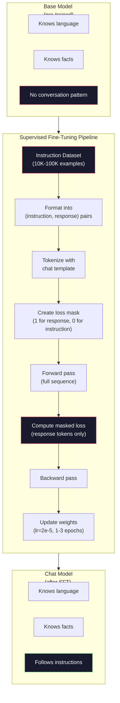

# 명령어 조정 (SFT)

> 기본 모델은 다음 토큰을 예측합니다. 그게 다입니다. 명령어를 따르거나 질문에 대답하거나 해로운 요청을 거부하지 않습니다. SFT는 토큰 예측자와 유용한 보조 사이의 다리입니다. 여러분이 이야기한 모든 모델들 -- 클로드, GPT, Llama Chat -- 이 단계를 거쳤습니다.

**Type:** Build
**Languages:** Python (with numpy)
**Prerequisites:** Phase 10, Lesson 04 (Pre-Training a Mini GPT)
**Time:** ~90 minutes

## 학습 목표

- 기본 언어 모델을 명령어를 따르는 보조로 변환하는 감독된 미세 조정 (SFT) 을 구현
- 시스템, 사용자 및 보조 역할과 함께 채팅 템플릿을 사용하여 훈련 데이터를 포맷하고, 보조하지 않는 토큰에 마스크 손실
- 왜 SFT가 필요한지 설명하라: 기본 모델은 질문에 대답하는 대신 텍스트를 계속한다
- 수납된 명령어 집합에서 기본 모델과 정교한 모델 응답을 비교하여 SFT 품질을 평가합니다.

## 문제

여러분은 04. 수업에서 모델을 훈련시켰습니다. 다음 토큰을 예측할 수 있습니다. "트랜스포머 아키텍처"를 입력하면 "자연 언어 처리를 혁명적으로 변화시켰습니다".

이제 이것을 시도해보세요. "프랑스의 수도는 무엇입니까?" "독일 수도는 무엇인가? 스페인 의 수도 는 무엇 입니까?" 는 이유 는 질문 목록 을 담고 있는 문서 에서 알게 되었기 때문 이다. 또는 "많은 사람들이 묻는 질문"이 나올 수 있습니다. 왜냐하면 이것이 다음 기호의 지속일 수 있기 때문입니다. 모델은 "응답"이라는 개념이 없습니다. 이 말은 계속하는 것 뿐이야

이것은 GPT-3 (기본 모델, 2020년 6월 출시) 과 ChatGPT (명령 조정, 2022년 11월 출시) 사이의 격차입니다. 동일한 건축물. 동일한 사전 훈련. 차이점은 모형에 대화 패턴을 따르도록 가르치는 20,000~100,000 개의 신중하게 제작된 (명령, 응답) 쌍입니다.

스탠퍼드 알파카는 수백만 개의 예제가 필요하지 않다는 것을 증명했습니다. 2023년 3월, 그들은 GPT-3.5에서 생성된 52,000개의 명령어 응답 쌍에 Llama 7B를 정비했습니다.$600. The result was a chatbot that could follow instructions, answer questions, and hold conversations. Not as good as ChatGPT, but shockingly close for $600시간 훈련과 몇시간 훈련

메타의 라마 2 채팅은 초기 SFT 단계에 대해 2만 7천여 개의 고품질의 예를 사용했습니다. 핵심 통찰은 양보다 품질이 더 중요합니다. 숙련된 해설가들에 의해 작성된 27만 개의 예는 인터넷에서 스크래프된 1백만 개의 노이즈한 예제를 능가합니다.

## 개념

### 실제로 SFT가 하는 일

감독된 정렬은 훈련 전부터 같은 훈련 루프를 계속합니다. 앞으로 통과, 계산 손실, 뒤로 통과, 업데이트 중량. 하지만 다른 종류의 데이터에 따라요. 원본 텍스트 대신 구조화된 대화에 훈련합니다.

```json
{
  "system": "You are a helpful assistant.",
  "user": "What is the capital of France?",
  "assistant": "The capital of France is Paris."
}
```

모델은 이미 파리가 프랑스의 수도라는 것을 알고 있습니다. 이것은 위키백과, 교과서 및 웹 페이지에서 사전 훈련 중에 알게되었습니다. SFT는 모델에게 새로운 사실을 가르치지 않습니다. 모델에게 새로운 *행동*을 가르칩니다: 질문을 보았을 때 답을 만들어내십시오. 지시 사항을 보았을 때 완료를 만들어내십시오. 해로운 요청을 보았을 때 거부를 만들어내십시오.

예전에 훈련하면 모델에 대한 지식이 주어집니다. SFT는 모델 관습을 제공합니다.

### 데이터 형식

산업에 지배적인 세 가지 형식은 있습니다. 각각 동일한 정보를 암호화합니다. 누가 무엇을 말했는지요.

**Alpaca Format**(스탠포드, 2023년 3월)

```json
{
  "instruction": "Summarize the following article in 3 sentences.",
  "input": "The European Central Bank raised interest rates...",
  "output": "The ECB increased rates by 25 basis points..."
}
```

간단하고 널리 사용 됩니다.`input`스탠퍼드는 이 형식으로 52,000개의 예를 발표했습니다. GPT-3.5에서 600달러에 생성된 것입니다. 이것은 오픈소스 명령어 조율 운동을 시작시켰습니다.

**ShareGPT Format**(공동체, 2023):

```json
{
  "conversations": [
    {"from": "system", "value": "You are a helpful assistant."},
    {"from": "human", "value": "What causes tides?"},
    {"from": "gpt", "value": "Tides are caused by the gravitational pull of the Moon..."},
    {"from": "human", "value": "How often do they occur?"},
    {"from": "gpt", "value": "Most coastal areas experience two high tides and two low tides per day..."}
  ]
}
```

다중 회전 대화를 지원합니다. "From" 필드는 실제 모델에 관계없이 "인간"과 "gpt"를 통상적으로 사용합니다. Vicuna는 사용자 공유 ChatGPT 전개에서 스크래프된 70,000 개의 ShareGPT 대화에서 훈련을 받았습니다.

**ChatML Format**(OpenAI, 많은 오픈소스 모델에서 사용된다):

```
<|im_start|>system
You are a helpful assistant.<|im_end|>
<|im_start|>user
What is the capital of France?<|im_end|>
<|im_start|>assistant
The capital of France is Paris.<|im_end|>
```

특수 토큰을 사용한다 (`<|im_start|>``<|im_end|>`) 를 통해 역할들을 정의한다. 이 토큰들은 정렬 중에 토큰라이저의 어휘에 추가된다. Qwen, Yi, 그리고 다른 많은 모델들은 ChatML를 사용합니다.

세 가지 형식은 모두 같은 것을 수행합니다. 모델에게 "이것이 명령이고, 이것은 반응입니다, 이 패턴을 배우십시오".라고 말합니다.

### 왜 효과가 있습니까?

모델은 이미 사전 훈련에서 언어를 알고 있습니다. 그것은 질문과 함께 답변, 명령과 함께 완료, 그리고 사람들 사이의 대화의 수십억의 예들을 보았습니다. 패턴은 이미 무게에 코딩되었습니다.

SFT는 이러한 잠잠한 능력을 집중시킵니다. 모델은 문맥에서 질문에 대답해야하는지 아니면 문서를 계속해야하는지 알아내는 대신 SFT는 대화 패턴에 명시적으로 훈련합니다. 몇 천 가지 예제 후에 모델은 학습합니다. 보조 역할 표시기를 보면 도움이 되는 반응을 생성합니다.

27,000개의 예를 들어보면 충분합니다. 여러분은 모형 영어를 가르치지 않습니다. 여러분은 세계에 대한 사실을 가르치지 않습니다. 여러분은 간단한 행동을 가르치고 있습니다. 명령에 응답하세요. 지식은 이미 거기에 있었습니다.

### 은폐 된 손실

이것은 SFT에서 가장 중요한 기술적인 세부 사항이고 대부분의 튜토리얼은 그것을 생략합니다.

사전 훈련 중에, 당신은 모든 토큰에 손실을 계산합니다. 모델은 순서에서 다음 모든 토큰을 예측하는 것을 배우습니다. SFT 동안, 당신은 단지 * 응답* 토큰에 손실을 계산합니다. 명령 토큰은 맥락에 있습니다, 그러나 모델은 잘못 "예측" 한 것에 대해 처벌받지 않습니다.

왜? 왜냐하면 모델이 지시사항을 생성하는 법을 배우지 않으려면. 당신은 그 모델이 지시사항에 응답하는 법을 배우기를 원합니다. 명령표에 손실을 계산하면, 모델이 "프랑스의 수도는 무엇입니까?"를 예측하도록 훈련시키고 있습니다. 마치 그 모델이 질문을 던지는 것처럼. 그 모델은 gradient 신호를 낭비하고 그 역할에 대해 모델을 혼란스럽게 할 수 있습니다.

실제에서는 손실 마스크를 만듭니다. 응답 토큰에 1개, 명령 토큰에 0개. 평균하기 전에 이 마스크로 당 토큰 손실을 곱합니다.

```
Tokens:    [SYS] You are helpful [USER] What is the capital? [ASST] Paris is the capital [EOS]
Loss mask:   0    0    0     0      0     0   0  0     0       1     1    1   1     1      1
```

그 후의 토큰만`[ASST]`손실에 기여합니다. 모델은 전면 패스 중에 전체 대화를 볼 수 있습니다 (정확한 응답을 생성하기 위해 지침이 필요합니다), 그러나 응답을 얼마나 잘 예측했는지에 따라 무게를 업데이트합니다.

### 훈련 하이퍼파라메터

SFT는 훈련 전과 매우 다른 하이퍼파레머를 사용합니다. 여러분은 처음부터 훈련을 하지 않고 이미 작동하는 모델을 조정합니다.

| Parameter | Pre-Training (Llama 2 7B) | SFT (Llama 2 Chat) |
|-----------|---------------------------|---------------------|
| Learning rate | 3e-4 (peak) | 2e-5 |
| Epochs | 1 (single pass over data) | 2 |
| Batch size | 4M tokens | 64 examples |
| Warmup steps | 2,000 | 0-100 |
| Weight decay | 0.1 | 0.0-0.1 |
| Data size | 2T tokens | 27,000 examples |

학습률은 SFT에 대해 15배 낮습니다. 이것은 매우 중요합니다. 미세조정 과정에서 높은 학습률은 미리 훈련된 지식을 파괴합니다. 모델은 배운 것을 "잊고" 작은 미세조정 데이터 세트에 과잉합니다. 이것은 재앙적인 잊음입니다.

두 시대는 모델이 두 번씩 훈련 예제를 볼 수 있다는 것을 의미합니다. 작은 데이터 세트에 3 시대가 넘는 것은 기억으로 이어집니다. 모델은 일반화 대신 훈련 예제를 말 그대로 재생하기 시작합니다.

### 참혹 한 잊음

정렬은 일반적인 능력을 파괴할 수 있습니다. 명령에 따라 데이터를 너무 오랫동안 훈련하면 모델은 코드를 작성하거나 수학하거나 창의적인 텍스트를 생성 할 수있는 능력을 잃습니다. 훈련 데이터의 특정 형식에 매우 훌륭하고 다른 모든 것에 끔찍한 것입니다.

세 가지 완화 방법:

1. **Low learning rate.**1e-5에서 5e-5에 대한 작은 업데이트는 미리 훈련된 기능의 파괴를 덜 의미합니다.

2. **Short training.**1~3시대, 모델이 오프타이트되기 전에 멈춰라

3. **Mix in pre-training data.**Llama 2 Chat은 SFT 데이터 세트에 원료 사전 훈련 데이터의 작은 비율 (2-5%) 를 혼합했습니다. 이것은 새로운 명령어를 따르는 행동을 배우는 동안 일반적인 기능의 모델을 "보상"합니다.

### 실제 숫자

7B 모델을 10,000개의 고품질의 명령어 쌍으로 정렬하는 데는 NVIDIA A100 80GB GPU에서 1시간 정도 걸립니다. 여기 수학이 있습니다.

- 10만 개의 예제 x 512 개의 토큰 평균 = 5.12M 토큰
- 2 시대 = 10.24M 토큰 전체
- A100 7B 모델 정형 조정: ~3,000 토큰/초
- 10.24M / 3,000 = ~ 3,400초 = ~ 57분

우리의 미니 GPT (4층, 128 ) 에 있어서 훈련은 거의 즉각적입니다.



```figure
loss-masking
```

## 건설 해

### 단계 1: 명령어 데이터셋

합성 명령어 데이터 세트를 만들죠. 제작에서 Scale AI와 Anthropic 같은 회사들은 인간 해설자를 고용해서 이런 내용을 작성합니다. 우리는 그 형식을 보여주기 위해 프로그래밍 방식으로 만들죠.

```python
import numpy as np

INSTRUCTION_DATA = [
    {
        "instruction": "What is the capital of France?",
        "response": "The capital of France is Paris."
    },
    {
        "instruction": "Explain gravity in one sentence.",
        "response": "Gravity is the force that attracts objects with mass toward each other."
    },
    {
        "instruction": "Write a haiku about the ocean.",
        "response": "Waves crash on the shore, salt and foam beneath the sun, endless blue expanse."
    },
    {
        "instruction": "What is 15 multiplied by 7?",
        "response": "15 multiplied by 7 is 105."
    },
    {
        "instruction": "Name three programming languages.",
        "response": "Three programming languages are Python, Rust, and TypeScript."
    },
    {
        "instruction": "Summarize photosynthesis.",
        "response": "Photosynthesis converts sunlight, water, and carbon dioxide into glucose and oxygen."
    },
    {
        "instruction": "What year did World War II end?",
        "response": "World War II ended in 1945."
    },
    {
        "instruction": "Define machine learning.",
        "response": "Machine learning is a field where algorithms learn patterns from data to make predictions."
    },
]
```

8가지 예는 아주 작습니다. 스탠퍼드 알파카는 52,000개를 사용했습니다. 하지만 기계는 8개나 52,000개나 상관없이 동일합니다.

### 단계 2: 채팅 템플릿으로 토큰을 사용

명령-응답 쌍을 특수 롤마크로 토큰 순서로 변환합니다. 마크는 명령이 끝나는 곳과 응답이 시작하는 곳을 모델에 알려줍니다.

```python
SPECIAL_TOKENS = {
    "INST_START": 253,
    "INST_END": 254,
    "RESP_START": 255,
}


def tokenize_instruction_pair(instruction, response, vocab_size=256):
    inst_tokens = list(instruction.encode("utf-8"))
    resp_tokens = list(response.encode("utf-8"))

    inst_tokens = [min(t, vocab_size - 4) for t in inst_tokens]
    resp_tokens = [min(t, vocab_size - 4) for t in resp_tokens]

    tokens = (
        [SPECIAL_TOKENS["INST_START"]]
        + inst_tokens
        + [SPECIAL_TOKENS["INST_END"]]
        + [SPECIAL_TOKENS["RESP_START"]]
        + resp_tokens
    )

    return tokens


def create_loss_mask(tokens):
    mask = np.zeros(len(tokens), dtype=np.float32)
    in_response = False

    for i, token in enumerate(tokens):
        if token == SPECIAL_TOKENS["RESP_START"]:
            in_response = True
            continue
        if in_response:
            mask[i] = 1.0

    return mask
```

손실 마스크는 모든 명령 토큰의 0이고 응답 토큰의 0입니다.`RESP_START`토큰 자체는 0의 마스크를 얻습니다. 왜냐하면 그것은 응답 내용의 일부이기 때문에

### 3단계: 마스크 된 크로스 엔트로피 손실

표준 크로스 엔트로피, 하지만 손실 마스크로 곱합니다. 반응 토큰만 그레디엔트에 기여합니다.

```python
def masked_cross_entropy_loss(logits, targets, loss_mask):
    batch, seq_len, vocab_size = logits.shape
    logits_flat = logits.reshape(-1, vocab_size)
    targets_flat = targets.reshape(-1)
    mask_flat = loss_mask.reshape(-1)

    max_logits = logits_flat.max(axis=-1, keepdims=True)
    log_softmax = logits_flat - max_logits - np.log(
        np.exp(logits_flat - max_logits).sum(axis=-1, keepdims=True)
    )

    per_token_loss = -log_softmax[np.arange(len(targets_flat)), targets_flat]

    masked_loss = per_token_loss * mask_flat
    num_response_tokens = mask_flat.sum()
    if num_response_tokens == 0:
        return 0.0
    loss = masked_loss.sum() / num_response_tokens

    return loss
```

나명자는`num_response_tokens`아니`seq_len`. 전체 순서 길이를 나누면 더 긴 명령어들은 기하급수 신호를 희소화합니다. 응답 토큰 수를 나누는 것은 명령어의 길이를 상관없이 응답 토큰에 대한 무게가 동일하도록 보장합니다.

### 단계 4: SFT 훈련 루프

수업 04에서 MiniGPT를 재사용합니다. 훈련 루프는 사전 훈련과 거의 동일하지만 명령 포맷과 마스크 손실이 있습니다.

```python
import sys
import os
sys.path.insert(0, os.path.join(os.path.dirname(__file__), "..", "..", "04-pre-training-mini-gpt", "code"))
from main import MiniGPT, LayerNorm, FeedForward, MultiHeadAttention, TransformerBlock, Embedding


def sft_train(model, dataset, num_epochs=2, lr=2e-5, seq_len=64):
    formatted_data = []
    for example in dataset:
        tokens = tokenize_instruction_pair(example["instruction"], example["response"])
        mask = create_loss_mask(tokens)
        formatted_data.append((tokens, mask))

    print(f"SFT Training: {len(formatted_data)} examples, {num_epochs} epochs, lr={lr}")
    print(f"Total tokens: {sum(len(t) for t, _ in formatted_data):,}")
    print()

    losses = []

    for epoch in range(num_epochs):
        epoch_loss = 0.0
        num_batches = 0

        indices = np.random.permutation(len(formatted_data))

        for idx in indices:
            tokens, mask = formatted_data[idx]

            if len(tokens) < 3:
                continue
            if len(tokens) > seq_len:
                tokens = tokens[:seq_len]
                mask = mask[:seq_len]

            input_ids = np.array(tokens[:-1]).reshape(1, -1)
            target_ids = np.array(tokens[1:]).reshape(1, -1)
            loss_mask = np.array(mask[1:]).reshape(1, -1)

            logits = model.forward(input_ids)
            loss = masked_cross_entropy_loss(logits, target_ids, loss_mask)

            batch_size, s_len, v_size = logits.shape
            probs = np.exp(logits - logits.max(axis=-1, keepdims=True))
            probs = probs / probs.sum(axis=-1, keepdims=True)
            dlogits = probs.copy()
            dlogits[np.arange(batch_size)[:, None], np.arange(s_len), target_ids] -= 1.0

            mask_expanded = loss_mask[:, :, np.newaxis]
            num_resp = loss_mask.sum()
            if num_resp > 0:
                dlogits = dlogits * mask_expanded / num_resp

            for block in model.blocks:
                block.ffn.W1 -= lr * np.random.randn(*block.ffn.W1.shape) * 0.01
                block.ffn.W2 -= lr * np.random.randn(*block.ffn.W2.shape) * 0.01
                block.ffn.b1 -= lr * np.random.randn(*block.ffn.b1.shape) * 0.01
                block.ffn.b2 -= lr * np.random.randn(*block.ffn.b2.shape) * 0.01

            epoch_loss += loss
            num_batches += 1
            losses.append(loss)

        avg_loss = epoch_loss / max(num_batches, 1)
        print(f"Epoch {epoch + 1}/{num_epochs} | Avg Loss: {avg_loss:.4f}")

    return model, losses
```

학습률은 2e-5, Llama 2 채팅과 일치합니다. 사전 훈련에서 사용되는 3e-4와 비교해보세요. 15배 작습니다. 그라디엔트는 마스크됩니다. 명령 토큰은 0 그라디엔트를 생성합니다. 응답 토큰만이 무게를 밀어냅니다.

### 단계 5: 기본 모델과 SFT 모델을 비교

SFT의 핵심은 행동 변화입니다. 이 모델을 측정하여 설명 형식으로 입력된 입력과 원본 텍스트 연속에 어떻게 반응하는지 확인해보겠습니다.

```python
def generate_response(model, prompt_tokens, max_new_tokens=50, temperature=0.8):
    tokens = list(prompt_tokens)
    seq_len = model.embedding.pos_embed.shape[0]

    for _ in range(max_new_tokens):
        context = np.array(tokens[-seq_len:]).reshape(1, -1)
        logits = model.forward(context)
        next_logits = logits[0, -1, :]

        next_logits = next_logits / max(temperature, 1e-8)
        probs = np.exp(next_logits - next_logits.max())
        probs = probs / probs.sum()
        probs = np.clip(probs, 1e-10, 1.0)
        probs = probs / probs.sum()

        next_token = np.random.choice(len(probs), p=probs)
        tokens.append(int(next_token))

    return tokens


def evaluate_instruction_following(model, instructions):
    print("Evaluating instruction following:")
    print("-" * 50)

    for instruction in instructions:
        tokens = (
            [SPECIAL_TOKENS["INST_START"]]
            + [min(t, 252) for t in list(instruction.encode("utf-8"))]
            + [SPECIAL_TOKENS["INST_END"]]
            + [SPECIAL_TOKENS["RESP_START"]]
        )

        output = generate_response(model, tokens, max_new_tokens=30, temperature=0.6)
        response_start = len(tokens)
        response_tokens = output[response_start:]
        response_bytes = bytes([t for t in response_tokens if t < 128])
        response_text = response_bytes.decode("utf-8", errors="replace")

        print(f"  Q: {instruction}")
        print(f"  A: {response_text[:80]}")
        print()
```

8가지 예제를 가진 작은 모델에서는 응답이 의미가 없을 것입니다. 그것은 예상됩니다. 중요한 것은 *구조*입니다. 모델은 더 많은 지침을 생성하는 대신 응답 표시자 이후에 출력을 생성하는 것을 배우게 됩니다.

### 6단계: 재앙적 인 잊음을 측정 하십시오

SFT 전과 이후의 모델의 다음 토큰 예측 능력을 비교하십시오. SFT가 일반적인 기능을 손상시키면 원본의 손실이 증가합니다.

```python
def measure_forgetting(model, test_text, seq_len=64):
    tokens = np.array(list(test_text.encode("utf-8")[:512]))

    total_loss = 0.0
    num_windows = 0

    for start in range(0, len(tokens) - seq_len - 1, seq_len):
        input_ids = tokens[start:start + seq_len].reshape(1, -1)
        target_ids = tokens[start + 1:start + seq_len + 1].reshape(1, -1)

        logits = model.forward(input_ids)

        batch, s_len, vocab_size = logits.shape
        logits_flat = logits.reshape(-1, vocab_size)
        targets_flat = target_ids.reshape(-1)

        max_logits = logits_flat.max(axis=-1, keepdims=True)
        log_softmax = logits_flat - max_logits - np.log(
            np.exp(logits_flat - max_logits).sum(axis=-1, keepdims=True)
        )

        loss = -log_softmax[np.arange(len(targets_flat)), targets_flat].mean()
        total_loss += loss
        num_windows += 1

    return total_loss / max(num_windows, 1)
```

실제 정렬에서, 당신은 훈련 내내 이 메트릭을 추적 할 것입니다. 원본 텍스트 손실이 10-15% 이상 증가하면, SFT는 너무 공격적입니다. 학습 속도를 낮추거나 시대를 줄일 수 있습니다.

## 사용 하 고

### 전체 SFT 파이프라인 데모

```python
if __name__ == "__main__":
    np.random.seed(42)

    test_text = """The transformer architecture processes sequences through self-attention.
Each layer applies multi-head attention followed by a feedforward network.
Residual connections and layer normalization stabilize deep networks.
The model learns to predict the next token given all previous tokens."""

    print("=" * 70)
    print("INSTRUCTION TUNING (SFT) DEMO")
    print("=" * 70)
    print()

    model = MiniGPT(
        vocab_size=256, embed_dim=128, num_heads=4,
        num_layers=4, max_seq_len=128, ff_dim=512
    )
    print(f"Model: {model.count_parameters():,} parameters")
    print(f"Config: 4 layers, 4 heads, 128 dims (mini GPT from Lesson 04)")
    print()

    print("PRE-SFT: Measuring base model loss on raw text")
    base_loss = measure_forgetting(model, test_text)
    print(f"  Base model loss: {base_loss:.4f}")
    print()

    print("=" * 70)
    print("SFT TRAINING")
    print("=" * 70)

    model, losses = sft_train(
        model, INSTRUCTION_DATA, num_epochs=3, lr=2e-5, seq_len=128
    )

    print()
    print("POST-SFT: Measuring fine-tuned model loss on raw text")
    sft_loss = measure_forgetting(model, test_text)
    print(f"  SFT model loss: {sft_loss:.4f}")
    print(f"  Change: {((sft_loss - base_loss) / base_loss * 100):+.1f}%")
    if abs(sft_loss - base_loss) / base_loss < 0.15:
        print("  Minimal forgetting (< 15% change)")
    else:
        print("  Significant forgetting detected")
    print()

    print("=" * 70)
    print("INSTRUCTION FOLLOWING EVALUATION")
    print("=" * 70)
    print()

    test_instructions = [
        "What is the capital of France?",
        "Name a programming language.",
        "Define gravity.",
    ]
    evaluate_instruction_following(model, test_instructions)

    print("=" * 70)
    print("DATA FORMAT EXAMPLES")
    print("=" * 70)
    print()

    for i, example in enumerate(INSTRUCTION_DATA[:3]):
        tokens = tokenize_instruction_pair(example["instruction"], example["response"])
        mask = create_loss_mask(tokens)
        resp_count = int(mask.sum())
        total_count = len(tokens)
        print(f"  Example {i + 1}: {total_count} tokens, {resp_count} response tokens ({resp_count/total_count:.0%} of sequence)")
        print(f"    Instruction: {example['instruction']}")
        print(f"    Response: {example['response']}")
        print()

    print("=" * 70)
    print("TRAINING LOSS CURVE")
    print("=" * 70)
    print()

    if losses:
        window = max(1, len(losses) // 5)
        for i in range(0, len(losses), window):
            chunk = losses[i:i + window]
            avg = sum(chunk) / len(chunk)
            print(f"  Steps {i:3d}-{i + len(chunk) - 1:3d}: avg loss = {avg:.4f}")
```

## 선박

이 교훈은`outputs/prompt-sft-data-curator.md`- SFT에 대한 명령어 데이터 세트를 설계하고 관리하는 데 도움이 되는 프롬프트. 목표 기능 (코드 생성, 수학, 대화) 을 고려하면 형식 사양, 품질 기준 및 다양성 요구 사항과 함께 데이터 수집 계획을 생성합니다.

## 운동

1. 시스템 신속 지원 추가. 수정 `tokenize_instruction_pair`시스템 메시지를 받아서 명령에 앞서 미리 작성하는 경우, 5개의 예를 만들어서 다른 시스템 명령어 ("당신은 시인", "당신은 수학 교사") 를 작성하고, 모델이 훈련 중에 다른 시스템 명령어를 보는지 확인합니다.

2. 데이터 혼합을 구현합니다. SFT 데이터 세트와 원본 텍스트 코퍼스를 가져가는 함수를 생성하고, 그 다음 5%의 예例가 원본 텍스트 (마스크링이 없습니다) 및 95%가 명령쌍 (마스크링) 이있는 훈련 대를 생성합니다. 3 시대를 실행하고 순수한 SFT 훈련과 잊기 매트릭을 비교하십시오.

3. 데이터 품질 점수를 구축하십시오. 각 명령어 응답 쌍에 대해 계산하십시오: (a) 토큰의 응답 길, (b) 명령어 응답 비율, (c) 어휘 다양성 (일본 토큰 / 전체 토큰). 응답 길이가 < 10 토큰 또는 다양성 < 0.3의 예제를 필터링하십시오. 필터링이 최종 손실에 어떻게 영향을 미치는지 보여줍니다.

4. 다회전 대화 훈련을 구현하십시오. 3회전 대화 (이용자 보조-이용자 보조-이용자 보조) 를 처리하기 위해 토큰화를 확장하십시오. 손실 마스크는 세 차례 모두 포함되어야합니다. 하나의 예로 토큰-마스크 조화를 인쇄하여 마스크가 올바른지 확인하십시오.

5. 학습률을 비교하십시오. 동일한 모델을 lr=1e-4, lr=2e-5, lr=1e-6로 세 번 연습하십시오. 손실 곡선을 그려보십시오. 1e-4 경기는 초기 급속한 감소가 있지만 최종 손실이 더 높아야 합니다. 1e-6 경기는 거의 움직이지 않습니다. 2e-5 경기는 달콤한 점이어야합니다.

## 주요 용어

| Term | What people say | What it actually means |
|------|----------------|----------------------|
| SFT | "Fine-tuning on conversations" | Supervised Fine-Tuning: continuing training on (instruction, response) pairs with loss computed only on response tokens |
| Instruction tuning | "Teaching the model to follow instructions" | Training on explicit instruction-response pairs so the base model learns the conversation pattern, not new knowledge |
| Loss masking | "Ignoring the prompt" | Setting loss to zero for instruction tokens so gradients only flow from response token predictions |
| ChatML | "Chat Markup Language" | A token format using `<\|im_start\|>` and `<\|im_end\|>` delimiters to mark speaker roles in conversation data |
| Alpaca format | "Stanford's format" | A JSON format with instruction/input/output fields, used for 52K GPT-3.5-generated examples that cost $600 |
| Catastrophic forgetting | "The model gets dumber" | Fine-tuning destroys pre-trained capabilities because gradient updates overwrite general knowledge with task-specific patterns |
| Weight tying | "Shared embeddings" | Using the same matrix for input token embeddings and output prediction head, saving parameters and improving coherence |
| Chat template | "How you format the prompt" | The specific token sequence (role markers, delimiters) that structures a conversation for the model |

## 더 많은 읽기

- [Ouyang et al., 2022 -- "Training language models to follow instructions with human feedback" (InstructGPT)](https://arxiv.org/abs/2203.02155)-- OpenAI에서 명령어 정렬 + RLHF를 도입한 논문
- [Taori et al., 2023 -- "Stanford Alpaca: An Instruction-following LLaMA Model"](https://github.com/tatsu-lab/stanford_alpaca)-- $600에 52K의 명령 예제, SFT가 작은 데이터 세트에서 작동한다는 것을 증명하는
- [Touvron et al., 2023 -- "Llama 2: Open Foundation and Fine-Tuned Chat Models"](https://arxiv.org/abs/2307.09288)-- 메타의 SFT+RLHF 파이프라인은 27K의 고품질의 사례를 가지고 있습니다
- [Chiang et al., 2023 -- "Vicuna: An Open-Source Chatbot Impressing GPT-4"](https://lmsys.org/blog/2023-03-30-vicuna/)-- 70K ShareGPT 대화에 대한 교육
- [Zhou et al., 2023 -- "LIMA: Less Is More for Alignment"](https://arxiv.org/abs/2305.11206)-- 1000개의 신중하게 정리한 예가 훨씬 큰 데이터 세트에서 SFT와 일치할 수 있음을 증명합니다
