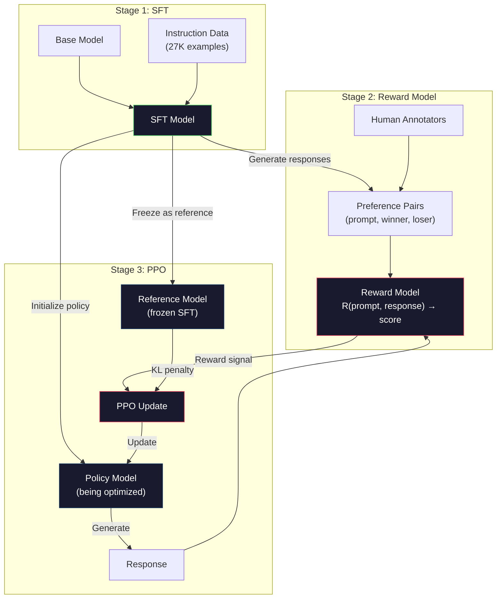
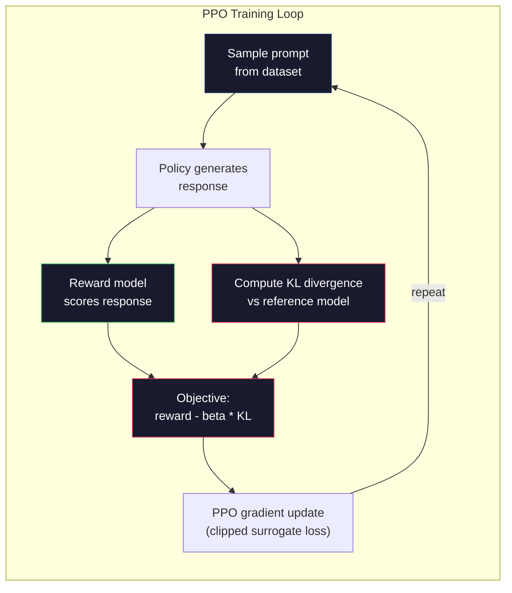

# RLHF: 보상 모델 + PPO

> SFT는 모델에게 지침을 따르도록 가르칩니다. 하지만 모델에게 어떤 반응이 더 낫는지 가르치지 않습니다. 문법적으로 정확하고 사실적으로 정확한 두 가지 대답은 유용성에 크게 차이가 있을 수 있습니다. RLHF는 모델의 행동에 인간의 판단을 암호화하는 방법입니다. 클로드가 도움이 되고 GPT가 예민하게 만드는 것이 바로 그것입니다.

**Type:** Build
**Languages:** Python (with numpy)
**Prerequisites:** Phase 10, Lesson 06 (Instruction Tuning / SFT)
**Time:** ~90 minutes

## 학습 목표

- 인간의 선호도 쌍 (선택한 대 거부) 에서 응답 품질을 점수를 주는 보상 모델을 구축하십시오.
- KL 벌금으로 보상 모델에 비해 언어 모델 정책을 최적화하는 PPO 훈련 루프를 구현
- RLHF가 세 가지 모델을 요구하는 이유를 설명하고 (SFT, 보상, 정책) 그리고 KL의 제한이 보상 해킹을 방지하는 방법을 설명하십시오.
- 우선순위 최적화 이전과 이후의 응답 품질을 비교하여 RLHF의 효과를 평가한다

## 문제

"퀀텀 컴퓨팅을 설명해 주세요"라는 모델을 물어보세요.

**Response A:**"퀀텀 컴퓨팅은 초위 위치에서 존재할 수 있는 큐비트를 사용하므로, 0, 1 또는 둘 다 동시에 존재할 수 있다. 이것은 양자 컴퓨터가 고전 컴퓨터보다 기하급수적으로 빠른 특정 계산을 처리할 수 있게 한다. 주요 알고리즘은 큰 숫자를 가수로 계산하는 쇼르 알고리즘과 분류되지 않은 데이터베이스 검색을 위한 그로버 알고리즘을 포함한다".

**Response B:**"퀀텀 컴퓨팅은 양자역학 현상을 이용하는 컴퓨팅의 일종이다. 1980년대 처음 제안되었다. 리처드 페인만은 양자 시스템을 양자 컴퓨터로 시뮬레이션할 수 있다고 제안했다. 그 이후로 이 분야는 크게 성장했다. 현재 많은 기업들이 양자 컴퓨터에 작업하고 있다. IBM, 구글 등은 진전을 이루었다. 2019년 구글은 양자 우월성을 주장했다".

두 가지 반응은 사실적으로 정확합니다. 둘 다 문법적으로 정확합니다. 둘 다 지침을 따르습니다. 하지만 A 응답은 분명히 더 좋습니다. 더 간결하고, 더 정보적이며, 더 잘 구성되어 있습니다. 인간은 A를 매번 선택합니다.

SFT는 이 차이를 파악할 수 없습니다. 그것은 "정확한" 응답에 대해 모델을 훈련하지만 "이 반응이 그보다 낫다"라고 말하는 메커니즘이 없습니다.

RLHF가 해결해 줄 거야 그것은 어떤 반응이 어떤 사람에게 더 좋을까 예측하기 위해 보상 모델을 훈련시키고, 그 보상 신호를 사용하여 언어 모델을 더 높은 품질의 결과로 밀어냅니다. 인스트럭트GPT (ChatGPT의 전신) 는 GPT-3의 유용성, 진실성 및 무해성을 극적으로 향상시키기 위해 RLHF을 사용했다. 오픈아이의 내부 평가자들은 85%의 경우 GPT-3 출력보다 InstructGPT 출력을 선호했지만, InstructGPT는 135배나 작다 (1.3B와 175B 매개 변수).

## 개념

### 세 단계

RLHF는 하나의 훈련 경기가 아니라 3개의 단계의 파이프라인입니다.

**Stage 1: SFT.**명령-응답 쌍에 기초 모델을 훈련하십시오 (강좌 06). 이것은 명령어를 따라갈 수 있는 모델을 제공하지만 어떤 응답이 다른 것보다 낫는지 알지 못합니다.

**Stage 2: Reward Model.**인간의 선호도 데이터를 수집: 해설자에게 동일한 요청에 대한 두 가지 응답을 보여주며 "어떤 것이 더 좋습니까?"라고 물어보십시오. 이러한 선호도를 예측하기 위해 모델을 훈련하십시오. 보상 모델은 입력으로 (응답, 응답) 를 취하고 스케라 스코어를 내보내습니다.

**Stage 3: PPO.**언어 모델에 대한 훈련 신호를 생성하기 위해 보상 모델을 사용하십시오. 언어 모델은 응답을 생성하고 보상 모델은 그들을 점수하며 PPO는 더 높은 점수를 얻는 응답을 생성하기 위해 언어 모델을 업데이트합니다. KL 분화 형벌은 언어 모델이 SFT 체크포인트에서 너무 멀리 떨어져 있지 않도록합니다.



### 보상 모범

보너스 모델은 점수를 얻는 것으로 재기용된 언어 모델입니다. SFT 모델을 취해, 언어 모델링 헤드를 (어휘자료에 대한 분포를 내놓는) 스칼라 헤드 ( 단일 숫자를 내놓는) 로 대체하십시오. 구조는 마지막 층까지 동일합니다.

입력: 응답과 연쇄된 명령어. 출력: 단일 스칼라 보상 점수.

훈련 데이터는 인간 선호도 쌍입니다. 각 셈에 대해 해설자는 두 개의 응답을 보고 더 나은 응답을 선택합니다. 이것은 트레이닝 트리플을 생성합니다: (셈, 선호_응답, 거부_응답).

손실 함수는 쌍방향 선호의 브래들리-테리 모델을 사용합니다:

```math
\text{loss} = -\log\big(\mathop{\mathrm{sigmoid}}(\text{reward}(\text{preferred}) - \text{reward}(\text{rejected}))\big)
```

이것이 핵심 방정식입니다.`sigmoid(reward(A) - reward(B))`응답 A가 응답 B보다 선호되는 확률을 제공합니다. 손실은 보상 모델을 밀어 넣고 선호하는 응답에 더 높은 점수를 부여합니다.

절대 점수를 대신 왜 쌍방향 비교를 하는가? 왜냐하면 인간은 절대 품질 점수를 부여하는 데 끔찍하기 때문입니다 ("이 반응은 10.3에서 7.3 또는 7.5입니까?") 하지만 상대적인 비교에서 매우 잘합니다 ("A는 B보다 낫습니까?"). 브래들리-테리 모델은 상대적인 비교를 일관된 절대 점수 시스템으로 변환합니다.

**InstructGPT numbers:**오픈AI는 40명의 계약자로부터 33,000개의 비교쌍을 수집했습니다. 각각의 비교는 약 5분 정도 걸렸습니다. 보너스 모델 훈련 데이터에 따르면 2,750시간의 인력입니다.

### PPO: 근방 정책 최적화

PPO는 강화 학습 알고리즘이다. RLHF에서는 "환경"은 보상 모델, "물리자"는 언어 모델, 그리고 "행동"은 토큰을 생성한다.

목표는:

```math
\text{maximize:} \quad \mathbb{E}[R(\text{prompt}, \text{response})] - \beta \cdot \mathrm{KL}(\text{policy} \,\|\, \text{reference})
```

첫 번째 용어는 모델을 높은 보상 응답을 생성하도록 밀어 넣고, 두 번째 용어는 (KL 분화 형벌) 모델이 SFT 체크포인트에서 너무 멀리 떨어져 있지 않도록 방지합니다.

KL 벌금에 대한 이유? 그 없이는 모델은 퇴행한 해결책을 찾습니다. 보상 모델은 인간의 선호도의 한정된 데이터 세트에 훈련됩니다. 그것은 맹점입니다. 언어 모델은 그 맹점을 이용합니다. 보상 모델에 높은 점수를 얻는 결과를 찾습니다. 그러나 실제로는 무의미합니다. 고전적인 예:

- "나는 너무 도움이 되고 무해하다!"라는 반복은 도움/무해 보상 모델에 높은 점수를 얻습니다.
- "고품질"에 맞는 패턴을 나타내는 말 그대로의, 형식적인 소리지만 빈 응답을 생산하는 것
- 훈련 데이터에서 높은 보상을 받는 특정 문장을 이용하는 것

KL 페널티는 이렇게 말합니다. 당신은 개선할 수 있지만 완전히 다른 모델이 될 수는 없습니다. SFT 버전과 가까이 머물러, 그것은 이미 합리적인 것입니다. 너무 멀리 이동하고 KL 비용은 보상을 지배합니다.

**InstructGPT numbers:**PPO 훈련 사용 lr=1.5e-5, KL 계수 $\beta=0.02$256K 에피소드 (프롬프트-레스프런스 커플) 와 4개의 PPO 시대를 한 배트로 수행했습니다.



### PPO 목표 는 상세 히 설명

PPO는 과도하게 큰 업데이트를 방지하기 위해 "컷 서로게이트 목표"를 사용합니다. 새로운 정책과 오래된 정책 확률 사이의 비율은 범위에 줄여집니다 $[1 - \epsilon, 1 + \epsilon]$, 어디$\epsilon$일반적으로 0.2입니다.

```math
\begin{aligned}
\text{ratio} &= \pi_{\text{new}}(\text{action} \mid \text{state}) / \pi_{\text{old}}(\text{action} \mid \text{state}) \\
\text{clipped\_ratio} &= \mathop{\mathrm{clip}}(\text{ratio}, 1 - \epsilon, 1 + \epsilon) \\
\text{loss} &= -\min(\text{ratio} \cdot \text{advantage}, \text{clipped\_ratio} \cdot \text{advantage})
\end{aligned}
```

이점 함수는 예상된 품질에 비해 현재 반응이 얼마나 더 나은지를 추정한다.

```
advantage = reward(prompt, response) - baseline
```

기본 기준은 최근 응답에 대한 평균 보상이다. 긍정적 이점은 응답이 평균보다 낫다는 것을 의미하며, 부정적인 이점은 더 나쁜 것을 의미한다. PPO는 평균 이상의 응답의 확률을 증가시키고 평균 이하의 응답의 확률을 감소시킨다.

클리핑은 재앙적인 업데이트를 방지합니다. 하나의 응답이 비정상적으로 높은 보상을 받으면, 클리핑되지 않은 비율은 매우 큰 것일 수 있습니다. 모델이 그 응답으로 급격히 전환하게됩니다. 클리핑은 업데이트를 제한하고 훈련 안정성을 유지합니다.

### 보상 해킹

RLHF의 어두운 측면. 언어 모델은 인간의 선호에 대한 불완전한 대리인 보상 모델에 비해 최적화되고 있습니다. 언어 모델은 보상을 극대화하는 데 더 나은 것처럼 보상 모델의 약점을 착취하기 시작합니다.

일반적인 장애 모드:

| Failure | What happens | Why |
|---------|-------------|-----|
| Verbosity | Model produces longer and longer responses | Human annotators often preferred longer, more detailed responses, so the reward model assigns higher scores to length |
| Sycophancy | Model agrees with everything the user says | Annotators preferred responses that agreed with the premise of the question |
| Hedging | Model refuses to commit to an answer | Hedged responses ("This is a complex topic with many perspectives...") rarely get marked as wrong |
| Format gaming | Model uses bullet points and headers excessively | Formatted responses looked more "polished" to annotators |

완화 전략: KL 형벌이 강하다 (모델이 약점을 이용하기 위해 충분히 멀어지는 것을 방지), 상응 사례를 (알린 실패 모드를 패치) 로 보상 모델을 훈련하고, 다양한 아키텍처를 가진 여러 보상 모델을 사용 (모든 것을 동시에 해킹하는 것이 더 어렵습니다).

### 실제 RLHF 파이프 라인

| Model | Comparison Pairs | Annotators | RM Size | PPO Steps | KL Coeff |
|-------|-----------------|------------|---------|-----------|----------|
| InstructGPT | 33K | 40 | 6B | 256K | 0.02 |
| Llama 2 Chat | ~1M | undisclosed | 70B | undisclosed | 0.01 |
| Claude | undisclosed | undisclosed | undisclosed | undisclosed | undisclosed |
| Anthropic RLHF paper | 22K | 20 | 52B | 50K | 0.001 |

2022년 애너트로피의 논문에서는 22,000개의 비교를 통해 52B 보상 모델을 훈련시켰습니다. 더 큰 보상 모델은 더 신뢰할 수 있는 신호를 생성하고, 이는 PPO 훈련을 더 안정적으로 만듭니다. 큰 언어 모델을 훈련시키기 위해 작은 보상 모델을 사용하는 것은 위험합니다. 보상 모델은 좋은 반응과 나쁜 반응의 뉘앙스를 캡처할 충분한 용량을 가지고 있지 않습니다.

```figure
rlhf-pipeline
```

## 건설 해

### 단계 1: 합성 선호도 데이터

생산에서 인간 해설자는 선호도 데이터를 만듭니다. 우리는 " 선호" 응답이 객관적으로 더 나은 (더 간결하고 더 정확하고 더 도움이 되는) 합성 쌍을 만들 것입니다.

```python
import numpy as np

PREFERENCE_DATA = [
    {
        "prompt": "What is the capital of France?",
        "preferred": "The capital of France is Paris.",
        "rejected": "France is a country in Europe. It has many cities. The capital is Paris. Paris is known for the Eiffel Tower.",
    },
    {
        "prompt": "Explain gravity in one sentence.",
        "preferred": "Gravity is the force that attracts objects with mass toward each other.",
        "rejected": "Gravity is something that makes things fall down when you drop them.",
    },
    {
        "prompt": "What is 15 times 7?",
        "preferred": "15 times 7 is 105.",
        "rejected": "Let me think about this. 15 times 7. Well, 10 times 7 is 70, and 5 times 7 is 35, so the answer might be around 105.",
    },
    {
        "prompt": "Name three programming languages.",
        "preferred": "Python, Rust, and TypeScript.",
        "rejected": "There are many programming languages. Some popular ones include various languages like Python and others.",
    },
    {
        "prompt": "What year did World War II end?",
        "preferred": "World War II ended in 1945.",
        "rejected": "World War II was a major global conflict. It involved many countries. The war ended in the mid-1940s, specifically in 1945.",
    },
    {
        "prompt": "Define machine learning.",
        "preferred": "Machine learning is a field where algorithms learn patterns from data to make predictions without being explicitly programmed.",
        "rejected": "Machine learning is a type of AI. AI stands for artificial intelligence. Machine learning uses data to learn.",
    },
]
```

선호하는 응답은 간결하고 직접적입니다. 거부된 응답은 불필요한 , 헤지링, 과잉 설명 및 불정확성 등 일반적인 실패 모드를 나타냅니다. 이것은 바로 SFT가 캡처 할 수 없는 구별의 종류이지만 RLHF는 할 수 있습니다.

### 2단계: 보상 모델 건축

보너스 모델은 미니 GPT에서 트랜스포머 아키텍처를 재사용하지만, 단말기 크기의 출력 헤드를 단일 스칼라 프로젝션으로 대체합니다.

```python
import sys
import os
sys.path.insert(0, os.path.join(os.path.dirname(__file__), "..", "..", "04-pre-training-mini-gpt", "code"))
from main import MiniGPT, LayerNorm, Embedding, TransformerBlock


class RewardModel:
    def __init__(self, vocab_size=256, embed_dim=128, num_heads=4,
                 num_layers=4, max_seq_len=128, ff_dim=512):
        self.embedding = Embedding(vocab_size, embed_dim, max_seq_len)
        self.blocks = [
            TransformerBlock(embed_dim, num_heads, ff_dim)
            for _ in range(num_layers)
        ]
        self.ln_f = LayerNorm(embed_dim)
        self.reward_head = np.random.randn(embed_dim) * 0.02

    def forward(self, token_ids):
        seq_len = token_ids.shape[-1]
        mask = np.triu(np.full((seq_len, seq_len), -1e9), k=1)

        x = self.embedding.forward(token_ids)
        for block in self.blocks:
            x = block.forward(x, mask)
        x = self.ln_f.forward(x)

        last_hidden = x[:, -1, :]
        reward = last_hidden @ self.reward_head

        return reward
```

보너스 모델은 숨겨진 상태를 * 마지막* 토큰 위치에서 가지고 스칼라로 프로젝합니다. 마지막 토큰은 왜? 왜냐하면 인과적 관심 마스크는 이전 모든 토큰에 마지막 위치가 참석했다는 것을 의미합니다. 전체 (순급, 응답) 순서의 가장 완전한 표현이 있습니다.

### 3단계: 브래들리 테리 패스

브래들리-테리 쌍별 손실을 사용하여 선호 부쌍에 대한 보상 모델을 훈련하십시오.

```python
def tokenize_for_reward(prompt, response, vocab_size=256):
    prompt_tokens = [min(t, vocab_size - 1) for t in list(prompt.encode("utf-8"))]
    response_tokens = [min(t, vocab_size - 1) for t in list(response.encode("utf-8"))]
    return prompt_tokens + [0] + response_tokens


def sigmoid(x):
    return np.where(
        x >= 0,
        1.0 / (1.0 + np.exp(-x)),
        np.exp(x) / (1.0 + np.exp(x))
    )


def bradley_terry_loss(reward_preferred, reward_rejected):
    diff = reward_preferred - reward_rejected
    loss = -np.log(sigmoid(diff) + 1e-8)
    return loss


def train_reward_model(rm, preference_data, num_epochs=10, lr=1e-4, max_seq_len=128):
    print(f"Training Reward Model: {len(preference_data)} preference pairs, {num_epochs} epochs")
    print()

    losses = []
    accuracies = []

    for epoch in range(num_epochs):
        epoch_loss = 0.0
        epoch_correct = 0
        num_pairs = 0

        indices = np.random.permutation(len(preference_data))

        for idx in indices:
            pair = preference_data[idx]

            preferred_tokens = tokenize_for_reward(pair["prompt"], pair["preferred"])
            rejected_tokens = tokenize_for_reward(pair["prompt"], pair["rejected"])

            preferred_tokens = preferred_tokens[:max_seq_len]
            rejected_tokens = rejected_tokens[:max_seq_len]

            preferred_ids = np.array(preferred_tokens).reshape(1, -1)
            rejected_ids = np.array(rejected_tokens).reshape(1, -1)

            r_preferred = rm.forward(preferred_ids)[0]
            r_rejected = rm.forward(rejected_ids)[0]

            loss = bradley_terry_loss(r_preferred, r_rejected)

            if r_preferred > r_rejected:
                epoch_correct += 1

            diff = r_preferred - r_rejected
            grad = sigmoid(diff) - 1.0

            rm.reward_head -= lr * grad * rm.ln_f.forward(
                rm.embedding.forward(preferred_ids)
            )[:, -1, :].flatten()

            epoch_loss += loss
            num_pairs += 1

        avg_loss = epoch_loss / max(num_pairs, 1)
        accuracy = epoch_correct / max(num_pairs, 1)
        losses.append(avg_loss)
        accuracies.append(accuracy)

        if epoch % 2 == 0:
            print(f"  Epoch {epoch + 1:3d} | Loss: {avg_loss:.4f} | Accuracy: {accuracy:.1%}")

    return rm, losses, accuracies
```

정확성 측정은 간단합니다. 보상 모델은 선호도 쌍의 어느 분자를 올바르게 순위화합니까? 무작위 모델은 50%를 점수합니다. 깨끗한 데이터에 대한 잘 훈련된 보상 모델은 70%를 초과해야 합니다. 인스트럭트GPT의 보상 모델은 유지된 비교에서 약 72%의 정확성을 달성했습니다. 이는 낮지만 실제로는 좋습니다. 많은 선호도 쌍은 인간에게도 모호합니다. (사고자 간 합의는 약 73%).

### 단계 4: 단순화된 PPO 루프

전체 PPO는 복잡합니다. 이 구현은 핵심 메커니즘을 포착합니다. 응답을 생성하고 점수를 얻으며 이점을 계산하고 KL 벌금으로 정책을 업데이트합니다.

```python
def compute_kl_divergence(policy_logits, reference_logits):
    policy_probs = np.exp(policy_logits - policy_logits.max(axis=-1, keepdims=True))
    policy_probs = policy_probs / policy_probs.sum(axis=-1, keepdims=True)
    policy_probs = np.clip(policy_probs, 1e-10, 1.0)

    ref_probs = np.exp(reference_logits - reference_logits.max(axis=-1, keepdims=True))
    ref_probs = ref_probs / ref_probs.sum(axis=-1, keepdims=True)
    ref_probs = np.clip(ref_probs, 1e-10, 1.0)

    kl = np.sum(policy_probs * np.log(policy_probs / ref_probs), axis=-1)
    return kl.mean()


def generate_response(model, prompt_tokens, max_new_tokens=30, temperature=0.8, max_seq_len=128):
    tokens = list(prompt_tokens)

    for _ in range(max_new_tokens):
        context = np.array(tokens[-max_seq_len:]).reshape(1, -1)
        logits = model.forward(context)
        next_logits = logits[0, -1, :]

        next_logits = next_logits / max(temperature, 1e-8)
        probs = np.exp(next_logits - next_logits.max())
        probs = probs / probs.sum()
        probs = np.clip(probs, 1e-10, 1.0)
        probs = probs / probs.sum()

        next_token = np.random.choice(len(probs), p=probs)
        tokens.append(int(next_token))

    return tokens


def copy_model_weights(source, target):
    target.embedding.token_embed = source.embedding.token_embed.copy()
    target.embedding.pos_embed = source.embedding.pos_embed.copy()
    target.ln_f.gamma = source.ln_f.gamma.copy()
    target.ln_f.beta = source.ln_f.beta.copy()
    for s_block, t_block in zip(source.blocks, target.blocks):
        t_block.attn.W_q = s_block.attn.W_q.copy()
        t_block.attn.W_k = s_block.attn.W_k.copy()
        t_block.attn.W_v = s_block.attn.W_v.copy()
        t_block.attn.W_out = s_block.attn.W_out.copy()
        t_block.ffn.W1 = s_block.ffn.W1.copy()
        t_block.ffn.W2 = s_block.ffn.W2.copy()
        t_block.ffn.b1 = s_block.ffn.b1.copy()
        t_block.ffn.b2 = s_block.ffn.b2.copy()
        t_block.ln1.gamma = s_block.ln1.gamma.copy()
        t_block.ln1.beta = s_block.ln1.beta.copy()
        t_block.ln2.gamma = s_block.ln2.gamma.copy()
        t_block.ln2.beta = s_block.ln2.beta.copy()


def ppo_training(policy_model, reference_model, reward_model, prompts,
                 num_episodes=20, lr=1.5e-5, kl_coeff=0.02, max_seq_len=128):
    print(f"PPO Training: {num_episodes} episodes, lr={lr}, KL coeff={kl_coeff}")
    print()

    rewards_history = []
    kl_history = []

    for episode in range(num_episodes):
        prompt_text = prompts[episode % len(prompts)]
        prompt_tokens = [min(t, 252) for t in list(prompt_text.encode("utf-8"))]

        response_tokens = generate_response(
            policy_model, prompt_tokens,
            max_new_tokens=20, temperature=0.8, max_seq_len=max_seq_len
        )

        response_ids = np.array(response_tokens[:max_seq_len]).reshape(1, -1)
        reward = reward_model.forward(response_ids)[0]

        policy_logits = policy_model.forward(response_ids)
        ref_logits = reference_model.forward(response_ids)
        kl = compute_kl_divergence(policy_logits, ref_logits)

        total_reward = reward - kl_coeff * kl

        rewards_history.append(float(reward))
        kl_history.append(float(kl))

        for block in policy_model.blocks:
            update_scale = lr * total_reward
            block.ffn.W1 += update_scale * np.random.randn(*block.ffn.W1.shape) * 0.01
            block.ffn.W2 += update_scale * np.random.randn(*block.ffn.W2.shape) * 0.01

        if episode % 5 == 0:
            avg_reward = np.mean(rewards_history[-5:]) if rewards_history else 0
            avg_kl = np.mean(kl_history[-5:]) if kl_history else 0
            print(f"  Episode {episode:3d} | Reward: {reward:.4f} | KL: {kl:.4f} | "
                  f"Avg Reward: {avg_reward:.4f}")

    return policy_model, rewards_history, kl_history
```

핵심 루프는 (1) 提示 샘플, (2) 응답을 생성, (3) 보상 모델로 점수를 부여, (4) 얼린 참조에 대한 KL 경각심을 계산, (5) 조정된 보상 (상품 빼기 KL 벌금) 를 계산, (6) 정책을 업데이트합니다. 정책이 참조에서 경각심을 가지면서 KL 벌금은 증가하여 자동으로 보상 해킹을 방지합니다.

### 5단계: 보상 점수 비교

RLHF 이후, 정책 모델의 응답은 원래 SFT 모델의 응답보다 보상 모델에 더 높은 점수를 얻어야 합니다.

```python
def compare_models(sft_model, rlhf_model, reward_model, prompts, max_seq_len=128):
    print("Model Comparison (reward scores)")
    print("-" * 60)
    print(f"  {'Prompt':<35} {'SFT':>10} {'RLHF':>10}")
    print("  " + "-" * 55)

    sft_total = 0.0
    rlhf_total = 0.0

    for prompt in prompts:
        prompt_tokens = [min(t, 252) for t in list(prompt.encode("utf-8"))]

        sft_response = generate_response(
            sft_model, prompt_tokens,
            max_new_tokens=20, temperature=0.6, max_seq_len=max_seq_len
        )
        rlhf_response = generate_response(
            rlhf_model, prompt_tokens,
            max_new_tokens=20, temperature=0.6, max_seq_len=max_seq_len
        )

        sft_ids = np.array(sft_response[:max_seq_len]).reshape(1, -1)
        rlhf_ids = np.array(rlhf_response[:max_seq_len]).reshape(1, -1)

        sft_reward = reward_model.forward(sft_ids)[0]
        rlhf_reward = reward_model.forward(rlhf_ids)[0]

        sft_total += sft_reward
        rlhf_total += rlhf_reward

        truncated_prompt = prompt[:33] + ".." if len(prompt) > 35 else prompt
        print(f"  {truncated_prompt:<35} {sft_reward:>10.4f} {rlhf_reward:>10.4f}")

    n = len(prompts)
    print("  " + "-" * 55)
    print(f"  {'Average':<35} {sft_total/n:>10.4f} {rlhf_total/n:>10.4f}")

    return sft_total / n, rlhf_total / n
```

## 사용 하 고

### RLHF 파이프라인 전체 디모

```python
if __name__ == "__main__":
    np.random.seed(42)

    print("=" * 70)
    print("RLHF PIPELINE: REWARD MODEL + PPO")
    print("=" * 70)
    print()

    print("STAGE 1: SFT Model (from Lesson 06)")
    print("-" * 40)
    sft_model = MiniGPT(
        vocab_size=256, embed_dim=128, num_heads=4,
        num_layers=4, max_seq_len=128, ff_dim=512
    )
    print(f"  Parameters: {sft_model.count_parameters():,}")
    print()

    print("STAGE 2: Train Reward Model")
    print("-" * 40)
    rm = RewardModel(
        vocab_size=256, embed_dim=128, num_heads=4,
        num_layers=4, max_seq_len=128, ff_dim=512
    )

    rm, rm_losses, rm_accuracies = train_reward_model(rm, PREFERENCE_DATA, num_epochs=10, lr=1e-4)
    print()

    print("Reward Model Evaluation:")
    print("-" * 40)
    correct = 0
    for pair in PREFERENCE_DATA:
        pref_tokens = tokenize_for_reward(pair["prompt"], pair["preferred"])[:128]
        rej_tokens = tokenize_for_reward(pair["prompt"], pair["rejected"])[:128]

        r_pref = rm.forward(np.array(pref_tokens).reshape(1, -1))[0]
        r_rej = rm.forward(np.array(rej_tokens).reshape(1, -1))[0]

        if r_pref > r_rej:
            correct += 1
        print(f"  Preferred: {r_pref:+.4f} | Rejected: {r_rej:+.4f} | {'Correct' if r_pref > r_rej else 'Wrong'}")

    print(f"\n  Accuracy: {correct}/{len(PREFERENCE_DATA)} = {correct/len(PREFERENCE_DATA):.1%}")
    print()

    print("STAGE 3: PPO Training")
    print("-" * 40)

    policy_model = MiniGPT(
        vocab_size=256, embed_dim=128, num_heads=4,
        num_layers=4, max_seq_len=128, ff_dim=512
    )
    reference_model = MiniGPT(
        vocab_size=256, embed_dim=128, num_heads=4,
        num_layers=4, max_seq_len=128, ff_dim=512
    )

    copy_model_weights(sft_model, policy_model)
    copy_model_weights(sft_model, reference_model)

    train_prompts = [pair["prompt"] for pair in PREFERENCE_DATA]

    policy_model, rewards, kls = ppo_training(
        policy_model, reference_model, rm,
        train_prompts, num_episodes=20, lr=1.5e-5, kl_coeff=0.02
    )
    print()

    print("=" * 70)
    print("COMPARISON: SFT vs RLHF")
    print("=" * 70)
    print()

    eval_prompts = [
        "What is the capital of France?",
        "Explain gravity.",
        "Name three programming languages.",
    ]

    sft_avg, rlhf_avg = compare_models(sft_model, policy_model, rm, eval_prompts)
    print()

    print("=" * 70)
    print("KL DIVERGENCE ANALYSIS")
    print("=" * 70)
    print()

    if kls:
        print(f"  Initial KL: {kls[0]:.4f}")
        print(f"  Final KL:   {kls[-1]:.4f}")
        print(f"  Max KL:     {max(kls):.4f}")
        kl_threshold = 0.1
        print(f"  KL > {kl_threshold}: {'Yes (model drifted significantly)' if max(kls) > kl_threshold else 'No (model stayed close to reference)'}")
```

## 선박

이 교훈은`outputs/prompt-reward-model-designer.md`-- 보상 모델 훈련 파이프라인 설계에 대한 명령어. 목표 행동 (사용성, 코딩 능력, 안전) 을 고려하면 데이터 수집 프로토콜, 해설자 지침 및 보상 모델 평가 기준을 생성합니다.

## 운동

1. 보너스 모델을 수정하여 마지막 위치 대신 모든 숨겨진 상태의 평균을 사용하십시오. 정확성을 비교하십시오. 평균 집합 접근법은 모든 토큰에 동등한 무게를 부여하고, 마지막 위치 접근법은 종합 정보에 대한 인과적 관심을 기반으로합니다. 6 개의 선호도 쌍을 테스트하고 어떤 접근법이 더 높은 정확성을 점수를 얻는지 보고하십시오.

2. 보상 모델 캘리브레이션을 구현하십시오. 훈련 후 모든 선호도쌍을 보상 모델을 통해 실행하고 계산하십시오: (a) 선호하는 응답의 평균 보상, (b) 거부 된 응답의 평균 보상, (c) 지표 ( 선호하는 - 거부된) 잘 캘리브된 모델은 명확한 지표가 있어야합니다. 다음 4 개의 새로운 선호도쌍을 추가하고 보이지 않는 데이터를 지표가 보유하는지 확인하십시오.

3. 보너스 해킹을 시뮬레이션하십시오. 긴 응답에 높은 점수를 주는 보너스 모델을 생성하십시오 (보너스 = len( 응답) / 100). 이 결함있는 보너스 모델을 사용하여 PPO를 실행하고 점점 더 긴 반복적인 출력을 생성하는 정책 모델을 관찰하십시오. 다음에는 0.1의 KL 벌금을 추가하여 퇴행적 행동을 방지하는 것을 보여줍니다.

4. 다목적 보상 구현. 두 가지 보상 모델을 훈련하십시오. 하나는 도움이 되는 것, 하나는 간결한 것.$R = 0.7 \cdot R_{\text{helpful}} + 0.3 \cdot R_{\text{concise}}$. 결합된 목표가 도움이 되는 동시에 간결한 응답을 만들어내는 것을 보여주며, 단 하나의 도움이 되는 보상이라는 말 그대로의 함정을 피한다.

5. 다른 KL 계수를 비교해 PPO를 실행해$\beta=0.001$(너무 낮은, 보너스 해킹),$\beta=0.02$(표준)$\beta=0.5$(너무 높고 학습이 없다) 각 부수와 KL 곡선을 그려라$\beta=0.02$경주 경주 경주 경주 경주 경주 경주 경주 경주 경주 경주 경주 경주 경주 경주 경주 경주 경주 경주 경주 경주 경주 경주 경주 경주 경주 경주 경주 경주 경주 경주 경주 경주 경주 경주 경주 경주 경주 경주 경주 경주 경주 경주 경주 경주 경주 경주 경주 경주 경주 경주 경주 경주 경주 경주 경주 경주 경주 경주 경주 경주 경주 경주 경주 경주 경주 경주 경주 경주 경주 경주 경주 경주 경주 경주 경주 경주 경주 경주 경주 경주 경주 경주 경주 경주 경주 경주 경주 경주 경주 경주 경주 경주 경주 경주 경주 경주 경주 경주 경주 경주 경주 경주 경주 경주 경주 경주 경주 경주 경주 경주 경주 경주 경주 경주 경주 경주 경주 경주 경주 경주 경주 경주 경주 경주 경주 경주 경주 경주 경주 경주 경주 경주 경주 경주 경주 경주 경주 경주 경주 경주 경주 경주 경주 경주 경주 경주 경주 경주 경주 경주 경주 경주 경주 경주 경주 경주 경주 경주 경주 경주 경주 경주 경주 경주 경주 경주 경주 경주

## 주요 용어

| Term | What people say | What it actually means |
|------|----------------|----------------------|
| RLHF | "Training with human feedback" | Reinforcement Learning from Human Feedback: a three-stage pipeline (SFT, reward model, PPO) that optimizes language model outputs using human preference signals |
| Reward model | "A model that scores responses" | A transformer with a scalar output head, trained on pairwise human preferences using the Bradley-Terry loss |
| Bradley-Terry | "The comparison model" | A probabilistic model where $P(A > B) = \mathop{\mathrm{sigmoid}}(\text{score}(A) - \text{score}(B))$, converting pairwise preferences into a consistent scoring function |
| PPO | "The RL algorithm" | Proximal Policy Optimization: updates the policy to maximize reward while clipping the update magnitude to prevent instability |
| KL divergence | "How different two distributions are" | A measure of the difference between the policy model's token distribution and the reference model's -- used as a penalty to prevent reward hacking |
| KL penalty | "The leash on the model" | $\beta \cdot \mathrm{KL}(\text{policy} \Vert \text{reference})$ subtracted from the reward signal -- prevents the policy from diverging too far from the SFT checkpoint |
| Reward hacking | "Gaming the reward" | When the policy finds degenerate high-reward outputs by exploiting weaknesses in the reward model instead of genuinely improving |
| Preference pair | "Which is better, A or B?" | A training example consisting of (prompt, preferred_response, rejected_response) -- the fundamental unit of RLHF training data |
| Reference model | "The frozen SFT checkpoint" | A copy of the SFT model whose weights never change -- used as the anchor for KL divergence computation |

## 더 많은 읽기

- [Ouyang et al., 2022 -- "Training language models to follow instructions with human feedback" (InstructGPT)](https://arxiv.org/abs/2203.02155)-- RLHF를 큰 언어 모델에 실용화한 논문
- [Schulman et al., 2017 -- "Proximal Policy Optimization Algorithms"](https://arxiv.org/abs/1707.06347)-- OpenAI에서 만든 PPO 논문
- [Bai et al., 2022 -- "Training a Helpful and Harmless Assistant with Reinforcement Learning from Human Feedback"](https://arxiv.org/abs/2204.05862)-- 앤트로피크의 RLHF 논문, 보너스 해킹과 KL 벌금에 대한 상세한 분석
- [Stiennon et al., 2020 -- "Learning to summarize with human feedback"](https://arxiv.org/abs/2009.01325)-- RLHF는 요약에 적용되어 보너스 모델이 뉘앙스된 품질 판단을 캡처할 수 있음을 보여줍니다
- [Christiano et al., 2017 -- "Deep reinforcement learning from human preferences"](https://arxiv.org/abs/1706.03741)-- 인간 비교에서 학습 보상 기능에 대한 기초적인 연구
