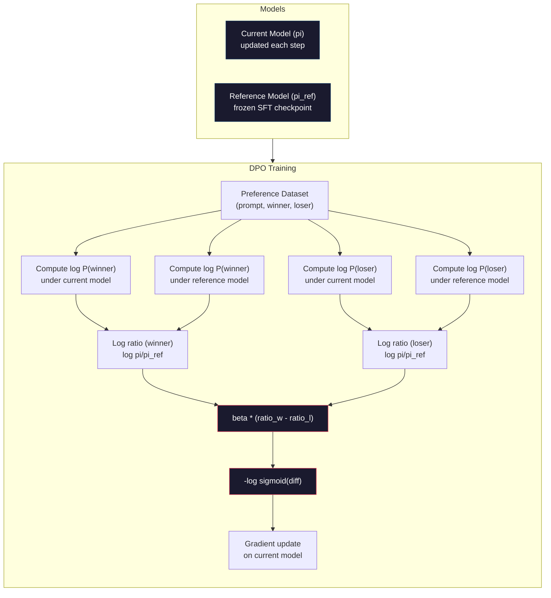

# DPO: 직접 선호도 최적화

> RLHF는 작동합니다. 또한 세 가지 모델을 훈련시키는 것이 필요합니다 (SFT, 보상 모델, 정책), PPO의 불안정을 관리하고 KL 형벌을 조정합니다. DPO는 질문합니다: 당신이 이 모든 것을 건너뛰면 어떨까요? DPO는 선호도 쌍에서 언어 모델을 직접 최적화합니다. 보상 모델이 없습니다. PPO는 없습니다. 하나의 훈련 루프. 동일한 결과가 있습니다.

**Type:** Build
**Languages:** Python (with numpy)
**Prerequisites:** Phase 10, Lesson 07 (RLHF)
**Time:** ~90 minutes

## 학습 목표

- 별도의 보상 모델 없이 선호도 쌍에 대한 언어 모델을 직접 최적화하는 DPO 교육을 실시
- DPO 손실 함수를 추출하고 정책의 로그 확률을 통해 임시적으로 보상 모델을 어떻게 나타낸지를 설명합니다.
- 훈련 안정성, 계산 비용 및 필요한 모델 수에 있어서 DPO와 RLHF를 비교하십시오
- 베타 매개 변수를 조정하여 훈련된 정책이 참조 모델과 얼마나 차이가 있는지 제어합니다

## 문제

7학습에서 RLHF 파이프라인을 구축했습니다. 3단계. 3개의 모델. SFT 모델, 보너스 모델, 그리고 PPO로 최적화된 정책 모델. 보너스 모델만으로 수천 개의 인간 선호도 쌍과 별도의 훈련 루프가 필요했습니다. PPO는 KL 계수, 학습 속도, 클립 비율 및 시대 수를 신중하게 조정해야합니다.

실제에서, PPO 훈련은 불균형적이라고 알려져 있습니다. 작은 과다 매개 변수는 훈련이 분화되는 원인이 됩니다. 보상 모델은 인간의 선호에 대한 불완전한 대리이며, 정책은 약점을 이용하는 방법을 찾습니다. KL 벌금은 도움이 되지만 자체 조정이 필요합니다. 너무 낮고 당신은 보상 해킹을 얻습니다, 너무 높고 모델은 거의 배우지 않습니다.

이 복잡성은 인스트럭트GPT가 발표된 후 대부분의 오픈소스 모델이 RLHF에 어려움을 겪는 이유이기도 하다. 세 단계 파이프라인은 취약하다. 각 단계는 자체적인 실패 모드를 가지고 있으며 오류가 합산됩니다.

2023년 5월, 라파엘 라파일로프, 아르치트 샤르마, 스탠퍼드 대학 동료들은 "직접 선호도 최적화: 당신의 언어 모델은 비밀리에 보상 모델입니다". 최적의 보상 함수는 언어 모델의 자체 토큰 확률에 의해 수학적으로 결정됩니다. 보너스 모델을 완전히 건너뛰고 선호도 쌍에서 언어 모델을 직접 최적화 할 수 있습니다.

DPO는 RLHF를 하나의 감독된 학습 단계로 줄이고. 한 모델. 한 손실 기능. 한 훈련 루프. 강화 학습이 없습니다. DPO를 규모로 사용하는 최초의 모델 중 하나인 Zephyr-7B는 여러 벤치마크에서 완전한 RLHF를 훈련받은 모델과 일치하거나 이길 수 있습니다. 메타는 Llama 3의 조선 파이프라인의 일부로 DPO를 사용했습니다. 인류는 조선 연구에 DPO 스타일의 방법을 인용했습니다.

## 개념

### 핵심적 인 통찰력

RLHF는 이 목표를 최적화 합니다.

```math
\text{maximize:} \quad \mathbb{E}[R(x, y)] - \beta \cdot \mathrm{KL}(\pi \,\|\, \pi_{\text{ref}})
```

어디$R$보상 모델입니다.$\pi$정책이$\pi_{\text{ref}}$참고 모델이 되고,$\beta$KL 계수입니다.

DPO 논문에서 이 목표가 폐쇄형 최적의 해결책을 가지고 있다는 것을 보여주었습니다.$R$, 최적의 정책은

```math
\pi^*(y \mid x) = \pi_{\text{ref}}(y \mid x) \cdot \exp(R(x, y) / \beta) / Z(x)
```

어디$Z(x)$정규화 상수입니다.

```math
R(x, y) = \beta \log \frac{\pi^*(y \mid x)}{\pi_{\text{ref}}(y \mid x)} + \beta \log Z(x)
```

이 돌파구입니다. 보상은 정책 모델의 확률과 참조 모델의 확률에 전적으로 표현됩니다. 별도의 보상 모델을 훈련할 필요가 없습니다. 보상은 확률 비율에 *간접적으로 * 표시됩니다.

브래들리-테리 선호 모델에 이점을 대체합니다.

```math
\begin{aligned}
P(y_w > y_l \mid x) &= \mathop{\mathrm{sigmoid}}(R(x, y_w) - R(x, y_l)) \\
&= \mathop{\mathrm{sigmoid}}\left(\beta \left(\log \frac{\pi(y_w \mid x)}{\pi_{\text{ref}}(y_w \mid x)} - \log \frac{\pi(y_l \mid x)}{\pi_{\text{ref}}(y_l \mid x)}\right)\right)
\end{aligned}
```

$Z(x)$두 응답 모두 같은 명령에 조건이 있기 때문에 조건이 취소 $x$. 남은 것은 정책 모델의 로그 확률과 참조 모델의 로그 확률의 선택과 거부 응답에 대한 함수입니다.

### DPO 손실

```math
L_{\text{DPO}} = -\log \mathop{\mathrm{sigmoid}}\left(\beta \left(\log \frac{\pi(y_w \mid x)}{\pi_{\text{ref}}(y_w \mid x)} - \log \frac{\pi(y_l \mid x)}{\pi_{\text{ref}}(y_l \mid x)}\right)\right)
```

각 조각을 풀자

- **$y_w$**= 선호하는 (승인) 반응
- **$y_l$**= 거절 (잃어버린) 응답
- **$x$**= 신속한
- **$\pi$**= 현재 모델 (훈련 중)
- **$\pi_{\text{ref}}$**= 참조 모델 (결제된 SFT 체크포인트)
- **$\beta$**= 참조로부터의 경각심을 제어하는 온도 매개 변수 (정상적으로 0.1~0.5)

비율`log pi(y|x) / pi_ref(y|x)`이 비율이 긍정적 인 경우, 현재의 모델은 응답에 더 높은 확률을 부여합니다 $y$만약 음이 되면, 현재의 모델은 확률이 낮을 것입니다.

DPO 손실은 모델을 추진하여 선호하는 응답의 로그 확률 비율을 높이고 거부된 응답에 대한 비율을 감소시킵니다. 베타 매개 변수는 모델이 참조에서 얼마나 공격적으로 벗어날 수 있는지 제어합니다. 작은 베타는 큰 차이는 허용되며 큰 베타는 모델이 참조에 가깝게 유지됩니다.



### 왜 DPO가 더 단순할까요?

| Aspect | RLHF (PPO) | DPO |
|--------|-----------|-----|
| Models to train | 3 (SFT + reward + policy) | 1 (policy only) |
| Training loops | 3 (SFT, RM training, PPO) | 2 (SFT, DPO) |
| Hyperparameters | lr, KL coeff, clip ratio, RM lr, epochs x3 | lr, beta, epochs |
| Reward model | Required (separate training) | Implicit in model probabilities |
| RL algorithm | PPO (complex, unstable) | Supervised learning (stable) |
| GPU memory | 3-4 models in memory during PPO | 2 models (current + reference) |
| Training stability | Sensitive to hyperparameters | Robust, similar to SFT |

DPO는 훈련 중에 메모리에 두 가지 모델을 필요로 합니다. 현재 모델과 얼어붙은 참조. RLHF는 3 또는 4가지가 필요합니다. 정책, 참조, 보상 모델, 선택적으로 값 함수 기본 라인. 70B 모델에서는 각 복사본이 FP16에서 140GB를 차지합니다. 보상 모델을 제거하는 메모리 절약은 상당한 것입니다.

### DPO가 RLHF를 이길 때

**Small datasets.**5,000~20,000개의 선호도쌍을 가지고 있는 DPO는 RLHF에 해당하거나 이를 초월하는 경우가 많다. RLHF의 보상 모델은 일반화하기 위해 충분한 데이터가 필요합니다. 제한된 데이터로서는 과잉하여 신뢰할 수 없는 보상 신호를 생성합니다. DPO는 보상 모델이 전혀 필요하지 않음으로써 이 문제를 회피합니다.

**Limited compute.**DPO는 전체 RLHF의 계산의 약 1/3을 필요로 한다 (삼 대신 하나의 훈련 루프). 큰 GPU 클러스터를 가진 팀에게는 이것은 실용적인 선택이다.

**Rapid iteration.**10가지 다른 선호도 데이터 세트를 시도해 보고 어떤 모델이 가장 좋은지 확인하려면? DPO는 모든 실험을 몇 시간 안에 실행할 수 있게 해줍니다. RLHF는 각 데이터 세트에 대한 보상 모델의 재교육이 필요합니다.

### RLHF가 DPO를 이길 때

**Large-scale training.**GPT-4 또는 클로드의 규모에서, RLHF의 별도의 보상 모델은 더 뉘앙스 된 선호 신호를 캡처 할 수 있습니다. 보상 모델은 복잡한 품질 기준에 적응하는 학습된 손실 함수로서 작용합니다.

**Complex reward signals.**"더 나은"는 여러 차원 (사용성, 무해성, 정직성) 을 포함하면 보상 모델은 이 다목적 타협을 배울 수 있습니다. DPO는 각각의 선호도 쌍을 바이너리 신호로 취급합니다. 하나는 더 좋고 하나는 더 나쁘습니다. 그 이유를 모형화하지 않고요.

**Iterative alignment.**RLHF 파이프라인은 현재 정책으로 새로운 반응을 생성하고, 인간에게 평가하고, 온라인 루프에서 보상 모델을 재교육 할 수 있습니다. DPO는 고정된 선호도 쌍 데이터 세트에 작동합니다. 헌법 AI (Anthropic의 접근) 는 RLHF의 이 반복적 속성을 광범위하게 사용합니다.

### DPO를 넘어: KTO, ORPO, SimPO

DPO는 단순화된 조율 방법의 가족을 영감을 주었다.

**KTO (Kahneman-Tversky Optimization, 2024):**쌍도 필요 없어 KTO는 부쌍없는 피드백을 가지고 작동합니다. 각각의 응답을 다른 대안과 비교하지 않고 "좋은" 또는 "나쁜"로 표시합니다. 이것은 데이터 수집을 극적으로 단순화합니다. 해설자에게 두 가지 응답을 보여주기 보다는 "어떤 것이 더 좋습니까?"라고 묻기 보다는 "이것이 좋은가요?"라고 묻습니다. 손실 함수는 전망 이론에서 손실 혐오를 적용합니다. 나쁜 응답은 좋은 응답보다 더 많은 보상을 받습니다.

**ORPO (Odds Ratio Preference Optimization, 2024):**SFT와 조화를 하나의 훈련 단계로 결합합니다. ORPO는 우선 SFT를 수행하기 보다는 DPO를 변경하여 선호 신호를 포함합니다. 손실은 두 가지 조건을 가지고 있습니다. 선호하는 응답에 대한 표준 다음 토큰 예측 손실, 더 선호하는 응답 확률과 거부된 응답 확률 사이의 격차를 증가시키는 확률 비율 용어. 두 가지 대신 하나의 훈련 루프.

**SimPO (Simple Preference Optimization, 2024):**참고 모델은 완전히 제거됩니다. SimPO는 냉동 참조에 대한 로그 확률 비율을 계산하기 대신 응답의 평균 로그 확률 (장량으로 정상화) 를 암시적인 보상으로 사용합니다. 이것은 메모리를 절약합니다 ( 참조 모델이 필요하지 않습니다) 그리고 훈련을 단순화합니다. 길이가 정상화되는 것은 모델이 더 짧은 응답을 선호하는 것을 방지합니다.

| Method | Year | Models in Memory | Needs Pairs? | Needs Reference? | Training Loops |
|--------|------|-----------------|-------------|-----------------|----------------|
| RLHF | 2022 | 3-4 | Yes (for RM) | Yes | 3 |
| DPO | 2023 | 2 | Yes | Yes | 2 |
| KTO | 2024 | 2 | No (unpaired) | Yes | 2 |
| ORPO | 2024 | 1 | Yes | No | 1 |
| SimPO | 2024 | 1 | Yes | No | 1 |

트렌드는 분명합니다. 각 방법은 더 많은 복잡성을 제거합니다. RLHF는 보상 모델과 PPO가 필요했습니다. DPO는 둘 다 제거했습니다. KTO는 쌍 데이터를 제거했습니다. ORPO는 별도의 SFT 단계를 제거했습니다. SimPO는 참조 모델을 제거했습니다. 기본 모델에서 정렬 모델로 이동하는 계산 및 복잡성 비용은 계속 감소합니다.

### 실제 DPO 배치

**Zephyr-7B (HuggingFace, October 2023):**미스트랄 7B 베이스, 울트라채트 (200K 예제), 그리고 울트라 피드백 (60K 선호도 쌍) 에서 DPO. MT- 벤치에서 6.47 점수를 얻었다. 당시 가장 높은 7B 모델이다. 비교를 위해, Llama 2 채트 70B는 6.86 점수를 얻었다. 즉 Zephyr은 DPO 조화를 사용하여 모델의 크기의 10배를 차지하는 6% 내에 있었다.

**Llama 3 (Meta, April 2024):**초기 RLHF 단계 후에 DPO를 사용했습니다. 조합은 DPO와 RLHF가 보완될 수 있음을 암시합니다.

**Neural Magic / nm-chat (2024):**여러 오픈소스 모델에 DPO를 적용하여 SFT에서만 기본 라인보다 조화 기준에 대해 5-15%의 개선률을 지속적으로 나타냈다.

```figure
dpo-loss
```

## 건설 해

### 단계 1: 선호도 데이터셋

RLHF와 같은 형식 (이급식, 선호, 거부) 이 3배입니다. DPO는 중간 보상 모델 없이 직접 데이터를 소비합니다.

```python
import numpy as np
import sys
import os
sys.path.insert(0, os.path.join(os.path.dirname(__file__), "..", "..", "04-pre-training-mini-gpt", "code"))
from main import MiniGPT, LayerNorm, Embedding, TransformerBlock

PREFERENCE_DATA = [
    {
        "prompt": "What is the capital of France?",
        "preferred": "The capital of France is Paris.",
        "rejected": "France is a country in Europe. It has many cities. The capital is Paris. Paris is known for the Eiffel Tower.",
    },
    {
        "prompt": "Explain gravity in one sentence.",
        "preferred": "Gravity is the force that attracts objects with mass toward each other.",
        "rejected": "Gravity is something that makes things fall down when you drop them.",
    },
    {
        "prompt": "What is 15 times 7?",
        "preferred": "15 times 7 is 105.",
        "rejected": "Let me think about this. 15 times 7. Well, 10 times 7 is 70, and 5 times 7 is 35, so the answer might be around 105.",
    },
    {
        "prompt": "Name three programming languages.",
        "preferred": "Python, Rust, and TypeScript.",
        "rejected": "There are many programming languages. Some popular ones include various languages like Python and others.",
    },
    {
        "prompt": "What year did World War II end?",
        "preferred": "World War II ended in 1945.",
        "rejected": "World War II was a major global conflict. It involved many countries. The war ended in the mid-1940s, specifically in 1945.",
    },
    {
        "prompt": "Define machine learning.",
        "preferred": "Machine learning is a field where algorithms learn patterns from data to make predictions without being explicitly programmed.",
        "rejected": "Machine learning is a type of AI. AI stands for artificial intelligence. Machine learning uses data to learn.",
    },
]
```

### 단계 2: 염기록 확률

DPO 손실은 프롬프트 주어진 응답의 전체 로그 확률을 계산하는 것을 필요로 한다. 이것은 모델을 전체 (프롬프트 + 응답) 순서에서 실행하고 각 응답 토큰의 로그 확률을 합하는 것을 의미합니다.

```python
def tokenize_sequence(text, vocab_size=256):
    return [min(t, vocab_size - 1) for t in list(text.encode("utf-8"))]


def compute_sequence_log_prob(model, prompt_tokens, response_tokens, max_seq_len=128):
    full_sequence = prompt_tokens + response_tokens
    if len(full_sequence) > max_seq_len:
        full_sequence = full_sequence[:max_seq_len]

    if len(full_sequence) < 2:
        return 0.0

    input_ids = np.array(full_sequence[:-1]).reshape(1, -1)
    target_ids = np.array(full_sequence[1:])

    logits = model.forward(input_ids)
    logits = logits[0]

    max_logits = logits.max(axis=-1, keepdims=True)
    log_probs = logits - max_logits - np.log(
        np.exp(logits - max_logits).sum(axis=-1, keepdims=True)
    )

    prompt_len = len(prompt_tokens)
    response_start = max(0, prompt_len - 1)
    response_end = len(target_ids)

    if response_start >= response_end:
        return 0.0

    response_log_probs = log_probs[response_start:response_end, :]
    response_targets = target_ids[response_start:response_end]

    total_log_prob = 0.0
    for i, target in enumerate(response_targets):
        total_log_prob += response_log_probs[i, target]

    return total_log_prob
```

이 기능은 DPO의 작업마자입니다. 각 선호도 쌍에 대해, 그것은 네 번 실행됩니다: 선호 응답 모델, 거부 응답 모델, 선호 응답 참조, 거부 응답 참조. 그것은 RLHF의 생성 + 보상 점수 + 가치 추정 + PPO 업데이트에 비해 훈련 예제당 4 개의 앞면 통과입니다. 더 간단하고, 더 빠르고, 더 안정적입니다.

### 3단계: DPO 손실

코드에서 논문의 핵심은 하나 함수 하나 손실이 하나 보상 모델이 없습니다

```python
def sigmoid(x):
    return np.where(
        x >= 0,
        1.0 / (1.0 + np.exp(-x)),
        np.exp(x) / (1.0 + np.exp(x))
    )


def dpo_loss(policy_logprob_preferred, policy_logprob_rejected,
             ref_logprob_preferred, ref_logprob_rejected, beta=0.1):
    preferred_ratio = policy_logprob_preferred - ref_logprob_preferred
    rejected_ratio = policy_logprob_rejected - ref_logprob_rejected

    logit = beta * (preferred_ratio - rejected_ratio)

    loss = -np.log(sigmoid(logit) + 1e-8)

    preferred_reward = beta * preferred_ratio
    rejected_reward = beta * rejected_ratio

    return loss, {
        "preferred_ratio": float(preferred_ratio),
        "rejected_ratio": float(rejected_ratio),
        "logit": float(logit),
        "implicit_preferred_reward": float(preferred_reward),
        "implicit_rejected_reward": float(rejected_reward),
        "reward_margin": float(preferred_reward - rejected_reward),
    }
```

`preferred_ratio`그리고`rejected_ratio`DPO 추리에서 얻은 로그 확률 비율입니다. 현재 모델이 선호하는 응답 ( 참조에 비해) 에 더 높은 확률과 거부된 응답에 더 낮은 확률을 부여하면 로그이트는 긍정적이며 손실은 낮습니다. 훈련 신호는 모델을 정확히 이 방향으로 밀어줍니다.

`implicit_preferred_reward`그리고`implicit_rejected_reward`DPO 손실이 암묵적으로 부여하는 보상입니다. 훈련이 효과가 있는지 확인하기 위해 그것들을 추출할 수 있습니다. 선호하는 보상과 거부되는 보상 사이의 간격은 훈련에 비해 증가해야합니다.

### 단계 4: DPO 훈련 루프

표준 감독 훈련 루프, PPO가 없고 보너스 모델도 없고, 그냥 횡단판과 gradient 업데이트만

```python
def copy_model_weights(source, target):
    target.embedding.token_embed = source.embedding.token_embed.copy()
    target.embedding.pos_embed = source.embedding.pos_embed.copy()
    target.ln_f.gamma = source.ln_f.gamma.copy()
    target.ln_f.beta = source.ln_f.beta.copy()
    for s_block, t_block in zip(source.blocks, target.blocks):
        t_block.attn.W_q = s_block.attn.W_q.copy()
        t_block.attn.W_k = s_block.attn.W_k.copy()
        t_block.attn.W_v = s_block.attn.W_v.copy()
        t_block.attn.W_out = s_block.attn.W_out.copy()
        t_block.ffn.W1 = s_block.ffn.W1.copy()
        t_block.ffn.W2 = s_block.ffn.W2.copy()
        t_block.ffn.b1 = s_block.ffn.b1.copy()
        t_block.ffn.b2 = s_block.ffn.b2.copy()
        t_block.ln1.gamma = s_block.ln1.gamma.copy()
        t_block.ln1.beta = s_block.ln1.beta.copy()
        t_block.ln2.gamma = s_block.ln2.gamma.copy()
        t_block.ln2.beta = s_block.ln2.beta.copy()


def dpo_train(policy_model, reference_model, preference_data,
              num_epochs=5, lr=5e-6, beta=0.1, max_seq_len=128):
    print(f"DPO Training: {len(preference_data)} pairs, {num_epochs} epochs, "
          f"lr={lr}, beta={beta}")
    print()

    losses = []
    margins = []

    for epoch in range(num_epochs):
        epoch_loss = 0.0
        epoch_margin = 0.0
        num_examples = 0

        indices = np.random.permutation(len(preference_data))

        for idx in indices:
            pair = preference_data[idx]

            prompt_tokens = tokenize_sequence(pair["prompt"])
            preferred_tokens = tokenize_sequence(pair["preferred"])
            rejected_tokens = tokenize_sequence(pair["rejected"])

            pi_logprob_w = compute_sequence_log_prob(
                policy_model, prompt_tokens, preferred_tokens, max_seq_len
            )
            pi_logprob_l = compute_sequence_log_prob(
                policy_model, prompt_tokens, rejected_tokens, max_seq_len
            )
            ref_logprob_w = compute_sequence_log_prob(
                reference_model, prompt_tokens, preferred_tokens, max_seq_len
            )
            ref_logprob_l = compute_sequence_log_prob(
                reference_model, prompt_tokens, rejected_tokens, max_seq_len
            )

            loss, metrics = dpo_loss(
                pi_logprob_w, pi_logprob_l,
                ref_logprob_w, ref_logprob_l, beta
            )

            update_direction = 1.0 if metrics["logit"] < 0 else -0.1
            for block in policy_model.blocks:
                block.ffn.W1 += lr * update_direction * np.random.randn(*block.ffn.W1.shape) * 0.01
                block.ffn.W2 += lr * update_direction * np.random.randn(*block.ffn.W2.shape) * 0.01

            epoch_loss += loss
            epoch_margin += metrics["reward_margin"]
            num_examples += 1
            losses.append(float(loss))
            margins.append(metrics["reward_margin"])

        avg_loss = epoch_loss / max(num_examples, 1)
        avg_margin = epoch_margin / max(num_examples, 1)

        print(f"  Epoch {epoch + 1}/{num_epochs} | Loss: {avg_loss:.4f} | "
              f"Avg Margin: {avg_margin:.4f}")

    return policy_model, losses, margins
```

훈련 루프는 RLHF와 비교하여 신선하게 간단합니다. 각 선호도 쌍에 대해: 4 개의 로그 확률을 계산 (두 모델, 두 응답), DPO 손실에 연결하고, 그레디언트를 계산하고, 정책을 업데이트합니다. 생성 단계가 없습니다. 보상 모델 추론이 없습니다. 이점 추정도 없습니다. 절단도 없습니다.

### 단계 5: DPO와 RLHF를 비교

함부로 보상 지표와 로그 확률 변화를 측정하여 DPO를 07 수업의 RLHF 모델과 비교합니다.

```python
def evaluate_preference_accuracy(model, reference_model, preference_data, beta=0.1, max_seq_len=128):
    correct = 0
    total = 0

    for pair in preference_data:
        prompt_tokens = tokenize_sequence(pair["prompt"])
        preferred_tokens = tokenize_sequence(pair["preferred"])
        rejected_tokens = tokenize_sequence(pair["rejected"])

        pi_w = compute_sequence_log_prob(model, prompt_tokens, preferred_tokens, max_seq_len)
        pi_l = compute_sequence_log_prob(model, prompt_tokens, rejected_tokens, max_seq_len)
        ref_w = compute_sequence_log_prob(reference_model, prompt_tokens, preferred_tokens, max_seq_len)
        ref_l = compute_sequence_log_prob(reference_model, prompt_tokens, rejected_tokens, max_seq_len)

        preferred_reward = beta * (pi_w - ref_w)
        rejected_reward = beta * (pi_l - ref_l)

        if preferred_reward > rejected_reward:
            correct += 1
        total += 1

    return correct / max(total, 1)


def analyze_implicit_rewards(model, reference_model, preference_data, beta=0.1, max_seq_len=128):
    print("Implicit Reward Analysis:")
    print("-" * 65)
    print(f"  {'Prompt':<30} {'Pref Reward':>12} {'Rej Reward':>12} {'Margin':>10}")
    print("  " + "-" * 60)

    for pair in preference_data:
        prompt_tokens = tokenize_sequence(pair["prompt"])
        preferred_tokens = tokenize_sequence(pair["preferred"])
        rejected_tokens = tokenize_sequence(pair["rejected"])

        pi_w = compute_sequence_log_prob(model, prompt_tokens, preferred_tokens, max_seq_len)
        pi_l = compute_sequence_log_prob(model, prompt_tokens, rejected_tokens, max_seq_len)
        ref_w = compute_sequence_log_prob(reference_model, prompt_tokens, preferred_tokens, max_seq_len)
        ref_l = compute_sequence_log_prob(reference_model, prompt_tokens, rejected_tokens, max_seq_len)

        pref_reward = beta * (pi_w - ref_w)
        rej_reward = beta * (pi_l - ref_l)
        margin = pref_reward - rej_reward

        truncated = pair["prompt"][:28] + ".." if len(pair["prompt"]) > 30 else pair["prompt"]
        print(f"  {truncated:<30} {pref_reward:>12.4f} {rej_reward:>12.4f} {margin:>10.4f}")

    print()
```

### 단계 6: 베타 감수성 분석

베타 매개 변수는 RLHF의 KL 계수 DPO와 동등합니다. 모델이 참조로부터 얼마나 멀어질 수 있는지 제어합니다. 이 실험은 그 효과를 보여줍니다.

```python
def beta_sensitivity_analysis(sft_model, preference_data, betas, max_seq_len=128):
    print("Beta Sensitivity Analysis")
    print("-" * 60)
    print(f"  {'Beta':>8} {'Final Loss':>12} {'Final Margin':>14} {'Accuracy':>10}")
    print("  " + "-" * 55)

    results = []

    for beta in betas:
        policy = MiniGPT(
            vocab_size=256, embed_dim=128, num_heads=4,
            num_layers=4, max_seq_len=max_seq_len, ff_dim=512
        )
        reference = MiniGPT(
            vocab_size=256, embed_dim=128, num_heads=4,
            num_layers=4, max_seq_len=max_seq_len, ff_dim=512
        )
        copy_model_weights(sft_model, policy)
        copy_model_weights(sft_model, reference)

        policy, losses, margins_list = dpo_train(
            policy, reference, preference_data,
            num_epochs=3, lr=5e-6, beta=beta, max_seq_len=max_seq_len
        )

        accuracy = evaluate_preference_accuracy(
            policy, reference, preference_data, beta, max_seq_len
        )

        final_loss = losses[-1] if losses else 0
        final_margin = margins_list[-1] if margins_list else 0

        print(f"  {beta:>8.3f} {final_loss:>12.4f} {final_margin:>14.4f} {accuracy:>10.1%}")
        results.append({
            "beta": beta,
            "final_loss": final_loss,
            "final_margin": final_margin,
            "accuracy": accuracy,
        })

        print()

    return results
```

작은 베타 (0.01) 는 모델이 참조로부터 자유롭게 벗어날 수 있게 해줍니다. 빠른 학습이지만 퇴행한 솔루션의 위험이 있습니다. 큰 베타 (1.0) 는 모델이 참조에 가깝게 유지됩니다. 안정적이지만 느린 학습. 대부분의 응용 프로그램의 달콤한 점은 0.1에서 0.3입니다.

## 사용 하 고

### 전체 DPO 파이프라인 데모

```python
if __name__ == "__main__":
    np.random.seed(42)

    print("=" * 70)
    print("DPO: DIRECT PREFERENCE OPTIMIZATION")
    print("=" * 70)
    print()

    print("STEP 1: Initialize SFT Model (from Lesson 06)")
    print("-" * 50)
    sft_model = MiniGPT(
        vocab_size=256, embed_dim=128, num_heads=4,
        num_layers=4, max_seq_len=128, ff_dim=512
    )
    print(f"  Parameters: {sft_model.count_parameters():,}")
    print()

    print("STEP 2: DPO Training")
    print("-" * 50)

    policy_model = MiniGPT(
        vocab_size=256, embed_dim=128, num_heads=4,
        num_layers=4, max_seq_len=128, ff_dim=512
    )
    reference_model = MiniGPT(
        vocab_size=256, embed_dim=128, num_heads=4,
        num_layers=4, max_seq_len=128, ff_dim=512
    )
    copy_model_weights(sft_model, policy_model)
    copy_model_weights(sft_model, reference_model)

    policy_model, losses, margins = dpo_train(
        policy_model, reference_model, PREFERENCE_DATA,
        num_epochs=5, lr=5e-6, beta=0.1
    )
    print()

    print("=" * 70)
    print("STEP 3: Evaluate")
    print("=" * 70)
    print()

    pre_accuracy = evaluate_preference_accuracy(
        sft_model, reference_model, PREFERENCE_DATA, beta=0.1
    )
    post_accuracy = evaluate_preference_accuracy(
        policy_model, reference_model, PREFERENCE_DATA, beta=0.1
    )

    print(f"  Preference accuracy (pre-DPO):  {pre_accuracy:.1%}")
    print(f"  Preference accuracy (post-DPO): {post_accuracy:.1%}")
    print()

    analyze_implicit_rewards(policy_model, reference_model, PREFERENCE_DATA, beta=0.1)

    print("=" * 70)
    print("STEP 4: Training Dynamics")
    print("=" * 70)
    print()

    if losses:
        print("  Loss curve:")
        window = max(1, len(losses) // 5)
        for i in range(0, len(losses), window):
            chunk = losses[i:i + window]
            avg = sum(chunk) / len(chunk)
            print(f"    Steps {i:3d}-{i + len(chunk) - 1:3d}: loss = {avg:.4f}")
        print()

    if margins:
        print("  Reward margin curve:")
        window = max(1, len(margins) // 5)
        for i in range(0, len(margins), window):
            chunk = margins[i:i + window]
            avg = sum(chunk) / len(chunk)
            print(f"    Steps {i:3d}-{i + len(chunk) - 1:3d}: margin = {avg:.4f}")
        print()

    print("=" * 70)
    print("STEP 5: Beta Sensitivity")
    print("=" * 70)
    print()

    beta_results = beta_sensitivity_analysis(
        sft_model, PREFERENCE_DATA, betas=[0.01, 0.1, 0.3, 1.0]
    )

    print("=" * 70)
    print("DPO vs RLHF COMPARISON")
    print("=" * 70)
    print()
    print("  DPO advantages:")
    print("    - 1 training loop (vs 3 for RLHF)")
    print("    - 2 models in memory (vs 3-4 for RLHF)")
    print("    - Supervised learning (vs RL, more stable)")
    print("    - No reward model to train or maintain")
    print()
    print("  RLHF advantages:")
    print("    - Separate reward model captures complex preferences")
    print("    - Online learning: generate, rate, retrain")
    print("    - Better for multi-objective alignment")
    print("    - Proven at largest scales (GPT-4, Claude)")
    print()
    print("  Practical guidance:")
    print("    - Start with DPO. It's simpler and often sufficient.")
    print("    - Switch to RLHF if DPO plateaus on your eval metrics.")
    print("    - Many production systems use both: RLHF first, DPO to refine.")
```

## 선박

이 교훈은`outputs/prompt-alignment-method-selector.md`-- 귀하의 사용 사례에 적합한 조립 방법을 (SFT, RLHF, DPO, KTO, ORPO, SimPO) 선택하는 데 도움이 되는 명령어. 데이터 가용성, 계산 예산 및 조립 목표에 감안하면, 방법과 훈련 계획을 추천합니다.

## 운동

1. KTO를 구현하세요. KTO는 쌍이 필요하지 않습니다. 각각의 응답을 "좋은" 또는 "나쁜"로 표시합니다. 좋은 응답의 손실은`-log(sigmoid(beta * log_ratio))`그리고 나쁜 반응은`-log(1 - sigmoid(beta * log_ratio))`나쁜 응답 손실에 대한 손실 거부감 곱 (일반적으로 1.5x) 를 가지고 동일한 데이터를 (좋아하고 나쁘다) 으로 독립적으로 처리하고) 훈련하고 DPO에 대한 정확성을 비교하십시오.

2. 길이가 정상화된 DPO를 구현합니다. 원료 로그 확률 대신 응답 토큰의 수로 나눌 수 있습니다: `normalized_logprob = total_logprob / num_tokens`이 방법은 모델이 더 짧은 응답을 선호하는 것을 방지합니다 (이 경우 전체 로그-프로가 더 높습니다).

3. ORPO 스타일의 결합 손실을 구축합니다. DPO 손실에 선호하는 응답에 표준 다음 토큰 예측 손실을 추가합니다: `L = L_sft(preferred) + alpha * L_dpo`. 0.1, 0.5 및 1.0의 알파 값을 시도하십시오. 결합 손실은 명령어를 따르는 모델 (SFT 용어) 을 생성해야 하며 더 나은 응답을 선호해야 합니다 (DPO 용어) 는 별도의 SFT 단계의 필요성을 제거합니다.

4. 반복 DPO를 구현하십시오. 3 시대 동안 DPO를 실행하고, 훈련된 모델에서 새로운 응답을 생성하고, 새로운 선호도 쌍으로 원래 선호하는 응답과 결합하여 다시 DPO를 실행하십시오. 이 "자동 플레이" 프로세스의 두 라운드. 반복적인 정리가 도움이되는지 확인하기 위해 1 라운드 및 2 라운드 이후 선호도 정확성을 비교하십시오.

5. DPO를 다른 참조 모델과 비교하십시오. SFT 체크포인트를 참조로 사용하는 대신: (a) 기본 모델 (SFT 이전), (b) DPO의 1 시대의 체크포인트, (c) 정책 모델의 기하급수적인 이동 평균을 시도하십시오. 어떤 참조가 가장 높은 선호 정확성과 가장 안정적인 훈련 곡선을 생성하는지 보고하십시오.

## 주요 용어

| Term | What people say | What it actually means |
|------|----------------|----------------------|
| DPO | "RLHF without RL" | Direct Preference Optimization: a supervised learning algorithm that optimizes the language model directly on preference pairs, bypassing the reward model and PPO |
| Implicit reward | "The reward is in the model" | The reward function is determined by the log-probability ratio between the policy and reference models -- no separate reward model needed |
| Beta (DPO) | "The temperature" | Controls how far the policy can deviate from the reference model -- small beta allows large deviations, large beta keeps the model close |
| Log-probability ratio | "How much the model changed" | $\log \pi(y \mid x) - \log \pi_{\text{ref}}(y \mid x)$ -- positive means the current model assigns higher probability than the reference |
| Reference model | "The frozen checkpoint" | A copy of the SFT model whose weights never change -- serves as the anchor for computing probability ratios |
| KTO | "DPO without pairs" | Kahneman-Tversky Optimization: works with unpaired "good" or "bad" labels instead of requiring preference pairs |
| ORPO | "One-step alignment" | Odds Ratio Preference Optimization: combines SFT and alignment into a single training loop by adding a preference term to the SFT loss |
| SimPO | "No reference needed" | Simple Preference Optimization: eliminates the reference model by using length-normalized average log-probability as the implicit reward |
| Alignment tax | "The cost of making models safe" | The additional compute, data, and complexity required to go from a base model to an aligned model -- DPO reduces this significantly |

## 더 많은 읽기

- [Rafailov et al., 2023 -- "Direct Preference Optimization: Your Language Model is Secretly a Reward Model"](https://arxiv.org/abs/2305.18290)-- RLHF에서 감독된 학습에 대한 조화를 단순화한 DPO 논문
- [Tunstall et al., 2023 -- "Zephyr: Direct Distillation of LM Alignment"](https://arxiv.org/abs/2310.16944)-- Zephyr-7B, UltraFeedback에서 DPO를 보여주는 기준에서 RLHF와 일치합니다
- [Ethayarajh et al., 2024 -- "KTO: Model Alignment as Prospect Theoretic Optimization"](https://arxiv.org/abs/2402.01306)-- 쌍용 선호의 필요성을 없애는 것
- [Hong et al., 2024 -- "ORPO: Monolithic Preference Optimization without Reference Model"](https://arxiv.org/abs/2403.07691)-- 한 단계로 SFT와 조화를 결합
- [Meng et al., 2024 -- "SimPO: Simple Preference Optimization with a Reference-Free Reward"](https://arxiv.org/abs/2405.14734)-- 참조 모델을 완전히 제거
- [Llama 3 Technical Report](https://arxiv.org/abs/2407.21783)-- RLHF와 DPO를 결합하는 메타의 조화 파이프라인
