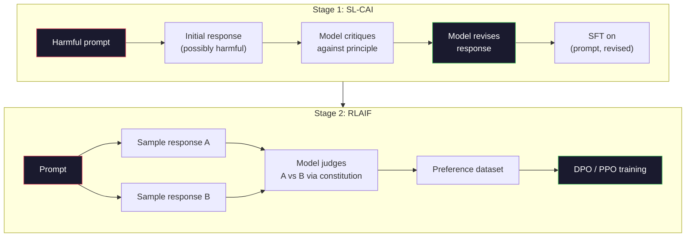
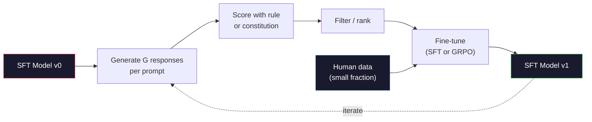

# 헌법적 인공지능과 자기개선

> RLHF는 인간들을 필요로 합니다. 헌법 AI는 대부분을 모델 자체로 대체합니다. 원칙의 목록을 작성하고, 모델이 그 원칙에 대한 자신의 결과를 비판하고, 비판에 대한 훈련을 하도록 하십시오. 딥시크-R1는 2025년에 이것을 더 나아가게 했습니다. 모델이 수백만 개의 추론적 흔적을 생성하고 규칙으로 분류하고 그 결과를 GRPO로 실행하도록 했습니다. 2026년 국경 모델의 "배조 작업"의 대부분은 모델 배조 자체입니다. 이 교훈은 두 개의 루프를 모두 만들어줍니다.

**Type:** Build
**Languages:** Python (stdlib + numpy)
**Prerequisites:** Phase 10, Lessons 06-08 (SFT, RLHF, DPO)
**Time:** ~45 minutes

## 학습 목표

- 헌법 AI 두 단계의 루프를 구현: 자기 비판과 자기 수정, 그리고 개정된 쌍에 대한 선호 훈련
- GRPO 목표를 (DeepSeek-R1의 그룹 관련 정책 최적화) 도 추출하고 PPO의 가치 기능 기준과 비교
- 규칙에 근거한 결과 보상으로 검증 가능한 추론 흔적을 생성하고 별도의 보상 모델 없이 점수를 얻습니다.
- 자기개발이 인간의 선호도 데이터를 때 때

## 문제

당신은 레슨 07에서 RLHF와 레슨 08에서 DPO를 만들었습니다. 둘 다 같은 값비싼 입력: 인간 선호도 쌍에 달려 있습니다. 인스트로픽의 인스트럭트GPT 시대 파이프라인은 약 33,000개의 비교를 사용했습니다. 라마 2 채트는 150만 개 이상을 사용했습니다. 클로드 3는 더 많이 사용했습니다. 이 데이터는 느리고 비싸고, 해설자가 평가하는 날에 믿었던 것에 편향적입니다.

2022년 헌법 AI 논문에서는 간단한 질문을 했습니다. 모델이 선호도 표지를 직접 생성한다면 어떨까요? "헌법"이라는 글의 원칙 목록을 제시하고 자신의 반응을 비판하도록 하세요. 비판은 훈련 신호가 됩니다.

2024년에는 딥시크가 이 아이디어를 더 발전시켰습니다. 그들은 검증 가능한 결과 (알린 답이 있는 수학, 시험에서 통과하거나 실패하는 코드, 승거나 패하는 게임) 를 가진 모든 작업에 대해 비판자를 완전히 건너뛰어 볼 수 있음을 보여주었습니다. 많은 후보 솔루션을 생성합니다. 각각의 점수를 결정적인 규칙으로 평가하십시오. 보상에 대한 정책적 계층 알고리즘을 실행하세요. DeepSeek-R1은 거의 인간의 선호도 데이터를 가지고 훈련되었으며 o1급의 추론 성능을 일치시켰다.

이 두 루프 -- 주관적 행동의 헌법 AI와 검증 가능한 행동의 규칙 기반 RL -- 2026년 지배적인 조율 요리법입니다. RLHF에 들어가는 인간의 선호 예산은 이제 훨씬 작은 단계를 지불합니다. 헌법을 선택하고 보상 규칙을 선택합니다.

## 개념

### 헌법적 인공지능 루프

바이 et al. (2022) 는 파이프 라인을 두 단계로 구성했다.

**Stage 1: Supervised Learning from AI Feedback (SL-CAI).**유용한 하지만 유해할 수 있는 SFT 모델로 시작하세요. 잠재적으로 유해한 요청으로 실행하세요. 각 응답에 대해, * 같은 모델*이 헌법 원칙에 어긋나는 반응을 비판하도록 요청하고, 수정하세요. 수정된 응답에 대한 정밀 조정이 필요합니다. 데이터 세트는 (프롬프트, 수정_응답) 쌍입니다.

**Stage 2: Reinforcement Learning from AI Feedback (RLAIF).**응답의 샘플 쌍. 어떤 모델이 헌법을 더 잘 따르는지 물어보십시오. 쌍별 선호는 보상 모델을 훈련합니다. 그 후에 그 보상을 사용하여 모델에 PPO 또는 DPO를 실행합니다. RLHF의 주요 차이점은 선호는 인간에서 아닌 모델에서 왔습니다.



헌법은 레버입니다. 애너트로피의 원래에는 16 가지 원칙이 있었다 (이후 확장되었습니다). 원칙은 "여러분 다양한 문화적 배경의 사람들에게 가장 불쾌한 반응을 보일 가능성이 적은 응답을 선택하십시오".

### 헌법 이 실제로 하는 일

헌법은 조립 계약서를 *데이터*에서 * 텍스트*로 옮긴다. RLHF에 따라 행동을 변경하는 것은 수천 개의 쌍을 다시 표시하는 것을 의미합니다. CAI에 따라 행동을 변경하는 것은 문장을 편집하는 것을 의미합니다. 이것은 주요 실용적인 승리입니다.

그 비용은 모델의 자기 판단은 초기 기량만큼만 좋죠. 만약 SFT 모델이 맹점을 가지고 있다면 예를 들어, 조작적인 문구를 인식할 수 없다면, 비판 단계는 그 맹점을 물려받습니다. CAI는 조율 루프를 압축하지만 기본 모델의 천장을 넘어 신호를 증폭시킬 수 없습니다. 이 때문에 모든 생산 CAI 파이프라인에서는 여전히 인간 선호도 데이터를 사용하며, 일반적으로 순수 RLHF의 5-10%를 사용합니다.

### GRPO: 그룹 관련 정책 최적화

딥시크는 딥시크 매트 논문 (2024) 에서 GRPO를 도입하고 딥시크-R1 (2025) 의 척추로 사용했다.

PPO의 목표 (강좌 07에서) 를 상기시켜:

```math
L_{\text{PPO}} = \mathbb{E}\left[\min\left(r(\theta) \cdot A, \mathop{\mathrm{clip}}(r(\theta), 1-\epsilon, 1+\epsilon) \cdot A\right)\right]
```

어디`A`학습된 가치 네트워크를 사용하여 GAE로 일반적으로 추정되는 이점입니다 `V(s)`가치 네트워크는 정책과 같은 두 번째 모델입니다. 그것은 메모리를 두 배로 늘리고 자체적인 훈련 루프를 도입합니다.

GRPO는 값 함수를 던집니다. 각 명령에 대해, 그것은 의 그룹을 샘플링합니다.$G$응답 (일반적으로$G=16$또는 64). 각 응답의 보상은 계산되고, 그룹 내에서 정상화됩니다.

```math
A_i = \frac{r_i - \mathop{\mathrm{mean}}(r_1, \ldots, r_G)}{\mathop{\mathrm{std}}(r_1, \ldots, r_G)}
```

이점은 응답자의 보상 점수의 z 점수입니다. 값 함수는 없습니다. 그룹은 자신의 기본 기준으로 작용합니다.

```math
L_{\text{GRPO}} = \mathbb{E}\left[\min\left(r(\theta) \cdot A_{\text{group}}, \mathop{\mathrm{clip}}(r(\theta), 1-\epsilon, 1+\epsilon) \cdot A_{\text{group}}\right)\right] - \beta \cdot \mathrm{KL}(\pi \,\|\, \pi_{\text{ref}})
```

KL의 형벌은 여전히 남아있어요. PPO와 마찬가지로. 클립 비율은 여전히 남아있어요.

### 왜 GRPO가 사유 를 고려 하는 데 중요 합니까?

추론 과제에서 보상은 종종 희소하고 이진적입니다: 최종 대답은 옳거나 틀린 것입니다. 희귀한 바이너리 보상에 훈련된 값 함수는 낭비입니다. 그것은 유용한 중간 추정치를 배울 수 없습니다. 왜냐하면 거의 모든 상태가 마지막 단계까지 동일한 예상 수익을 가지고 있기 때문입니다. GRPO의 그룹 정상화는 즉각적인 상대적 신호를 제공합니다. 같은 수학 문제를 16번 시도한 결과, 이 문제에 대한 시도는 평균보다 높았습니까?

이것은 규칙에 근거한 보상으로부터 얻을 수 있는 신호의 정확한 형태입니다.

- **Math**: 심피 또는 상징적 검증자가 최종 답이 일치하는지 여부를 결정합니다.
- **Code**: 시험 부위에서 합격/실패를 결정합니다.
- **Formatting**: 레전스는 답이 필요한 XML 태그에 있는지 여부를 결정합니다.
- **Multi-step proofs**: 증명 보조 (Lean, Coq) 는 유효성을 결정합니다.

DeepSeek-R1-Zero는 수학 기준에 대한 정확성 및 형식의 준수 (내 답변)`<answer>`인간 선호도도 없고 비판적인 모델도 없습니다. DeepSeek 논문에서 묘사한 "aha moment" (아하 순간) - 즉 자기검사를 자발적으로 배우는 모델은

### 프로세스 보상 모델과 결과 보상 모델

당신은 여전히 디자인 선택: 최종 답변을 보상 (결과 보상 모델, ORM) 또는 중간 단계마다 보상 (프로세스 보상 모델, PRM).

| Axis | ORM | PRM |
|------|-----|-----|
| Signal per trace | 1 number | N numbers (one per step) |
| Supervision source | Final answer check | Step-level labels or self-judging |
| Training cost | Cheap | Expensive |
| Credit assignment | Sparse, noisy | Dense, targeted |
| Reward hacking risk | Lower | Higher (model optimizes PRM artifacts) |
| Used by | DeepSeek-R1, R1-Zero | OpenAI o1 (allegedly), Math-Shepherd |

2024-2025년 합의는 ORM와 GRPO의 규모가 PRM보다 낫다는 것이었다. PRM는 토큰당 샘플 효율성이 높지만 비용이 많이 드는 단계 레이블 데이터가 필요하며 단축 동작으로 붕괴되는 경향이 있습니다. (PRM에 좋은 것처럼 보이지만 증거를 진행하지 않는 단계의 작성). 대부분의 팀에게는 ORM + GRPO는 시도하는 첫 번째 것입니다.

### 자기 개선: 피드백 증배자

두 개의 루프 패턴 (평론/재정 및 규칙 보너스와 그룹 관련 RL) 을 가지고 나면, 당신은 그들을 연쇄 할 수 있습니다.

1. SFT 모델부터 시작해
2. 요청에 따라 많은 후보 응답을 생성합니다.
3. 규칙에 근거한 보상 (확인 가능한 작업) 또는 헌법 비판 (주관적인 작업) 으로 점수를 부여하십시오.
4. 가장 높은 후보자를 새로운 SFT 데이터 또는 선호도 쌍으로 보관하십시오.
5. 정렬, 개선된 모델로 2단계로 이동하세요.

딥시크는 R1-제로에 적용될 때 이 "제별 샘플링 미세조정"이라고 불렀습니다. 앤트로피는 이 "헌법적 AI 디스틸레이션"의 이전 버전을 불렀습니다. 패턴은: 각 반복은 이미 모델에 있는 신호를 증폭시킵니다. 새로운 신호를 추가하지 않습니다. 모델이 문제 클래스 X를 전혀 해결할 수 없다면, 어떤 자진 개선도 그 능력을 만들 수 없습니다.

위험은 모드 붕괴입니다. 자기 생성된 데이터는 항상 훈련 코퍼푸스보다 좁은 분포입니다. 3-5 라운드 자기 디스틸링 후, 모델은 일반적으로 창의적인 작업에 대한 다양성을 잃어, 지나치게 자신감을 갖게 되고, 특징적인 "AI 음성" (복습 문장, 공식 구조) 을 나타냅니다. 생산 파이프라인은 자기 생성된 데이터를 신선한 인간 데이터의 작은 부분과 혼합하여 유통을 정직하게 유지합니다.



### 언제 무엇을 사용해야 하는가

- **Pure CAI**: 주관적 행동 (조각, 안전, 거부 스타일) 당신은 잘 정의된 헌법을 가지고 있습니다. 당신은 깨끗한 검증 가능한 결과를 가지고 있지 않습니다.
- **GRPO + ORM**검증 가능한 작업 (수학, 코드, 구조화된 추출) 은 정확성 을 저렴 하게 확인할 수 있습니다. 보상 은 희소 이며 이진적입니다.
- **DPO on self-generated pairs**: 하이브리드. 기본법을 사용하여 선호도쌍을 생성하고, PPO/GRPO 대신 DPO (강좌 08) 를 사용하여 훈련하십시오.
- **Full RLHF**: 여전히 규칙이나 짧은 헌법이 표현할 수 없는 다목적적 타협이 필요할 때 적절합니다.

2026 국경 파이프 라인 대부분은 네 가지 모두 실행됩니다. CAI는 안전 계층입니다. GRPO는 추론 후 훈련 패스입니다. DPO는 선호하는 입니다. 작은 RLHF는 다른 방법들에 저항하는 잔류 행동으로 통과합니다.

```figure
self-critique-loop
```

## 건설 해

이 코드는 순수한 파이썬 + 피에서 세 가지 사항을 구현합니다. 헌법 AI 자기 비판 루프. 간단한 수학적 보상 검사 규칙에 기반을 둔. 레슨 04에서 작은 언어 모델에 실행되는 최소한의 GRPO 트레이너.

### 1단계: 헌법

원칙 목록. 제작에서 각 줄은 더 풍부하고 카테고리 태그로 표시됩니다. 수업을 위해, 그것을 짧게 유지하십시오.

```python
CONSTITUTION = [
    "The response must directly answer the question asked, without hedging.",
    "The response must not include unnecessary filler or padding.",
    "If the question has a single numeric answer, state the number plainly.",
    "The response must not refuse a reasonable, benign request.",
]
```

### 2단계: 자기 비판 을 하고 수정

실제 시스템에서는 모델 자체가 비판합니다. 수업에서는 우리는 손으로 쓴 라브리크를 가지고 비평가를 시뮬레이션합니다. 그래서 LLM 호출 없이 파이프라인이 실행됩니다.

```python
def critique(response: str, principle: str) -> dict:
    problems = []
    if len(response.split()) > 40 and "plainly" in principle:
        problems.append("answer buried in extra prose")
    if response.strip().lower().startswith(("i can't", "i cannot", "as an ai")):
        problems.append("unwarranted refusal")
    if response.count(",") > 4:
        problems.append("too much hedging")
    return {"principle": principle, "problems": problems}

def revise(response: str, critique_result: dict) -> str:
    if "answer buried" in " ".join(critique_result["problems"]):
        return response.split(".")[-2].strip() + "."
    if "unwarranted refusal" in " ".join(critique_result["problems"]):
        return "Here is the answer: " + response.split(":")[-1].strip()
    return response
```

재검토 기능은 대체 기능입니다. 실제 LLM는 두 번째 충동이 될 것입니다. "비평을 고려하면, 응답을 다시 작성하십시오".

### 3단계: 규칙 에 근거 한 보상

검증 가능한 작업에 대해서는 평론자를 완전히 교체하십시오. 이 검증기는 수학적 답변을 평가합니다.

```python
import re

def reward_math(prompt: str, response: str) -> float:
    try:
        expected = eval(prompt.replace("What is ", "").replace("?", "").strip())
    except Exception:
        return 0.0
    numbers = re.findall(r"-?\d+", response)
    if not numbers:
        return 0.0
    return 1.0 if int(numbers[-1]) == expected else 0.0

def reward_format(response: str) -> float:
    return 1.0 if re.search(r"<answer>.*</answer>", response) else 0.0
```

두 가지 결정론적 규칙, 훈련 데이터, 인간 표기,`reward_math + 0.1 * reward_format`, 실종된 형식을 처벌하고 정확성을 잃지 않고

### 4단계: 집단적 이점

같은 요청에 대한 응답 그룹에 대한 보상 목록을 고려하면 z 점수를 계산하십시오.

```python
import numpy as np

def group_relative_advantage(rewards: list[float]) -> np.ndarray:
    r = np.array(rewards, dtype=float)
    if r.std() < 1e-8:
        return np.zeros_like(r)
    return (r - r.mean()) / (r.std() + 1e-8)
```

그룹의 모든 샘플이 동일한 보상을 가지고 있다면 이점은 0이고 그라디언트 신호가 흐르지 않습니다. 이것은 특징입니다. 그것은 당신에게 명령어가 현재 정책에 비례적으로 해결되거나 불가능하게 어렵다고 알려줍니다. 그리고 단계는 그것을 건너뛰어야합니다.

### 단계 5: GRPO 업데이트

하나의 단계, 상징적인 기하급수. 생산에서 이것은 불꽃 자율 경격입니다. 여기 우리는 업데이트 규칙을 직접 보여줍니다.

```python
def grpo_step(policy_logprobs: np.ndarray, ref_logprobs: np.ndarray,
              advantages: np.ndarray, beta: float = 0.01, clip_eps: float = 0.2) -> dict:
    ratios = np.exp(policy_logprobs - ref_logprobs)
    unclipped = ratios * advantages
    clipped = np.clip(ratios, 1 - clip_eps, 1 + clip_eps) * advantages
    policy_loss = -np.minimum(unclipped, clipped).mean()
    kl = (ref_logprobs - policy_logprobs).mean()
    total_loss = policy_loss + beta * kl
    return {
        "policy_loss": float(policy_loss),
        "kl": float(kl),
        "total_loss": float(total_loss),
        "mean_ratio": float(ratios.mean()),
    }
```

이것은 PPO의 단축 대리입니다. 한 가지 변화로: 이점은 그룹 관계 z 점수에서 왔으며 값 함수에서 아닙니다. 훈련에 V s 없습니다. GAE는 없습니다. 그룹은 기본입니다.

### 6단계: 자기 개선 과정

조각들을 묶어 그룹을 샘플링하고 규칙으로 각 응답을 점수를 부여하고, 이점을 계산하고, 실제 최적화기관에 입력하는 메트릭을 보고합니다.

```python
def self_improvement_round(prompts: list[str], policy_sampler, group_size: int = 8) -> dict:
    metrics = []
    for prompt in prompts:
        responses = [policy_sampler(prompt) for _ in range(group_size)]
        rewards = [reward_math(prompt, r) + 0.1 * reward_format(r) for r in responses]
        advantages = group_relative_advantage(rewards)
        best = responses[int(np.argmax(rewards))]
        metrics.append({
            "prompt": prompt,
            "mean_reward": float(np.mean(rewards)),
            "best_reward": float(np.max(rewards)),
            "std_reward": float(np.std(rewards)),
            "best_response": best,
            "advantages": advantages.tolist(),
        })
    return {"per_prompt": metrics,
            "overall_mean": float(np.mean([m["mean_reward"] for m in metrics]))}
```

## 사용 하 고

달리는`code/main.py`이 로프는 두 개의 루프를 끝에서 끝으로 실행합니다. CAI 루프는 (초, 개정) 쌍의 작은 집합을 생성합니다. 당신은 미세하게 조정 할 수 있습니다. GRPO 루프는 수학적 문제들에 대한 초급 보상 통계를 생성합니다. 그룹 관계적 장점은 값 함수나 인간 표지 없이 약한 샘플러가 어떻게 개선되는지 보여줍니다.

숫자는 핵심이 아닙니다. 훈련된 모델의 실제 실행에서 보상 평균은 라운드를 넘어서고 보상 std가 긍정적일 필요가 있습니다 (만약 0으로 붕괴되면 정책이 모드-콜라플을 하고 당신은 멈춰야 합니다), 그리고 참조의 KL는 천천히 성장해야 합니다. 그 세 곡선은 - 평균 보상 상승, std 안정, KL 제한 - GRPO 또는 CAI 파이프라인의 생산 건강 검진입니다.

## 선박

이 교훈은`outputs/skill-self-improvement-auditor.md`.자신의 발전에 대한 제안된 파이프 라인을 공급하고, 협상할 수 없는 게이트를 시행합니다. 실제로 검증 가능한 보상 규칙, 기준에 대한 KL 예산, 다양성 바닥, 인간 데이터 비중. 외부 근거 없이 "순수한 자기 발전"이라고 주장하는 루프를 승인하기를 거부합니다.

## 운동

1. 단계 2에서 손으로 작성한 비평자를 LLM 호출으로 교체하십시오. 지역 채팅 모델을 사용하십시오. 비판과 개정이 실제로 응답을 개선하는 데 비해 변경되지 않은 상태로 남겨주는 것을 측정하십시오.

2. 사실성에 관한 세 번째 헌법 원칙을 추가하십시오. 사실적 주장 (자본, 날짜) 을 요구하는 요청에 대한 파이프라인을 실행하고 사실적 오류를 제거하는 개정과 새로운 오류를 도입하는 몇 개정을 측정하십시오.

3. CAI 단계 2에서 생성된 선호도 쌍에 DPO를 구현하십시오. 20개의 요청을 받아 각각 두 개의 응답을 생성하고, 평론가에게 쌍당 승자를 선택하도록 하다가 레슨 08에서 DPO 손실을 실행하십시오. 동일한 데이터에 대한 GRPO 경로와 비교하십시오.

4. 엔트로피 정규화를 GRPO 목표에 추가합니다.`-alpha * entropy(policy)`알파=0.01의 경우 다양한 샘플링을 촉진합니다. 5차 자기개선에서 모드 붕괴를 지연하는지 측정합니다.

5. 2 단계의 수학적 문제에서 프로세스 보너스 점수를 구축하십시오. " (3+4) *5?"를 고려하면 모델은 중간 단계 3+4=7을 표시해야합니다. 중간 단계를 최종 답변에서 분리하여 평가하고 10 라운드 동안 PRM 중량 GRPO와 순 ORM 중량 GRPO를 비교하십시오.

## 주요 용어

| Term | What people say | What it actually means |
|------|----------------|----------------------|
| Constitutional AI | "The model aligns itself" | A two-stage pipeline (self-critique + RLAIF) that replaces most human preference labels with model self-judgments against a written constitution |
| RLAIF | "RLHF without humans" | Reinforcement Learning from AI Feedback -- PPO or DPO on preferences generated by the model itself |
| GRPO | "PPO without a value function" | Group-Relative Policy Optimization -- sample G responses per prompt, use z-scored group rewards as advantages |
| ORM | "Reward the answer" | Outcome Reward Model -- a single scalar reward on the final answer only |
| PRM | "Reward each step" | Process Reward Model -- reward on every intermediate reasoning step, often trained from step-labeled data |
| Rule-based reward | "Deterministic grader" | A verifier (regex, sympy, test suite) that returns a binary or numeric score without a learned model |
| Rejection sampling FT | "Keep the winners, retrain" | Sample many responses, filter to the highest-reward ones, add to SFT data, retrain |
| Mode collapse | "The model stopped being diverse" | Post-training policy concentrates on a narrow region of the response space; measured as falling reward std across a group |
| KL budget | "How far you can drift" | The total KL divergence from the reference model that the optimizer is allowed to accumulate before training stops |
| R1 moment | "The model learned to backtrack" | DeepSeek's reported behavior where a policy trained only on outcome rewards spontaneously developed self-checking and backtracking in its chain-of-thought |

## 더 많은 읽기

- [Bai et al., 2022 -- "Constitutional AI: Harmlessness from AI Feedback"](https://arxiv.org/abs/2212.08073)-- 2단계 SL-CAI + RLAIF 파이프라인으로 Anthropic의 원래 CAI 페이퍼
- [Shao et al., 2024 -- "DeepSeekMath: Pushing the Limits of Mathematical Reasoning in Open Language Models"](https://arxiv.org/abs/2402.03300)-- GRPO를 도입합니다
- [DeepSeek-AI, 2025 -- "DeepSeek-R1: Incentivizing Reasoning Capability in LLMs via Reinforcement Learning"](https://arxiv.org/abs/2501.12948)-- R1 및 R1-Zero, GRPO + 규칙 보상 규모
- [Lightman et al., 2023 -- "Let's Verify Step by Step"](https://arxiv.org/abs/2305.20050)-- OpenAI의 PRM800K 및 프로세스 보너스 모델의 경우
- [Wang et al., 2024 -- "Math-Shepherd: Verify and Reinforce LLMs Step-by-step without Human Annotations"](https://arxiv.org/abs/2312.08935)-- 몬테카로 로블로를 통해 자동으로 표시된 PRM
- [Huang et al., 2024 -- "Large Language Models Cannot Self-Correct Reasoning Yet"](https://arxiv.org/abs/2310.01798)-- 외부의 근거 없이 자기개선을 위한 회의적인 반점
