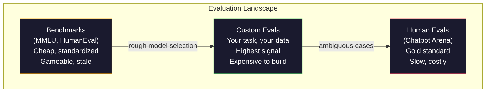
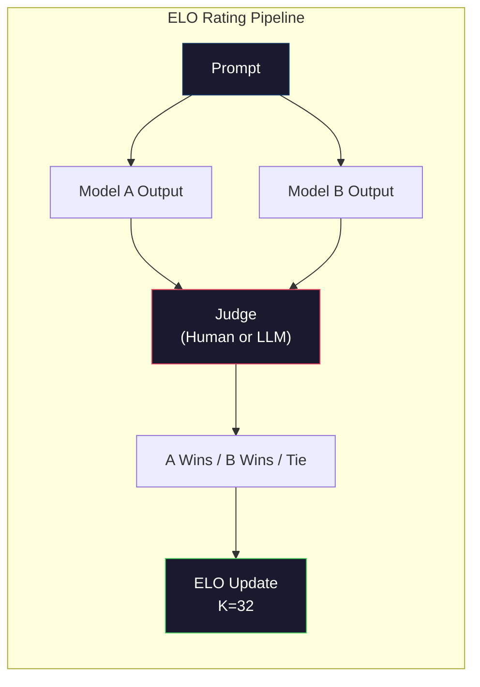

# 평가: 벤치마크, Evals, LM Harness

> 고드하트의 법칙: 측정이 목표가 되면, 그것은 좋은 측정이 되지 않습니다. 모든 국경 실험실 게임 기준이 있습니다. MMLU 점수는 상승합니다. 모델들은 여전히 "스트로베리"에서 R의 수를 믿을 수 없습니다. 중요한 유일한 평가는 당신의 평가입니다. 당신의 작업에 대한 당신의 데이터와 함께.

**Type:** Build
**Languages:** Python
**Prerequisites:** Phase 10, Lessons 01-05 (LLMs from Scratch)
**Time:** ~90 minutes

## 학습 목표

- 언어 모델에 대한 다중 선택 및 개방형 기준을 실행하는 사용자 정의 평가 띠를 구축하십시오
- 표준 벤치마크 (MMLU, HumanEval) 가 왜 포화되고 국경 모델을 차별화하지 못하는지를 설명하십시오.
- 적절한 매트릭을 가지고 작업에 대한 평가들을 실행하십시오. 정확한 일치, F1, BLEU, 그리고 LLM-as-judge 점수
- 공개적인 리더보드에만 의존하는 대신 특정 사용 사례를 대상으로 한 사용자 정의 평가 제품군을 설계하십시오

## 문제

MMLU는 2020년 57개 주제에 걸쳐 15,908개의 질문을 가지고 발표되었다. 3년 이내에, 국경 모델이 그것을 포화했다. GPT-4는 86.4% 점수를 얻었다. 클로드 3 오푸스는 86.8% 점수를 얻었다. Llama 3 405B는 88.6% 점수를 얻었다.

한편, 그 모델들은 10살짜리 아이가 생각없이 처리하는 작업에 실패합니다. 클로드 3.5 소넷은 MMLU에서 88.7% 점수를 얻었고 처음에는 "스트로베리"의 문자들을 셀 수 없었습니다. 이는 0의 세계 지식과 0의 추론을 필요로 하는 작업이었습니다. 휴먼 에발은 164개의 문제로 코드 생성 테스트를 합니다. 모델은 90% 이상의 점수를 얻으면서도 가장자리 케이스에 충돌하는 코드를 생산합니다.

벤치마킹 성과와 실제 세계 신뢰성 사이의 격차는 LLM 평가의 핵심 문제입니다. 벤치마크는 모델이 벤치마크에 어떻게 동작하는지 알려줍니다. 그들은 거의 그 모델이 특정 작업에 어떻게 동작하는지, 특정 데이터와 특정 실패 모드에서 어떻게 동작하는지 전혀 알려주지 않습니다. 고객 지원 로봇을 만들고 있다면 MMLU는 중요하지 않습니다. 코드 보조를 만들고 있다면 HumanEval은 기능 수준의 생성만을 다루고 있습니다. 파일의 디버깅, 재팩토링, 또는 코드를 설명하는 것에 대해 아무것도 말하지 않습니다.

사용자 정의 평가가 필요합니다. 기준이 쓸모없는 것이 아니라 대략적인 모델 선택에 유용하기 때문입니다. 최종 평가는 배치 조건과 정확히 일치해야 하기 때문입니다.

## 개념

### 에발 풍경

평가의 세 가지 유형이 있는데, 각 종류는 비용과 신호 품질이 다르다.

**Benchmarks**표준화된 테스트 스위트입니다. MMLU, HumanEval, SWE-bench, MATH, ARC, HellaSwag. 벤치마크에 대한 모델을 실행하고 점수를 얻습니다. 이점은: 모든 사람이 동일한 테스트를 사용합니다. 그래서 모델을 비교할 수 있습니다. 단점은: 모델과 훈련 데이터는 점점 더 이러한 벤치마크를 오염시킵니다. 연구실은 벤치마크 질문을 포함하는 데이터에 훈련합니다. 점수는 증가합니다. 능력은 그렇지 않을 수 있습니다.

**Custom evals**특정 사용 사례를 위해 만든 테스트 스위트입니다. 입력, 예상 출력 및 점수 기능을 정의합니다. 법적 문서 요약자는 법적 문서에 의해 평가됩니다. SQL 생성기는 데이터베이스 스케마에 의해 평가됩니다. 제작 비용이 많이 들지만 생산 성능을 예측하는 유일한 평가입니다.

**Human evals**사용 된 해설자 를 사용하여 유용성, 정확성, 유창성, 안전성 같은 기준 에 따라 모델 출력을 판단 합니다. 자동 점수 실패 하는 오픈 엔딩 작업 에 대한 금 표준. 채봇 아레나는 100+ 모델 에서 2 백만 개 이상의 인적 선호도 투표 를 수집했습니다. 단점: 비용 ($0.10-$2시간/심판) 및 속도 (시간에서 일일까지)



### 기준이 왜 깨지는지

세 가지 메커니즘은 벤치마크 점수가 실제 능력을 반영하지 못하게 합니다.

**Data contamination.**훈련 기관들은 인터넷을 스크래프합니다. 벤치마크 질문들은 인터넷에서 생중계됩니다. 모델들은 훈련 중에 답을 봅니다. 이것은 전통적인 의미에서 사기 아닙니다. 실험실들은 의도적으로 벤치마크 데이터를 포함하지 않습니다. 하지만 웹 규모의 스크래핑은 거의 배제 불가능합니다.

**Teaching to the test.**실험실에서는 벤치마크 성능을 위해 훈련 혼합물을 최적화합니다. 훈련 혼합물의 5%가 MMLU 스타일의 다중 선택이라면, 모델은 형식과 응답 분포를 학습합니다. MMLU는 4방향 다중 선택입니다. 모델은 A / B / C / D에서 응답 분포가 대략 균일하다는 것을 알게됩니다. 이는 모델이 답을 알지 못할 때에도 도움이 됩니다.

**Saturation.**모든 국경 모델이 벤치마크에서 85-90% 점수를 얻으면 벤치마크는 차별을 중단합니다. 나머지 10-15%의 질문은 모호하거나 잘못된 표기 또는 어둡고 영역 지식을 필요로 할 수 있습니다. MMLU에서 87%에서 89%로 개선하면 모델이 두 가지 더 어둡고 더 똑똑한 질문을 기억했다는 것을 의미 할 수 있습니다.

### 혼란: 신속 한 건강 검사

혼란은 토큰의 연속으로 모델이 얼마나 놀라는지 측정합니다. 공식적으로는, 그것은 기하급수 평균 음적 로그 확률입니다.

```math
\text{PPL} = \exp\left(-\frac{1}{N} \sum_i \log P(\text{token}_i \mid \text{context})\right)
```

10의 미묘한 것은 모델이 평균적으로 모든 토큰 위치에서 10가지 옵션 중에서 균일하게 선택하는 것과 같은 불확실성을 의미합니다. 낮은 것은 더 좋습니다. GPT-2는 위키텍스트 103에서 ~30의 미묘한 것을 얻습니다. GPT-3는 ~20을 얻습니다. Llama 3 8B는 ~7을 얻습니다.

혼란은 동일한 테스트 세트에서 모델을 비교하는 데 유용하지만 맹점점이 있습니다. 모델은 흔한 패턴을 예측하는 데 잘하면서도 희귀하지만 중요한 패턴에 끔찍하다는 점에서 낮은 혼란을 가질 수 있습니다. 또한 지침을 따르는 것, 추론 또는 사실상의 정확성에 대해 아무 것도 말하지 않습니다. 이를 건강 검증으로 사용하십시오. 최종 판결이 아닙니다.

### 법무장관

약한 모델의 출력을 평가하기 위해 강력한 모델을 사용하세요. 아이디어는 간단합니다. GPT-4o 또는 클로드 소넷에게 정확성, 유용성 및 안전성 1-5 척도로 응답을 평가하도록 요청하세요. 이것은 GPT-4o-mini와 같은 판단에 대해 약 0.01 달러에 달합니다. 그리고 인간의 판단과 놀랍도록 잘 상관관계합니다. 대부분의 작업에 대해 80% 정도 동의합니다.

점수 prompt은 모델보다 더 중요합니다. 모호한 prompt ("이 응답을 평가") 는 소란한 점수를 생성합니다. 주소를 가진 구조화된 prompt ("사실적으로 올바른 답변이 있고 소스를 인용하는 경우 5 점, 정당한 경우 4 점, 그러나 원천이 아닌 경우 3 점, 부분적으로 올바른 경우 ...") 는 일관된 재생 가능한 점수를 생성합니다.

실패 모드: 판사 모델은 위치 편향을 나타냅니다 (쌍형 비교에서 첫 번째 반응을 선호합니다), 말성 편향 (장기 응답을 선호합니다) 및 자기 선호 (GPT-4 비율은 동등한 클로드 출력보다 높은 GPT-4 출력입니다). 완화: 순서 순서를 무작위로 조정, 길이를 정상화, 평가되는 모델과 다른 판사를 사용합니다.

### 쌍용 비교에서 ELO 평가

채봇 아레나의 접근 방식. 다른 모델에서 같은 요청에 두 개의 응답을 표시합니다. 인간 (또는 LLM 판사는) 더 나은 하나를 선택합니다. 이러한 수천 가지 비교에서, 각 모델에 대한 ELO 평가를 계산합니다. 체스에서 사용되는 동일한 시스템입니다.

ELO의 장점: 상대적인 순위는 절대 점수보다 더 신뢰할 수 있으며, 넥타이를 우아하게 처리하며, 모든 출력을 독립적으로 점수하는 것보다 적은 비교로 공렴합니다. 2026년 초부터, 채봇 아레나 순위는 GPT-4o, 클로드 3.5 소넷, 그리고 트메니 1.5 프로를 서로 20 ELO 포인트 안에 가장 위에 나타냅니다.



### 이원형 프레임워크

**lm-evaluation-harness**(EleutherAI): 표준 오픈소스 평가 프레임워크. 200+ 벤치마크를 지원합니다. MMLU, HellaSwag, ARC 등을 한 명령으로 Hugging Face 모델을 실행합니다. 오픈 LLM 레더보드에서 사용됩니다.

**RAGAS**RAG 파이프 라인 에 대한 평가 프레임 워크. 신뢰성 (사답 은 검색 된 맥락 에 일치 합니까?), 관련성 (사문 에 관련 된 맥락 은 검색 된 것 인가?), 그리고 답변 의 정확성 을 측정 합니다.

**promptfoo**: prompt 엔지니어링을 위한 구성 기반의 eval. YAML에서 테스트 케이스를 정의하고, 여러 모델에 대해 실행하고, 통과/실패 보고서를 얻습니다. 회귀 테스트 명령어에 유용합니다.

### 사용자 정의 에볼 을 만드는 것

생산에 중요한 유일한 평가입니다.

1. **Define the task.**"문제 에 대답" 하는 것 은 너무 모호 하다. "고객 의 불평 에 대한 이메일 을 받아서 제품 이름, 문제 범주, 감정 을 추출 하십시오"는 것 은 평가 할 수 있는 과제 입니다.

2. **Create test cases.**프로토타입 eval에 최소 50개, 생산에 200개 이상. 각 테스트 케이스는 (인पुट, expected_output) 쌍이다. 가장자리 케이스: 빈 입력, 적대적 입력, 모호한 입력, 다른 언어로 입력.

3. **Define scoring.**구조화된 출력에서 정확히 일치합니다. 텍스트 유사성에서 BLEU/ROUGE, 오픈 엔드 품질에서 LLM-답게 판사, 추출 작업에서 F1

4. **Automate.**모든 eval는 하나의 명령으로 실행됩니다. 수동 단계가 없습니다. 시간적 비교를 가능하게 하는 형식으로 결과를 저장합니다.

5. **Track over time.**평가 점수는 고립적으로 의미가 없습니다. 트렌드 라인을 필요로 합니다. 마지막 요청 변경 후 점수는 개선되었습니까? 모델 전환 후 다시 돌아갔습니까?

| Eval Type | Cost per judgment | Agreement with humans | Best for |
|-----------|------------------|----------------------|----------|
| Exact match | ~$0 | 100% (when applicable) | Structured output, classification |
| BLEU/ROUGE | ~$0 | ~60% | Translation, summarization |
| LLM-as-judge | ~$0.01 | ~80% | Open-ended generation |
| Human eval | $0.10-$2.00 | N/A (is the ground truth) | Ambiguous, high-stakes tasks |

```figure
perplexity-loss
```

## 건설 해

### 단계 1: 최소 동등한 틀

핵심 추상화를 정의하십시오. eval 케이스에는 입력, 예상 출력 및 선택적 메타 데이터 디렉트가 있습니다. 점수자는 예측과 참조를 취하고 0에서 1 사이의 점수를 반환합니다.

```python
import json
from collections import Counter

class EvalCase:
    def __init__(self, input_text, expected, metadata=None):
        self.input_text = input_text
        self.expected = expected
        self.metadata = metadata or {}

class EvalSuite:
    def __init__(self, name, cases, scorers):
        self.name = name
        self.cases = cases
        self.scorers = scorers

    def run(self, model_fn):
        results = []
        for case in self.cases:
            prediction = model_fn(case.input_text)
            scores = {}
            for scorer_name, scorer_fn in self.scorers.items():
                scores[scorer_name] = scorer_fn(prediction, case.expected)
            results.append({
                "input": case.input_text,
                "expected": case.expected,
                "prediction": prediction,
                "scores": scores,
            })
        return results
```

### 2단계: 기능 점수를

정확한 일치, 토큰 F1를 만들고 심화된 LLM 판사 점수를

```python
def exact_match(prediction, expected):
    return 1.0 if prediction.strip().lower() == expected.strip().lower() else 0.0

def token_f1(prediction, expected):
    pred_tokens = set(prediction.lower().split())
    exp_tokens = set(expected.lower().split())
    if not pred_tokens or not exp_tokens:
        return 0.0
    common = pred_tokens & exp_tokens
    precision = len(common) / len(pred_tokens)
    recall = len(common) / len(exp_tokens)
    if precision + recall == 0:
        return 0.0
    return 2 * (precision * recall) / (precision + recall)

def llm_judge_simulated(prediction, expected):
    pred_words = set(prediction.lower().split())
    exp_words = set(expected.lower().split())
    if not exp_words:
        return 0.0
    overlap = len(pred_words & exp_words) / len(exp_words)
    length_penalty = min(1.0, len(prediction) / max(len(expected), 1))
    return round(overlap * 0.7 + length_penalty * 0.3, 3)
```

### 단계 3: ELO 평가 시스템

ELO 업데이트와 쌍용 비교를 구현합니다. 이것은 바로 Chatbot Arena가 모델을 순위화하는 시스템을 사용합니다.

```python
class ELOTracker:
    def __init__(self, k=32, initial_rating=1500):
        self.ratings = {}
        self.k = k
        self.initial_rating = initial_rating
        self.history = []

    def _ensure_player(self, name):
        if name not in self.ratings:
            self.ratings[name] = self.initial_rating

    def expected_score(self, rating_a, rating_b):
        return 1 / (1 + 10 ** ((rating_b - rating_a) / 400))

    def record_match(self, player_a, player_b, outcome):
        self._ensure_player(player_a)
        self._ensure_player(player_b)

        ea = self.expected_score(self.ratings[player_a], self.ratings[player_b])
        eb = 1 - ea

        if outcome == "a":
            sa, sb = 1.0, 0.0
        elif outcome == "b":
            sa, sb = 0.0, 1.0
        else:
            sa, sb = 0.5, 0.5

        self.ratings[player_a] += self.k * (sa - ea)
        self.ratings[player_b] += self.k * (sb - eb)

        self.history.append({
            "a": player_a, "b": player_b,
            "outcome": outcome,
            "rating_a": round(self.ratings[player_a], 1),
            "rating_b": round(self.ratings[player_b], 1),
        })

    def leaderboard(self):
        return sorted(self.ratings.items(), key=lambda x: -x[1])
```

### 단계 4: 혼란스러워진 계산

토큰 확률을 사용하여 복잡성을 계산합니다. 실제에서 우리는 이 모델을 로그티에서 얻을 수 있습니다. 여기 우리는 확률 분포를 사용하여 시뮬레이션을 합니다.

```python
import numpy as np

def perplexity(log_probs):
    if not log_probs:
        return float("inf")
    avg_neg_log_prob = -np.mean(log_probs)
    return float(np.exp(avg_neg_log_prob))

def token_log_probs_simulated(text, model_quality=0.8):
    np.random.seed(hash(text) % 2**31)
    tokens = text.split()
    log_probs = []
    for i, token in enumerate(tokens):
        base_prob = model_quality
        if len(token) > 8:
            base_prob *= 0.6
        if i == 0:
            base_prob *= 0.7
        prob = np.clip(base_prob + np.random.normal(0, 0.1), 0.01, 0.99)
        log_probs.append(float(np.log(prob)))
    return log_probs
```

### 5단계: 합계 결과

평가 실행에서 합계 통계를 계산: 평균, 중계, 임계점에서의 통과율 및 매트릭 분량.

```python
def summarize_results(results, threshold=0.8):
    all_scores = {}
    for r in results:
        for metric, score in r["scores"].items():
            all_scores.setdefault(metric, []).append(score)

    summary = {}
    for metric, scores in all_scores.items():
        arr = np.array(scores)
        summary[metric] = {
            "mean": round(float(np.mean(arr)), 3),
            "median": round(float(np.median(arr)), 3),
            "std": round(float(np.std(arr)), 3),
            "min": round(float(np.min(arr)), 3),
            "max": round(float(np.max(arr)), 3),
            "pass_rate": round(float(np.mean(arr >= threshold)), 3),
            "n": len(scores),
        }
    return summary

def print_summary(summary, suite_name="Eval"):
    print(f"\n{'=' * 60}")
    print(f"  {suite_name} Summary")
    print(f"{'=' * 60}")
    for metric, stats in summary.items():
        print(f"\n  {metric}:")
        print(f"    Mean:      {stats['mean']:.3f}")
        print(f"    Median:    {stats['median']:.3f}")
        print(f"    Std:       {stats['std']:.3f}")
        print(f"    Range:     [{stats['min']:.3f}, {stats['max']:.3f}]")
        print(f"    Pass rate: {stats['pass_rate']:.1%} (threshold >= 0.8)")
        print(f"    N:         {stats['n']}")
```

### 6단계: 전체 파이프 라인을 실행 하십시오

모든 것을 하나로 연결해 놓습니다. 작업을 정의하고 테스트 케이스를 만들고, 두 모델을 시뮬레이션하고, 평가 작업을 실행하고, 쌍방향 비교에서 ELO를 계산하고, 순위표를 인쇄합니다.

```python
def demo_model_good(prompt):
    responses = {
        "What is the capital of France?": "Paris",
        "What is 2 + 2?": "4",
        "Who wrote Hamlet?": "William Shakespeare",
        "What language is PyTorch written in?": "Python and C++",
        "What is the boiling point of water?": "100 degrees Celsius",
    }
    return responses.get(prompt, "I don't know")

def demo_model_bad(prompt):
    responses = {
        "What is the capital of France?": "Paris is the capital city of France",
        "What is 2 + 2?": "The answer is four",
        "Who wrote Hamlet?": "Shakespeare",
        "What language is PyTorch written in?": "Python",
        "What is the boiling point of water?": "212 Fahrenheit",
    }
    return responses.get(prompt, "Unknown")

cases = [
    EvalCase("What is the capital of France?", "Paris"),
    EvalCase("What is 2 + 2?", "4"),
    EvalCase("Who wrote Hamlet?", "William Shakespeare"),
    EvalCase("What language is PyTorch written in?", "Python and C++"),
    EvalCase("What is the boiling point of water?", "100 degrees Celsius"),
]

suite = EvalSuite(
    name="General Knowledge",
    cases=cases,
    scorers={
        "exact_match": exact_match,
        "token_f1": token_f1,
        "llm_judge": llm_judge_simulated,
    },
)

results_good = suite.run(demo_model_good)
results_bad = suite.run(demo_model_bad)

print_summary(summarize_results(results_good), "Model A (concise)")
print_summary(summarize_results(results_bad), "Model B (verbose)")
```

"좋은" 모델은 정확한 답을 제공합니다. "나쁜" 모델은 구사적인 문장을 제공합니다. 정확한 일치는 구사적인 모델을 엄격하게 처벌합니다. F1 토큰과 LLM-as-judge는 더 용서합니다. 이것은 메트릭 선택이 중요한 이유를 보여줍니다. 같은 모델은 당신이 그것을 어떻게 점수를 받느냐에 따라 훌륭하거나 끔찍하게 보입니다.

### 단계 7: ELO 토너먼트

여러 라운드에서 모델들 간의 쌍방향 비교를 실행하십시오.

```python
elo = ELOTracker(k=32)

for case in cases:
    pred_a = demo_model_good(case.input_text)
    pred_b = demo_model_bad(case.input_text)

    score_a = token_f1(pred_a, case.expected)
    score_b = token_f1(pred_b, case.expected)

    if score_a > score_b:
        outcome = "a"
    elif score_b > score_a:
        outcome = "b"
    else:
        outcome = "tie"

    elo.record_match("model_a_concise", "model_b_verbose", outcome)

print("\nELO Leaderboard:")
for name, rating in elo.leaderboard():
    print(f"  {name}: {rating:.0f}")
```

### 8단계: 혼란스러운 비교

다양한 품질 수준의 "모델"의 복잡성을 비교하십시오.

```python
test_text = "The quick brown fox jumps over the lazy dog in the garden"

for quality, label in [(0.9, "Strong model"), (0.7, "Medium model"), (0.4, "Weak model")]:
    log_probs = token_log_probs_simulated(test_text, model_quality=quality)
    ppl = perplexity(log_probs)
    print(f"  {label} (quality={quality}): perplexity = {ppl:.2f}")
```

## 사용 하 고

### im 평가용 장기 (EleutherAI)

어떤 모델에 대한 기준을 실행하는 표준 도구.

```python
# pip install lm-eval
# Command line:
# lm_eval --model hf --model_args pretrained=meta-llama/Llama-3.1-8B --tasks mmlu --batch_size 8

# Python API:
# import lm_eval
# results = lm_eval.simple_evaluate(
#     model="hf",
#     model_args="pretrained=meta-llama/Llama-3.1-8B",
#     tasks=["mmlu", "hellaswag", "arc_easy"],
#     batch_size=8,
# )
# print(results["results"])
```

### promptfoo

YAML에서 테스트를 정의하고 여러 공급업체에 맞서 실행합니다.

```yaml
# promptfoo.yaml
providers:
  - openai:gpt-4o-mini
  - anthropic:claude-3-haiku

prompts:
  - "Answer in one word: {{question}}"

tests:
  - vars:
      question: "What is the capital of France?"
    assert:
      - type: contains
        value: "Paris"
  - vars:
      question: "What is 2 + 2?"
    assert:
      - type: equals
        value: "4"
```

### RAGAS를 평가하기 위한 RAGAS

```python
# pip install ragas
# from ragas import evaluate
# from ragas.metrics import faithfulness, answer_relevancy, context_precision
#
# result = evaluate(
#     dataset,
#     metrics=[faithfulness, answer_relevancy, context_precision],
# )
# print(result)
```

RAGAS는 일반 평가에서 놓친 것을 측정합니다. 모델의 대답은 추상적으로 "정확" 여부를 의미하는 것이 아니라, 검색된 맥락에서 근거가 있는지 여부를 측정합니다.

## 선박

이 교훈은`outputs/prompt-eval-designer.md`-- 어떤 작업에 맞게 사용자 지정 평가 수단을 설계하는 재사용 가능한 프롬프트. 작업 설명을 제공하여 테스트 케이스, 점수 기능 및 통과/실패 임계 추천을 생성합니다.

또한 생산합니다`outputs/skill-llm-evaluation.md`-- 작업 유형, 예산 및 지연 요구에 따라 올바른 평가 전략을 선택하는 의사 결정 프레임워크

## 운동

1. "관성" 점수를 추가하여 동일한 입력값을 모델을 통해 5 번 실행하고 출력값이 얼마나 일치하는지 측정합니다. 결정적 입력값에 대한 불일치 있는 응답은 취약한 명령어 또는 높은 온도 설정을 나타냅니다.

2. ELO 추적기를 확장하여 여러 판사 기능을 지원합니다 (정확 맞춤형, F1, LLM-as-judge) 그리고 무게를 측정합니다. F1에 비해 정확한 맞춤형에 무게가 크게있을 때 리더보드 변경 방식을 비교하십시오.

3. 특정 작업에 대한 평가 스위트를 구축하십시오. 이메일 분류 5 가지로. 가장자리 사례를 포함한 다양한 사례로 100 개의 테스트 사례를 생성하십시오. (다양 카테고리에 속할 수 있는 이메일, 빈 이메일, 다른 언어로 된 이메일). 다른 "모델" (규칙 기반, 키워드 일치, 시뮬레이션 LLM) 의 성능을 측정하십시오.

4. 오염 검출을 시행: 평가 질문과 훈련 코퍼스를 고려하면 교육 데이터에 평가 질문 (또는 가까운 문장) 의 비율이 얼마나 있는지 확인하십시오. 연구자들은 이러한 방식으로 기준 유효성을 검사합니다.

5. "모델 디프리" 도구를 구축하십시오. 두 가지 모델 버전의 평가 결과를 고려하면 어떤 특정 테스트 사례가 개선되었는지, 어떤 사례가 퇴행되었는지, 어떤 사례가 동일하게 유지되었는지 강조하십시오. 이것은 코드 디프리 (code diff) 의 평가 동등입니다. 변화가 도움이 되었는지 또는 해를 끼쳤는지 이해하는 데 필수적입니다.

## 주요 용어

| Term | What people say | What it actually means |
|------|----------------|----------------------|
| MMLU | "The benchmark" | Massive Multitask Language Understanding -- 15,908 multiple choice questions across 57 subjects, saturated above 88% by 2025 |
| HumanEval | "Code eval" | 164 Python function-completion problems from OpenAI, tests only isolated function generation |
| SWE-bench | "Real coding eval" | 2,294 GitHub issues from 12 Python repos, measures end-to-end bug fixing including test generation |
| Perplexity | "How confused the model is" | $\exp(-\mathop{\mathrm{avg}}(\log P(\text{token}_i \text{ given context})))$ -- lower means the model assigns higher probability to the actual tokens |
| ELO rating | "Chess ranking for models" | A relative skill rating computed from pairwise win/loss records, used by Chatbot Arena to rank 100+ models |
| LLM-as-judge | "Using AI to grade AI" | A strong model scores a weaker model's outputs against a rubric, ~80% agreement with human judges at ~$0.01/judgment |
| Data contamination | "The model saw the test" | Training data includes benchmark questions, inflating scores without improving real capability |
| Eval suite | "A bunch of tests" | A versioned collection of (input, expected_output, scorer) triples that measure a specific capability |
| Pass rate | "What percentage it gets right" | Fraction of eval cases scoring above a threshold -- more actionable than mean score because it measures reliability |
| Chatbot Arena | "Model ranking website" | LMSYS platform with 2M+ human preference votes, producing the most trusted LLM leaderboard via ELO ratings |

## 더 많은 읽기

- [Hendrycks et al., 2021 -- "Measuring Massive Multitask Language Understanding"](https://arxiv.org/abs/2009.03300)-- MMLU 논문, 여전히 가장 많이 인용되는 LLM 기준
- [Chen et al., 2021 -- "Evaluating Large Language Models Trained on Code"](https://arxiv.org/abs/2107.03374)-- OpenAI에서 HumanEval 논문, 코드 생성 평가 방법론을 확립
- [Zheng et al., 2023 -- "Judging LLM-as-a-Judge"](https://arxiv.org/abs/2306.05685)-- 위치 편향과 말성 편향 결과를 포함하여 LLM를 평가하기 위해 LLM를 사용하는 체계적인 분석
- [Arena (formerly LMSYS Chatbot Arena)](https://arena.ai/leaderboard)-- 2M+ 투표를 가진 크라우드소싱 모델 비교 플랫폼, 실제 세계에서 가장 신뢰할 수 있는 LLM 순위
