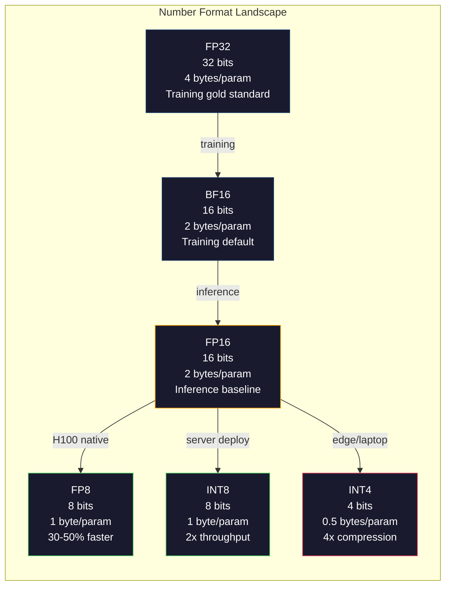
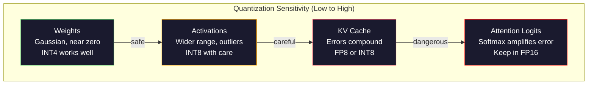
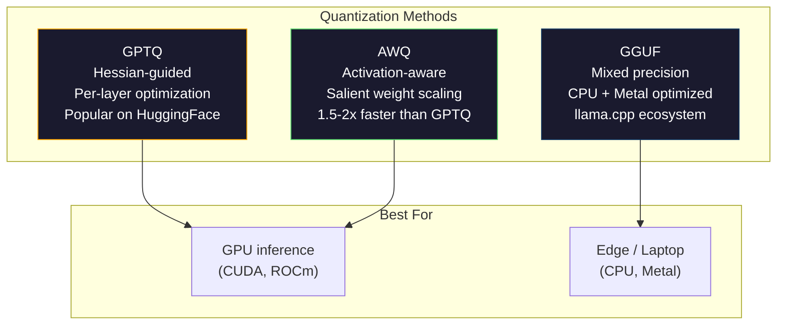

# 양자: 모델 을 적합 하게 만드는 것

> FP16의 70B 모델은 140GB가 필요해요. 무게에 2A100가 필요해요. FP8로 양자합시다. 80GB의 GPU가 하나요. INT4: 맥북.

**Type:** Build
**Languages:** Python (with numpy)
**Prerequisites:** Phase 10, Lessons 01-10 (LLMs from Scratch)
**Time:** ~120 minutes

## 학습 목표

- 텐서 및 채널별 스케일링을 포함하여 FP16에서 INT8 및 INT4까지 대칭 및 비대칭 양자화를 구현
- 양자화에서 메모리 절약을 계산하고 주어진 GPU의 VRAM에 어느 정확도가 맞는지를 결정합니다.
- 양자화 (PTQ) 와 양자화 의식 훈련 (QAT) 사이의 차이를 설명하십시오.
- 실제 모델을 양분화하고 벤치마크에서 정확성 메모리 트레이드오프를 측정하기 위해 GPTQ 또는 AWQ를 적용합니다

## 문제

Llama 3 70B는 70억개의 매개 변수를 가지고 있습니다. 각 매개 변수는 16비트 부동소수점 숫자입니다. 140억 바이트입니다. 140GB. 단일 A100는 80GB의 VRAM를 가지고 있습니다. 당신은 무게를 로드 할 수 없습니다. 단 하나의 GPU에서 추론을 실행 할 수 없습니다. 당신은 하나의 모델을 서비스하기 위해 2 $ / 시간당 두 개의 A100를 필요로 합니다.

하지만 매 매개 변수 16 비트는 낭비입니다. 신경 네트워크 클러스터의 대부분의 무게는 0에 가깝습니다. FP16의 전체 동적 범위 (0.000000059에서 65,504) 은 거의 완전히 사용하지 않습니다. Llama 3 70B에서 실제 무게 분포를 측정하면 95%는 -0.1에서 +0.1 사이에 떨어집니다. 당신은 4에 들어갈 수 있는 값을 나타낼 16 비트를 태우고 있습니다.

양자화는 높은 정확성 숫자를 더 낮은 정확성 숫자로 대체합니다. FP16에서 FP8은 메모리를 절반으로 줄입니다. FP16에서 INT4는 그것을 네 번째로 줄입니다. 140GB 모델은 35GB가 됩니다. 단일 소비자 GPU에 적합합니다. 2 비트 양자화 ( 공격적이고 손실이 많지만 일부 작업에 사용할 수 있습니다) 로 밀어 넣고 같은 모델은 16GB 노트북에서 실행됩니다.

정확한 값은 정확성입니다. 당신이 제거하는 모든 비트는 정보를 파괴합니다. 문제는 당신이 얼마나 정확한 것을 잃게 될 것인가, 어디서요. 양자화 된 INT4 모델은 대부분의 기준에 95-99%의 원본의 품질을 유지합니다. INT4에 순진한 양자화는 모델을 완전히 파괴 할 수 있습니다. 차이점은 기술입니다.

GPTQ와 함께 Llama 3에서 INT4에 대한 커뮤니티 양자화는 위키텍스트에서 약 1-2 개의 혼란 포인트를 나타냅니다. 미스트랄은 MMLU에서 측정 가능한 품질 손실이 0이있는 Mixtral 8x22B의 FP8 체크포인트를 출시했습니다. GGUF 형식은 llama.cpp를 지원하며 M 시리즈 칩을 가진 맥북에서 70B 모델을 실행합니다. 양자화는 해크가 아닙니다. 7B보다 큰 모든 모델의 표준 배포 경로입니다.

## 개념

### 숫자 형식: 각각의 비트 는 어떤 역할을 합니까?

모든 부동소수점 숫자는 세 부분: 표기, 기하급수, 그리고 매니세 (또한 Signiand라고도 한다). 표기 는 하나 비트이다. 기하급수 는 범위를 결정한다 (수치가 얼마나 크고 작을 수 있는지). 매니세 는 정확도를 결정한다 (무엇 십자수를 얻는가).

```
FP32:  [1 sign] [8 exponent] [23 mantissa]  = 32 bits
FP16:  [1 sign] [5 exponent] [10 mantissa]  = 16 bits
BF16:  [1 sign] [8 exponent] [7  mantissa]  = 16 bits
FP8:   [1 sign] [4 exponent] [3  mantissa]  = 8  bits (E4M3)
FP8:   [1 sign] [5 exponent] [2  mantissa]  = 8  bits (E5M2)
INT8:  [1 sign] [7 value]                   = 8  bits (uniform steps)
INT4:  [1 sign] [3 value]                   = 4  bits (16 levels total)
```

**FP32**23개의 mantissa 비트로 정밀도가 약 7개 지수입니다.$1.2 \times 10^{-38}$ $3.4 \times 10^{38}$. 훈련은 FP32에서 전용적으로 이루어졌습니다. 그것은 여전히 축적 (매트릭스 곱셈 동안 실행되는 수) 에 적용됩니다.

**FP16**10 마티사 비트 는 약 3.3 십자리 수치를 준다. 기하 는 5 비트 로 줄어들며 범위 를 크게 줄인다 (최고 값은 ~65,504). 이것은 무게 (무에 가까운 클러스터) 에 적합하지만 훈련 중에 급증할 수 있는 활성화 및 경진에 위험하다. FP16 훈련은 하류를 방지하기 위해 손실 확장이 필요합니다.

**BF16**(Brain Float 16) 는 8 비트 기하수를 FP32에서 유지하지만 mantissa를 7 비트로 줄입니다. FP32와 동일한 범위, FP16보다 정확도가 낮습니다. 구글은 이를 특별히 딥러닝을 위해 설계했습니다. 직감: 범위는 신경 네트워크에 대한 정확보다 더 중요합니다.$10^{-20}$FP16에서 0으로 하락하는 것은 BF16에서 생존한다. BF16에서 0.07342의 무게가 0.07344로 돌아가는 것은 충분히 가깝다. 모든 현대 훈련 경기는 BF16 또는 BF16/FP32 혼합물을 사용합니다.

**FP8**두 가지 맛으로 제공됩니다. E4M3 (4 기하급수, 3 마티사) 는 추론 과정에서 무게와 활성화를 위해 사용됩니다. E5M2 (5 기하급수, 2 마티사) 는 범위가 정확보다 더 중요하게 훈련 중 gradients에 사용됩니다. H100 GPU에 FP8 추론은 무시할 수없는 품질 손실과 함께 FP16보다 30-50%의 속도를 달성합니다.

**INT8**이 범위에서 부동점 무게를 지도하기 위해 스케일 요소가 필요합니다. 이 장점은: 정수 수리학은 부동점보다 더 빠르고 더 효율적입니다. A100에 INT8 매트릭스 곱셈은 FP16에 대한 TOPS 624 대 TFLOPS 312 대에서 실행됩니다.

**INT4**더 나아가도록 밀어붙입니다. 가능한 값은 16개밖에 없습니다. 스케일 요소는 무거운 일을 합니다. 품질은 전적으로 스케일을 어떻게 선택하고 양자하는지에 달려 있습니다. 최첨단 INT4 방법 (GPTQ, AWQ) 은 원래 모델 품질의 95% 이상을 유지합니다.



### 양자 가량화 는 어떻게 작용 합니까?

핵심 동작은 간단합니다. 부동소수점 값의 텐서를 가지고 스케일 요소를 찾아, 곱하고 가장 가까운 정수까지 둥글게 저장하고, 전체 숫자와 스케일 요소를 저장합니다.

**Quantize:**
```
scale = max(abs(tensor)) / max_int_value
quantized = round(tensor / scale)
```

**Dequantize:**
```
reconstructed = quantized * scale
```

시메트릭 범위 (-127~127) 의 INT8:
```
scale = max(abs(tensor)) / 127
quantized = clamp(round(tensor / scale), -128, 127)
```

오류는 라운딩 오류입니다. 각 값은 최대 을 할 수 있습니다`scale / 2`전체 오류는 당신이 얼마나 많은 무게를 가지고 있는지에 따라 달라집니다. 그리고 그 무게의 혼란에 모델이 얼마나 민감한지에 따라 달라집니다.

**Per-tensor vs per-channel quantization.**페르텐서 는 전체 무게 매트릭스 에 대해 한 척도 요소를 사용합니다. 단순하지만 손실이 크다: 한 열이 큰 값이고 다른 열이 작은 값이라면 작은 값은 정확도가 대부분 잃는다. 채널당 출력 채널 (중량 매트릭스의 행이나 열) 에 한 척도 요소를 사용합니다. 더 많은 대용량 (N 스케일 요인을 저장하기 보다는 1) 하지만 훨씬 더 좋은 품질. 모든 생산 양량화 방법은 채널별 또는 더 미세한 미분성을 사용합니다.

**Asymmetric quantization**0점 이산을 추가합니다: `quantized = round(tensor / scale) + zero_point`이 방법은 0에서 중심이 되지 않는 분포를 처리한다. 예를 들어, ReLU 활성화는 항상 부정적이다. 대칭 양자화 는 결코 나타나지 않는 음수 범위의 절반을 낭비한다. 대칭 양자화 는 실제 범위 [min,max]를 전체 전체 범위로 지도한다.

### 감수성 계층

모든 모델은 양자화를 똑같이 용납하지 않습니다. 명확한 계층이 있습니다.

**Weights (most robust).**훈련 중에 모델 무게는 천천히 변화하고 거의 0에 가까운 가우시 분포를 따르고 있습니다. 그들은 양자 잘합니다. 채널 당 스케일로 INT8 무게는 거의 손실없는 결과를 제공합니다. INT4는 더 정교한 방법을 필요로하지만 작동합니다.

**Activations (moderate sensitivity).**활성화는 추론 과정에서 네트워크를 통해 흐르는 중간 값입니다. 무게보다 더 넓은 역학적 범위를 가지고 있으며, 이상적인 값을 포함합니다. 하나의 주의 머리는 평균보다 100배 더 큰 활성화 값을 생성할 수 있습니다. 이러한 비정상적 기준은 모델 품질에 있어서 매우 중요합니다. 그 정보를 순진하게 양자화하면 정보를 파괴합니다. 솔루션: 더 높은 정확도로 외곽 채널을 유지 (LLM.int8() 하며, 토큰 또는 채널별 활성화 스케일을 사용한다.

**KV cache (high sensitivity).**키-값 캐시는 이전 모든 토큰에 대한 주의 상태를 저장합니다. 긴 컨텍스트 길이를 보면 KV 캐시는 메모리를 지배합니다. 32K 컨텍스트에서 70B 모델에서는 KV 캐시는 FP16에서 40GB입니다. KV 캐시를 FP8 또는 INT8로 양자화하면 엄청난 메모리를 저장하지만 모든 미래의 주의 계산에서 오류가 합병됩니다. 질의 영향은 순서 길이와 함께 확장됩니다.

**Attention logits (most sensitive).**주의의 소프트맥스는 입력의 작은 변화에 매우 민감하다. 사전 소프트맥스 로그이트에서 0.01의 양량화 오류는 주의 분포를 의미있게 변화시킬 수 있습니다. 대부분의 양량화 계획은 다른 모든 것이 양량화되어있을 때에도 주의 계산을 더 높은 정확도로 유지합니다 (FP16 또는 BF16).



### PTQ와 QAT

**Post-Training Quantization (PTQ)**이미 훈련된 모델을 양자화합니다. 재교육이 없습니다. FP16 무게, 계산 규모 요인, 라운드, 배포합니다. 빠른 (분에서 시간) 및 저렴합니다. INT8 및 FP8에 잘 작동합니다. INT4에서는 순진 PTQ가 종종 축적되는 라운드 오류로 인해 크게 실패합니다. 고급 PTQ 방법은 (GPTQ, AWQ) 는 양자 오류를 최소화하기 위해 캘리브레이션 데이터를 사용합니다.

**Quantization-Aware Training (QAT)**훈련 중에 앞면으로  수량화 작업을 삽입합니다. 모델은 자중을 둥근 오류가 작은 곳에 배치하는 것을 배우게 됩니다. 직선 추정 (STE) 을 사용하여 가짜 양자화 (quantisation) 를 통해 gradients가 흐른다: 라운딩 작업이 gradient 1을 가지고 있다고 가정하십시오. QAT는 PTQ보다 더 나은 INT4 및 INT2 모델을 생산하지만 완전한 훈련이 필요합니다. 구글은 트윈의 효율적인 서비스용 QAT를 사용했습니다. 메타는 일부 람마 배치 목표물에 QAT를 사용했습니다.

| Aspect | PTQ | QAT |
|--------|-----|-----|
| Cost | Minutes to hours | Full training run |
| Quality at INT8 | Excellent (< 0.1% loss) | Excellent |
| Quality at INT4 | Good with GPTQ/AWQ (1-3% loss) | Better (< 1% loss) |
| Quality at INT2 | Poor | Usable for some tasks |
| Calibration data | 128-1024 examples | Full training dataset |
| When to use | Deployment, iteration | Maximum quality at low bit-width |

### GPTQ, AWQ, GGUF

**GPTQ (GPT Quantization)**한 발로 PTQ 방법입니다. 그것은 작은 캘리브레이션 데이터 세트를 사용하여 한 번에 한 층 중량을 양자화합니다 (128 예는 전형적입니다) 헤센 (출력 출력이 각 무게에 얼마나 민감한지에 대한 두 번째 순서 정보) 를 측정하기 위해. 헤센어인이 중요하다고 말하는 무게는 더 신중하게 양자화됩니다. GPTQ는 LLM에 INT4 양자화를 실용화한 최초의 방법이었다. Hugging Face의 TheBlooke는 수백 개의 모델의 양자 버전을 출시함으로써 GPTQ를 대중화했습니다.

**AWQ (Activation-Aware Weight Quantization)**작은 분량의 무게 (약 1%) 가 비례적으로 중요하다는 것을 관찰합니다. 왜냐하면 그들은 큰 활성화 값으로 번식하기 때문입니다. AWQ는 기량 측정 데이터를 사용하여 이러한 중요한 무게를 식별하고 양자화 전에 확장합니다 (이하에 해당 활성화를 낮추습니다). 이것은 INT4 양자화가 정확할 범위에서 중요한 무게를 유지합니다. AWQ는 일반적으로 GPTQ 품질과 일치하거나 약간 더 뛰어나지만 적용 속도는 1.5-2배 더 빠르다.

**GGUF (GPT-Generated Unified Format)**llama.cpp 및 그 생태계에서 사용하는 파일 형식입니다. 혼합 양자화를 지원합니다. 다른 층은 다른 비트 너비를 얻습니다. 첫 번째와 마지막 층 (이베딩 및 출력 헤드) 은 일반적으로 더 높은 정확도로 유지됩니다. 중간층은 INT4 또는 INT3를 얻습니다. GGUF 파일은 자립되어 있습니다. 무게, 토큰, 메타데이터 모두 하나의 파일입니다. 이 형식은 CPU 추론 및 Apple Silicon을 위해 설계되어 있으며, 전체 모델을 메모리에 로드하고 CPU 또는 메탈 GPU에 매트릭스 곱셈을 실행하는 것이 표준 경로입니다. Q4_K_M는 품질과 크기를 균형 잡는 가장 인기있는 GGUF 양자 변종입니다.



### 품질 측정

양자 모델이 여전히 좋은지 어떻게 알 수 있을까요?

**Perplexity.**가장 일반적인 측정값. 낮은 것은 더 좋습니다. 원래와 양자화된 모델 모두에 대한 유지된 데이터 세트 (WikiText-2는 표준) 에서 계산 복잡성. 델타는 양자화가 얼마나 많은 정보를 파괴했는지 알려줍니다. 엄지 손가락 규칙: 델타 < 0.5은 훌륭하고 0.5-1.0은 좋습니다. 대부분의 작업에 대해 1.0-2.0는 허용되며, > 2.0는 뭔가 잘못되었다는 것을 의미합니다.

**Task-specific benchmarks.**MMLU, HumanEval, GSM8K 또는 사용자 지정 평가 스위트에서 양자화된 모델을 실행하십시오. 원본과 비교하십시오. 양자화는 다른 기능에 불균형적으로 영향을 미칩니다. 수학과 코드 작업은 일반적인 지식보다 정확성 손실에 더 민감합니다.

**Output comparison.**같은 명령에 대해 두 모델에서 응답을 생성하고 비교하십시오. LLM-as-judge (강좌 10) 은 여기서 잘 작동합니다. 승률을 계산하십시오: 양자 모델이 어떤 명령에 일치하거나 원본을 이길 수 있습니까?

**Latency and throughput.**양자화란 모델을 더 빠르고 저렴하게 만들기 위해 존재합니다. 초당 토큰, 첫 번째 토큰에 대한 시간, 메모리 사용량을 측정합니다. 원본보다 느린 양자화 모델은 쓸모없는 것보다 더 나쁘습니다.

| Model | Format | Size | Perplexity (WikiText-2) | MMLU | Tokens/sec (A100) |
|-------|--------|------|------------------------|------|-------------------|
| Llama 3 70B | FP16 | 140GB | 3.12 | 79.5% | 38 |
| Llama 3 70B | FP8 | 70GB | 3.14 | 79.3% | 55 |
| Llama 3 70B | GPTQ INT4 | 35GB | 4.32 | 77.8% | 72 |
| Llama 3 70B | AWQ INT4 | 35GB | 4.18 | 78.1% | 75 |
| Llama 3 70B | GGUF Q4_K_M | 40GB | 4.25 | 77.9% | 28 (CPU) |

패턴: FP8는 거의 무료입니다. INT4는 1-2 MMLU 포인트를 지불하지만 출력량과 메모리 4분의 2를 더합니다. 거의 모든 배포에 대한 타협은 가치가 있습니다.

### 실제 숫자

H100에서 FP16에서 FP8: 30-50% 추론 속도, <0.1% 품질 손실. 이것은 뇌가 없는 양자화입니다. 모든 H100 배포는 그것을 사용해야합니다.

FP16에서 INT8 (LLM.int8(): 2x 메모리 감소, <0.5% 품질 손실. 혼합 정밀 접근 방식은 FP16에서 이상적인 특징을 유지하면서 다른 모든 것을 INT8에 양자화합니다.

FP16에서 INT4 (GPTQ/AWQ): 4x 메모리 감소, 모델과 방법에 따라 1-3% 품질 손실. 단일 48GB GPU에서 70B 모델을 활성화합니다.

FP16에서 INT4 (GGUF Q4_K_M): 3.5x 메모리 감소, 1-2% 품질 손실. CPU 추론을 위해 최적화. Q4_K_M에서 70B 모델은 약 40GB이며 64GB의 M3 맥스에서 10-15 토큰/초로 실행됩니다.

FP16에서 INT2: 8x 메모리 감소, 5-15% 품질 손실. 특정 좁은 작업에만 실행 가능해 질 수 있습니다. 분해를 용납 할 수 있습니다. 연구 경계, 일반 사용에 생산 준비가되지 않습니다.

```figure
quantization
```

## 건설 해

### 단계 1: 숫자 형식 표현

각 형식의 비트 레벨 표현을 만들어서 정확히 어떤 표지판, 기호, 매티사가 있는지 확인합니다.

```python
import numpy as np


def float_to_fp32_bits(value):
    bits = np.float32(value).view(np.uint32)
    sign = (bits >> 31) & 1
    exponent = (bits >> 23) & 0xFF
    mantissa = bits & 0x7FFFFF
    return {"sign": int(sign), "exponent": int(exponent), "mantissa": int(mantissa),
            "exponent_bits": format(int(exponent), '08b'),
            "mantissa_bits": format(int(mantissa), '023b'),
            "value": float(value),
            "actual_exponent": int(exponent) - 127}


def float_to_fp16_bits(value):
    fp16 = np.float16(value)
    bits = fp16.view(np.uint16)
    sign = (bits >> 15) & 1
    exponent = (bits >> 10) & 0x1F
    mantissa = bits & 0x3FF
    return {"sign": int(sign), "exponent": int(exponent), "mantissa": int(mantissa),
            "exponent_bits": format(int(exponent), '05b'),
            "mantissa_bits": format(int(mantissa), '010b'),
            "value": float(fp16),
            "actual_exponent": int(exponent) - 15}


def float_to_bf16_bits(value):
    fp32_bits = np.float32(value).view(np.uint32)
    bf16_bits = (fp32_bits >> 16).astype(np.uint16)
    sign = (bf16_bits >> 15) & 1
    exponent = (bf16_bits >> 7) & 0xFF
    mantissa = bf16_bits & 0x7F
    reconstructed = np.uint32(bf16_bits.astype(np.uint32) << 16).view(np.float32)
    return {"sign": int(sign), "exponent": int(exponent), "mantissa": int(mantissa),
            "exponent_bits": format(int(exponent), '08b'),
            "mantissa_bits": format(int(mantissa), '07b'),
            "value": float(reconstructed),
            "actual_exponent": int(exponent) - 127}


def simulate_fp8_e4m3(value):
    sign = 1 if value < 0 else 0
    abs_val = abs(value)
    max_val = 448.0
    abs_val = min(abs_val, max_val)
    if abs_val == 0:
        return {"sign": sign, "exponent": 0, "mantissa": 0, "value": 0.0,
                "exponent_bits": "0000", "mantissa_bits": "000"}
    exp = int(np.floor(np.log2(abs_val)))
    exp = max(-6, min(8, exp))
    mantissa_val = abs_val / (2.0 ** exp) - 1.0
    mantissa_quant = round(mantissa_val * 8) / 8
    mantissa_quant = max(0, min(0.875, mantissa_quant))
    reconstructed = (1.0 + mantissa_quant) * (2.0 ** exp)
    if sign:
        reconstructed = -reconstructed
    mantissa_int = int(round(mantissa_quant * 8))
    return {"sign": sign, "exponent": exp + 7, "mantissa": mantissa_int,
            "exponent_bits": format(exp + 7, '04b'),
            "mantissa_bits": format(mantissa_int, '03b'),
            "value": float(reconstructed),
            "actual_exponent": exp}


def display_format_comparison(value):
    fp32 = float_to_fp32_bits(value)
    fp16 = float_to_fp16_bits(value)
    bf16 = float_to_bf16_bits(value)
    fp8 = simulate_fp8_e4m3(value)

    print(f"\n  Value: {value}")
    print(f"  {'Format':<8} {'Stored Value':>14} {'Error':>12} {'Sign':>5} {'Exp Bits':>10} {'Man Bits':>25}")
    print(f"  {'-'*76}")
    print(f"  {'FP32':<8} {fp32['value']:>14.6f} {abs(fp32['value'] - value):>12.8f} {fp32['sign']:>5} {fp32['exponent_bits']:>10} {fp32['mantissa_bits']:>25}")
    print(f"  {'FP16':<8} {fp16['value']:>14.6f} {abs(fp16['value'] - value):>12.8f} {fp16['sign']:>5} {fp16['exponent_bits']:>10} {fp16['mantissa_bits']:>25}")
    print(f"  {'BF16':<8} {bf16['value']:>14.6f} {abs(bf16['value'] - value):>12.8f} {bf16['sign']:>5} {bf16['exponent_bits']:>10} {bf16['mantissa_bits']:>25}")
    print(f"  {'FP8e4m3':<8} {fp8['value']:>14.6f} {abs(fp8['value'] - value):>12.8f} {fp8['sign']:>5} {fp8['exponent_bits']:>10} {fp8['mantissa_bits']:>25}")
```

### 단계 2: 대칭 양자 (테너 및 채널)

기본 양자화 작업: 퍼텐서 는 전체 행렬에 대한 한 척도를 사용 합니다.

```python
def quantize_symmetric(tensor, num_bits=8):
    qmin = -(2 ** (num_bits - 1))
    qmax = 2 ** (num_bits - 1) - 1
    abs_max = np.max(np.abs(tensor))
    if abs_max == 0:
        return np.zeros_like(tensor, dtype=np.int32), 1.0
    scale = abs_max / qmax
    quantized = np.clip(np.round(tensor / scale), qmin, qmax).astype(np.int32)
    return quantized, float(scale)


def dequantize_symmetric(quantized, scale):
    return quantized.astype(np.float64) * scale


def quantize_per_channel(tensor, num_bits=8, axis=0):
    qmin = -(2 ** (num_bits - 1))
    qmax = 2 ** (num_bits - 1) - 1

    if axis == 0:
        abs_max = np.max(np.abs(tensor), axis=1, keepdims=True)
    else:
        abs_max = np.max(np.abs(tensor), axis=0, keepdims=True)

    abs_max = np.where(abs_max == 0, 1.0, abs_max)
    scales = abs_max / qmax
    quantized = np.clip(np.round(tensor / scales), qmin, qmax).astype(np.int32)
    return quantized, scales.squeeze()


def dequantize_per_channel(quantized, scales, axis=0):
    if axis == 0:
        return quantized.astype(np.float64) * scales.reshape(-1, 1)
    else:
        return quantized.astype(np.float64) * scales.reshape(1, -1)


def quantize_asymmetric(tensor, num_bits=8):
    qmin = 0
    qmax = 2 ** num_bits - 1
    t_min = np.min(tensor)
    t_max = np.max(tensor)
    if t_max == t_min:
        return np.zeros_like(tensor, dtype=np.int32), 1.0, 0
    scale = (t_max - t_min) / (qmax - qmin)
    zero_point = int(np.round(qmin - t_min / scale))
    zero_point = max(qmin, min(qmax, zero_point))
    quantized = np.clip(np.round(tensor / scale + zero_point), qmin, qmax).astype(np.int32)
    return quantized, float(scale), int(zero_point)


def dequantize_asymmetric(quantized, scale, zero_point):
    return (quantized.astype(np.float64) - zero_point) * scale
```

### 3단계: 품질 측정

양자화로 얼마나 많은 정보를 파괴하는지 측정합니다. 평균 제곱 오류, 신호-음음 비율, 원본 및 재구성된 텐서 사이의 코시노 유사성.

```python
def quantization_error(original, reconstructed):
    diff = original - reconstructed
    mse = float(np.mean(diff ** 2))
    rmse = float(np.sqrt(mse))
    max_error = float(np.max(np.abs(diff)))
    signal_power = float(np.mean(original ** 2))
    snr_db = 10 * np.log10(signal_power / max(mse, 1e-20))

    orig_flat = original.flatten()
    recon_flat = reconstructed.flatten()
    norm_orig = np.linalg.norm(orig_flat)
    norm_recon = np.linalg.norm(recon_flat)
    if norm_orig == 0 or norm_recon == 0:
        cosine_sim = 0.0
    else:
        cosine_sim = float(np.dot(orig_flat, recon_flat) / (norm_orig * norm_recon))

    return {"mse": mse, "rmse": rmse, "max_error": max_error,
            "snr_db": float(snr_db), "cosine_similarity": cosine_sim}


def compare_quantization_methods(tensor, num_bits=8):
    q_pt, s_pt = quantize_symmetric(tensor, num_bits)
    recon_pt = dequantize_symmetric(q_pt, s_pt)
    err_pt = quantization_error(tensor, recon_pt)

    q_pc, s_pc = quantize_per_channel(tensor, num_bits, axis=0)
    recon_pc = dequantize_per_channel(q_pc, s_pc, axis=0)
    err_pc = quantization_error(tensor, recon_pc)

    q_asym, s_asym, zp = quantize_asymmetric(tensor, num_bits)
    recon_asym = dequantize_asymmetric(q_asym, s_asym, zp)
    err_asym = quantization_error(tensor, recon_asym)

    print(f"\n  Quantization Comparison ({num_bits}-bit, tensor shape {tensor.shape}):")
    print(f"  {'Method':<20} {'MSE':>12} {'SNR (dB)':>10} {'Cosine Sim':>12} {'Max Error':>12}")
    print(f"  {'-'*68}")
    print(f"  {'Per-tensor sym':<20} {err_pt['mse']:>12.8f} {err_pt['snr_db']:>10.2f} {err_pt['cosine_similarity']:>12.8f} {err_pt['max_error']:>12.8f}")
    print(f"  {'Per-channel sym':<20} {err_pc['mse']:>12.8f} {err_pc['snr_db']:>10.2f} {err_pc['cosine_similarity']:>12.8f} {err_pc['max_error']:>12.8f}")
    print(f"  {'Asymmetric':<20} {err_asym['mse']:>12.8f} {err_asym['snr_db']:>10.2f} {err_asym['cosine_similarity']:>12.8f} {err_asym['max_error']:>12.8f}")

    return {"per_tensor": err_pt, "per_channel": err_pc, "asymmetric": err_asym}
```

### 단계 4: 조금 넓게 스캔

같은 텐서 를 서로 다른 비트 너비 (2, 3, 4, 8, 16) 에서 양자 한 해 측정 하고 각 레벨 에서 품질을 측정 합니다. 이것은 품질 절벽이 정확히 어디에 있는지 보여줍니다.

```python
def bit_width_sweep(tensor):
    print(f"\n  Bit-Width Sweep (tensor shape {tensor.shape}):")
    print(f"  {'Bits':>6} {'Levels':>8} {'MSE':>14} {'SNR (dB)':>10} {'Cosine Sim':>12} {'Compression':>12}")
    print(f"  {'-'*64}")

    results = []
    for bits in [2, 3, 4, 8, 16]:
        q, s = quantize_per_channel(tensor, bits, axis=0)
        recon = dequantize_per_channel(q, s, axis=0)
        err = quantization_error(tensor, recon)
        levels = 2 ** bits
        compression = 32.0 / bits

        print(f"  {bits:>6} {levels:>8} {err['mse']:>14.8f} {err['snr_db']:>10.2f} {err['cosine_similarity']:>12.8f} {compression:>11.1f}x")
        results.append({"bits": bits, "levels": levels, "error": err, "compression": compression})

    return results
```

### 5단계: 감수성 실험

트랜스포머의 다른 부분을 양자화하는 시뮬레이션을 수행하고 어떤 구성 요소가 가장 민감한지를 측정합니다. 이것은 민감성 계층을 보여줍니다: 무게 < 활성화 < KV 캐시 < 주의.

```python
def simulate_transformer_layer(input_data, weights, kv_scale=1.0):
    hidden = input_data @ weights["qkv"]
    seq_len = hidden.shape[1]
    d_model = weights["qkv"].shape[1] // 3
    q, k, v = hidden[:, :, :d_model], hidden[:, :, d_model:2*d_model], hidden[:, :, 2*d_model:]

    attn_scores = (q @ k.transpose(0, 2, 1)) / np.sqrt(d_model) * kv_scale
    attn_max = np.max(attn_scores, axis=-1, keepdims=True)
    attn_exp = np.exp(attn_scores - attn_max)
    attn_weights = attn_exp / np.sum(attn_exp, axis=-1, keepdims=True)

    attn_output = attn_weights @ v
    output = attn_output @ weights["out"]
    return output, {"q": q, "k": k, "v": v, "attn_scores": attn_scores,
                    "attn_weights": attn_weights, "attn_output": attn_output}


def sensitivity_experiment(batch_size=2, seq_len=16, d_model=64, num_bits=8):
    np.random.seed(42)
    input_data = np.random.randn(batch_size, seq_len, d_model) * 0.1

    weights = {
        "qkv": np.random.randn(d_model, 3 * d_model) * (2.0 / d_model) ** 0.5,
        "out": np.random.randn(d_model, d_model) * (2.0 / d_model) ** 0.5,
    }

    baseline_output, baseline_internals = simulate_transformer_layer(input_data, weights)

    experiments = {}

    q_qkv, s_qkv = quantize_per_channel(weights["qkv"], num_bits, axis=0)
    q_out, s_out = quantize_per_channel(weights["out"], num_bits, axis=0)
    quantized_weights = {
        "qkv": dequantize_per_channel(q_qkv, s_qkv, axis=0),
        "out": dequantize_per_channel(q_out, s_out, axis=0),
    }
    weight_quant_output, _ = simulate_transformer_layer(input_data, quantized_weights)
    experiments["Weights only"] = quantization_error(baseline_output, weight_quant_output)

    _, fresh_internals = simulate_transformer_layer(input_data, weights)
    q_act, s_act = quantize_per_channel(
        fresh_internals["attn_output"].reshape(-1, d_model), num_bits, axis=0
    )
    quant_attn_out = dequantize_per_channel(q_act, s_act, axis=0).reshape(batch_size, seq_len, d_model)
    act_quant_output = quant_attn_out @ weights["out"]
    experiments["Activations only"] = quantization_error(baseline_output, act_quant_output)

    q_k, s_k = quantize_per_channel(fresh_internals["k"].reshape(-1, d_model), num_bits, axis=0)
    q_v, s_v = quantize_per_channel(fresh_internals["v"].reshape(-1, d_model), num_bits, axis=0)
    quant_k = dequantize_per_channel(q_k, s_k, axis=0).reshape(batch_size, seq_len, d_model)
    quant_v = dequantize_per_channel(q_v, s_v, axis=0).reshape(batch_size, seq_len, d_model)
    attn_scores_kv = (fresh_internals["q"] @ quant_k.transpose(0, 2, 1)) / np.sqrt(d_model)
    attn_max_kv = np.max(attn_scores_kv, axis=-1, keepdims=True)
    attn_exp_kv = np.exp(attn_scores_kv - attn_max_kv)
    attn_weights_kv = attn_exp_kv / np.sum(attn_exp_kv, axis=-1, keepdims=True)
    kv_quant_output = (attn_weights_kv @ quant_v) @ weights["out"]
    experiments["KV cache only"] = quantization_error(baseline_output, kv_quant_output)

    noise_scale = np.std(fresh_internals["attn_scores"]) * 0.05
    noisy_scores = fresh_internals["attn_scores"] + np.random.randn(*fresh_internals["attn_scores"].shape) * noise_scale
    noisy_max = np.max(noisy_scores, axis=-1, keepdims=True)
    noisy_exp = np.exp(noisy_scores - noisy_max)
    noisy_weights = noisy_exp / np.sum(noisy_exp, axis=-1, keepdims=True)
    attn_quant_output = (noisy_weights @ fresh_internals["v"]) @ weights["out"]
    experiments["Attention logits (5% noise)"] = quantization_error(baseline_output, attn_quant_output)

    print(f"\n  Sensitivity Experiment ({num_bits}-bit quantization):")
    print(f"  {'Component':<30} {'MSE':>14} {'SNR (dB)':>10} {'Cosine Sim':>12}")
    print(f"  {'-'*68}")
    for name, err in sorted(experiments.items(), key=lambda x: x[1]["mse"]):
        print(f"  {name:<30} {err['mse']:>14.8f} {err['snr_db']:>10.2f} {err['cosine_similarity']:>12.8f}")

    return experiments
```

### 단계 6: 시뮬레이션 GPTQ

GPTQ는 한 번에 한 기둥을 양자화하여, 헤센어법을 사용하여 회전 오류를 어떻게 배포할 것인지 결정합니다. 이것은 핵심 아이디어를 포착하는 단순화된 버전입니다. 무게의 중요성을 측정하기 위해 캘리브레이션 데이터를 사용하고, 가장 중요하지 않은 무게를 더 공격적으로 양자화합니다.

```python
def simulated_gptq(weight_matrix, calibration_inputs, num_bits=4):
    n_in, n_out = weight_matrix.shape
    qmin = -(2 ** (num_bits - 1))
    qmax = 2 ** (num_bits - 1) - 1

    H = np.zeros((n_in, n_in))
    for x in calibration_inputs:
        x = x.reshape(-1, 1) if x.ndim == 1 else x
        for row in range(x.shape[0]):
            xi = x[row].reshape(-1, 1)
            H += xi @ xi.T
    H /= len(calibration_inputs)
    H += np.eye(n_in) * 1e-4

    weight_importance = np.diag(H)

    quantized = np.zeros_like(weight_matrix, dtype=np.int32)
    scales = np.zeros(n_out)
    errors = np.zeros(n_out)

    W = weight_matrix.copy()

    for col in range(n_out):
        w_col = W[:, col]
        abs_max = np.max(np.abs(w_col))
        if abs_max == 0:
            scales[col] = 1.0
            continue
        scale = abs_max / qmax
        scales[col] = scale

        q_col = np.clip(np.round(w_col / scale), qmin, qmax).astype(np.int32)
        quantized[:, col] = q_col

        quant_error = w_col - q_col * scale
        errors[col] = np.sqrt(np.mean(quant_error ** 2))

        if col < n_out - 1:
            importance_weights = weight_importance / (np.max(weight_importance) + 1e-10)
            for next_col in range(col + 1, min(col + 4, n_out)):
                compensation = quant_error * importance_weights * 0.1
                W[:, next_col] += compensation

    return quantized, scales, {"column_errors": errors,
                               "mean_error": float(np.mean(errors)),
                               "max_error": float(np.max(errors))}


def dequantize_gptq(quantized, scales):
    result = np.zeros_like(quantized, dtype=np.float64)
    for col in range(quantized.shape[1]):
        result[:, col] = quantized[:, col] * scales[col]
    return result
```

### 단계 7: AWQ 시뮬레이션

AWQ는 중요한 무게를 (큰 활성화로 증식되는) 식별하고 양자화 전에 확장함으로써 보호합니다.

```python
def simulated_awq(weight_matrix, calibration_inputs, num_bits=4, salient_fraction=0.01):
    n_in, n_out = weight_matrix.shape
    qmin = -(2 ** (num_bits - 1))
    qmax = 2 ** (num_bits - 1) - 1

    activation_magnitudes = np.zeros(n_in)
    for x in calibration_inputs:
        if x.ndim == 1:
            activation_magnitudes += np.abs(x)
        else:
            activation_magnitudes += np.mean(np.abs(x), axis=0)
    activation_magnitudes /= len(calibration_inputs)

    n_salient = max(1, int(n_in * salient_fraction))
    salient_indices = np.argsort(activation_magnitudes)[-n_salient:]

    scale_factors = np.ones(n_in)
    for idx in salient_indices:
        col_max = np.max(np.abs(weight_matrix[idx, :]))
        if col_max > 0:
            scale_factors[idx] = min(4.0, 1.0 / (col_max + 1e-8) * np.mean(np.abs(weight_matrix)))

    scaled_weights = weight_matrix * scale_factors.reshape(-1, 1)

    quantized, scales = quantize_per_channel(scaled_weights, num_bits, axis=0)
    dequantized = dequantize_per_channel(quantized, scales, axis=0)

    result = dequantized / scale_factors.reshape(-1, 1)

    err = quantization_error(weight_matrix, result)

    return result, {"salient_indices": salient_indices,
                    "scale_factors": scale_factors[salient_indices],
                    "error": err,
                    "n_salient": n_salient}
```

### 8단계: 전체 파이프라인

모든 것을 연결해 놓고, 순진한 양자화와 채널별, GPTQ, AWQ를 같은 무게 매트릭스에 비교해 보세요.

```python
def full_quantization_comparison(d_in=256, d_out=512, num_bits=4, n_calibration=32):
    np.random.seed(42)

    weight = np.random.randn(d_in, d_out) * 0.02
    outlier_rows = np.random.choice(d_in, size=5, replace=False)
    weight[outlier_rows] *= 10

    calibration = [np.random.randn(8, d_in) * 0.1 for _ in range(n_calibration)]

    q_naive, s_naive = quantize_symmetric(weight, num_bits)
    recon_naive = dequantize_symmetric(q_naive, s_naive)
    err_naive = quantization_error(weight, recon_naive)

    q_pc, s_pc = quantize_per_channel(weight, num_bits, axis=0)
    recon_pc = dequantize_per_channel(q_pc, s_pc, axis=0)
    err_pc = quantization_error(weight, recon_pc)

    q_gptq, s_gptq, gptq_info = simulated_gptq(weight, calibration, num_bits)
    recon_gptq = dequantize_gptq(q_gptq, s_gptq)
    err_gptq = quantization_error(weight, recon_gptq)

    recon_awq, awq_info = simulated_awq(weight, calibration, num_bits)
    err_awq = awq_info["error"]

    print(f"\n  Full Quantization Comparison ({num_bits}-bit, {d_in}x{d_out} matrix)")
    print(f"  Matrix has {len(outlier_rows)} outlier rows (10x scale)")
    print()
    print(f"  {'Method':<20} {'MSE':>14} {'SNR (dB)':>10} {'Cosine Sim':>12}")
    print(f"  {'-'*58}")
    print(f"  {'Naive per-tensor':<20} {err_naive['mse']:>14.8f} {err_naive['snr_db']:>10.2f} {err_naive['cosine_similarity']:>12.8f}")
    print(f"  {'Per-channel':<20} {err_pc['mse']:>14.8f} {err_pc['snr_db']:>10.2f} {err_pc['cosine_similarity']:>12.8f}")
    print(f"  {'Simulated GPTQ':<20} {err_gptq['mse']:>14.8f} {err_gptq['snr_db']:>10.2f} {err_gptq['cosine_similarity']:>12.8f}")
    print(f"  {'Simulated AWQ':<20} {err_awq['mse']:>14.8f} {err_awq['snr_db']:>10.2f} {err_awq['cosine_similarity']:>12.8f}")

    test_input = np.random.randn(4, d_in) * 0.1
    baseline = test_input @ weight
    output_naive = test_input @ recon_naive
    output_pc = test_input @ recon_pc
    output_gptq = test_input @ recon_gptq
    output_awq = test_input @ recon_awq

    print(f"\n  End-to-End Output Error (matmul with test input):")
    print(f"  {'Method':<20} {'Output MSE':>14} {'Output Cosine':>14}")
    print(f"  {'-'*50}")
    for name, output in [("Naive", output_naive), ("Per-channel", output_pc),
                          ("GPTQ", output_gptq), ("AWQ", output_awq)]:
        out_err = quantization_error(baseline, output)
        print(f"  {name:<20} {out_err['mse']:>14.8f} {out_err['cosine_similarity']:>14.8f}")

    return {"naive": err_naive, "per_channel": err_pc, "gptq": err_gptq, "awq": err_awq}


def memory_calculator(num_params_billions, bits_per_param):
    bytes_per_param = bits_per_param / 8
    total_bytes = num_params_billions * 1e9 * bytes_per_param
    total_gb = total_bytes / (1024 ** 3)
    return total_gb


def print_memory_table():
    print("\n  Memory Requirements by Model and Precision:")
    print(f"  {'Model':<15} {'FP32':>8} {'FP16':>8} {'FP8':>8} {'INT8':>8} {'INT4':>8} {'INT2':>8}")
    print(f"  {'-'*64}")
    for name, params in [("7B", 7), ("13B", 13), ("34B", 34), ("70B", 70), ("405B", 405)]:
        fp32 = memory_calculator(params, 32)
        fp16 = memory_calculator(params, 16)
        fp8 = memory_calculator(params, 8)
        int8 = memory_calculator(params, 8)
        int4 = memory_calculator(params, 4)
        int2 = memory_calculator(params, 2)
        print(f"  {name:<15} {fp32:>7.1f}G {fp16:>7.1f}G {fp8:>7.1f}G {int8:>7.1f}G {int4:>7.1f}G {int2:>7.1f}G")


if __name__ == "__main__":
    np.random.seed(42)

    print("=" * 70)
    print("QUANTIZATION: MAKING MODELS FIT")
    print("=" * 70)

    print("\nSTEP 1: Number Format Comparison")
    print("-" * 50)
    for val in [0.1, 3.14159, -0.00073, 42.5, 0.0000012]:
        display_format_comparison(val)

    print("\n\nSTEP 2: Memory Requirements")
    print("-" * 50)
    print_memory_table()

    print("\n\nSTEP 3: Quantization Methods Comparison")
    print("-" * 50)
    weight_matrix = np.random.randn(128, 256) * 0.02
    weight_matrix[0] *= 15
    weight_matrix[42] *= 8
    compare_quantization_methods(weight_matrix, num_bits=8)
    compare_quantization_methods(weight_matrix, num_bits=4)

    print("\n\nSTEP 4: Bit-Width Sweep")
    print("-" * 50)
    sweep_tensor = np.random.randn(64, 128) * 0.05
    bit_width_sweep(sweep_tensor)

    print("\n\nSTEP 5: Sensitivity Experiment")
    print("-" * 50)
    print("\n  INT8:")
    sensitivity_experiment(num_bits=8)
    print("\n  INT4:")
    sensitivity_experiment(num_bits=4)

    print("\n\nSTEP 6: GPTQ vs AWQ vs Naive (INT4)")
    print("-" * 50)
    full_quantization_comparison(d_in=256, d_out=512, num_bits=4)

    print("\n\nSTEP 7: Distribution Analysis")
    print("-" * 50)
    np.random.seed(0)
    simulated_weights = np.random.randn(1000) * 0.02
    abs_vals = np.abs(simulated_weights)
    pct_in_range = np.mean(abs_vals < 0.1) * 100
    print(f"\n  Simulated weight distribution (1000 params, std=0.02):")
    print(f"  Weights in [-0.1, 0.1]: {pct_in_range:.1f}%")
    print(f"  Weights in [-0.05, 0.05]: {np.mean(abs_vals < 0.05) * 100:.1f}%")
    print(f"  Weights in [-0.01, 0.01]: {np.mean(abs_vals < 0.01) * 100:.1f}%")
    print(f"  Max absolute value: {np.max(abs_vals):.6f}")
    print(f"  Mean absolute value: {np.mean(abs_vals):.6f}")

    histogram = np.histogram(simulated_weights, bins=20)
    print(f"\n  Weight histogram:")
    max_count = max(histogram[0])
    for i in range(len(histogram[0])):
        bar_len = int(histogram[0][i] / max_count * 40)
        lo = histogram[1][i]
        hi = histogram[1][i + 1]
        print(f"  [{lo:>7.4f}, {hi:>7.4f}] {'#' * bar_len} ({histogram[0][i]})")

    print("\n\n" + "=" * 70)
    print("DONE")
    print("=" * 70)
```

## 사용 하 고

### GPTQModel로 양자리

```python
# pip install gptqmodel
# from gptqmodel import GPTQConfig, GPTQModel
#
# model_id = "meta-llama/Llama-3.1-8B"
# quant_config = GPTQConfig(bits=4, group_size=128)
#
# model = GPTQModel.load(model_id, quant_config)
# model.quantize(calibration_texts[:128], batch_size=1)
# model.save("llama-8b-gptq-int4")
```

### LLM 압축기 (LLM Compressor) 로 AWQ에 양자

```python
# pip install llmcompressor
# from transformers import AutoModelForCausalLM, AutoTokenizer
# from llmcompressor import oneshot
# from llmcompressor.modifiers.quantization import QuantizationModifier
# from llmcompressor.modifiers.transform.awq import AWQModifier
#
# model_id = "meta-llama/Llama-3.1-8B"
# model = AutoModelForCausalLM.from_pretrained(model_id)
# tokenizer = AutoTokenizer.from_pretrained(model_id)
#
# recipe = [
#     AWQModifier(duo_scaling="both"),
#     QuantizationModifier(ignore=["lm_head"], scheme="W4A16_ASYM", targets=["Linear"]),
# ]
# oneshot(
#     model=model,
#     dataset="perfectblend",
#     splits="train[:512]",
#     recipe=recipe,
#     max_seq_length=512,
#     num_calibration_samples=256,
# )
# model.save_pretrained("llama-8b-awq-int4", save_compressed=True)
# tokenizer.save_pretrained("llama-8b-awq-int4")
```

이 두 방법의 원래 도구인 AutoGPTQ와 AutoAWQ는 보관되어 있습니다. GPTQModel와 LLM 압축기는 유지되는 후계자입니다.

### GGUF로 변환

```bash
# git clone https://github.com/ggml-org/llama.cpp
# cmake -S llama.cpp -B llama.cpp/build && cmake --build llama.cpp/build --config Release
# pip install -r llama.cpp/requirements.txt
# hf download meta-llama/Llama-3.1-8B --local-dir Llama-3.1-8B
# python llama.cpp/convert_hf_to_gguf.py Llama-3.1-8B --outtype f16 --outfile llama-8b-f16.gguf
# llama.cpp/build/bin/llama-quantize llama-8b-f16.gguf llama-8b-q4km.gguf Q4_K_M
# llama.cpp/build/bin/llama-server -m llama-8b-q4km.gguf -c 4096 -ngl 99
```

변환기는 K 양 출력 (`--outtype`받아들이는`f32``f16``bf16``q8_0``tq1_0``tq2_0`또는`auto`), 그래서`llama-quantize`Q4_K_M 파일을 생성합니다.

### 양자형 모델에 대한 서비스

```python
# pip install vllm
# vllm serve llama-8b-awq-int4 --max-model-len 8192
```

vLLM는 AWQ 및 GPTQ 모델을 원천적으로 지원하고 체크포인트의 구성에서 양자화 방법을 읽습니다.`--quantization`플래그가 필요합니다. 매트릭스 곱셈 동안 분수를 처리하고 KV 캐시에 페이지를 사용합니다. H100에서 FP8에 대해 추가 `--quantization fp8_per_tensor`16비트 체크포인트의 무게를 로드 시점에 양자화하기 위해서

## 선박

이 교훈은`outputs/skill-quantization.md`, 올바른 양량화 전략을 선택하는 의사 결정 프레임 워크. 모델 크기와 목표 하드웨어 및 품질 요구 사항을 고려하면 어떤 형식, 방법 및 검증 단계를 사용해야하는지 알려줍니다. 메모리 예산 계산, 구성 요소별 정확성 권고, vLLM, llama.cpp 및 TensorRT-LLM의 배포 요리법 등이 포함되어 있습니다.

## 운동

1. 그룹 양자화를 구현하십시오. 채널당 한 척도 대신 채널 내에서 128 무게의 그룹에 한 척도를 사용하십시오. 이것은 GPTQ와 AWQ가 실제로 사용하는 것입니다. 같은 무게 매트릭스에서 32, 64, 128 및 256 그룹 크기를 비교하십시오. 작은 그룹은 더 나은 품질을 제공하지만 규모 요인에 대한 저장 대비를 더 많이 제공합니다.

2. 혼합 정확성 양자계를 구축하십시오. INT4에서 중간 층을 양자화하면서 INT8에서 다층 네트워크의 첫 번째와 마지막 층을 양자화하십시오. 일정한 INT4와 일정한 INT8에 대한 엔드-투-엔드 출력 품질을 비교하십시오. 모든 INT8과 비교하여 메모리 절약을 측정하십시오.

3. 양분 인식 훈련에 대한 직간접 추정 (STE) 을 구현하십시오. 회귀 작업에 훈련된 간단한 두 층 네트워크의 전진에 가짜 양분화/분화 작업을 삽입하십시오. 정상적으로 훈련된 모델 (이후 PTQ에서 INT4) 와 처음부터 QAT로 훈련된 모델 사이의 최종 손실을 비교하십시오.

4. LLM.int8에 영감을 받아 외상식 양자계를 구축하십시오. 활성화 크기가 평균의 6배를 초과하는 채널을 탐지하십시오. FP16에 그 채널을 보관하고 다른 모든 것을 INT8에 양자하십시오. 5 단계부터 변수 층의 끝에서 끝까지의 품질을 측정하여 변수 임대값 (3x, 6x, 10x) 를 다양하게 측정하십시오.

5. 양량화 품질 대시보드를 구현하십시오. 무게 매트릭스를 고려하여 계산 및 표시: 무게 분포 히스토그램, 양량화 오류 분포, 채널별 규모 요소, 최악의 양량화 채널 (최고의 재건 오류) 및 100 개의 무작위 입력에서 원본 및 양량화 출력 사이의 코시노 유사성. 어떤 채널을 더 높은 정확도로 유지해야하는지 확인하십시오.

## 주요 용어

| Term | What people say | What it actually means |
|------|----------------|----------------------|
| FP16 | "Half precision" | 16-bit float with 5 exponent bits and 10 mantissa bits, max value 65,504, standard inference format |
| BF16 | "Brain float" | 16-bit float with 8 exponent bits (same range as FP32) and 7 mantissa bits, designed by Google for training |
| FP8 | "Eight-bit float" | Two variants: E4M3 (inference, more precision) and E5M2 (training, more range), native on H100 |
| INT8 | "Eight-bit integer" | 256 uniformly spaced values from -128 to 127, needs a scale factor to map from floats |
| INT4 | "Four-bit integer" | 16 levels total, requires sophisticated methods (GPTQ, AWQ) to maintain quality |
| Per-channel quantization | "One scale per row" | Uses a separate scale factor for each output channel instead of one for the whole tensor, dramatically reduces error |
| GPTQ | "The Hessian method" | Post-training quantization using second-order information to minimize output error, one layer at a time |
| AWQ | "Activation-aware" | Scales salient weights (those multiplied by large activations) before quantization to protect them |
| GGUF | "The llama.cpp format" | Self-contained model file with mixed-precision layers, optimized for CPU and Apple Silicon inference |
| PTQ | "Quantize after training" | Convert a trained model's weights to lower precision without retraining, fast but limited at extreme compression |
| QAT | "Quantize during training" | Insert fake quantization into the forward pass so the model learns to tolerate rounding, better at INT4/INT2 |
| Calibration data | "The 128 examples" | A small dataset run through the model to compute activation statistics for setting scale factors |
| Scale factor | "The multiplier" | Converts between floating-point range and integer range: `float_val = int_val * scale` |
| Perplexity delta | "How much worse" | Difference in perplexity between original and quantized model, < 0.5 is excellent, > 2.0 is a problem |

## 더 많은 읽기

- [Frantar et al., 2022 -- "GPTQ: Accurate Post-Training Quantization for Generative Pre-trained Transformers"](https://arxiv.org/abs/2210.17323)-- Hessian 가이드 웨이트 라운딩을 이용한 LLM에 INT4 양자화를 실용화한 논문
- [Lin et al., 2023 -- "AWQ: Activation-aware Weight Quantization for LLM Compression and Acceleration"](https://arxiv.org/abs/2306.00978)-- 양자화 이전에 스케일링, GPTQ와 일치하거나 제치고 있는 중요한 무게를 보호합니다
- [Dettmers et al., 2022 -- "LLM.int8(): 8-bit Matrix Multiplication for Transformers at Scale"](https://arxiv.org/abs/2208.07339)-- FP16에서 이상적인 특징을 유지하는 혼합 정확성 INT8
- [Xiao et al., 2023 -- "SmoothQuant: Accurate and Efficient Post-Training Quantization for Large Language Models"](https://arxiv.org/abs/2211.10438)-- W8A8 배포를 위한 액티베이션에서 무게로 이동하는 양자화 어려움
- [Micikevicius et al., 2022 -- "FP8 Formats for Deep Learning"](https://arxiv.org/abs/2209.05433)-- NVIDIA/ARM/Intel의 논문으로 E4M3와 E5M2 형식을 정의하고 있습니다.
